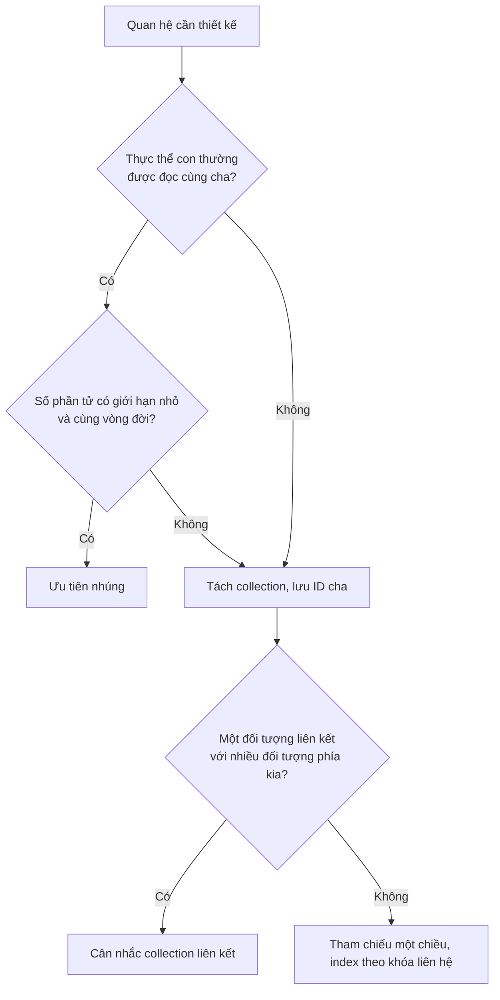

# Mô hình hóa quan hệ một-một, một-nhiều và nhiều-nhiều trong Spring Data MongoDB

Một ứng dụng thường có các thực thể liên quan với nhau: một người dùng có một hồ sơ, một đơn hàng có nhiều dòng hàng, và một người dùng có thể tham gia nhiều workspace. Khi lưu trên MongoDB, câu hỏi quan trọng không chỉ là **“quan hệ có bao nhiêu phần tử?”** mà còn là **“các dữ liệu này được đọc, ghi và thay đổi cùng nhau như thế nào?”**.

Trong **Spring Data MongoDB**, ta ánh xạ đối tượng Java vào BSON document bằng `@Document`, `@Id`, `@Field`, `MongoTemplate` hoặc repository. Dù các đối tượng Java tham chiếu được đến nhau, MongoDB không tự biến chúng thành quan hệ có khóa ngoại và phép JOIN giống hệ quản trị quan hệ. Người thiết kế cần quyết định lúc nào **nhúng (embedding)**, lúc nào **tham chiếu (referencing)** và lúc nào phải tạo **collection liên kết**.

Bài học thuộc chương **Thiết kế document**, tập trung vào ba loại quan hệ và hệ quả thực tế của lựa chọn mô hình: kích thước tài liệu, truy vấn, aggregation, index, cập nhật nguyên tử, transaction, reactive access và kiểm thử.

## 1. Ba cách biểu diễn quan hệ bằng document

### 1.1. Nhúng dữ liệu (embedding)

Đối tượng con nằm ngay trong document của đối tượng cha:

```javascript
{
  _id: ObjectId("674000000000000000000001"),
  email: "an@example.test",
  profile: {
    displayName: "An",
    language: "vi"
  }
}
```

Một lần đọc document cha có thể lấy luôn `profile`. Cập nhật các trường trong **cùng một document** được MongoDB bảo đảm nguyên tử ở cấp document. Cách này thường phù hợp khi con thuộc về một cha, có vòng đời gắn chặt với cha và kích thước luôn trong giới hạn kiểm soát được.

### 1.2. Tham chiếu bằng định danh (referencing)

Hai loại đối tượng lưu ở hai collection. Document giữ mã định danh của document còn lại:

```javascript
// users
{ _id: ObjectId("674000000000000000000001"), email: "an@example.test" }

// user_preferences
{
  _id: ObjectId("674000000000000000000101"),
  user_id: ObjectId("674000000000000000000001"),
  theme: "dark"
}
```

Tách collection giúp đọc, cập nhật và phân quyền theo vòng đời riêng. Tuy nhiên, ứng dụng phải bảo đảm `user_id` trỏ tới người dùng hợp lệ, quyết định xử lý bản ghi mồ côi và tổ chức truy vấn bổ sung khi cần lấy cả hai đối tượng.

### 1.3. Collection liên kết (association / junction collection)

Với quan hệ nhiều-nhiều có thuộc tính riêng, một collection trung gian lưu mỗi **cặp quan hệ**:

```javascript
// workspace_members
{
  _id: ObjectId("674000000000000000000201"),
  workspace_id: ObjectId("674000000000000000000301"),
  user_id: ObjectId("674000000000000000000001"),
  role: "EDITOR",
  joined_at: ISODate("2026-11-01T09:00:00Z")
}
```

Mỗi document liên kết vừa xác định thành viên thuộc workspace nào, vừa có thể chứa vai trò và thời điểm tham gia. Thiết kế này hữu ích khi số mối liên hệ tăng, cần tra cứu từ hai phía hoặc cần cập nhật thuộc tính của chính quan hệ.

| Cách lưu | Đọc | Ghi/cập nhật | Điểm cần chú ý |
| --- | --- | --- | --- |
| Nhúng đối tượng/array | Thường đọc cùng cha trong một truy vấn | Một document có thể cập nhật nguyên tử | Document phình to, array không giới hạn, tranh chấp ghi |
| Tham chiếu ID sang collection khác | Có thể cần truy vấn thứ hai hoặc `$lookup` | Cập nhật độc lập | Tính toàn vẹn tham chiếu do ứng dụng đảm nhận |
| Collection liên kết | Lọc quan hệ trước, sau đó lấy đối tượng liên quan | Thêm/xóa quan hệ độc lập | Cần unique index, index hai chiều và quy tắc dọn dữ liệu |

Đây là các **cách tổ chức dữ liệu vật lý**, không phải quy tắc “một-một luôn nhúng” hay “nhiều-nhiều luôn phải JOIN”. Một loại quan hệ logic có thể có nhiều cách lưu phù hợp với tải thực tế.

## 2. Chọn mô hình từ cách sử dụng dữ liệu

Trước khi viết Java entity, hãy trả lời:

1. **Đọc cùng nhau?** Có cần trả cha và con trong cùng API hầu hết thời gian không? Có thường chỉ đọc một phần dữ liệu con không?
2. **Số lượng có giới hạn?** Một cha có tối đa vài địa chỉ, hàng chục dòng hàng hay hàng triệu bình luận? Giới hạn này có được áp dụng bằng nghiệp vụ không?
3. **Cập nhật cùng nhau?** Con có cần thay đổi nguyên tử với cha, hay được ghi liên tục bởi luồng độc lập?
4. **Có chia sẻ giữa nhiều cha?** Đối tượng con có nhiều chủ sở hữu, hoặc cần truy vấn độc lập bằng một ID ổn định không?
5. **Tra cứu theo hướng nào?** “Lấy các đơn của khách hàng”, “lấy khách của đơn”, hay cả hai? Có cần phân trang, tìm kiếm và sắp xếp theo thuộc tính của con không?
6. **Giới hạn và vận hành?** BSON document có giới hạn kích thước **16 MiB**; array lớn, document tăng liên tục, index nhiều và giao dịch đa document đều có chi phí.



Sơ đồ là điểm khởi đầu, không thay thế việc đo tải: dữ liệu phải phản ánh **access pattern**, quy tắc toàn vẹn và dự báo tăng trưởng của ứng dụng.

## 3. Quan hệ một-một (1:1)

Ví dụ: mỗi `User` có tối đa một `Profile`.

### 3.1. Nhúng profile vào user

```java
import org.bson.types.ObjectId;
import org.springframework.data.annotation.Id;
import org.springframework.data.mongodb.core.mapping.Document;

record Profile(String displayName, String language) {}

@Document("users")
class User {
    @Id
    private ObjectId id;
    private String email;
    private Profile profile;

    // Constructor/getter được lược bớt để tập trung vào mô hình lưu trữ.
}
```

MongoDB lưu `profile` như một document lồng trong `users`; **không cần tạo collection `profiles`**. Để sửa đúng một thuộc tính mà không thay cả document, dùng `MongoTemplate`:

```java
import org.springframework.data.mongodb.core.query.Criteria;
import org.springframework.data.mongodb.core.query.Query;
import org.springframework.data.mongodb.core.query.Update;

Query byId = Query.query(Criteria.where("id").is(userId));
Update change = new Update().set("profile.language", "en");

mongoTemplate.updateFirst(byId, change, User.class);
```

Lệnh có ý nghĩa tương đương với `db.users.updateOne({_id: userId}, {$set: {"profile.language": "en"}})`. Trường lồng được cập nhật trên một document, nên không cần giao dịch nhiều document chỉ để đổi thuộc tính này. Nếu `profile` có thể chưa tồn tại, `$set` tạo đường dẫn lồng phù hợp khi cấu trúc dữ liệu cho phép.

**Phù hợp:** profile nhỏ, đọc gần như luôn cùng user, không chia sẻ, không tăng không giới hạn. **Không phù hợp:** profile có vòng đời riêng, rất lớn, bị cập nhật bởi dịch vụ khác với tần suất cao, hoặc cần chính sách truy cập tách biệt với user.

### 3.2. Tách 1:1 sang collection riêng

Nếu cài đặt người dùng được quản lý độc lập:

```java
import org.bson.types.ObjectId;
import org.springframework.data.annotation.Id;
import org.springframework.data.mongodb.core.index.Indexed;
import org.springframework.data.mongodb.core.mapping.Document;
import org.springframework.data.mongodb.core.mapping.Field;

@Document("user_preferences")
class UserPreferences {
    @Id
    private ObjectId id;

    @Field("user_id")
    @Indexed(unique = true)
    private ObjectId userId;

    private String theme;
}
```

Quan hệ logic một-một được thể hiện bằng `user_id` và **unique index thực sự tồn tại trong MongoDB**. Nếu không có ràng buộc unique ở server, hai yêu cầu ghi đồng thời vẫn có thể tạo nhiều `UserPreferences` cho một user dù Java code luôn kiểm tra trước khi insert. Cấu hình tự tạo index từ annotation phụ thuộc môi trường/phiên bản; trong production nên quản lý index bằng migration hoặc quy trình triển khai được kiểm soát.

```java
import java.util.Optional;
import org.bson.types.ObjectId;
import org.springframework.data.mongodb.repository.MongoRepository;

interface UserPreferencesRepository
        extends MongoRepository<UserPreferences, ObjectId> {
    Optional<UserPreferences> findByUserId(ObjectId userId);
}
```

Lấy user và preferences theo hai truy vấn có thể chấp nhận được nếu API đọc preferences không thường xuyên. Nếu cần tạo đồng thời cả user và preferences với yêu cầu **cùng thành công hoặc cùng thất bại**, cân nhắc MongoDB transaction khi hạ tầng và cấu hình hỗ trợ; unique index chỉ bảo đảm tính duy nhất, không bảo đảm user được tham chiếu phải tồn tại.

Một biến thể 1:1 dùng cùng giá trị `_id` cho cả hai document thay vì tạo `user_id` riêng. Cách này đơn giản hóa ràng buộc duy nhất, nhưng yêu cầu ứng dụng quản lý ID nhất quán.

## 4. Quan hệ một-nhiều (1:N)

Hai tình huống có cùng cardinality nhưng lựa chọn thiết kế rất khác nhau: **đơn hàng có một số dòng hàng giới hạn** và **bài viết có thể nhận số bình luận không giới hạn**.

### 4.1. Một đơn hàng có nhiều dòng hàng: nhúng mảng

```javascript
{
  _id: ObjectId("674000000000000000000401"),
  customer_id: "KH-101",
  lines: [
    { sku: "SKU-7", quantity: 2, unitPriceVnd: NumberLong("150000") },
    { sku: "SKU-9", quantity: 1, unitPriceVnd: NumberLong("99000") }
  ],
  status: "NEW"
}
```

Thiết kế Java tương ứng:

```java
import java.util.ArrayList;
import java.util.List;
import org.bson.types.ObjectId;
import org.springframework.data.annotation.Id;
import org.springframework.data.mongodb.core.mapping.Document;
import org.springframework.data.mongodb.core.mapping.Field;

record OrderLine(String sku, int quantity, long unitPriceVnd) {}

@Document("orders")
class Order {
    @Id
    private ObjectId id;

    @Field("customer_id")
    private String customerId;

    private List<OrderLine> lines = new ArrayList<>();
    private String status;
}
```

Các `OrderLine` là giá trị lồng trong document `Order`; không phải entity `@Document` riêng. Giá tại thời điểm đặt hàng thường được **chụp lại** trong dòng hàng để hóa đơn lịch sử không đổi khi giá sản phẩm trong catalog thay đổi. Đây là một trường hợp phi chuẩn hóa có chủ đích.

Ta có thể tìm đơn chứa một SKU:

```java
Query query = Query.query(Criteria.where("lines.sku").is("SKU-7"));
List<Order> orders = mongoTemplate.find(query, Order.class);
```

Và cập nhật dòng phù hợp đầu tiên mà không ghi lại cả đơn:

```java
Query query = Query.query(
    Criteria.where("id").is(orderId)
            .and("lines.sku").is("SKU-7")
);
Update update = new Update().set("lines.$.quantity", 3);

mongoTemplate.updateFirst(query, update, Order.class);
```

Toán tử vị trí `$` ở ví dụ trên sửa **phần tử array đầu tiên khớp điều kiện**. Nếu có nhiều dòng mang cùng SKU và phải sửa nhiều phần tử, cần quy tắc thiết kế khác hoặc dùng array filters (`$[identifier]`) cho đúng ý định. Lưu ý mảng lồng vẫn thuộc **một document**, nhưng cạnh tranh cập nhật trên cùng đơn có thể tăng khi nhiều tiến trình cùng ghi.

**Ưu điểm:** một lần đọc lấy đủ thông tin đơn, cập nhật nguyên tử toàn document, lưu được snapshot lịch sử. **Giới hạn:** document không thể tăng vượt 16 MiB; mảng quá lớn ảnh hưởng kích thước dữ liệu truyền, index và chi phí cập nhật. Nên đặt giới hạn số dòng hàng theo quy tắc nghiệp vụ và tránh dùng `save(order)` để ghi lại một entity cũ khi chỉ cần cập nhật một dòng.

### 4.2. Một bài viết có nhiều bình luận: tách collection

Nếu bài viết có hàng trăm nghìn bình luận, không nên dồn tất cả vào `posts.comments[]`. Hãy lưu mỗi comment như một document và để **phía nhiều giữ ID phía một**:

```javascript
// posts
{ _id: ObjectId("674000000000000000000501"), title: "MongoDB" }

// comments
{
  _id: ObjectId("674000000000000000000601"),
  post_id: ObjectId("674000000000000000000501"),
  author_id: ObjectId("674000000000000000000001"),
  body: "Bài rất hữu ích",
  created_at: ISODate("2026-11-01T10:00:00Z")
}
```

Trong Spring Data MongoDB:

```java
import java.time.Instant;
import org.bson.types.ObjectId;
import org.springframework.data.annotation.Id;
import org.springframework.data.mongodb.core.index.CompoundIndex;
import org.springframework.data.mongodb.core.mapping.Document;
import org.springframework.data.mongodb.core.mapping.Field;

@Document("comments")
@CompoundIndex(name = "by_post_time",
               def = "{'post_id': 1, 'created_at': -1}")
class Comment {
    @Id
    private ObjectId id;

    @Field("post_id")
    private ObjectId postId;

    @Field("author_id")
    private ObjectId authorId;

    private String body;

    @Field("created_at")
    private Instant createdAt;
}
```

Truy vấn 20 bình luận mới nhất:

```java
import org.springframework.data.domain.Sort;

Query query = Query.query(Criteria.where("postId").is(postId))
    .with(Sort.by(Sort.Direction.DESC, "createdAt"))
    .limit(20);

List<Comment> page = mongoTemplate.find(query, Comment.class);
```

`MongoTemplate` dùng tên **thuộc tính Java** `postId`, `createdAt`, rồi ánh xạ sang `post_id`, `created_at`. Compound index `{post_id: 1, created_at: -1}` là ứng viên tốt cho bộ lọc theo bài viết và sắp xếp theo thời gian giảm dần, nhưng phải xác minh trên dữ liệu thực bằng `explain("executionStats")`.

**Ưu điểm:** danh sách bình luận mở rộng độc lập, dễ phân trang, index, cập nhật/xóa từng comment. **Đánh đổi:** lấy bài viết và danh sách bình luận thường là nhiều thao tác; việc xóa bài viết cần quy tắc xóa hoặc lưu trữ bình luận liên quan. Với luồng lớn, có thể cân nhắc phân trang bằng khóa `createdAt` kết hợp `_id` để tránh chi phí `skip` sâu.

### 4.3. Có nên lưu cả danh sách ID con trong cha?

Đối với quan hệ có số phần tử rất nhỏ, có thể lưu `featuredCommentIds` hoặc một danh sách ID giới hạn trong cha. Nhưng với tập con tăng không giới hạn, array ID vẫn tăng dần và phải cập nhật cha khi thêm/xóa con. Lưu **ID cha ở document con** thường phù hợp hơn cho collection lớn: có thể index `post_id`, phân trang và ghi độc lập.

Tuyệt đối tránh mặc định lưu đồng thời `post.commentIds[]` **và** `comment.postId` nếu chưa có quy trình đồng bộ rõ ràng; hai bản sao quan hệ có thể lệch nhau khi một thao tác lỗi.

## 5. Quan hệ nhiều-nhiều (N:M)

Ví dụ một user tham gia nhiều workspace, một workspace có nhiều user. Quan hệ có thể mang thuộc tính `role`, `joinedAt`, `invitedBy`.

### 5.1. Chỉ lưu mảng ID ở một phía khi quan hệ nhỏ và đơn giản

```javascript
{
  _id: ObjectId("674000000000000000000701"),
  name: "Nhóm nội dung",
  member_ids: [
    ObjectId("674000000000000000000001"),
    ObjectId("674000000000000000000002")
  ]
}
```

Mảng ID phù hợp khi số thành viên có giới hạn nhỏ, ứng dụng thường tải workspace cùng danh sách ID và không cần metadata cho từng cặp. Nếu muốn tra cứu “workspace nào chứa user X?”, cần index thích hợp trên `member_ids` (multikey index); document vẫn có thể trở thành điểm tranh chấp ghi khi rất nhiều người thêm/xóa thành viên.

Không nên giữ cả `workspace.memberIds[]` lẫn `user.workspaceIds[]` như hai nguồn sự thật độc lập. Việc cập nhật đồng thời hai phía tăng khả năng lệch dữ liệu và đòi hỏi transaction hoặc cơ chế đồng bộ.

### 5.2. Dùng collection liên kết khi quan hệ có thuộc tính hoặc tăng lớn

```java
import java.time.Instant;
import org.bson.types.ObjectId;
import org.springframework.data.annotation.Id;
import org.springframework.data.mongodb.core.index.CompoundIndex;
import org.springframework.data.mongodb.core.index.CompoundIndexes;
import org.springframework.data.mongodb.core.mapping.Document;
import org.springframework.data.mongodb.core.mapping.Field;

@Document("workspace_members")
@CompoundIndexes({
    @CompoundIndex(
        name = "uniq_workspace_user",
        def = "{'workspace_id': 1, 'user_id': 1}",
        unique = true
    ),
    @CompoundIndex(
        name = "by_user_workspace",
        def = "{'user_id': 1, 'workspace_id': 1}"
    )
})
class WorkspaceMember {
    @Id
    private ObjectId id;

    @Field("workspace_id")
    private ObjectId workspaceId;

    @Field("user_id")
    private ObjectId userId;

    private String role;

    @Field("joined_at")
    private Instant joinedAt;

    public ObjectId getUserId() { return userId; }
}
```

Một document trong `workspace_members` đại diện cho một cặp `(workspaceId, userId)`. **Unique compound index** không cho phép tạo trùng một quan hệ. Index thứ hai hỗ trợ truy vấn theo user; có cần index thứ hai hay không phụ thuộc mức độ thường xuyên của truy vấn ngược.

Repository cho lớp liên kết:

```java
import java.util.List;
import java.util.Optional;
import org.bson.types.ObjectId;
import org.springframework.data.mongodb.repository.MongoRepository;

interface WorkspaceMemberRepository
        extends MongoRepository<WorkspaceMember, ObjectId> {

    List<WorkspaceMember> findByWorkspaceId(ObjectId workspaceId);

    Optional<WorkspaceMember> findByWorkspaceIdAndUserId(
        ObjectId workspaceId, ObjectId userId);
}
```

Để lấy thành viên của một workspace, có thể đọc các dòng liên kết rồi truy vấn danh sách user theo ID **theo lô**:

```java
List<WorkspaceMember> links =
    workspaceMemberRepository.findByWorkspaceId(workspaceId);

List<ObjectId> userIds = links.stream()
    .map(WorkspaceMember::getUserId)
    .toList();

List<User> users = userIds.isEmpty()
    ? List.of()
    : mongoTemplate.find(
        Query.query(Criteria.where("id").in(userIds)),
        User.class
    );
```

Từ góc độ thực thi, đây thường là hai truy vấn thay vì một truy vấn riêng cho **từng** user. Nếu cần giữ thứ tự, phân trang theo vai trò hoặc ngày tham gia, hãy phân trang trực tiếp trên `workspace_members` trước, sau đó tra cứu các user tương ứng; kết quả truy vấn `$in` không mặc định bảo đảm đúng thứ tự ID đầu vào.

Khi cần MongoDB thực hiện phần ghép dữ liệu trên server, `$lookup` là một lựa chọn:

```javascript
db.workspace_members.aggregate([
  {
    $match: {
      workspace_id: ObjectId("674000000000000000000701")
    }
  },
  {
    $lookup: {
      from: "users",
      localField: "user_id",
      foreignField: "_id",
      as: "user"
    }
  },
  { $unwind: "$user" },
  {
    $project: {
      _id: 0,
      role: 1,
      "user._id": 1,
      "user.email": 1
    }
  }
]);
```

Điều kiện của `$lookup` yêu cầu **giá trị và kiểu BSON của các trường nối khớp nhau**. Ví dụ trên dùng `ObjectId` cho cả `user_id` và `users._id`. Nếu `user_id` được lưu dạng chuỗi còn `_id` là ObjectId, phép nối sẽ không cho kết quả mong muốn dù hai giá trị nhìn giống nhau. MongoDB có `$lookup`, nhưng ghép collection không miễn phí: cần đánh giá index, cardinality và dung lượng kết quả.

### 5.3. Biến thể dùng Spring Data references

Spring Data MongoDB có `@DBRef` và `@DocumentReference` để ánh xạ quan hệ giữa document:

| Cơ chế | Cách tham chiếu | Điều cần nhớ |
| --- | --- | --- |
| Tự lưu `ObjectId userId` | Trường ID thông thường | Truy vấn và vòng đời tham chiếu hoàn toàn rõ ràng trong service |
| `@DBRef` | BSON DBRef chứa thông tin collection và ID | Có thể kích hoạt phân giải tham chiếu khi đọc; không tạo khóa ngoại hay JOIN tự động ở server |
| `@DocumentReference` | Tham chiếu linh hoạt, mặc định thường lưu ID | Spring Data phân giải document được tham chiếu qua truy vấn; chú ý lazy loading và số lần truy vấn |

Ví dụ quan hệ nhỏ, có nhu cầu điều hướng từ một entity sang entity liên quan:

```java
import org.bson.types.ObjectId;
import org.springframework.data.annotation.Id;
import org.springframework.data.mongodb.core.mapping.Document;
import org.springframework.data.mongodb.core.mapping.DocumentReference;

@Document("projects")
class Project {
    @Id
    private ObjectId id;

    @DocumentReference(lazy = true)
    private User owner;
}
```

Đoạn trên minh họa **một field tham chiếu** trên entity `Project`; phần constructor/getter được lược bỏ. `@DocumentReference` không biến tất cả thao tác đọc thành phép JOIN giống SQL, không bảo đảm document được tham chiếu còn tồn tại và không giải quyết quan hệ N:M có số cạnh lớn. Khi duyệt nhiều document cha và tự động phân giải từng tham chiếu, hãy đo số truy vấn để tránh hiện tượng **N+1**. Với quan hệ lớn và API cần phân trang, lưu ID tường minh cùng collection liên kết thường dễ kiểm soát hơn.

## 6. Tính nhất quán và cập nhật theo ranh giới document

MongoDB bảo đảm thao tác ghi trên **một document** có tính nguyên tử. Điều này ảnh hưởng trực tiếp đến cách mô hình hóa:

| Tình huống | Ranh giới nguyên tử tự nhiên | Cách bảo đảm yêu cầu nghiệp vụ |
| --- | --- | --- |
| Đổi `profile.language` trong `users` | Một document user | `$set` trên trường lồng |
| Sửa `lines.$.quantity` của một order | Một document order | `updateFirst` với điều kiện đúng phần tử |
| Thêm comment trong `comments` | Một document comment | Insert comment; nếu tăng bộ đếm trên post, cân nhắc tính nhất quán của bộ đếm |
| Tạo user và preferences riêng | Hai document thuộc hai collection | Transaction nếu bắt buộc cùng commit; hoặc xử lý bù/hội tụ nếu chấp nhận nhất quán sau |
| Thêm thành viên và tăng `memberCount` trên workspace | Document liên kết và document workspace | Dùng transaction khi cần đồng bộ tức thời; hoặc coi count là dữ liệu dẫn xuất và sửa theo sự kiện |

Transaction MongoDB cần hạ tầng hỗ trợ (replica set hoặc sharded cluster phù hợp), session và transaction manager thích hợp như `MongoTransactionManager`; với reactive có cơ chế transaction reactive tương ứng. `@Transactional` chỉ có ý nghĩa khi được nối với transaction manager đúng loại và thao tác tham gia cùng transaction. Transaction giúp bảo đảm tính nhất quán đa document nhưng có chi phí: **ưu tiên thiết kế ranh giới document phù hợp trước**.

Ngoài ra, phải xử lý:

- **Xóa cha:** khi xóa post, comments có bị xóa theo, giữ để kiểm toán hay đánh dấu xóa? MongoDB không tự cascade với ID tham chiếu thông thường.
- **Chèn trùng quan hệ:** unique index trên `(workspace_id, user_id)` là ràng buộc cuối cùng, thay vì chỉ dùng kiểm tra tồn tại trước insert.
- **Ghi đồng thời:** với trường thay đổi thường xuyên, dùng `$inc`, `$addToSet`, `$pull` hoặc cập nhật có điều kiện; cân nhắc `@Version` khi mô hình phù hợp.
- **Dữ liệu sao chép:** tên user hoặc giá catalog được nhúng vào document khác cần quy tắc làm mới hoặc quyết định giữ bản chụp lịch sử. Không nên đồng bộ mọi snapshot một cách mù quáng.
- **Tham chiếu mồ côi:** cần kiểm tra định kỳ, cleanup có kiểm soát hoặc xử lý theo sự kiện khi một document liên quan bị xóa.

## 7. Index và truy vấn phải đi cùng mô hình

Index nên được chọn từ câu hỏi nghiệp vụ, không phải tạo một index cho mọi trường:

| Truy vấn thường gặp | Trường index có thể cân nhắc | Lý do |
| --- | --- | --- |
| Lấy preferences theo user | `user_preferences.user_id` **unique** | Bảo đảm tối đa một preferences cho một user |
| Lọc order theo SKU trong `lines[]` | `orders.lines.sku` (multikey) | MongoDB có thể tra cứu giá trị trong mảng |
| Lấy comment của post theo thời gian mới nhất | `comments: {post_id: 1, created_at: -1}` | Hỗ trợ lọc rồi sắp xếp |
| Lấy thành viên của workspace và chống trùng | `workspace_members: {workspace_id: 1, user_id: 1}` unique | Tra cứu theo workspace và giữ duy nhất mỗi cặp |
| Lấy các workspace mà user tham gia | `workspace_members: {user_id: 1, workspace_id: 1}` | Phục vụ chiều truy vấn ngược |

Một index unique dạng multikey không thay thế quy tắc “không có ID trùng trong **cùng một array**”; tính duy nhất của index tập trung vào các khóa index giữa những document khác nhau. Với tập ID nhỏ có yêu cầu không trùng, `$addToSet` hữu ích hơn `$push` khi thêm phần tử.

Ví dụ đo truy vấn comments:

```javascript
db.comments
  .find({ post_id: ObjectId("674000000000000000000501") })
  .sort({ created_at: -1 })
  .limit(20)
  .explain("executionStats");
```

Đọc `winningPlan`, `nReturned`, `totalKeysExamined`, `totalDocsExamined` và so sánh trên dữ liệu đại diện. Index giúp đọc nhanh hơn trong nhiều trường hợp nhưng làm tăng chi phí ghi, RAM và dung lượng đĩa. Các annotation như `@Indexed` và `@CompoundIndex` là khai báo mapping; index cần thực sự tồn tại trong database mới có hiệu lực.

## 8. Lựa chọn khi truy cập reactive

`ReactiveMongoTemplate` và `ReactiveMongoRepository` dùng cùng tư duy mô hình document: nhúng dữ liệu, tham chiếu bằng ID, collection liên kết và index **không đổi**. Khác biệt ở cách trả kết quả và tổ chức luồng bất đồng bộ:

```java
import reactor.core.publisher.Flux;
import org.bson.types.ObjectId;
import org.springframework.data.mongodb.repository.ReactiveMongoRepository;

interface ReactiveCommentRepository
        extends ReactiveMongoRepository<Comment, ObjectId> {
    Flux<Comment> findByPostId(ObjectId postId);
}
```

Một `Flux<Comment>` thường chỉ bắt đầu truy vấn khi được subscribe. Nếu cần lấy một post kèm danh sách comments, nên giới hạn/phân trang comments theo nhu cầu thay vì tự động gom toàn bộ Flux thành một mảng lớn. Reactive giúp tổ chức I/O bất đồng bộ; nó **không** khắc phục truy vấn thiếu index, số lượng tham chiếu quá lớn hoặc việc ánh xạ quan hệ sai.

## 9. Lỗi thiết kế phổ biến và cách tránh

1. **Nhúng array không giới hạn:** dồn toàn bộ comment vào post hoặc toàn bộ event vào user. Hãy tách collection theo ID cha và phân trang.
2. **Phân tách quá mức:** tách một profile nhỏ, luôn đọc kèm user thành nhiều collection gây thêm round trip không cần thiết. Cân nhắc nhúng.
3. **Nhầm `@DBRef` với khóa ngoại:** MongoDB không tự ngăn xóa document được tham chiếu hay tự xóa các document con. Định nghĩa logic toàn vẹn rõ ràng.
4. **Tạo hai nguồn sự thật:** lưu cùng danh sách membership ở cả user và workspace. Chọn một nơi là nguồn dữ liệu chính, hoặc có transaction/sự kiện đồng bộ kiểm chứng được.
5. **Lẫn ID `String` và BSON `ObjectId`:** truy vấn bằng Java entity có thể áp dụng chuyển đổi `@Id`, nhưng `$lookup` và truy vấn trực tiếp trên trường tham chiếu phải so khớp kiểu BSON. Kiểm tra dữ liệu thật khi ghép collection.
6. **Tạo quan hệ bằng kiểm tra trước khi ghi:** hai request đồng thời đều có thể “chưa thấy” quan hệ và cùng insert. Unique index mới bảo đảm ràng buộc duy nhất ở server.
7. **Ghi lại cả entity khi chỉ đổi một trường:** `save` trên entity cũ hoặc entity đọc bằng phép chiếu có thể làm mất dữ liệu. Ưu tiên các cập nhật có điều kiện và toán tử nguyên tử khi phù hợp.
8. **Phân giải tham chiếu không kiểm soát:** lazy reference không đồng nghĩa miễn phí. Đo số lần truy cập server, dùng batch query hoặc aggregation phù hợp với API.

## 10. Bài thực hành: chọn mô hình rồi kiểm chứng

**Đề bài:** Thiết kế ứng dụng có user, hồ sơ cá nhân, đơn hàng, bình luận bài viết và workspace. Cần hỗ trợ: đọc user cùng profile, xem chi tiết order, tải 20 comment mới nhất, xem thành viên workspace và phân quyền thành viên.

Một phương án hợp lý ban đầu:

| Nhu cầu | Mô hình | Kiểm chứng cần thực hiện |
| --- | --- | --- |
| User + profile nhỏ | 1:1 nhúng `users.profile` | Cập nhật một field bằng `$set`; kiểm tra readback |
| Order + số dòng hàng được giới hạn | 1:N nhúng `orders.lines[]` | Kiểm tra array update, snapshot giá và tổng kích thước document |
| Post + comment tăng liên tục | 1:N `comments.post_id` | Tạo compound index, phân trang, chạy `explain` |
| User + workspace có role | N:M `workspace_members` | Tạo unique pair index, truy vấn hai chiều, thử insert trùng |

Khi làm với Spring Data MongoDB, có thể viết integration test sử dụng MongoDB thật trong môi trường cô lập (ví dụ Testcontainers) để kiểm tra document được lưu, kiểu BSON của ID, tên field từ `@Field`, index, cách `MongoTemplate` cập nhật và kết quả repository. Mock repository đơn thuần không chứng minh mapping và index hoạt động đúng trên MongoDB.

Các tình huống cần kiểm tra kỹ:

- **Concurrency:** hai request cùng thêm một `WorkspaceMember` có cùng `(workspaceId, userId)`; yêu cầu cuối cùng là chỉ có một liên kết và lỗi trùng được xử lý rõ ràng.
- **Truy vấn hai chiều:** tìm members theo workspace và tìm workspaces theo user; xem có index tương ứng không.
- **Phân trang:** khi post tăng tới hàng triệu comment, API vẫn chỉ đọc số comment yêu cầu.
- **Xóa dữ liệu:** xóa user hoặc post phải chạy đúng chính sách cleanup; không để referential integrity chỉ phụ thuộc giả định.
- **Transaction:** nếu nghiệp vụ bắt buộc tạo hai document cùng thành công, kiểm thử commit/rollback với hạ tầng MongoDB có hỗ trợ transaction.

## 11. Câu hỏi tự kiểm tra

**1.** Một user có đúng một cấu hình giao diện nhỏ, hầu như luôn đọc cùng user. Nên bắt đầu với mô hình nào?  
**Gợi ý:** nhúng vào document user để đọc và cập nhật cùng nhau; chỉ tách nếu có yêu cầu độc lập rõ ràng.

**2.** Bài viết có thể có một triệu bình luận. Vì sao không nên nhúng hết vào `posts.comments[]`?  
**Gợi ý:** giới hạn kích thước BSON document, array tăng liên tục, chi phí cập nhật, phân trang và tải dữ liệu dư thừa.

**3.** Tạo `@Indexed(unique = true)` nhưng database chưa có index thực tế. Hai `UserPreferences` cùng `userId` có chắc bị ngăn?  
**Gợi ý:** không; phải xác nhận unique index đã được tạo trên MongoDB.

**4.** Một user có thể ở nhiều workspace, quan hệ chứa `role` và `joinedAt`. Mô hình nào dễ kiểm soát nhất khi tập quan hệ lớn?  
**Gợi ý:** collection liên kết với unique compound index và index theo hướng truy vấn.

**5.** MongoDB Shell `$lookup` giữa `workspace_members.user_id` và `users._id` không trả dữ liệu mặc dù ID nhìn giống nhau. Bước kiểm tra đầu tiên là gì?  
**Gợi ý:** kiểm tra kiểu BSON thực tế (chuỗi hay ObjectId), rồi xác minh tên field, collection và điều kiện join.

**6.** Thao tác insert comment thành công nhưng tăng bộ đếm `commentCount` trong post thất bại. Có mâu thuẫn với bảo đảm nguyên tử của MongoDB không?  
**Gợi ý:** không; đây là hai document. Phải định nghĩa transaction, sửa bù hoặc chấp nhận bộ đếm dẫn xuất được đồng bộ sau.

Mấu chốt của thiết kế quan hệ trong MongoDB là chọn **ranh giới document** theo dữ liệu được đọc và cập nhật cùng nhau. Spring Data MongoDB giúp ánh xạ Java, tạo truy vấn, aggregation và thao tác cập nhật thuận tiện, nhưng lựa chọn nhúng, tham chiếu, index và quy tắc nhất quán vẫn phải xuất phát từ đặc tính của nghiệp vụ và được xác minh bằng dữ liệu thực tế.
