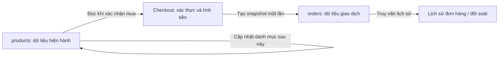

# Ảnh chụp dữ liệu (snapshot) trong đơn hàng và dữ liệu nguồn có thể thay đổi

## 1. Bài toán: sản phẩm thay đổi sau khi khách đã đặt hàng

Một cửa hàng bán **bàn phím KB-87** với tên “Bàn phím 87 phím” và giá 1.250.000 VND. Khách đặt mua 2 chiếc vào ngày 10/11/2026, thanh toán 2.500.000 VND. Ngày hôm sau, cửa hàng đổi tên sản phẩm thành “Bàn phím cơ 87 phím” và điều chỉnh giá niêm yết lên 1.450.000 VND.

Khi mở lại đơn hàng đã đặt, khách vẫn phải thấy tên hàng, đơn giá và tổng tiền **đã được xác nhận ở thời điểm mua**. Nếu màn hình lịch sử đơn hàng luôn đọc giá hiện hành từ danh mục sản phẩm, hệ thống có thể hiển thị sai số tiền, gây nhầm lẫn khi đối soát, xử lý hoàn tiền hoặc hỗ trợ khách hàng.

Đây là lý do quan trọng để học **snapshot trong thiết kế document** với MongoDB. Trong module **SPRING_DATA_MONGODB**, ta dùng Spring Data MongoDB để ánh xạ document sang Java, đọc sản phẩm nguồn bằng repository hoặc `MongoTemplate`, xây dựng snapshot khi đặt hàng, rồi khai thác truy vấn, index, transaction và kiểm thử để bảo đảm dữ liệu lịch sử có ý nghĩa nhất quán.

**Snapshot** là bản sao có chủ đích của những thuộc tính cần giữ nguyên theo một **mốc nghiệp vụ**. Nó không có nghĩa là sao chép toàn bộ collection nguồn hay tạo bản sao lưu cơ sở dữ liệu.

### Dòng thời gian minh họa

| Thời điểm | Dữ liệu nguồn trong `products` | Dữ liệu trong đơn hàng `orders` |
| --- | --- | --- |
| T0: trước khi mua | Tên “Bàn phím 87 phím”, giá 1.250.000 | Chưa có đơn |
| T1: xác nhận đặt hàng | Phiên bản sản phẩm 7, giá 1.250.000 | Lưu tên, đơn giá 1.250.000, số lượng 2, tổng 2.500.000 |
| T2: cửa hàng cập nhật danh mục | Tên “Bàn phím cơ 87 phím”, giá 1.450.000, phiên bản 8 | Vẫn lưu dữ liệu đã xác nhận tại T1 |
| T3: khách xem lịch sử | Danh mục hiển thị tên và giá hiện hành | Đơn cũ hiển thị thông tin tại thời điểm mua |

Yêu cầu cốt lõi: **thay đổi ở nguồn không được vô tình viết lại sự thật lịch sử của giao dịch**.

## 2. Phân biệt dữ liệu nguồn, tham chiếu và snapshot

Một document đơn hàng thường chứa đồng thời ba loại thông tin:

1. **Dữ liệu nguồn đang thay đổi (mutable source):** `products.name`, `products.currentPrice`, `customers.defaultAddress`, trạng thái còn bán, thông tin tồn kho. Chúng phục vụ nghiệp vụ hiện tại và có vòng đời riêng.
2. **Tham chiếu nhận diện (reference):** `productId`, `customerId`, mã biến thể hoặc mã chương trình khuyến mại. Chúng giúp liên hệ tới thực thể nguồn khi cần.
3. **Snapshot lịch sử:** `nameAtPurchase`, `skuAtPurchase`, `unitPrice`, địa chỉ giao hàng tại thời điểm chốt, mức giảm giá đã áp dụng và các thành phần tính tiền đã xác nhận.

| Thuộc tính | Đọc nguồn hiện tại hay snapshot? | Vì sao? |
| --- | --- | --- |
| `productId` | Giữ tham chiếu trong đơn | Nhận diện sản phẩm; có thể tra thêm thông tin hiện hành |
| `nameAtPurchase`, `skuAtPurchase` | Snapshot | Hiển thị đúng mặt hàng được khách xác nhận |
| `unitPrice`, `currency` | Snapshot | Tránh dùng giá mới để tính lại đơn cũ |
| `quantity`, `lineTotal` | Snapshot | Ghi nhận số lượng và thành tiền giao dịch |
| `discountSnapshot`, `taxSnapshot` | Snapshot nếu thuộc nghiệp vụ | Giữ chính sách giá/thuế áp dụng cho giao dịch |
| `shippingAddressAtCheckout` | Snapshot | Địa chỉ mặc định của khách có thể đổi sau khi mua |
| `customerId` | Tham chiếu | Kết nối với tài khoản khách hàng hiện tại |
| `currentStock` | Dữ liệu nguồn riêng | Tồn kho là trạng thái vận hành, không được lấy từ đơn cũ |
| `orderStatus` | Trạng thái thay đổi theo vòng đời đơn | Cần cập nhật khi thanh toán, giao hàng, hủy… |

Không phải mọi trường trong đơn hàng đều bất biến. **Thông tin giao dịch đã chốt** và **trạng thái xử lý đơn hàng** có nhiệm vụ khác nhau: trạng thái có thể chuyển từ `PLACED` sang `PAID` rồi `SHIPPED`, còn đơn giá đã xác nhận không được thay bằng giá danh mục mới.

Một số nghiệp vụ cho phép sửa địa chỉ nhận hàng trước khi giao. Khi ấy, có thể giữ cả `shippingAddressAtCheckout` và `deliveryAddress` hiện hành, hoặc lưu lịch sử các lần đổi địa chỉ. Như vậy việc điều chỉnh để giao hàng không xóa mất dữ liệu gốc.

## 3. Thiết kế hai collection trong MongoDB

Ta xem `products` là nguồn dữ liệu sản phẩm hiện hành; `orders` chứa các snapshot thuộc giao dịch.

### 3.1. Document sản phẩm đang thay đổi

Ví dụ trong `mongosh`:

```javascript
db.products.insertOne({
  _id: "p-001",
  sku: "KB-87",
  name: "Bàn phím 87 phím",
  currentPrice: NumberDecimal("1250000"),
  currency: "VND",
  active: true,
  version: NumberLong(7),
  updatedAt: ISODate("2026-11-09T10:00:00Z")
});
```

`currentPrice` là giá đang được công bố, không phải giá của mọi giao dịch trong lịch sử. Trường `version` giúp nhận biết trạng thái nguồn đã được đọc và có thể hỗ trợ kiểm soát cập nhật đồng thời.

### 3.2. Document đơn hàng lưu snapshot

```javascript
db.orders.insertOne({
  _id: "o-1001",
  customerId: "c-01",
  placedAt: ISODate("2026-11-10T10:00:00Z"),
  status: "PLACED",
  currency: "VND",
  items: [
    {
      productId: "p-001",
      sourceProductVersion: NumberLong(7),
      skuAtPurchase: "KB-87",
      nameAtPurchase: "Bàn phím 87 phím",
      quantity: 2,
      unitPrice: NumberDecimal("1250000"),
      lineTotal: NumberDecimal("2500000")
    }
  ],
  shippingAddressAtCheckout: {
    recipient: "Nguyen An",
    city: "Đà Nẵng",
    street: "12 Nguyễn Văn Linh"
  },
  subtotal: NumberDecimal("2500000"),
  shippingFee: NumberDecimal("0"),
  discountTotal: NumberDecimal("0"),
  grandTotal: NumberDecimal("2500000"),
  pricingPolicyVersion: "2026-11"
});
```

Các trường `items` và `shippingAddressAtCheckout` được **nhúng (embedding)** vào đơn vì chúng thuộc bản ghi giao dịch. MongoDB lưu một document dưới dạng BSON; ví dụ dùng `NumberDecimal` và `ISODate` để thể hiện rõ kiểu số thập phân và thời gian, thay vì ngầm hiểu số tiền hoặc thời điểm là chuỗi.

Công thức của ví dụ:

```text
lineTotal    = unitPrice × quantity
subtotal     = tổng lineTotal
grandTotal   = subtotal + shippingFee - discountTotal
             = 2.500.000 + 0 - 0 = 2.500.000 VND
```

Trong hệ thống thật có thể cần thêm thuế, phí dịch vụ, phí vận chuyển, giảm giá từng dòng, quy tắc làm tròn và thời điểm xác định tỷ giá. Những yếu tố đó phải được mô hình hóa theo nghiệp vụ thực tế để **tính lại đúng số tiền đã xác nhận**, không suy ra từ chính sách đang có hiệu lực hôm nay.

### 3.3. Đổi sản phẩm nguồn, giữ nguyên đơn cũ

Giả sử cửa hàng cập nhật sản phẩm sau thời điểm đặt hàng:

```javascript
db.products.updateOne(
  { _id: "p-001", version: NumberLong(7) },
  {
    $set: {
      name: "Bàn phím cơ 87 phím",
      currentPrice: NumberDecimal("1450000"),
      updatedAt: ISODate("2026-11-11T10:00:00Z")
    },
    $inc: { version: NumberLong(1) }
  }
);

db.products.findOne({ _id: "p-001" });
db.orders.findOne({ _id: "o-1001" });
```

Thao tác `updateOne` ở collection `products` không làm thay đổi document `orders` đã lưu. Khách xem đơn `o-1001` vẫn thấy giá 1.250.000 VND mỗi chiếc, trong khi trang sản phẩm có thể hiển thị giá 1.450.000 VND. Bộ lọc `version: 7` giúp từ chối cập nhật nếu người khác đã đổi nguồn trước đó; ứng dụng phải kiểm tra `matchedCount` và xử lý trường hợp không khớp.

**Quy tắc:** khi hiển thị chứng từ, lịch sử thanh toán, số tiền hoàn cho dòng hàng đã mua, hãy đọc những trường giao dịch từ `orders`. Có thể tra cứu `products` để bổ sung hình ảnh hoặc đường dẫn hiện hành, nhưng dữ liệu phụ trợ đó không được thay thế các trường lịch sử.

## 4. Chọn trường nào để snapshot và snapshot vào lúc nào?

### 4.1. Chọn theo sự thật nghiệp vụ cần tái hiện

Nên giữ những giá trị mà nếu nguồn thay đổi sẽ khiến giao dịch cũ bị diễn giải khác đi, chẳng hạn:

- **Đặc điểm hàng đã chọn:** mã SKU/biến thể, tên hiển thị, dung lượng, màu sắc, gói bảo hành; lưu đủ để nhận diện hàng đã mua.
- **Điều kiện giá đã chốt:** đơn giá, số lượng, loại tiền, chiết khấu, mã khuyến mại đã áp dụng, thuế/phí liên quan và tổng tiền.
- **Thông tin giao nhận:** người nhận và địa chỉ được xác nhận tại thời điểm đặt; lịch sử thay đổi địa chỉ nếu nghiệp vụ cho phép.
- **Điều kiện giao dịch:** phiên bản chính sách giá/điều khoản hoặc thời hạn bảo hành nếu chúng ảnh hưởng đến cách giải quyết đơn sau này.

Không nên chép tùy tiện mọi trường của document nguồn. Ví dụ, dữ liệu nội bộ như lượng hàng tồn, cờ vận hành, lịch sử chỉnh sửa, danh sách nhà cung cấp hoặc mô tả kỹ thuật không liên quan đến đơn có thể tăng dung lượng và tạo nguy cơ làm lộ thông tin ngoài mục đích.

### 4.2. Mốc snapshot phải được định nghĩa rõ

Các thời điểm có thể khác nhau: lúc cho hàng vào giỏ, lúc tạo báo giá, lúc khách nhấn “Đặt hàng”, lúc thanh toán thành công hoặc lúc phát hành hóa đơn.

- **Giỏ hàng:** giá hiển thị thường chỉ là giá tham khảo, có thể cần kiểm tra lại khi checkout.
- **Báo giá có hiệu lực:** nếu cam kết giữ giá đến một hạn nhất định, cần lưu mã báo giá, phiên bản, thời hạn và điều kiện áp dụng.
- **Đặt hàng được chấp nhận:** tạo snapshot giao dịch theo giá và điều kiện đã xác nhận.
- **Thanh toán/hóa đơn:** có thể cần chứng từ riêng hoặc lần ghi nhận riêng, tùy quy trình nghiệp vụ.

Không tồn tại một mốc đúng cho mọi hệ thống. Điều bắt buộc là ứng dụng phải xác định **mốc có hiệu lực**, tránh tình trạng một số dòng lấy giá trước thay đổi còn những dòng khác lấy giá sau thay đổi mà không được chấp nhận.

### 4.3. Snapshot không đồng nghĩa với đồng bộ hai chiều

Có ba luồng dữ liệu khác nhau:



Việc cập nhật `products` sau khi đơn được tạo không được tự chạy thao tác ghi đè tên hay giá trong `orders.items`. Chỉ xử lý thay đổi lịch sử khi có yêu cầu nghiệp vụ **rõ ràng**, chẳng hạn hủy và phát hành lại chứng từ, với quy tắc truy vết riêng.

## 5. Ánh xạ snapshot với Spring Data MongoDB

Spring Data MongoDB hỗ trợ hai cách truy cập thường gặp: repository cho các thao tác theo entity và `MongoTemplate` khi cần tự kiểm soát truy vấn, projection, aggregation hoặc cập nhật theo điều kiện.

### 5.1. Entity nguồn và phiên bản dữ liệu

Ví dụ Java 17+; các đoạn mã bên dưới minh họa những type ở các tệp Java riêng, lược bỏ `package` và các `import` thông thường:

```java
import java.math.BigDecimal;
import java.time.Instant;

import org.springframework.data.annotation.Id;
import org.springframework.data.annotation.Version;
import org.springframework.data.mongodb.core.mapping.Document;
import org.springframework.data.mongodb.core.mapping.Field;
import org.springframework.data.mongodb.core.mapping.FieldType;

@Document(collection = "products")
public record ProductDocument(
    @Id String id,
    String sku,
    String name,
    @Field(targetType = FieldType.DECIMAL128)
    BigDecimal currentPrice,
    String currency,
    boolean active,
    @Version Long version,
    Instant updatedAt
) {}
```

`@Version` hỗ trợ **optimistic locking** cho thao tác lưu entity qua Spring Data. Nếu hai request cùng đọc một phiên bản và cùng lưu thay đổi, thao tác dùng phiên bản cũ có thể nhận lỗi `OptimisticLockingFailureException` thay vì lặng lẽ ghi đè. Cơ chế này cần thao tác ghi đi qua đường hỗ trợ version đúng cách; với lệnh `MongoTemplate.updateFirst(...)` tự xây dựng, ứng dụng vẫn phải thiết kế điều kiện cập nhật thích hợp và kiểm tra kết quả.

`@Field(targetType = FieldType.DECIMAL128)` thể hiện chủ đích lưu tiền bằng BSON Decimal128; cần thống nhất quy tắc đơn vị tiền, độ chính xác và làm tròn. Dùng `double` cho phép tính tiền có thể gây sai lệch biểu diễn số nhị phân.

### 5.2. Entity đơn hàng và cấu trúc nhúng

```java
import java.math.BigDecimal;
import java.time.Instant;
import java.util.List;

import org.springframework.data.annotation.Id;
import org.springframework.data.mongodb.core.mapping.Document;
import org.springframework.data.mongodb.core.mapping.Field;
import org.springframework.data.mongodb.core.mapping.FieldType;

@Document(collection = "orders")
public record OrderDocument(
    @Id String id,
    String customerId,
    Instant placedAt,
    String status,
    String currency,
    List<OrderLineSnapshot> items,
    AddressSnapshot shippingAddressAtCheckout,
    @Field(targetType = FieldType.DECIMAL128)
    BigDecimal subtotal,
    @Field(targetType = FieldType.DECIMAL128)
    BigDecimal shippingFee,
    @Field(targetType = FieldType.DECIMAL128)
    BigDecimal discountTotal,
    @Field(targetType = FieldType.DECIMAL128)
    BigDecimal grandTotal
) {
    public record OrderLineSnapshot(
        String productId,
        Long sourceProductVersion,
        String skuAtPurchase,
        String nameAtPurchase,
        int quantity,
        @Field(targetType = FieldType.DECIMAL128)
        BigDecimal unitPrice,
        @Field(targetType = FieldType.DECIMAL128)
        BigDecimal lineTotal
    ) {}

    public record AddressSnapshot(
        String recipient,
        String city,
        String street
    ) {}
}
```

`OrderLineSnapshot` và `AddressSnapshot` là các giá trị nhúng vào cùng document `orders`. Không cần tạo collection riêng cho từng dòng hàng chỉ vì mã Java có record riêng. `productId` vẫn là tham chiếu đến nguồn; còn `nameAtPurchase` và `unitPrice` là dữ liệu đã chốt.

Trong hệ thống nhiều phiên bản, có thể thêm `snapshotSchemaVersion` để phân biệt định dạng snapshot cũ và mới. Nếu yêu cầu kiểm toán đòi hỏi truy vết thay đổi về sau, cần mô hình lịch sử sự kiện hoặc log riêng; lưu snapshot hiện tại không tự tạo ra lịch sử đầy đủ của mọi lần sửa.

### 5.3. Repository và truy vấn lịch sử

```java
import org.springframework.data.domain.Pageable;
import org.springframework.data.domain.Slice;
import org.springframework.data.mongodb.repository.MongoRepository;

interface ProductRepository extends MongoRepository<ProductDocument, String> {}

interface OrderRepository extends MongoRepository<OrderDocument, String> {
    Slice<OrderDocument> findByCustomerId(
        String customerId,
        Pageable pageable
    );
}
```

Ví dụ gọi:

```java
Pageable firstPage = PageRequest.of(
    0, 20, Sort.by(Sort.Direction.DESC, "placedAt")
);
Slice<OrderDocument> recentOrders =
    orderRepository.findByCustomerId("c-01", firstPage);
```

Ví dụ trên giả định đã có repository và các `import` của `PageRequest`, `Sort`, `Pageable`, `Slice`. `Slice` phù hợp khi ứng dụng chỉ cần biết còn trang sau hay không, tránh yêu cầu đếm toàn bộ như `Page` trong một số trường hợp. Dữ liệu hiển thị từ `OrderDocument` phải dùng giá và tên nằm trong snapshot.

## 6. Tạo snapshot an toàn trong quá trình checkout

Việc tạo snapshot là **một thao tác nghiệp vụ có kiểm soát**. Ứng dụng không nên tin giá hoặc tên sản phẩm do trình duyệt gửi lên, vì dữ liệu phía khách có thể cũ hoặc bị sửa.

### 6.1. Luồng xử lý đề xuất

1. Nhận danh sách `productId`/biến thể và số lượng khách yêu cầu; xác thực số lượng, định danh và giới hạn nghiệp vụ.
2. Đọc nguồn sản phẩm hoặc báo giá hợp lệ từ nơi ứng dụng kiểm soát, xác minh còn bán và đúng loại tiền.
3. Tính đơn giá đã áp dụng, giảm giá, thuế, phí và tổng tiền bằng quy tắc nghiệp vụ **ở phía server**.
4. Tạo snapshot gồm mã sản phẩm, phiên bản nguồn, tên/SKU, số lượng, đơn giá, thành tiền, địa chỉ và các điều kiện cần lưu.
5. Ghi document đơn hàng; dùng khóa định danh/idempotency để xử lý request được gửi lại, tránh vô tình tạo hai đơn.
6. Nếu nghiệp vụ còn phải giữ tồn kho, ghi nhận thanh toán hoặc cập nhật nhiều document, áp dụng chiến lược nhất quán riêng cho các bước đó.

### 6.2. Ví dụ service tạo đơn

Ví dụ rút gọn chỉ gồm **một loại tiền**, không áp dụng giảm giá, thuế hay phí vận chuyển. Đây là phạm vi minh họa cách copy trường vào snapshot; ứng dụng sản xuất cần triển khai đầy đủ các quy tắc liên quan.

```java
import java.math.BigDecimal;
import java.time.Clock;
import java.time.Instant;
import java.util.ArrayList;
import java.util.List;

import org.springframework.stereotype.Service;

@Service
public class CheckoutService {
    private final ProductRepository products;
    private final OrderRepository orders;
    private final Clock clock;

    public CheckoutService(
        ProductRepository products,
        OrderRepository orders,
        Clock clock
    ) {
        this.products = products;
        this.orders = orders;
        this.clock = clock;
    }

    public record RequestedLine(String productId, int quantity) {}

    public OrderDocument placeOrder(
        String orderId,
        String customerId,
        List<RequestedLine> requestedLines,
        OrderDocument.AddressSnapshot address
    ) {
        if (requestedLines == null || requestedLines.isEmpty()) {
            throw new IllegalArgumentException("Đơn hàng phải có sản phẩm");
        }

        List<OrderDocument.OrderLineSnapshot> snapshots = new ArrayList<>();
        String currency = null;
        BigDecimal subtotal = BigDecimal.ZERO;

        for (RequestedLine line : requestedLines) {
            if (line.quantity() <= 0) {
                throw new IllegalArgumentException("Số lượng không hợp lệ");
            }

            ProductDocument product = products.findById(line.productId())
                .orElseThrow(() -> new IllegalArgumentException(
                    "Không tìm thấy sản phẩm: " + line.productId()
                ));

            if (!product.active()) {
                throw new IllegalStateException("Sản phẩm đã ngừng bán");
            }

            if (currency == null) {
                currency = product.currency();
            } else if (!currency.equals(product.currency())) {
                throw new IllegalArgumentException("Không hỗ trợ nhiều loại tiền");
            }

            BigDecimal lineTotal = product.currentPrice()
                .multiply(BigDecimal.valueOf(line.quantity()));

            snapshots.add(new OrderDocument.OrderLineSnapshot(
                product.id(),
                product.version(),
                product.sku(),
                product.name(),
                line.quantity(),
                product.currentPrice(),
                lineTotal
            ));
            subtotal = subtotal.add(lineTotal);
        }

        OrderDocument order = new OrderDocument(
            orderId,
            customerId,
            Instant.now(clock),
            "PLACED",
            currency,
            List.copyOf(snapshots),
            address,
            subtotal,
            BigDecimal.ZERO,
            BigDecimal.ZERO,
            subtotal
        );
        return orders.insert(order);
    }
}
```

Các điểm cần hiểu:

- `orders.insert(order)` tạo một document mới; nếu `_id` trùng, MongoDB từ chối theo tính duy nhất của khóa `_id`. Đây chưa đủ để triển khai idempotency toàn diện: cần ràng buộc request/giao dịch và trả về kết quả cũ một cách có chủ đích khi retry.
- `sourceProductVersion` cho biết bản ghi sản phẩm đã đọc khi tạo snapshot. **Chỉ ghi phiên bản vào đơn không tự khóa giá ở nguồn**; giữa lúc đọc và lúc ghi đơn, sản phẩm có thể bị cập nhật. Nếu nghiệp vụ cam kết giá và tồn kho tại thời điểm chấp nhận đơn, phải có cơ chế xác thực giá/phiên bản hoặc báo giá có hiệu lực tại mốc chốt.
- Ghi nguyên đơn hàng trong một document giúp **một thao tác insert** có tính nguyên tử ở mức document. Các thay đổi ở sản phẩm, kho hàng, hóa đơn hoặc thanh toán là phạm vi riêng.
- Mô hình đơn giản này chưa kiểm tra đầy đủ `customerId`, `address`, giới hạn số lượng, các dòng trùng sản phẩm, hiệu lực khuyến mại hay giá âm. Đó là phần của validation nghiệp vụ thực tế.

### 6.3. Khi giá thay đổi đồng thời với checkout

Một lỗi khó phát hiện là **time-of-check/time-of-use**:

```text
Request A: đọc product P, giá = 1.250.000, version = 7
Request B: cập nhật P, giá = 1.450.000, version = 8
Request A: tạo order với giá đã đọc = 1.250.000
```

Snapshot ghi đúng giá mà request A đã đọc, nhưng liệu có đúng *giá được phép bán khi xác nhận đơn* hay không còn tùy chính sách. Có thể áp dụng một trong các hướng sau:

- **Giữ giá theo báo giá:** tạo báo giá có mã, phiên bản, điều kiện và thời hạn; khi checkout xác thực báo giá vẫn hợp lệ.
- **Kiểm tra lại phiên bản khi chốt:** từ chối hoặc yêu cầu khách xác nhận giá mới nếu phiên bản nguồn đã thay đổi. Cần tránh khoảng trống cạnh tranh giữa bước kiểm tra và bước ghi.
- **Gói thao tác trong transaction khi phù hợp:** nếu cần đọc/ghi nhất quán qua nhiều document, thiết kế transaction và các thao tác ghi có điều kiện để kiểm soát cạnh tranh; vẫn phải quy định đúng hành vi khi conflict/retry.
- **Ưu tiên mô hình bất biến giá theo thời kỳ:** lưu các phiên bản giá hoặc khoảng hiệu lực, rồi chốt giá theo chính sách đã định.

Transaction trên nhiều document của MongoDB yêu cầu triển khai và cấu hình phù hợp, ví dụ replica set hoặc sharded cluster có hỗ trợ. Với Spring Data MongoDB có thể cấu hình `MongoTransactionManager` và dùng `@Transactional` cho luồng imperative khi cần. Transaction không thay thế việc định nghĩa giá bán hợp lệ và quy tắc xử lý cập nhật đồng thời.

## 7. Cập nhật trạng thái đơn mà không làm hỏng snapshot

Không nên gọi thao tác đồng bộ sản phẩm để “refresh” giá và tên trong các đơn cũ. Nếu đơn chỉ đổi trạng thái từ `PAID` sang `SHIPPED`, hãy sửa đúng trường trạng thái, kèm điều kiện chuyển trạng thái hợp lệ.

Ví dụ với `MongoTemplate`:

```java
Query query = Query.query(
    Criteria.where("_id").is("o-1001")
            .and("status").is("PAID")
);

Update update = new Update()
    .set("status", "SHIPPED")
    .set("shippedAt", Instant.now(clock));

UpdateResult result =
    mongoTemplate.updateFirst(query, update, OrderDocument.class);

if (result.getMatchedCount() == 0) {
    throw new IllegalStateException("Đơn không ở trạng thái PAID");
}
```

Đây là đoạn code bên trong service, giả định `mongoTemplate`, `clock` và import của `Query`, `Criteria`, `Update`, `UpdateResult` đã sẵn có. Bộ lọc trạng thái giúp tránh việc hai request đồng thời chuyển cùng một trạng thái theo đường đi không hợp lệ. Các trường snapshot không xuất hiện trong `Update` nên không bị ghi lại.

Trong thiết kế thực tế, nên bổ sung `updatedAt`, lịch sử trạng thái và quy tắc quyền hạn tương ứng. Nếu đơn đang cần chỉnh sửa địa chỉ, đổi hàng hoặc sửa tiền sau khi được xác nhận, hãy xem đó là **nghiệp vụ điều chỉnh** có quy tắc riêng, thay vì sửa âm thầm bản ghi giá gốc.

## 8. Snapshot, reference, audit log và event sourcing khác nhau ra sao?

| Cơ chế | Giải quyết câu hỏi | Điều không tự bảo đảm |
| --- | --- | --- |
| **Reference** bằng `productId` | “Đây là sản phẩm nào?” | Tên, giá lịch sử của sản phẩm |
| **Snapshot** trong `orders.items` | “Khách đã mua gì, với điều kiện nào?” | Toàn bộ diễn biến thay đổi trước/sau giao dịch |
| **Phiên bản dữ liệu nguồn** `sourceProductVersion` | “Đơn dùng trạng thái nguồn nào?” | Nội dung phiên bản cũ nếu nguồn không giữ lịch sử |
| **Audit log** | “Ai thay đổi gì, lúc nào?” | Khả năng tái tạo toàn bộ nghiệp vụ nếu log thiếu hoặc không nhất quán |
| **Event sourcing** | “Những sự kiện nào tạo nên trạng thái hiện tại?” | Dễ triển khai: cần thiết kế sự kiện, replay, versioning, projection |

**Snapshot đơn hàng không phải bản sao bảo đảm mọi thay đổi trong lịch sử.** Nếu cần điều tra ai đổi giá, lý do đổi giá, thời gian duyệt giá hoặc tái lập đúng danh mục ở một thời điểm khác, cần cơ chế versioning/audit riêng.

Nếu document sản phẩm bị xóa hoặc ngừng bán, đơn cũ vẫn giữ những giá trị đã nhúng. Việc lấy hình ảnh sản phẩm hiện tại có thể thất bại, nhưng không được vì thế mà mất tên, số lượng hay đơn giá lịch sử.

## 9. Index, truy vấn và aggregation trên dữ liệu snapshot

### 9.1. Index cho lịch sử đơn hàng

Nếu khách thường mở các đơn gần đây, cân nhắc index trên khách hàng và thời điểm:

```javascript
db.orders.createIndex({ customerId: 1, placedAt: -1 });

db.orders.find(
  { customerId: "c-01" },
  {
    _id: 1,
    placedAt: 1,
    status: 1,
    currency: 1,
    grandTotal: 1,
    "items.nameAtPurchase": 1
  }
).sort({ placedAt: -1 }).limit(20);
```

Projection giúp chỉ lấy những trường cần hiển thị. Index tổng hợp có thể hỗ trợ lọc và sắp xếp, nhưng cần dùng `explain("executionStats")` trên dữ liệu đại diện để xác nhận kế hoạch truy vấn, số khóa và số document đã duyệt. Không nên tạo index cho mọi trường snapshot vì index tốn dung lượng và chi phí ghi.

Nếu yêu cầu tìm các đơn có sản phẩm cụ thể, có thể cân nhắc index trên `items.productId` (multikey index vì `items` là mảng):

```javascript
db.orders.createIndex({ "items.productId": 1, placedAt: -1 });

db.orders.find({ "items.productId": "p-001" })
         .sort({ placedAt: -1 })
         .limit(20);
```

### 9.2. Thống kê theo **giá đã bán** thay vì giá hiện tại

Muốn biết doanh thu ghi nhận từ mặt hàng trong đơn, dùng `items.unitPrice` hoặc `items.lineTotal` trong snapshot, không nhân số lượng lịch sử với `products.currentPrice`.

```javascript
db.orders.aggregate([
  { $match: { status: { $in: ["PAID", "SHIPPED", "DELIVERED"] } } },
  { $unwind: "$items" },
  {
    $group: {
      _id: {
        productId: "$items.productId",
        currency: "$currency"
      },
      units: { $sum: "$items.quantity" },
      grossLineAmount: { $sum: "$items.lineTotal" }
    }
  },
  { $sort: { grossLineAmount: -1 } }
]);
```

Đây là minh họa tổng giá trị dòng hàng trong các đơn được chọn, **chưa phải báo cáo doanh thu kế toán**: chưa phân bổ chiết khấu toàn đơn, phí, thuế, đơn hoàn/hủy một phần hoặc thời điểm ghi nhận doanh thu. Điều kiện trạng thái, kỳ báo cáo và cách xử lý hoàn tiền phải theo quy tắc nghiệp vụ.

Spring Data MongoDB hỗ trợ aggregation pipeline tương đương qua `MongoTemplate.aggregate(...)`. Khi xử lý nhiều đơn có nhiều dòng hàng, chú ý chi phí `$unwind` và `$group`; đưa `$match` có lợi ích lọc lên sớm nếu phù hợp, thiết kế index và kiểm tra hiệu năng trên dữ liệu thực.

## 10. Ranh giới document, kích thước và cập nhật schema

Nhúng dòng hàng vào document đơn phù hợp khi danh sách hàng thuộc một giao dịch, được đọc cùng nhau và có kích thước giới hạn hợp lý. MongoDB có giới hạn kích thước BSON document thông thường là **16 MiB**. Vì vậy:

- Không nhúng toàn bộ lịch sử đơn vào một document khách hàng: số đơn có thể tăng mãi. Mỗi đơn nên là một document độc lập.
- Tránh snapshot những cấu trúc quá lớn như toàn bộ mô tả HTML, lịch sử review, mọi hình ảnh độ phân giải cao hoặc metadata nội bộ không cần thiết.
- Nếu đơn có số lượng dòng hàng rất lớn hoặc phải cập nhật độc lập từng phần ở quy mô đặc biệt, cần đánh giá lại ranh giới aggregate, tách collection và cơ chế nhất quán đi kèm.
- Nếu bổ sung trường snapshot mới, như `warrantyMonthsAtPurchase`, các đơn cũ không tự có trường đó. Code đọc phải xử lý dữ liệu cũ; có thể thêm `snapshotSchemaVersion` và migration khi thực sự cần.

### Khi nào thay đổi dữ liệu lịch sử là hợp lệ?

Tính “bất biến” của snapshot là **quy tắc nghiệp vụ**, không phải việc MongoDB chặn mọi cập nhật. Các trường hợp hoàn tiền, điều chỉnh hóa đơn, sai sót nhập dữ liệu hoặc yêu cầu xử lý dữ liệu cá nhân cần được thiết kế riêng. Tùy hệ thống, có thể dùng **bút toán điều chỉnh**, **chứng từ thay thế**, **sự kiện sửa đổi** hoặc cơ chế **ẩn/xóa dữ liệu nhạy cảm theo chính sách**.

Không nên hứa rằng một trường snapshot “không bao giờ được sửa” nếu chính nghiệp vụ và yêu cầu quản trị dữ liệu đòi hỏi điều chỉnh có kiểm soát. Điều quan trọng là giữ được quan hệ giữa bản gốc, thay đổi và lý do thay đổi trong phạm vi cần thiết.

## 11. Transaction, reactive access và hiệu năng

### 11.1. Atomicity ở mức một document

MongoDB bảo đảm một thao tác ghi trên **một document** là nguyên tử, kể cả khi document chứa mảng dòng hàng và địa chỉ lồng nhau. Nhờ đó, `insert` của đơn hàng không tạo ra tình huống chỉ có một nửa số dòng `items` trong cùng document được ghi bởi chính thao tác đó.

Tuy nhiên, đặt hàng thường còn liên quan nhiều document/hệ thống: giảm tồn kho, tạo thanh toán, ghi điểm tích lũy, gửi thông báo. Những bước này cần transaction, thao tác cập nhật có điều kiện, idempotency, outbox hoặc cơ chế phối hợp khác tùy yêu cầu. MongoDB transaction đa document không thể tự bao gồm mọi API thanh toán bên ngoài như một transaction cơ sở dữ liệu duy nhất.

### 11.2. Reactive Spring Data MongoDB

Với ứng dụng reactive, `ReactiveMongoRepository` và `ReactiveMongoTemplate` có thể đọc nguồn và tạo đơn theo chuỗi `Mono`/`Flux` không chặn. Các quy tắc snapshot vẫn giống hệt:

- Đọc nguồn sản phẩm hợp lệ; tính tiền và tạo dữ liệu snapshot ở phía ứng dụng.
- Kiểm tra đồng thời, idempotency và transaction nếu có nhiều document.
- Tránh gọi repository blocking bên trong luồng reactive; nếu dùng transaction reactive cần cấu hình `ReactiveMongoTransactionManager` và đưa thao tác vào transaction context phù hợp.
- Reactive không làm mất yêu cầu index, giới hạn kích thước document hoặc nhất quán nghiệp vụ, cũng không tự bảo đảm truy vấn nhanh hơn.

### 11.3. Chẩn đoán hiệu năng và độ chính xác

Để kiểm tra hệ thống sau khi triển khai, theo dõi cả **chi phí** lẫn **đúng dữ liệu**:

- Tỷ lệ truy vấn đọc đơn phải ghép thêm `products`, và liệu màn hình lịch sử có vô tình dùng giá hiện hành hay không.
- Độ lớn trung bình và phân vị cao của document đơn, số lượng `items` mỗi đơn.
- Kế hoạch truy vấn bằng `explain("executionStats")`, số document quét, số index key quét và độ trễ thực tế.
- Chi phí index, tốc độ ghi khi checkout, tranh chấp phiên bản giá/tồn kho, số lần retry và đơn trùng.
- Tính nhất quán giữa `lineTotal`, `subtotal` và `grandTotal` theo đúng chính sách tính tiền đã lưu.

Một truy vấn có index tốt vẫn có thể sai về nghiệp vụ nếu nó ghép `currentPrice` vào đơn cũ; ngược lại, snapshot đúng nghiệp vụ nhưng sao chép quá nhiều dữ liệu có thể làm tăng dung lượng và chi phí đọc ghi.

## 12. Kiểm thử hành vi khi dữ liệu nguồn thay đổi

Nên kiểm thử bằng MongoDB thật trong môi trường tích hợp (có thể dùng Testcontainers), nhất là những phần liên quan mapping, Decimal128, index, transaction và xử lý đồng thời. Các tình huống quan trọng:

| Tình huống | Kết quả mong đợi |
| --- | --- |
| Tạo đơn với giá 1.250.000, sau đó đổi sản phẩm lên 1.450.000 | Giá/tổng trong đơn cũ giữ nguyên; đơn mới theo quy tắc giá có hiệu lực |
| Đổi tên hoặc SKU nguồn sau khi mua | `nameAtPurchase` và `skuAtPurchase` của đơn cũ không bị sửa |
| Khách đổi địa chỉ mặc định sau checkout | `shippingAddressAtCheckout` vẫn là địa chỉ đã xác nhận |
| Sản phẩm ngừng bán hoặc bị xóa | Vẫn đọc được chi tiết lịch sử từ snapshot |
| Gửi giá giả mạo từ phía client | Server bỏ qua giá client, xác thực giá nguồn/báo giá hợp lệ |
| Có hai request cập nhật sản phẩm cùng phiên bản | Cơ chế optimistic locking hoặc cập nhật có điều kiện phát hiện tranh chấp |
| Checkout được gửi lại với cùng idempotency key | Không tạo hai đơn độc lập cho cùng ý định mua |
| Thay đổi trạng thái `PAID` → `SHIPPED` | Chỉ đổi trạng thái và metadata được phép; snapshot giữ nguyên |
| Đơn cũ không có trường snapshot mới | Ứng dụng đọc được và áp dụng quy tắc tương thích rõ ràng |
| Đặt hàng trùng thời điểm cập nhật giá | Hệ thống tuân thủ chính sách về thời điểm chốt và xử lý xung đột đã định |

Không phải mọi ví dụ trong bài đều là một hệ thống checkout hoàn chỉnh. Khi triển khai thực tế, hãy kiểm thử đặc biệt các **bất biến nghiệp vụ**: tổng tiền phải khớp các dòng hàng và chính sách đã áp dụng; lịch sử không bị ảnh hưởng bởi cập nhật danh mục; tác vụ lặp lại không tạo đơn trùng; cập nhật đồng thời không bán sai giá hoặc vượt quá tồn kho ngoài quy tắc cho phép.

## 13. Những lỗi thiết kế thường gặp

**Chỉ lưu `productId` và số lượng.** Mỗi lần mở đơn cũ, hệ thống phải đọc tên/giá mới nhất, dẫn đến thay đổi lịch sử theo danh mục. Khắc phục bằng cách nhúng các giá trị quan trọng đã xác nhận.

**Copy toàn bộ document sản phẩm.** Làm phình kích thước đơn, lưu nhiều dữ liệu không có giá trị lịch sử và tăng rủi ro rò rỉ thông tin nội bộ. Khắc phục bằng danh sách trường snapshot có mục đích rõ.

**Ghi lại snapshot mỗi lần danh mục đổi.** Xóa bỏ ý nghĩa của ảnh chụp theo thời điểm. Khắc phục bằng tách luồng cập nhật dữ liệu nguồn và luồng ghi nhận đơn.

**Dùng `double` để tính tiền.** Có thể gây sai lệch khi cộng/trừ/nhân số thập phân. Khắc phục bằng `BigDecimal` hoặc đơn vị tiền nhỏ nhất dạng số nguyên, quy tắc làm tròn thống nhất, lưu kiểu BSON phù hợp.

**Cho rằng `@Version` tự bảo đảm giá chốt.** Version giúp phát hiện một số xung đột khi lưu entity, nhưng nếu checkout chỉ đọc giá rồi insert đơn, không có kiểm tra thêm, giá có thể đổi giữa hai thao tác. Khắc phục bằng chính sách chốt giá, báo giá/phiên bản, cập nhật có điều kiện và transaction khi cần.

**Nhầm snapshot với toàn bộ audit log.** Snapshot mô tả trạng thái tại một mốc; muốn biết diễn biến của mọi thay đổi cần cơ chế lịch sử riêng.

**Dùng giá hiện hành để lập báo cáo đơn cũ.** Làm sai doanh thu/số tiền đã thỏa thuận. Khắc phục bằng đọc thành tiền trong snapshot và xử lý điều chỉnh, thuế, hoàn tiền theo quy tắc báo cáo.

## 14. Checklist khi thiết kế document đơn hàng

1. Xác định mốc nghiệp vụ mà giá và điều kiện mua trở thành cam kết.
2. Liệt kê các trường nguồn có thể đổi: tên, SKU, giá, thuế, khuyến mại, địa chỉ, điều khoản.
3. Quyết định trường nào cần snapshot, trường nào chỉ cần tham chiếu và trường nào còn được cập nhật theo vòng đời đơn.
4. Lưu số tiền bằng kiểu phù hợp, đồng nhất đơn vị tiền và ghi rõ quy tắc tính tổng.
5. Tạo snapshot ở phía server; xét đồng thời, idempotency và bất biến tồn kho/giá.
6. Đọc dữ liệu lịch sử từ document đơn, không thay thế bằng dữ liệu nguồn hiện tại.
7. Tạo index theo mẫu truy vấn, đo bằng `explain` và kiểm soát kích thước document.
8. Kiểm thử tình huống thay đổi nguồn, lỗi đồng thời, retry và dữ liệu phiên bản cũ.

Khi thiết kế đúng, document đơn hàng vừa có **tham chiếu** để liên hệ sản phẩm hiện tại, vừa chứa **snapshot** đủ để giải thích giao dịch đã xảy ra. Đây là cách vận dụng embedding và referencing trong Spring Data MongoDB: dùng repository hoặc `MongoTemplate` để ghi/đọc dữ liệu theo ranh giới nghiệp vụ, rồi kiểm soát index, aggregation, transaction, reactive access và kiểm thử để lịch sử đơn hàng luôn đáng tin cậy.

