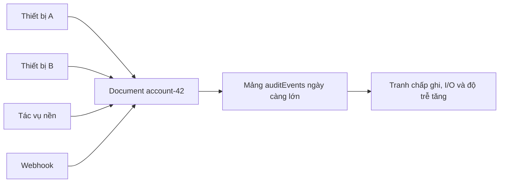
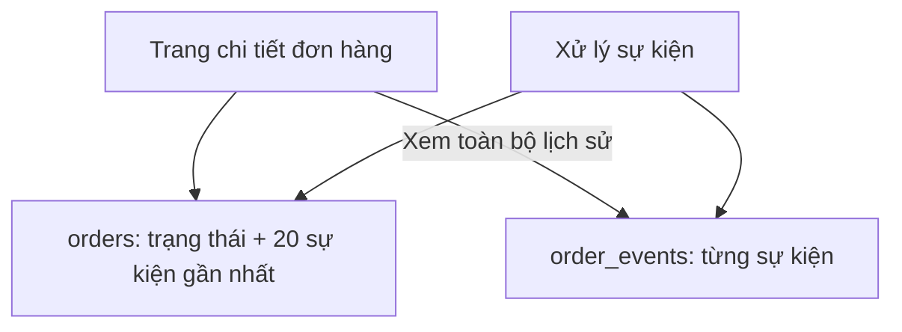

# Array tăng không giới hạn, document lớn và nguy cơ điểm nóng

## 1. Vì sao đây là bài toán thiết kế document?

MongoDB lưu dữ liệu dưới dạng document BSON. Khi hai nhóm thông tin thường được đọc cùng nhau, **embedding** (nhúng đối tượng hoặc mảng con vào document cha) có thể giúp một lần truy vấn lấy đủ dữ liệu và cập nhật nhiều trường của cùng document một cách nguyên tử. Tuy nhiên, mô hình này chỉ bền vững khi kích thước và tốc độ thay đổi của dữ liệu con được kiểm soát.

Hãy xét một đơn hàng có lịch sử sự kiện:

```json
{
  "_id": "order-123",
  "customerId": "customer-7",
  "status": "SHIPPING",
  "events": [
    {
      "eventId": "evt-001",
      "type": "CREATED",
      "occurredAt": "2026-11-20T08:00:00Z"
    },
    {
      "eventId": "evt-002",
      "type": "PAID",
      "occurredAt": "2026-11-20T08:05:00Z"
    }
  ]
}
```

Nếu hệ thống cứ `$push` thêm sự kiện vào `events` mà không giới hạn, một đơn hàng hoạt động lâu hoặc có tần suất cập nhật cao có thể tạo ra ba vấn đề đồng thời:

1. **Mảng tăng không giới hạn (unbounded array):** số phần tử không có ngưỡng tối đa được thực thi.
2. **Document quá lớn:** BSON chứa toàn bộ mảng cùng các trường khác; đến một lúc sẽ chạm giới hạn kích thước, gây chậm đọc/ghi và khó vận hành.
3. **Điểm nóng (hot document):** nhiều request cùng sửa *một document*, gây tranh chấp và tập trung tải vào cùng vị trí lưu trữ dù cluster có nhiều node.

Trong **SPRING_DATA_MONGODB**, rủi ro này tồn tại với cả `MongoTemplate`, `MongoRepository`, `ReactiveMongoTemplate` và repository reactive. Reactive access giúp tổ chức I/O, nhưng không giải quyết giới hạn BSON hoặc sự tập trung ghi trên cùng document. Cách khắc phục chủ yếu nằm ở **thiết kế document, truy vấn, index và chiến lược lưu trữ dữ liệu theo thời gian**.

## 2. Giới hạn BSON và hệ quả của một mảng lớn

MongoDB có giới hạn **16 MiB cho một BSON document** (16.777.216 byte). Giới hạn tính trên toàn bộ BSON, gồm tên trường, kiểu dữ liệu, metadata mã hóa, các document con và phần tử mảng; không chỉ tính payload mà ứng dụng quan tâm. MongoDB cung cấp **GridFS** cho trường hợp lưu tệp lớn, nhưng GridFS không phải cách thay thế thông thường cho một danh sách sự kiện cần truy vấn theo khóa và thời gian.

Với mỗi phần tử mới, kích thước của document tăng thêm. Có thể ước lượng để phát hiện rủi ro trước khi triển khai:

\[
\text{Dung lượng tăng/ngày} \approx \text{số sự kiện/phút}
\times \text{byte trung bình/sự kiện} \times 60 \times 24
\]

Ví dụ, một đối tượng nhận **5 sự kiện/phút**, mỗi sự kiện chiếm khoảng **512 byte BSON**, thì dữ liệu tăng khoảng **3,5 MiB/ngày**. Ngay cả khi bỏ qua các trường khác, mô hình này sẽ tiến gần 16 MiB chỉ sau vài ngày. Con số thực tế phụ thuộc dữ liệu và chi phí mã hóa BSON; mục tiêu của phép tính là nhận ra rằng mảng cần chính sách giới hạn từ đầu.

Ngoài lỗi khi chạm trần, document lớn tạo ra các chi phí:

| Tác động | Giải thích |
| --- | --- |
| Đọc dư dữ liệu | Nếu ứng dụng lấy toàn bộ document chỉ để hiển thị `status`, nó có thể kéo theo lịch sử rất lớn. Projection giúp giảm dữ liệu trả về, nhưng không sửa cấu trúc ghi. |
| Ghi ngày càng đắt | Cập nhật mảng có thể làm tăng công việc lưu trữ, quản lý phiên bản trong storage engine và tài nguyên replication; mức độ cụ thể phụ thuộc kiểu update và engine. |
| Áp lực mạng và bộ nhớ | Document lớn làm tăng dữ liệu truyền, cấp phát bộ nhớ, giải mã BSON và rủi ro cache bị chiếm bởi dữ liệu ít dùng. |
| Index đa khóa (multikey) | Index trên trường mảng có thể tạo nhiều index key trên một document và tăng chi phí cập nhật index khi mảng thay đổi. |
| Độ trễ đuôi | Một số document “ngoại lệ” rất lớn có thể làm p95/p99 xấu dù kích thước trung bình vẫn nhỏ. |
| Giới hạn cứng | Một lệnh làm BSON vượt 16 MiB sẽ thất bại; tăng tài nguyên máy không làm giới hạn này biến mất. |

**Lưu ý:** `$slice` khi đọc chỉ giới hạn kết quả được trả về; nó không tự rút ngắn mảng đã lưu. Phải có chính sách ghi hoặc chuyển lịch sử sang một cấu trúc khác.

## 3. Hot document là gì và vì sao xảy ra?

MongoDB sử dụng cơ chế đồng thời ở mức document cho nhiều thao tác ghi thông thường. Một cập nhật đơn document có tính nguyên tử. Nhưng **nguyên tử không đồng nghĩa với không có tranh chấp**: nếu hàng trăm request cùng cập nhật một document, các thao tác vẫn phải được phối hợp và có thể phát sinh write conflict, retry hoặc hàng đợi.

Ví dụ, mọi thiết bị của một tài khoản cùng ghi vào:

```javascript
db.accounts.updateOne(
  { _id: "account-42" },
  { $push: { auditEvents: newEvent } }
);
```

Tất cả request hướng tới cùng `_id`. Nếu account này có lưu lượng cao, nó thành điểm nóng dù phần lớn account khác khá nhàn rỗi. Các lần cập nhật ở các document khác nhau có thể chạy đồng thời thuận lợi hơn.



Đặc biệt trong hệ thống **sharded**, nhiều shard không thể chia một document thành nhiều phần để cập nhật song song. Các thao tác vào cùng document vẫn hướng về shard sở hữu document đó. Thêm shard hoặc đổi sang reactive driver không tự giải quyết một khóa nóng. Khi cần phân tán ghi thực sự, phải phân chia dữ liệu thành **nhiều document có khóa phân phối thích hợp** và kiểm chứng pattern truy cập.

Hot document cũng không nhất thiết phải lớn: một bản ghi bộ đếm nhỏ nhưng nhận hàng nghìn `$inc` mỗi giây vẫn có thể là điểm nóng. Ngược lại, một document lớn nhưng hầu như chỉ đọc có rủi ro khác. Vì vậy cần đo **kích thước** và **mức tập trung thao tác ghi** như hai trục riêng.

## 4. Nhận diện mảng nào có nguy cơ không giới hạn

Trước khi quyết định embed, hãy hỏi:

- Một document cha có thể có bao nhiêu phần tử con trong toàn bộ vòng đời? Có giới hạn nghiệp vụ thực sự hay chỉ là ước lượng hôm nay?
- Các phần tử đến với tốc độ nào? Có nhóm khách hàng, đơn hàng, phiên chat hoặc thiết bị nào nhận lưu lượng cao bất thường?
- Người dùng thường đọc **toàn bộ lịch sử** hay chỉ **20–50 mục gần nhất**?
- Cần truy vấn phần tử con độc lập theo thời gian, trạng thái, người tạo hay phải phân trang lịch sử?
- Có cần giữ sự kiện vĩnh viễn để kiểm toán, hoặc có chính sách TTL/xóa sau một khoảng thời gian?
- Các request có thường xuyên cùng thêm hoặc sửa phần tử trên một khóa cha?

Các ứng viên cần xem xét kỹ gồm: bình luận của bài viết, tin nhắn trong hội thoại, audit log, lịch sử thay đổi, sensor readings, lượt xem, notification, phần tử giỏ hàng không giới hạn hoặc danh sách thành viên tăng mãi.

**Không phải mọi array đều xấu.** Mảng có kích thước nhỏ và bị giới hạn bởi nghiệp vụ, như 3–10 địa chỉ giao hàng, vài vai trò hoặc tối đa 12 thông số cố định, có thể nhúng rất hợp lý. Rủi ro xuất hiện khi **cardinality và tốc độ tăng không được khống chế**, nhất là khi mọi lần ghi đều tác động cùng document.

## 5. Các chiến lược thiết kế thay thế

### 5.1. Bounded array: chỉ giữ N phần tử gần nhất

Nếu màn hình chỉ cần 50 sự kiện mới nhất, có thể lưu một mảng ngắn trong document cha bằng `$push` kết hợp `$each` và `$slice`:

```javascript
db.orders.updateOne(
  { _id: "order-123" },
  {
    $push: {
      recentEvents: {
        $each: [
          {
            eventId: "evt-003",
            type: "SHIPPED",
            occurredAt: ISODate("2026-11-20T09:00:00Z")
          }
        ],
        $slice: -50
      }
    }
  }
);
```

`$slice: -50` giữ **50 phần tử cuối mảng** sau khi thêm. Với mảng được append theo đúng thứ tự mong muốn, đây là cách gọn để giữ cửa sổ gần nhất. Nếu sự kiện có thể đến trễ hoặc không đúng thứ tự, cân nhắc `$sort` cùng `$each` và `$slice`, đồng thời xác định rõ thứ tự theo `occurredAt` và cách phá hòa. Cần kiểm thử khi hai sự kiện có cùng timestamp.

Ưu điểm: kích thước dữ liệu nhúng được khống chế, đọc nhanh phần gần đây và cập nhật trong một document là nguyên tử.

Giới hạn: dữ liệu bị loại khỏi mảng **không còn nằm trong document cha**; nếu cần lịch sử đầy đủ, phải lưu ở nơi khác. Một document vẫn có thể thành điểm nóng dù mảng chỉ có 50 phần tử. Đừng dùng mảng bounded như phương án duy nhất cho audit log bắt buộc lưu giữ.

### 5.2. Reference / child collection: mỗi phần tử là một document riêng

Đối với lịch sử lớn hoặc phải phân trang, lưu thông tin ổn định trong `orders` và sự kiện trong `order_events`:

```javascript
// orders
{
  _id: "order-123",
  customerId: "customer-7",
  status: "SHIPPING",
  totalEventCount: 120000
}

// order_events: mỗi sự kiện là một document
{
  _id: "evt-120000",
  orderId: "order-123",
  eventId: "provider-evt-120000",
  type: "SHIPPED",
  occurredAt: ISODate("2026-11-20T09:00:00Z")
}
```

Index phục vụ danh sách sự kiện mới nhất:

```javascript
db.order_events.createIndex({
  orderId: 1,
  occurredAt: -1,
  _id: -1
});

db.order_events.find({ orderId: "order-123" })
  .sort({ occurredAt: -1, _id: -1 })
  .limit(50);
```

Ở đây `orderId` định vị tập sự kiện; `occurredAt` giúp sắp xếp theo thời gian và `_id` là khóa phá hòa để thứ tự ổn định. Khi trang sau sử dụng cursor, cần lọc theo cặp khóa cuối cùng của trang trước; không nên dựa hoàn toàn vào `skip` lớn trên lịch sử dài.

**Đánh đổi:** phải có truy vấn thứ hai hoặc phép join thích hợp khi cần kết hợp chi tiết đơn hàng với lịch sử; write sang hai collection là hai thao tác khác nhau, không mặc nhiên nguyên tử cùng nhau. Nếu nghiệp vụ yêu cầu cập nhật status và thêm event cùng thành công/thất bại, cân nhắc transaction MongoDB với topology hỗ trợ và xử lý lỗi/retry đúng cách. Nếu chấp nhận eventual consistency, có thể dùng sự kiện/outbox và cơ chế đối soát.

### 5.3. Subset pattern: document cha chứa bản tóm tắt và phần mới nhất

Một mô hình thực tế là:

- `orders` lưu `status`, `totalEventCount` và tối đa 20 `recentEvents` để trang chi tiết hiển thị ngay.
- `order_events` lưu **toàn bộ** lịch sử có thể phân trang, tìm kiếm và phân tích.



Pattern này tối ưu đường đọc phổ biến và tránh nhúng lịch sử vô hạn. Nhưng cần **xác định nguồn sự thật (source of truth)**. Chẳng hạn, `order_events` là lịch sử đầy đủ; `recentEvents` chỉ là bản sao phục vụ hiển thị. Nếu một bước cập nhật bản sao thất bại, hệ thống phải có quy trình tái tạo hoặc đồng bộ lại từ nguồn chính.

Không nên lưu hai bản sao dữ liệu rồi giả định chúng luôn đồng bộ mà không có transaction, retry hoặc cơ chế đối soát.

### 5.4. Bucket pattern: gom thành nhiều document có giới hạn

Với dữ liệu tuần tự như sensor logs, audit events hoặc session events, có thể gom **một số lượng hữu hạn** mục vào mỗi bucket:

```json
{
  "_id": "device-9:2026-11-20:bucket-03",
  "deviceId": "device-9",
  "bucketStart": "2026-11-20T00:00:00Z",
  "sequence": 3,
  "count": 200,
  "events": [
    {"at": "2026-11-20T08:00:00Z", "value": 30.2},
    {"at": "2026-11-20T08:00:05Z", "value": 30.4}
  ]
}
```

Ví dụ trên minh họa cấu trúc; trường `count` cần phản ánh số phần tử thực tế của bucket, không chỉ hai phần tử được rút gọn để hiển thị. Khi một bucket đạt ngưỡng số mục/kích thước/thời gian, tạo bucket mới.

Ưu điểm: ít document hơn mô hình từng sự kiện, giảm kích thước kết quả khi đọc theo khoảng thời gian và chia nhỏ một chuỗi lịch sử dài. Nhược điểm: phải quản lý biên bucket, phân trang và đồng thời. Nhiều writer đổ vào **bucket hiện tại** vẫn có thể gây điểm nóng, nên ở tải cao có thể cần bucket theo nhiều phân vùng ghi, ví dụ kết hợp thời gian với partition/shard được thiết kế cẩn thận.

Đối với dữ liệu đo đạc theo thời gian thuần túy, nên đánh giá cả **MongoDB time series collections** và các giới hạn tính năng theo phiên bản đang dùng; không mặc định cần tự cài đặt mọi bucket bằng tay.

### 5.5. Outlier pattern: xử lý đối tượng ngoại lệ

Nếu 99% bài viết có dưới 100 bình luận, nhưng một số bài có hàng triệu bình luận, có thể lưu phần hiển thị gần nhất trong document và chuyển lịch sử đầy đủ sang collection con khi vượt ngưỡng. Đây là một cách xử lý **outlier**.

Đừng chọn ngưỡng theo trung bình đơn thuần; cần biết phân phối `p95`, `p99`, tài khoản cực đại, tốc độ tăng và SLA ghi. Cấu trúc của trường hợp ngoại lệ phải được quản lý nhất quán khi chuyển đổi, nếu không logic truy vấn sẽ trở nên khó dự đoán.

### Bảng chọn nhanh

| Pattern | Kích thước dữ liệu | Đọc thường gặp | Điểm cần quản lý |
| --- | --- | --- | --- |
| Embed có giới hạn nghiệp vụ | Nhỏ, cố định | Đọc cùng cha | Ràng buộc giới hạn thực tế |
| Bounded array | Tối đa N phần tử | N mục gần nhất | Mục cũ bị loại, hot key vẫn có thể tồn tại |
| Child collection | Lịch sử lớn hoặc không giới hạn | Phân trang, lọc, tìm kiếm | Index, round trip, đồng bộ với cha |
| Subset + history | Cha nhỏ, history lớn | Đọc nhanh và mở lịch sử khi cần | Bản sao và tính nhất quán |
| Bucket | Chuỗi dữ liệu dài | Quét theo khoảng/batch | Kích thước bucket, concurrency và rollover |
| Outlier pattern | Phân phối lệch mạnh | Phần lớn đối tượng nhỏ | Quy tắc chuyển ngưỡng, nhánh đọc/ghi |

## 6. Thực hành bằng Spring Data MongoDB

### 6.1. Document con và repository

Với lịch sử sự kiện lớn, tạo một collection riêng. Ví dụ Java sử dụng Spring Data MongoDB đồng bộ:

```java
import java.time.Instant;
import org.springframework.data.annotation.Id;
import org.springframework.data.mongodb.core.index.CompoundIndex;
import org.springframework.data.mongodb.core.mapping.Document;

@Document(collection = "order_events")
@CompoundIndex(
    name = "by_order_time",
    def = "{'orderId': 1, 'occurredAt': -1, '_id': -1}"
)
public record OrderEvent(
    @Id String id,
    String orderId,
    String eventId,
    String type,
    Instant occurredAt
) {}
```

```java
import java.util.List;
import org.springframework.data.mongodb.repository.MongoRepository;

public interface OrderEventRepository
        extends MongoRepository<OrderEvent, String> {

    List<OrderEvent> findTop50ByOrderIdOrderByOccurredAtDescIdDesc(
        String orderId
    );
}
```

Repository trả tối đa 50 document sự kiện mới nhất của đơn hàng. `@CompoundIndex` diễn tả index mong muốn trong mapping; **không nên giả định annotation luôn tự tạo index ở mọi môi trường**. Tùy cấu hình Spring Data/Spring Boot, index phải được tạo qua migration, quản lý index hoặc cơ chế tạo index được bật có chủ đích. Xác minh index thực tế bằng `getIndexes()` và `explain()`.

### 6.2. MongoTemplate để truy vấn lịch sử theo điều kiện động

```java
import java.time.Instant;
import java.util.List;
import org.springframework.data.domain.Sort;
import org.springframework.data.mongodb.core.MongoTemplate;
import org.springframework.data.mongodb.core.query.Criteria;
import org.springframework.data.mongodb.core.query.Query;

public class OrderEventQueryService {
    private final MongoTemplate template;

    public OrderEventQueryService(MongoTemplate template) {
        this.template = template;
    }

    public List<OrderEvent> latest(String orderId, Instant since) {
        Query query = Query.query(
            Criteria.where("orderId").is(orderId)
                .and("occurredAt").gte(since)
        );
        query.with(Sort.by(
            Sort.Order.desc("occurredAt"),
            Sort.Order.desc("id")
        ));
        query.limit(50);
        return template.find(query, OrderEvent.class);
    }
}
```

Trong Spring Data, `id` là thuộc tính Java được mapping về `_id`. Với MongoDB reactive, thiết kế collection và index giữ nguyên; thay `MongoTemplate` bằng `ReactiveMongoTemplate` và kết quả `List<OrderEvent>` bằng `Flux<OrderEvent>`:

```java
// Trong service đã được inject ReactiveMongoTemplate reactiveTemplate:
Flux<OrderEvent> events = reactiveTemplate.find(query, OrderEvent.class);
```

Hãy import `reactor.core.publisher.Flux` và sử dụng `Flux` qua pipeline/reactive controller tương ứng. Phần khác nhau là API và cách tiêu thụ kết quả; **tách lịch sử khỏi document cha** mới là thay đổi giúp tránh unbounded array.

### 6.3. Giới hạn mảng ngay trong lệnh update

Nếu chỉ lưu 50 sự kiện để hiển thị, `MongoTemplate` hỗ trợ `$push` + `$slice`:

```java
import org.springframework.data.mongodb.core.MongoTemplate;
import org.springframework.data.mongodb.core.query.Criteria;
import org.springframework.data.mongodb.core.query.Query;
import org.springframework.data.mongodb.core.query.Update;

public void addRecentEvent(
        MongoTemplate template, String orderId, OrderEvent event) {

    Query query = Query.query(Criteria.where("_id").is(orderId));
    Update update = new Update();
    var pushBuilder = update.push("recentEvents");
    pushBuilder.slice(-50);
    pushBuilder.each(event);

    template.updateFirst(query, update, "orders");
}
```

Ví dụ dùng tên collection `orders` cho lệnh update và `OrderEvent` như cấu trúc dữ liệu của phần tử. Nếu cần tính bất biến, đếm chính xác, chống gửi lặp hoặc lưu lịch sử đầy đủ, cần thiết kế thêm; chỉ `$push` không bảo đảm idempotency. `$slice` giữ cuối mảng theo thứ tự hiện tại, nên “mới nhất” chỉ đúng khi thứ tự append đáp ứng yêu cầu nghiệp vụ.

Với một document riêng lẻ, update là nguyên tử. Nhưng nếu hệ thống đồng thời ghi bản đầy đủ ở `order_events` và bản tóm tắt ở `orders`, hai lệnh **không tự tạo một transaction chung**.

## 7. Index, phân trang và khả năng ghi

### Index đúng đường đọc

Nếu lịch sử đã được tách, query phổ biến:

```javascript
db.order_events.find({
  orderId: "order-123",
  occurredAt: { $gte: ISODate("2026-11-01T00:00:00Z") }
})
.sort({ occurredAt: -1, _id: -1 })
.limit(50);
```

Index `{ orderId: 1, occurredAt: -1, _id: -1 }` hỗ trợ filter theo parent và duyệt kết quả theo thời gian. Tuy nhiên, index chỉ hữu ích khi tương thích với filter, sort, selectivity và workload; cần xem execution plan, không dựa vào tên index.

Với phân trang sâu, `skip(100000)` khiến server phải đi qua nhiều phần tử hơn. Keyset/cursor pagination có thể dùng khóa `(occurredAt, _id)` cuối trang trước:

```javascript
const lastTime = ISODate("2026-11-19T10:00:00Z");
const lastId = "evt-050000";

db.order_events.find({
  orderId: "order-123",
  $or: [
    { occurredAt: { $lt: lastTime } },
    { occurredAt: lastTime, _id: { $lt: lastId } }
  ]
})
.sort({ occurredAt: -1, _id: -1 })
.limit(50);
```

Ví dụ giả định `_id` là chuỗi cùng kiểu với `lastId`. Điều kiện cần theo đúng thứ tự sort và cùng kiểu BSON đang lưu; trộn ObjectId với string sẽ làm cursor sai.

### Tránh index mảng khổng lồ khi không cần

Index trên `events.type` khi `events` là array tạo index multikey. Mảng nhiều mục đồng nghĩa với công việc duy trì nhiều index key và có thể chạm các giới hạn của compound multikey index (ví dụ hạn chế các trường mảng song song). Nếu chủ yếu truy vấn phần tử theo từng sự kiện, thiết kế child collection với index trên `orderId`, thời gian và thuộc tính sự kiện thường rõ ràng và linh hoạt hơn.

### Cân nhắc shard key

Tách thành nhiều document **chưa bảo đảm** tải được phân đều cho từng parent nóng. Ví dụ, chọn shard key chỉ theo `orderId` có thể giữ mọi sự kiện của một đơn hàng trên cùng shard. Khi throughput ghi theo một `orderId` rất cao, phải đánh giá cách phân phối khóa, bucket theo thời gian hoặc thành phần phân vùng bổ sung, đồng thời cân bằng với yêu cầu query theo `orderId`. Việc chọn shard key là quyết định theo workload thật và khả năng vận hành của phiên bản MongoDB, không phải công thức dùng chung.

## 8. Đo lường và chẩn đoán vấn đề

### 8.1. Tìm document lớn và mảng dài

Aggregation sau minh họa cách xem những document có mảng `recentEvents` lớn nhất trong collection `orders`:

```javascript
db.orders.aggregate([
  { $match: { recentEvents: { $type: "array" } } },
  {
    $project: {
      sizeBytes: { $bsonSize: "$$ROOT" },
      eventCount: { $size: "$recentEvents" }
    }
  },
  { $sort: { sizeBytes: -1 } },
  { $limit: 20 }
]);
```

`$bsonSize` đo kích thước BSON của document đang được xử lý. Trên collection lớn, phép thống kê có thể tốn tài nguyên vì phải đọc nhiều document; cân nhắc sampling, chạy ngoài giờ cao điểm và giới hạn phạm vi bằng tiêu chí phù hợp.

Có thể xem những document chứa ít nhất 1.000 phần tử (kiểm tra phần tử ở chỉ số 999, bắt đầu từ 0):

```javascript
db.orders.find(
  { "recentEvents.999": { $exists: true } },
  { _id: 1, status: 1 }
);
```

Truy vấn này chỉ là tín hiệu chẩn đoán; không thay thế đo kích thước BSON và có thể đòi hỏi quét nhiều document nếu không có index phù hợp.

### 8.2. Theo dõi triệu chứng điểm nóng

Những dấu hiệu nên quan sát cùng nhau:

| Dấu hiệu | Cách kiểm tra |
| --- | --- |
| p95/p99 của update tăng | APM/tracing theo tên thao tác và nhóm `orderId`, đối chiếu mức tải |
| Nhiều update vào ít khóa cha | Thống kê request theo `_id`/khóa nghiệp vụ từ log có kiểm soát |
| Write conflict hoặc retry tăng | Metrics server/driver, profiler và slow operation logs |
| Tăng kích thước document | `$bsonSize` theo mẫu, đo trung vị và phần đuôi |
| Index/nền tảng I/O quá tải | `explain("executionStats")`, index usage, cache, disk, network, connection pool |
| Thất bại khi thêm phần tử | Theo dõi lỗi command/driver, bao gồm trường hợp BSON vượt kích thước cho phép |

Đừng chẩn đoán “do hot document” chỉ từ một biểu đồ CPU cao. Cần liên hệ giữa **khóa nhận nhiều ghi**, số lượng update đồng thời, write conflict/latency và kích thước document. Một index thiếu có thể khiến query chậm nhưng không tạo ra đúng kiểu tranh chấp update trên một document.

### 8.3. Kiểm thử tải có đối chứng

Tạo ít nhất ba kịch bản:

1. **Nhiều khóa:** 10.000 update phân bố trên 10.000 document.
2. **Một khóa nóng:** 10.000 update dồn vào một document.
3. **Nhiều document con:** 10.000 sự kiện ghi vào các document riêng, index và thiết kế shard key phù hợp.

Đo throughput, p50/p95/p99, write conflict, dung lượng và tải CPU/I/O. Giữ cấu hình cluster, driver, write concern và kích thước payload tương đương. Kết quả giúp xác nhận nút thắt nằm ở mô hình dữ liệu hay ở hạ tầng.

## 9. Tính nhất quán và tránh ghi trùng

Tách mảng ra collection khác giảm kích thước cha nhưng đưa ra yêu cầu mới:

- **Idempotency:** request có thể được retry do timeout hoặc lỗi mạng. Mỗi sự kiện cần `eventId` ổn định; index unique trên khóa nghiệp vụ (ví dụ `{ orderId: 1, eventId: 1 }`) giúp không ghi lặp vào lịch sử.
- **Ordering:** timestamp không đủ duy nhất khi hai sự kiện đồng thời. Dùng cặp timestamp và khóa duy nhất hoặc một sequence được cấp theo thiết kế phù hợp. Cẩn thận: một bộ đếm sequence tập trung cũng có thể thành điểm nóng.
- **Atomicity:** cập nhật status của cha và ghi event con là hai document, cần transaction nếu yêu cầu bất biến xuyên document; transaction có chi phí và cần topology hỗ trợ. Nếu chấp nhận eventual consistency, thiết kế retry và đối soát có căn cứ.
- **Retention:** TTL index có thể dọn các document sự kiện hết hạn ở collection riêng; TTL không phải công cụ tự cắt bớt phần tử trong mảng document cha.
- **Xóa và quyền riêng tư:** khi xóa cha, dữ liệu con không tự cascade như foreign key trong RDBMS. Cần cơ chế xóa/cập nhật theo policy và khả năng khôi phục nhất quán.

Ví dụ index để chống thêm trùng cùng một sự kiện vào `order_events`:

```javascript
db.order_events.createIndex(
  { orderId: 1, eventId: 1 },
  { unique: true }
);
```

Index unique này giả định tất cả bản ghi đều có `eventId` hợp lệ theo schema. Nếu cần retention bằng TTL hay sharding, phải kiểm tra giới hạn tương thích với unique/shard key theo triển khai cụ thể. Một index unique có thể ngăn lưu bản ghi trùng, nhưng ứng dụng vẫn phải xử lý duplicate key như kết quả hợp lệ của retry khi `eventId` đã tồn tại.

## 10. Chuyển đổi từ mảng lớn sang child collection

Giả sử hệ thống đang có `orders.events` chứa lịch sử lâu năm. Một quy trình chuyển đổi có thể gồm:

1. **Khảo sát:** đo kích thước BSON, số phần tử, phân phối theo khóa và rate update. Xác định trường nào được đọc thường xuyên và ngưỡng giữ ở cha.
2. **Thiết kế đích:** tạo `order_events`, khóa định danh sự kiện, index cho truy vấn theo cha/thời gian và chính sách retention.
3. **Backfill theo lô:** đọc lịch sử cũ, chuyển thành document con và ghi idempotent. Bảo tồn timestamp, thứ tự cần thiết và khóa gốc; tránh đọc/ghi một lô quá lớn.
4. **Theo kịp ghi mới:** dùng phương án ghi kép có kiểm soát, event/outbox hoặc cơ chế đồng bộ phù hợp để không bỏ sót sự kiện trong lúc chuyển đổi. Kiểm thử tình huống một bên ghi thất bại.
5. **Đối soát:** so số lượng và khóa sự kiện (hoặc checksum thích hợp), kiểm tra truy vấn và phân trang, quan sát index/latency.
6. **Chuyển đường đọc:** đọc lịch sử từ collection con, giữ subset nhỏ trong cha nếu cần. Có cơ chế xử lý đối tượng chưa backfill xong.
7. **Ngừng ghi mảng cũ rồi dọn dữ liệu:** chỉ xóa/truncate dữ liệu lịch sử ở cha sau khi kiểm tra dữ liệu mới đủ và có phương án phục hồi.

**Không** dùng một lệnh cập nhật lớn để di chuyển hoặc thu gọn mọi document cùng lúc trong giờ cao điểm. Trước mỗi giai đoạn, thử trên dữ liệu đại diện và theo dõi replica lag, cache, thời gian query và tỷ lệ lỗi.

## 11. Bài tập thực hành và tiêu chí đánh giá

### Bài tập

Thiết kế dịch vụ theo dõi trạng thái đơn hàng với yêu cầu: trang chi tiết chỉ hiển thị 20 sự kiện mới nhất; nhân viên hỗ trợ cần xem toàn bộ lịch sử; một số đơn hàng có thể nhận hàng nghìn webhook mỗi giờ và request có thể được gửi lặp.

Hãy:

1. Vẽ schema cho `orders` và `order_events`; xác định nguồn sự thật và trường nào được nhúng dưới dạng subset.
2. Viết lệnh MongoDB giữ 20 `recentEvents` bằng `$push`/`$slice` và lệnh insert sự kiện đầy đủ.
3. Đề xuất index để lấy 50 sự kiện theo thứ tự `occurredAt` giảm dần, có thể phân trang ổn định.
4. Thiết kế cách tránh ghi trùng sự kiện và cách xử lý khi ghi cha thành công nhưng ghi con thất bại (hoặc ngược lại).
5. Dùng `MongoTemplate` hoặc `ReactiveMongoTemplate` truy vấn danh sách sự kiện, có filter thời gian và limit.
6. Thử tải với một đơn hàng nóng so với nhiều đơn hàng; đối chiếu p95/p99 và metrics MongoDB.

### Câu hỏi tự kiểm tra

- Vì sao một document 1 MiB nhưng nhận hàng nghìn lần `$inc` mỗi giây vẫn có thể là hot document?
- Vì sao projection và `$slice` trong lúc **đọc** không ngăn mảng ở database tiếp tục lớn lên?
- Trong tình huống nào bounded array là đủ, và khi nào phải lưu child collection hoặc bucket?
- Tại sao thêm shard không nhất thiết cải thiện throughput khi mọi request cập nhật cùng một `_id`?
- Tách lịch sử sang collection riêng tác động thế nào đến tính nguyên tử và yêu cầu idempotency?

## Ghi nhớ

Embedding hiệu quả khi dữ liệu liên quan có kích thước và vòng đời được kiểm soát. **Mảng tăng không giới hạn** vừa đẩy document đến trần 16 MiB, vừa có thể kéo theo I/O, index và độ trễ lớn. **Hot document** là vấn đề tập trung cập nhật vào một document; nó có thể xảy ra ngay cả khi document còn nhỏ. Trong Spring Data MongoDB, cách xử lý là thiết kế lại ranh giới document: giữ subset có giới hạn, tách lịch sử sang child collection, hoặc dùng bucket phù hợp; sau đó xác minh bằng index, truy vấn thực tế, kiểm thử tích hợp và số liệu hiệu năng.
