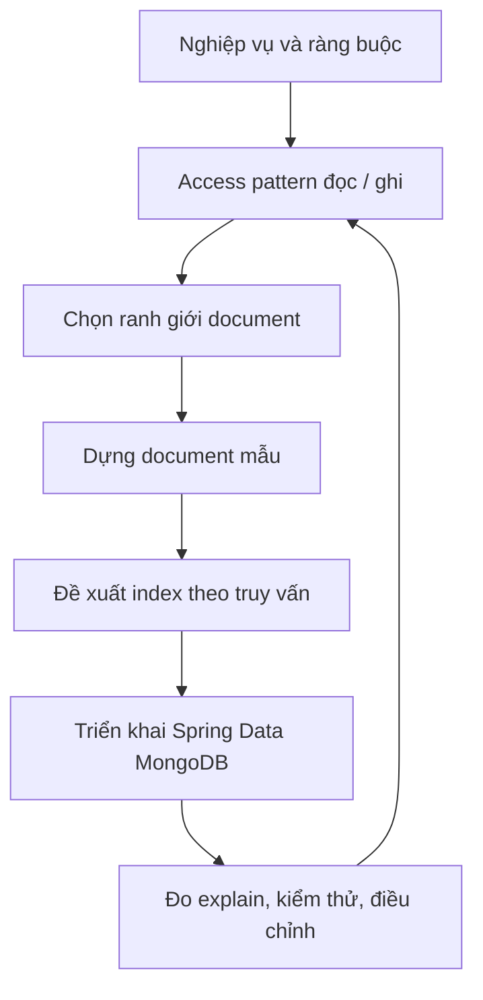

# Từ yêu cầu nghiệp vụ đến document mẫu và chỉ mục dự kiến

## 1. Kết quả cần đạt

Thiết kế dữ liệu MongoDB bắt đầu từ **nghiệp vụ và cách ứng dụng đọc, ghi dữ liệu**, sau đó mới quyết định cấu trúc document và index. Hai hệ thống cùng quản lý đơn hàng có thể cần hai mô hình khác nhau nếu một hệ thống chủ yếu xem chi tiết đơn, còn hệ thống kia chủ yếu thống kê hàng triệu sự kiện giao vận.

Trong module **SPRING_DATA_MONGODB**, Spring Data MongoDB cung cấp `@Document`, ánh xạ object Java sang BSON, `MongoRepository`, `MongoTemplate` và các API truy vấn, aggregation, index, transaction, reactive access. Các công cụ này triển khai thiết kế; chúng không thay thế bước phân tích yêu cầu trước khi lập schema.

Sau bài này, bạn có thể:

1. Chuyển yêu cầu nghiệp vụ thành **access pattern**: ai truy vấn, lọc theo gì, sắp xếp thế nào, cần trả bao nhiêu dữ liệu và cập nhật những trường nào.
2. Chọn nhúng (embedding) hoặc tham chiếu (referencing) dựa trên vòng đời, cardinality, giới hạn tăng trưởng và nhu cầu nhất quán.
3. Thiết kế document mẫu có kiểu BSON, khóa định danh, giá trị snapshot và ranh giới cập nhật rõ ràng.
4. Đề xuất compound index dựa trên các query shape cụ thể, kèm mục đích và chi phí của từng index.
5. Ánh xạ mô hình vào Spring Data MongoDB và xây dựng kế hoạch thử nghiệm tính đúng đắn, hiệu năng.

**Đầu ra của một bản thiết kế có thể review được** không chỉ là JSON mẫu: phải có bảng yêu cầu, danh sách truy vấn, document mẫu, index dự kiến, lý do lựa chọn và cách xác minh trên dữ liệu đủ đại diện.

## 2. Tình huống thực tế: quản lý đơn hàng theo doanh nghiệp

Giả sử chúng ta xây dựng dịch vụ quản lý đơn hàng cho nhiều cửa hàng độc lập trên cùng một hệ thống (multi-tenant). Mỗi cửa hàng là một tenant. Người mua đặt đơn; nhân viên xem hàng chờ đóng gói; khách xem đơn đã mua; hệ thống ghi lại diễn biến xử lý.

### 2.1. Yêu cầu nghiệp vụ và giả định cần xác nhận

| Mã | Yêu cầu | Tác động đến thiết kế |
| --- | --- | --- |
| BR-01 | Trong một tenant, `orderNo` phải duy nhất | Cần ràng buộc unique theo cặp `(tenantId, orderNo)` |
| BR-02 | Xem chi tiết đơn kèm sản phẩm đã mua và địa chỉ nhận khi đặt | Nên đọc được thông tin thiết yếu từ một document đơn |
| BR-03 | Khách xem 20 đơn gần nhất, có thể xem tiếp | Cần lọc `tenantId + customerId` và sắp xếp theo thời gian |
| BR-04 | Nhân viên xem 20 đơn `READY_TO_SHIP` mới nhất | Cần lọc `tenantId + status` và sắp xếp theo thời gian |
| BR-05 | Có thể chuyển trạng thái đơn với kiểm tra trạng thái hiện tại | Cần thao tác cập nhật nguyên tử và kiểm tra kết quả |
| BR-06 | Lịch sử sự kiện có thể dài và phải xem theo đơn | Cân nhắc collection riêng cho sự kiện tăng trưởng liên tục |
| BR-07 | Mỗi dòng hàng giữ tên và đơn giá tại lúc mua | Cần snapshot, tránh thay đổi khi catalog sản phẩm cập nhật |
| BR-08 | Truy vấn từ tenant A không được trả dữ liệu tenant B | Mọi truy vấn nghiệp vụ cần đưa `tenantId` vào điều kiện |

Đây là yêu cầu minh họa, chưa phải thông số sản xuất. Trước khi chốt, cần hỏi thêm: số đơn theo ngày/tenant, số dòng hàng tối đa, tốc độ ghi, thời gian lưu trữ, phân bố tenant lớn và nhỏ, danh sách báo cáo, tỷ lệ truy vấn đọc/ghi, yêu cầu độ trễ và mức nghiêm ngặt của nhật ký sự kiện.

Ví dụ về **giả định có thể kiểm chứng**: một đơn thường có 1–30 dòng hàng, tối đa 100; lịch sử sự kiện có thể lên đến hàng nghìn bản ghi qua nhiều năm; giao diện chỉ lấy 20 đơn mỗi trang. Nếu những giả định này thay đổi, cần đánh giá lại lựa chọn nhúng và index.

### 2.2. Từ câu nói nghiệp vụ đến truy vấn cụ thể

Thay vì ghi chung chung «tìm đơn hàng nhanh», chuyển thành query shape có thể kiểm tra:

| Access pattern | Filter | Sort/limit | Kết quả |
| --- | --- | --- | --- |
| Q1 — Tra cứu số đơn | `tenantId = ?`, `orderNo = ?` | Một document | Chi tiết đơn |
| Q2 — Lịch sử của khách | `tenantId = ?`, `customerId = ?` | `placedAt DESC, _id DESC`; 20 | Danh sách đơn |
| Q3 — Hàng đợi giao | `tenantId = ?`, `status = READY_TO_SHIP` | `placedAt DESC, _id DESC`; 20 | Đơn chờ giao |
| Q4 — Chi tiết theo ID | `_id = ?`, `tenantId = ?` | Một document | Dòng hàng, địa chỉ, trạng thái |
| Q5 — Dòng sự kiện | `tenantId = ?`, `orderId = ?` | `occurredAt DESC, _id DESC`; 50 | Lịch sử xử lý |
| W1 — Chuyển trạng thái | `tenantId + orderNo + status hiện tại` | Cập nhật một document | Trạng thái mới, thời điểm cập nhật |

Các query shape trên là **đầu vào để quyết định index**, không phải phần bổ sung sau khi code đã viết xong. Nếu ứng dụng còn yêu cầu dashboard doanh thu theo ngày hoặc tìm kiếm toàn văn theo tên sản phẩm, phải liệt kê riêng vì có thể cần aggregation, dữ liệu tổng hợp hoặc search index khác với index cho Q1–Q5.

### 2.3. Luồng thiết kế



Mũi tên quay lại nhấn mạnh một thực tế: index và schema là **giả thuyết thiết kế có thể đo được**. Một tài liệu đẹp mắt nhưng không phục vụ truy vấn và khối lượng ghi thực tế vẫn là thiết kế chưa hoàn tất.

## 3. Chọn ranh giới document: nhúng hay tham chiếu?

MongoDB có document lồng nhau, mảng và liên kết thông qua ID. Quyết định nhúng hay tham chiếu cần xét cả **cách đọc** lẫn **cách dữ liệu thay đổi**.

### 3.1. Bảng quyết định cho ví dụ

| Dữ liệu | Phương án | Lý do |
| --- | --- | --- |
| Địa chỉ giao hàng tại thời điểm đặt | Nhúng trong `orders.shippingAddress` | Cần giữ snapshot, đọc cùng đơn |
| Dòng hàng đã mua | Nhúng `orders.items[]` | Số phần tử có giới hạn, đọc cùng đơn, tính tiền một lần |
| Tên và đơn giá sản phẩm lúc mua | Lưu snapshot trong mỗi dòng hàng | Catalog có thể đổi tên/giá sau khi đặt |
| Thông tin tài khoản khách hàng | Lưu `customerId` tham chiếu | Khách có vòng đời riêng, dùng ở nhiều đơn |
| Catalog sản phẩm hiện hành | Collection `products` riêng | Sản phẩm được sửa và tái sử dụng độc lập |
| Dòng sự kiện giao vận/kiểm toán tăng liên tục | Collection `order_events` riêng | Số lượng có thể lớn, đọc phân trang theo đơn |

Việc nhúng `items[]` không loại bỏ khả năng tham chiếu `productId`. Có thể vừa lưu ID sản phẩm để đối chiếu catalog, vừa lưu `sku`, tên và đơn giá **tại thời điểm mua** để lịch sử đơn không đổi theo catalog.

### 3.2. Bốn câu hỏi trước khi nhúng

1. **Có đọc cùng nhau không?** Nếu hầu hết màn hình chi tiết luôn cần địa chỉ và dòng hàng, nhúng giảm số lần truy vấn.
2. **Có thay đổi cùng nhau không?** Nếu đơn và dòng hàng phải nhất quán khi cập nhật trong một document, nhúng tận dụng tính nguyên tử của thao tác ghi trên một document.
3. **Số lượng có giới hạn không?** Mảng tăng không ngừng khiến document lớn, index multikey nhiều entry và có thể chạm giới hạn BSON.
4. **Có được chia sẻ/tồn tại độc lập không?** Dữ liệu được nhiều entity tham chiếu hoặc có vòng đời riêng thường thích hợp hơn trong collection độc lập.

MongoDB giới hạn kích thước **mỗi document BSON ở 16 MiB**. Đây là giới hạn kỹ thuật cuối cùng, không phải mục tiêu kích thước vận hành. Document nhỏ và ổn định thường dễ truyền, cập nhật và cache hơn.

Không có quy tắc «cứ one-to-many thì nhúng» hoặc «dữ liệu quan hệ thì luôn tách». Số lượng phần tử và query shape mới quyết định hiệu quả.

## 4. Document mẫu cho collection orders

### 4.1. Bản ghi BSON minh họa trong mongosh

```javascript
db.orders.insertOne({
  tenantId: "tenant-acme",
  orderNo: "ORD-2026-00042",
  customerId: "customer-018",
  status: "READY_TO_SHIP",
  placedAt: ISODate("2026-11-18T03:20:00Z"),
  updatedAt: ISODate("2026-11-18T03:30:00Z"),
  currency: "VND",
  totalAmountVnd: NumberLong("530000"),
  shippingAddress: {
    receiverName: "Nguyen A",
    city: "Da Nang",
    district: "Hai Chau",
    addressLine: "12 Duong Mau"
  },
  items: [
    {
      lineNo: 1,
      productId: "product-101",
      sku: "BOOK-01",
      productName: "Sach MongoDB",
      quantity: 2,
      unitPriceVnd: NumberLong("150000"),
      lineAmountVnd: NumberLong("300000")
    },
    {
      lineNo: 2,
      productId: "product-205",
      sku: "CASE-02",
      productName: "Tui dung sach",
      quantity: 1,
      unitPriceVnd: NumberLong("230000"),
      lineAmountVnd: NumberLong("230000")
    }
  ]
});
```

MongoDB tự tạo `_id` nếu không được cung cấp. Ở đây `placedAt` và `updatedAt` là kiểu BSON Date, còn các giá trị tiền dùng BSON Int64 thông qua `NumberLong`. Với VND trong ví dụ, giá trị lưu là **số đồng nguyên**. Một hệ thống đa tiền tệ cần thống nhất quy ước đơn vị nhỏ nhất cho từng loại tiền hoặc dùng Decimal128 phù hợp; không dùng `double` để cộng tiền một cách tùy tiện.

Tính nhất quán có thể kiểm tra từ document mẫu:

```text
BOOK-01: 2 × 150.000 = 300.000 VND
CASE-02: 1 × 230.000 = 230.000 VND
Tổng cộng:              530.000 VND
```

**Snapshot và dữ liệu nguồn:** `customerId`, `productId` là ID tham chiếu để tra cứu dữ liệu hiện hành. `shippingAddress`, `productName` và `unitPriceVnd` là snapshot của giao dịch. Khi tên sản phẩm hoặc địa chỉ tài khoản thay đổi, chi tiết đơn đã đặt vẫn phải giữ nguyên dữ liệu lịch sử theo quy tắc nghiệp vụ này.

### 4.2. Hợp đồng trường dữ liệu

| Field | Kiểu BSON | Yêu cầu và ý nghĩa |
| --- | --- | --- |
| `_id` | ObjectId | Khóa định danh document do MongoDB sinh |
| `tenantId` | String | Bắt buộc trong truy vấn nghiệp vụ để cô lập tenant |
| `orderNo` | String | Duy nhất **trong tenant**, không bắt buộc duy nhất toàn hệ thống |
| `customerId` | String | Tham chiếu khách hàng |
| `status` | String/enum quy ước | Trạng thái theo state machine nghiệp vụ |
| `placedAt` | Date | Thời điểm tạo đơn theo UTC |
| `updatedAt` | Date | Thời điểm thay đổi gần nhất |
| `currency` | String | Mã tiền tệ, trong ví dụ là VND |
| `totalAmountVnd` | Int64 | Tổng tiền của snapshot đơn, bao gồm quy tắc thuế/phí nếu nghiệp vụ yêu cầu |
| `shippingAddress` | Embedded document | Ảnh chụp địa chỉ giao hàng |
| `items[]` | Array of embedded documents | Các dòng hàng có giới hạn; tối thiểu một dòng theo nghiệp vụ |

Các ràng buộc còn cần làm rõ khi triển khai: số dòng hàng tối đa, số lượng mỗi dòng phải dương, không trùng `lineNo` trong một đơn, trạng thái được phép, cách làm tròn tiền, có phí vận chuyển/khuyến mãi hay không, vùng thời gian hiển thị và chính sách bảo vệ thông tin cá nhân.

Đừng nhầm việc `@Document` ánh xạ đúng dữ liệu với **validation**: có thể kết hợp kiểm tra ở API/service, Bean Validation và JSON Schema validator của MongoDB để hạn chế document không hợp lệ từ nhiều nguồn ghi.

## 5. Collection cho sự kiện tăng trưởng không giới hạn

Để đáp ứng BR-06, mỗi sự kiện được lưu trong `order_events`, thay vì liên tục nối thêm vào một mảng không giới hạn bên trong đơn:

```javascript
db.order_events.insertOne({
  tenantId: "tenant-acme",
  orderId: ObjectId("6732c8db5b9b6d0a9a61a111"),
  eventType: "READY_TO_SHIP",
  occurredAt: ISODate("2026-11-18T03:30:00Z"),
  actorType: "SYSTEM",
  detail: {
    previousStatus: "PAID",
    newStatus: "READY_TO_SHIP"
  }
});
```

`orderId` ở đây là một **ID minh họa**, phải được thay bằng `_id` thật của đơn hàng khi chạy thử. Lưu `orderId` cùng kiểu BSON ObjectId với khóa `orders._id` để tránh lỗi truy vấn do lệch kiểu.

Truy vấn lịch sử:

```javascript
db.order_events.find({
  tenantId: "tenant-acme",
  orderId: ObjectId("6732c8db5b9b6d0a9a61a111")
})
  .sort({ occurredAt: -1, _id: -1 })
  .limit(50);
```

Tách collection giúp phân trang, lưu trữ và quản lý vòng đời sự kiện. Đổi lại, nếu nghiệp vụ yêu cầu **cập nhật trạng thái và ghi event luôn cùng thành công hoặc cùng thất bại**, hai thao tác ghi vào hai document có thể cần transaction hoặc một thiết kế tin cậy tương đương như transactional outbox với xử lý idempotent. Không nên suy ra tính nguyên tử xuyên document từ tính nguyên tử của từng lệnh ghi.

## 6. Thiết kế index dự kiến theo truy vấn

### 6.1. Lập bảng nối yêu cầu và index

Một index phù hợp phải phục vụ một query shape quan trọng. Thứ tự field trong compound index có ý nghĩa:

| Index đề xuất | Phục vụ | Vì sao sắp xếp trường như vậy |
| --- | --- | --- |
| `{ tenantId: 1, orderNo: 1 }` **unique** | Q1, W1 | Hai điều kiện bằng nhau; ràng buộc unique theo tenant |
| `{ tenantId: 1, customerId: 1, placedAt: -1, _id: -1 }` | Q2 | Lọc bằng `tenantId, customerId`; trả đơn mới nhất và có khóa phá hòa |
| `{ tenantId: 1, status: 1, placedAt: -1, _id: -1 }` | Q3 | Lọc bằng `tenantId, status`; lấy hàng đợi theo thứ tự |
| Index `_id` mặc định | Q4 | Tra cứu đúng một ID, sau đó vẫn kiểm tra `tenantId` |
| `{ tenantId: 1, orderId: 1, occurredAt: -1, _id: -1 }` trên `order_events` | Q5 | Lọc sự kiện theo đơn và sắp xếp mới nhất |

Đối với compound index, một hướng dẫn hữu ích là ưu tiên các trường **equality**, sau đó xét **sort** và **range** tùy query shape (thường được gọi là ESR). Tuy nhiên, đây là nguyên tắc lập kế hoạch, không phải bảo đảm index luôn được chọn. Phải đo bằng truy vấn thật và `explain`.

Với Q2 và Q3, `_id` là khóa phá hòa để thứ tự ổn định khi hai đơn có cùng `placedAt`. Trường này cũng có ích khi phân trang bằng con trỏ. Một index mặc định trên `_id` không thể thay thế index kết hợp để lọc hàng nghìn đơn theo tenant/trạng thái rồi sắp xếp hiệu quả.

### 6.2. Lệnh tạo index trong mongosh

```javascript
// BR-01, Q1: mỗi tenant không được có hai đơn cùng orderNo.
db.orders.createIndex(
  { tenantId: 1, orderNo: 1 },
  { unique: true, name: "uq_orders_tenant_orderNo" }
);

// Q2: 20 đơn gần nhất của một khách trong một tenant.
db.orders.createIndex(
  { tenantId: 1, customerId: 1, placedAt: -1, _id: -1 },
  { name: "ix_orders_tenant_customer_recent" }
);

// Q3: hàng đợi theo trạng thái.
db.orders.createIndex(
  { tenantId: 1, status: 1, placedAt: -1, _id: -1 },
  { name: "ix_orders_tenant_status_recent" }
);

// Q5: nhật ký theo đơn, mới nhất trước.
db.order_events.createIndex(
  { tenantId: 1, orderId: 1, occurredAt: -1, _id: -1 },
  { name: "ix_order_events_tenant_order_recent" }
);
```

Đây là **danh sách dự kiến**, chưa phải mệnh lệnh phải tạo đủ bốn index trong mọi hệ thống. Cần kiểm tra xem các màn hình này thực sự tồn tại, tần suất sử dụng ra sao và index nào có thể dùng chung. Mỗi index tốn dung lượng, bộ nhớ và chi phí duy trì khi ghi.

Nếu collection đã có dữ liệu trùng `(tenantId, orderNo)`, tạo unique index sẽ thất bại; phải phát hiện và xử lý dữ liệu trùng trước khi triển khai. Khi sử dụng sharding, cần xem lại cả shard key lẫn các ràng buộc đối với unique index; không bê nguyên thiết kế index của collection chưa shard vào mà không kiểm chứng.

### 6.3. Chứng minh index phục vụ đúng query shape

```javascript
// Q1
db.orders.findOne({
  tenantId: "tenant-acme",
  orderNo: "ORD-2026-00042"
});

// Q2
db.orders.find({
  tenantId: "tenant-acme",
  customerId: "customer-018"
})
  .sort({ placedAt: -1, _id: -1 })
  .limit(20);

// Q3
db.orders.find({
  tenantId: "tenant-acme",
  status: "READY_TO_SHIP"
})
  .sort({ placedAt: -1, _id: -1 })
  .limit(20);
```

Q1 dùng unique compound index để tra nhanh và chống trùng `orderNo` trong một tenant. Q2 và Q3 có cặp điều kiện bằng ở phần đầu index, tiếp theo là thứ tự sắp xếp phù hợp; đây là cơ sở hợp lý để tránh sort lớn trong bộ nhớ đối với các truy vấn này.

Lưu ý: quyền truy cập tenant **không được bảo đảm chỉ bằng việc có `tenantId` trong index**. Mã truy vấn, API kiểm tra quyền và test phải luôn ràng buộc tenant của người dùng. Một truy vấn chỉ theo `orderNo` có thể vừa không dùng đúng unique index theo tenant, vừa tạo nguy cơ lộ dữ liệu giữa tenant.

### 6.4. Khi nào đề xuất index khác?

Nếu phát sinh yêu cầu «xem toàn bộ đơn gần nhất của tenant bất kể trạng thái và khách hàng», index Q2/Q3 không tự đáp ứng tối ưu việc sắp xếp đó. Có thể cần cân nhắc:

```javascript
db.orders.createIndex(
  { tenantId: 1, placedAt: -1, _id: -1 },
  { name: "ix_orders_tenant_recent" }
);
```

Chỉ thêm khi query shape này thực sự quan trọng, có tải đủ lớn và kết quả đo cho thấy index hiện tại không đủ. Tương tự, lọc theo `items.sku` có thể tạo **multikey index**, nhưng sẽ có nhiều entry theo phần tử mảng và không mặc nhiên cần thiết nếu ứng dụng hầu như không truy vấn đơn bằng SKU.

**Không nên tạo index trên mọi field chỉ vì field xuất hiện trong schema.** Đầu tư vào những truy vấn quan trọng và thường xuyên; đo lợi ích đọc so với chi phí ghi.

## 7. Từ document mẫu đến Spring Data MongoDB

### 7.1. Ánh xạ document sang Java

Ví dụ bên dưới minh họa Java 17+ dùng `record`, `@Document` và `@Id`. Các record cùng package với document chính để trình bày ngắn gọn:

```java
import java.time.Instant;
import java.util.List;
import org.bson.types.ObjectId;
import org.springframework.data.annotation.Id;
import org.springframework.data.mongodb.core.mapping.Document;

@Document(collection = "orders")
public record OrderDocument(
    @Id ObjectId id,
    String tenantId,
    String orderNo,
    String customerId,
    String status,
    Instant placedAt,
    Instant updatedAt,
    String currency,
    long totalAmountVnd,
    ShippingAddress shippingAddress,
    List<OrderLine> items
) {}

record ShippingAddress(
    String receiverName,
    String city,
    String district,
    String addressLine
) {}

record OrderLine(
    int lineNo,
    String productId,
    String sku,
    String productName,
    int quantity,
    long unitPriceVnd,
    long lineAmountVnd
) {}
```

Với mapping này, `shippingAddress` lưu thành embedded document; `items` lưu thành mảng BSON, còn `Instant` biểu diễn thời điểm (thường được lưu dạng Date qua cơ chế conversion phù hợp). Dùng `ObjectId` làm ID giúp giữ kiểu thống nhất với `order_events.orderId`. Khi đổi tên field vật lý bằng `@Field`, phải kiểm tra tác động đến truy vấn và index.

Đây là mô hình học tập tối giản: service thực tế còn cần validation, bảo vệ bất biến tiền tệ, chính sách cập nhật trạng thái, kiểm toán và có thể cần bổ sung trường version.

### 7.2. Repository cho truy vấn tra cứu

```java
import java.util.Optional;
import org.bson.types.ObjectId;
import org.springframework.data.domain.Page;
import org.springframework.data.domain.Pageable;
import org.springframework.data.mongodb.repository.MongoRepository;

public interface OrderRepository
    extends MongoRepository<OrderDocument, ObjectId> {

    Optional<OrderDocument> findByTenantIdAndOrderNo(
        String tenantId,
        String orderNo
    );

    Page<OrderDocument> findByTenantIdAndCustomerId(
        String tenantId,
        String customerId,
        Pageable pageable
    );
}
```

Ví dụ gọi repository:

```java
import org.springframework.data.domain.PageRequest;
import org.springframework.data.domain.Sort;

PageRequest firstPage = PageRequest.of(
    0,
    20,
    Sort.by(Sort.Order.desc("placedAt"), Sort.Order.desc("id"))
);

var orders = orderRepository.findByTenantIdAndCustomerId(
    "tenant-acme",
    "customer-018",
    firstPage
);
```

Ví dụ giả định một biến `orderRepository` đã được inject. Dùng `Page` có thể phát sinh truy vấn đếm tổng số bản ghi; nếu chỉ cần nút «xem thêm» hoặc không cần tổng trang, cân nhắc `Slice` hoặc cursor pagination để tránh chi phí đếm trong những tập dữ liệu lớn.

### 7.3. MongoTemplate cho query shape và cập nhật cụ thể

```java
import java.time.Instant;
import java.util.List;
import org.springframework.data.domain.Sort;
import org.springframework.data.mongodb.core.MongoTemplate;
import org.springframework.data.mongodb.core.query.Criteria;
import org.springframework.data.mongodb.core.query.Query;
import org.springframework.data.mongodb.core.query.Update;

public class OrderService {
    private final MongoTemplate mongoTemplate;

    public OrderService(MongoTemplate mongoTemplate) {
        this.mongoTemplate = mongoTemplate;
    }

    public List<OrderDocument> readyToShip(String tenantId) {
        Query query = Query.query(
            Criteria.where("tenantId").is(tenantId)
                .and("status").is("READY_TO_SHIP")
        );
        query.with(Sort.by(
            Sort.Order.desc("placedAt"),
            Sort.Order.desc("id")
        ));
        query.limit(20);
        return mongoTemplate.find(query, OrderDocument.class);
    }

    public boolean markShipped(String tenantId, String orderNo) {
        Query query = Query.query(
            Criteria.where("tenantId").is(tenantId)
                .and("orderNo").is(orderNo)
                .and("status").is("READY_TO_SHIP")
        );
        Update update = new Update()
            .set("status", "SHIPPED")
            .set("updatedAt", Instant.now());

        return mongoTemplate.updateFirst(
            query, update, OrderDocument.class
        ).getModifiedCount() == 1;
    }
}
```

Lệnh `markShipped` kiểm tra trạng thái hiện tại trong cùng phép cập nhật để tránh hai luồng cùng chuyển trạng thái một cách mù quáng. Giá trị `false` có thể có nhiều nguyên nhân: không tìm thấy đơn, sai tenant hoặc trạng thái đã đổi; nếu API cần phân biệt, phải có xử lý và truy vấn phù hợp. Không nên «thử lại» mọi lỗi mà không xét tính idempotent.

**Khả năng nguyên tử:** Việc sửa một document `orders` là nguyên tử. Nếu đồng thời ghi `order_events` hoặc trừ tồn kho trong collection khác và cần all-or-nothing, phải xem xét transaction nhiều document cùng các điều kiện triển khai (ví dụ MongoDB replica set/sharded cluster) và chi phí của nó. Reactive MongoDB thay đổi cách truy cập bất đồng bộ, không tự thay đổi nguyên tắc thiết kế document/index hoặc phạm vi transaction.

### 7.4. Quản lý index từ Spring Data

Có thể tạo index bằng migration vận hành hoặc Spring Data `IndexOperations`. Ví dụ khởi tạo index Q3:

```java
import org.springframework.data.domain.Sort;
import org.springframework.data.mongodb.core.MongoTemplate;
import org.springframework.data.mongodb.core.index.Index;

public void ensureShippingQueueIndex(MongoTemplate template) {
    Index index = new Index()
        .on("tenantId", Sort.Direction.ASC)
        .on("status", Sort.Direction.ASC)
        .on("placedAt", Sort.Direction.DESC)
        .on("_id", Sort.Direction.DESC)
        .named("ix_orders_tenant_status_recent");

    template.indexOps(OrderDocument.class).ensureIndex(index);
}
```

Đây là **đoạn phương thức minh họa**, cần đặt trong class phù hợp. Trong dự án thực tế, xác định rõ cơ chế quản lý index và phiên bản cấu trúc: triển khai theo migration có kiểm soát, xác minh index đã tồn tại trước khi tạo, lưu ý dữ liệu trùng khi thêm unique index và chi phí tạo index trên collection lớn. Không mặc định rằng chỉ gắn annotation là môi trường production sẽ tự tạo mọi index mong muốn.

## 8. Nhất quán dữ liệu và biên transaction

Thiết kế document đồng thời là thiết kế **biên nguyên tử**. Với đơn hàng:

- Thay trạng thái, cập nhật `updatedAt` hoặc nhiều trường của cùng document có thể thực hiện bằng một lệnh atomic.
- Lưu địa chỉ snapshot và các dòng hàng cùng đơn giúp giữ một ảnh chụp giao dịch trong một document.
- Trừ tồn kho ở `inventory` hoặc ghi `order_events` là thao tác liên quan document khác; muốn nguyên tử xuyên các document đó cần giải pháp tương ứng.
- Cập nhật giá catalog **không nên** lan sang snapshot đã giao dịch trong đơn.

Ví dụ trạng thái hợp lệ có thể là:

```text
NEW -> PAID -> READY_TO_SHIP -> SHIPPED -> DELIVERED
  \-> CANCELLED
```

Đây chỉ là state machine minh họa; nghiệp vụ cần chốt trạng thái hủy được phép từ đâu, hoàn tiền ra sao và sự kiện nào được phát ra. Truy vấn chuyển trạng thái cần kiểm tra trạng thái trước đó. Nếu có nhiều actor sửa các thuộc tính khác nhau, có thể bổ sung `@Version` để dùng optimistic locking trong luồng lưu entity; phải thống nhất với các cập nhật trực tiếp bằng `MongoTemplate` để không bỏ qua quy tắc đồng thời.

Với yêu cầu audit nghiêm ngặt, không thể chỉ chèn event sau khi cập nhật rồi xem hai thao tác như một transaction. Hãy quyết định rõ giữa transaction, outbox, hoặc mức nhất quán eventual có thể chấp nhận, cùng cơ chế phát hiện/tránh tạo trùng sự kiện.

## 9. Chẩn đoán index bằng explain và dữ liệu đại diện

Index là một dự đoán về kế hoạch thực thi. Để kiểm chứng Q3, chạy:

```javascript
db.orders.find({
  tenantId: "tenant-acme",
  status: "READY_TO_SHIP"
})
  .sort({ placedAt: -1, _id: -1 })
  .limit(20)
  .explain("executionStats");
```

Quan sát các tín hiệu:

| Tín hiệu | Cách diễn giải |
| --- | --- |
| `winningPlan`, `IXSCAN` / `COLLSCAN` | Có dùng index hay quét collection? |
| `indexName` trong plan | Index nào được chọn? |
| `executionStats.nReturned` | Số document trả về |
| `totalKeysExamined` | Số khóa index đã đọc |
| `totalDocsExamined` | Số document đã kiểm tra |
| Stage `SORT` và tài nguyên liên quan | Có sort riêng hay đã lấy được thứ tự từ index? |
| `executionTimeMillis` | Chỉ số tham khảo, cần đo lặp lại với môi trường và tải phù hợp |

Không có một tỷ lệ duy nhất như «`totalDocsExamined` luôn phải bằng `nReturned`» cho mọi truy vấn. Truy vấn có filter phức tạp, phân trang, projection hoặc planner khác nhau có thể buộc đọc nhiều tài liệu hơn số kết quả. Hãy đối chiếu kết quả với query shape và quy mô tập dữ liệu.

**Thử nghiệm thực tế nên gồm cả trường hợp khó**, không chỉ vài bản ghi mẫu:

1. Tenant lớn và tenant nhỏ, trạng thái phổ biến và trạng thái hiếm.
2. Nhiều đơn có cùng `placedAt` để xác nhận sort ổn định bằng `_id`.
3. Số đơn tăng, nhiều dòng hàng và sự kiện; đo tác động đến kích thước document và tốc độ ghi.
4. Cập nhật trạng thái đồng thời, lệnh gửi lại, không tìm thấy đơn và sai tenant.
5. Tạo trùng `orderNo` trong cùng tenant phải bị từ chối; cùng `orderNo` ở tenant khác vẫn được phép.

Với phân trang sâu, `skip` lớn có thể tốn công đọc qua nhiều document. Có thể chuyển sang **keyset/cursor pagination** bằng cặp `(placedAt, _id)`: trang sau lấy các bản ghi có thời điểm cũ hơn cursor, hoặc cùng thời điểm nhưng `_id` nhỏ hơn. Cách này cần query được viết và đo lại trên index đã chọn.

## 10. Những quyết định dễ sai

| Quyết định vội | Vấn đề | Hướng sửa |
| --- | --- | --- |
| Nhúng mọi sự kiện vào mảng của đơn | Mảng tăng vô hạn; document và chi phí cập nhật lớn | Dùng collection sự kiện riêng, index theo `orderId` và thời gian |
| Chỉ lưu `productId` trong dòng hàng | Đổi giá/tên catalog làm mất lịch sử giá trị đã mua | Snapshot tên, đơn giá và số lượng trên đơn |
| Chỉ tạo index `status` | Không tận dụng tốt filter tenant và sort theo thời gian | Xem compound index từ Q3 |
| Tạo index cho mọi field | Chi phí ghi, bộ nhớ, dung lượng lớn | Chỉ ưu tiên query shape thực tế |
| Dùng `orderNo` unique toàn hệ thống | Quy tắc BR-01 chỉ yêu cầu unique trong tenant | Dùng unique compound `(tenantId, orderNo)` |
| Quên `tenantId` trong query | Trả dữ liệu sai phạm vi truy cập | Bắt buộc tenant trong truy vấn và kiểm tra quyền ở service |
| Lưu tiền bằng `double` | Sai số số thực trong phép tính | Lưu số nguyên theo đơn vị tiền hoặc Decimal128 |
| Truy vấn đúng trên vài document | Chưa thấy mất index/sort lớn ở tải thật | Tạo dữ liệu đại diện, chạy `explain` và benchmark phù hợp |
| Chuyển trạng thái bằng đọc rồi lưu đè | Có thể ghi đè thay đổi của luồng khác | Cập nhật có điều kiện hoặc optimistic locking |

## 11. Bài thực hành: bổ sung một yêu cầu mới

**Yêu cầu mới:** Nhân viên muốn «xem 30 đơn gần nhất có `status = CANCELLED` trong một tenant, nhưng chỉ lấy đơn đã hủy từ đầu tháng».

**Bước 1 — Viết query shape.** Điều kiện bằng cho tenant và status, điều kiện phạm vi cho `placedAt` (tạm giả định nghiệp vụ dùng *ngày đặt đơn*, không phải *ngày hủy*), rồi sort theo `placedAt` giảm dần:

```javascript
const monthStart = ISODate("2026-11-01T00:00:00Z");

db.orders.find({
  tenantId: "tenant-acme",
  status: "CANCELLED",
  placedAt: { $gte: monthStart }
})
  .sort({ placedAt: -1, _id: -1 })
  .limit(30);
```

**Bước 2 — Đánh giá index.** Index Q3 `{ tenantId: 1, status: 1, placedAt: -1, _id: -1 }` đã có thứ tự phù hợp để lọc theo hai trường equality, quét khoảng thời gian trên `placedAt` và trả kết quả đúng sort. Vì thế **chưa cần thêm index** trước khi đo.

**Bước 3 — Kiểm tra lại ngữ nghĩa.** Nếu «đã hủy từ đầu tháng» nghĩa là **thời điểm hủy**, `placedAt` không đúng. Cần thiết kế thêm `cancelledAt`, viết lại truy vấn và cân nhắc index theo `cancelledAt` nếu tần suất và độ trễ yêu cầu đủ lớn.

**Bước 4 — Kiểm chứng.** Thử hai đơn cùng ngày đặt nhưng khác ngày hủy; đối chiếu kết quả với định nghĩa nghiệp vụ. Chạy `explain("executionStats")` và kiểm tra cả dữ liệu tenant lớn.

Bài thực hành cho thấy một câu hỏi nhỏ về ý nghĩa của thời gian có thể ảnh hưởng trực tiếp đến **field trong schema, truy vấn và index**. Việc viết code nhanh không giải quyết được sai lệch yêu cầu này.

## 12. Mẫu hồ sơ thiết kế cần bàn giao

Khi hoàn tất một thiết kế document mới, nhóm có thể ghi lại:

| Hạng mục | Nội dung cần có |
| --- | --- |
| Nghiệp vụ | User story, bất biến dữ liệu, giới hạn độ lớn, mục tiêu độ trễ |
| Access pattern | Query shape, sort, limit, projection, tần suất tương đối |
| Ranh giới document | Entity nào nhúng, entity nào tham chiếu, lý do và ngưỡng tăng trưởng |
| Document mẫu | BSON/JSON mẫu, các field bắt buộc, kiểu thời gian và tiền |
| Index dự kiến | Collection, key pattern, unique/partial nếu có, query được phục vụ |
| Tính nhất quán | Biên atomic, cập nhật có điều kiện, transaction hoặc eventual consistency |
| Triển khai | Mapping Spring Data, repository/MongoTemplate, migration index và validation |
| Bằng chứng | Test chức năng, đo `explain`, benchmark trên dữ liệu đại diện |
| Rủi ro còn mở | Tải thực tế chưa biết, nhu cầu reporting/search mới, tăng trưởng dữ liệu |

### Điểm cần nhớ

- Bắt đầu từ **cách người dùng đọc và ghi dữ liệu**, không bắt đầu từ sơ đồ lớp Java hay danh sách field.
- Nhúng dữ liệu được đọc và thay đổi cùng nhau khi kích thước có giới hạn; tách dữ liệu độc lập hoặc tăng trưởng liên tục.
- Document mẫu phải ghi rõ kiểu dữ liệu, snapshot lịch sử, invariant và biên nguyên tử.
- Mỗi index dự kiến cần gắn với một query shape cụ thể. Với compound index, thứ tự field phải phù hợp equality, sort và range.
- Kết nối được bản thiết kế với `MongoRepository`, `MongoTemplate` và kế hoạch tạo index, rồi **xác minh bằng test và `explain`**.
