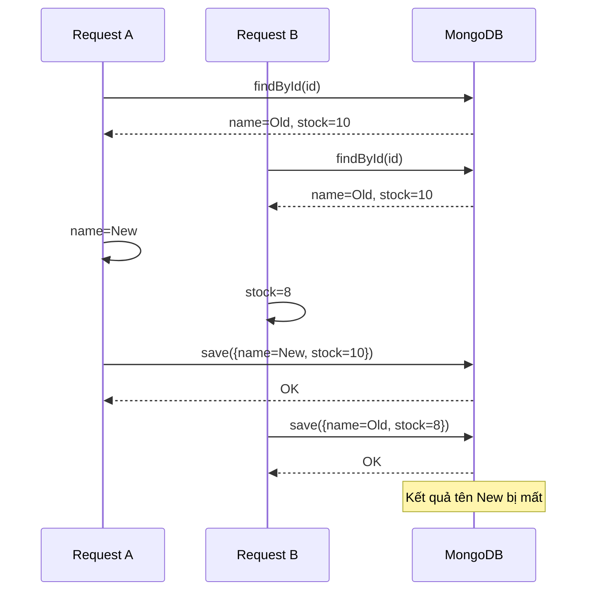
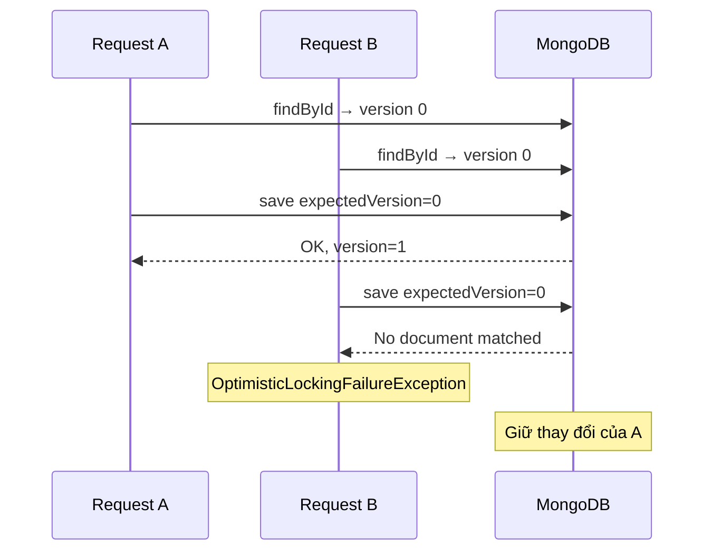

# Mất cập nhật (lost update) khi nhiều yêu cầu cùng lưu một document

Trong **Spring Data MongoDB**, một document có thể được đọc bởi nhiều HTTP request, background job hoặc consumer cùng lúc. Nếu hai luồng đều đọc **cùng phiên bản cũ**, tự sửa entity trong bộ nhớ rồi gọi `save(...)`, thao tác ghi diễn ra sau có thể **ghi đè thay đổi hợp lệ của thao tác trước**. Hiện tượng đó gọi là **mất cập nhật — lost update**.

MongoDB bảo đảm **một thao tác ghi trên một document có tính nguyên tử**, nhưng điều đó **không bảo đảm** một chuỗi *đọc → tính toán tại Java → ghi lại toàn document* là nguyên tử. Đây là khác biệt cốt lõi cần nắm khi dùng `MongoRepository` hoặc `MongoTemplate` trong ứng dụng có nhiều người dùng.

Bài thuộc chương **Kiểm soát đồng thời** của module **SPRING_DATA_MONGODB**: kết nối và mapping document, thao tác MongoDB qua `MongoTemplate` hoặc repository, thiết kế truy vấn và index, transaction, reactive access, kiểm thử và chẩn đoán hiệu năng. Ta sẽ tái hiện lost update, so sánh ba chiến lược chống lỗi (`@Version`, update nguyên tử và compare-and-set), xét transaction/retry, rồi xây integration test kiểm chứng hành vi trên MongoDB thật.

## 1. Một ví dụ rất dễ xảy ra: sửa tên và giảm tồn kho

Giả sử collection `inventory_items` có một sản phẩm:

```javascript
{
  _id: ObjectId("674000000000000000003001"),
  tenant_id: "T1",
  sku: "KB-01",
  display_name: "Bàn phím cơ",
  stock: 10
}
```

Hai request độc lập chạy gần đồng thời:

- **Request A**: nhân viên sửa `display_name` thành `"Bàn phím cơ Pro"`.
- **Request B**: hệ thống ghi nhận xuất kho 2 sản phẩm, nên muốn `stock=8`.

Cả hai đều đọc bản gốc trước khi bên kia lưu. Mỗi bên giữ một **Java object khác nhau** nhưng cùng biểu diễn document MongoDB ban đầu.

```text
Thời điểm   Request A (đổi tên)          Request B (xuất kho)
---------   ---------------------------   ---------------------------
t0          Đọc name="Bàn phím cơ"       Đọc name="Bàn phím cơ"
            stock=10                      stock=10
t1          Sửa name="... Pro"           Tính stock = 10 - 2 = 8
t2          save(A)                        ...
            DB: name="... Pro", stock=10
t3          ...                            save(B)
                                           DB: name="Bàn phím cơ", stock=8
t4          Tên mới của A đã bị ghi đè!
```

Hai thao tác `save` riêng lẻ đều có thể thành công. **Không có exception** nào báo rằng A vừa mất kết quả do B ghi entity cũ. Trạng thái cuối phụ thuộc thứ tự ghi thực tế.



Đây không phải vì MongoDB thực thi *nửa thao tác save* của A rồi *nửa thao tác save* của B. Mỗi ghi vẫn nguyên tử ở document; chính **bản sao dữ liệu cũ** được B ghi lại đã thay thế phần A vừa cập nhật.

## 2. Lost update khác với dirty read và write conflict

Những thuật ngữ này mô tả các lỗi khác nhau:

| Thuật ngữ | Ý nghĩa | Liên hệ ví dụ |
| --- | --- | --- |
| **Lost update** | Một thay đổi đã ghi bị một thay đổi khác dựa trên dữ liệu cũ ghi đè | Tên mới của A biến mất sau `save(B)` |
| Dirty read | Đọc dữ liệu chưa commit của một giao dịch khác | Không phải vấn đề trong ví dụ |
| Write conflict | Server phát hiện hai thao tác không thể cùng tiếp tục theo ngữ nghĩa transaction, có thể yêu cầu abort/retry | Có thể gặp trong MongoDB transaction |
| Stale object | Entity Java được đọc trước và đã lỗi thời so với DB | B là stale khi A đã save |
| Optimistic locking failure | Một thao tác kiểm tra version không còn match; framework báo xung đột | Có thể dùng `@Version` để phát hiện |
| Duplicate business operation | Cùng yêu cầu được xử lý nhiều lần, ví dụ xuất kho trừ hai lần | Cần idempotency; không hoàn toàn là lost update |

**Một thao tác thành công về mặt database không luôn tương đương thành công về mặt nghiệp vụ.** Khi quyết định phản hồi 200, 409 hoặc retry, service cần hiểu thao tác đã ghi có bảo vệ được điều kiện người dùng mong muốn hay không.

## 3. Vì sao single-document atomicity không tự bảo vệ read-modify-write?

Trong MongoDB, các lệnh như:

```javascript
db.inventory_items.updateOne(
  { _id: ObjectId("674000000000000000003001") },
  { $set: { display_name: "Bàn phím cơ Pro" } }
);
```

là nguyên tử đối với **một document**. Một lệnh khác:

```javascript
db.inventory_items.updateOne(
  { _id: ObjectId("674000000000000000003001") },
  { $inc: { stock: -2 } }
);
```

cũng nguyên tử. Nếu hai lệnh chỉ thay **hai field độc lập** như trên, chúng không có nhu cầu ghi đè toàn document và có thể giữ cả hai thay đổi.

Nhưng chuỗi Java sau **không phải một MongoDB atomic operation**:

```java
InventoryItem item = repository.findById(id).orElseThrow();
item.setStock(item.getStock() - 2);
repository.save(item);
```

Giữa `findById` và `save`, request khác có thể thay document. MongoDB không thể suy ra rằng Java chỉ định thay `stock` nhưng object `item` còn mang `displayName` cũ. Tùy cơ chế persistence, `save` trên entity hiện có có thể ghi lại toàn bộ document đã ánh xạ, gây lost update trên field không chủ ý sửa.

**Không dùng `synchronized` ở một service instance để giải quyết tình huống phân tán:** nhiều replica JVM, background consumers hoặc admin scripts vẫn có thể ghi cùng MongoDB document. Khóa trong một process chỉ kiểm soát các thread của process ấy.

## 4. Entity mẫu không có version: lỗi nằm ở read rồi save

Ta bắt đầu với entity **không có `@Version`**:

```java
import org.bson.types.ObjectId;
import org.springframework.data.annotation.Id;
import org.springframework.data.mongodb.core.mapping.Document;
import org.springframework.data.mongodb.core.mapping.Field;

@Document("inventory_items_unversioned")
public class UnversionedItem {
    @Id
    private ObjectId id;

    @Field("tenant_id")
    private String tenantId;

    private String sku;

    @Field("display_name")
    private String displayName;

    private int stock;

    public UnversionedItem() {}

    public UnversionedItem(
            ObjectId id, String tenantId, String sku,
            String displayName, int stock) {
        this.id = id;
        this.tenantId = tenantId;
        this.sku = sku;
        this.displayName = displayName;
        this.stock = stock;
    }

    public ObjectId getId() { return id; }
    public String getTenantId() { return tenantId; }
    public String getSku() { return sku; }
    public String getDisplayName() { return displayName; }
    public int getStock() { return stock; }
    public void setDisplayName(String value) { displayName = value; }
    public void setStock(int value) { stock = value; }
}
```

Repository:

```java
import org.bson.types.ObjectId;
import org.springframework.data.mongodb.repository.MongoRepository;

public interface UnversionedItemRepository
        extends MongoRepository<UnversionedItem, ObjectId> {
}
```

Ví dụ tái hiện deterministic, không cần chạy hai thread thật:

```java
ObjectId id = new ObjectId();
repository.save(new UnversionedItem(
    id, "T1", "KB-01", "Bàn phím cơ", 10
));

// Hai snapshot giống nhau, như hai request đọc đồng thời.
UnversionedItem fromA = repository.findById(id).orElseThrow();
UnversionedItem fromB = repository.findById(id).orElseThrow();

// A chỉ muốn đổi tên.
fromA.setDisplayName("Bàn phím cơ Pro");
repository.save(fromA);

// B chỉ muốn trừ tồn kho, nhưng save lại toàn entity cũ.
fromB.setStock(8);
repository.save(fromB);

// Có thể đọc thấy displayName trở lại "Bàn phím cơ".
```

Đây là tình huống **last write wins**, không phải optimistic concurrency control. Đổi thứ tự lưu thì request B có thể là bên bị ghi đè.

**Chú ý:** `MongoRepository.save(...)` có thể thực hiện insert/update/replace tùy trạng thái entity, loại ID, version và phiên bản framework. Ý nghĩa rủi ro ở đây là **ghi trạng thái stale của nhiều field**, không dựa vào một lựa chọn lệnh nội bộ duy nhất.

## 5. Giải pháp 1 — @Version để phát hiện thay đổi đồng thời

Spring Data MongoDB hỗ trợ **optimistic locking** bằng `@Version`. Entity giữ một trường version, và các đường lưu được hỗ trợ sẽ **so khớp version hiện tại** với version của object đã đọc.

```java
import org.bson.types.ObjectId;
import org.springframework.data.annotation.Id;
import org.springframework.data.annotation.Version;
import org.springframework.data.mongodb.core.mapping.Document;
import org.springframework.data.mongodb.core.mapping.Field;

@Document("inventory_items")
public class InventoryItem {
    @Id
    private ObjectId id;

    @Field("tenant_id")
    private String tenantId;

    private String sku;

    @Field("display_name")
    private String displayName;

    private int stock;

    @Version
    private Long version;

    public InventoryItem() {}

    public InventoryItem(
            ObjectId id, String tenantId, String sku,
            String displayName, int stock) {
        this.id = id;
        this.tenantId = tenantId;
        this.sku = sku;
        this.displayName = displayName;
        this.stock = stock;
    }

    public ObjectId getId() { return id; }
    public String getTenantId() { return tenantId; }
    public String getSku() { return sku; }
    public String getDisplayName() { return displayName; }
    public int getStock() { return stock; }
    public Long getVersion() { return version; }

    public void setDisplayName(String value) { displayName = value; }
    public void setStock(int value) { stock = value; }
}
```

Chọn `Long` thay vì `long` để new entity có version `null` trước lần insert; Spring Data thường khởi tạo version cho entity mới, rồi tăng qua mỗi lần lưu thành công trên các thao tác hỗ trợ. **Không tự sửa field version trong DTO/request**; version là metadata kiểm soát cạnh tranh do ứng dụng và persistence layer quản lý.

Một bản ghi sau insert thường có:

```javascript
{
  _id: ObjectId("674000000000000000003001"),
  tenant_id: "T1",
  sku: "KB-01",
  display_name: "Bàn phím cơ",
  stock: 10,
  version: NumberLong("0")
}
```

Giá trị version bắt đầu là `0` cho wrapper numeric trên các phiên bản Spring Data thông dụng. Đừng hard-code số phiên bản khởi tạo trong business logic; test nên kiểm tra **version tăng**, không phụ thuộc vào dữ liệu giả định đã tồn tại trước migration.

## 6. @Version xử lý hai lần save stale như thế nào?

Giả sử cả A và B đọc `version=0`:

```text
t0  DB:  name=Old, stock=10, version=0
t1  A đọc version=0; B đọc version=0
t2  A save(name=New, expectedVersion=0)
    → match, ghi, version tăng thành 1
t3  B save(stock=8, expectedVersion=0)
    → không match: DB hiện version=1
    → OptimisticLockingFailureException
t4  DB vẫn giữ name=New, stock=10, version=1
```



Thông thường Spring Data thực hiện so khớp `_id + version` và tăng version trong cùng thao tác ghi. Nếu version không khớp, Spring Data ném **`OptimisticLockingFailureException`** thay vì ghi đè âm thầm.

**Điều kiện quan trọng:** optimistic locking cần **write concern có xác nhận** (acknowledged). Với `WriteConcern.UNACKNOWLEDGED`, framework không thể tin cậy vào số document matched để nhận diện version conflict. Hãy kiểm tra cấu hình write concern của MongoTemplate/repository, không dựa vào annotation một cách mù quáng.

## 7. Repository.save với @Version: đoạn xử lý cơ bản

```java
import org.bson.types.ObjectId;
import org.springframework.data.mongodb.repository.MongoRepository;

public interface InventoryRepository
        extends MongoRepository<InventoryItem, ObjectId> {
}
```

Service đọc rồi lưu:

```java
import org.bson.types.ObjectId;
import org.springframework.dao.OptimisticLockingFailureException;
import org.springframework.stereotype.Service;

@Service
public class InventoryAdminService {
    private final InventoryRepository repository;

    public InventoryAdminService(InventoryRepository repository) {
        this.repository = repository;
    }

    public InventoryItem rename(
            ObjectId id, String expectedTenant, String newName) {

        InventoryItem item = repository.findById(id)
            .orElseThrow(() -> new IllegalArgumentException("Not found"));

        if (!expectedTenant.equals(item.getTenantId())) {
            throw new IllegalArgumentException("Not found");
        }
        if (newName == null || newName.isBlank()) {
            throw new IllegalArgumentException("Tên không hợp lệ");
        }

        item.setDisplayName(newName.trim());

        // Nếu có save khác cùng id dựa trên cùng version,
        // đường save hỗ trợ @Version sẽ phát hiện mismatch.
        return repository.save(item);
    }
}
```

Ví dụ ưu tiên đơn giản để tập trung vào `@Version`. Ở hệ thống đa tenant, nên **đưa tenant vào chính truy vấn đọc** thay vì chỉ gọi `findById` rồi kiểm tra Java, nhất là khi có chính sách truy cập dữ liệu chặt chẽ. Có thể dùng derived method `findByIdAndTenantId(...)` hoặc `MongoOperations.findOne` với `id+tenantId`.

**Không catch `OptimisticLockingFailureException` rồi mặc định trả thành công.** Nếu xung đột xảy ra, request chưa được áp dụng như yêu cầu. Nên trả HTTP 409, hoặc retry theo nghiệp vụ sau khi đã đọc lại trạng thái mới.

## 8. @Version phát hiện chứ không tự hợp nhất thay đổi

Giả sử A đổi tên, B trừ stock. Khi B gặp optimistic-lock failure, Spring Data **không tự quyết định** có thể hợp nhất hai thay đổi hay không. Có ba hướng:

1. **Báo conflict** cho caller; người dùng tải lại dữ liệu và xác nhận hành động.
2. **Đọc lại, áp dụng lại ý định** của B trên version mới, rồi save; chỉ khi hành động an toàn/idempotent.
3. **Đổi loại thao tác** của B sang cập nhật nguyên tử `$inc`/conditional update, không đọc rồi save toàn document.

Nếu request B nhận `stock=8` như một **giá trị tuyệt đối** do UI gửi sau khi đọc stock=10, không được tự đoán rằng người dùng muốn giảm 2 từ mọi trạng thái. Ngược lại, nếu request B là lệnh **“xuất kho đúng 2 đơn vị”**, thì `$inc:-2` kết hợp điều kiện đủ hàng thường diễn đạt đúng hơn.

**Mẫu chống lost update phải bảo vệ ý nghĩa nghiệp vụ**, không chỉ tìm cách làm exception biến mất.

## 9. Giải pháp 2 — update nguyên tử chỉ các field cần sửa

Thay vì dùng `findById → set field → save entity`, có thể dùng `MongoTemplate.updateFirst` với `$set` để cập nhật đúng property mong muốn:

```java
import com.mongodb.client.result.UpdateResult;
import org.bson.types.ObjectId;
import org.springframework.data.mongodb.core.MongoOperations;
import org.springframework.data.mongodb.core.query.Criteria;
import org.springframework.data.mongodb.core.query.Query;
import org.springframework.data.mongodb.core.query.Update;

public boolean renameWithoutReplacingOtherFields(
        MongoOperations operations,
        ObjectId id, String tenantId, String newName) {

    Query target = Query.query(
        Criteria.where("id").is(id).and("tenantId").is(tenantId)
    );

    Update patch = new Update().set("displayName", newName);

    UpdateResult result =
        operations.updateFirst(target, patch, InventoryItem.class);

    return result.getMatchedCount() == 1;
}
```

Do dùng typed mapping `InventoryItem.class`, Spring Data hiểu Java property `displayName` cần ghi vào BSON `display_name` và `tenantId` thành `tenant_id`. Trên document có `@Version`, một số Spring Data update APIs có thể tự tăng version nếu không được chỉ rõ trong update; **việc tăng version không tự làm thao tác này trở thành CAS theo version cũ**.

Một lệnh khác cùng lúc:

```java
Update patch = new Update().inc("stock", -2);
operations.updateFirst(target, patch, InventoryItem.class);
```

chỉ điều chỉnh `stock`. Hai cập nhật tới hai field khác nhau không phải **full replacement từ stale entity**, nên không gây lost update kiểu “B trả tên cũ của A về DB”.

**Giới hạn:** hai câu lệnh `$set` cùng ghi **một field** vẫn có thể xảy ra **last write wins** nếu không có guard. Partial update giảm bề mặt ghi đè, không tự giải quyết mọi conflict.

## 10. Stock và biến đếm: dùng $inc có điều kiện

Nếu yêu cầu nghiệp vụ là “xuất 2 đơn vị khi vẫn còn đủ hàng”, tránh:

```java
// Rủi ro: hai request đều đọc stock=10 rồi set 8.
InventoryItem item = repository.findById(id).orElseThrow();
if (item.getStock() >= 2) {
    item.setStock(item.getStock() - 2);
    repository.save(item);
}
```

Dùng một update atomic kiểm tra điều kiện và cập nhật trong **cùng một lệnh**:

```java
import com.mongodb.client.result.UpdateResult;
import org.springframework.data.mongodb.core.query.Criteria;
import org.springframework.data.mongodb.core.query.Query;
import org.springframework.data.mongodb.core.query.Update;

Query target = Query.query(
    Criteria.where("id").is(id)
        .and("tenantId").is(tenantId)
        .and("stock").gte(2)
);

Update decrement = new Update().inc("stock", -2);

UpdateResult result =
    mongoOperations.updateFirst(
        target, decrement, InventoryItem.class
    );

if (result.getMatchedCount() == 0) {
    throw new IllegalStateException(
        "Không tìm thấy sản phẩm hoặc không đủ hàng"
    );
}
```

Nếu hai yêu cầu cùng trừ stock khi còn 2:

```text
DB: stock=2

A: filter stock >= 2, $inc -2  → match, stock=0
B: filter stock >= 2, $inc -2  → không match, stock vẫn 0
```

MongoDB đánh giá điều kiện lọc trên trạng thái document liên quan khi áp dụng update, vì vậy không thể đồng thời trừ xuống âm qua hai lệnh có guard này nếu không có write bypass khác. `matchedCount=0` **không phải write error**; service phải xử lý hết hàng, không tồn tại hoặc sai tenant theo chính sách.

**Idempotency vẫn quan trọng:** nếu client gửi **cùng request xuất kho** hai lần, hai lần `$inc:-2` có thể đều được áp dụng khi còn đủ hàng. Một conditional decrement không tự bảo vệ việc xử lý lặp của **cùng business event**.

## 11. Giải pháp 3 — compare-and-set bằng expectedVersion

Nếu thao tác cần kiểm tra rằng document **chưa thay đổi kể từ lúc người dùng xem**, dùng **CAS (compare-and-set)** bằng version:

```java
import com.mongodb.client.result.UpdateResult;
import org.bson.types.ObjectId;
import org.springframework.data.mongodb.core.MongoOperations;
import org.springframework.data.mongodb.core.query.Criteria;
import org.springframework.data.mongodb.core.query.Query;
import org.springframework.data.mongodb.core.query.Update;

public boolean renameWithExpectedVersion(
        MongoOperations operations,
        ObjectId id, String tenantId,
        long expectedVersion, String newName) {

    Query filter = Query.query(
        Criteria.where("id").is(id)
            .and("tenantId").is(tenantId)
            .and("version").is(expectedVersion)
    );

    Update patch = new Update()
        .set("displayName", newName)
        .inc("version", 1L);

    UpdateResult result = operations.updateFirst(
        filter, patch, InventoryItem.class
    );

    return result.getMatchedCount() == 1;
}
```

Ở đây **kiểm tra version và cập nhật field/version diễn ra trong cùng một MongoDB update**. Khi một request thành công nâng version từ 3 lên 4, request khác gửi `expectedVersion=3` không còn match.

### Vì sao có .inc("version", 1L)?

Khi viết CAS tường minh, cần bảo đảm version **thay đổi trong chính operation**. Đoạn mã đưa `version` vào update spec với `$inc`, nên đây là phiên bản mà thao tác **tự kiểm soát cả predicate và việc tăng version**.

Spring Data MongoDB có thể tự tăng `@Version` đối với một số `updateFirst/updateMulti` khi version chưa được đề cập trong `Update`. **Đừng tăng version hai lần.** Nếu dùng `.inc("version",1L)` như ví dụ, không thêm một thao tác increment khác ở service.

**Cũng đừng chỉ tăng version mà không kiểm tra expectedVersion**: làm vậy giúp bộ đếm tăng nhưng không phát hiện stale write từ caller. Trong bài, `.and("version").is(expectedVersion)` mới là điều kiện kiểm soát xung đột.

## 12. Chọn @Version hay CAS tường minh?

| Nhu cầu | `@Version` cùng `repository.save` | CAS qua `updateFirst` |
| --- | --- | --- |
| Người dùng sửa nhiều property của entity | Phù hợp, phát hiện stale entity | Có thể làm nhưng phải tự dựng patch |
| Chỉ sửa một field, không muốn thay field khác | Save có thể gửi nhiều field | **Ưu tiên** `$set` một field |
| Cần expectedVersion từ UI | Có thể đọc/sửa entity theo version, quản lý trong service | **Tường minh** qua filter version |
| Cần cập nhật giảm stock khi đủ hàng | Cần đọc rồi save/kiểm tra xung đột | **Ưu tiên** guard stock + `$inc` |
| Lỗi version mismatch | Framework ném optimistic-lock exception | `matchedCount=0`; service tự chuyển thành conflict |
| Auditing/lifecycle callbacks | Có thể theo đường `save` được hỗ trợ | Không nhất thiết giống `save` |
| Tối ưu lượng dữ liệu gửi | Thường thao tác với entity đầy đủ | Patch nhỏ hơn |
| Cần nhiều document cùng commit/rollback | `@Version` không giải quyết | CAS cũng không giải quyết; xem transaction |

Hai cách có thể cùng tồn tại trong hệ thống: `save` có version để sửa entity, `updateFirst` để sửa field riêng, cả hai phải có chính sách version nhất quán để tránh bỏ lọt các writers.

## 13. Một API HTTP cần phân biệt 404, 409 và 422

Giả sử người dùng mở form sửa tên khi document có version 7, rồi submit sau khi đồng nghiệp đã đổi thành version 8. Nếu backend ghi đè im lặng, thay đổi đồng nghiệp có thể mất.

Một hợp đồng API hợp lý:

```json
// Client đã đọc:
{
  "id": "674000000000000000003001",
  "displayName": "Bàn phím cơ",
  "stock": 10,
  "version": 7
}
```

Request:

```http
PATCH /api/inventory/674000000000000000003001
If-Match: "7"
Content-Type: application/json

{"displayName":"Bàn phím cơ Pro"}
```

`If-Match` trong ví dụ là **quy ước ETag/version do ứng dụng định nghĩa**: nếu dùng HTTP ETag chuẩn, cần tạo, trích dẫn và so khớp ETag đúng đặc tả HTTP (có thể mã hóa version thành một ETag opaque thay vì dùng version thô).

Service chuyển version client cung cấp thành `expectedVersion` trong CAS. Kết quả:

- **200/204** khi match và ghi thành công.
- **404** khi không có document trong phạm vi tenant được phép; tránh để lộ document của tenant khác.
- **409 Conflict** hoặc **412 Precondition Failed** khi version/precondition không còn hợp lệ, tùy hợp đồng HTTP.
- **400/422** khi dữ liệu request không hợp lệ, ví dụ tên rỗng hoặc xuất kho âm.
- **503/5xx** với lỗi hạ tầng không thể kết luận đã ghi hay chưa; cần chính sách đối soát/retry rõ.

Trong trường hợp `matchedCount=0` từ CAS, service có thể đọc lại để phân biệt không tìm thấy và version mismatch, **nhưng phải bảo vệ quyền/tenant** và chấp nhận dữ liệu có thể đổi thêm giữa các lần đọc. Không phân biệt 404/409 bằng cách truy vấn global bỏ điều kiện tenant.

## 14. Trường hợp partial update cũng gây lost update

`$set` lên field độc lập tránh overwrite field khác, nhưng nếu hai request cùng cập nhật một field, ta vẫn có vấn đề ngữ nghĩa:

```text
DB: price=100

A đọc price=100, muốn tăng 10% → tính 110
B đọc price=100, muốn giảm 5% → tính 95

A: $set(price=110) → DB=110
B: $set(price=95)  → DB=95
```

`$set` của B **không cần thay toàn document** nhưng đã ghi đè giá 110 của A. Nếu nghiệp vụ là hai phép biến đổi tương đối cần áp dụng nối tiếp, cần:

- Express phép biến đổi bằng **atomic update expression** khi thích hợp.
- Hoặc CAS theo expectedVersion rồi tính lại trên giá trị mới.
- Hoặc reject conflict để chủ sở hữu dữ liệu quyết định.
- Hoặc nghiệp vụ tuyên bố **last write wins** là chính sách hợp lệ, và ghi log/audit cho quyết định đó.

Không coi “dùng `MongoTemplate.updateFirst`” là bảo hiểm chung cho mọi lost update.

## 15. findAndModify: đọc và sửa trong một lệnh

`findAndModify` giúp cập nhật theo điều kiện và trả document **trước hoặc sau update** trong một thao tác atomic trên document.

```java
import org.springframework.data.mongodb.core.FindAndModifyOptions;
import org.springframework.data.mongodb.core.MongoOperations;
import org.springframework.data.mongodb.core.query.Criteria;
import org.springframework.data.mongodb.core.query.Query;
import org.springframework.data.mongodb.core.query.Update;

public InventoryItem allocateStock(
        MongoOperations operations,
        ObjectId id, String tenantId, int quantity) {

    if (quantity <= 0) {
        throw new IllegalArgumentException("Số lượng phải dương");
    }

    Query filter = Query.query(
        Criteria.where("id").is(id)
            .and("tenantId").is(tenantId)
            .and("stock").gte(quantity)
    );

    Update patch = new Update().inc("stock", -quantity);

    InventoryItem updated = operations.findAndModify(
        filter,
        patch,
        FindAndModifyOptions.options().returnNew(true),
        InventoryItem.class
    );

    if (updated == null) {
        throw new IllegalStateException(
            "Sản phẩm không tồn tại hoặc không đủ hàng"
        );
    }
    return updated;
}
```

Khác với chuỗi `find → tính stock tại Java → save`, filter và update được server xử lý trong cùng lệnh. `returnNew(true)` yêu cầu kết quả sau cập nhật; mặc định API có thể trả giá trị trước cập nhật.

**Không tự xem kết quả returnNew là bằng chứng không còn cạnh tranh sau lệnh**: request khác có thể cập nhật ngay sau đó. Kết quả chỉ là trạng thái gắn với thao tác atomic của chính request.

## 16. Transaction có giải quyết mọi lost update không?

MongoDB multi-document transaction cho phép nhóm các ghi **cùng commit hoặc rollback** trên topology hỗ trợ. Nhưng:

- Tạo transaction không thay thế việc xác định **điều kiện nghiệp vụ** nào cần bảo vệ.
- Hai transaction cùng cố ghi một document có thể gặp **write conflict**; một transaction bị abort và cần retry toàn bộ logic.
- Một request không dùng transaction hoặc code cũ vẫn có thể ghi đè nếu nó không dùng optimistic locking/CAS phù hợp.
- Transaction có chi phí, thời hạn, memory và quy tắc session; không nên mở transaction chỉ để đổi một field khi một atomic update đã đủ.

Ví dụ cấu trúc service nhiều document:

```java
import org.springframework.stereotype.Service;
import org.springframework.transaction.annotation.Transactional;

@Service
public class OrderAllocationService {
    private final MongoOperations operations;

    public OrderAllocationService(MongoOperations operations) {
        this.operations = operations;
    }

    @Transactional(transactionManager = "mongoTransactionManager")
    public void allocateAndAudit(/* id, tenant, quantity, eventId */) {
        // 1. $inc stock với điều kiện >= quantity.
        // 2. Chỉ khi matchedCount=1, insert audit event
        //    trong cùng MongoDB transaction.
        // 3. Nếu audit insert lỗi, ném RuntimeException để rollback.
    }
}
```

Đây là **khung ý tưởng**, không phải đoạn code thực thi đầy đủ: còn cần inject dependencies, validation, xây Query/Update và ghi audit. Muốn transaction thật sự hoạt động, phải có `MongoTransactionManager` đúng `MongoDatabaseFactory` và MongoDB replica set/sharded cluster hỗ trợ; gọi `@Transactional` qua Spring proxy, không tự mở MongoClient/session riêng trong fragment.

**Đối với đúng một document**, một conditional update atomic thường ngắn gọn và ít overhead hơn transaction. Khi cần đồng thời cập nhật `inventory_items` và ghi `stock_movements` theo invariant “cả hai cùng tồn tại”, transaction có thể cần thiết.

## 17. Retry khi gặp optimistic locking failure: phải đọc lại

Một sai lầm phổ biến:

```java
// Không làm thế này:
InventoryItem stale = repository.findById(id).orElseThrow();

try {
    repository.save(stale);
} catch (OptimisticLockingFailureException ex) {
    repository.save(stale); // Cùng object/version cũ: không xử lý conflict.
}
```

Retry đúng phải **đọc trạng thái mới** và áp dụng **lại ý định nghiệp vụ**. Ví dụ đổi tên nếu hệ thống chấp nhận người dùng ghi trên trạng thái mới:

```java
import org.springframework.dao.OptimisticLockingFailureException;

public InventoryItem renameWithBoundedRetry(
        ObjectId id, String tenantId, String newName) {

    for (int attempt = 0; attempt < 3; attempt++) {
        InventoryItem latest = repository.findById(id).orElseThrow();
        if (!tenantId.equals(latest.getTenantId())) {
            throw new IllegalArgumentException("Not found");
        }

        latest.setDisplayName(newName);

        try {
            return repository.save(latest);
        } catch (OptimisticLockingFailureException conflict) {
            if (attempt == 2) {
                throw conflict; // Hết retry budget.
            }
        }
    }

    throw new IllegalStateException("Unreachable");
}
```

Đoạn này là **ví dụ chiến lược có điều kiện**, không phải lời khuyên retry mọi xung đột. Nó bảo vệ khỏi overwrite stale toàn document, nhưng việc **cứ tiếp tục đổi tên** sau khi đồng nghiệp vừa đổi tên có thể không phù hợp. Với form chỉnh sửa của con người, nên báo conflict để họ so sánh.

Đối với trừ stock, thường **không nên retry read-modify-save theo cách này** nếu event đã có thể được áp dụng trước đó. Dùng conditional `$inc` và idempotency key thuận tiện hơn.

## 18. Retry không thay cho idempotency

Giả sử API `POST /allocations` nhận lệnh xuất kho 2 sản phẩm. Server thực thi `$inc:-2` thành công, nhưng kết nối bị ngắt **trước khi client nhận phản hồi**. Client gửi lại cùng request.

Nếu chỉ có `stock>=2`, lần gửi lại có thể trừ thêm 2. Đây là **xử lý lặp cùng một nghiệp vụ**, khác với lost update do stale entity.

Giải pháp:

- Mỗi allocation có một **requestId/stockMovementId** ổn định khi retry.
- Một collection ghi nhận movement có **unique index** theo tenant và request ID.
- Trong MongoDB transaction (nếu cần nguyên tử giữa stock và movement), insert movement và decrement stock cùng commit/rollback.
- Với mô hình nhúng, có thể dùng conditional update và lưu dấu requestId trên cùng document nếu tập marker có giới hạn và được thiết kế kỹ.
- Khi client không chắc yêu cầu đã hoàn tất, **đối soát theo requestId**, không tự suy đoán và trừ tiếp.

`@Version` phát hiện stale update; `$inc` làm phép cộng/trừ atomic; **idempotency** chống thực thi lặp cùng yêu cầu; transaction bảo vệ commit/rollback đa document. Bốn cơ chế có mục tiêu khác nhau.

## 19. @Version và các đường ghi khác nhau trong Spring Data

`@Version` đặc biệt hữu ích với `save` của Spring Data, nhưng **không được suy rộng** rằng mọi đường ghi đều dùng CAS theo version của object.

| Đường ghi | Cần nhớ |
| --- | --- |
| `MongoRepository.save(entity)` | Dùng optimistic locking với version của entity trên đường được hỗ trợ |
| `MongoTemplate.save(entity)` | Tương tự khi mapping entity có `@Version` và write concern acknowledged |
| `MongoOperations.updateFirst(query, update, Entity.class)` | Có thể tự tăng version nếu chưa có trong Update; **không tự so sánh expected version của object cũ** |
| `MongoOperations.updateMulti(...)` | Cập nhật nhiều document, version semantics khác `save` entity; phải thiết kế filter |
| `MongoOperations.findAndModify(...)` | Atomic update theo filter, có thể đọc kết quả mới; muốn CAS phải đưa version vào filter |
| `BulkOperations` | Không dựa vào optimistic locking tự động kiểu `save` từng entity; mỗi operation cần chính sách riêng |
| Native `MongoCollection<Document>.replaceOne/updateOne` | Không đọc annotation `@Version` của Spring; phải tự build filter/update nếu cần CAS |
| Spring Data delete theo entity/version | Một số overload kiểm tra version; `deleteById`/raw delete có semantics khác, cần đối chiếu API |

Nếu toàn hệ thống có hai đường ghi — một dùng `save` + `@Version`, một dùng native driver `replaceOne` theo mỗi `_id` — thì đường native có thể **vượt qua cơ chế phát hiện conflict**. Lập danh sách mọi writer (HTTP, consumer, scheduler, migration, shell scripts) khi điều tra lost update.

## 20. Lỗi khi “chỉ thêm @Version” vào dữ liệu đã có

Một collection production có thể chứa hàng triệu document **không có field version**. Nếu đột ngột thêm `@Version` vào entity:

- Những document cũ thiếu version cần được xử lý theo **semantics framework và migration plan** rõ ràng.
- Các chương trình cũ không biết version vẫn có thể dùng update/replace bỏ qua guard.
- Một số DTO có thể tình cờ expose version nhưng client lại gửi version tùy ý.
- Nếu update pipeline/bulk tự tăng version, cần tránh tăng hai lần.
- Các job reimport có thể ghi đè field version hoặc thay document không mong muốn.

Một lộ trình an toàn:

1. Rà soát data cũ: bao nhiêu document thiếu `version` hoặc sai kiểu BSON?
2. Xác định cách khởi tạo/migrate version, làm thử trên staging có dữ liệu thật.
3. Liệt kê tất cả đường ghi: repository, template, native driver, bulk, change processing.
4. Dừng/điều chỉnh các đường ghi không tôn trọng version.
5. Deploy code mới và theo dõi optimistic-lock failures, duplicate jobs, update latency.
6. Kiểm tra các nghiệp vụ sửa từ UI: expectedVersion/ETag và lỗi conflict có hiển thị đúng không?

**Không tùy tiện chạy `updateMany({},{$set:{version:0}})` trên mọi document production** nếu đã có writer đang sử dụng version khác hoặc một số record đã được migrate; migration cần idempotent và có điều kiện.

## 21. Multi-tenant: version đúng nhưng filter sai vẫn nguy hiểm

Trong một hệ thống đa tenant, bảo vệ xung đột và bảo vệ quyền là hai ràng buộc độc lập.

Đừng viết:

```java
Query unsafe = Query.query(
    Criteria.where("id").is(id)
        .and("version").is(expectedVersion)
);
// Thiếu tenant trong filter nếu id được lấy từ input không tin cậy.
```

Ưu tiên:

```java
Query guarded = Query.query(
    Criteria.where("id").is(id)
        .and("tenantId").is(authenticatedTenant)
        .and("version").is(expectedVersion)
);
```

Khi dùng entity `InventoryItem`, `tenantId` được ánh xạ sang BSON `tenant_id`. Không nhận `authenticatedTenant` từ body HTTP rồi tin ngay; phải lấy từ principal/session/context đáng tin cậy.

Nếu `matchedCount=0`, không nên trả lỗi phân biệt rõ “document thuộc tenant khác” với “không tồn tại” cho người dùng không được quyền xem. Giao diện quản trị nội bộ có thể trình bày 404 vs 409 sau khi truy vấn đúng scope, nhưng không leak thông tin định danh của tenant khác.

## 22. Reactive access và optimistic locking

Trong Spring Data MongoDB reactive, repository trả `Mono`/`Flux` thay vì giá trị trực tiếp. Cơ chế optimistic locking dựa trên `@Version` vẫn có ý nghĩa cho các thao tác reactive được hỗ trợ:

```java
import org.bson.types.ObjectId;
import org.springframework.data.mongodb.repository.ReactiveMongoRepository;
import reactor.core.publisher.Mono;

public interface ReactiveInventoryRepository
        extends ReactiveMongoRepository<InventoryItem, ObjectId> {
}
```

Ví dụ service:

```java
import org.springframework.dao.OptimisticLockingFailureException;
import reactor.core.publisher.Mono;

public Mono<InventoryItem> renameReactive(
        ObjectId id, String tenantId, String newName) {

    return reactiveRepository.findById(id)
        .switchIfEmpty(Mono.error(
            new IllegalArgumentException("Not found")
        ))
        .flatMap(item -> {
            if (!tenantId.equals(item.getTenantId())) {
                return Mono.error(
                    new IllegalArgumentException("Not found")
                );
            }

            item.setDisplayName(newName);
            return reactiveRepository.save(item);
        })
        .onErrorMap(
            OptimisticLockingFailureException.class,
            ex -> new IllegalStateException(
                "Document đã thay đổi; vui lòng tải lại", ex
            )
        );
}
```

Ví dụ dùng biến `reactiveRepository` được inject ở service. Trong production nên định nghĩa class/constructor đầy đủ và query theo tenant ngay từ repository.

- `Mono` thường thực thi khi được **subscribe**; không tự `subscribe()` trong service rồi làm mất lỗi.
- Hai subscribers dùng chung một entity mutable Java object có thể tạo thêm race **ngay trong bộ nhớ**; giữ trạng thái per request.
- Retry `Mono` phải xem xét việc **đọc lại** và idempotency, không lặp save của object stale.
- Transaction reactive dùng `ReactiveMongoTransactionManager` và Reactor Context; không trộn sync/async APIs rồi nghĩ chúng cùng transaction.
- Với một conditional update một document, một `ReactiveMongoTemplate.updateFirst` thường đủ mà không cần mở transaction.

## 23. Cơ sở kiểm thử: đừng chỉ mock repository

Mock `repository.save` trả thành công không chứng minh optimistic locking, vì logic version/atomicity thực tế nằm ở Spring Data mapping + MongoDB Server.

Một bộ kiểm thử tốt cần:

- Dùng **MongoDB instance dành riêng cho test** (ví dụ Testcontainers).
- Chèn dữ liệu bằng `MongoTemplate` hoặc repository để giữ metadata mapping đúng.
- Mô phỏng **hai bản snapshot của cùng document** được đọc trước khi một bản lưu.
- Quan sát exception version mismatch và trạng thái BSON cuối cùng.
- Với stock decrement, kiểm tra `matchedCount` và không âm.
- Với update CAS, kiểm tra một expectedVersion thành công, phiên bản cũ thất bại.
- Với native driver, xác minh có/không có version guard theo code thực.
- Với transaction, test trên replica set phù hợp; không dựa vào mock transaction manager.

Một deterministic test với **hai object độc lập và hai lần save nối tiếp** đã chứng minh chính xác race có thể xảy ra. Test nhiều thread bổ sung hữu ích, nhưng dễ flaky nếu không có barrier/latches.

## 24. Integration test: chứng minh lost update khi không có @Version

JUnit 5 và Spring Boot test slice, MongoDB test thực:

```java
import static org.assertj.core.api.Assertions.assertThat;

import org.bson.types.ObjectId;
import org.junit.jupiter.api.Test;
import org.springframework.beans.factory.annotation.Autowired;
import org.springframework.boot.test.autoconfigure.data.mongo.DataMongoTest;
import org.springframework.data.mongodb.core.MongoTemplate;

@DataMongoTest
class UnversionedLostUpdateTest {
    @Autowired MongoTemplate template;

    @Test
    void staleSaveOverwritesAnotherFieldsChange() {
        ObjectId id = new ObjectId();

        template.insert(new UnversionedItem(
            id, "test-T1", "KB-01", "Old", 10
        ));

        UnversionedItem requestA =
            template.findById(id, UnversionedItem.class);
        UnversionedItem requestB =
            template.findById(id, UnversionedItem.class);

        assertThat(requestA).isNotNull();
        assertThat(requestB).isNotNull();

        requestA.setDisplayName("New");
        template.save(requestA);

        requestB.setStock(8);
        template.save(requestB); // Save stale document.

        UnversionedItem actual =
            template.findById(id, UnversionedItem.class);

        assertThat(actual).isNotNull();
        assertThat(actual.getStock()).isEqualTo(8);
        assertThat(actual.getDisplayName()).isEqualTo("Old");
    }
}
```

Test này **cố ý chứng minh lỗi**, không phải gợi ý nên dùng cách save stale. Do hai object đã được đọc trước, không phụ thuộc scheduler/thread; nó tái hiện chính xác lịch ghi A thành công trước B.

Các test phải chạy trên database cô lập, không sửa hoặc xóa collection production. Nếu project có custom entity scanning/constructor mapping, đảm bảo hai entity mẫu được scan bởi test context.

## 25. Integration test: @Version chặn save stale

```java
import static org.assertj.core.api.Assertions.assertThat;
import static org.assertj.core.api.Assertions.assertThatThrownBy;

import org.bson.types.ObjectId;
import org.junit.jupiter.api.Test;
import org.springframework.beans.factory.annotation.Autowired;
import org.springframework.boot.test.autoconfigure.data.mongo.DataMongoTest;
import org.springframework.data.mongodb.core.MongoTemplate;
import org.springframework.dao.OptimisticLockingFailureException;

@DataMongoTest
class VersionedLostUpdateTest {
    @Autowired MongoTemplate template;

    @Test
    void versionRejectsSecondStaleSave() {
        ObjectId id = new ObjectId();

        InventoryItem created = template.insert(
            new InventoryItem(id, "test-T1", "KB-01", "Old", 10)
        );

        InventoryItem requestA =
            template.findById(id, InventoryItem.class);
        InventoryItem requestB =
            template.findById(id, InventoryItem.class);

        assertThat(requestA).isNotNull();
        assertThat(requestB).isNotNull();
        assertThat(requestA.getVersion())
            .isEqualTo(requestB.getVersion());

        requestA.setDisplayName("New");
        InventoryItem firstSaved = template.save(requestA);

        requestB.setStock(8);
        assertThatThrownBy(() -> template.save(requestB))
            .isInstanceOf(OptimisticLockingFailureException.class);

        InventoryItem actual =
            template.findById(id, InventoryItem.class);

        assertThat(actual).isNotNull();
        assertThat(actual.getDisplayName()).isEqualTo("New");
        assertThat(actual.getStock()).isEqualTo(10);
        assertThat(actual.getVersion())
            .isEqualTo(firstSaved.getVersion());
        assertThat(actual.getVersion())
            .isNotEqualTo(created.getVersion());
    }
}
```

**Lưu ý về object identity:** ví dụ lấy `created` từ lần insert rồi tiếp tục thực hiện `save(requestA)`. Tùy cách Spring Data trả và cập nhật object version, version của `created` thường vẫn là version ban đầu, nhưng để test **không phụ thuộc chuyện object có bị mutate ngoài dự kiến**, nên lưu giá trị version từ trước khi save:

```java
// Trong test thực tế, ghi nhận trước khi save:
Long beforeVersion = requestA.getVersion();

// Sau khi save:
assertThat(firstSaved.getVersion()).isGreaterThan(beforeVersion);
```

Nếu chuyển test sang cách dùng record immutable, các thao tác cập nhật cần tạo instance mới thay vì setter; optimistic locking vẫn dựa vào version của instance được lưu.

## 26. Integration test: update atomic và CAS

Kiểm tra stock 2 chỉ đủ cho một request trừ 2:

```java
import static org.assertj.core.api.Assertions.assertThat;

import com.mongodb.client.result.UpdateResult;
import org.bson.types.ObjectId;
import org.junit.jupiter.api.Test;
import org.springframework.beans.factory.annotation.Autowired;
import org.springframework.boot.test.autoconfigure.data.mongo.DataMongoTest;
import org.springframework.data.mongodb.core.MongoTemplate;
import org.springframework.data.mongodb.core.query.Criteria;
import org.springframework.data.mongodb.core.query.Query;
import org.springframework.data.mongodb.core.query.Update;

@DataMongoTest
class ConditionalInventoryUpdateTest {
    @Autowired MongoTemplate template;

    @Test
    void stockGuardPreventsSecondAllocation() {
        ObjectId id = new ObjectId();
        String tenant = "test-" + new ObjectId().toHexString();

        template.insert(new InventoryItem(
            id, tenant, "KB-01", "Keyboard", 2
        ));

        Query filter = Query.query(
            Criteria.where("id").is(id)
                .and("tenantId").is(tenant)
                .and("stock").gte(2)
        );

        Update patch = new Update().inc("stock", -2);

        UpdateResult a = template.updateFirst(
            filter, patch, InventoryItem.class
        );
        UpdateResult b = template.updateFirst(
            filter, patch, InventoryItem.class
        );

        assertThat(a.getMatchedCount()).isEqualTo(1);
        assertThat(b.getMatchedCount()).isZero();

        InventoryItem stored =
            template.findById(id, InventoryItem.class);

        assertThat(stored).isNotNull();
        assertThat(stored.getStock()).isZero();
    }

    @Test
    void expectedVersionMakesCompareAndSet() {
        ObjectId id = new ObjectId();
        String tenant = "test-" + new ObjectId().toHexString();

        InventoryItem entity = template.insert(new InventoryItem(
            id, tenant, "KB-02", "Keyboard", 5
        ));
        long expectedVersion = entity.getVersion();

        Query guard = Query.query(
            Criteria.where("id").is(id)
                .and("tenantId").is(tenant)
                .and("version").is(expectedVersion)
        );

        Update change = new Update()
            .set("displayName", "Keyboard Plus")
            .inc("version", 1L);

        UpdateResult first =
            template.updateFirst(guard, change, InventoryItem.class);
        UpdateResult stale =
            template.updateFirst(guard, change, InventoryItem.class);

        assertThat(first.getMatchedCount()).isEqualTo(1);
        assertThat(stale.getMatchedCount()).isZero();
    }
}
```

Hai lần update nối tiếp với **cùng filter version** chứng minh logic CAS; chạy thật song song có thể bổ sung để kiểm tra under load. Với stock filter, thao tác thứ hai không match vì state thay từ 2 xuống 0. Với version filter, thao tác thứ hai không match vì version đã tăng.

Dùng `int stock` cho ví dụ nhỏ; khi hệ thống có số lượng lớn, xem xét kiểu `long` và validation để tránh tràn số hoặc số âm không hợp lệ.

## 27. Test hai thread thật với barrier: tránh race test may rủi

Một test concurrency cơ bản có thể:

1. Khởi tạo document có `@Version`.
2. Tạo **hai task**; mỗi task gọi `findById` để lấy snapshot riêng.
3. Sau khi cả hai đọc xong, dùng `CountDownLatch` nhả cho cả hai save.
4. Mỗi task sửa một field khác nhau.
5. Kết quả kỳ vọng: **một lần save thành công**, **một optimistic-lock failure**.
6. Đọc document cuối và xác nhận version tăng đúng một lần từ trạng thái trước thử nghiệm.

Phác thảo lõi điều phối:

```java
import java.util.concurrent.CountDownLatch;
import java.util.concurrent.ExecutorService;
import java.util.concurrent.Executors;
import java.util.concurrent.TimeUnit;

ExecutorService pool = Executors.newFixedThreadPool(2);
CountDownLatch bothRead = new CountDownLatch(2);
CountDownLatch release = new CountDownLatch(1);

// Mỗi Callable phải:
// 1. findById -> bản sao độc lập.
// 2. bothRead.countDown(); release.await();
// 3. chỉnh field rồi save trong try/catch.
// 4. trả một kết quả SUCCESS hoặc CONFLICT.

try {
    // Submit 2 Callable vào pool; giữ các Future.
    // Chỉ release khi cả hai đã đọc:
    if (!bothRead.await(5, TimeUnit.SECONDS)) {
        throw new IllegalStateException("Hai task chưa đọc xong");
    }
    release.countDown();
    // Chờ Future.get với timeout và xác minh đúng 1 SUCCESS.
} finally {
    release.countDown(); // Không để thread kẹt nếu test fail.
    pool.shutdownNow();
}
```

Đoạn trên là **pseudocode Java có khung đồng bộ hóa** chứ không phải một test class tự chạy; để làm integration test đầy đủ cần viết hai `Callable` và xử lý `Future`/`ExecutionException`. Quan trọng nhất là đảm bảo cả hai request đã **đọc cùng version trước khi ghi**, nếu không test có thể chạy tuần tự và cả hai save hợp lệ.

Với CI, test deterministic ở các mục trước thường ổn định hơn cho hợp đồng chức năng; test hai thread là bổ sung để quan sát hành vi tranh chấp thật và latency.

## 28. Chẩn đoán lost update trên production

Một triệu chứng dễ nhận biết: người dùng báo “đã sửa tên thành công, ít phút sau tên cũ xuất hiện lại”, nhưng log HTTP của hai request đều 200 và MongoDB không báo lỗi.

Các bước điều tra:

1. Xác định document `_id`, tenant, khoảng thời gian và những service/consumer đã ghi.
2. Kiểm tra đường ghi có `repository.save` nguyên entity sau một lần đọc lâu hay không.
3. Xem entity có `@Version` không; document có field version đúng kiểu không; write concern đã acknowledged chưa.
4. Tìm writers native driver, bulk updates, scheduled imports hoặc admin tools bỏ qua version.
5. Dùng audit logs/outbox nếu có: requestId, expectedVersion, observedVersion, field changed, actor, commit time.
6. Kiểm tra client retry hoặc queue redelivery có áp dụng cùng business command hai lần không.
7. Phân biệt **last-write-wins được thiết kế** với lỗi vô tình ghi đè.
8. Tái hiện bằng integration test hai snapshot và kiểm tra trước/sau.
9. Đối chiếu hiệu năng: query dài, load lớn và network latency có thể làm cửa sổ read–write rộng hơn.
10. Chọn một chính sách nhất quán cho **mọi writer**.

Không cần log toàn bộ payload chứa PII hoặc dữ liệu nhạy cảm. Có thể log `documentId` đã được kiểm soát, tenant internal ID, `requestId`, expected/current version và danh sách tên field thay đổi, tuân thủ chính sách bảo vệ dữ liệu.

## 29. Bảng chọn chiến lược theo nghiệp vụ

| Tình huống | Ưu tiên | Lý do |
| --- | --- | --- |
| Form chỉnh sửa nhiều field của một entity | `@Version` + 409/412 | Phát hiện stale object và để người dùng xử lý |
| Sửa riêng một field độc lập | `$set` scoped theo tenant | Không ghi lại field khác từ bản sao stale |
| Tăng/giảm counter | `$inc` | Phép biến đổi atomic trên document |
| Giảm stock không được âm | `$inc` + filter `stock >= quantity` | Kiểm tra điều kiện và trừ trong một lệnh |
| So sánh version client đã xem | CAS query theo `id+tenant+version` | Chặn một thay đổi dựa vào version cũ |
| Muốn nhận trạng thái sau update | `findAndModify(returnNew=true)` | Đọc và ghi trong một operation |
| Cập nhật cùng lúc hai document có invariant | MongoDB transaction (nếu cần) | Cùng commit/rollback nhiều writes |
| Queue redelivery có thể lặp command | Idempotency key + unique index | Chống cùng nghiệp vụ trừ/cộng nhiều lần |
| Dữ liệu cũ không có version | Migration + kiểm tra mọi writer | Tránh bật annotation nhưng vẫn có đường ghi bypass |
| Reactive endpoint | Reactive repository/template + context đúng | Giữ semantics async và xử lý conflict có kiểm soát |

Tránh chọn “giải pháp nặng nhất” cho mọi request. MongoDB mạnh ở **atomic single-document updates**; optimistic locking và transaction bổ sung cho những yêu cầu mà một lệnh update đơn giản không thể biểu đạt.

## 30. Các sai lầm phổ biến

| Sai lầm | Hậu quả | Cách sửa |
| --- | --- | --- |
| Tin mỗi `save` atomic nên chuỗi read–save không mất dữ liệu | Lost update từ stale entity | `@Version` hoặc atomic updates |
| Hai request cùng đọc stock=10 rồi `set(8)` | Hai lần xuất kho chỉ trừ một lần | `$inc` với guard và idempotency |
| Thêm `@Version` nhưng dùng write concern UNACKNOWLEDGED | Không xác định chắc version mismatch | Dùng acknowledged writes |
| Catch optimistic exception rồi trả HTTP 200 | Client nghĩ yêu cầu đã áp dụng | 409/412 hoặc retry có chủ đích |
| Retry save cùng object stale | Tiếp tục mismatch, không rebase nghiệp vụ | Đọc lại và quyết định merge |
| Tin `updateFirst` tự kiểm tra expectedVersion | Ghi đè giá trị khi hai request cùng `$set` | Thêm version/status vào filter |
| Manual CAS có filter version nhưng không tăng version | Request sau vẫn match version cũ | Bump version trong cùng update |
| Tăng version hai lần | Lệch version, conflict giả | Chọn một cơ chế increment |
| Đổi `$set` thành `$inc` nhưng quên requestId | Retry business command có thể lặp trừ | Idempotency key/outbox |
| Chỉ dùng Java `synchronized` | Không bảo vệ nhiều JVM/replicas | Atomic DB guard hoặc locking đúng |
| Tin transaction luôn thay thế optimistic locking | Có thể gặp conflict/abort và phải retry | Định nghĩa invariant, CAS khi cần |
| Native `replaceOne` theo ID bỏ version | Bypass @Version của Spring | Tự CAS filter/update hoặc dùng Spring Data |
| Gắn @Version sau khi đã có dữ liệu cũ | Missing version, writers không tương thích | Có migration và kiểm tra schema |
| Client gửi tenant trong body | Có thể sửa document của tenant khác | Tenant từ auth, filter scoped |
| Dùng test mock repository | Không kiểm tra BSON atomicity/version | Integration test với MongoDB thật |

## 31. Bài thực hành và câu hỏi tự đánh giá

**Bài thực hành:** trên MongoDB dành riêng cho test, tạo `UnversionedItem` và `InventoryItem`; chèn cùng dữ liệu ban đầu. Viết test hai snapshot để chứng minh lost update với `UnversionedItem`, rồi thêm `@Version` và kiểm tra `OptimisticLockingFailureException`. So sánh `save` toàn entity với `MongoTemplate.updateFirst` chỉ `$set` một field. Viết atomic stock decrement `$inc` kèm `stock >= quantity`, CAS `version`, và case retry lặp cùng request ID. Cuối cùng thử hai task đồng thời bằng `CountDownLatch`, quan sát result sau khi đọc BSON thật, rồi thiết kế API trả 409 hoặc 412 khi conflict.

**Câu hỏi 1.** MongoDB atomic write trên một document có làm cả chuỗi `findById → thay field → save` nguyên tử không?  
**Đáp án:** không. Giữa read và save, request khác có thể thay document.

**Câu hỏi 2.** Hai request cùng sửa hai field khác nhau nhưng đều `save` entity cũ có thể mất cập nhật không?  
**Đáp án:** có. Một save stale có thể ghi lại toàn bộ document và ghi đè field request kia vừa thay.

**Câu hỏi 3.** `@Version` giải quyết chuyện gì?  
**Đáp án:** phát hiện stale entity trên những thao tác Spring Data hỗ trợ optimistic locking, ngăn save stale ghi đè im lặng.

**Câu hỏi 4.** Nếu `@Version` phát hiện xung đột, Spring Data có tự hợp nhất hai bộ thay đổi không?  
**Đáp án:** không. Caller/service quyết định retry trên dữ liệu mới, merge có chủ đích hoặc trả conflict.

**Câu hỏi 5.** Vì sao cần acknowledged write concern?  
**Đáp án:** framework cần biết update có match document/version hay không để xác định optimistic locking failure.

**Câu hỏi 6.** Khi hai request cùng trừ stock, `$inc` khác `$set(stock=8)` ra sao?  
**Đáp án:** `$inc` thực hiện phép tăng/giảm trên giá trị hiện tại trong một lệnh; `$set` ghi giá trị tính từ snapshot có thể stale.

**Câu hỏi 7.** Với `stock=2`, hai request cùng dùng `stock>=2` và `$inc:-2` thì có trừ xuống -2 không?  
**Đáp án:** không nếu mọi thao tác tôn trọng guard; chỉ một request match, request còn lại matched=0.

**Câu hỏi 8.** `updateFirst` có tự dùng expectedVersion của một object client cũ không?  
**Đáp án:** không tự có expectedVersion nếu service không đưa nó vào filter; có thể auto-bump version nhưng đó không phải CAS trên version client.

**Câu hỏi 9.** CAS gồm hai thành phần nào?  
**Đáp án:** filter so sánh expectedVersion và update thay đổi dữ liệu **đồng thời tăng version** trong một thao tác nguyên tử.

**Câu hỏi 10.** Một `$inc` có chống cùng business event được gửi lại hai lần không?  
**Đáp án:** không. Cần idempotency key/unique constraint và workflow xử lý replay.

**Câu hỏi 11.** Có nên giữ client-side lock Java để chống nhiều server instances ghi cùng document không?  
**Đáp án:** không đủ; lock trong JVM không bao phủ các instances khác và DB clients ngoài ứng dụng.

**Câu hỏi 12.** Khi nào cần transaction?  
**Đáp án:** khi một nghiệp vụ cần **nhiều document/collection** cùng commit hoặc rollback, sau khi cân nhắc atomic update một document có đủ không.

## 32. Tài liệu tham khảo và tổng kết

**Tài liệu chính thức để đối chiếu theo phiên bản đang sử dụng:**

- [Spring Data MongoDB — Optimistic Locking](https://docs.spring.io/spring-data/mongodb/reference/mongodb/template-crud-operations.html#mongo-template.optimistic-locking).
- [Spring Data MongoDB — Saving, Updating, and Removing Documents](https://docs.spring.io/spring-data/mongodb/reference/mongodb/template-crud-operations.html).
- [Spring Data MongoDB — Repositories](https://docs.spring.io/spring-data/mongodb/reference/mongodb/repositories/repositories.html).
- [MongoDB — Atomicity and Transactions](https://www.mongodb.com/docs/manual/core/write-operations-atomicity/).
- [MongoDB — Update Operators (`$inc`, `$set`)](https://www.mongodb.com/docs/manual/reference/operator/update/).
- [MongoDB Java Driver — Update Documents](https://www.mongodb.com/docs/drivers/java/sync/current/crud/update/).
- [MongoDB — Transactions](https://www.mongodb.com/docs/manual/core/transactions/).

**Kết luận:** MongoDB bảo đảm **tính nguyên tử của một lệnh ghi lên một document**, nhưng không tự bảo đảm chuỗi **đọc dữ liệu cũ → sửa trong Java → `save` cả entity** khỏi lost update. Với Spring Data MongoDB, dùng **`@Version` để phát hiện stale save**, dùng **`$set`/`$inc` và điều kiện update atomic** để diễn đạt những thay đổi nhỏ, dùng **CAS có expectedVersion** khi caller phải kiểm tra snapshot, và dùng **transaction** chỉ khi cần commit/rollback nhiều document. Dù chọn chiến lược nào, hãy bảo vệ tenant, thiết kế idempotency cho retry, kiểm tra write concern, rà soát mọi đường ghi và chứng minh hành vi bằng integration test trên MongoDB thực thay vì chỉ nhìn code Java.

