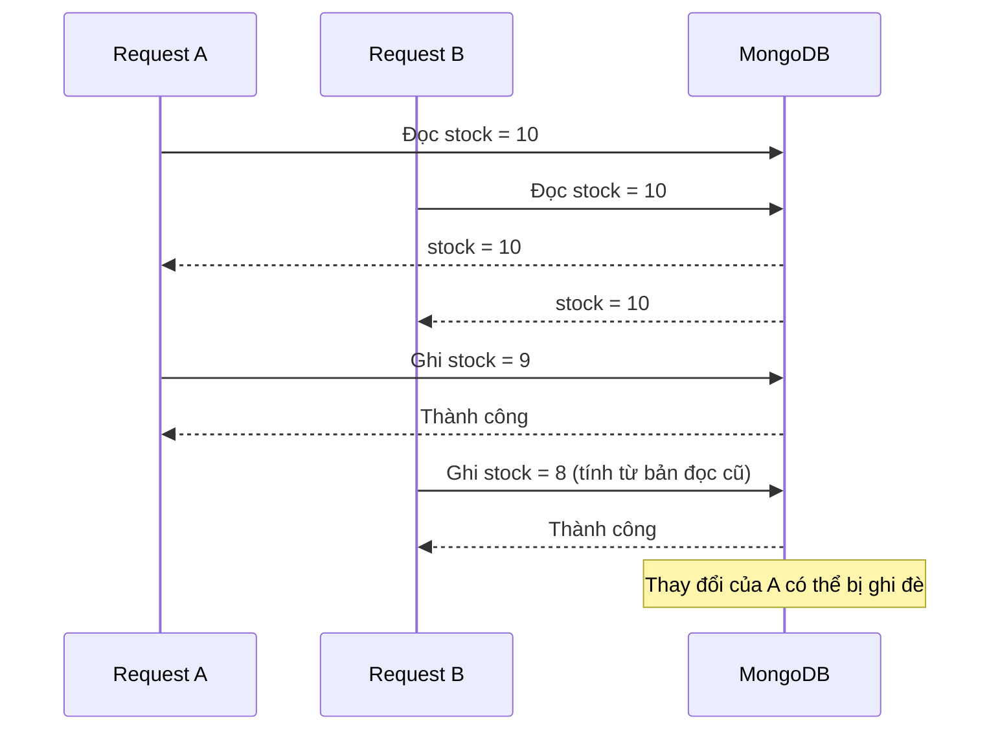

# @Version và optimistic locking

Trong hệ thống có nhiều người dùng hoặc nhiều instance Spring Boot cùng thao tác MongoDB, một tình huống dễ xảy ra là **hai request cùng đọc một document, cùng sửa từ trạng thái cũ, rồi ghi lại**. Nếu thao tác chỉ thay thế document theo `_id`, người ghi sau có thể **ghi đè thay đổi của người ghi trước** mà không nhận biết: đây là **lost update**.

Spring Data MongoDB cung cấp annotation **`@Version`** để triển khai **optimistic locking** cho những thao tác CRUD có hỗ trợ version. Khi lưu một entity đã được đọc, framework dùng **version mà entity đang nắm giữ** làm điều kiện cập nhật. Nếu document trên server đã được thay đổi và version tăng, thao tác ghi cũ không còn khớp; thay vì im lặng ghi đè, Spring Data có thể ném **`OptimisticLockingFailureException`**.

Bài thuộc chương **Kiểm soát đồng thời** của module `SPRING_DATA_MONGODB`. Bên cạnh kết nối, ánh xạ document, `MongoTemplate` và repository, module còn chú trọng thiết kế truy vấn, aggregation, index, transaction, reactive access, kiểm thử và chẩn đoán hiệu năng dữ liệu. Bài này tập trung vào tính đúng đắn của **đọc–sửa–ghi**, phân biệt version check với việc chỉ tăng version, và những ranh giới thực tế khi dùng query updates, driver/raw writes, bulk operations, xóa document hoặc retry.

> **Điểm cốt lõi:** `@Version` không biến mọi lệnh MongoDB thành optimistic locking. `repository.save(entity)`/`MongoTemplate.save(entity)` có hành vi kiểm tra version theo entity đã đọc, nhưng `updateFirst(Query, Update, Entity.class)` dù có thể **tự tăng trường version** vẫn không tự biết `expectedVersion` của request. Muốn CAS ở kiểu update này, phải **đặt version vào chính Query** và xử lý kết quả ghi.

## 1. Mục tiêu học tập

Sau bài này, bạn có thể:

1. Giải thích lost update khi hai request sửa cùng một document.
2. Phân biệt **pessimistic locking** với **optimistic locking** và chỉ ra khi nào mỗi mô hình phù hợp.
3. Tạo entity MongoDB có `@Id` và `@Version Long`.
4. Hiểu version ban đầu trên insert (wrapper `Long` thường từ `null` thành `0`) và thay đổi version sau save.
5. Giải thích logic của `save`: kiểm tra `_id + version`, ghi document rồi tăng version hoặc phát hiện xung đột.
6. Xử lý `OptimisticLockingFailureException` mà không tự động ghi đè thay đổi của người khác.
7. Phân biệt `repository.save`, `MongoTemplate.save`, `updateFirst`, `findAndModify`, `remove` và `deleteById`.
8. Xây **compare-and-set** bằng `Query` có version dự kiến, `Update` và `UpdateResult.matchedCount`.
9. Hiểu vì sao **write acknowledgement** là điều kiện cần để phát hiện optimistic lock failure đáng tin cậy.
10. Giải thích hạn chế của `bulkOps`, native driver, untyped updates và các writers không tuân thủ version.
11. Thiết kế retry có kiểm soát, idempotency, HTTP `409 Conflict` và logging/metrics xung đột.
12. Viết integration tests: hai bản đọc cũ, save thắng/thua, CAS match/no-match, stale delete và version tăng.
13. Phân biệt tính nguyên tử của một document với transaction đa document.
14. Đánh giá hiệu năng, độ tranh chấp và lựa chọn cách giảm hot-document conflicts.

## 2. Bài toán lost update: khi không có version

Giả sử tồn kho sản phẩm `SKU-BOOK` đang có 10 đơn vị. Hai request đều muốn thay đổi từ giá trị đã đọc.



Nếu B nghĩ rằng mình đang giảm 2 sản phẩm từ stock 10, kết quả cuối thành 8. Trong một tình huống khác, A/B có thể cùng cập nhật **hai field khác nhau** của cùng document bằng full-document `save` và một bên làm mất thay đổi của bên kia.

Đây là vấn đề **đọc–sửa–ghi qua nhiều thao tác**. MongoDB bảo đảm một lệnh ghi trên **một document** là nguyên tử, nhưng điều đó **không** làm chuỗi `findById → tính toán ở Java → save` của nhiều request trở thành một transaction chung.

### 2.1. Không phải mọi update đều cần @Version

Nếu bài toán chỉ là cộng bộ đếm, lệnh atomic:

```javascript
db.product_stock.updateOne(
  { _id: "SKU-BOOK" },
  { $inc: { available: -1 } }
);
```

khác với đọc `available` về Java, trừ 1 rồi ghi lại bằng `$set`. `$inc` chạy nguyên tử trên document, nên tránh được lost update **cho phép cộng đơn giản** dù không dùng optimistic version.

Tuy vậy, `$inc` không tự bảo vệ bất biến `available >= 0`. Để trừ hàng có điều kiện, phải có predicate tồn kho cùng lệnh ghi:

```javascript
db.product_stock.updateOne(
  { _id: "SKU-BOOK", available: { $gte: 1 } },
  { $inc: { available: -1 } }
);
```

Với quy tắc nghiệp vụ phức tạp hoặc cần biết dữ liệu đã thay đổi giữa lúc đọc và ghi, `@Version`/CAS có vai trò rõ ràng.

## 3. Optimistic và pessimistic locking

| Đặc điểm | Optimistic locking | Pessimistic locking |
| --- | --- | --- |
| Giả định | Xung đột không quá thường xuyên | Muốn ngăn xung đột bằng khóa |
| Cơ chế | Ghi có **expected version**, fail nếu đã đổi | Khóa tài nguyên khi có phiên đang sử dụng |
| Chi phí khi ít tranh chấp | Thường thấp, không giữ khóa dài ở ứng dụng | Có overhead quản lý khóa/chờ |
| Khi xung đột | Thông báo, retry có kiểm soát, merge hoặc yêu cầu người dùng đọc lại | Chờ khóa, timeout/deadlock tùy DB |
| Trong Spring Data MongoDB | `@Version`, CAS trong `Query` | Không có tương đương JPA `SELECT FOR UPDATE` cho document theo kiểu truy vấn thông thường |
| Giữ khóa xuyên form chỉnh sửa | Không | Thường không thực tế cho request dài |

MongoDB có khóa nội bộ để thực thi lệnh/transaction an toàn, nhưng **optimistic locking của Spring Data không giữ khóa ứng dụng từ lúc người dùng mở form đến khi bấm Lưu**.

Nếu bản ghi thay đổi trong lúc người dùng đang sửa, giao diện nên cho biết có phiên bản mới thay vì chỉ báo “Lưu thành công”.

## 4. Domain entity có @Version

Một model có thể dùng class mutable để dễ minh họa việc sửa các field trước khi gọi `save`.

```java
package dev.learning.stock;

import org.springframework.data.annotation.Id;
import org.springframework.data.annotation.Version;
import org.springframework.data.mongodb.core.mapping.Document;
import org.springframework.data.mongodb.core.mapping.Field;

@Document("versioned_product_stock")
public class ProductStock {

    @Id
    private String id;

    @Field("tenant_id")
    private String tenantId;

    private String sku;
    private long available;

    @Version
    private Long version;

    protected ProductStock() {
        // Spring Data cần có thể tạo instance hoặc dùng constructor mapping.
    }

    public ProductStock(String id, String tenantId,
                        String sku, long available) {
        this.id = id;
        this.tenantId = tenantId;
        this.sku = sku;
        this.available = available;
    }

    public String getId() { return id; }
    public String getTenantId() { return tenantId; }
    public String getSku() { return sku; }
    public long getAvailable() { return available; }
    public Long getVersion() { return version; }

    public void setAvailable(long available) {
        this.available = available;
    }
}
```

Spring Data MongoDB có thể đọc/ghi field riêng tư qua mapping metadata. Không cần public setter cho `version` trong ứng dụng thông thường; version do framework quản lý.

### 4.1. BSON tương ứng

Sau lần insert đầu tiên:

```javascript
{
  _id: "STOCK-BOOK",
  tenant_id: "tenant-a",
  sku: "SKU-BOOK",
  available: NumberLong("10"),
  version: NumberLong("0"),
  _class: "dev.learning.stock.ProductStock"
}
```

Field `_class` là type hint mặc định thường gặp; dự án có thể tắt hoặc dùng `@TypeAlias`. BSON `version` với `Long` là số nguyên 64-bit; không dùng string `"0"` thay cho number `0`.

### 4.2. Vì sao chọn Long thay vì long?

Với wrapper `Long`:

- `null` biểu diễn entity mới chưa có version, thuận tiện cho newness detection.
- Spring Data MongoDB khởi tạo version ban đầu thành **0** khi insert loại wrapper.
- Sau lần save hợp lệ, version tăng thành **1**, rồi **2**, …

Với primitive `long`/`int`, cơ chế khởi tạo và xác định đối tượng mới khác, thường bắt đầu từ **1** trong các dòng Spring Data được tài liệu hóa. Đừng chuyển `Long` sang `long` trong một hệ thống đã có dữ liệu mà không kiểm tra migration/newness semantics.

### 4.3. @Id và @Version không thay thế nhau

`@Id` định danh document; `@Version` cho biết **bản entity thuộc thế hệ nào**. Hai document có ID khác nhau hoàn toàn có thể cùng version `0`. Version chỉ có ý nghĩa **khi so với chính document cùng ID**.

Không dùng `@Version` làm unique business key; nếu SKU phải unique trong tenant, cần ràng buộc/index phù hợp trên `tenant_id + sku`.

## 5. Insert: version mới được khởi tạo như thế nào?

```java
import org.springframework.data.mongodb.core.MongoTemplate;

ProductStock initial = new ProductStock(
    "STOCK-BOOK", "tenant-a", "SKU-BOOK", 10);

ProductStock inserted = mongoTemplate.insert(initial);

System.out.println(inserted.getVersion()); // 0 với Long @Version
```

Ý định trên là insert **document mới**. `insert` không có nghĩa “replace nếu trùng ID”; nếu ID đã tồn tại, MongoDB thường trả duplicate-key error.

Cũng có thể dùng repository:

```java
import org.springframework.data.mongodb.repository.MongoRepository;

public interface ProductStockRepository
        extends MongoRepository<ProductStock, String> {
}
```

```java
ProductStock inserted = repository.insert(
    new ProductStock("STOCK-BOOK", "tenant-a",
                     "SKU-BOOK", 10));
```

`repository.save` có logic xác định entity mới/đã tồn tại. Với entity có `@Version`, **trạng thái newness** chịu ảnh hưởng của version type/null/0. Vì vậy:

- Dùng `insert` khi chủ ý tạo mới và muốn phát hiện duplicate ID.
- Dùng `save` để lưu trạng thái đã đọc, có kiểm soát version.
- Không ép version về `null` để “reset” conflict; làm vậy có thể kích hoạt logic insert/`isNew` khác dự kiến.

### 5.1. @Version là metadata của entity, không phải default server

MongoDB server **không biết annotation Java `@Version`**. Khi bạn insert raw BSON qua `mongosh` hoặc driver mà không có `version`, server không tự thêm version.

Nếu collection có dữ liệu legacy thiếu trường `version`, cần chiến lược migration/schema rõ ràng trước khi bật optimistic locking. Không mặc định mọi document cũ đã có version `0`.

## 6. Save với version: so sánh bản đọc cũ

Hai lần đọc cùng document:

```java
ProductStock first = repository.findById("STOCK-BOOK")
    .orElseThrow();

ProductStock second = repository.findById("STOCK-BOOK")
    .orElseThrow();

// Cả hai nhìn thấy version 0 và available 10.
first.setAvailable(9);
ProductStock saved = repository.save(first);

// Trên server: available 9, version 1.
second.setAvailable(8);

repository.save(second); // OptimisticLockingFailureException
```

Lần ghi thứ nhất khớp version cũ **0**, tăng version thành **1**. Lần ghi thứ hai đang cố lưu từ bản đọc version **0**, nên không thể khớp document hiện tại version **1**.

Sơ đồ:

```mermaid
sequenceDiagram
  participant A as Request A (v0)
  participant B as Request B (v0)
  participant DB as MongoDB
  A->>DB: save: filter {_id, version:0}
  DB-->>A: matched; set fields; version -> 1
  B->>DB: save: filter {_id, version:0}
  DB-->>B: matchedCount = 0
  Note over B: OptimisticLockingFailureException
```

Cách diễn giải BSON (minh họa semantics, không phải raw command do framework phát ra):

```javascript
db.versioned_product_stock.updateOne(
  { _id: "STOCK-BOOK", version: NumberLong("0") },
  {
    $set: {
      available: NumberLong("9"),
      sku: "SKU-BOOK",
      tenant_id: "tenant-a"
    },
    $inc: { version: NumberLong("1") }
  }
);
```

`MongoTemplate.save` có thể dùng kiểu write khác `$set/$inc` theo implementation, nhưng **điều kiện expected version và version tăng** mới là hợp đồng quan trọng. Đừng kiểm thử bằng cách bắt buộc internal command có một shape duy nhất nếu thư viện thay đổi version.

### 6.1. Lỗi đúng tên và kiểu xử lý

Spring Data phát ra ngoại lệ thuộc hệ:

```java
org.springframework.dao.OptimisticLockingFailureException
```

Một số đường gọi có thể dùng subtype riêng. Ứng dụng nên bắt **type gốc** (hoặc subtype phù hợp) ở ranh giới service/API, không parse message string của driver.

Không catch `Exception` rồi trả “Lưu thành công”. Lỗi optimistic lock có nghĩa **lệnh ghi dự kiến không được áp dụng** ở thời điểm đó; cần quyết định conflict resolution.

## 7. MongoTemplate.save và repository.save

```java
ProductStock loaded = mongoTemplate.findById(
    "STOCK-BOOK", ProductStock.class);

loaded.setAvailable(7);
ProductStock updated = mongoTemplate.save(loaded);
```

`MongoTemplate.save(entity)` và `repository.save(entity)` đều làm việc qua Spring Data MongoDB mapping, nên các thao tác save đã được hỗ trợ có thể dùng `@Version` theo entity.

Một số điểm cần tránh nhầm:

- `save` không cần bạn tự đặt version vào `Query`; framework lấy version từ **entity**.
- `save` không biến thao tác sửa thành merge field-level: ghi full object cũ có thể gây lost update nếu writer khác không tham gia version protocol.
- `save` thường quyết định create/update từ entity newness; logic có thể khác khi version null, ID được cấp trước hoặc khi entity implements `Persistable`.
- `@Version` không thay thế validation giá trị nghiệp vụ. Với tồn kho, vẫn phải kiểm tra available không âm.
- Nếu entity chứa array lớn nhưng chỉ muốn thay đổi một field, `Update` có điều kiện và expectedVersion có thể tiết kiệm payload hơn full save.

### 7.1. Không chia sẻ mutable entity giữa các thread

Hai thread thay đổi **cùng một object Java** rồi gọi save không phản ánh đúng mô hình “hai bản đọc độc lập”. Ví dụ concurrency nên đọc entity hai lần vào **hai object khác nhau**. Đồng thời, không đặt mutable entity vào singleton cache rồi cho nhiều request sửa trực tiếp.

### 7.2. Không tin version do client gửi là đủ

Nếu API nhận `version=5` từ request, vẫn cần xác minh **authorization** theo tenant/user và rằng document ID thuộc đối tượng được phép cập nhật. Version không bảo vệ dữ liệu khi application bỏ qua quyền hoặc chấp nhận ID tùy ý.

## 8. WriteConcern.ACKNOWLEDGED: điều kiện phát hiện xung đột

Optimistic locking dựa trên việc nhận **write result** từ MongoDB. Nếu sử dụng **`WriteConcern.UNACKNOWLEDGED`**, client không có đủ thông tin để biết update có khớp version hay không; Spring Data cảnh báo optimistic locking failure có thể **bị bỏ qua âm thầm**.

Ví dụ cấu hình minh họa ở một context có `MongoTemplate` do ứng dụng quản lý:

```java
import com.mongodb.WriteConcern;

// Thiết lập khi khởi tạo/configure template cho workload cần OCC:
mongoTemplate.setWriteConcern(WriteConcern.ACKNOWLEDGED);
```

Dự án có thể thiết lập write concern qua connection/database/client configuration thay vì setter này. Điều cốt lõi là **write concern hiệu lực** cho phép driver biết update/delete đã được server xác nhận.

### 8.1. ACKNOWLEDGED khác MAJORITY

- `ACKNOWLEDGED`: nhận được xác nhận ghi theo write concern từ server; đủ nền tảng kiểm tra matched count/xung đột.
- `MAJORITY`: xác nhận với yêu cầu replication mạnh hơn tùy topology.
- `UNACKNOWLEDGED`: không có write result đáng tin cậy để phát hiện xung đột.

Chọn write concern theo durability, latency và topology; không đánh đồng “xử lý OCC đúng” với “đảm bảo mọi mục tiêu durability/backup”. Với hệ thống quan trọng, đánh giá cả retryable writes, read concern, failover và monitoring.

### 8.2. Không chỉ dựa trên version field được tăng

Một câu `updateOne({ _id }, { $inc:{version:1} })` thành công **không chứng minh đã thực hiện optimistic locking**, vì không có điều kiện expected version. OCC cần cả:

1. Giá trị version mà client **kỳ vọng** ở bước đọc hoặc yêu cầu.
2. Predicate so sánh version đó trong **cùng lệnh ghi**.
3. Kết quả acknowledged để biết predicate khớp hay không.
4. Quy tắc tăng version trên những write thành công để writers tiếp theo nhận biết.

## 9. updateFirst: tự tăng version không đồng nghĩa tự kiểm tra CAS

Spring Data `MongoTemplate.updateFirst(Query, Update, Entity.class)` hỗ trợ **tự tăng property `@Version` nếu `Update` không chủ động đặt field đó**. Nhưng method này chỉ có **Query** do bạn cung cấp; nó không nắm một entity đã đọc để tự biết expectedVersion của người dùng.

Ví dụ **chỉ lọc theo ID**:

```java
import org.springframework.data.mongodb.core.query.Criteria;
import org.springframework.data.mongodb.core.query.Query;
import org.springframework.data.mongodb.core.query.Update;

Query byId = Query.query(
    Criteria.where("id").is("STOCK-BOOK")
);

Update update = new Update().set("available", 8);

var result = mongoTemplate.updateFirst(
    byId, update, ProductStock.class);
```

Với typed entity `ProductStock.class`, Spring Data có thể tăng `version` khi update thành công. Nhưng nếu nhiều request cùng chạy cập nhật theo ID, cả hai vẫn có thể ghi, vì **không có điều kiện version**. Nếu cả hai dùng `$set` từ giá trị stale, lost update vẫn có thể xảy ra.

### 9.1. Cách đúng: thêm expectedVersion vào Query

```java
String id = "STOCK-BOOK";
String authorizedTenant = "tenant-a";
long expectedVersion = 3L;

Query compareAndSet = Query.query(
    Criteria.where("id").is(id)
        .and("tenantId").is(authorizedTenant)
        .and("version").is(expectedVersion)
);

Update change = new Update().set("available", 8L);

var result = mongoTemplate.updateFirst(
    compareAndSet, change, ProductStock.class);

if (result.getMatchedCount() != 1) {
    throw new org.springframework.dao.OptimisticLockingFailureException(
        "Dữ liệu đã thay đổi hoặc không còn phù hợp");
}
```

Khi document khớp cả `_id`, tenant và version, thay đổi cùng việc tăng version được áp dụng trên một document. Nếu version khác, `matchedCount=0` và service coi là conflict.

**Quan trọng:** nếu query kèm tenant, `matchedCount=0` có thể là document không có, thiếu quyền tenant, hoặc version đã đổi. Không trả chi tiết tồn tại của document tenant khác cho người không có quyền.

### 9.2. UpdateResult.matchedCount và modifiedCount

- `getMatchedCount()`: số **document khớp query**.
- `getModifiedCount()`: số **document thực sự thay đổi**.
- `getUpsertedId()`: ID document tạo mới nếu có upsert; không liên quan trực tiếp đến CAS update-only.

Với predicate `_id + version`, hãy dùng `matchedCount` để biết có match với phiên mong đợi hay không. `modifiedCount` có thể bằng 0 nếu dữ liệu được đặt giống giá trị cũ trong một số kiểu update; nếu Spring Data tự tăng version thì document có thể vẫn thay đổi. Không suy `modifiedCount=1` là “chỉ một field được sửa”.

### 9.3. Đừng tự tăng version hai lần

```java
// Tránh thao tác tùy tiện:
new Update().set("available", 8)
            .inc("version", 1);
```

Nếu bạn tự chỉ định version trong `Update`, Spring Data không còn làm auto-increment theo cùng quy tắc. Cách này có thể đúng trong một flow được thiết kế/kiểm thử rõ ràng, nhưng không nên trộn với assumptions về auto-versioning. Với typed update phổ biến, hãy để framework tăng version nếu bạn chưa đặt field ấy.

## 10. Trừ tồn kho bằng CAS và điều kiện nghiệp vụ trong cùng lệnh

Một service giảm tồn kho cần bảo vệ cả **version** và **available ≥ quantity**.

```java
package dev.learning.stock;

import com.mongodb.client.result.UpdateResult;
import org.springframework.dao.OptimisticLockingFailureException;
import org.springframework.data.mongodb.core.MongoTemplate;
import org.springframework.data.mongodb.core.query.Criteria;
import org.springframework.data.mongodb.core.query.Query;
import org.springframework.data.mongodb.core.query.Update;

public final class InventoryService {

    private final MongoTemplate template;

    public InventoryService(MongoTemplate template) {
        this.template = template;
    }

    public void reserve(
            String productId,
            String authorizedTenant,
            long expectedVersion,
            long quantity) {

        if (quantity <= 0) {
            throw new IllegalArgumentException(
                "quantity phải > 0");
        }

        Query query = Query.query(
            Criteria.where("id").is(productId)
                .and("tenantId").is(authorizedTenant)
                .and("version").is(expectedVersion)
                .and("available").gte(quantity)
        );

        Update update = new Update()
            .inc("available", -quantity);

        UpdateResult result = template.updateFirst(
            query, update, ProductStock.class);

        if (result.getMatchedCount() != 1) {
            throw new OptimisticLockingFailureException(
                "Phiên bản, trạng thái hoặc tồn kho không hợp lệ");
        }
    }
}
```

Điều kiện `version + available` được xét **ở cùng lệnh update** với `$inc`; không có khoảng hở race kiểu `findOne` trước rồi `save` không điều kiện.

Nếu số lượng còn thiếu, query không match. Service có thể cần phân biệt `out-of-stock` với `version conflict`, nhưng phải làm điều đó theo chính sách thông tin và quyền hợp lệ, tránh một read thêm rồi âm thầm ghi đè. Đối với API, các lỗi có thể được phân loại bằng bước đọc lại sau khi không match nếu phù hợp với thiết kế.

### 10.1. Có cần version cho mỗi lần $inc?

Một `$inc` có predicate `available >= quantity` đã bảo vệ invariant tồn kho trong một document. Khi có nhu cầu “yêu cầu của client chỉ hợp lệ trên **đúng phiên bản nó đã nhìn thấy**”, thêm version để bảo đảm semantics mạnh hơn.

Ngược lại, nếu mọi request chỉ độc lập trừ một số lượng hợp lệ, OCC bắt buộc client gửi version có thể tạo **xung đột không cần thiết** trên một hot stock document. Chọn theo business rule, không dùng version một cách máy móc.

## 11. findAndModify: read-modify-write nguyên tử với version predicate

`MongoTemplate.findAndModify` kết hợp query và update trên một document, có thể trả **trạng thái trước hoặc sau khi cập nhật**.

```java
import org.springframework.data.mongodb.core.FindAndModifyOptions;
import org.springframework.data.mongodb.core.query.Criteria;
import org.springframework.data.mongodb.core.query.Query;
import org.springframework.data.mongodb.core.query.Update;

Query query = Query.query(
    Criteria.where("id").is(productId)
        .and("tenantId").is(authorizedTenant)
        .and("version").is(expectedVersion)
        .and("available").gte(quantity)
);

Update update = new Update()
    .inc("available", -quantity);

ProductStock after = mongoTemplate.findAndModify(
    query,
    update,
    FindAndModifyOptions.options().returnNew(true),
    ProductStock.class
);

if (after == null) {
    throw new org.springframework.dao.OptimisticLockingFailureException(
        "Không thể áp dụng cập nhật theo phiên bản dự kiến");
}
```

Với `returnNew(true)`, method trả document **sau cập nhật**. Với mặc định `returnNew(false)`, kết quả là trạng thái **trước cập nhật**. Không suy rằng một document trả về từ `findAndModify` đã được update chỉ bằng cách nhìn nó có ID; phải biết tùy chọn và `null` semantics.

Theo Javadoc `MongoOperations`, typed `findAndModify` cũng có thể tự tăng `@Version` nếu field chưa có trong `Update`. Nhưng **việc auto-increment không thay cho expectedVersion trong Query**.

### 11.1. Tránh upsert khi thực hiện CAS

Không đặt `upsert(true)` cho một command **chỉ muốn cập nhật entity có version dự kiến**. Nếu query có `_id + version` nhưng document hiện tại mang version khác, upsert có thể đi vào nhánh tạo document mới và gặp duplicate key hoặc sinh hành vi không mong muốn.

Với compare-and-set, **update-only** là mặc định hợp lý. Luồng “tạo sản phẩm mới” phải dùng `insert` hoặc quy tắc tạo mới tách biệt, có unique keys/idempotency.

## 12. Xóa entity có @Version: delete(Object) khác deleteById

Spring Data MongoDB có một khác biệt quan trọng từ các bản hỗ trợ optimistic locking cho xóa.

Giả sử đã đọc một entity:

```java
ProductStock stale = repository.findById(productId)
    .orElseThrow();

// Một request khác thay đổi document, version từ 4 -> 5.
repository.delete(stale);
```

Với **`CrudRepository.delete(entity)`** trên entity versioned, framework kiểm tra version; nếu không thể xóa theo version đã đọc, nó có thể ném `OptimisticLockingFailureException` khi write được acknowledged.

Tương tự, `MongoTemplate.remove(entity)` có thể đưa version vào điều kiện xóa.

Ngược lại:

```java
repository.deleteById(productId);
```

`deleteById` **bỏ qua optimistic version check** đối với entity versioned, xóa theo ID. Nó phù hợp với nghiệp vụ “xóa bất kể phiên bản”, **không phù hợp** nếu API bắt buộc từ chối xóa từ bản đọc cũ.

### 12.1. Bảng khác biệt

| Thao tác | Kiểm tra version? | Cảnh báo |
| --- | --- | --- |
| `repository.delete(entity)` với `@Version` | Có theo optimistic locking | Entity phải mang version của bản đã đọc |
| `mongoTemplate.remove(entity)` | Có với entity versioned | Không giống remove theo query |
| `repository.deleteById(id)` | Bỏ qua version | Có thể xóa dù bản ghi đã sửa |
| `mongoTemplate.remove(Query, Class)` | Theo **Query**; không tự lấy version từ entity | Nếu muốn CAS delete, thêm version vào Query |
| Raw driver `deleteOne` | Theo BSON filter bạn cung cấp | Không biết `@Version` |

Nếu codebase đổi từ `delete(entity)` sang `deleteById(id)` để “đơn giản hóa”, có thể đã **thay đổi ý nghĩa đồng thời** của nghiệp vụ. Phải review cẩn thận.

### 12.2. CAS delete bằng Query rõ ràng

```java
Query query = Query.query(
    Criteria.where("id").is(productId)
        .and("tenantId").is(authorizedTenant)
        .and("version").is(expectedVersion)
);

var result = mongoTemplate.remove(query, ProductStock.class);

if (result.getDeletedCount() != 1) {
    throw new org.springframework.dao.OptimisticLockingFailureException(
        "Không thể xóa do dữ liệu đã đổi hoặc không có quyền");
}
```

Ở cách này, chính **caller** viết version predicate và kiểm tra `DeleteResult`. Đây là kiểm tra CAS tường minh, không phải framework tự trích version từ một entity.

## 13. Những đường ghi không tự có optimistic locking

Một sai lầm khi triển khai `@Version` là nghĩ **mọi write vào collection** đều tuân thủ version.

| Đường ghi | Có dùng version đúng cách? | Hướng xử lý |
| --- | --- | --- |
| `repository.save(versionedEntity)` | Có với phiên đọc đã gắn trên entity | Bắt conflict |
| `mongoTemplate.save(versionedEntity)` | Có với supported CRUD | Bắt conflict |
| `updateFirst(Query, Update, Entity.class)` | Có thể tự tăng version, **không tự gắn expectedVersion** | Đặt version trong Query |
| `findAndModify(Query, Update, Entity.class)` | Có thể tự tăng version, **không tự gắn expectedVersion** | Đặt version trong Query |
| `updateMulti(Query, Update, Entity.class)` | Có thể tăng version theo cập nhật typed | Không phải CAS riêng cho từng phiên đọc nếu thiếu predicate |
| `remove(Query, Entity.class)` | Không lấy phiên entity cũ | Thêm version filter nếu cần |
| `deleteById(id)` | Bỏ qua version | Dùng khi chủ ý bỏ qua |
| `getCollection(...).updateOne(...)` | Raw driver không biết annotation | Tự viết CAS và tăng version |
| `mongosh db.collection.updateOne` | Raw BSON query | Tự viết CAS và tăng version |
| `bulkOps(...)` | **Không hỗ trợ optimistic locking tự động kiểu entity save** | Thiết kế result handling và CAS riêng |
| `repository.saveAll(...)` | Phụ thuộc đường thực thi save/insert và trạng thái từng entity | Kiểm thử cụ thể, không coi batch là transaction |

Các phương thức `MongoOperations` có overload chỉ nhận `String collectionName` nhưng không có `Class<?> entityClass` thường **không có domain metadata** để hỗ trợ version/mapping giống overload typed. Không dùng untyped overload rồi mặc định framework vẫn xử lý `@Version`.

### 13.1. Writers không tăng version có thể phá toàn bộ giao thức

Ví dụ server đang có:

```javascript
{ _id: "STOCK-BOOK", available: 10, version: NumberLong("5") }
```

Một worker dùng driver raw:

```javascript
db.versioned_product_stock.updateOne(
  { _id: "STOCK-BOOK" },
  { $set: { available: 7 } }
);
```

Nó sửa available nhưng **không tăng version**. Một entity stale đang giữ `version=5` vẫn có thể `save` thành công, vì version trên server vẫn là 5, rồi **ghi đè available=7**.

Để hệ thống OCC đáng tin, **mọi đường ghi có ảnh hưởng đến trạng thái cần bảo vệ** phải tuân thủ giao thức version hoặc dùng một cơ chế đồng thời khác được thiết kế rõ ràng.

### 13.2. Giao thức CAS ở raw BSON

```javascript
db.versioned_product_stock.updateOne(
  {
    _id: "STOCK-BOOK",
    tenant_id: "tenant-a",
    version: NumberLong("5")
  },
  {
    $set: { available: NumberLong("7") },
    $inc: { version: NumberLong("1") }
  }
);
```

Kiểm tra `matchedCount` của acknowledged result. Nếu 0, document có thể đã đổi phiên bản, bị xóa hoặc không thỏa authorization filter.

**Không mặc định raw driver dùng `@Version`.** Đây là giao thức do **caller thực thi**.

## 14. Bulk operations và @Version: giới hạn cần biết

`BulkOperations` gom nhiều thao tác insert/update/delete thành batch. Điều này giảm overhead round trip, nhưng **không có cùng giao thức optimistic locking tự động như entity `save`**: Javadoc Spring Data MongoDB ghi rõ các thao tác cần kết quả riêng từng operation (như optimistic locking) **không được hỗ trợ** trên `BulkOperations`; version field có thể không được populate như mong đợi.

Ví dụ một batch:

```java
import org.springframework.data.mongodb.core.BulkOperations.BulkMode;
import org.springframework.data.mongodb.core.query.Criteria;
import org.springframework.data.mongodb.core.query.Query;
import org.springframework.data.mongodb.core.query.Update;

var result = mongoTemplate.bulkOps(
        BulkMode.ORDERED, ProductStock.class)
    .updateOne(
        Query.query(Criteria.where("id").is("STOCK-A")),
        new Update().inc("available", -1))
    .updateOne(
        Query.query(Criteria.where("id").is("STOCK-B")),
        new Update().inc("available", -1))
    .execute();
```

Hai update này **không ràng buộc expectedVersion** từ một entity đã đọc. Nếu luồng nghiệp vụ yêu cầu CAS, bạn phải thiết kế từng filter `_id + version`, cách tăng version và xử lý kết quả tương ứng; không kỳ vọng `BulkOperations` ném `OptimisticLockingFailureException` cho mỗi item như `repository.save(entity)`.

### 14.1. Batch không phải transaction nhiều document

`ORDERED` nghĩa là các operations trong batch được xử lý theo thứ tự, có thể dừng khi gặp lỗi tùy command; **không biến toàn batch thành một transaction nguyên tử**. Những write đã thành công trước lỗi có thể vẫn còn.

Khi cần một invariant qua nhiều documents, xem xét transaction hoặc một mô hình dữ liệu gộp invariant vào một document. Khi chỉ cần throughput cao và thao tác độc lập, bulk phù hợp nhưng phải chấp nhận semantics của kết quả batch.

### 14.2. Tách luồng OCC khỏi batch update phổ thông

Một ứng dụng có thể dùng:

- `repository.save` cho trường hợp người dùng sửa form từ một snapshot.
- `updateFirst` với version + điều kiện nghiệp vụ cho CAS có phạm vi hẹp.
- `$inc` atomic cho counter độc lập, nếu invariant đã được ràng buộc.
- Bulk writes cho batch có thể xử lý từng lỗi theo chính sách đã thiết kế, **không gọi nó là optimistic locking tự động**.

Không nên trộn các đường ghi này lên cùng document mà không có quy tắc tăng version thống nhất.

## 15. Repository delete, update-by-query và vấn đề thiết kế API

Giả sử API hỗ trợ:

```text
GET    /products/STOCK-BOOK
PUT    /products/STOCK-BOOK
DELETE /products/STOCK-BOOK
```

Client đọc product version `7`, sau đó gửi thay đổi.

### 15.1. Sửa theo snapshot với repository.save

Nếu server tải entity mới nhất ngay trước khi sửa rồi lưu mà **không so sánh expected version của client**, thì có thể bỏ mất chính ý nghĩa của concurrency token:

```java
// KHÔNG ĐỦ để bảo vệ snapshot mà client đã đọc trước đó:
ProductStock current = repository.findById(id).orElseThrow();
current.setAvailable(requestedAvailable);
repository.save(current);
```

Cách này kiểm tra version của bản server vừa đọc, không kiểm tra rằng **người dùng đã xem version nào** trước khi gửi lệnh. Nó vẫn có thể phát hiện một request khác thay đổi ở giữa lần `findById` mới và `save`, nhưng **không từ chối một client rất cũ** nếu không có write chen vào trong khoảng ngắn ấy.

Khi request mang expectedVersion, dùng nó trong query CAS hoặc so sánh trước rồi vẫn cần CAS ở thời điểm ghi. **So sánh version ở Java rồi save không tự loại bỏ mọi race** nếu không giữ version đúng.

### 15.2. PUT cần bảo vệ lost update

Ví dụ DTO chỉ cho sửa số lượng:

```java
public record ChangeStockRequest(
    long available,
    long expectedVersion) {
}
```

Triển khai an toàn hơn:

```java
public void replaceAvailable(
        String id,
        String authorizedTenant,
        ChangeStockRequest request) {

    if (request.available() < 0) {
        throw new IllegalArgumentException(
            "available không được âm");
    }

    Query filter = Query.query(
        Criteria.where("id").is(id)
            .and("tenantId").is(authorizedTenant)
            .and("version").is(request.expectedVersion())
    );

    Update change = new Update()
        .set("available", request.available());

    UpdateResult result = mongoTemplate.updateFirst(
        filter, change, ProductStock.class);

    if (result.getMatchedCount() != 1) {
        throw new OptimisticLockingFailureException(
            "Bản ghi đã thay đổi hoặc không thể truy cập");
    }
}
```

Đây là **partial update** và không xóa những field khác của document. Typed update hỗ trợ tăng version nếu không được đặt trực tiếp trong `Update`; client phải đọc lại hoặc nhận phiên mới sau khi ghi thành công.

### 15.3. HTTP 409 hay 412?

- Với giao thức API dùng version trong body và business conflict, **`409 Conflict`** là lựa chọn phổ biến.
- Nếu dùng HTTP conditional request với header **`If-Match`/`ETag`**, khi precondition không thỏa, **`412 Precondition Failed`** thường có ngữ nghĩa phù hợp hơn.
- **`404 Not Found`** hoặc **`403 Forbidden`** phụ thuộc chính sách truy cập; không tiết lộ document tenant khác qua thông báo version conflict.

Ví dụ trao đổi dùng ETag:

```http
GET /products/STOCK-BOOK
HTTP/1.1 200 OK
ETag: "7"
Content-Type: application/json

{"id":"STOCK-BOOK","available":10}
```

```http
PUT /products/STOCK-BOOK
If-Match: "7"
Content-Type: application/json

{"available":8}
```

Nếu document trên server đang version 8, trả `412` thay vì im lặng ghi đè. ETag/If-Match phải được ánh xạ chính xác sang version thực và kết hợp với authorization. Không coi string ETag người dùng cung cấp là nguồn phân quyền.

## 16. Phản hồi xung đột: đừng nuốt OptimisticLockingFailureException

Một handler mẫu trong Spring Web MVC:

```java
package dev.learning.stock;

import java.util.Map;
import org.springframework.dao.OptimisticLockingFailureException;
import org.springframework.http.HttpStatus;
import org.springframework.http.ResponseEntity;
import org.springframework.web.bind.annotation.ExceptionHandler;
import org.springframework.web.bind.annotation.RestControllerAdvice;

@RestControllerAdvice
public class StockConflictAdvice {

    @ExceptionHandler(OptimisticLockingFailureException.class)
    public ResponseEntity<Map<String, String>> conflict(
            OptimisticLockingFailureException ex) {

        return ResponseEntity.status(HttpStatus.CONFLICT)
            .body(Map.of(
                "code", "STALE_VERSION",
                "message", "Dữ liệu đã thay đổi; vui lòng tải lại"));
    }
}
```

Đây là ví dụ cho **body-version API**, nên trả `409`. Nếu endpoint dùng `If-Match` như một HTTP precondition, controller/service có thể dùng cơ chế exception và mapping riêng để trả `412`.

### 16.1. Tránh thông tin nhạy cảm và lỗi giả

Nếu CAS query có `id + tenantId + version + available≥quantity`, `matchedCount=0` **không phân biệt được nguyên nhân**. Có thể là:

- ID không tồn tại.
- Document thuộc tenant khác.
- Version stale.
- Tồn kho hoặc trạng thái không thỏa.
- Có rule nghiệp vụ khác trong filter.

Handler không được mặc định thông báo “version stale” với dữ liệu người dùng không có quyền đọc. Thiết kế domain error có thể phân loại sau một phép đọc an toàn, nhưng kết quả của phép đọc thêm cũng có thể thay đổi sau đó.

### 16.2. Logging và metrics

Nên ghi:

- Operation name, tenant hash hoặc tenant identifier được phép, correlation ID.
- Conflict count theo endpoint/collection.
- Retry count, outcome, độ trễ từ lúc đọc đến lúc save.
- Tỷ lệ lỗi `OptimisticLockingFailureException` so với số lần cập nhật.
- Có writer nào dùng raw driver hoặc bulk bypass version không.

Tránh ghi toàn bộ tài liệu tài chính/thông tin cá nhân hoặc body chứa dữ liệu nhạy cảm vào log xung đột.

## 17. Retry: khi nào nên và khi nào không?

Một cách xử lý phổ biến là bắt `OptimisticLockingFailureException` rồi **retry**. Nhưng retry không phải lúc nào cũng đúng: hành vi sửa của người dùng có thể phụ thuộc vào dữ liệu **cũ mà họ đã nhìn thấy**.

### 17.1. Không retry bằng cách save lại entity stale

Sai:

```java
ProductStock stale = repository.findById(id).orElseThrow();
stale.setAvailable(7);

for (int i = 0; i < 3; i++) {
    try {
        repository.save(stale);
        break;
    } catch (OptimisticLockingFailureException ex) {
        // Sai: retry cùng stale.version mà không reload/merge.
    }
}
```

Nếu version đã sai, lặp lại cùng version thường vẫn sai. Không được “chữa” bằng cách tăng version trên object client tự ý, vì nó bỏ qua những thay đổi mà client chưa nhìn thấy.

### 17.2. Retry có reload và tính lại

Với phép biến đổi **có thể tính lại từ trạng thái mới nhất** và không có side effect bên ngoài:

```java
public ProductStock applyBusinessChangeWithRetry(
        String id, long delta) {

    final int maxAttempts = 3;

    for (int attempt = 0; attempt < maxAttempts; attempt++) {
        ProductStock current = repository.findById(id)
            .orElseThrow();

        long next = Math.addExact(current.getAvailable(), delta);
        if (next < 0) {
            throw new IllegalStateException("Không đủ tồn kho");
        }

        current.setAvailable(next);

        try {
            return repository.save(current);
        } catch (OptimisticLockingFailureException ex) {
            if (attempt == maxAttempts - 1) {
                throw ex;
            }
            // Lần sau sẽ reload và tính lại từ version mới.
        }
    }
    throw new IllegalStateException("Không thể retry");
}
```

**Đây là ví dụ thuật toán**, không phải một implementation đủ điều kiện production. Cần thêm tenant authorization, deadline, backoff/jitter có kiểm soát, monitoring và idempotency. Với `delta` do request gửi qua mạng, client có thể gửi lại cùng thao tác sau timeout và bị cộng/trừ **hai lần** dù OCC vẫn đúng.

### 17.3. Phân biệt retry conflict với retry network error

- **Version conflict đã xác nhận**: thao tác CAS không được áp dụng, có thể reload/re-evaluate nếu rule cho phép.
- **Network timeout sau ghi**: client không chắc server đã áp dụng hay chưa. Lặp lại thao tác `$inc` mù quáng có thể nhân đôi thay đổi.
- **Transient transaction error**: retry toàn transaction theo contract của MongoDB driver có quy tắc khác retry một entity stale.

Muốn tránh thực thi lặp yêu cầu thanh toán/đặt hàng, cần **idempotency key** hoặc transaction/outbox phù hợp; `@Version` không tự giải quyết duplicate HTTP requests.

### 17.4. Khi cần cho người dùng merge thủ công

Với tài liệu nhiều field do người dùng chỉnh sửa, không nên tự động làm `reload → chép giá trị cũ → save`, vì đó chính là ghi đè thay đổi của người khác ở một phiên bản mới.

Giao diện nên cho người dùng:

1. Xem bản mới nhất.
2. So sánh bản họ đã chỉnh và bản đã thay đổi.
3. Chọn giữ, merge hoặc hủy.
4. Gửi thay đổi trên **version hiện hành**, có xác nhận của người dùng.

## 18. Reactive repository và optimistic locking

Reactive Spring Data MongoDB có cùng cơ chế version ở các thao tác hỗ trợ, nhưng lỗi sẽ được phát qua **publisher**, không phải ném ngay khi dựng pipeline.

```java
import org.springframework.data.mongodb.repository.ReactiveMongoRepository;

public interface ReactiveProductStockRepository
        extends ReactiveMongoRepository<ProductStock, String> {
}
```

Ví dụ:

```java
import reactor.core.publisher.Mono;

Mono<ProductStock> update = reactiveRepository.findById(productId)
    .switchIfEmpty(Mono.error(
        new IllegalArgumentException("Không tìm thấy sản phẩm")))
    .flatMap(current -> {
        current.setAvailable(current.getAvailable() - 1);
        return reactiveRepository.save(current);
    });
```

Publisher này **chưa chạy** khi chỉ được gán vào biến. Khi được subscribe, `save` có thể thất bại với `OptimisticLockingFailureException` nếu document đã đổi giữa lúc đọc và ghi.

### 18.1. Bắt riêng lỗi optimistic conflict

```java
Mono<ProductStock> safeUpdate = update
    .onErrorMap(
        OptimisticLockingFailureException.class,
        ex -> new IllegalStateException(
            "Cập nhật xung đột với phiên bản mới", ex)
    );
```

Trong ứng dụng WebFlux, có thể ánh xạ lỗi sang `409`/`412` ở tầng HTTP thay vì tạo `IllegalStateException` như ví dụ. Không dùng `onErrorResume(ex -> Mono.empty())` cho mọi lỗi: bạn có thể biến một lần ghi thất bại thành “không có kết quả”, khiến client hiểu nhầm.

### 18.2. retryWhen không tự bảo đảm tính đúng

```java
import reactor.util.retry.Retry;

Mono<ProductStock> retried = Mono.defer(
    () -> reactiveRepository.findById(productId)
        .switchIfEmpty(Mono.error(
            new IllegalArgumentException("Không tìm thấy")))
        .flatMap(current -> {
            current.setAvailable(current.getAvailable() - 1);
            return reactiveRepository.save(current);
        })
).retryWhen(
    Retry.max(2)
        .filter(OptimisticLockingFailureException.class::isInstance)
);
```

Dùng `Mono.defer` để mỗi lần retry thực sự **đọc lại** state. Nhưng mẫu này vẫn cần kiểm tra `available≥1`, authorization, backoff và idempotency. Với reservation, rất nhiều request song song và `$inc` có predicate có thể phù hợp hơn read-save-retry; không lấy ví dụ này làm mẫu business service production.

### 18.3. Không dùng block trong event loop

`reactiveRepository.save(...)` trả `Mono<ProductStock>`. Không gọi `block()` trong một reactive HTTP handler chỉ để dùng code imperative; điều đó có thể làm tắc event loop. Nếu phải tích hợp hệ thống blocking, dùng boundary phù hợp và giới hạn tài nguyên.

## 19. Version và transaction: hai cơ chế không thay thế nhau

MongoDB đảm bảo atomicity trên **một document** cho một write operation. Optimistic locking dùng `version` để phát hiện client đang ghi từ **snapshot cũ**. Transaction đa document lại giải quyết việc nhiều writes/reads cần nhất quán theo ranh giới giao dịch.

| Nhu cầu | Cơ chế thường phù hợp |
| --- | --- |
| Người dùng sửa entity từ một bản đã đọc | `@Version` với `save` hoặc CAS |
| Giảm tồn kho một sản phẩm có điều kiện | `updateFirst` với predicate `available≥n`, có thể thêm version |
| Cộng counter không cần read-modify-write | Atomic `$inc` |
| Thay đổi hai documents phải cùng thành công/thất bại | MongoDB transaction nếu topology/workload hỗ trợ |
| Chống lặp cùng HTTP request sau timeout | Idempotency key |
| Khóa quyền tenant | Authorization filter + role/permission, không phải version |

Ví dụ: một đơn hàng và số tồn kho nằm trong **hai documents khác nhau**. `@Version` trên từng entity giúp phát hiện xung đột từng document, nhưng nếu đã save order thành công rồi stock thất bại, **nó không tự rollback order**. Cần transaction, saga hoặc thiết kế eventual consistency/outbox phù hợp.

### 19.1. Transaction không tự sửa nghiệp vụ stale client

Kể cả khi service dùng transaction, nếu người dùng mở form từ phiên bản 5 rồi gửi update khi document đã sang phiên bản 8, transaction bắt đầu **lúc request ghi** không tự biết người dùng đang sửa từ v5. Khi business yêu cầu chống stale UI update, expected version/ETag vẫn có vai trò.

### 19.2. Không dùng transaction kéo dài qua tương tác người dùng

Không giữ MongoDB transaction mở từ lúc GET cho tới khi người dùng bấm Save vài phút sau. Transaction dài làm tăng chi phí và rủi ro; optimistic locking được thiết kế để phù hợp hơn với các khoảng đọc–ghi dài ở tầng ứng dụng.

## 20. Idempotency và side effects ngoài MongoDB

Xét nghiệp vụ:

```text
1. Đọc product version 3
2. Gửi email/charge payment
3. Save product với @Version
```

Nếu save thất bại vì conflict, email hoặc charge **đã xảy ra**. Retry cả hàm có thể gửi email/charge **hai lần**.

Thứ tự hoặc ranh giới xử lý cần được thiết kế lại:

- Ghi lại ý định thay đổi và idempotency key.
- Dùng transaction/outbox cho các thay đổi MongoDB trong phạm vi phù hợp.
- Chỉ phát side effect sau khi operation có kết quả ghi chắc chắn hoặc dùng consumer idempotent.
- Phân biệt commit success, write timeout và duplicate retry.
- Với external payment, dùng idempotency key theo contract của provider.

### 20.1. Cách lưu idempotency key

Một mô hình thường dùng collection `processed_requests` với unique index `request_key`, hoặc một field idempotency trong entity có update điều kiện. Tuy nhiên, **tạo một record processed riêng và cập nhật product trong hai lệnh độc lập** vẫn có khoảng không nhất quán; phải thiết kế transaction/outbox hoặc atomic boundary rõ ràng nếu yêu cầu tất cả-cùng-thành-công.

`@Version` không thay thế tính duy nhất của `request_key`.

## 21. Tối ưu hiệu năng khi xung đột cao

Optimistic locking phù hợp khi đa số request **không tranh chấp trực tiếp**. Trên một “hot document” bị hàng trăm request ghi mỗi giây, nhiều phiên đọc nhanh chóng stale và retry có thể gây tắc nghẽn.

Các cách giảm xung đột:

- Tránh gom mọi counter độc lập của toàn hệ thống vào một document duy nhất.
- Dùng atomic `$inc` với điều kiện, thay vì read-save cho phép cộng.
- Chia aggregate theo ranh giới nghiệp vụ và lựa chọn shard/partition hợp lý.
- Dùng event/append-only hoặc reconciliation khi phù hợp yêu cầu nhất quán.
- Giảm thời gian giữa read và save; không gọi API mạng khi giữ một snapshot cũ.
- Với UI, chỉ gửi field thay đổi và expected version, tránh save full entity stale.
- Giới hạn retry attempts và áp backoff/jitter.
- Kiểm tra index trên khóa tìm kiếm; `_id` đã có index mặc định.
- Đo tỉ lệ optimistic conflict so với các lỗi validation/permission, không gộp tất cả thành một loại.

### 21.1. Chi phí index cho CAS

Với query `{_id:id,version:n}`, MongoDB có thể tìm document bằng index `_id` rồi kiểm tra `version`. Không nhất thiết cần compound index `{_id:1,version:1}` cho mỗi collection: `_id` đã là duy nhất và rất chọn lọc. Hãy đo `explain`, latency và workload trước khi tạo index bổ sung.

Nếu query chủ yếu theo `tenant_id + sku` không dùng ID, compound unique index phù hợp với key nghiệp vụ có thể quan trọng hơn. Version là một điều kiện đồng thời, không phải luôn là trường dẫn đầu tốt nhất của mọi index.

### 21.2. Quan sát acknowledged result

Theo dõi `matchedCount`/`modifiedCount` ở những lệnh CAS tường minh và số exceptions của `save`. Nếu write concern bị cấu hình `UNACKNOWLEDGED`, hệ thống có thể không nhìn được xung đột; đây là lỗi thiết kế/quan sát cần xử lý trước khi điều tra throughput.

## 22. Integration test: stale save bị từ chối

Test phải thật sự đọc **hai bản độc lập** của cùng document trước khi save. Dùng MongoDB test riêng (URI test/Testcontainers) và ID/tenant ngẫu nhiên; không gọi `deleteAll()` trên database có thể trỏ production.

```java
package dev.learning.stock;

import static org.assertj.core.api.Assertions.assertThat;
import static org.assertj.core.api.Assertions.assertThatThrownBy;

import java.util.UUID;

import org.junit.jupiter.api.Test;
import org.springframework.beans.factory.annotation.Autowired;
import org.springframework.boot.test.context.SpringBootTest;
import org.springframework.dao.OptimisticLockingFailureException;

@SpringBootTest
class VersionedProductStockIntegrationTest {

    @Autowired ProductStockRepository repository;

    private ProductStock fresh(long available) {
        String suffix = UUID.randomUUID().toString();
        return repository.insert(
            new ProductStock(
                "STOCK-" + suffix,
                "tenant-test-" + suffix,
                "SKU-" + suffix,
                available)
        );
    }

    @Test
    void twoStaleSnapshotsCannotBothSave() {
        ProductStock original = fresh(10);

        assertThat(original.getVersion()).isEqualTo(0L);

        ProductStock first = repository.findById(original.getId())
            .orElseThrow();

        ProductStock second = repository.findById(original.getId())
            .orElseThrow();

        assertThat(first.getVersion()).isEqualTo(0L);
        assertThat(second.getVersion()).isEqualTo(0L);

        first.setAvailable(9);
        ProductStock saved = repository.save(first);

        assertThat(saved.getVersion()).isEqualTo(1L);

        second.setAvailable(8);

        assertThatThrownBy(() -> repository.save(second))
            .isInstanceOf(OptimisticLockingFailureException.class);

        ProductStock persisted = repository.findById(
            original.getId()).orElseThrow();

        assertThat(persisted.getAvailable()).isEqualTo(9L);
        assertThat(persisted.getVersion()).isEqualTo(1L);
    }
}
```

Đây là **kiểm thử deterministic** cho stale snapshot: không cần tạo nhiều thread; hai bản đọc đã được lưu trong hai object khác nhau, nên hành vi xung đột được kiểm tra rõ ràng.

### 22.1. Vì sao không xóa dữ liệu chung trước test?

Bộ test dùng ID UUID để tránh đụng các test khác và không cần `repository.deleteAll()`. Nếu cần cleanup, chỉ xóa **tài nguyên do test đã tạo** và trong database test riêng, theo chính sách test fixture. Không dùng `dropCollection` cho collection chung chỉ để dọn một test.

## 23. Integration test: CAS update, version increment và stale delete

Thêm vào **cùng class** `VersionedProductStockIntegrationTest`:

```java
@Autowired org.springframework.data.mongodb.core.MongoTemplate template;

@Test
void typedUpdateIncrementsVersionButRequiresCallerCasPredicate() {
    ProductStock initial = fresh(10);
    long v0 = initial.getVersion();

    var query = org.springframework.data.mongodb.core.query.Query.query(
        org.springframework.data.mongodb.core.query.Criteria
            .where("id").is(initial.getId())
            .and("tenantId").is(initial.getTenantId())
            .and("version").is(v0)
    );

    var delta = new org.springframework.data.mongodb.core.query.Update()
        .inc("available", -2);

    var first = template.updateFirst(
        query, delta, ProductStock.class);

    assertThat(first.getMatchedCount()).isEqualTo(1L);

    ProductStock after = repository.findById(initial.getId())
        .orElseThrow();

    assertThat(after.getAvailable()).isEqualTo(8L);
    assertThat(after.getVersion()).isEqualTo(v0 + 1);

    var staleAttempt = template.updateFirst(
        query,
        new org.springframework.data.mongodb.core.query.Update()
            .inc("available", -3),
        ProductStock.class);

    assertThat(staleAttempt.getMatchedCount()).isZero();

    ProductStock unchanged = repository.findById(initial.getId())
        .orElseThrow();

    assertThat(unchanged.getAvailable()).isEqualTo(8L);
    assertThat(unchanged.getVersion()).isEqualTo(v0 + 1);
}
```

Ý nghĩa:

1. Typed `updateFirst` tự tăng version nếu `Update` chưa chỉ định field version.
2. Vì `Query` có `version=v0`, lần thứ hai không thể match.
3. `updateFirst` thường trả `UpdateResult` thay vì tự ném `OptimisticLockingFailureException` cho predicate version do caller viết; service **phải kiểm tra matchedCount**.

### 23.1. Test stale entity delete

```java
@Test
void staleEntityDeleteFailsButCurrentEntityStillExists() {
    ProductStock initial = fresh(10);

    ProductStock stale = repository.findById(initial.getId())
        .orElseThrow();

    ProductStock current = repository.findById(initial.getId())
        .orElseThrow();

    current.setAvailable(9);
    repository.save(current);

    assertThatThrownBy(() -> repository.delete(stale))
        .isInstanceOf(OptimisticLockingFailureException.class);

    assertThat(repository.findById(initial.getId())).isPresent();
}
```

Bổ sung test riêng nếu muốn xác nhận `repository.deleteById(id)` **bỏ qua version**; khi thực hiện nhớ dùng **ID ngẫu nhiên của test** và assert document bị xóa. Không dùng `deleteById` làm fallback tự động sau khi stale delete bị từ chối vì sẽ phá ý nghĩa OCC.

### 23.2. Test update theo ID không có expectedVersion

Một kiểm thử phản ví dụ đáng có: hai lần `updateFirst` chỉ theo ID với `$set("available",…)` có thể đều match và ghi, dù version tăng. Test này không dùng cho production flow; nó chứng minh **auto-version-increment ≠ optimistic version check**.

### 23.3. Test write concern và raw driver

Để kiểm tra phạm vi bảo vệ, cấu hình một test riêng quan sát `CommandListener` hoặc BSON raw:

- `repository.save` thêm predicate version.
- `updateFirst(Query, Update, ProductStock.class)` có update tăng version nhưng **không tự bổ sung expectedVersion** nếu query không có.
- `getCollection(...).updateOne` không biết annotation.
- `bulkOps` không có per-entity optimistic lock failure giống save.
- Write concern hiệu lực không được là `UNACKNOWLEDGED` cho flow cần OCC.

Đừng dựa duy nhất vào unit mock; concurrency behavior và update result cần được kiểm chứng trên MongoDB thật.

## 24. Test nhiều thread: làm rõ xung đột nhưng không tạo flaky assertion

Một bài thực hành concurrency nâng cao dùng hai thread đọc cùng version cũ rồi cho phép cùng save. Dùng `CountDownLatch` hoặc `CyclicBarrier` để bảo đảm **cả hai đã đọc xong trước khi ghi**; nếu không, thread B có thể đọc version mới rồi save thành công, khiến test “hai writer, một writer fail” không ổn định.

Pseudocode:

```text
seed document version=0
create barrier(participants=2)

worker A:
    a = repository.findById(id)
    barrier.await()
    a.available = 9
    repository.save(a)

worker B:
    b = repository.findById(id)
    barrier.await()
    b.available = 8
    repository.save(b)

collect results:
    exactly one save succeeds
    exactly one fails with OptimisticLockingFailureException
    final version == 1
    final available == 9 OR 8 (depending on winner)
```

Không suy worker A luôn thắng do thread được tạo trước. Test nên assert **số winner**, loại lỗi và version cuối, không assert một thứ tự lập lịch cụ thể.

### 24.1. Tại sao hai request có thể cùng thành công trong một bài toán khác?

Nếu hai request đều gọi `$inc` trên document với predicate hợp lệ nhưng **không** yêu cầu expectedVersion cụ thể, cả hai có thể thành công và kết quả tổng hợp là cộng cả hai delta. Đây là semantics hợp lệ đối với counter. Điều cần kiểm tra là invariant và requirement, không phải “mọi concurrent update phải ném conflict”.

## 25. Những lỗi thường gặp và cách xử lý

| Triệu chứng | Nguyên nhân khả dĩ | Cách xử lý |
| --- | --- | --- |
| Save stale vẫn ghi đè dữ liệu | Entity thiếu `@Version` hoặc writer khác không tăng version | Bổ sung và thống nhất version protocol |
| Không bao giờ thấy `OptimisticLockingFailureException` | Write concern unacknowledged, thiếu test cùng version cũ | Bật acknowledgement, test read-twice |
| `updateFirst` làm mất update nhưng version vẫn tăng | Query chỉ lọc ID, không có expectedVersion | Đặt version vào Query và check matchedCount |
| Version bị tăng nhưng request không “làm gì” | Typed update tự tăng version dù field business giống nhau | Xem UpdateResult và semantics của update |
| `repository.save` lỗi sau khi client thay đổi từ lâu | Expected version cũ, OCC hoạt động đúng | Trả conflict, reload/merge |
| `delete(entity)` thất bại nhưng `deleteById` xóa được | deleteById bỏ qua version | Không dùng bypass nếu business yêu cầu OCC |
| `remove(Query)` xóa bản mới | Query thiếu version | Thêm expectedVersion và check deletedCount |
| Entity mới có version 1, không phải 0 | Primitive vs wrapper `@Version` khác newness | Dùng wrapper và test mapping |
| Dữ liệu cũ thiếu version | Migration chưa áp version BSON | Thiết kế backfill/compatibility |
| Raw driver update không nâng version | Annotation chỉ có tác dụng qua mapper/framework phù hợp | Giao thức CAS tường minh hoặc cấm đường ghi đó |
| `bulkOps` không ném OCC exception | Batch không hỗ trợ per-entity optimistic locking | Chọn save/CAS riêng hoặc phân tích batch results |
| Upsert CAS gặp duplicate key | Version stale làm query không match, upsert cố insert | Không upsert trong CAS update-only |
| Retry liên tục vẫn conflict | Retry lại entity cũ, không reload | Retry có giới hạn, đọc lại đúng lúc |
| Retry sau timeout làm trừ tồn kho hai lần | Không có idempotency key | Thiết kế idempotent command |
| Transaction thành công nhưng UI stale | Không so expectedVersion từ client | Thêm ETag/version precondition |
| Hot document có nhiều conflict | Quá nhiều writer phụ thuộc cùng snapshot | Atomic update, partition, giảm read-save |
| Query theo tenant và version không match | Có thể sai quyền/ID/version | Phân loại lỗi an toàn, tránh leak |
| Version overflow hoặc ép kiểu sai | Dùng primitive nhỏ, BSON type không thống nhất | Dùng Long, kiểm tra migration/retention |
| Chỉ test một save đơn lẻ | Không kiểm chứng xung đột | Thêm stale snapshot và CAS tests |

### 25.1. Checklist debug khi bị optimistic conflict

1. Client đã đọc **document ID và version** nào?
2. Current BSON server có version mấy, kiểu số nào?
3. Có một write khác thay đổi document giữa read và save?
4. Writer khác có **tăng version** không?
5. Code đang gọi `save(entity)`, `updateFirst` hay `bulkOps`?
6. Nếu `updateFirst`, có đặt `version` trong Query hay chỉ tăng field này?
7. Write concern có được acknowledged?
8. Query có tenant/authorization filter đúng và không lộ thông tin cross-tenant?
9. Có retry nào dùng lại stale object hoặc lặp side effects không?
10. Conflict là expected business event hay dấu hiệu hot-document contention bất thường?

## 26. Bài tập thực hành

**Bài 1 — Lost update.** Hai request cùng đọc available=10, rồi `save` giá trị 9 và 8 khi entity **không có `@Version`**. Kết quả có thể ra sao? *Đáp án:* last writer wins, một thay đổi có thể bị ghi đè.

**Bài 2 — @Version Long.** Thêm `@Version Long version`, insert entity mới, đọc version sau insert và save. *Đáp án thông thường:* 0 rồi 1.

**Bài 3 — Hai snapshots.** Đọc cùng product hai lần, save một bản rồi save bản còn lại. Xác minh `OptimisticLockingFailureException`.

**Bài 4 — UpdateFirst có và không có CAS.** Viết hai `Update` theo ID; sau đó thêm `Criteria.where("version").is(expectedVersion)` và chứng minh lần thứ hai không match.

**Bài 5 — Đếm kết quả.** `matchedCount=0` có thể là những nguyên nhân nào nếu query chứa tenant, version và available? Tại sao không trả chi tiết ngay cho client chưa được phân quyền?

**Bài 6 — findAndModify.** Dùng `returnNew(true)` để trừ 2 hàng và lấy trạng thái sau ghi. Nhớ expectedVersion và `available≥2` trong query.

**Bài 7 — Delete.** So sánh `repository.delete(staleEntity)` với `repository.deleteById(id)` khi document đã đổi version.

**Bài 8 — Bulk.** Viết một batch cập nhật 10 products. Vì sao không tự động có `OptimisticLockingFailureException` cho mỗi product stale như gọi 10 lần `save`?

**Bài 9 — Raw writer.** Chạy một `updateOne` raw thay available nhưng không tăng version. Giải thích vì sao entity stale có thể ghi đè update này.

**Bài 10 — HTTP.** Định nghĩa API nhận expectedVersion trong body và API dùng `If-Match`. Phân biệt khi nào trả `409` hay `412`.

**Bài 11 — Retry.** Thử retry cùng stale entity rồi retry có reload; nêu điều kiện không được tự merge khi người dùng sửa form thủ công.

**Bài 12 — Idempotency.** Thiết kế reservation request với requestId duy nhất. Nếu network timeout sau write, vì sao version không đủ để ngăn hai lần trừ hàng?

**Bài 13 — Test concurrency.** Dùng barrier để cả hai thread đọc v0 trước khi save, assert một thành công và một conflict mà không phụ thuộc ai thắng.

**Bài 14 — Hiệu năng.** Đo p95 latency, conflict rate và retry count trên hot product. So sánh full save với atomic `$inc` có predicate.

**Bài 15 — Transaction.** Một đơn hàng cần cập nhật order + stock ở hai documents. Giải thích vì sao `@Version` trên từng document không tự bảo đảm cả hai cùng commit.

## 27. Checklist triển khai và tài liệu chính thức

Trước khi đưa `@Version` vào production:

- [ ] Xác định nghiệp vụ cần chống **stale snapshot** hay chỉ cần phép `$inc` nguyên tử.
- [ ] Entity có `@Version` kiểu phù hợp, ưu tiên wrapper `Long` cho newness rõ ràng.
- [ ] Có migration cho documents legacy thiếu version hoặc lưu sai BSON type.
- [ ] Dùng `save(entity)` khi muốn framework check version của entity đã đọc.
- [ ] Với `updateFirst`/`findAndModify`, tự đưa **expectedVersion vào Query**.
- [ ] Hiểu auto-increment field version **khác** optimistic lock predicate.
- [ ] Đọc `matchedCount`/`deletedCount` của các lệnh CAS do caller viết.
- [ ] Không dùng `upsert` cho update-only CAS từ snapshot cũ.
- [ ] WriteConcern hiệu lực phải acknowledged để không bỏ qua lỗi OCC.
- [ ] Review mọi đường ghi raw driver, `bulkOps`, query updates và background jobs.
- [ ] Không cho writer khác sửa state mà quên tăng version.
- [ ] Phân biệt `delete(entity)` với `deleteById(id)`.
- [ ] Giữ tenant/user authorization độc lập với version.
- [ ] HTTP mapping `409`/`412` theo semantics body-version/If-Match.
- [ ] Không retry stale object; reload/recompute nếu operation có thể retry.
- [ ] Có idempotency key cho command có thể bị gửi lại sau timeout.
- [ ] Không phát side effects không thể hoàn tác trước khi chắc chắn write đã thành công.
- [ ] Không dùng OCC để thay thế transaction đa document.
- [ ] Test hai snapshots, CAS no-match, stale delete, typed update increment và raw writer.
- [ ] Theo dõi conflict rate, retries, write concern, latency và hot documents.
- [ ] Đo index/throughput thực tế trước khi thêm compound index version.
- [ ] Không coi trạng thái viết tài liệu `WRITTEN` là hoàn tất QA chuyên môn hoặc đã publish.

### Nguồn chính thức

1. [Spring Data MongoDB — Saving, Updating, and Removing Documents / Optimistic Locking](https://docs.spring.io/spring-data/mongodb/reference/mongodb/template-crud-operations.html): `@Version`, save conflict, WriteConcern acknowledged và versioned delete.
2. [Spring Data MongoDB — Object Mapping](https://docs.spring.io/spring-data/mongodb/reference/mongodb/mapping/mapping.html): metadata ánh xạ và conversion.
3. [Spring Data MongoDB — MongoOperations Javadoc](https://docs.spring.io/spring-data/mongodb/reference/api/java/org/springframework/data/mongodb/core/MongoOperations.html): `updateFirst`/`findAndModify` và version auto-increment.
4. [Spring Data MongoDB — MongoTemplate Javadoc](https://docs.spring.io/spring-data/mongodb/reference/api/java/org/springframework/data/mongodb/core/MongoTemplate.html): các CRUD operations theo entity/class.
5. [Spring Data MongoDB — BulkOperations Javadoc](https://docs.spring.io/spring-data/mongodb/reference/api/java/org/springframework/data/mongodb/core/BulkOperations.html): giới hạn optimistic locking của bulk.
6. [Spring Data Commons — Persistent Entities and Newness Detection](https://docs.spring.io/spring-data/mongodb/reference/data-commons/repositories/core-concepts.html): quan hệ `@Version`/`@Id`/`Persistable` khi xác định entity mới.
7. [Spring Data MongoDB — Reactive MongoDB Support](https://docs.spring.io/spring-data/mongodb/reference/mongodb/template-api.html): API reactive template và reactive repository.
8. [MongoDB Manual — Atomicity and Transactions](https://www.mongodb.com/docs/manual/core/write-operations-atomicity/): single-document atomicity và điều kiện cập nhật.
9. [MongoDB Manual — updateOne](https://www.mongodb.com/docs/manual/reference/method/db.collection.updateOne/): filter, update, matchedCount và upsert.
10. [MongoDB Manual — findOneAndUpdate](https://www.mongodb.com/docs/manual/reference/method/db.collection.findOneAndUpdate/): atomic find-and-update, returnDocument và options.
11. [MongoDB Manual — Write Concern](https://www.mongodb.com/docs/manual/reference/write-concern/): acknowledgment, majority và durability.
12. [MongoDB Manual — Transactions](https://www.mongodb.com/docs/manual/core/transactions/): transaction đa document, topology và retry.
13. [MongoDB Manual — Retryable Writes](https://www.mongodb.com/docs/manual/core/retryable-writes/): phân biệt cơ chế retry của driver với idempotency nghiệp vụ.
14. [Spring Framework — OptimisticLockingFailureException Javadoc](https://docs.spring.io/spring-framework/docs/current/javadoc-api/org/springframework/dao/OptimisticLockingFailureException.html): ngoại lệ xung đột version.

**Kết luận:** `@Version` là cơ chế optimistic locking của Spring Data MongoDB dành cho tình huống **nhiều request cùng sửa từ những bản đọc khác nhau**. Với `save` trên entity versioned, framework chỉ ghi khi version còn khớp rồi nâng version; bản đọc stale bị từ chối bằng `OptimisticLockingFailureException`. Với typed `updateFirst`/`findAndModify`, **tự tăng version không thay thế điều kiện CAS** — bạn phải tự cung cấp expectedVersion và kiểm tra write result. Để bảo vệ dữ liệu thực sự, hãy dùng write acknowledgement, thống nhất giao thức giữa mọi writers, xử lý xung đột/retry/idempotency đúng nghiệp vụ và kiểm thử concurrency trên MongoDB thật.

