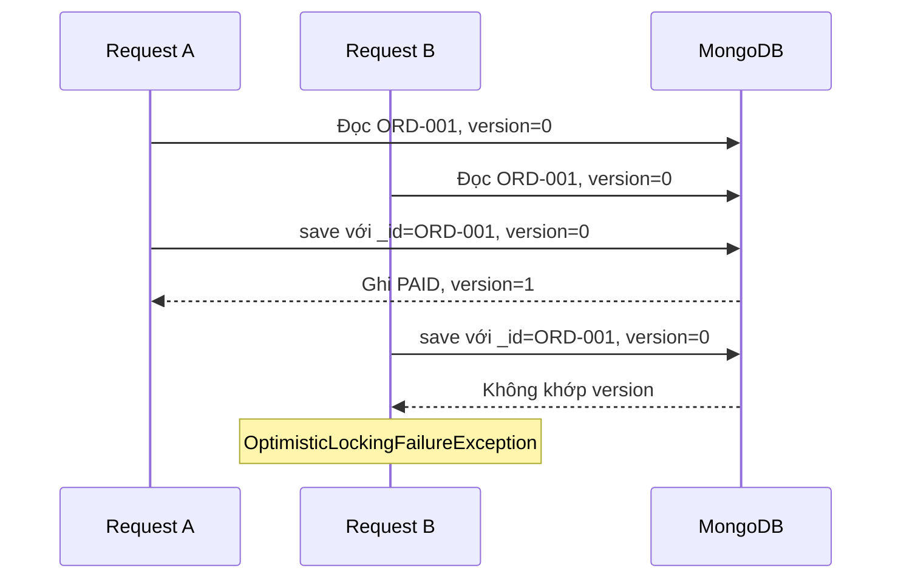
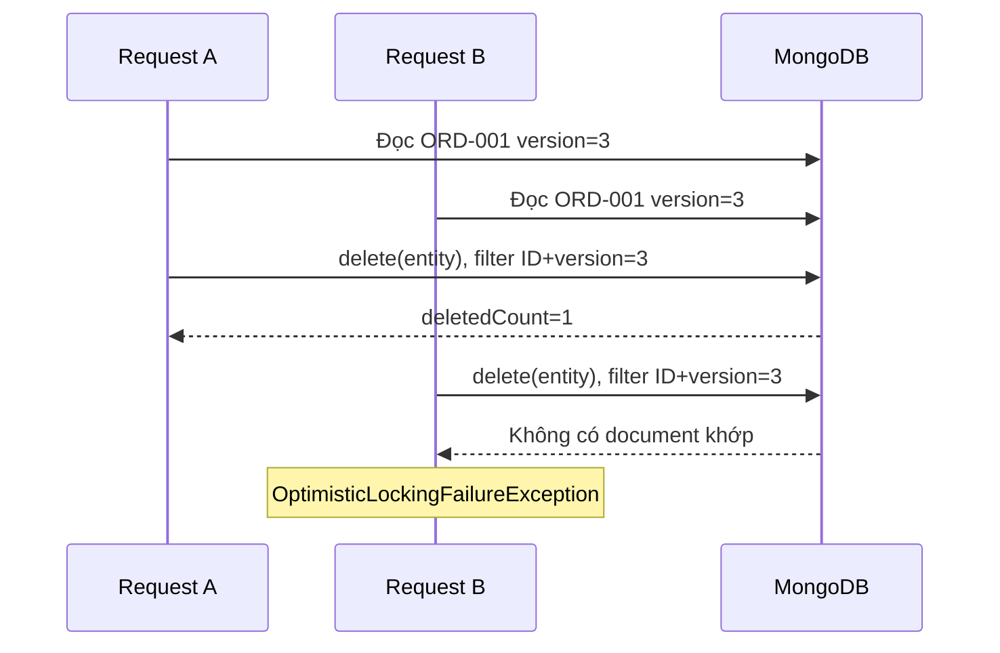
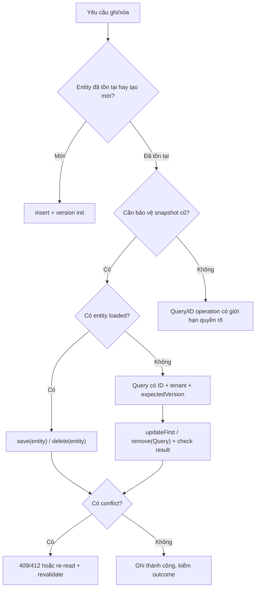

# Version lúc thêm mới, cập nhật và xóa

> **Chương:** Kiểm soát đồng thời  
> **Module:** `SPRING_DATA_MONGODB` — kết nối và ánh xạ document, làm việc với MongoDB qua `MongoTemplate` hoặc repository, thực hành truy vấn, aggregation, index, transaction, reactive access, kiểm thử và chẩn đoán hiệu năng. Bài tập trung vào vòng đời **`@Version` khi insert, save/update và delete**, các ngoại lệ do bản ghi stale, cũng như giới hạn của optimistic locking khi dùng update/delete theo query.

## 1. Vì sao cần version trong MongoDB?

Giả sử có một đơn hàng `ORD-001` đang ở trạng thái `PENDING`. Hai tác vụ đọc gần như đồng thời:

- **Request A** xác nhận thanh toán, đổi thành `PAID`.
- **Request B** hủy đơn, đổi thành `CANCELLED`, nhưng vẫn giữ object đã đọc từ trước.

Nếu ứng dụng chỉ dùng `_id` để ghi, thao tác đến sau có thể ghi đè trạng thái do thao tác đến trước vừa lưu. Đây là **lost update**.

Spring Data MongoDB dùng `@Version` để triển khai **optimistic locking**: mỗi document có một version. Khi sửa một entity đã đọc, framework đưa **version kỳ vọng** vào bộ lọc ghi và cập nhật version khi ghi thành công. Nếu người khác đã sửa trước, phiên bản hiện tại của database không còn khớp và thao tác stale thất bại thay vì lặng lẽ ghi đè.



**Không nhầm optimistic locking với khóa độc quyền:** framework không giữ lock từ lúc đọc đến lúc ghi. Hai request có thể đọc cùng một version; chỉ có một thao tác ghi theo **cùng điều kiện version cũ** được chấp nhận nếu thực sự đang cạnh tranh trên cùng document. MongoDB bảo đảm tính nguyên tử của update ở **cấp document**, nhờ đó phép so sánh version và ghi bản mới diễn ra nhất quán tại thời điểm update.

### 1.1. Ba thời điểm khác nhau

| Thao tác | Quy tắc cần hiểu | Hệ quả |
| --- | --- | --- |
| **Thêm mới** bằng `insert` hoặc save entity được coi là mới | Spring Data **khởi tạo version** chưa gán | Wrapper `Long` thường bắt đầu `0`; primitive `long` bắt đầu `1` |
| **Cập nhật** bằng `save` entity đã tồn tại | Ghép `_id + version cũ` vào điều kiện ghi và tăng version khi thành công | Object stale bị từ chối bằng ngoại lệ |
| **Xóa entity** bằng `repository.delete(entity)` hoặc `mongoTemplate.remove(entity)` | Với entity có `@Version`, filter xóa theo **ID và version** | Repository delete kiểm kết quả và có thể ném `OptimisticLockingFailureException`; template remove trả `DeleteResult` để caller kiểm count |

**Phạm vi:** quy tắc trong bảng dành cho những API Spring Data MongoDB **có hỗ trợ kiểm soát version**. Không suy ra mọi phương thức `updateFirst`, `@Query`, `@Update`, bulk write, raw Java Driver hoặc xóa theo ID đều kiểm version giống `save(entity)`.

## 2. Domain model: @Version cùng @Id

Định nghĩa entity có version kiểu wrapper `Long` và ID kiểu `String` do ứng dụng cung cấp:

```java
package demo.orders;

import org.springframework.data.annotation.Id;
import org.springframework.data.annotation.Version;
import org.springframework.data.mongodb.core.mapping.Document;

@Document(collection = "purchase_orders")
public class PurchaseOrder {
    @Id
    private String id;

    private String tenantId;
    private String status;
    private long amountCents;

    @Version
    private Long version;

    protected PurchaseOrder() {}

    public PurchaseOrder(
        String id, String tenantId, String status, long amountCents
    ) {
        this.id = id;
        this.tenantId = tenantId;
        this.status = status;
        this.amountCents = amountCents;
    }

    public String getId() { return id; }
    public String getTenantId() { return tenantId; }
    public String getStatus() { return status; }
    public long getAmountCents() { return amountCents; }
    public Long getVersion() { return version; }

    public void setStatus(String status) { this.status = status; }
    public void setAmountCents(long amountCents) {
        this.amountCents = amountCents;
    }
}
```

`@Version` ở đây là `org.springframework.data.annotation.Version`, **không** phải annotation JPA. MongoDB lưu version thành một field BSON tương ứng property `version` (trừ khi có mapping custom). `Long` cho phép biểu diễn **chưa có version** bằng `null` trong entity mới.

Repository:

```java
package demo.orders;

import org.springframework.data.mongodb.repository.MongoRepository;

public interface PurchaseOrderRepository
    extends MongoRepository<PurchaseOrder, String> {
}
```

Khi dùng `MongoTemplate`, pass `PurchaseOrder.class` để framework biết domain metadata như `@Id`, `@Version`, `@Field` và collection. Truy cập raw `db.purchase_orders` bằng `mongosh` sẽ thấy BSON thực tế, không thấy các annotation Java.

### 2.1. @Version dùng kiểu dữ liệu gì?

Ví dụ chọn `Long`. Các ví dụ phổ biến còn dùng `Integer`/`int`/`long`. Nên sử dụng **kiểu số phù hợp** và thống nhất schema BSON, không dùng một giá trị version do client tùy ý chọn làm sự thật.

Không dùng `version` làm ID nghiệp vụ: mỗi document có version riêng, không phải đồng hồ toàn hệ thống. Không được suy tổng số thao tác ghi toàn collection bằng cách lấy version lớn nhất.

### 2.2. Entity bất biến và record

Nếu domain dùng immutable class/record, Spring Data cần cách dựng entity bản mới và cập nhật `@Version` thông qua persistence constructor, wither hoặc cơ chế mapping tương thích. Đừng giả định gọi `save` sẽ làm thay đổi object immutable ban đầu theo cùng cách với class mutable ở ví dụ này. Trong bài, dùng mutable class có setter để dễ theo dõi **hai snapshot cũ và mới**.

## 3. Giá trị version khi thêm mới: wrapper 0, primitive 1

Spring Data MongoDB tài liệu hóa quy tắc khởi tạo `@Version` **chưa được gán** trong insert:

| Khai báo field | Giá trị lúc tạo mới trong Java | Version sau insert thông thường |
| --- | --- | --- |
| `@Version Long version` | `null` | **0** |
| `@Version Integer version` | `null` | **0** |
| `@Version long version` | `0` mặc định | **1** |
| `@Version int version` | `0` mặc định | **1** |

Đây là khác biệt quan trọng vì Spring Data Commons có thể dùng version để xác định **entity mới**: wrapper `null` được xem là chưa lưu, trong khi primitive `0` đóng vai trò giá trị “chưa có version hợp lệ” trong quy tắc phát hiện mới.

### 3.1. Insert với Long wrapper

```java
PurchaseOrder candidate = new PurchaseOrder(
    "ORD-001", "TENANT-A", "PENDING", 10000L
);

assert candidate.getVersion() == null;

PurchaseOrder inserted = mongoTemplate.insert(candidate);

System.out.println(inserted.getVersion()); // 0
```

Tương ứng BSON về ý nghĩa:

```javascript
{
  _id: "ORD-001",
  tenantId: "TENANT-A",
  status: "PENDING",
  amountCents: NumberLong(10000),
  version: NumberLong(0)
}
```

**Đừng tự gán `version=1` ngay từ request tạo mới**, rồi cho rằng framework sẽ luôn xem đây là entity mới. Đối với entity dùng version-based is-new detection, việc tự đặt version khác giá trị mới mặc định có thể khiến `save` xử lý nó như entity đã có, dẫn đến behavior khác insert.

### 3.2. Insert với primitive long

Một entity khác:

```java
import org.springframework.data.annotation.Id;
import org.springframework.data.annotation.Version;
import org.springframework.data.mongodb.core.mapping.Document;

@Document(collection = "primitive_version_orders")
public class PrimitiveVersionOrder {
    @Id String id;
    @Version long version;

    public PrimitiveVersionOrder(String id) {
        this.id = id;
    }
}
```

```java
PrimitiveVersionOrder order = new PrimitiveVersionOrder("P-001");
System.out.println(order.version); // 0 (Java default)

mongoTemplate.insert(order);
System.out.println(order.version); // 1 sau insert theo cơ chế mapping thông thường
```

**Tại sao primitive bắt đầu 1?** Vì giá trị `0` của primitive cũng được dùng để biểu diễn **entity mới** khi dùng version-based new detection; version bắt đầu từ `1` khi đã được insert. Với wrapper, `null` biểu diễn chưa lưu nên version đầu tiên có thể là `0`.

### 3.3. Kiểm tra is-new khi gọi repository.save

```java
PurchaseOrder order = new PurchaseOrder(
    "ORD-NEW", "TENANT-A", "PENDING", 25000L
);
PurchaseOrder saved = purchaseOrderRepository.save(order);

System.out.println(saved.getVersion()); // thường 0 với Long mới
```

`save` trên entity mới có thể đi theo nhánh **insert**, còn `save` entity có ID/version đã tồn tại đi theo nhánh **cập nhật**. **ID không phải yếu tố duy nhất để quyết định mới/cũ khi entity có version**. Nếu tạo object mới với ID trùng bản ghi đang tồn tại nhưng `version=null`, một insert có thể báo **duplicate key**; đó không phải một optimistic-lock exception nhất thiết.

Khuyến nghị:

- Tạo entity mới với version chưa được gán.
- Để Spring Data quản lý version.
- Sau `save`/`insert`, dùng entity trả về và/hoặc đọc lại để lấy version hiện tại.
- Với REST API, giữ version server-side hoặc gửi version như một concurrency token đáng tin cậy đã validate; không cho client tùy ý nâng version để vượt điều kiện.

## 4. Save cập nhật: so khớp ID và version trong một thao tác ghi

Giả sử `ORD-001` đã tồn tại với `version=0`. Khi code:

```java
PurchaseOrder order = purchaseOrderRepository.findById("ORD-001")
    .orElseThrow();

order.setStatus("PAID");
PurchaseOrder updated = purchaseOrderRepository.save(order);

System.out.println(updated.getVersion()); // 1 sau cập nhật thành công
```

Spring Data đưa version cũ vào filter ghi. Có thể diễn đạt logic gần như:

```javascript
db.purchase_orders.updateOne(
  { _id: "ORD-001", version: NumberLong(0) },
  {
    // Thực tế framework có thể dùng replacement hay update shape khác.
    $set: { status: "PAID", amountCents: NumberLong(10000) },
    $inc: { version: NumberLong(1) }
  }
);
```

Đây là **mô hình tư duy về compare-and-set**, không phải cam kết từng byte của lệnh do Spring Data gửi (save có thể thực hiện thao tác khác tùy phiên bản). Điều bất biến cần giữ là **chỉ sửa khi ID và version cũ khớp**, và **version tăng** khi ghi thành công.

### 4.1. Hai snapshot riêng biệt và lost update

```java
PurchaseOrder snapshotA =
    purchaseOrderRepository.findById("ORD-001").orElseThrow();
PurchaseOrder snapshotB =
    purchaseOrderRepository.findById("ORD-001").orElseThrow();

System.out.println(snapshotA.getVersion()); // 0
System.out.println(snapshotB.getVersion()); // 0

snapshotA.setStatus("PAID");
purchaseOrderRepository.save(snapshotA); // version mới: 1

snapshotB.setStatus("CANCELLED");
purchaseOrderRepository.save(snapshotB);
// OptimisticLockingFailureException
```

Tại thời điểm snapshot B định ghi, MongoDB đã có version `1`. Filter version `0` không tìm thấy document để sửa, nên Spring Data báo lỗi **thay vì ghi đè thành CANCELLED**.

### 4.2. Ngoại lệ nào được ném?

Trong ứng dụng Spring Data, lỗi stale write thường biểu hiện:

```java
import org.springframework.dao.OptimisticLockingFailureException;

try {
    purchaseOrderRepository.save(snapshotB);
} catch (OptimisticLockingFailureException conflict) {
    // Bản ghi đã đổi version hoặc bị xóa;
    // không ghi đè bằng snapshot đã cũ.
}
```

`OptimisticLockingFailureException` là loại exception ở tầng Spring DAO. Không dùng `NullPointerException`, `DuplicateKeyException` hay `IllegalStateException` làm dấu hiệu chính cho lỗi version mismatch. Một request có thể thất bại vì nhiều lý do khác (timeout, network, validation), cần phân biệt ở service.

### 4.3. @Version chỉ bảo vệ document có metadata tương ứng

Nếu update diễn ra bằng **raw driver**:

```javascript
db.purchase_orders.updateOne(
  { _id: "ORD-001" },
  { $set: { status: "CANCELLED" } }
);
```

Lệnh này **không kiểm tra version** và cũng **không tự tăng version** theo `@Version` của Java, vì MongoDB không biết annotation của Spring. Nó có thể làm dữ liệu thay đổi mà version giữ nguyên, khiến các request `save` sau đó **không phát hiện** một số thay đổi đã xảy ra.

Muốn toàn hệ thống có optimistic locking, mọi writer quan trọng (repository, template, job, script, service khác) phải **tuân thủ cùng concurrency protocol** hoặc dùng quy tắc atomically guarded updates thích hợp.

## 5. @Version khác business state và optimistic locking không bao gồm transaction

Version là **token phát hiện thay đổi**, không thay thế điều kiện nghiệp vụ như `status="PENDING"`, số dư đủ, inventory còn hoặc tenantId khớp.

Ví dụ một đơn có version mới nhất nhưng đã `CANCELLED`. Một thao tác “markPaid” phải chặn theo quy tắc trạng thái, chứ không chỉ kiểm version rồi cho phép chuyển thành `PAID`.

**Không giả định `@Version` tự bảo đảm rằng phép chuyển trạng thái hợp lệ.** Với thao tác có điều kiện mạnh, kết hợp:

- Kiểm tra trạng thái/permission trong service.
- Filter server-side chứa **trạng thái cũ/tenant/version** khi cần một compare-and-set nghiệp vụ.
- Quy tắc version nhất quán với các writer khác.
- Transaction/outbox nếu workflow có nhiều document hoặc sự kiện ngoài MongoDB.

### 5.1. Optimistic locking không phải multi-document transaction

Một lệnh update trên một document là atomic ở cấp document. Nhưng nếu sau khi cập nhật đơn hàng, ứng dụng cần **trừ tồn kho và ghi payment receipt** ở hai collection khác, version của đơn hàng không tự bảo đảm hai bước kia cùng commit hay rollback.

MongoDB transaction trên replica set/sharded topology được hỗ trợ có thể giải quyết tính nguyên tử giữa các thao tác liên quan trong phạm vi transaction; nó có chi phí và giới hạn riêng. **Transaction và version giải quyết các vấn đề khác nhau** và có thể dùng kết hợp khi cần.

### 5.2. Không dùng version làm idempotency key

Version tăng theo cập nhật thành công, nhưng không tự nhận biết “hai request này là cùng một payment event được gửi lại”. Để tránh thanh toán/tăng số lượng hai lần, cần **idempotency key** hoặc một quy tắc dữ liệu độc lập (event ledger, unique constraint, state transition có điều kiện).

`@Version` phát hiện stale snapshot, **không thay thế idempotency** của request nghiệp vụ.

## 6. insert, save và upsert: tên gần giống nhưng semantics khác

| API | Trường hợp thường dùng | Ứng xử với version |
| --- | --- | --- |
| `MongoTemplate.insert(entity)` | Chèn document mới; nếu ID trùng thì lỗi | Khởi tạo `@Version` chưa gán |
| `MongoRepository.save(entity)` | Insert entity được coi là mới hoặc cập nhật entity đang có | New-state detection; khi cập nhật versioned entity thì kiểm version |
| `MongoTemplate.save(entity)` | Lưu domain entity, hỗ trợ version tương tự nhưng API/đường đi riêng | Khi cập nhật entity hiện hữu, filter theo version kỳ vọng |
| `MongoTemplate.upsert(query, update, Entity.class)` | Cập nhật nếu khớp, hoặc chèn document mới nếu không khớp | Có hỗ trợ khởi tạo/tăng version **nếu Update không chỉ định version**, nhưng **không mặc định so khớp version kỳ vọng** |
| `MongoTemplate.upsert(query, update, "collectionName")` | Upsert bằng tên collection (không có domain type metadata) | Không có toàn bộ hỗ trợ mapping/version từ entity class |
| Java Driver `updateOne(..., upsert=true)` | Thao tác thẳng lên MongoDB | Không biết `@Version`, cần quản lý version thủ công |

### 6.1. Upsert có thể tạo bản ghi mới nếu query version không khớp

Đây là cạm bẫy quan trọng. Giả sử:

```javascript
db.purchase_orders.findOne({ _id: "ORD-001" });
// { _id: "ORD-001", version: 3, status: "PAID", ... }
```

Nếu gọi upsert với filter `{_id:"ORD-001",version:2}`, **không có document khớp**. MongoDB có thể thử **insert** một document mới từ query/update thay vì chỉ báo “stale version”. Khi `_id` là cùng `ORD-001`, kết quả thường gặp là **duplicate key** (do _id đã tồn tại), chứ không phải optimistic locking exception như `save(entity)`.

**Không dùng upsert làm công cụ compare-and-set đơn thuần.** Với nghiệp vụ update-if-version-matches, dùng `save(entity)` hoặc `updateFirst`/`findAndModify` với filter version cũ và **không bật upsert**, rồi kiểm tra `matchedCount`/kết quả.

### 6.2. Upsert tự thêm version không có nghĩa tự chống race

Tài liệu Spring Data nói rằng một số `MongoTemplate` upsert/update operations có thể **tự khởi tạo hoặc tăng `@Version`** nếu bạn **không đề cập field version trong Update**. Nhưng chỉ việc tăng version **không làm query tự chứa điều kiện version cũ**. Nếu filter chỉ theo `_id`, hai request vẫn có thể cập nhật và ghi đè nhau, dù version tăng 2 lần.

Đây là lý do cần phân biệt:

1. **Kiểm version trong filter** — ngăn stale write.
2. **Tăng version trong update** — làm các snapshot cũ không còn hợp lệ.

Hệ thống kiểm soát đồng thời tốt cần hai phần liên kết nhất quán, không chỉ một.

## 7. MongoTemplate.updateFirst: tự viết điều kiện version

### 7.1. Tại sao update theo query không giống save(entity)?

`save(entity)` có cả **entity snapshot** với version cũ, nên Spring Data có thể xây filter version tương ứng. Trong khi đó, một lời gọi:

```java
mongoTemplate.updateFirst(
    Query.query(Criteria.where("id").is("ORD-001")),
    new Update().set("status", "PAID"),
    PurchaseOrder.class
);
```

**không tự biết phiên bản mà người gọi đã đọc trước đây**. Với các typed update operations, Spring Data MongoDB có thể tự **tăng version khi `Update` không chứa field version**, nhưng điều đó không nhất thiết bổ sung **version cũ vào filter**. Hai request dùng query chỉ theo ID có thể cùng sửa, phá vỡ giả định về compare-and-set.

### 7.2. Đưa version kỳ vọng vào Criteria

```java
package demo.orders;

import com.mongodb.client.result.UpdateResult;
import org.springframework.dao.OptimisticLockingFailureException;
import org.springframework.data.mongodb.core.MongoTemplate;
import org.springframework.data.mongodb.core.query.Criteria;
import org.springframework.data.mongodb.core.query.Query;
import org.springframework.data.mongodb.core.query.Update;
import org.springframework.stereotype.Service;

@Service
public class OrderTransitionService {
    private final MongoTemplate mongoTemplate;

    public OrderTransitionService(MongoTemplate mongoTemplate) {
        this.mongoTemplate = mongoTemplate;
    }

    public void markPaid(
        String id, String tenantId, long expectedVersion
    ) {
        Query filter = Query.query(
            Criteria.where("id").is(id)
                .and("tenantId").is(tenantId)
                .and("version").is(expectedVersion)
                .and("status").is("PENDING")
        );

        Update update = new Update().set("status", "PAID");
        // Với typed MongoTemplate update, Spring Data có thể tự
        // tăng @Version nếu Update không chỉ định field version.

        UpdateResult result = mongoTemplate.updateFirst(
            filter, update, PurchaseOrder.class
        );

        if (!result.wasAcknowledged()) {
            throw new IllegalStateException(
                "Write acknowledgement is required"
            );
        }
        if (result.getMatchedCount() != 1L) {
            throw new OptimisticLockingFailureException(
                "Order not found, stale, or transition not allowed"
            );
        }
    }
}
```

**Lưu ý:** khi gọi `Criteria.where("id")` cùng `PurchaseOrder.class`, Spring Data MongoDB dùng entity metadata để ánh xạ property ID tới BSON `_id`. Với raw `Document` hoặc `mongosh`, phải dùng tên BSON thực tế.

Trong phương thức này, filter bao gồm:

- ID đơn hàng;
- tenant từ ngữ cảnh xác thực;
- version kỳ vọng (ví dụ `3`);
- trạng thái trước khi chuyển (`PENDING`).

Nếu `matchedCount=0`, nguyên nhân có thể là ID không tồn tại, sai tenant, version đã đổi hoặc status không còn `PENDING`. Ví dụ dùng một exception chung để chặn ghi; trong API production nên phân loại theo contract mà **không làm lộ sự tồn tại của tài nguyên tenant khác**.

### 7.3. Tăng version tự động và explicit

Các `MongoOperations` typed updates hỗ trợ **tự tăng version nếu update không đề cập version** theo tài liệu. Nhưng chi tiết có thể phụ thuộc loại thao tác và phiên bản Spring Data.

Nếu phải **kiểm soát tường minh toàn bộ compare-and-set**, có thể đặt version vào update payload:

```java
Query filter = Query.query(
    Criteria.where("id").is("ORD-001")
        .and("tenantId").is("TENANT-A")
        .and("version").is(3L)
);

Update update = new Update()
    .set("status", "PAID")
    .inc("version", 1L);

UpdateResult result = mongoTemplate.updateFirst(
    filter, update, PurchaseOrder.class
);
```

Vì version **đã xuất hiện trong Update**, Spring Data không cần tự thêm lần tăng thứ hai. **Không tự `$inc version` nếu chưa kiểm tra đường update đang chạy có tự tăng phiên bản hay không**; một quy tắc update có thể dẫn tới tăng hai lần hoặc xung đột khi được thực hiện sai.

### 7.4. Matched count và modified count

Java Driver trả `UpdateResult`:

```java
long matched = result.getMatchedCount();
long modified = result.getModifiedCount();
```

`matchedCount=1` nghĩa là có document thỏa filter; `modifiedCount=1` nghĩa là có document thực sự thay đổi. Với update chỉ `$set` cùng giá trị, có thể `matched=1` nhưng `modified=0`. Nếu typed update đồng thời tăng version, bản ghi có thể vẫn được xem là đã sửa vì version thay đổi.

Đối với compare-and-set, **matched count** thường thể hiện rõ điều kiện filter có khớp hay không. Đừng tự xem modified count 0 luôn là lỗi version nếu lệnh ghi có thể là no-op theo thiết kế.

## 8. Repository @Query + @Update và version kỳ vọng

Repository update method dùng `@Query` để chọn document và `@Update` để mô tả phép sửa. Nó **không thực hiện chu trình load–modify–save entity** cho mỗi document.

```java
package demo.orders;

import org.springframework.data.mongodb.repository.MongoRepository;
import org.springframework.data.mongodb.repository.Query;
import org.springframework.data.mongodb.repository.Update;

public interface OrderUpdateRepository
        extends MongoRepository<PurchaseOrder, String> {

    @Query("{ '_id': ?0, 'tenantId': ?1, " +
           "'version': ?2, 'status': 'PENDING' }")
    @Update("{ '$set': { 'status': 'PAID' }, " +
            "'$inc': { 'version': 1 } }")
    long findAndMarkPaidIfVersionMatches(
        String id, String tenantId, long expectedVersion
    );
}
```

Ở đây:

- `?0` là ID, `?1` là tenant, `?2` là version người gọi kỳ vọng.
- `@Query` bảo vệ **ID + tenant + version + trạng thái cũ**.
- `@Update` đặt trạng thái mới và **tăng version tường minh**.
- `long` báo số document bị sửa theo API repository update.

Khi ID là duy nhất và filter khớp, tối đa **một** document bị sửa. Nếu không có ID/unique key, repository update có thể sửa **tất cả document khớp**, không tự giới hạn một document.

**Đừng kết luận chỉ thêm `@Version` vào entity thì mọi method `@Update` sẽ tự kiểm tra version.** Filter chỉ có `_id` vẫn có thể sửa object đã thay đổi từ trước. Nếu annotation update có thể dùng trong production, hãy kiểm thử câu lệnh MongoDB thực tế và chính sách auto-increment version trên **dependency đang dùng**.

### 8.1. Không phát lifecycle events như save

Repository update methods **không phát các persistence/mapping lifecycle events** như đường save thông thường. Nếu ứng dụng gắn quy tắc audit hoặc domain validation vào callbacks của save, không được giả định chúng chạy cho mỗi document bị sửa bằng `@Update`. Hãy viết rõ `updatedAt`, actor và validation ở đường update nếu contract yêu cầu.

### 8.2. Gắn expectedVersion với API

Một REST endpoint có thể nhận `expectedVersion` từ body hoặc `If-Match`/ETag:

```text
PATCH /orders/ORD-001/status
If-Match: "v3"
Content-Type: application/json

{"status":"PAID"}
```

API server giải mã token `v3` thành version kỳ vọng, xác thực tenant và thao tác hợp lệ, sau đó gọi conditional update. `If-Match` là một kỹ thuật thiết kế HTTP; **Spring Data không tự triển khai ETag này cho controller** chỉ vì entity có `@Version`.

Nếu version client đưa là stale, HTTP `409 Conflict` hoặc `412 Precondition Failed` có thể phù hợp tùy contract; với `If-Match` thường lựa chọn `412` rõ nghĩa hơn. **Không tự báo 404** chỉ từ một count 0 khi chưa xử lý ID/tenant/status và privacy policy.

## 9. Xóa entity có version: delete(entity) được bảo vệ

### 9.1. MongoRepository.delete(entity)

Từ **Spring Data MongoDB 2.2**, repository kiểm tra kết quả của **acknowledged delete** khi xóa một entity có version. Nếu entity đang stale, `CrudRepository.delete(Object)` ném `OptimisticLockingFailureException` thay vì âm thầm xóa document mới hơn.

Ví dụ:

```java
PurchaseOrder stale =
    purchaseOrderRepository.findById("ORD-001").orElseThrow();

PurchaseOrder current =
    purchaseOrderRepository.findById("ORD-001").orElseThrow();

current.setStatus("PAID");
purchaseOrderRepository.save(current); // version 0 -> 1

purchaseOrderRepository.delete(stale);
// OptimisticLockingFailureException: stale.version = 0
```

Về ý nghĩa MongoDB, framework xóa theo **ID và version** của entity:

```javascript
db.purchase_orders.deleteOne({
  _id: "ORD-001",
  version: NumberLong(0)
});
// deletedCount = 0 nếu DB hiện version=1
```

Đây là sơ đồ logic: Spring Data sẽ xây filter thích hợp theo metadata, và khi xóa một versioned entity không có kết quả, nó xử lý mismatch thành lỗi optimistic locking theo hợp đồng API.

### 9.2. MongoTemplate.remove(entity): có version filter, trả DeleteResult

Spring Data MongoDB từ **2.2** cũng đưa `@Version` vào query của `MongoOperations.remove(entity)`. Tuy nhiên, JavaDoc của `MongoOperations.remove(Object)` mô tả **`DeleteResult`** để kiểm số document đã xóa, **không cam kết tự ném `OptimisticLockingFailureException`** giống repository `delete(entity)`:

```java
PurchaseOrder snapshot = mongoTemplate.findById(
    "ORD-001", PurchaseOrder.class
);

// Giả định snapshot không null, và một writer khác đã tăng version.
com.mongodb.client.result.DeleteResult result =
    mongoTemplate.remove(snapshot);

if (!result.wasAcknowledged()) {
    throw new IllegalStateException("Delete not acknowledged");
}
if (result.getDeletedCount() != 1L) {
    throw new org.springframework.dao.OptimisticLockingFailureException(
        "Entity absent or version changed"
    );
}
```

Ở ví dụ này, `snapshot` phải khác null, và lời gọi remove diễn ra **sau khi có thao tác khác cập nhật version**. Khi đó filter gồm version cũ không khớp, `deletedCount=0`. **Service tự quyết định ném optimistic exception dựa trên count**; một lời gọi template remove trả 0 không mặc nhiên ném exception. Trên phiên bản Spring Data cũ hoặc đường API khác, hãy xác minh behavior cụ thể bằng integration test.

### 9.3. Một entity bị xóa cũng khiến snapshot cũ stale

Hai luồng đọc cùng một document version=3:



Điều này đúng với contract optimistic locking của delete trên entity versioned. Nếu API muốn việc xóa lặp là idempotent và trả thành công khi document đã không tồn tại, service cần **chính sách xử lý kết quả rõ ràng**, không mặc định mọi optimistic exception phải lộ ra client.

## 10. Xóa theo ID và theo Query: có thể bỏ qua kiểm version

### 10.1. CrudRepository.deleteById(ID)

Theo tài liệu Spring Data MongoDB, `CrudRepository.deleteById(ID)` **bỏ qua kiểm tra optimistic locking** của `@Version`:

```java
purchaseOrderRepository.deleteById("ORD-001");
```

Thao tác này không có **expectedVersion** từ snapshot cụ thể để so khớp. Vì vậy một người dùng đang cầm trạng thái cũ có thể gọi deleteById và xóa document đã được request khác cập nhật, trừ khi ứng dụng có ràng buộc bổ sung.

**Nguy cơ multi-tenant:** method nhận mỗi ID không có tiêu chí tenant. Với ID có thể dự đoán hoặc được chia sẻ giữa tenant, phải xác thực quyền trước khi gọi hoặc dùng query xóa chứa tenant và version kỳ vọng.

### 10.2. MongoTemplate.remove(Query,…)

`MongoOperations.remove(Query, Entity.class)` hoạt động theo **Criteria do caller cung cấp**, không mặc định thêm version của một entity snapshot cụ thể:

```java
import com.mongodb.client.result.DeleteResult;
import org.springframework.data.mongodb.core.query.Criteria;
import org.springframework.data.mongodb.core.query.Query;

Query byIdAndTenant = Query.query(
    Criteria.where("id").is("ORD-001")
        .and("tenantId").is("TENANT-A")
);

DeleteResult result = mongoTemplate.remove(
    byIdAndTenant, PurchaseOrder.class
);

long deleted = result.getDeletedCount();
```

Lệnh trên có tenant nhưng **không kiểm version**, nên xóa document bất kể request khác đã sửa version. Nếu muốn guard version:

```java
Query guarded = Query.query(
    Criteria.where("id").is("ORD-001")
        .and("tenantId").is("TENANT-A")
        .and("version").is(3L)
);

DeleteResult result = mongoTemplate.remove(
    guarded, PurchaseOrder.class
);

if (!result.wasAcknowledged()) {
    throw new IllegalStateException("Delete must be acknowledged");
}
if (result.getDeletedCount() != 1L) {
    throw new OptimisticLockingFailureException(
        "Order absent, stale or outside tenant"
    );
}
```

**Lưu ý:** `remove(Query, …)` theo query **không tự ném optimistic exception** chỉ vì số xóa bằng 0. Trong ví dụ, **service chủ động kiểm `deletedCount`** và phát exception theo contract. Nếu query không có ID/unique key, `remove(Query, Entity.class)` có thể xóa **nhiều document** khớp filter.

### 10.3. Bảng so sánh delete

| Phương thức | Có expectedVersion của entity không? | Có kiểm version tự động? | Khi không xóa được |
| --- | :---: | :---: | --- |
| `repository.delete(entity)` | Có | **Có** với versioned entity (2.2+) | Optimistic lock failure với acknowledged delete |
| `mongoTemplate.remove(entity)` | Có | **Có version trong filter** với versioned entity (2.2+) | Trả `DeleteResult`; khi stale thường `deletedCount=0`, caller xử lý |
| `repository.deleteById(id)` | Không | **Không** | Hành vi xóa theo ID, không phát lỗi version mismatch |
| `mongoTemplate.remove(Query, Entity.class)` | Chỉ khi caller đưa vào query | **Không tự động** | `DeleteResult`, caller quyết định xử lý count 0 |
| Raw Java Driver `deleteOne` | Chỉ nếu filter có version | **Không biết `@Version`** | `DeleteResult`, caller kiểm count |

Với business operation “xóa nếu document vẫn đúng phiên bản người dùng đang thấy”, **không dùng deleteById như phương án mặc định**. Với nghiệp vụ xóa theo ID không cần version (ví dụ admin cleanup), nên giới hạn quyền và audit rõ ràng.

## 11. Write concern: không có acknowledgement thì không phát hiện conflict đáng tin cậy

Spring Data MongoDB nhấn mạnh: **optimistic locking đòi hỏi write acknowledgement từ server**. Nếu dùng `WriteConcern.UNACKNOWLEDGED`, kết quả cập nhật/xóa không được xác nhận; framework có thể **không phát hiện** stale write để phát `OptimisticLockingFailureException`.

### 11.1. ACKNOWLEDGED so với UNACKNOWLEDGED

| Write concern | Ý nghĩa cơ bản | Tác động với optimistic locking |
| --- | --- | --- |
| `UNACKNOWLEDGED` / `w:0` | Client không đợi kết quả write từ server | **Không phù hợp** khi phải biết update/delete có match version |
| `ACKNOWLEDGED` / `w:1` | Primary xác nhận thao tác theo write concern | Cho phép framework quan sát matched/deleted result và phát hiện mismatch |
| `MAJORITY` | Phù hợp với bảo đảm acknowledgment theo majority trong replica set | Có ý nghĩa cao hơn về khả năng duy trì sau failover, vẫn cần version filter |

`WriteConcern.ACKNOWLEDGED` là điều kiện cần cho việc phát hiện conflict, **không đồng nghĩa mọi dữ liệu đã có majority durability**. Nếu nghiệp vụ yêu cầu độ bền qua failover, thiết kế write concern và retry strategy phù hợp topology.

### 11.2. Ví dụ cấu hình ở tầng ứng dụng

Tùy stack và phiên bản, có thể cấu hình `MongoTemplate`/`MongoClient` để dùng write concern đáp ứng nghiệp vụ:

```java
import com.mongodb.WriteConcern;

// Ví dụ trong cấu hình khởi tạo MongoTemplate đã có sẵn:
mongoTemplate.setWriteConcern(WriteConcern.ACKNOWLEDGED);
```

Đoạn trên chỉ minh họa **ý định cấu hình**, không khuyến nghị đổi write concern trong mỗi request và không phủ nhận các cấu hình driver/transaction/write concern resolver khác. Nếu dùng `@Transactional` với MongoDB, phải kiểm tra write concern của transaction/commit theo hệ thống thực.

### 11.3. Lỗi mạng và kết quả ghi không xác định

Nếu client mất kết nối sau khi gửi `save`, có thể server **đã ghi thành công** nhưng client chưa nhận response. Đừng tự nghĩ “exception nghĩa là version chưa tăng” rồi lặp vô hạn:

- Đọc lại document bằng ID + tenant, so trạng thái và version.
- Nếu thao tác nghiệp vụ có event ID, kiểm tra idempotency.
- Phân biệt lỗi version mismatch với network timeout hoặc write concern error.
- Chỉ retry có giới hạn theo phân loại lỗi và tính chất thao tác.

## 12. Retry sau OptimisticLockingFailureException: đọc lại, tính lại, thử có giới hạn

### 12.1. Cách retry nguy hiểm

```java
// PHẢN VÍ DỤ: cố giữ object stale rồi save lại.
while (true) {
    try {
        purchaseOrderRepository.save(staleOrder);
        break;
    } catch (OptimisticLockingFailureException ex) {
        // Không refresh version hay trạng thái -> có thể lặp vô hạn.
    }
}
```

Một khi `staleOrder` giữ version cũ, save lại nguyên object đó thường vẫn thất bại. **Tự sửa version lên giá trị tùy đoán cũng không an toàn**, vì có thể ghi đè cập nhật của người khác.

### 12.2. Retry đúng phải tính lại từ trạng thái mới

Ví dụ thao tác “đổi amountCents theo quy tắc hiện hành” có thể retry khi version mismatch, **nếu nghiệp vụ cho phép**:

```java
public PurchaseOrder changeAmountWithRetry(
    String id, String tenantId, long newAmountCents
) {
    final int maxAttempts = 3;
    for (int attempt = 1; attempt <= maxAttempts; attempt++) {
        PurchaseOrder latest = purchaseOrderRepository.findById(id)
            .filter(order -> tenantId.equals(order.getTenantId()))
            .orElseThrow(() -> new IllegalArgumentException(
                "Order not found or not accessible"
            ));

        if (!"PENDING".equals(latest.getStatus())) {
            throw new IllegalStateException(
                "Cannot change amount of a non-pending order"
            );
        }

        latest.setAmountCents(newAmountCents);
        try {
            return purchaseOrderRepository.save(latest);
        } catch (OptimisticLockingFailureException conflict) {
            if (attempt == maxAttempts) {
                throw conflict;
            }
            // Vòng sau đọc lại entity mới, kiểm tra lại toàn bộ nghiệp vụ.
        }
    }
    throw new IllegalStateException("Unreachable");
}
```

`purchaseOrderRepository` là dependency của service, được inject qua constructor. Method là ví dụ **bounded retry**; không có delay/backoff để giữ trọng tâm, nhưng production có thể cần jitter và chính sách retry hợp lý.

**Cảnh báo nghiệp vụ:** không retry tự động bằng cách “đọc lại rồi áp cùng yêu cầu” cho thanh toán, trừ tiền hoặc chuyển trạng thái khi việc lặp có thể tạo hiệu ứng bên ngoài. Với giao dịch tài chính, thường cần idempotency token, event ledger hoặc outbox. Xung đột version có thể là **tín hiệu cần trả 409/412 cho người dùng**, không nhất thiết là lỗi nên retry.

### 12.3. Cẩn trọng transaction khi retry

Nếu gọi `save` bên trong MongoDB transaction và gặp write conflict, transaction có thể đã ở trạng thái cần rollback/retry **cả transaction**, không chỉ retry một statement trong cùng transaction. Phải theo hướng dẫn driver/Spring transaction manager về lỗi có thể retry và thiết kế boundary.

Đừng bắt mọi exception rồi bỏ qua, cũng đừng tiếp tục dùng cùng transactional context sau khi đã có lỗi khiến transaction không còn hợp lệ.

## 13. ReactiveMongoRepository và ReactiveMongoTemplate

### 13.1. Save entity versioned dưới dạng Mono

`ReactiveMongoRepository` triển khai semantics optimistic locking cho các thao tác tương ứng trên entity có `@Version`:

```java
package demo.orders;

import org.springframework.data.mongodb.repository.ReactiveMongoRepository;

public interface ReactivePurchaseOrderRepository
    extends ReactiveMongoRepository<PurchaseOrder, String> {}
```

Trong service:

```java
import reactor.core.publisher.Mono;

Mono<PurchaseOrder> updated = reactivePurchaseOrderRepository
    .findById("ORD-001")
    .switchIfEmpty(Mono.error(
        new IllegalArgumentException("Order not found")
    ))
    .map(order -> {
        order.setStatus("PAID");
        return order;
    })
    .flatMap(reactivePurchaseOrderRepository::save);
```

Không có `block()` trong event loop. Khi `Mono` được subscribe, thao tác tìm và lưu mới thực thi; nếu version đã bị request khác tăng, `save` phát lỗi tương ứng qua **onError** của publisher.

Trong ứng dụng đa tenant, ví dụ trên cần bổ sung **kiểm tra tenant** trước khi đổi trạng thái; không dùng ID-only lookup cho endpoint mà người gọi không có quyền xem mọi tenant.

### 13.2. Bắt riêng conflict trong reactive

```java
import org.springframework.dao.OptimisticLockingFailureException;

Mono<PurchaseOrder> result = updated.onErrorMap(
    OptimisticLockingFailureException.class,
    ex -> new OrderConflictException(
        "Order was modified by another request", ex
    )
);
```

`OrderConflictException` là custom exception do ứng dụng tự định nghĩa. `onErrorMap` **chỉ ánh xạ lỗi**, không retry hay thay đổi dữ liệu. Nếu muốn retry, phải định nghĩa retry policy có giới hạn và **đọc lại trạng thái** phù hợp nghiệp vụ.

### 13.3. Reactive delete cũng phân biệt entity và ID

```java
Mono<Void> guardedDelete = reactivePurchaseOrderRepository
    .findById("ORD-001")
    .switchIfEmpty(Mono.error(
        new IllegalArgumentException("Order not found")
    ))
    .flatMap(reactivePurchaseOrderRepository::delete);
```

`delete(entity)` sử dụng version của entity được truyền trong đường repository hỗ trợ. Nhưng tìm theo ID rồi delete vẫn cần kiểm tra quyền/tenant, và **có một khoảng cạnh tranh** giữa read và delete: chính version guard mới giải quyết stale delete ở cấp document.

`reactivePurchaseOrderRepository.deleteById("ORD-001")` không mang version snapshot, nên không được dùng thay guarded delete nếu endpoint yêu cầu compare-and-delete.

### 13.4. ReactiveMongoTemplate cập nhật có điều kiện

```java
import com.mongodb.client.result.UpdateResult;
import org.springframework.data.mongodb.core.query.Criteria;
import org.springframework.data.mongodb.core.query.Query;
import org.springframework.data.mongodb.core.query.Update;
import reactor.core.publisher.Mono;

Query query = Query.query(
    Criteria.where("id").is("ORD-001")
        .and("tenantId").is("TENANT-A")
        .and("version").is(3L)
        .and("status").is("PENDING")
);

Mono<UpdateResult> write = reactiveMongoTemplate.updateFirst(
    query,
    new Update().set("status", "PAID"),
    PurchaseOrder.class
);
```

Giống imperative `MongoTemplate`, **query phải chứa version kỳ vọng** nếu đây là optimistic compare-and-set. Publisher trả `UpdateResult` để kiểm `matchedCount` khi được subscribe. Tự tăng version (khi update không đề cập version) **không đồng nghĩa** tự so khớp version.

## 14. Bulk operations, aggregation updates và bypass paths

### 14.1. Bulk write không tương đương save từng entity versioned

`BulkOperations` tối ưu roundtrip khi có nhiều update/insert, nhưng không nên giả định bulk update có cùng optimistic-lock exception semantics với `save(entity)` cho từng item. Với bulk update theo query, cần chủ động đặt `version` trong filter và tăng version khi muốn CAS.

```java
// Ý tưởng kiểm soát version cho một bulk update item:
Query filter = Query.query(
    Criteria.where("id").is("ORD-001")
        .and("version").is(3L)
);
Update change = new Update()
    .set("status", "PAID")
    .inc("version", 1L);

// Tạo bulk operation cho nhiều item cần thiết, rồi execute.
// Kiểm tra BulkWriteResult và mapping từng item/exception theo yêu cầu.
```

Theo tài liệu Spring Data, **bulk operations không hỗ trợ đầy đủ optimistic locking và lifecycle events ở mức từng entity**. Đừng lấy một tổng modified count từ bulk rồi suy đúng item nào stale nếu không có thiết kế đối soát rõ ràng.

### 14.2. Aggregation pipeline updates

MongoDB cho phép dùng update pipeline (chẳng hạn `$set` với biểu thức) thông qua API Spring Data phù hợp. Khi thao tác update không phải `save(entity)`, version snapshot cũ không mặc nhiên được dùng để tạo filter. Phải xác định rõ:

1. Điều kiện chọn document có `version` và trạng thái cũ không?
2. Update có tăng version một lần không?
3. Có upsert hay không, và nếu không match thì làm gì?
4. Các mapping/converter cho field version có được dùng ở đường API này không?
5. Exception và write concern được xử lý thế nào?

Chạy integration test trên đúng server/Spring Data version trước khi dùng trong nghiệp vụ quan trọng.

### 14.3. Raw driver và các dịch vụ khác phải cùng protocol

Một worker ngoài Java có thể viết:

```javascript
db.purchase_orders.updateOne(
  { _id: "ORD-001", version: NumberLong(3) },
  {
    $set: { status: "PAID" },
    $inc: { version: NumberLong(1) }
  }
);
```

Nếu mọi writer dùng cơ chế CAS nhất quán, version có thể bảo vệ dữ liệu xuyên nhiều thành phần. Nhưng nếu một writer cố ý bỏ filter version hoặc update status mà không tăng version, các đảm bảo optimistic locking bị suy yếu. Đây là **quy ước hệ thống**, không phải một cài đặt toàn cục tự thực thi chỉ nhờ annotation trong ứng dụng Spring.

## 15. Mapping, legacy documents và xử lý version bất thường

### 15.1. Document thiếu field version

Một hệ thống có thể đã ghi hàng triệu document trước khi thêm `@Version`:

```javascript
db.purchase_orders.findOne({ _id: "LEGACY-001" });
// { _id: "LEGACY-001", tenantId: "...", status: "...", ... }
// Không có field version.
```

Khi entity ánh xạ vào `Long version`, giá trị Java có thể là `null`. Đây cũng là **dấu hiệu entity mới** đối với version-based detection. Đừng mặc định `repository.save(legacyEntity)` sẽ sửa document cũ một cách trơn tru; nó có thể bị phân loại là mới và cố insert, dẫn tới duplicate ID.

Trước khi bật optimistic locking trên dữ liệu cũ:

- Kiểm kê document thiếu version hoặc có version sai kiểu.
- Quy định version khởi đầu (thường 0 cho wrapper) nhất quán với mapping.
- Chạy migration dữ liệu có kiểm soát, không sửa version tùy tiện khi có writer đang hoạt động.
- Đảm bảo tất cả writer đã chuyển sang protocol kiểm soát version.
- Test bản ghi legacy, bản ghi mới và update/delete cạnh tranh.

### 15.2. Migration ví dụ trên MongoDB test

```javascript
db.purchase_orders.updateMany(
  { version: { $exists: false } },
  { $set: { version: NumberLong(0) } }
);
```

Đây là **ví dụ migration trên database test**, không phải khuyến nghị chạy thẳng trên production. Nếu hệ thống đang tiếp tục ghi, migration version có thể tạo race; cần quy trình rollout, pause/dual-write hoặc chiến lược tương thích được đánh giá cụ thể.

### 15.3. Đừng reset version về 0 khi đã tồn tại

```javascript
// PHẢN VÍ DỤ: làm vô hiệu token concurrency đang lưu trong client.
db.purchase_orders.updateMany(
  {},
  { $set: { version: NumberLong(0) } }
);
```

Nếu reset version của mọi document đang sống, các snapshot cũ có version=0 có thể bất ngờ khớp trở lại hoặc những snapshot mới hơn trở thành stale. Không có cơ chế versioning nào tự bảo vệ trước việc người vận hành chủ động ghi đè version sai quy tắc.

### 15.4. Field alias và kiểu số

Nếu entity có:

```java
@Version
@org.springframework.data.mongodb.core.mapping.Field("revision")
private Long version;
```

trong MongoDB field thực tế là `revision`. Khi dùng Spring Data typed queries, framework mapping có thể chuyển property `version` sang field BSON. Nhưng khi viết `mongosh` hoặc Java Driver raw, phải dùng đúng `revision`, không phải `version`.

Thống nhất kiểu BSON (ví dụ `NumberLong`), đừng để một phần document version lưu String `"3"`, phần khác là number `3`. Equality filter theo version có thể không khớp dù giá trị “trông giống nhau” khi in log.

### 15.5. Version overflow

Version kiểu số nguyên hữu hạn. Về lý thuyết, nếu một document bị cập nhật đủ số lần để đạt giới hạn biểu diễn của kiểu Java/BSON, nó có thể overflow hoặc gặp lỗi số học. Với hầu hết nghiệp vụ dùng `Long`, điều này rất xa trong thực tế; nhưng là lý do không chọn kiểu `byte` hay `short` cho version và không tự tăng version bằng biểu thức không kiểm soát.

## 16. Integration test: kiểm chứng insert, save, stale delete và bypass

Không nên chỉ mock repository rồi assert “method save được gọi một lần”. Mock không kiểm chứng MongoDB thật có match version, tăng version và trả lỗi khi không khớp hay không.

### 16.1. Chuẩn bị MongoDB test riêng

Một lớp test Spring Boot 3.x có thể dùng `@DataMongoTest`, JUnit 5 và AssertJ. Cần **MongoDB server/test database riêng**, ví dụ Testcontainers; `@DataMongoTest` không tự bảo đảm server có sẵn.

```java
package demo.orders;

import static org.assertj.core.api.Assertions.assertThat;
import static org.assertj.core.api.Assertions.assertThatThrownBy;

import org.bson.Document;
import org.junit.jupiter.api.BeforeEach;
import org.junit.jupiter.api.Test;
import org.springframework.beans.factory.annotation.Autowired;
import org.springframework.boot.test.autoconfigure.data.mongo.DataMongoTest;
import org.springframework.dao.OptimisticLockingFailureException;
import org.springframework.data.mongodb.core.MongoTemplate;

@DataMongoTest
class PurchaseOrderVersionTest {

    @Autowired PurchaseOrderRepository repository;
    @Autowired MongoTemplate template;

    @BeforeEach
    void clean() {
        // CHỈ được xóa dữ liệu trên MongoDB TEST cô lập.
        template.dropCollection(PurchaseOrder.class);
    }

    @Test
    void wrapperVersionStartsAtZeroOnInsert() {
        PurchaseOrder inserted = repository.insert(
            new PurchaseOrder(
                "ORD-INSERT", "TENANT-A", "PENDING", 10000L
            )
        );

        assertThat(inserted.getVersion()).isEqualTo(0L);

        Document raw = template.getCollection("purchase_orders")
            .find(new Document("_id", "ORD-INSERT"))
            .first();

        assertThat(raw).isNotNull();
        assertThat(((Number) raw.get("version")).longValue())
            .isZero();
    }

    @Test
    void firstSaveSucceedsAndStaleSaveFails() {
        repository.insert(new PurchaseOrder(
            "ORD-SAVE", "TENANT-A", "PENDING", 10000L
        ));

        PurchaseOrder first = repository.findById("ORD-SAVE")
            .orElseThrow();
        PurchaseOrder stale = repository.findById("ORD-SAVE")
            .orElseThrow();

        assertThat(first.getVersion()).isEqualTo(0L);
        assertThat(stale.getVersion()).isEqualTo(0L);

        first.setStatus("PAID");
        PurchaseOrder saved = repository.save(first);
        assertThat(saved.getVersion()).isEqualTo(1L);

        stale.setStatus("CANCELLED");
        assertThatThrownBy(() -> repository.save(stale))
            .isInstanceOf(OptimisticLockingFailureException.class);

        PurchaseOrder latest = repository.findById("ORD-SAVE")
            .orElseThrow();
        assertThat(latest.getStatus()).isEqualTo("PAID");
        assertThat(latest.getVersion()).isEqualTo(1L);
    }

    @Test
    void staleEntityCannotDeleteNewerDocument() {
        repository.insert(new PurchaseOrder(
            "ORD-DELETE", "TENANT-A", "PENDING", 10000L
        ));

        PurchaseOrder stale = repository.findById("ORD-DELETE")
            .orElseThrow();
        PurchaseOrder latest = repository.findById("ORD-DELETE")
            .orElseThrow();

        latest.setStatus("PAID");
        repository.save(latest);

        assertThatThrownBy(() -> repository.delete(stale))
            .isInstanceOf(OptimisticLockingFailureException.class);

        assertThat(repository.findById("ORD-DELETE")
            .orElseThrow().getStatus())
            .isEqualTo("PAID");
    }

    @Test
    void templateRemoveStaleEntityReturnsZeroWithoutDeleting() {
        repository.insert(new PurchaseOrder(
            "ORD-TEMPLATE-DELETE", "TENANT-A", "PENDING", 10000L
        ));

        PurchaseOrder stale = repository.findById("ORD-TEMPLATE-DELETE")
            .orElseThrow();
        PurchaseOrder latest = repository.findById("ORD-TEMPLATE-DELETE")
            .orElseThrow();

        latest.setStatus("PAID");
        repository.save(latest); // version 0 -> 1

        com.mongodb.client.result.DeleteResult outcome =
            template.remove(stale);

        assertThat(outcome.wasAcknowledged()).isTrue();
        assertThat(outcome.getDeletedCount()).isZero();
        assertThat(repository.findById("ORD-TEMPLATE-DELETE")
            .orElseThrow().getStatus()).isEqualTo("PAID");
    }

    @Test
    void deleteByIdDoesNotCheckLoadedSnapshotVersion() {
        repository.insert(new PurchaseOrder(
            "ORD-ID-DELETE", "TENANT-A", "PENDING", 10000L
        ));

        PurchaseOrder old = repository.findById("ORD-ID-DELETE")
            .orElseThrow();
        PurchaseOrder latest = repository.findById("ORD-ID-DELETE")
            .orElseThrow();

        latest.setStatus("PAID");
        repository.save(latest); // DB version=1; old.version=0

        // Không truyền old vào delete => không dùng expectedVersion=0.
        repository.deleteById(old.getId());

        assertThat(repository.existsById("ORD-ID-DELETE"))
            .isFalse();
    }

    @Test
    void freshEntityDeleteSucceeds() {
        PurchaseOrder inserted = repository.insert(
            new PurchaseOrder(
                "ORD-FRESH", "TENANT-A", "PENDING", 10000L
            )
        );

        repository.delete(inserted);
        assertThat(repository.existsById("ORD-FRESH")).isFalse();
    }
}
```

**Giải thích test:** hai lời gọi `findById` tạo **hai snapshot riêng** trong JVM. Test không phụ thuộc vào việc hai luồng chạy đúng cùng nano-giây; nó tái hiện một cách quyết định được điều kiện **stale version**. Nếu dùng multithread/two service nodes, vẫn cần test race thực trên môi trường kiểm soát, nhưng logic cơ bản không nên phụ thuộc scheduling ngẫu nhiên của JVM.

**Phạm vi Spring Boot:** package của `@DataMongoTest` có thể thay đổi giữa major version; ví dụ này minh họa theo stack Boot 3.x phổ biến. Các test cần Spring Data MongoDB, JUnit, AssertJ và MongoDB riêng; **không được chạy lệnh `dropCollection` trên môi trường dùng chung hoặc production**.

### 16.2. Test version nguyên thủy long

Ví dụ bổ sung trong một test class có bean `MongoTemplate`:

```java
@Test
void primitiveVersionStartsAtOne() {
    PrimitiveVersionOrder fresh =
        new PrimitiveVersionOrder("P-INSERT");

    PrimitiveVersionOrder inserted = template.insert(fresh);
    assertThat(inserted.version).isEqualTo(1L);
}
```

Lớp `PrimitiveVersionOrder` được định nghĩa ở mục 3.2. Test cần collection `primitive_version_orders` của riêng môi trường thử nghiệm, tránh ID trùng giữa lần chạy. Kiểu primitive `long` nhận giá trị mặc định Java `0` trước khi insert, nhưng sau insert version được khởi tạo thành `1`.

### 16.3. Test MongoTemplate.updateFirst có version guard

```java
import static org.assertj.core.api.Assertions.assertThat;
import com.mongodb.client.result.UpdateResult;
import org.springframework.data.mongodb.core.query.Criteria;
import org.springframework.data.mongodb.core.query.Query;
import org.springframework.data.mongodb.core.query.Update;

@Test
void typedUpdateWithVersionInQueryPerformsCompareAndSet() {
    repository.insert(new PurchaseOrder(
        "ORD-CAS", "TENANT-A", "PENDING", 10000L
    ));

    Query versionZero = Query.query(
        Criteria.where("id").is("ORD-CAS")
            .and("tenantId").is("TENANT-A")
            .and("version").is(0L)
    );

    UpdateResult first = template.updateFirst(
        versionZero,
        new Update().set("status", "PAID"),
        PurchaseOrder.class
    );
    assertThat(first.getMatchedCount()).isEqualTo(1L);

    PurchaseOrder latest = repository.findById("ORD-CAS")
        .orElseThrow();
    assertThat(latest.getVersion()).isEqualTo(1L);
    assertThat(latest.getStatus()).isEqualTo("PAID");

    UpdateResult stale = template.updateFirst(
        versionZero,
        new Update().set("status", "CANCELLED"),
        PurchaseOrder.class
    );
    assertThat(stale.getMatchedCount()).isZero();

    PurchaseOrder unchanged = repository.findById("ORD-CAS")
        .orElseThrow();
    assertThat(unchanged.getStatus()).isEqualTo("PAID");
}
```

Test này đặc biệt hữu ích để kiểm tra **tự tăng `@Version` của typed `MongoTemplate.updateFirst`** khi `Update` không đề cập version. Nếu dependency có behavior khác, phải sửa code theo API/version thực tế trước khi triển khai, không mặc định version luôn tăng trên mọi đường update.

### 16.4. Test query-based delete bỏ version

```java
@Test
void queryRemovalWithoutVersionCanDeleteAChangedDocument() {
    repository.insert(new PurchaseOrder(
        "ORD-QUERY-DEL", "TENANT-A", "PENDING", 10000L
    ));

    PurchaseOrder snapshot = repository.findById("ORD-QUERY-DEL")
        .orElseThrow();
    snapshot.setStatus("PAID");
    repository.save(snapshot); // version mới = 1

    Query byId = Query.query(
        Criteria.where("id").is("ORD-QUERY-DEL")
    );

    long deleted = template.remove(
        byId, PurchaseOrder.class
    ).getDeletedCount();

    assertThat(deleted).isEqualTo(1L);
    assertThat(repository.existsById("ORD-QUERY-DEL")).isFalse();
}
```

Ngược với `repository.delete(staleEntity)`, `remove(Query, …)` không có stale snapshot trừ khi caller đưa `version` vào Criteria. Test không khuyến nghị dùng query thiếu tenant/permission trong production: `byId` ở đây chỉ để minh họa **đường bypass**.

### 16.5. Bộ case nên kiểm thêm

| Test | Điều cần xác nhận |
| --- | --- |
| Wrapper `@Version Long`, insert mới | Version đầu là 0 |
| Primitive `@Version long`, insert mới | Version đầu là 1 |
| Save snapshot hiện tại | Ghi thành công, version tăng |
| Save snapshot stale | `OptimisticLockingFailureException`, document mới không bị ghi đè |
| Delete entity stale | `OptimisticLockingFailureException`, document còn tồn tại |
| Delete entity hiện tại | Xóa đúng document |
| `deleteById` sau khi tăng version | Không kiểm snapshot cũ |
| `remove(Query)` có version guard | Count 0 khi version không còn khớp |
| `remove(Query)` thiếu version | Có thể xóa document đã đổi version |
| Typed `updateFirst` có version filter | Matched 1 rồi matched 0, version tự tăng theo API |
| Upsert stale version | Không được nhầm duplicate key với optimistic exception |
| Dữ liệu legacy thiếu version | Đường save/new-state detection phải được migration và kiểm thử |
| Write concern không acknowledged | Không được sử dụng làm cơ chế optimistic locking tin cậy |
| Tenant khác | ID/tenant/permission phải chặn thay đổi ngoài phạm vi |
| Reactive stale write | `Mono` phát lỗi khi subscribe, không blocking |

## 17. Các lỗi thường gặp

| Triệu chứng | Nguyên nhân thường gặp | Hướng xử lý |
| --- | --- | --- |
| Insert `Long version` thấy 0 thay vì 1 | Quy tắc khởi tạo wrapper của Spring Data. | Đây là behavior thường gặp; primitive bắt đầu 1. |
| Insert primitive thấy 1 dù Java default là 0 | Spring Data dùng 0 để nhận biết entity mới. | Để framework khởi tạo; không tự tăng khi insert. |
| Save mới với ID có sẵn báo duplicate key | Version null khiến object được xem là mới, cố insert. | Không tạo “entity cũ” với version trống; load hoặc migration đúng. |
| Request B ghi đè thay đổi A | Bỏ `@Version` hoặc writer bypass version filter. | Mọi writer tuân cùng concurrency protocol. |
| Save stale ném `OptimisticLockingFailureException` | DB đã tăng version hoặc document đã bị xóa. | Trả conflict hoặc đọc lại, revalidate rồi retry có giới hạn. |
| Save stale không ném exception như mong đợi | Unacknowledged write concern hoặc đường API không dùng version như save. | Dùng acknowledged writes, kiểm tra API và query thực tế. |
| `updateFirst` tăng version nhưng vẫn ghi đè | Filter chỉ theo ID, không có expectedVersion. | Thêm version cũ vào Criteria; kiểm matched count. |
| `@Update` không bảo vệ version | Annotation update không tự nhận snapshot entity. | Đưa expectedVersion vào `@Query`, tăng version đúng một lần. |
| `delete(entity)` fail dù document tồn tại | Entity đang stale do writer khác tăng version. | Đọc lại rồi quyết định nghiệp vụ, không tự chuyển sang deleteById. |
| `deleteById` xóa document “đã được người khác sửa” | Không có version guard trong deleteById. | Dùng delete(entity) hoặc remove(Query) có version nếu cần. |
| `remove(Query)` trả deletedCount 0 mà không ném optimistic exception | Query-based remove không tự áp version check như entity remove. | Service kiểm `deletedCount` và xử lý theo contract. |
| Upsert báo duplicate key khi version stale | Không match nên cố insert cùng `_id`. | Dùng updateFirst không upsert cho CAS. |
| REST trả 404 khi version mismatch | Đánh đồng “không match filter” với “không tồn tại”. | Phân loại đúng conflict và bảo vệ privacy theo tenant. |
| Retry vô hạn | Retry cùng object stale, không reload. | Đọc lại, revalidate, bounded retry nếu nghiệp vụ cho phép. |
| Dữ liệu legacy không có version | Entity ánh xạ wrapper null → được coi là mới. | Migration version có kiểm soát. |
| Transaction thất bại sau version conflict | Lỗi write conflict có thể yêu cầu rollback toàn transaction. | Retry theo transaction boundary phù hợp, không chỉ statement. |
| Cùng event thanh toán bị xử lý hai lần | Version không phải idempotency token. | Dùng event ID/unique key/outbox. |
| Lệnh raw driver sửa status không tăng version | Driver không biết `@Version`. | Đặt version guard và increment tường minh hoặc chuyển API. |

**Trình tự debug:** (1) đọc BSON `_id` và `version` thực; (2) xác nhận wrapper/primitive; (3) đối chiếu entity đã load với trạng thái DB; (4) xác định API là insert/save/update/query-delete; (5) kiểm tra filter có version hay không; (6) xem write concern/exception; (7) kiểm tra writer khác có thay đổi mà bỏ version không; (8) mô phỏng bằng integration test với hai snapshot.

## 18. Chọn thao tác đúng với nhu cầu concurrency

### 18.1. Decision table

| Nhu cầu | API thường phù hợp | Cần tự làm gì? |
| --- | --- | --- |
| Tạo entity mới, chưa có version | `repository.insert` / `mongoTemplate.insert` | Bảo đảm ID/unique key không trùng, để Spring Data khởi tạo version |
| Lưu entity đã đọc, không cho ghi đè snapshot mới hơn | `repository.save(entity)` / `mongoTemplate.save(entity)` | Giữ version cũ trên object, xử lý optimistic exception |
| Chuyển trạng thái nếu đang ở status cũ và version cũ | `MongoTemplate.updateFirst` / `findAndModify` | Filter gồm tenant + ID + status cũ + version; theo dõi result |
| Cập nhật hàng loạt có thể có nhiều document | `updateMulti` / repository `@Update` / bulk | Tự thiết kế version guards nếu cần, tránh giả định version của một snapshot |
| Xóa entity theo snapshot còn mới | `repository.delete(entity)` | Xử lý `OptimisticLockingFailureException` |
| Xóa entity qua MongoTemplate, có version guard | `mongoTemplate.remove(entity)` | Kiểm `DeleteResult.deletedCount` và acknowledgement |
| Xóa theo ID, **không** quan tâm version | `repository.deleteById(id)` | Xác thực quyền, hiểu đây là bypass theo contract |
| Xóa theo ID + tenant + expectedVersion | `mongoTemplate.remove(Query, Entity.class)` | Đặt đủ filter, kiểm `deletedCount` và tự ánh xạ conflict |
| Upsert nếu chưa tồn tại | `mongoTemplate.upsert` | Đảm bảo unique keys, hiểu upsert **khác** CAS khi version stale |
| Cần sửa nhiều collection atomically | MongoDB transaction | Thiết kế transaction boundary, write concern, retry, idempotency |

### 18.2. Quy trình tư duy trước mỗi lệnh ghi



Điểm chọn quan trọng không chỉ là method name, mà là **lúc ghi có còn biết version kỳ vọng từ snapshot nào hay không**. Nếu không có, lệnh ghi theo ID có thể hợp lệ với yêu cầu kỹ thuật nhưng không thể được gọi là optimistic compare-and-set dựa trên snapshot.

### 18.3. Không cần index riêng cho mọi câu lệnh ID + version

MongoDB đã có unique index trên `_id`. Với filter:

```javascript
{ _id: "ORD-001", version: NumberLong(3) }
```

database có thể tìm document bằng `_id` và kiểm thêm version trên document đó. Không nhất thiết cần index `{_id:1,version:1}` chỉ cho một phép update theo ID duy nhất. Cân nhắc index bổ sung dựa trên `explain`, query shape, shard key và workload thực, không dựa trên việc filter có nhiều điều kiện.

### 18.4. Ghi version có nghĩa gì khi không có thay đổi nghiệp vụ?

Nếu gọi `save` với một entity giữ nguyên field nhưng framework vẫn thực hiện write làm version tăng, request khác đang cầm version cũ vẫn có thể bị xem là stale. Điều này phù hợp với version là “số lần thay đổi/ghi qua protocol” chứ không phải “số lần trạng thái nghiệp vụ thay đổi”.

Nếu nghiệp vụ muốn tránh bump version khi không có thay đổi, thiết kế check no-op có chủ đích hoặc atomic update phù hợp; không được âm thầm loại version guard chỉ để giảm một lần conflict.

## 19. Bài thực hành: điều phối cập nhật và xóa cùng một đơn

**Bối cảnh:** hệ thống bán hàng đa tenant có đơn ở trạng thái `PENDING`, số tiền tính theo cent và tài khoản có quyền thao tác. Mục tiêu là bảo đảm một request cũ không ghi đè hoặc xóa nhầm đơn vừa được thay đổi.

1. Tạo entity `PurchaseOrder` với `@Id String id`, `@Version Long version`, `tenantId`, `status` và `amountCents`.
2. Tạo repository `MongoRepository<PurchaseOrder,String>` và lưu một entity `version=null` bằng `insert`. Đọc lại raw BSON để xác nhận version **0**.
3. Viết thêm một entity `@Version long` primitive ở collection test riêng; xác nhận version đầu là **1** sau insert.
4. Đọc cùng ID bằng `findById` hai lần thành hai object `A`/`B`. Sửa `A` thành `PAID` rồi `save`; xác nhận version tăng thành 1.
5. Sửa `B` thành `CANCELLED` rồi `save`; assert `OptimisticLockingFailureException`. Kiểm tra BSON vẫn ở `PAID`.
6. Viết `MongoTemplate.updateFirst` với filter `_id`, `tenantId`, `version` và `status`. Kiểm tra `matchedCount=1` ở lần đầu, `matchedCount=0` khi lặp với expectedVersion cũ.
7. Viết một ví dụ `@Query` + `@Update` tăng version tường minh. Test rằng **không** bỏ version khỏi filter.
8. Đọc entity version=1 làm snapshot stale, rồi cập nhật thành version=2. Thử `repository.delete(stale)` và xác nhận exception; document vẫn tồn tại.
9. Với snapshot tương tự, thử `mongoTemplate.remove(stale)`; kiểm `DeleteResult.getDeletedCount()==0`, rồi để service tự chuyển thành conflict.
10. Thử `repository.deleteById(id)` trên document version mới và giải thích vì sao nó **không kiểm version**.
11. Viết `mongoTemplate.remove(Query)` với `id+tenantId+version`. Khi stale, phải kiểm `deletedCount` và không tự giả định sẽ có optimistic exception.
12. Thử upsert filter có version cũ nhưng ID đã tồn tại; phân biệt lỗi duplicate key với optimistic exception và giải thích vì sao upsert không phù hợp cho CAS đơn giản.
13. Tạo một document legacy thiếu version trong MongoDB test, đọc bằng entity `@Version Long` và quan sát new-state detection; đề xuất migration an toàn.
14. Viết một service retry tối đa ba lần, **mỗi lần đọc lại entity và kiểm tra trạng thái**. Giải thích vì sao không retry tự động thanh toán.
15. Viết reactive variant bằng `ReactiveMongoRepository.save` và `ReactiveMongoTemplate.updateFirst`; kiểm version mismatch đi qua publisher error.
16. Đo `explain` cho filter theo `_id` và version trên dữ liệu đại diện; giải thích vì sao không mặc định cần compound index.
17. Thiết kế REST `If-Match`/ETag hoặc `expectedVersion` trong request, xác định khi nào trả 409 hay 412 và cách bảo vệ tenant ID.
18. Rà soát mọi writer khác như batch job/raw driver có tuân thủ version protocol không; bổ sung idempotency key khi workflow liên quan sự kiện bên ngoài.

### Câu hỏi tự kiểm tra

- Vì sao `@Version Long` thường có giá trị đầu là **0** nhưng `@Version long` là **1**?
- Khi gọi `save`, vì sao filter phải chứa **version đã đọc trước đó**, không phải version hiện tại do client đoán?
- Hai request đọc cùng version=0; request A ghi thành công và tăng version lên 1. Request B ghi cùng version=0 sẽ nhận gì?
- `OptimisticLockingFailureException` khác `DuplicateKeyException` trong tình huống version stale thế nào?
- `@Version` có tự chặn chuyển trạng thái `CANCELLED → PAID` theo business rule không?
- `updateFirst` có tự tăng version thì có nghĩa đã tự kiểm expectedVersion chưa?
- Vì sao `matchedCount` và `modifiedCount` có thể khác nhau?
- Vì sao upsert với filter version stale có thể dẫn tới lỗi duplicate ID?
- `repository.delete(entity)` và `repository.deleteById(id)` khác nhau ở việc kiểm version như thế nào?
- `mongoTemplate.remove(entity)` có gửi version trong filter không? Nó trả kiểu gì và caller cần kiểm gì?
- `mongoTemplate.remove(Query)` có tự thêm version của entity vào Criteria không?
- Vì sao optimistic locking không đáng tin cậy với `UNACKNOWLEDGED` write concern?
- Khi bắt lỗi stale, có nên retry ngay cùng object version cũ hay phải reload?
- Reactive version conflict được quan sát qua exception trực tiếp hay error signal của `Mono`?
- Tại sao một writer raw driver không tăng version có thể phá vỡ optimistic locking của ứng dụng Spring?
- Khi nào cần transaction nhiều document dù đã có `@Version` trên mỗi document?

## 20. Tóm tắt: ba thời điểm của version và ranh giới bảo đảm

- **Insert entity mới:** Spring Data MongoDB tự khởi tạo `@Version` chưa gán; ví dụ **`Long → 0`**, **`long → 1`**.
- **Save entity đã tồn tại:** optimistic locking so `_id` và version kỳ vọng, cập nhật thành công sẽ tăng version; snapshot stale bị từ chối bằng `OptimisticLockingFailureException` khi write được acknowledged.
- **Repository delete(entity):** từ Spring Data MongoDB 2.2 có version guard và kiểm kết quả acknowledged delete; stale entity không xóa được document mới hơn.
- **MongoTemplate remove(entity):** từ 2.2 đưa version vào filter nhưng trả **`DeleteResult`**; caller cần kiểm `deletedCount` để tự xử lý stale outcome.
- **deleteById và remove(Query):** không mặc định kiểm version snapshot; muốn CAS phải có version kỳ vọng trong query và kiểm kết quả.
- **Typed update/upsert:** một số API tự tăng/khởi tạo version khi `Update` không nhắc tới field đó; **auto-bump không tự đồng nghĩa auto-match expectedVersion**.
- **Không dùng upsert như CAS đơn thuần**: query version stale có thể khiến upsert thử chèn mới và gặp duplicate key.
- **Write acknowledgement là điều kiện cần:** `UNACKNOWLEDGED` có thể làm optimistic failure không được phát hiện.
- **Version không thay thế state machine, authorization, idempotency, transaction và snapshot consistency**; cần thiết kế các phần này theo nghiệp vụ.
- **Integration test phải đọc hai snapshot riêng, thực hiện stale save/stale delete và kiểm raw BSON** — mock không chứng minh được concurrency protocol trên server.

### Tài liệu chính thức để đối chiếu theo phiên bản

- [Spring Data MongoDB — Saving, Updating, and Removing Documents](https://docs.spring.io/spring-data/mongodb/reference/mongodb/template-crud-operations.html) — phần Insert, Upsert, Update, Delete và Optimistic Locking.
- [Spring Data MongoDB — MongoOperations JavaDoc](https://docs.spring.io/spring-data/mongodb/reference/api/java/org/springframework/data/mongodb/core/MongoOperations.html) — phân biệt `save`, `updateFirst`, `remove(Object)`, `remove(Query)`, `upsert`.
- [Spring Data MongoDB — Repository Query and Update Methods](https://docs.spring.io/spring-data/mongodb/reference/mongodb/repositories/query-methods.html).
- [Spring Data MongoDB — Repository Modifying Methods](https://docs.spring.io/spring-data/mongodb/reference/mongodb/repositories/modifying-methods.html).
- [Spring Data Commons — Entity State Detection Strategies](https://docs.spring.io/spring-data/commons/reference/repositories/core-concepts.html) — cách version/id quyết định entity mới.
- [Spring Data MongoDB — Mapping Fundamentals](https://docs.spring.io/spring-data/mongodb/reference/mongodb/mapping/mapping.html).
- [MongoDB — Atomicity and Transactions](https://www.mongodb.com/docs/manual/core/write-operations-atomicity/).
- [MongoDB — Transactions](https://www.mongodb.com/docs/manual/core/transactions/).
- [MongoDB — Write Concern](https://www.mongodb.com/docs/manual/reference/write-concern/).
- [MongoDB — UpdateResult matchedCount/modifiedCount](https://www.mongodb.com/docs/drivers/java/sync/current/crud/update-documents/).
