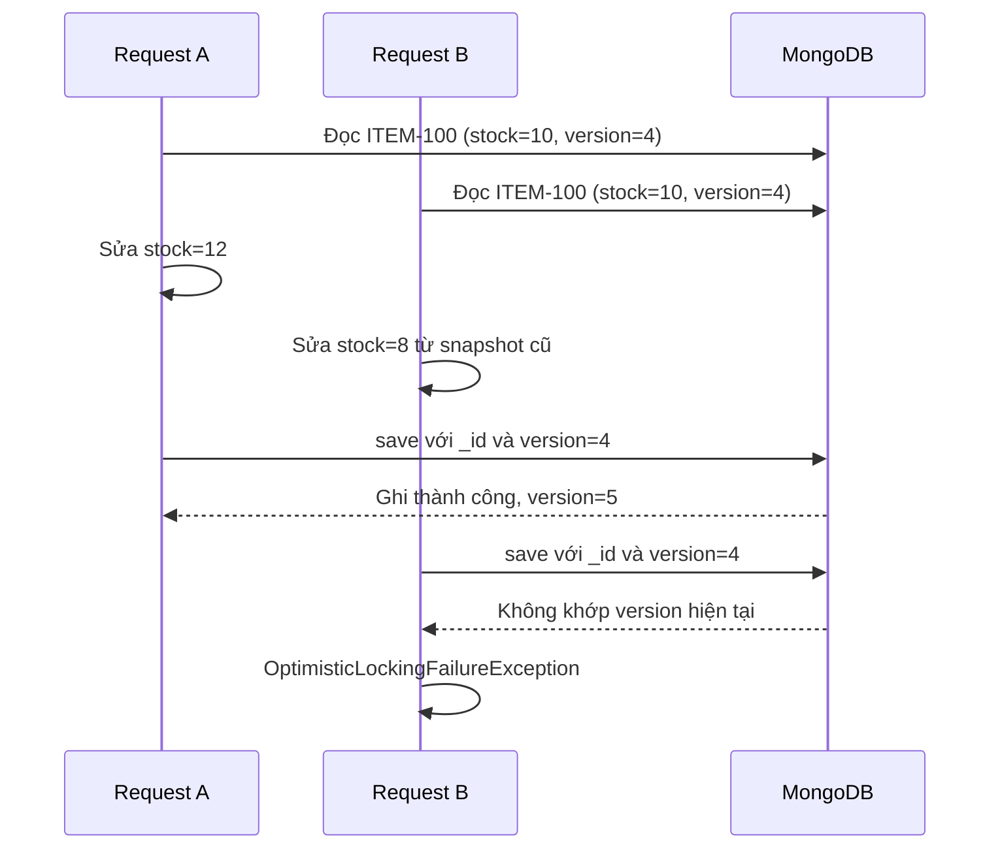

# Xử lý `OptimisticLockingFailureException` và tải lại dữ liệu

Trong ứng dụng sử dụng **Spring Data MongoDB**, hai người dùng hoặc hai worker có thể cùng đọc một document rồi cùng cập nhật. MongoDB đảm bảo tính nguyên tử của **một lệnh ghi trên một document**, nhưng một chuỗi thao tác **đọc → sửa object Java → `save`** không tự trở thành nguyên tử. Nếu cả hai cùng ghi lại bản chụp cũ, người ghi sau có thể vô tình làm mất thay đổi của người ghi trước.

**Optimistic locking** giải quyết phần quan trọng của vấn đề này bằng một trường **`@Version`**. Spring Data MongoDB sử dụng version trong các đường ghi entity được hỗ trợ để phát hiện snapshot đã lỗi thời; khi một `save` không thể cập nhật đúng version, ứng dụng có thể nhận **`OptimisticLockingFailureException`**. Xử lý đúng không phải chỉ `catch` exception rồi gọi `save` lần nữa, mà phải **tải lại dữ liệu hiện tại, kiểm tra ý định nghiệp vụ và quyết định từ chối, hợp nhất hoặc retry có giới hạn**.

Bài thuộc chương **Kiểm soát đồng thời** của module `SPRING_DATA_MONGODB`. Module thực hành kết nối và ánh xạ document, thao tác qua `MongoTemplate`/repository, truy vấn, aggregation, index, transaction, reactive access, kiểm thử và chẩn đoán hiệu năng dữ liệu. Trọng tâm của bài là **xử lý xung đột sau khi optimistic lock thất bại**, bao gồm cách xây API có thể giải thích xung đột cho người dùng và cách tránh vòng lặp retry gây hại khi nhiều request cùng sửa.

Sau bài này, bạn có thể:

1. Giải thích tại sao Spring Data ném `OptimisticLockingFailureException`, và phân biệt nó với duplicate key, timeout hoặc lỗi transaction.
2. Dùng `@Version` và `MongoRepository.save` để phát hiện **lost update**.
3. Chọn giữa **trả HTTP 409/412**, **tải lại và hợp nhất thủ công**, hoặc **retry tự động** theo tính chất lệnh.
4. Tải document mới nhất sau xung đột, nhưng không ghi đè thay đổi của người khác một cách mù quáng.
5. Thiết kế retry giới hạn số lần, backoff, idempotency và điều kiện nghiệp vụ an toàn.
6. Biết khi nào dùng `MongoTemplate.updateFirst` với điều kiện version/stock thay vì đường `save`.
7. Kiểm thử đồng thời trên MongoDB thực và chẩn đoán các trường hợp `@Version` không phát huy tác dụng.

## 1. Lost update diễn ra như thế nào?

Giả sử collection `inventoryItems` lưu số lượng tồn kho:

```javascript
{
  _id: "ITEM-100",
  tenantId: "T-A",
  sku: "BK-100",
  stock: 10,
  note: "Đã kiểm kê",
  version: NumberLong("4")
}
```

Hai request cùng đọc `version = 4`:



Nếu không có cơ chế version, B có thể ghi `stock=8` lên document vừa được A cập nhật, làm mất `stock=12`. Optimistic locking **không chọn giúp ứng dụng giá trị đúng**, nó báo rằng **bản dữ liệu B đang sửa đã cũ**. Ứng dụng phải quyết định nghiệp vụ tiếp theo.

### 1.1. Atomicity cấp document khác optimistic locking

| Khả năng | MongoDB Server | Spring Data `@Version` |
| --- | --- | --- |
| Một update document không bị ghi nửa chừng | Có, đối với thao tác đơn-document | Không phải nhiệm vụ chính |
| Hai `$inc` đồng thời không làm mất nhau khi dùng đúng operator | Có, nhờ atomic update | Có thể không cần read–modify–save |
| Phát hiện entity Java đọc trước đó đã cũ | Không tự biết ý định từ snapshot Java | Có, với đường ghi hỗ trợ và điều kiện version |
| Quyết định merge thay đổi của hai người dùng | Không | **Không**, ứng dụng phải làm |
| Nhiều document cùng commit/rollback | Cần transaction nếu nghiệp vụ yêu cầu | `@Version` đơn lẻ không bảo đảm |

Một câu hỏi hữu ích khi thiết kế: **“Đây là yêu cầu đặt một giá trị tuyệt đối, hay yêu cầu thay đổi một đại lượng theo phép toán?”** Với “đặt giá thành 100.000” từ form đã mở lâu, cần phát hiện conflict; với “trừ 2 sản phẩm nếu còn đủ tồn”, một atomic `$inc` có điều kiện thường thích hợp hơn việc tải entity rồi save.

## 2. `@Version` và điều kiện ghi mong đợi

Trong Spring Data MongoDB, annotation `@Version` đánh dấu field dùng để quản lý optimistic locking. Một ví dụ entity:

```java
import java.time.Instant;
import org.springframework.data.annotation.Version;
import org.springframework.data.mongodb.core.mapping.Document;
import org.springframework.data.mongodb.core.mapping.MongoId;

@Document(collection = "inventoryItems")
public class InventoryItem {

    @MongoId
    private String id;

    private String tenantId;
    private String sku;
    private int stock;
    private String note;
    private Instant updatedAt;

    @Version
    private Long version;

    protected InventoryItem() {}

    public InventoryItem(
            String id, String tenantId, String sku,
            int stock, String note
    ) {
        this.id = id;
        this.tenantId = tenantId;
        this.sku = sku;
        this.stock = stock;
        this.note = note;
    }

    public String getId() { return id; }
    public String getTenantId() { return tenantId; }
    public String getSku() { return sku; }
    public int getStock() { return stock; }
    public String getNote() { return note; }
    public Instant getUpdatedAt() { return updatedAt; }
    public Long getVersion() { return version; }

    public void setStock(int stock) { this.stock = stock; }
    public void setNote(String note) { this.note = note; }
    public void setUpdatedAt(Instant updatedAt) { this.updatedAt = updatedAt; }
}
```

Repository:

```java
import java.util.Optional;
import org.springframework.data.mongodb.repository.MongoRepository;

public interface InventoryItemRepository
        extends MongoRepository<InventoryItem, String> {

    Optional<InventoryItem> findByIdAndTenantId(
            String id, String tenantId);
}
```

Khi entity mới được insert bằng một đường mapping hỗ trợ, Spring Data khởi tạo/tăng version theo quy tắc của kiểu field và phiên bản framework. Với `Long` nullable, version ban đầu thường là `0`. Không hard-code rằng mọi entity ở mọi version thư viện đều bắt đầu từ 1: kiểu primitive, wrapper, dữ liệu legacy và quy tắc `isNew` có thể ảnh hưởng.

Khi một entity có version cũ được lưu qua `repository.save(entity)`, phép cập nhật có ý nghĩa **compare-and-set (CAS)**, gần như:

```javascript
// MINH HỌA logic, không phải BSON command do Spring Data luôn phát.
db.inventoryItems.updateOne(
  { _id: "ITEM-100", version: NumberLong("4") },
  {
    $set: { stock: 12, note: "Đã kiểm kê" },
    $inc: { version: NumberLong("1") }
  }
);
```

Đường `save` thực tế có thể dùng **replacement write** thay vì `$set` từng field, và chính sách ánh xạ các field khác cũng phụ thuộc entity/configuration. Đoạn `mongosh` chỉ minh họa **kiểm tra version cũ và tăng version ở cùng một thao tác nguyên tử**.

### 2.1. Điều kiện để exception có ý nghĩa

- Document được quản lý với `@Version` và **đường API hỗ trợ optimistic locking**.
- Entity có identifier và version hợp lệ để xác định phiên bản đã đọc.
- Câu lệnh ghi có **write acknowledgement**. Nếu dùng `WriteConcern.UNACKNOWLEDGED`, ứng dụng có thể không biết update đã match 0 document; không dựa vào đó để khẳng định optimistic locking hoạt động.
- Những writer khác cũng tôn trọng version. Raw driver, job migration hoặc bulk update không kiểm tra version cũ có thể thay đổi document **mà không gây conflict cho chính thao tác đó**.
- Ứng dụng không xóa/gán lại version tùy tiện trước khi `save`.

### 2.2. Version không phải timestamp

`updatedAt` giúp theo dõi thời gian nhưng không phải một thay thế mặc định cho `@Version`. Đồng hồ có thể lệch, nhiều update có thể cùng timestamp với độ phân giải giới hạn, còn data conversion có thể làm tròn. Với optimistic locking, **một counter version tăng theo thay đổi** thường dễ kiểm tra hơn.

`@LastModifiedDate` nếu được bật auditing thì phục vụ metadata thời gian; **không đồng nghĩa** framework sẽ dùng nó như version CAS.

## 3. Quan sát exception khi hai snapshot cùng được lưu

Ví dụ hai bản đọc từ repository:

```java
import org.springframework.dao.OptimisticLockingFailureException;

InventoryItem first = repository
        .findByIdAndTenantId("ITEM-100", "T-A")
        .orElseThrow();
InventoryItem second = repository
        .findByIdAndTenantId("ITEM-100", "T-A")
        .orElseThrow();

long expected = first.getVersion();

first.setStock(12);
repository.save(first);

second.setStock(8);
try {
    repository.save(second);
    throw new AssertionError("Phải phát hiện stale version");
} catch (OptimisticLockingFailureException conflict) {
    // Lúc này second mang dữ liệu cũ.
    // Không được save lại second ngay lập tức.
}
```

Hai biến `first` và `second` là hai object Java được tải riêng, đại diện cho **cùng snapshot tại thời điểm đầu**. Sau khi first được lưu thành công, version trong database đã tăng. Đối với second, exception nói rằng **update không đáp ứng điều kiện version**, không nói request thứ hai có quyền “thắng” hoặc tự biết cách merge.

### 3.1. `OptimisticLockingFailureException` là một tín hiệu, không phải bản sửa

Trong catch block có ba lựa chọn:

1. **Từ chối thay đổi và trả conflict:** thích hợp với form người dùng yêu cầu đặt giá trị tuyệt đối, thao tác nghiệp vụ quan trọng hoặc khi cần người dùng quyết định.
2. **Tải lại và hợp nhất ý định:** thích hợp khi có quy tắc merge rõ ràng, ví dụ người A sửa note, người B sửa một field độc lập và có thể xác minh không xung đột.
3. **Retry có giới hạn:** thích hợp với thao tác có thể áp lại **ý định** lên trạng thái mới, ví dụ “tăng counter thêm 1”, khi có idempotency và ràng buộc an toàn.

Điều **không nên làm** là:

```java
catch (OptimisticLockingFailureException ex) {
    repository.save(staleEntity); // SAI: thử lại chính object đã lỗi thời.
}
```

Một số phiên bản entity có thể đã bị cập nhật version trong bộ nhớ khi một lời gọi ghi thất bại hoặc callback có side effect. **Không suy ra từ object vừa fail rằng nó tự động là bản mới nhất.** Tải lại từ database và quyết định dựa trên snapshot mới.

## 4. Quyết định nghiệp vụ: conflict, merge hay retry?

| Ý định command | Gợi ý xử lý | Vì sao |
| --- | --- | --- |
| “Đặt giá sản phẩm thành 100.000 đồng” từ form lâu | Trả conflict, tải lại để người dùng duyệt | Giá đã đổi có thể mang ý nghĩa nghiệp vụ mới |
| “Sửa ghi chú” khi người khác đã sửa ghi chú | Conflict hoặc hỗ trợ so sánh khác biệt | Cùng field, merge tự động dễ mất dữ liệu |
| “Sửa ghi chú” khi người khác chỉ đổi tồn kho | Có thể merge có kiểm tra field và quyền | Hai thay đổi có thể độc lập |
| “Cộng thêm 3 lượt xem” | Atomic `$inc` hoặc retry intent có giới hạn | Phép cộng có thể áp lại lên giá trị mới |
| “Trừ 2 hàng còn tồn nếu đủ” | Atomic filter + `$inc` + idempotency | Phải giữ invariant `stock >= 0` |
| “Hoàn tất thanh toán” | Không retry mù, dùng state machine/idempotency | Có external side effects, dễ thực thi trùng |
| “Chuyển quyền sở hữu document” | Conflict và kiểm tra lại phân quyền | Không thể tự động chấp nhận snapshot cũ |

**Quy tắc cốt lõi:** retry **ý định nghiệp vụ**, không retry **bản entity cũ**. Mỗi lần làm lại phải xác nhận điều kiện nghiệp vụ vẫn đúng trên dữ liệu mới nhất.

## 5. Tải lại document mới nhất sau conflict

Khi phát hiện stale version, ứng dụng nên tách **bản người dùng đã thấy** khỏi **bản hiện có trên server**. Một response conflict tốt phải cho client biết thao tác chưa được chấp nhận và cách xử lý tiếp theo, thay vì lặng lẽ thay thế giá trị.

### 5.1. DTO thể hiện snapshot hiện tại

```java
import java.time.Instant;

public record ItemSnapshot(
        String id,
        String sku,
        int stock,
        String note,
        long version,
        Instant updatedAt
) {
    public static ItemSnapshot from(InventoryItem item) {
        return new ItemSnapshot(
                item.getId(),
                item.getSku(),
                item.getStock(),
                item.getNote(),
                item.getVersion(),
                item.getUpdatedAt()
        );
    }
}
```

Đây là **DTO chỉ đọc** cho những field user được phép xem; ứng dụng thực có thể không cho phép mọi vai trò xem stock, ghi chú hoặc thông tin nội bộ. Không bao giờ trả nguyên document MongoDB với thông tin nhạy cảm chỉ vì muốn giải thích exception.

### 5.2. Định nghĩa lỗi domain cho conflict

```java
public class ConcurrentEditException extends RuntimeException {
    private final long expectedVersion;
    private final ItemSnapshot current;

    public ConcurrentEditException(
            long expectedVersion,
            ItemSnapshot current
    ) {
        super("Document đã được thay đổi bởi thao tác khác");
        this.expectedVersion = expectedVersion;
        this.current = current;
    }

    public long getExpectedVersion() {
        return expectedVersion;
    }

    public ItemSnapshot getCurrent() {
        return current;
    }
}
```

Lý do tách exception của Spring Data khỏi lỗi domain: controller không nhất thiết biết một conflict phát sinh từ `MongoRepository.save`, `MongoTemplate`, hay một điều kiện version được kiểm tra sớm. API cần thông điệp **ổn định** và không làm lộ tên collection hoặc stack trace.

### 5.3. Service không tự ghi đè khi version cũ

Command cho thao tác sửa ghi chú:

```java
public record SetNoteCommand(
        String itemId,
        long expectedVersion,
        String newNote
) {}
```

Service:

```java
import java.time.Instant;
import java.util.NoSuchElementException;
import org.springframework.dao.OptimisticLockingFailureException;
import org.springframework.stereotype.Service;

@Service
public class ItemNoteService {
    private final InventoryItemRepository repository;

    public ItemNoteService(InventoryItemRepository repository) {
        this.repository = repository;
    }

    public ItemSnapshot setNote(
            String authorizedTenantId,
            SetNoteCommand command
    ) {
        if (authorizedTenantId == null
                || authorizedTenantId.isBlank()
                || command == null
                || command.itemId() == null
                || command.itemId().isBlank()
                || command.expectedVersion() < 0
                || command.newNote() == null
                || command.newNote().length() > 200) {
            throw new IllegalArgumentException("Command không hợp lệ");
        }

        InventoryItem current = findAuthorized(
                authorizedTenantId, command.itemId());

        // Phát hiện form gửi version cũ từ trước cả lần đọc của service.
        if (current.getVersion() != command.expectedVersion()) {
            throw new ConcurrentEditException(
                    command.expectedVersion(),
                    ItemSnapshot.from(current));
        }

        current.setNote(command.newNote());
        current.setUpdatedAt(Instant.now());

        try {
            // Có thể xung đột nếu writer khác thay version
            // SAU lần findAuthorized và TRƯỚC lệnh save.
            InventoryItem saved = repository.save(current);
            return ItemSnapshot.from(saved);
        } catch (OptimisticLockingFailureException ex) {
            // Tải MỘT object mới thay vì dùng lại 'current' đã fail.
            InventoryItem latest = findAuthorized(
                    authorizedTenantId, command.itemId());
            throw new ConcurrentEditException(
                    command.expectedVersion(),
                    ItemSnapshot.from(latest));
        }
    }

    private InventoryItem findAuthorized(
            String authorizedTenantId, String itemId
    ) {
        return repository.findByIdAndTenantId(
                        itemId, authorizedTenantId)
                .orElseThrow(() -> new NoSuchElementException(
                        "Không tìm thấy item được phép truy cập"));
    }
}
```

**Hai lớp kiểm tra không bị trùng vô ích:**

1. So sánh `current.version` với `expectedVersion` phát hiện client đã gửi form cũ **trước khi update**.
2. `repository.save(current)` tiếp tục bảo vệ **khoảng đua** giữa lần service đọc và lần ghi; nếu writer khác kịp thay version, Spring Data ném optimistic locking exception.

**Không gửi `authorizedTenantId` lấy trực tiếp từ body không đáng tin.** Nó phải đến từ security context hay nguồn đã xác thực, và các bước reload sau conflict cũng phải giới hạn cùng tenant. Nếu tài liệu đã bị xóa/chuyển tenant sau khi `save` thất bại, `findAuthorized` có thể trả rỗng; lúc đó API nên dùng quy tắc not-found/forbidden phù hợp thay vì tiết lộ dữ liệu ngoài scope.

### 5.4. Vì sao không dùng lại object sau exception?

Các đường ghi có thể thực hiện mapping, callback hoặc thay đổi một phần state trên object trước khi driver thông báo thất bại. Không nên coi entity vừa fail là **bản database mới nhất**. Việc:

```java
catch (OptimisticLockingFailureException ex) {
    current.setNote(command.newNote());
    repository.save(current);
}
```

không giải quyết được xung đột version cũ. Tệ hơn, nếu developer tự đặt `current.version = latest.version` mà không đối chiếu những field đã thay đổi, ứng dụng chỉ đang **ép ghi đè** với một version hợp lệ hơn.

## 6. Trả HTTP 409 hoặc 412 để người dùng quyết định

Nếu frontend gửi version trong payload, **409 Conflict** thường dễ diễn giải: “Dữ liệu đã thay đổi kể từ khi bạn mở form”. Nếu API sử dụng HTTP conditional request với `ETag`/`If-Match`, **412 Precondition Failed** là ngữ nghĩa phù hợp khi điều kiện `If-Match` không còn đúng.

| Thiết kế API | Ví dụ request | Phản hồi khi version cũ |
| --- | --- | --- |
| Version trong JSON | `PATCH /items/ITEM-100` với `expectedVersion:4` | `409 Conflict`, có thông tin conflict được phép xem |
| HTTP conditional | `PATCH` kèm `If-Match: "v4"` | `412 Precondition Failed` nếu precondition sai |
| User thực hiện lệnh nguyên tử như “trừ 2” | Command có idempotency key | Tùy điều kiện: thành công/không đủ stock/conflict, không mặc định retry |

Ví dụ body gửi từ frontend:

```json
{
  "itemId": "ITEM-100",
  "expectedVersion": 4,
  "newNote": "Hàng đã kiểm kê lại"
}
```

Nếu version trên server đang là 5, phản hồi minh họa:

```json
{
  "code": "CONCURRENT_EDIT",
  "message": "Dữ liệu đã thay đổi. Hãy xem bản mới trước khi lưu lại.",
  "expectedVersion": 4,
  "current": {
    "id": "ITEM-100",
    "sku": "BK-100",
    "stock": 12,
    "note": "Đã kiểm kê",
    "version": 5,
    "updatedAt": "2026-11-20T02:00:00Z"
  }
}
```

`updatedAt` ở đây là một **giá trị minh họa**, không phải thời điểm thực của bất kỳ thao tác nào. Hợp đồng API phải xác định khi nào được trả `current`: nếu quyền của user đã thay đổi hoặc document bị xóa, có thể cần chỉ trả mã lỗi mà không gửi snapshot.

### 6.1. Controller advice chuyển domain conflict thành response

```java
import org.springframework.http.HttpStatus;
import org.springframework.http.ResponseEntity;
import org.springframework.web.bind.annotation.ExceptionHandler;
import org.springframework.web.bind.annotation.RestControllerAdvice;

record ConcurrentEditResponse(
        String code,
        String message,
        long expectedVersion,
        ItemSnapshot current
) {}

@RestControllerAdvice
public class ConcurrencyExceptionHandler {
    @ExceptionHandler(ConcurrentEditException.class)
    public ResponseEntity<ConcurrentEditResponse> handle(
            ConcurrentEditException ex
    ) {
        return ResponseEntity.status(HttpStatus.CONFLICT).body(
                new ConcurrentEditResponse(
                        "CONCURRENT_EDIT",
                        ex.getMessage(),
                        ex.getExpectedVersion(),
                        ex.getCurrent()));
    }
}
```

Các loại exception thông thường cần handler khác: `IllegalArgumentException` cho command sai, không tìm thấy ID/tenant, quyền truy cập, duplicate key... Không bắt mọi `RuntimeException` và trả 409, vì sẽ che sự cố database/network thành lỗi “người khác đã sửa”.

### 6.2. Không ép client tự động ghi đè với version mới

Một frontend sai có thể làm:

```text
PATCH expectedVersion=4 → 409 current.version=5
PATCH expectedVersion=5 với giá trị cũ của form → "thành công"
```

Điều này biến optimistic locking thành **last-write-wins có thêm một round trip**. Cần hiển thị phần thay đổi, yêu cầu người dùng xác nhận hoặc chỉ merge các field đã được xác định là độc lập.

Nếu user muốn “ghi đè dù có thay đổi”, đó là **một hành động nghiệp vụ riêng**, có phân quyền, audit và một version mới nhất để bảo vệ khỏi cuộc đua tiếp theo; không dùng nút “Retry” lặng lẽ làm overwrite.

### 6.3. ETag và `If-Match`

Một API hỗ trợ concurrency ở giao thức HTTP có thể trả:

```http
HTTP/1.1 200 OK
ETag: "item-100-v5"
Content-Type: application/json

{"id":"ITEM-100","version":5,"note":"Đã kiểm kê"}
```

Client gửi:

```http
PATCH /items/ITEM-100 HTTP/1.1
If-Match: "item-100-v5"
Content-Type: application/json

{"note":"Hàng đã kiểm kê lại"}
```

Server phải **giải mã/kiểm tra ETag hợp lệ** và dùng version tương ứng làm điều kiện CAS; chỉ so chuỗi header sau lần GET mà không ràng buộc trong update thì vẫn có race. Đây là minh họa định dạng ETag mạnh; thiết kế production nên dùng opaque tag gắn với đại diện tài nguyên, không mặc định mọi cache representation đều tương ứng cùng một version entity.

Nếu `If-Match` thất bại, dùng **412** thay vì viết đè. Nếu endpoint bắt buộc precondition nhưng client không gửi, có thể cân nhắc **428 Precondition Required** theo hợp đồng API.

## 7. Tải lại và hợp nhất: ba phiên bản dữ liệu

Một quy trình merge có ý nghĩa phải phân biệt **ba bản**:

- **Base**: giá trị người dùng đã nhìn thấy khi mở form.
- **Proposed**: thay đổi người dùng muốn lưu trên nền base.
- **Latest**: document mới nhất trên server sau khi có conflict.

Ví dụ:

| Field | Base (v4) | Proposed từ user B | Latest (v5) do user A ghi |
| --- | --- | --- | --- |
| `stock` | 10 | 10 (không sửa) | 12 |
| `note` | “Đã kiểm kê” | “Đã kiểm kê lại” | “Đã kiểm kê” |

Nếu B **chỉ sửa note**, có thể rebase ý định của B lên Latest và cho output `stock=12, note="Đã kiểm kê lại"`; nhưng phải tiếp tục lưu bằng version **5**, không được ghi snapshot đầy đủ `stock=10`.

Trường hợp khác:

| Field | Base (v4) | Proposed từ B | Latest (v5) do A ghi |
| --- | --- | --- | --- |
| `note` | “Đã kiểm kê” | “Đã kiểm kê lại” | “Cần kiểm kê gấp” |

Đây là **xung đột cùng field**; merge tự động bằng “bên nào lưu sau” sẽ làm mất ý định của một người. Nên trả conflict hoặc yêu cầu user chọn cách giải quyết.

### 7.1. Thuật toán merge ba chiều tối giản

Với một field `note`:

```text
if Proposed.note == Base.note:
    User không thay field này → giữ Latest.note.
else if Latest.note == Base.note:
    Chỉ user này thay note → có thể dùng Proposed.note.
else if Latest.note == Proposed.note:
    Hai bên đã có cùng giá trị → coi như không cần đổi note.
else:
    Cùng field đã đổi khác nhau → CONFLICT, hỏi người dùng.
```

Đây chỉ là thuật toán minh họa cho field độc lập. Các field có quan hệ như `price` + `currency`, `status` + `paidAt`, hoặc `stock` + `reserved` cần **đánh giá invariant của cả entity**, không được merge máy móc từng field.

### 7.2. Trên dữ liệu mới vẫn phải CAS lần nữa

Ngay cả khi merge thành công sau khi tải Latest, một worker khác có thể update **sau lần reload và trước lần save**. Vì thế:

```text
Đọc Latest(v5)
    ↓
So Base và Proposed; quyết định merge
    ↓
Save theo v5 (CAS)
    ↓
Nếu lại stale → conflict hoặc retry có giới hạn từ dữ liệu mới hơn
```

Không có “một lần reload thì sẽ không còn concurrent update”. **Đọc lại chỉ cung cấp snapshot mới hơn tại thời điểm đọc**, không tự khóa document.

## 8. Merge một field độc lập và giữ lại thay đổi hợp lệ của người khác

Trong một số hệ thống, người B sửa ghi chú trong khi người A cập nhật số tồn; nghiệp vụ cho phép hai thay đổi cùng tồn tại. Có thể triển khai **merge theo field** nếu request cung cấp đủ dữ liệu để nhận biết giá trị gốc:

```java
public record MergeNoteCommand(
        String itemId,
        long baseVersion,
        String baseNote,
        String desiredNote
) {}
```

Ở ví dụ, `baseNote` là giá trị client đã đọc cùng `baseVersion`. Server **không thể kiểm chứng chỉ từ một cặp này** rằng client nói đúng về bản cũ: với nghiệp vụ nhạy cảm, cần lưu snapshot lịch sử/ETag hoặc giới hạn quyền merge. Có thể sử dụng đây làm chiến lược cho form ghi chú thông thường khi đã chấp nhận mức rủi ro.

### 8.1. Lặp đọc–merge–CAS tối đa ba lần

```java
import java.time.Instant;
import java.util.Objects;
import java.util.NoSuchElementException;
import org.springframework.dao.OptimisticLockingFailureException;
import org.springframework.stereotype.Service;

@Service
public class MergeNoteService {
    private static final int MAX_ATTEMPTS = 3;
    private final InventoryItemRepository repository;

    public MergeNoteService(InventoryItemRepository repository) {
        this.repository = repository;
    }

    public ItemSnapshot mergeNote(
            String authorizedTenantId,
            MergeNoteCommand command
    ) {
        if (authorizedTenantId == null || authorizedTenantId.isBlank()
                || command == null
                || command.itemId() == null || command.itemId().isBlank()
                || command.baseVersion() < 0
                || command.desiredNote() == null
                || command.desiredNote().length() > 200) {
            throw new IllegalArgumentException("Command không hợp lệ");
        }

        for (int attempt = 1; attempt <= MAX_ATTEMPTS; attempt++) {
            InventoryItem latest = repository.findByIdAndTenantId(
                            command.itemId(), authorizedTenantId)
                    .orElseThrow(NoSuchElementException::new);

            // Nếu kết quả người khác ghi đã giống ý định, không cần ghi nữa.
            if (Objects.equals(latest.getNote(), command.desiredNote())) {
                return ItemSnapshot.from(latest);
            }

            // Khi note đã đổi so với base, không ghi đè bằng ý định cũ.
            if (!Objects.equals(latest.getNote(), command.baseNote())) {
                throw new ConcurrentEditException(
                        command.baseVersion(),
                        ItemSnapshot.from(latest));
            }

            // Chỉ sửa note trên entity MỚI tải, giữ stock mới nhất.
            latest.setNote(command.desiredNote());
            latest.setUpdatedAt(Instant.now());

            try {
                InventoryItem saved = repository.save(latest);
                return ItemSnapshot.from(saved);
            } catch (OptimisticLockingFailureException conflict) {
                if (attempt == MAX_ATTEMPTS) {
                    InventoryItem current = repository
                            .findByIdAndTenantId(
                                    command.itemId(), authorizedTenantId)
                            .orElseThrow(NoSuchElementException::new);
                    throw new ConcurrentEditException(
                            command.baseVersion(),
                            ItemSnapshot.from(current));
                }
                // Một writer khác cập nhật trong lúc đọc–save.
                // Sang vòng tiếp theo và tải lại; không reuse latest.
            }
        }

        throw new IllegalStateException("Không thể hoàn tất merge");
    }
}
```

Logic này chỉ có ý nghĩa khi **giá trị ghi chú đủ độc lập** với stock/status, ứng dụng tin tưởng/kiểm tra được `baseNote` và không có một precondition nghiệp vụ khác bị bỏ qua. Service sẽ **giữ stock của Latest**, vì nó tải entity hiện tại trước khi sửa note; `@Version` vẫn chặn writer xuất hiện giữa lần reload và `save`.

### 8.2. Tại sao không chỉ so `baseVersion`?

Nếu `baseVersion = 4`, Latest có version 5, ta chỉ biết **có gì đó thay đổi**, không biết field note có thay không. Với một thay đổi independent, việc so `Latest.note == Base.note` có thể cho phép merge. Ngược lại, nếu chưa có bản gốc đáng tin, chỉ nhìn version mới **không cho biết** điều gì đã thay đổi. Một hệ thống nghiêm ngặt có thể lưu change history hoặc bắt người dùng reload rồi tự quyết định.

### 8.3. Khi có nhiều field phụ thuộc nhau

Đừng tự áp dụng phép kiểm tra riêng từng field vào mọi aggregate:

```text
status = "PAID"
paidAt = timestamp
paymentTransactionId = id
```

Nếu một request sửa `status` còn một request khác sửa `paidAt`, một merge “field không đụng nhau” có thể tạo trạng thái không hợp lệ. **Domain invariants** phải được kiểm tra trên trạng thái kết hợp, trong cùng update/transaction phù hợp.

## 9. Retry tự động: áp lại ý định lên một snapshot mới

Với command “tăng tồn kho thêm 3 đơn vị”, phép cộng có thể được thực hiện lại trên dữ liệu mới nhất sau optimistic conflict, miễn có các điều kiện:

- **Giới hạn** số lần thử và cân nhắc backoff khi cạnh tranh cao.
- Mỗi lần thử **đọc lại** document và **tính lại** giá trị từ snapshot mới.
- Chỉ retry **loại exception đã biết** là stale version; không gom network timeout, duplicate key và lỗi business vào cùng một catch.
- Tránh thực hiện external side effect trong vòng lặp.
- Với request có thể được **gửi lại toàn bộ** từ client, cần idempotency key riêng để không cộng hai lần.

### 9.1. Ví dụ retry với repository

```java
import java.time.Instant;
import java.util.NoSuchElementException;
import org.springframework.dao.OptimisticLockingFailureException;
import org.springframework.stereotype.Service;

@Service
public class IncreaseStockService {
    private static final int MAX_ATTEMPTS = 3;
    private final InventoryItemRepository repository;

    public IncreaseStockService(InventoryItemRepository repository) {
        this.repository = repository;
    }

    public ItemSnapshot addStock(
            String authorizedTenantId,
            String itemId,
            int quantity
    ) {
        if (authorizedTenantId == null || authorizedTenantId.isBlank()
                || itemId == null || itemId.isBlank()
                || quantity < 1 || quantity > 10_000) {
            throw new IllegalArgumentException("Input không hợp lệ");
        }

        for (int attempt = 1; attempt <= MAX_ATTEMPTS; attempt++) {
            InventoryItem current = repository
                    .findByIdAndTenantId(itemId, authorizedTenantId)
                    .orElseThrow(NoSuchElementException::new);

            long expected = current.getVersion();
            int newStock = Math.addExact(current.getStock(), quantity);
            current.setStock(newStock);
            current.setUpdatedAt(Instant.now());

            try {
                return ItemSnapshot.from(repository.save(current));
            } catch (OptimisticLockingFailureException conflict) {
                if (attempt == MAX_ATTEMPTS) {
                    InventoryItem latest = repository
                            .findByIdAndTenantId(
                                    itemId, authorizedTenantId)
                            .orElseThrow(NoSuchElementException::new);
                    throw new ConcurrentEditException(
                            expected, ItemSnapshot.from(latest));
                }
                // Chỉ CAS đã xác nhận thất bại mới được thử lại:
                // lấy version/stock mới ở lượt tiếp theo.
            }
        }
        throw new IllegalStateException("Không thể tăng tồn kho");
    }
}
```

Nếu hai worker cùng muốn cộng 3 và 4 từ stock 10, một lượt có thể gặp stale version; sau khi tải stock mới 13, worker còn lại tính `13+4=17` và lưu theo version mới. Kết quả đúng trong ví dụ là 17, **không phải 14** do worker thứ hai áp ý định trên bản cũ.

**Giới hạn quan trọng của ví dụ:** nó minh họa retry **trong một lời gọi service khi CAS bị xác nhận thất bại**. Nếu server đã ghi thành công nhưng client mất response và HTTP request được gửi lại, một lần `addStock(+3)` khác có thể tăng thêm 3 nữa. Đây là vấn đề **idempotency của toàn bộ command**, không được giải quyết bằng `@Version`.

### 9.2. Retry không đồng nghĩa ngủ ngẫu nhiên vô hạn

Một cách vận hành có thể dùng **exponential backoff + jitter** giữa các lượt retry:

```text
attempt 1 → CAS thất bại
attempt 2 → sau delay ngắn có jitter, reload và thử lại
attempt 3 → nếu vẫn thất bại, trả CONCURRENT_EDIT
```

Không đặt `Thread.sleep(...)` trên reactive event loop. Với pipeline reactive, dùng cơ chế scheduling/retry bất đồng bộ. Backoff chỉ giảm xung đột đồng thời; nó **không làm phép merge sai trở thành đúng** và không thay đổi sự thật rằng document có thể bị cập nhật tiếp.

Khi số lượt retry nhiều, cần đánh giá liệu đường `read → mutate → save` có phù hợp hay nên thay bằng **atomic update operator** để giảm cửa sổ race.

### 9.3. `@Retryable` có thể sử dụng, nhưng không phải mặc định an toàn

Spring Retry cho phép dùng `@Retryable` trong một số ứng dụng; tuy nhiên phải có dependency/configuration tương ứng, đi qua Spring proxy, chọn exception và số lượt thử chính xác. Đặc biệt:

- Nếu method gọi nội bộ trong cùng class (**self-invocation**), proxy retry có thể không được kích hoạt.
- Nếu transaction bao quanh toàn bộ lượt retry, những exception có thể khiến session/transaction không còn ở trạng thái phù hợp để tiếp tục thử trong cùng transaction.
- Nếu code gọi API ngoài hoặc ghi audit trước khi `save`, retry cả method có thể lặp side effect.

Với một bài toán đơn giản, vòng lặp tường minh giúp nhìn thấy **lần nào reload, lần nào CAS, khi nào dừng**. Với hệ thống lớn, có thể dùng retry policy tập trung nhưng phải kiểm chứng transaction ordering, idempotency và metrics.

## 10. Dùng `MongoTemplate` và atomic update khi bài toán là phép toán

Đối với command kiểu “trừ tồn kho nếu còn đủ”, cập nhật một document bằng **filter + `$inc`** có thể rõ ràng và rẻ hơn đọc entity rồi save:

```javascript
db.inventoryItems.updateOne(
  {
    _id: "ITEM-100",
    tenantId: "T-A",
    version: NumberLong("4"),
    stock: { $gte: 2 }
  },
  {
    $inc: { stock: -2, version: NumberLong("1") },
    $set: { updatedAt: ISODate("2026-11-20T02:00:00Z") }
  }
);
```

Filter `stock >= 2` bảo đảm một lệnh trừ 2 không làm stock âm, nếu các writer khác tuân thủ cùng domain invariant. Khi dùng thêm filter `version = 4`, command có cả **điều kiện tồn kho và optimistic precondition**.

Trong Spring Data MongoDB:

```java
import com.mongodb.client.result.UpdateResult;
import java.time.Instant;
import org.springframework.data.mongodb.core.MongoTemplate;
import org.springframework.data.mongodb.core.query.Criteria;
import org.springframework.data.mongodb.core.query.Query;
import org.springframework.data.mongodb.core.query.Update;

public UpdateResult reserveStockOnce(
        MongoTemplate template,
        String authorizedTenantId,
        String itemId,
        long expectedVersion,
        int quantity
) {
    if (authorizedTenantId == null || authorizedTenantId.isBlank()
            || itemId == null || itemId.isBlank()
            || expectedVersion < 0 || quantity <= 0) {
        throw new IllegalArgumentException("Input không hợp lệ");
    }

    Query filter = Query.query(
            Criteria.where("_id").is(itemId)
                    .and("tenantId").is(authorizedTenantId)
                    .and("version").is(expectedVersion)
                    .and("stock").gte(quantity));

    Update update = new Update()
            .inc("stock", -quantity)
            .inc("version", 1)
            .set("updatedAt", Instant.now());

    return template.updateFirst(
            filter, update, InventoryItem.class);
}
```

Ở đây `InventoryItem` có `@Version`, nhưng **ta tự ghi điều kiện version và `$inc` trong update** để diễn đạt CAS rõ ràng. Spring Data có quy tắc tăng version cho một số template update khi update chưa chỉ định version; đừng ngầm dựa vào cơ chế đó để suy rằng mọi update tự **kiểm tra version cũ**. Với đoạn code này, phải test BSON/`getMatchedCount()` trên version framework đang dùng để bảo đảm version không tăng hai lần.

### 10.1. `matchedCount == 0` không phải luôn là optimistic conflict

Nếu `UpdateResult.getMatchedCount() == 0`, có ít nhất ba khả năng:

1. Item không tồn tại hoặc user không có quyền truy cập tenant đó.
2. Version hiện tại khác `expectedVersion`.
3. Stock hiện tại nhỏ hơn `quantity`.

**Đừng ném `OptimisticLockingFailureException` một cách mù quáng cho mọi `matchedCount == 0`**. Có thể tải lại item **theo tenant được xác thực** để phân loại `404/403`, `409/412`, hoặc lỗi “không đủ hàng”, với lưu ý trạng thái có thể tiếp tục thay đổi giữa lúc update và reload.

### 10.2. Không nhất thiết cần version khi dùng atomic `$inc`

Với phép tăng counter không có điều kiện snapshot, chỉ dùng:

```javascript
db.inventoryItems.updateOne(
  { _id: "ITEM-100", tenantId: "T-A" },
  { $inc: { stock: 3, version: 1 } }
);
```

thì các phép cộng độc lập vẫn không làm mất cập nhật ở cấp document. Nhưng nếu logic nghiệp vụ yêu cầu **đúng version mà người dùng đã nhìn thấy**, hoặc cần đảm bảo state machine, phải thêm precondition thích hợp.

**Vẫn còn vấn đề retry sau mất response:** `$inc` không idempotent. Nếu request bị gửi lại sau khi server đã áp dụng một lần, giá trị có thể tăng lần hai. Cần một cơ chế idempotency cho **toàn bộ request**.

### 10.3. Phân biệt kết quả save và kết quả update

| Đường ghi | Cách phát hiện failure | Cách lấy state mới |
| --- | --- | --- |
| `repository.save(entity @Version)` | Có thể ném `OptimisticLockingFailureException` khi stale | Dùng entity được trả về nếu thành công; reload nếu conflict |
| `template.updateFirst(query, update, Entity.class)` | Xem `UpdateResult.getMatchedCount()` và write errors | Đọc lại theo ID/tenant, hoặc dùng API khác nếu cần kết quả tại thời điểm update |
| `template.findAndModify(...)` | Query có điều kiện; kết quả có thể null nếu không match | Có thể yêu cầu trả document sau update, phù hợp read-modify-return nguyên tử |
| `template.bulkOps(...).execute()` | `BulkWriteResult` tổng hợp; 0 match thường không ném optimistic locking exception | Đối soát từng command/ID; không mặc định version/callback như save |

Sau một `updateFirst` thành công, nếu bạn **reload** để trả DTO, một writer khác vẫn có thể update thêm trước lúc reload; DTO mới đọc có thể là version **sau cả hai thao tác**, không nhất thiết là snapshot ngay sau lệnh của bạn. Khi cần trả document đúng tại ranh giới ghi, xem xét `findAndModify` với return-new và điều kiện CAS phù hợp.

## 11. `findAndModify`: CAS và lấy kết quả mới trong một thao tác

Trong một số endpoint, client cần biết **trạng thái ngay sau thay đổi của chính request**, chứ không phải trạng thái có thể đã được người khác chỉnh tiếp trong khoảng reload. MongoDB cung cấp `findAndModify` để thực hiện update có điều kiện và trả một document theo tùy chọn.

```java
import java.time.Instant;
import java.util.NoSuchElementException;
import org.springframework.data.mongodb.core.FindAndModifyOptions;
import org.springframework.data.mongodb.core.MongoTemplate;
import org.springframework.data.mongodb.core.query.Criteria;
import org.springframework.data.mongodb.core.query.Query;
import org.springframework.data.mongodb.core.query.Update;

public ItemSnapshot changeNoteAtomically(
        MongoTemplate template,
        String authorizedTenantId,
        String itemId,
        long expectedVersion,
        String newNote
) {
    if (authorizedTenantId == null || authorizedTenantId.isBlank()
            || itemId == null || itemId.isBlank()
            || expectedVersion < 0
            || newNote == null || newNote.length() > 200) {
        throw new IllegalArgumentException("Input không hợp lệ");
    }

    Query query = Query.query(
            Criteria.where("_id").is(itemId)
                    .and("tenantId").is(authorizedTenantId)
                    .and("version").is(expectedVersion));

    Update update = new Update()
            .set("note", newNote)
            .set("updatedAt", Instant.now())
            .inc("version", 1);

    InventoryItem updated = template.findAndModify(
            query,
            update,
            FindAndModifyOptions.options()
                    .returnNew(true)
                    .upsert(false),
            InventoryItem.class);

    if (updated == null) {
        // Có thể không tồn tại, sai tenant, hoặc version cũ.
        // Tải lại theo tenant để phân loại trước khi phản hồi.
        throw new NoSuchElementException(
                "Không có document khớp điều kiện CAS");
    }

    return ItemSnapshot.from(updated);
}
```

**Ở production**, nhánh `updated == null` cần phân loại đúng missing/permission/stale version, như phần 10.1; ví dụ dùng `NoSuchElementException` để minh họa kết quả không khớp mà không nhầm với optimistic exception do repository tạo. Đừng gửi nguyên thông báo Java này cho người dùng.

`returnNew(true)` yêu cầu nhận **document sau update**, còn `upsert(false)` tránh trường hợp version không khớp nhưng lại thử insert document mới. Query có `_id + tenantId + version`, nên một writer khác nâng version trước sẽ khiến thao tác trả null.

### 11.1. Vì sao không dùng `upsert` cho stale version?

Một query có điều kiện version không khớp **không chứng minh document vắng mặt**. Nếu bật upsert, MongoDB có thể cố tạo document mới từ điều kiện/filter/update, gây duplicate key hoặc thêm bản ghi ngoài ý định nếu không có unique key phù hợp. Đối với update “chỉ nếu version còn đúng”, hãy giữ `upsert(false)`.

### 11.2. Ghi chú về mapping `@Version` trong template update

Ở các phiên bản Spring Data MongoDB hỗ trợ version-aware update, framework có thể tự tăng trường version nếu update chưa chỉ định nó. Trong ví dụ, `.inc("version", 1)` được **khai báo tường minh** cùng điều kiện query, vì vậy phải kiểm chứng bằng integration test rằng thao tác tăng **đúng một lần** theo version framework hiện tại.

Đừng nhầm **tự tăng version** với **tự kiểm tra expected version**. Nếu query không chứa điều kiện cũ, một update vẫn có thể ghi lên document đã thay đổi ngay cả khi version tăng.

## 12. Idempotency: retry sau conflict khác retry sau timeout

Có hai loại thất bại rất dễ bị trộn lẫn:

| Trường hợp | Hệ thống biết điều gì? | Cách xử lý |
| --- | --- | --- |
| `OptimisticLockingFailureException` từ CAS đã xác nhận | Update với version cũ **không được áp dụng** theo đường ghi có acknowledgement | Có thể reload/merge/retry **nếu ý định cho phép** |
| Network timeout/mất response sau khi gửi lệnh | Có thể update đã thành công hoặc chưa | **Không retry mù** phép `$inc`, cần idempotency/đối soát |
| `DuplicateKeyException` khi tạo item | Vi phạm unique constraint hoặc đã có entity trùng | Xác định idempotent create hay lỗi nghiệp vụ, không coi là stale version |
| `TransientTransactionError`/commit không rõ trạng thái | Transaction cần retry theo quy tắc driver/server | Retry với ranh giới transaction và idempotency phù hợp |

Một vòng retry ở mục 9 chỉ xử lý **CAS thất bại đã được xác nhận**. Nó không có khả năng suy ra từ timeout rằng server chắc chắn chưa ghi gì.

MongoDB Java Driver có cơ chế **retryable writes** cho một số thao tác và điều kiện triển khai được hỗ trợ. Điều đó không đồng nghĩa server sẽ nhận diện hai **HTTP request nghiệp vụ riêng biệt** mang cùng ý định như cùng một operation. Đừng lấy cấu hình `retryWrites=true` làm cơ sở để bỏ idempotency key ở API có thể bị gửi lại.

### 12.1. Ví dụ một request bị gửi lại sau khi đã thành công

```text
POST /items/ITEM-100/stock-adjustments
operationId = "op-789"
delta = +3

Lần 1:
  Server đã cộng stock +3 và commit.
  HTTP response bị mất giữa đường.

Lần 2:
  Client retry nguyên request.
  Nếu server không nhớ operationId,
  stock có thể bị cộng thêm +3 lần thứ hai.
```

**`@Version` không chặn điều này** nếu lần 2 đọc được version mới rồi tiếp tục áp lại ý định. Việc tăng version chỉ bảo vệ **cạnh tranh trên snapshot**, không bảo vệ **trùng lặp một command nghiệp vụ**.

### 12.2. Thiết kế operation ID và bản ghi kết quả

Một cách tiếp cận:

1. Client tạo **operationId** duy nhất cho một hành động nghiệp vụ và giữ nguyên ID đó khi retry.
2. Server có unique index `{tenantId:1,operationId:1}` trong collection `operations`.
3. Kiểm tra operation đã hoàn thành chưa; nếu đã có kết quả, trả lại kết quả cũ phù hợp.
4. Đảm bảo thay đổi stock và ghi nhận operation được **commit nhất quán** (ví dụ trong MongoDB transaction khi dùng hai document/collection, với điều kiện deployment hỗ trợ).
5. Nếu commit ở trạng thái không rõ, truy vấn lại trạng thái operation trước khi quyết định retry.

```javascript
db.operations.createIndex(
  { tenantId: 1, operationId: 1 },
  { unique: true, name: "ux_tenant_operation" }
);
```

Chỉ có unique index **không tự làm cho hai collection được commit nguyên tử**: nếu update stock thành công nhưng ghi `operations` thất bại, request gửi lại vẫn có thể cộng lần hai. Phải xác định transaction, state machine hoặc một mô hình cập nhật một document có chứa operation marker trong cùng atomic update, và cân nhắc giới hạn kích thước document.

### 12.3. Atomic marker trong cùng document: có ưu điểm và giới hạn

Một cách minh họa dùng một document:

```javascript
db.inventoryItems.updateOne(
  {
    _id: "ITEM-100",
    tenantId: "T-A",
    appliedOperationIds: { $ne: "op-789" }
  },
  {
    $inc: { stock: 3, version: 1 },
    $addToSet: { appliedOperationIds: "op-789" }
  }
);
```

Đây là **một thao tác nguyên tử trên cùng document**, nên nếu điều kiện marker và update được áp dụng, một retry với cùng `operationId` không cộng thêm lần hai. Tuy nhiên, mảng `appliedOperationIds` có thể **tăng vô hạn**, làm document lớn và tăng chi phí ghi/đọc, cuối cùng chạm giới hạn BSON. Với workload lớn, ledger riêng cùng transaction hoặc một mô hình idempotency có retention phù hợp thường bền vững hơn.

Không dùng `$addToSet` trên một mảng lớn rồi coi đó là hệ thống exactly-once hoàn chỉnh; cần quản lý vòng đời operation ID, kết quả trả về, lỗi không chắc chắn và audit.

### 12.4. Side effect ngoài MongoDB cần outbox/compensation

Nếu command còn gửi email, publish Kafka message hay gọi cổng thanh toán, không đặt side effect **trước hoặc bên trong** vòng lặp retry optimistic lock:

```java
for (...) {
    sendPaymentRequest();   // SAI: có thể gọi nhiều lần.
    repository.save(item);  // Có thể stale → lặp lại.
}
```

Ngay cả việc gửi message **sau `save`** cũng có vấn đề nếu process chết giữa commit DB và publish. Với yêu cầu tin cậy, dùng **transactional outbox**, idempotent consumer, hoặc workflow có compensation được thiết kế cụ thể. Optimistic locking không biến các external system thành một transaction phân tán.

## 13. Xung đột trong transaction và việc tải lại

MongoDB transaction hữu ích khi thao tác cần cập nhật **nhiều document** cùng thành công/rollback. Nhưng optimistic locking và transaction giải quyết **hai lớp vấn đề khác nhau**:

- `@Version` phát hiện việc một entity đang được lưu từ snapshot cũ.
- Transaction thiết lập ranh giới commit/rollback cho một nhóm thao tác trên deployment hỗ trợ.

Một transaction có thể gặp write conflict hoặc transient error khi các writer tranh chấp. **Không được bắt exception ngay bên trong transaction rồi tiếp tục dùng cùng transaction/session như thể chưa có gì xảy ra** nếu server/driver đã đánh dấu transaction thất bại.

### 13.1. Retry toàn bộ transaction từ bên ngoài

```text
Orchestrator (không đang giữ transaction cũ)
    |
    +-- attempt 1: bắt đầu transaction mới
    |      - đọc document
    |      - kiểm tra state/version/invariants
    |      - cập nhật document A và B
    |      - commit
    |      - nếu transient/write conflict được phép retry:
    |             rollback/kết thúc transaction hiện tại
    |
    +-- attempt 2: transaction MỚI + đọc dữ liệu MỚI
    |
    +-- sau số lần giới hạn: trả conflict/unavailable
```

Trong Spring:

```java
import org.springframework.transaction.annotation.Transactional;

@Transactional
public void transferStock(...) {
    // Tải và xác nhận tồn kho nguồn/đích.
    // Ghi cả hai document trong cùng MongoDB transaction.
    // Nếu xung đột hoặc điều kiện nghiệp vụ không thỏa,
    // ném exception để transaction rollback theo chính sách.
}
```

Đây là **pseudo-method** minh họa ranh giới transaction, không phải implementation đầy đủ. `@Transactional` chỉ có hiệu lực khi đã cấu hình transaction manager, MongoDB topology hỗ trợ và lời gọi đi qua proxy Spring phù hợp. Việc retry được điều phối bên ngoài phải tạo transaction mới cho mỗi lượt.

### 13.2. Khi nào không cần transaction?

Đối với **một document**, update theo filter + toán tử nguyên tử như `$inc`, `$set` và version CAS thường đủ để bảo vệ một số invariant. Bọc một phép update đơn giản vào transaction không thay thế việc viết filter đúng, có thể làm tăng contention/latency không cần thiết.

### 13.3. Đọc lại bên trong hay ngoài transaction?

Nếu đang xử lý exception do transaction đã thất bại, nên **thoát/rollback transaction đó** rồi mới tải snapshot mới trong một đơn vị công việc thích hợp. Đọc lại trong cùng transaction snapshot cũ hoặc session không còn hợp lệ có thể không phản ánh trạng thái mới cần dùng để retry.

Trong hệ thống có cache hoặc read preference đọc secondary, sau conflict còn phải xác định **nguồn đọc nhất quán** để không tải một snapshot **cũ hơn** từ replica lag. Với thao tác cần quyết định ngay, thường nên dùng cách đọc từ primary/consistency được thiết kế phù hợp và test dưới cấu hình deployment thật.

## 14. Reactive optimistic locking: retry phải tạo lại thao tác đọc

Spring Data MongoDB có `ReactiveMongoRepository` và `ReactiveMongoTemplate` cho ứng dụng reactive. Optimistic locking trên entity vẫn dựa vào version và server write acknowledgement, nhưng cách xây retry phải tôn trọng **subscription** và **Publisher lạnh (cold publisher)**.

### 14.1. Repository reactive

```java
import reactor.core.publisher.Mono;
import org.springframework.data.mongodb.repository.ReactiveMongoRepository;

public interface ReactiveInventoryItemRepository
        extends ReactiveMongoRepository<InventoryItem, String> {

    Mono<InventoryItem> findByIdAndTenantId(
            String id, String tenantId);
}
```

### 14.2. `Mono.defer` để mỗi lượt retry tải snapshot mới

```java
import java.time.Duration;
import java.time.Instant;
import java.util.NoSuchElementException;
import org.springframework.dao.OptimisticLockingFailureException;
import reactor.core.publisher.Mono;
import reactor.util.retry.Retry;

public class ReactiveIncreaseStockService {
    private final ReactiveInventoryItemRepository repository;

    public ReactiveIncreaseStockService(
            ReactiveInventoryItemRepository repository
    ) {
        this.repository = repository;
    }

    public Mono<ItemSnapshot> addStock(
            String authorizedTenantId, String itemId, int quantity
    ) {
        if (authorizedTenantId == null || authorizedTenantId.isBlank()
                || itemId == null || itemId.isBlank()
                || quantity <= 0 || quantity > 10_000) {
            return Mono.error(new IllegalArgumentException(
                    "Input không hợp lệ"));
        }

        Mono<ItemSnapshot> attempt = Mono.defer(() ->
                repository.findByIdAndTenantId(
                                itemId, authorizedTenantId)
                        .switchIfEmpty(Mono.error(
                                new NoSuchElementException()))
                        .map(item -> {
                            item.setStock(Math.addExact(
                                    item.getStock(), quantity));
                            item.setUpdatedAt(Instant.now());
                            return item;
                        })
                        .flatMap(repository::save)
                        .map(ItemSnapshot::from));

        return attempt.retryWhen(
                Retry.backoff(2, Duration.ofMillis(25))
                        .maxBackoff(Duration.ofMillis(200))
                        .jitter(0.3)
                        .filter(error ->
                                error instanceof
                                        OptimisticLockingFailureException));
    }
}
```

`retryWhen(Retry.backoff(2, ...))` cho phép **tối đa hai lượt retry sau lượt ban đầu**, tức tối đa ba attempt. `Mono.defer` làm rõ mỗi attempt **bắt đầu lại ở repository.find...**, không cố dùng object đã thất bại. Với ứng dụng thật, nên bổ sung logging/metrics và chuyển lỗi khi retry exhausted thành **conflict response** phù hợp; Reactor có thể bọc lỗi đã cạn retry trong một exception dạng retry-exhausted, nên HTTP handler cần phân biệt nguyên nhân gốc một cách có kiểm soát.

**Không gọi `block()` trên event loop** để chờ reload. Không dùng `Thread.sleep` trong `map`, `flatMap` hoặc callback retry; backoff của Reactor thực hiện không chặn thread theo cách dùng thông thường.

### 14.3. Side effect không thuộc pipeline retry

```java
return attempt
        .doOnNext(row -> publishExternalEvent(row)) // DỄ LẶP / KHÔNG NGUYÊN TỬ.
        .retryWhen(retrySpec);
```

Ngay cả với reactive, placement của side effect cũng quan trọng. Nếu callback phát event rồi có lỗi ở downstream, retry có thể phát lại hoặc không đồng bộ với trạng thái MongoDB. Đối với sự kiện quan trọng, dùng **outbox/idempotent consumer** hoặc một workflow có bảo đảm tường minh.

### 14.4. Reactive transaction có context riêng

Nếu dùng `ReactiveMongoTransactionManager`, transaction gắn với **Reactor context**, không phải biến ThreadLocal thông thường. Retry nguyên transaction phải được thiết kế ở đúng ranh giới subscription/transaction và dữ liệu phải được đọc lại từ transaction mới. Không chuyển nguyên ví dụ blocking `@Transactional` sang reactive bằng cách thêm `Mono.just(...)`.

## 15. Kiểm thử tích hợp optimistic locking trên MongoDB thật

Mock `MongoRepository` có thể xác nhận một method được gọi, nhưng không chứng minh **MongoDB update đã dùng điều kiện version**, server báo match 0 hoặc Spring Data ném đúng exception. Với bài này, integration test trên **MongoDB test instance riêng** là bắt buộc để tin cơ chế optimistic locking hoạt động.

Ví dụ sử dụng Spring Boot 3.x, JUnit 5, AssertJ và một MongoDB test instance thực (có thể Testcontainers). Không chạy fixture này trên production.

### 15.1. Setup fixture và hai snapshot

```java
import static org.assertj.core.api.Assertions.assertThat;
import static org.assertj.core.api.Assertions.assertThatThrownBy;

import org.junit.jupiter.api.BeforeEach;
import org.junit.jupiter.api.Test;
import org.springframework.beans.factory.annotation.Autowired;
import org.springframework.boot.test.autoconfigure.data.mongo.DataMongoTest;
import org.springframework.dao.OptimisticLockingFailureException;
import org.springframework.data.mongodb.core.MongoTemplate;
import org.springframework.data.mongodb.core.query.Query;

@DataMongoTest
class InventoryOptimisticLockingIntegrationTest {

    @Autowired
    InventoryItemRepository repository;

    @Autowired
    MongoTemplate template;

    @BeforeEach
    void prepare() {
        // Chỉ chạy với database test được cô lập.
        template.remove(new Query(), InventoryItem.class);
        repository.insert(new InventoryItem(
                "TEST-ITEM-1", "T-A", "SKU-T-1",
                10, "Đã kiểm kê"));
    }

    @Test
    void secondStaleSnapshotMustFail() {
        InventoryItem first = repository.findById("TEST-ITEM-1")
                .orElseThrow();
        InventoryItem second = repository.findById("TEST-ITEM-1")
                .orElseThrow();

        long initialVersion = first.getVersion();
        assertThat(second.getVersion()).isEqualTo(initialVersion);

        first.setStock(12);
        InventoryItem saved = repository.save(first);
        assertThat(saved.getVersion()).isEqualTo(initialVersion + 1);

        second.setStock(8);
        assertThatThrownBy(() -> repository.save(second))
                .isInstanceOf(
                        OptimisticLockingFailureException.class);

        InventoryItem latest = repository.findById("TEST-ITEM-1")
                .orElseThrow();
        assertThat(latest.getStock()).isEqualTo(12);
        assertThat(latest.getVersion())
                .isEqualTo(initialVersion + 1);
    }
}
```

Test này chứng minh **cả ba điều**: first save tăng version, second save trên snapshot cũ bị từ chối và MongoDB giữ dữ liệu từ first. Một test chỉ assert exception nhưng không đọc lại document có thể bỏ qua bug ghi nửa chừng hoặc mapping sai.

`@DataMongoTest` không tự tạo MongoDB Server cho mọi cấu hình. Cần URI/database test cô lập, dependency MongoDB driver/framework phù hợp và cấu hình write concern có acknowledgement.

### 15.2. Test tải lại sau khi client gửi form cũ

Thêm test sau **trong cùng class**:

```java
import static org.assertj.core.api.Assertions.assertThat;
import static org.assertj.core.api.Assertions.fail;

@Test
void serviceReturnsFreshSnapshotWhenVersionIsStale() {
    ItemNoteService service = new ItemNoteService(repository);

    InventoryItem opened = repository
            .findById("TEST-ITEM-1").orElseThrow();
    long clientVersion = opened.getVersion();

    // Request A thay stock trước.
    opened.setStock(12);
    repository.save(opened);

    // Request B vẫn gửi form từng thấy ở version cũ.
    try {
        service.setNote("T-A", new SetNoteCommand(
                "TEST-ITEM-1", clientVersion,
                "Ghi chú từ form cũ"));
        fail("Phải trả conflict khi client version cũ");
    } catch (ConcurrentEditException conflict) {
        assertThat(conflict.getExpectedVersion())
                .isEqualTo(clientVersion);
        assertThat(conflict.getCurrent().stock())
                .isEqualTo(12);
        assertThat(conflict.getCurrent().version())
                .isEqualTo(clientVersion + 1);
    }

    InventoryItem saved = repository.findById("TEST-ITEM-1")
            .orElseThrow();
    assertThat(saved.getNote()).isEqualTo("Đã kiểm kê");
}
```

Đây là test **xung đột được phát hiện trước khi save** vì service so expected version với current version. Để kiểm tra nhánh `catch (OptimisticLockingFailureException)` bên trong service, cần tạo **race thực** giữa bước đọc và save hoặc trích cơ chế ghi ra một collaborator có thể điều phối/test được. Không nên coi test form cũ này là bằng chứng đã bao phủ mọi nhánh catch.

### 15.3. Test merge một field độc lập

```java
@Test
void mergingNotePreservesOtherWritersStockChange() {
    MergeNoteService service = new MergeNoteService(repository);
    InventoryItem base = repository.findById("TEST-ITEM-1")
            .orElseThrow();

    long baseVersion = base.getVersion();
    String baseNote = base.getNote();

    // Người A chỉ sửa stock.
    base.setStock(12);
    repository.save(base);

    // Người B sửa note trên một base cũ.
    ItemSnapshot merged = service.mergeNote(
            "T-A",
            new MergeNoteCommand(
                    "TEST-ITEM-1",
                    baseVersion,
                    baseNote,
                    "Kiểm kê hoàn tất"));

    assertThat(merged.stock()).isEqualTo(12);
    assertThat(merged.note()).isEqualTo("Kiểm kê hoàn tất");
    assertThat(merged.version()).isEqualTo(baseVersion + 2);
}

@Test
void mergingTheSameFieldDifferentlyMustConflict() {
    MergeNoteService service = new MergeNoteService(repository);
    InventoryItem base = repository.findById("TEST-ITEM-1")
            .orElseThrow();
    long baseVersion = base.getVersion();

    base.setNote("Người A đã sửa");
    repository.save(base);

    assertThatThrownBy(() -> service.mergeNote(
            "T-A", new MergeNoteCommand(
                    "TEST-ITEM-1",
                    baseVersion,
                    "Đã kiểm kê",
                    "Người B muốn sửa khác")))
            .isInstanceOf(ConcurrentEditException.class);
}
```

Với hai test, merge chỉ thành công khi field note trên Latest **chưa thay so với Base**. Test thứ hai **lưu `baseVersion` trước khi save** để không phụ thuộc Spring Data có cập nhật version ngay trên Java object truyền vào hay chỉ trên entity được trả về.

### 15.4. Test atomic `updateFirst` trả 0 match

```java
import com.mongodb.client.result.UpdateResult;
import org.springframework.data.mongodb.core.query.Criteria;
import org.springframework.data.mongodb.core.query.Query;
import org.springframework.data.mongodb.core.query.Update;

@Test
void atomicUpdateCanRejectWrongVersion() {
    InventoryItem stored = repository.findById("TEST-ITEM-1")
            .orElseThrow();

    Query wrongVersion = Query.query(
            Criteria.where("_id").is("TEST-ITEM-1")
                    .and("tenantId").is("T-A")
                    .and("version").is(stored.getVersion() + 10));

    UpdateResult result = template.updateFirst(
            wrongVersion,
            new Update().inc("stock", 1)
                    .inc("version", 1),
            InventoryItem.class);

    assertThat(result.getMatchedCount()).isZero();

    InventoryItem latest = repository.findById("TEST-ITEM-1")
            .orElseThrow();
    assertThat(latest.getStock()).isEqualTo(10);
    assertThat(latest.getVersion())
            .isEqualTo(stored.getVersion());
}
```

Test này cho thấy query CAS ở `MongoTemplate` thường trả 0 matched, **không cần ném** `OptimisticLockingFailureException` như `repository.save`. Code service phải tự diễn giải kết quả.

### 15.5. Test thực với hai worker đồng thời

Một test có thể sử dụng `CountDownLatch` để **bảo đảm cả hai worker đọc trước khi bất kỳ worker nào ghi**, thay vì hy vọng `Thread.sleep` tạo race:

```java
import static org.assertj.core.api.Assertions.assertThat;
import java.util.concurrent.Callable;
import java.util.concurrent.CountDownLatch;
import java.util.concurrent.ExecutorService;
import java.util.concurrent.Executors;
import java.util.concurrent.Future;
import java.util.concurrent.TimeUnit;
import org.springframework.dao.OptimisticLockingFailureException;

@Test
void exactlyOneOfTwoStaleWritersCanSave() throws Exception {
    CountDownLatch bothRead = new CountDownLatch(2);
    CountDownLatch startWriting = new CountDownLatch(1);
    ExecutorService pool = Executors.newFixedThreadPool(2);

    Callable<Boolean> writer = () -> {
        InventoryItem snapshot = repository
                .findById("TEST-ITEM-1").orElseThrow();
        bothRead.countDown();
        if (!startWriting.await(5, TimeUnit.SECONDS)) {
            throw new IllegalStateException("Timed out waiting to write");
        }
        snapshot.setStock(snapshot.getStock() + 1);
        try {
            repository.save(snapshot);
            return true;
        } catch (OptimisticLockingFailureException stale) {
            return false;
        }
    };

    try {
        Future<Boolean> a = pool.submit(writer);
        Future<Boolean> b = pool.submit(writer);
        assertThat(bothRead.await(5, TimeUnit.SECONDS)).isTrue();
        startWriting.countDown();

        int successful = (a.get(5, TimeUnit.SECONDS) ? 1 : 0)
                + (b.get(5, TimeUnit.SECONDS) ? 1 : 0);

        assertThat(successful).isEqualTo(1);
        assertThat(repository.findById("TEST-ITEM-1")
                .orElseThrow().getStock()).isEqualTo(11);
    } finally {
        startWriting.countDown();
        pool.shutdownNow();
    }
}
```

Test này xác nhận cơ chế lock trên **một snapshot chung**, nhưng chạy song song trên cùng collection với những test khác sẽ gây nhiễu. Hãy dùng database test riêng, không chạy test class có `@BeforeEach` xóa collection song song với các test dùng chung collection, và có timeout để không giữ thread vô hạn.

### 15.6. Những tình huống nên bổ sung

| Test | Kỳ vọng |
| --- | --- |
| Save entity chưa có `@Version` | Không có cùng bảo đảm optimistic locking |
| Lưu snapshot stale `@Version` | Có exception và không ghi đè |
| Form gửi expected version cũ | Trả 409/412 trước save, gửi snapshot mới có kiểm soát |
| Worker đổi document sau lần service đọc | CAS trong `save` vẫn bắt được race |
| Merge note khi chỉ stock thay đổi | Giữ stock mới, áp note hợp lệ |
| Merge khi note đã đổi khác base | Trả conflict, không ghi đè |
| Retry ba lần vẫn xung đột | Dừng, trả conflict; không lặp vô hạn |
| Command tăng stock bằng `$inc` | Giá trị đúng khi concurrent updates |
| Điều kiện stock không đủ | Matched 0, không trừ âm |
| Request bị gửi lại với cùng operation ID | Không cộng hai lần |
| Document bị xóa/chuyển tenant | Reload không lộ dữ liệu ngoài scope |
| `WriteConcern.UNACKNOWLEDGED` | Không dùng kết quả không được xác nhận làm chứng cứ CAS |
| Raw driver cập nhật mà không tăng version | Nhận biết writer phá quy ước version |
| Reactor retry | Mỗi retry tạo lại query đọc, không dùng entity cũ |
| Lỗi network/timeout | Không tự động retry non-idempotent command |

## 16. Chẩn đoán khi optimistic locking không hoạt động như mong đợi

Một hệ thống có `@Version` vẫn có thể gặp lost update nếu một đường ghi **không dùng cơ chế version CAS**, hoặc nếu dữ liệu legacy/version BSON không nhất quán.

### 16.1. Kiểm tra document thật và kiểu của version

Trong một database test hoặc môi trường được cấp quyền:

```javascript
db.inventoryItems.findOne({
  _id: "ITEM-100",
  tenantId: "T-A"
});

db.inventoryItems.aggregate([
  { $match: { _id: "ITEM-100", tenantId: "T-A" } },
  {
    $project: {
      _id: 1,
      version: 1,
      versionType: { $type: "$version" },
      stockType: { $type: "$stock" },
      updatedAtType: { $type: "$updatedAt" }
    }
  }
]);
```

Kiểm tra field `version` có thực sự tồn tại không, và BSON type là `long`, `int` hay kiểu khác. Với dữ liệu được import bằng raw driver hoặc một ứng dụng cũ không có `@Version`, có thể gặp document thiếu version. **Không coi việc thêm `@Version Long` vào class Java là migration tự động cho tất cả document có sẵn.**

Nếu field vắng mặt, toán tử `$type` trong aggregation có thể trả `"missing"`. Cần xác định cách nâng cấp dữ liệu, cách xử lý document thiếu version và thời điểm chuyển writer để không tạo ra hai cơ chế cập nhật song song.

### 16.2. Kiểm tra các đường ghi không qua repository

Ví dụ đoạn raw update nguy hiểm:

```javascript
// Writer ngoài Spring Data chỉ sửa stock, không đổi version:
db.inventoryItems.updateOne(
  { _id: "ITEM-100" },
  { $set: { stock: 999 } }
);
```

Nếu một entity Java đã được tải ở `version=4`, raw update trên thay stock nhưng **giữ version=4**. Sau đó `repository.save(staleEntity)` có thể vẫn match `version=4`, và đường save kiểu replacement có thể ghi đè `stock=999` bằng stock cũ. Optimistic locking chỉ hữu ích khi **mọi writer có thể sửa cùng entity đều tuân thủ quy ước tăng/kiểm tra version phù hợp**.

Với những đường template update, hãy thiết kế cách tăng version và kiểm tra expected version nhất quán. Với `BulkOperations`, không giả định mọi update được bọc logic `@Version` như `repository.save`; phải đưa CAS vào filter/update hoặc có thiết kế khác phù hợp.

### 16.3. Write acknowledgement

Spring Data MongoDB optimistic locking dựa vào việc driver/server xác nhận update không match. Nếu `WriteConcern` là unacknowledged, ứng dụng không thể tin rằng một ghi không có lỗi đồng nghĩa đã thực thi đúng version. Cần cấu hình write concern phù hợp với yêu cầu dữ liệu và kiểm thử **đúng môi trường cấu hình**.

**Write concern và read concern là hai cơ chế khác nhau:** write acknowledgement trả lời câu hỏi ghi có được xác nhận ở mức nào; read concern/read preference ảnh hưởng snapshot được đọc. Không nhầm chúng với version check hoặc lock của Java.

### 16.4. `findByIdAndTenantId` trả dữ liệu cũ sau reload?

Những khả năng cần điều tra:

- Ứng dụng đang đọc từ secondary replica có độ trễ thay vì primary trong đường ra quyết định sau conflict.
- Có cache cấp service/repository hoặc một DTO snapshot chưa được invalidate.
- Vẫn dùng Java object cũ thay vì gọi repository mới.
- Một transaction dài giữ snapshot/đã bị abort.
- Có writer khác vừa cập nhật sau lần reload, nên latest đã đổi tiếp.

Đừng tự thêm vòng lặp `sleep + find` chỉ để “chờ version mới” trước khi hiểu nguồn đọc và consistency đã cấu hình. Với quyết định CAS cần nhất quán, phải có chính sách đọc/ghi và session phù hợp, không chỉ dựa vào thời gian chờ.

### 16.5. Đừng bỏ qua chính sách xóa document

Một item có thể bị **xóa** giữa lúc client đọc và lúc update. Trong các API xóa entity có hỗ trợ version check, stale version có thể được xử lý như optimistic conflict; nhưng **xóa theo ID hoặc query không phải mọi lúc đều có cùng cơ chế**.

Khi reload sau lỗi và không còn document khớp `id+tenant`, trả not-found/forbidden theo hợp đồng thay vì dựng một entity mới từ payload cũ. **Đừng dùng upsert** để “khắc phục” việc không tìm thấy document trong một workflow sửa bản hiện tại.

### 16.6. Phân biệt conflict kỹ thuật và lỗi nghiệp vụ

| Hiện tượng | Nên xử lý theo hướng | Không nên |
| --- | --- | --- |
| `OptimisticLockingFailureException` | Reload, conflict/merge/bounded retry theo command | Retry stale entity vô hạn |
| `DuplicateKeyException` | Kiểm tra unique key, idempotent create nếu phù hợp | Tự coi là lỗi version |
| `DataAccessResourceFailureException` hoặc lỗi kết nối | Circuit breaker/retry policy riêng, xem khả năng commit không rõ | Retry `$inc` mù |
| `UpdateResult.getMatchedCount() == 0` | Phân loại not found, forbidden, version cũ, business predicate | Tự khẳng định luôn có conflict |
| Transaction write conflict | Rollback và thử **transaction mới** theo chính sách | Catch trong transaction cũ rồi tiếp tục |
| Input version âm, thiếu ID/tenant | Validation lỗi input | Gửi MongoDB query để “xem có match không” |
| Version client cũ nhưng dữ liệu đã giống ý định | Tùy chính sách: trả already-applied hoặc conflict có thông tin | Ép ghi lại chỉ để nâng version |

### 16.7. Log và metrics hữu ích

Theo dõi các chỉ số:

```text
mongo.optimistic_conflicts_total{entity="InventoryItem"}
mongo.optimistic_retries_total{operation="addStock"}
mongo.optimistic_retry_exhausted_total{operation="addStock"}
mongo.concurrent_edit_http_conflicts_total{status="409"}
mongo.stock_update_zero_match_total{reason="version|stock|missing|unknown"}
```

Đây là **tên metric gợi ý**, không phải tên metric tự sinh bởi Spring Data. Không đưa item ID, full tenant ID, note hay user input vào **label** metric có cardinality cao. Log đủ `operationId`/trace ID và loại conflict theo chính sách bảo mật, tránh in toàn document hoặc thông tin cá nhân.

Một tỷ lệ conflict tăng đột biến có thể do UI giữ form quá lâu, batch job cập nhật quá thường xuyên, contention tại một “hot document”, hoặc writer mới không tuân thủ version. **Mục tiêu không phải xóa hết exception**, mà giảm xung đột không cần thiết và xử lý đúng xung đột còn lại.

## 17. Bài tập tình huống: hai nhân viên kiểm kê một mặt hàng

Giả sử một kho lưu:

```javascript
{
  _id: "ITEM-200",
  tenantId: "T-A",
  sku: "PEN-200",
  stock: 20,
  note: "Chưa kiểm kê",
  version: NumberLong("7")
}
```

Hai nhân viên A và B cùng mở form ở version 7.

**Nhân viên A:** ghi nhận `stock=18` và lưu, MongoDB đã tăng version lên 8.

**Nhân viên B:** chỉ đổi note thành “Kiểm kê bổ sung” dựa trên form cũ. B gửi `expectedVersion=7`.

### 17.1. Lựa chọn 1 — Conflict và người dùng quyết định

Service đọc latest = `{stock:18, note:"Chưa kiểm kê", version:8}`. Nó từ chối request của B bằng 409 với current snapshot (đã lọc theo quyền). Frontend hiển thị:

```text
Dữ liệu đã thay đổi từ khi bạn mở biểu mẫu.

Giá trị bạn đã xem:  stock=20, note="Chưa kiểm kê", version=7
Giá trị hiện tại:    stock=18, note="Chưa kiểm kê", version=8
Thay đổi bạn muốn:   note="Kiểm kê bổ sung"

[Tải bản mới]    [Xem khác biệt]
```

Người dùng có thể chọn tiếp tục thay note dựa trên bản hiện tại, nhưng frontend phải dùng version **8** và revalidate khi lưu; không âm thầm gửi lại payload nguyên bản rồi overwrite stock 18.

### 17.2. Lựa chọn 2 — Merge tự động với field độc lập

Nếu nghiệp vụ cho phép merge note và stock độc lập, có thể dùng `MergeNoteCommand`:

```java
new MergeNoteCommand(
    "ITEM-200",
    7,
    "Chưa kiểm kê",
    "Kiểm kê bổ sung"
);
```

Latest.note vẫn bằng Base.note, nên service merge: **stock=18, note="Kiểm kê bổ sung"**, sau đó `save` bằng version 8; nếu thành công version thành 9. Nếu trước khi save có một writer khác thay note, CAS lại thất bại, service phải reload/merge lại trong giới hạn.

### 17.3. Bài toán khác: B cũng đặt stock thành 17

Giờ B muốn **đặt giá trị tuyệt đối stock=17** từ form cũ, trong khi A đã đặt stock=18. Đây là xung đột cùng field, không nên tự cộng/trừ hay tùy ý chọn B thắng.

Nếu thay vào đó B yêu cầu **“xuất kho 3 sản phẩm nếu còn đủ hàng”**, ý định là một phép giảm, không phải một phép gán. Có thể dùng:

```javascript
db.inventoryItems.updateOne(
  {
    _id: "ITEM-200",
    tenantId: "T-A",
    stock: { $gte: 3 }
  },
  { $inc: { stock: -3, version: 1 } }
);
```

Với stock hiện tại 18, một lần update hợp lệ đưa stock về **15**, nhưng nếu request có thể được gửi lại sau timeout vẫn cần idempotency key để không trừ thành 12. Nếu xuất kho còn cần ghi một `stockMovement` riêng, phải thiết kế transaction/outbox tương ứng.

### 17.4. Câu hỏi kiểm tra

1. **Vì sao B nhận conflict dù B chỉ sửa note?** `@Version` bảo vệ snapshot **toàn entity**, không tự biết B chỉ sửa field nào.
2. **B có thể giữ thay đổi của A không?** Có, nếu merge được phép, so Base/Latest/Proposed và dùng entity latest cho save.
3. **Chỉ reload một lần có ngăn xung đột tiếp theo không?** Không, cần CAS ở lệnh ghi mới.
4. **Đặt stock 17 và trừ stock 3 có tương đương không?** Không. Một lệnh là giá trị tuyệt đối, lệnh kia là ý định delta.
5. **HTTP 409 và 412 khác nhau thế nào?** 409 diễn tả business conflict; 412 thường dùng khi `If-Match`/HTTP precondition không thỏa.
6. **Có nên retry vô hạn khi user đang chỉnh form?** Không, contention có thể kéo dài và retry mù có thể gây ghi đè.
7. **`$inc` có luôn idempotent không?** Không, retry toàn bộ một command có thể cộng/trừ hai lần.
8. **Sau khi save thành công nhưng HTTP response mất, có nên tự gửi lại không?** Chỉ khi command có cơ chế idempotency/đối soát phù hợp.
9. **Nếu raw driver sửa stock mà không tăng version, `@Version` có phát hiện không?** Không được bảo đảm; cần tất cả writer tuân thủ quy ước.
10. **Có nên trả current snapshot của tenant khác trong lỗi 409 không?** Không; reload và response phải tôn trọng phân quyền.

## 18. Checklist xử lý `OptimisticLockingFailureException` trong production

1. **Entity có `@Version` phù hợp không?** Kiểm tra kiểu Long, metadata mapping và dữ liệu version trong BSON.
2. **Có dùng đường ghi hỗ trợ optimistic locking không?** Repository/template, bulk/raw driver có ngữ nghĩa khác nhau.
3. **Write concern có acknowledgement không?** Nếu không, không thể xác nhận CAS thất bại tin cậy.
4. **Mọi writer đều tuân thủ version không?** Đặc biệt migration, batch, reactive, template và raw driver.
5. **Có giữ expected version từ lúc user đọc không?** Server phải kiểm tra precondition đúng, không tự thay bằng latest.
6. **Có tránh overwrite entity partial/stale không?** Chỉ lưu entity mới tải và đã validate.
7. **Sau conflict có reload từ nguồn phù hợp không?** Cùng tenant/permission, tránh cache cũ hoặc transaction đã abort.
8. **Đã phân biệt document không tồn tại với version cũ chưa?** Không lộ dữ liệu ngoài scope khi xử lý missing.
9. **Chiến lược xử lý theo từng command đã rõ chưa?** Conflict, merge hay retry không nên dùng một quy tắc cho mọi nghiệp vụ.
10. **Với merge, có Base/Proposed/Latest và kiểm tra invariant không?** Không chỉ thay version mới rồi save payload cũ.
11. **Với retry, có giới hạn số lần/backoff và tải lại mỗi lượt không?** Không vòng lặp vô hạn hoặc dùng stale entity.
12. **Các side effect có được tách khỏi vòng retry không?** Outbox/idempotent consumer khi cần.
13. **Request gửi lại sau timeout có idempotent không?** `@Version` và `$inc` không tự giải quyết.
14. **Nếu dùng `MongoTemplate.updateFirst` có xem `matchedCount` không?** 0 match không luôn là conflict.
15. **Nếu cần bản sau ghi, có dùng `findAndModify(returnNew=true)` hoặc cơ chế tương đương không?** Reload riêng có thể thấy update khác.
16. **Nếu có transaction, retry có tạo transaction mới không?** Không tiếp tục trên session đã thất bại.
17. **Nếu dùng reactive, mỗi retry có re-subscribe từ bước đọc và không block event loop không?** Dùng `Mono.defer`/retry policy phù hợp.
18. **Đã test với MongoDB thật chưa?** Snapshot stale, hai writer cùng version, reload, merge, CAS 0 match, idempotency và quyền tenant.
19. **API đã trả 409/412 có ích cho client chưa?** Thông điệp rõ, current snapshot được kiểm soát, không lộ stack trace.
20. **Có theo dõi conflict/retry exhaustion không?** Dùng metrics và tracing có cardinality hợp lý.

**Quy tắc ghi nhớ:** `OptimisticLockingFailureException` nghĩa là **bản entity đang lưu không còn được chấp nhận với version đã đọc**. Sau exception, **không dùng lại entity cũ để save**, mà **tải lại document mới nhất trong đúng phạm vi quyền**, rồi chọn **conflict, merge có kiểm chứng hoặc retry ý định với số lần giới hạn**. Với phép toán trên một document, cân nhắc atomic update/CAS; với request có thể lặp sau timeout, cần **idempotency** ngoài `@Version`.

### Tài liệu tham khảo chính thức

- [Spring Data MongoDB — Optimistic Locking](https://docs.spring.io/spring-data/mongodb/reference/mongodb/template-crud-operations.html#mongo-template.optimistic-locking): `@Version`, `OptimisticLockingFailureException` và yêu cầu write acknowledgement.
- [Spring Data MongoDB — Repository CRUD](https://docs.spring.io/spring-data/mongodb/reference/mongodb/repositories/repositories.html): lưu entity, repository và thao tác cập nhật.
- [Spring Data MongoDB — Template CRUD Operations](https://docs.spring.io/spring-data/mongodb/reference/mongodb/template-crud-operations.html): `updateFirst`, `findAndModify`, version handling và write results.
- [Spring Data MongoDB — Reactive MongoDB](https://docs.spring.io/spring-data/mongodb/reference/mongodb/reactive-mongodb.html): repository/template reactive và mô hình thực thi không chặn.
- [MongoDB Manual — Atomicity and Transactions](https://www.mongodb.com/docs/manual/core/write-operations-atomicity/): tính nguyên tử cấp document, update điều kiện và transaction.
- [MongoDB Manual — Retryable Writes](https://www.mongodb.com/docs/manual/core/retryable-writes/): retry ở driver/server và những giới hạn cần hiểu khi thiết kế idempotency nghiệp vụ.
- [MongoDB Manual — Read Concern](https://www.mongodb.com/docs/manual/reference/read-concern/): phạm vi tính nhất quán của thao tác đọc.
- [Spring Framework — Transaction Management](https://docs.spring.io/spring-framework/reference/data-access/transaction.html): ranh giới transaction và proxy invocation.
