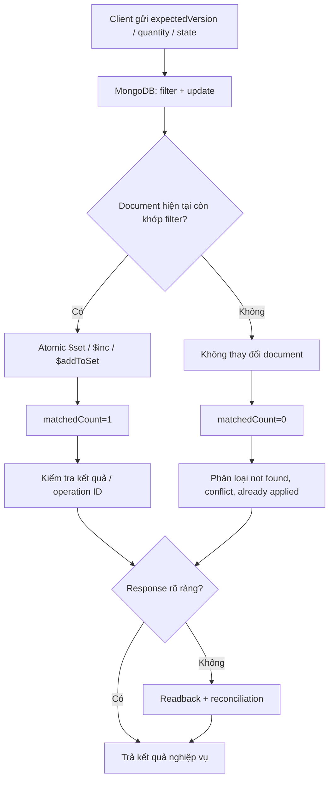

# Compare-and-set bằng điều kiện truy vấn và toán tử cập nhật

## 1. Vấn đề: đọc xong mới kiểm tra rồi ghi có thể mất cập nhật

Trong **Spring Data MongoDB**, một yêu cầu nghiệp vụ có thể đọc `Product` qua repository, kiểm tra `stock` rồi dùng `save` hoặc `$set` để ghi số lượng mới. Khi nhiều request đồng thời, điều kiện đã kiểm tra trong JVM có thể **không còn đúng** lúc MongoDB thực hiện lệnh ghi.

Ví dụ Mini Commerce có sản phẩm `KBD-001` còn 5 chiếc:

```text
T0: stock=5
T1: Request A đọc stock=5, cần mua 4 -> đủ
T2: Request B đọc stock=5, cần mua 4 -> đủ
T3: Request A ghi stock=1
T4: Request B ghi stock=1
```

Nếu cả hai đều được báo “mua 4 chiếc thành công”, hệ thống đã nhận tổng cộng 8 chiếc nhưng stock chỉ giảm 4. MongoDB vẫn đảm bảo mỗi lệnh ghi trên một document là **atomic**; lỗi nằm ở việc **đọc và ghi không cùng một điều kiện trên server**.

**Compare-and-set (CAS)** gửi một lệnh có hai phần:

- **Compare**: filter mô tả trạng thái phải còn đúng, ví dụ `version = 7`, `status = "PAID"` hoặc `stock >= 4`.
- **Set/change**: phép cập nhật `$set`, `$inc`, `$addToSet`, `$currentDate`… chỉ chạy nếu filter vẫn khớp.

MongoDB kiểm tra điều kiện của update khi các thao tác cạnh tranh được thực thi. Hai update dùng **cùng expected value** trên một document có thể khiến một update thành công và update còn lại không còn match. CAS không phải một lệnh lock riêng, và không cần một round-trip đọc trước để thực thi điều kiện.

Bài thuộc chương **Kiểm soát đồng thời** của `SPRING_DATA_MONGODB`. Nội dung kết nối với `MongoTemplate`/repository, mapping BSON, index, transaction, reactive access, kiểm thử và xử lý hiệu năng dữ liệu Mini Commerce.

### Mục tiêu học tập

Sau bài này, bạn có thể:

1. Diễn giải CAS bằng **filter + atomic update + đọc kết quả**.
2. Sử dụng `Query`/`Criteria` và `Update` để kiểm soát phiên bản, stock và trạng thái.
3. Phân biệt `UpdateResult.getMatchedCount()` với `getModifiedCount()`.
4. Kết hợp `stock >= quantity` và `$inc(-quantity)` để giảm oversell.
5. Phân biệt optimistic locking bằng `@Version` khi `save(entity)` và **CAS tường minh** ở direct update.
6. Sử dụng `findAndModify` để lấy document sau khi cập nhật trong một lệnh.
7. Nhận ra **lost update, ABA, duplicate retry và unknown outcome**.
8. Thiết kế operation ID/idempotency và biết khi nào cần transaction nhiều document.
9. Tích hợp repository `@Query` + `@Update`, reactive `Mono<UpdateResult>`, audit và integration test cạnh tranh.
10. Hiểu vì sao unique index, tenant isolation, write concern và quy tắc ứng dụng vẫn cần thiết.

**Điều kiện:** Java 17+, Spring Boot có `spring-boot-starter-data-mongodb`, MongoDB hoạt động, hiểu `@Document`, `MongoRepository`, `MongoTemplate`, `Query`, `Criteria` và BSON.

## 2. CAS trên một document diễn ra thế nào?



Một update trên document là atomic ngay cả khi đổi nhiều field. Nhưng **`updateMany` không phải transaction cho toàn tập document**: mỗi document được thay đổi atomic, còn các document khác vẫn có thể bị tác động bởi lệnh xen vào.

### 2.1. Ví dụ CAS tồn kho trong mongosh

```javascript
db.products.updateOne(
  {
    _id: "product-KBD-001",
    tenant_id: "shop-a",
    active: true,
    stock: { $gte: 4 }
  },
  {
    $inc: { stock: -4 },
    $currentDate: { updatedAt: true }
  }
);
```

Với stock=5, request đầu tiên có thể giảm còn 1. Request khác cũng đòi 4 không còn match điều kiện `stock >= 4`, nên không giảm tiếp. Đó là bảo vệ một **bất biến nghiệp vụ trên một document**.

### 2.2. Chọn filter theo invariant

| Mục tiêu | Filter CAS | Update |
| --- | --- | --- |
| Đổi tên khi client giữ version 7 | `_id`, `tenant_id`, `version: 7` | `$set name` + `$inc version` |
| Trừ kho nếu đủ hàng | `_id`, `active:true`, `stock >= quantity` | `$inc stock: -quantity` |
| Chuyển Order từ PAID sang PACKING | `_id`, `status: "PAID"`, tùy nhu cầu thêm version | `$set status`, `$inc version` |
| Tránh xử lý event cũ | `sourceVersion < incomingVersion` | `$set payload/sourceVersion` |
| Trừ stock một lần theo operation ID | `stock >= q` và `processedIds != operationId` | `$inc` và `$addToSet` trong cùng một update |

Đừng đặt filter chỉ có `{active:true}` để sửa đúng một Product. Với thao tác một document, sử dụng `_id` hoặc **business key có unique index**, kèm tenant và precondition cần thiết.

## 3. Mô hình Product–Customer–Order

### 3.1. Product với version và tồn kho

```java
package com.example.minicommerce.domain;

import java.math.BigDecimal;
import java.time.Instant;
import java.util.List;

import org.springframework.data.annotation.Id;
import org.springframework.data.annotation.Version;
import org.springframework.data.annotation.LastModifiedDate;
import org.springframework.data.mongodb.core.mapping.Document;
import org.springframework.data.mongodb.core.mapping.Field;
import org.springframework.data.mongodb.core.mapping.FieldType;

@Document(collection = "products")
public class Product {
    @Id
    private String id;

    @Field("tenant_id")
    private String tenantId;

    private String sku;
    private String name;
    private boolean active;
    private int stock;

    @Field(name = "unit_price", targetType = FieldType.DECIMAL128)
    private BigDecimal price;

    @Version
    private Long version;

    @LastModifiedDate
    private Instant updatedAt;

    private List<String> processedReservationIds;

    public Product() {}

    public String getId() { return id; }
    public void setId(String v) { id = v; }
    public String getTenantId() { return tenantId; }
    public void setTenantId(String v) { tenantId = v; }
    public String getSku() { return sku; }
    public void setSku(String v) { sku = v; }
    public String getName() { return name; }
    public void setName(String v) { name = v; }
    public boolean isActive() { return active; }
    public void setActive(boolean v) { active = v; }
    public int getStock() { return stock; }
    public void setStock(int v) { stock = v; }
    public BigDecimal getPrice() { return price; }
    public void setPrice(BigDecimal v) { price = v; }
    public Long getVersion() { return version; }
    public Instant getUpdatedAt() { return updatedAt; }
    public List<String> getProcessedReservationIds() {
        return processedReservationIds;
    }
}
```

Những điểm cần nhớ:

- `id` được map thành BSON `_id`.
- `tenantId` được map thành BSON `tenant_id`; `Criteria` gắn `Product.class` sử dụng **tên Java property**.
- `price` được map thành `unit_price` kiểu BSON Decimal128.
- `@Version` giúp optimistic locking cho **những API Spring Data có hợp đồng kiểm tra version**.
- `@LastModifiedDate` không tự thay đổi với mọi direct update; khi cần hãy set timestamp trong update.
- `processedReservationIds` chỉ để minh họa idempotency **một document**, không phải ledger không giới hạn.

### 3.2. Order và Customer

```java
package com.example.minicommerce.domain;

import java.time.Instant;
import org.springframework.data.annotation.Id;
import org.springframework.data.annotation.Version;
import org.springframework.data.mongodb.core.mapping.Document;
import org.springframework.data.mongodb.core.mapping.Field;

@Document(collection = "orders")
public class Order {
    @Id private String id;
    @Field("tenant_id") private String tenantId;
    private String customerId;
    private String status;
    @Version private Long version;
    private Instant updatedAt;

    public Order() {}
    public String getId() { return id; }
    public String getTenantId() { return tenantId; }
    public String getCustomerId() { return customerId; }
    public String getStatus() { return status; }
    public Long getVersion() { return version; }
    public Instant getUpdatedAt() { return updatedAt; }
}
```

Trong hệ thống đầy đủ, Order còn chứa `OrderLine` và giá snapshot; `Customer` có thông tin liên hệ và quyền tenant. CAS ở bài tập tập trung vào trạng thái Order và tồn kho Product, không tái định nghĩa các ranh giới aggregate.

## 4. Dữ liệu thử nghiệm

Sử dụng database **test riêng**, không chạy trên production:

```javascript
use mini_commerce

db.products.insertOne({
  _id: "product-KBD-001",
  tenant_id: "shop-a",
  sku: "KBD-001",
  name: "Bàn phím Mini",
  active: true,
  stock: 5,
  unit_price: NumberDecimal("129900.00"),
  version: NumberLong(7),
  updatedAt: ISODate("2026-11-20T02:00:00Z"),
  processedReservationIds: []
});

db.orders.insertOne({
  _id: "order-001",
  tenant_id: "shop-a",
  customerId: "customer-001",
  status: "PAID",
  version: NumberLong(3),
  updatedAt: ISODate("2026-11-20T02:00:00Z")
});
```

Chạy lại `insertOne` cùng `_id` gây duplicate key; tạo fixture ID mới hoặc cleanup đúng phạm vi. Java `@Id String` có thể được chuyển thành BSON ObjectId với một số giá trị giống ObjectId; ví dụ dùng ID có tiền tố chữ để dễ xác minh BSON thực.

## 5. CAS theo giá trị trạng thái cũ

Không phải mọi CAS đều phải có `@Version`. Với transition đơn giản `PAID → SHIPPED`:

```javascript
db.orders.updateOne(
  {
    _id: "order-001",
    tenant_id: "shop-a",
    status: "PAID"
  },
  {
    $set: { status: "SHIPPED" },
    $inc: { version: 1 },
    $currentDate: { updatedAt: true }
  }
);
```

Nếu lệnh đầu thành công, lần gọi lại cùng filter không khớp vì trạng thái không còn là PAID. Đây là **conditional update**, không phải “đọc trạng thái rồi cập nhật”. Kết quả không match có thể có nhiều nguyên nhân: đơn đã được ship, bị cancel, không tồn tại, sai tenant hoặc không đủ quyền.

Khi workflow cho phép quay `SHIPPED → PAID`, chỉ so sánh status có thể mắc **ABA**: trạng thái nhìn thấy giống ban đầu dù document đã thay đổi trong thời gian chờ. Khi cần ngăn stale client, thêm expected version hoặc generation token.

## 6. CAS bằng version và MongoTemplate.updateFirst

Client đã đọc Product version 7 và muốn đổi tên. Gửi update:

```javascript
db.products.updateOne(
  {
    _id: "product-KBD-001",
    tenant_id: "shop-a",
    version: NumberLong(7)
  },
  {
    $set: { name: "Bàn phím Mini V2" },
    $inc: { version: 1 },
    $currentDate: { updatedAt: true }
  }
);
```

Nếu hai writer cùng gửi expectedVersion=7, một writer có thể đổi name và tăng version thành 8. Writer còn lại không còn match version=7 và không ghi đè.

### 6.1. Service Spring Data hoàn chỉnh

```java
package com.example.minicommerce.service;

import com.mongodb.client.result.UpdateResult;
import org.springframework.data.mongodb.core.MongoTemplate;
import org.springframework.data.mongodb.core.query.Criteria;
import org.springframework.data.mongodb.core.query.Query;
import org.springframework.data.mongodb.core.query.Update;
import org.springframework.stereotype.Service;

import com.example.minicommerce.domain.Product;

@Service
public class ProductCasService {
    private final MongoTemplate template;

    public ProductCasService(MongoTemplate template) {
        this.template = template;
    }

    public boolean renameIfVersion(
            String tenantId, String productId,
            long expectedVersion, String rawName) {

        if (tenantId == null || tenantId.isBlank()) {
            throw new IllegalArgumentException("Tenant required");
        }
        if (rawName == null || rawName.isBlank()) {
            throw new IllegalArgumentException("Name required");
        }
        if (expectedVersion < 0) {
            throw new IllegalArgumentException("Invalid version");
        }

        Query filter = Query.query(
            Criteria.where("id").is(productId)
                .and("tenantId").is(tenantId)
                .and("version").is(expectedVersion));

        Update change = new Update()
            .set("name", rawName.trim())
            .inc("version", 1L)
            .currentDate("updatedAt");

        UpdateResult result =
            template.updateFirst(filter, change, Product.class);

        if (!result.wasAcknowledged()) {
            throw new IllegalStateException(
                "Acknowledged write required for CAS");
        }
        return result.getMatchedCount() == 1;
    }
}
```

Giải thích:

- `Criteria.where("id")` được mapping thành `_id`; `tenantId` thành `tenant_id` nhờ metadata `Product.class`.
- `version` trong **filter** là expected version từ snapshot client.
- `.inc("version", 1L)` làm version đổi **trong cùng atomic update**; vì version đã nằm trong `Update`, không cần trông chờ auto-increment của mapper.
- `.currentDate("updatedAt")` dùng timestamp do server đặt; direct update không đi qua một vòng entity save auditing.
- `updateFirst` không insert nếu không match; không bật `upsert` cho CAS.
- Filter có `_id` duy nhất, nên `matchedCount` chỉ có thể là 0 hoặc 1.

### 6.2. UpdateResult: matched khác modified

```java
UpdateResult result = template.updateFirst(
    filter, change, Product.class);

if (!result.wasAcknowledged()) {
    throw new IllegalStateException("Write unacknowledged");
}

long matched = result.getMatchedCount();
long modified = result.getModifiedCount();
```

| Kết quả | Ý nghĩa |
| --- | --- |
| `matched=1`, `modified=1` | Document khớp và thật sự thay đổi |
| `matched=1`, `modified=0` | Document khớp nhưng update không đổi giá trị, ví dụ `$set` cùng giá trị |
| `matched=0`, `modified=0` | Không có document khớp filter; **không phải MongoDB write error** |
| Exception do network/write concern | Client có thể không biết đầy đủ outcome | Cần đối soát, không retry mù quáng |

CAS rename phía trên có `$inc version`, nên khi match kỳ vọng sẽ có `modified=1`. Nhưng **không dùng `modifiedCount` làm định nghĩa tổng quát của CAS**: một `$set` cùng giá trị là thao tác hợp lệ với `matched=1`, `modified=0`.

### 6.3. Failure path theo nghiệp vụ

Nếu `matchedCount=0`, có thể là Product không tồn tại, sai tenant, version đã đổi hoặc điều kiện khác không còn đúng. Không mặc định mọi trường hợp là lỗi 409; để phân loại 404/403/409/412, ứng dụng cần đọc lại **trong phạm vi quyền truy cập**. Document có thể tiếp tục thay đổi giữa lần CAS và readback, nên không coi readback là snapshot chính xác tại thời điểm conflict.

## 7. @Version optimistic locking và direct CAS

Với entity có `@Version`, đường `save(entity)` của Spring Data có thể kiểm tra version của instance người dùng đã đọc:

```java
Product first = repository.findById(productId)
    .orElseThrow();
Product stale = repository.findById(productId)
    .orElseThrow();

first.setName("Tên A");
repository.save(first);

stale.setName("Tên B");
repository.save(stale);
// OptimisticLockingFailureException khi version đã đổi
// và write acknowledgement phù hợp.
```

Tuy nhiên, Spring Data còn mô tả rằng một số `MongoTemplate` update **tự tăng `@Version` nếu Update chưa đề cập property đó**:

```java
// Có thể tăng version, nhưng KHÔNG có expectedVersion:
template.updateFirst(
    Query.query(Criteria.where("id").is(productId)),
    new Update().set("name", "Tên mới"),
    Product.class);

// CAS tường minh: filter expectedVersion và $inc version.
template.updateFirst(
    Query.query(Criteria.where("id").is(productId)
        .and("version").is(7L)),
    new Update().set("name", "Tên mới")
        .inc("version", 1L),
    Product.class);
```

**Tăng version không đồng nghĩa kiểm tra version kỳ vọng**. Update thứ nhất không biết client đã đọc version nào. Update thứ hai tự đặt điều kiện version và cập nhật version đồng thời.

### 7.1. Mọi writer phải tôn trọng protocol

Nếu raw Java driver, `mongosh` hoặc bulk job có thể sửa `name` mà **không tăng version**, một entity stale có thể vẫn giữ version khớp. Vì vậy một aggregate cần quy tắc chung cho mọi đường ghi: repository save, template, raw driver, bulk, migration và reactive.

### 7.2. Không save entity chỉ có projection

Với `Product` đọc thiếu `stock`/`unit_price` qua projection, `save` dạng replacement có thể làm mất field không tải. Direct CAS với `$set` giữ những field không bị sửa, nhưng phải tự quản lý validation, timestamp và expected version. Chọn công cụ theo ownership và invariant.

## 8. CAS cho stock: $inc cùng điều kiện $gte

Một phương thức giảm stock nguyên tử:

```java
public boolean reserveStock(
        String tenantId, String productId, int quantity) {

    if (quantity <= 0) {
        throw new IllegalArgumentException(
            "Quantity must be positive");
    }

    Query filter = Query.query(
        Criteria.where("id").is(productId)
            .and("tenantId").is(tenantId)
            .and("active").is(true)
            .and("stock").gte(quantity));

    Update change = new Update()
        .inc("stock", -quantity)
        .currentDate("updatedAt");

    UpdateResult result =
        template.updateFirst(filter, change, Product.class);

    if (!result.wasAcknowledged()) {
        throw new IllegalStateException("Write unacknowledged");
    }
    return result.getMatchedCount() == 1;
}
```

Đây là method trong service đã inject `MongoTemplate template` và import `Product`/`UpdateResult`/`Query`/`Criteria`/`Update`. Nếu Product có `@Version` và update chưa đề cập version, Spring Data có thể tự tăng version; **đừng nhầm auto-bump này với kiểm tra phiên bản kỳ vọng**.

Với stock=5, hai request cần 4 chiếc: chỉ một request có thể match sau khi stock giảm còn 1. `$inc` thay đổi giá trị hiện tại tại server, khác `$set(stock=1)` đã tính từ một lần đọc cũ.

### 8.1. CAS theo stock chưa chống retry trùng

```text
Lần 1: stock=5, reserve 2 -> stock=3, server đã ghi
Client mất kết nối trước response
Lần 2: retry $inc(-2), stock>=2 vẫn khớp
Kết quả: stock=1, cùng một reservation bị trừ hai lần
```

`$inc` không idempotent theo request. Điều kiện `stock>=q` ngăn oversell, **không** ngăn client gọi lại cùng operation. Cần thêm operation ID và cơ chế đối soát.

## 9. Idempotency bằng operation ID trong cùng một Product

Một ví dụ atomic chỉ trên **một Product**:

```javascript
db.products.updateOne(
  {
    _id: "product-KBD-001",
    tenant_id: "shop-a",
    stock: { $gte: 2 },
    active: true,
    processedReservationIds: { $ne: "reserve-order-001" }
  },
  {
    $inc: { stock: -2, version: 1 },
    $addToSet: {
      processedReservationIds: "reserve-order-001"
    },
    $currentDate: { updatedAt: true }
  }
);
```

### 9.1. Service tương ứng

```java
public boolean reserveOnce(
        String tenantId, String productId,
        String reservationId, int quantity) {

    if (reservationId == null || reservationId.isBlank()) {
        throw new IllegalArgumentException(
            "Reservation ID required");
    }
    if (quantity <= 0) {
        throw new IllegalArgumentException(
            "Quantity must be positive");
    }

    Query filter = Query.query(
        Criteria.where("id").is(productId)
            .and("tenantId").is(tenantId)
            .and("active").is(true)
            .and("stock").gte(quantity)
            .and("processedReservationIds").ne(reservationId));

    Update update = new Update()
        .inc("stock", -quantity)
        .inc("version", 1L)
        .addToSet("processedReservationIds", reservationId)
        .currentDate("updatedAt");

    UpdateResult result =
        template.updateFirst(filter, update, Product.class);

    if (!result.wasAcknowledged()) {
        throw new IllegalStateException("Write unacknowledged");
    }
    return result.getMatchedCount() == 1;
}
```

Vì `$inc stock` và `$addToSet operationId` nằm trong **cùng update trên cùng document**, sau khi lần đầu thành công, lần retry với operation ID đó không còn khớp `$ne`. Field chưa tồn tại cũng có thể khớp `$ne` và `$addToSet` tạo array khi cần.

**Giới hạn không được bỏ qua:**

- Operation ID phải **ổn định** xuyên mọi attempt; không tạo UUID mới mỗi lần retry.
- `matched=0` có thể nghĩa là “đã xử lý” **hoặc** “không đủ stock”/sai tenant; cần readback khi phân loại.
- Mảng `processedReservationIds` có thể tăng đến giới hạn BSON document (16 MiB); không dùng làm ledger vĩnh viễn cho SKU phổ biến.
- Một operation ID trong Product A không bảo vệ thay đổi ở Product B hay việc ghi `Order`. Quy trình nhiều document cần ledger/unique index và có thể cần transaction.
- Với production, cân nhắc collection `inventory_reservations` có unique `(tenantId, operationId)`, checkpoint và replay có kiểm soát.

## 10. CAS theo state machine của Order

```text
PLACED -> PAID -> PACKING -> SHIPPED -> DELIVERED
                 \-> CANCELLED (khi quy tắc cho phép)
```

Một worker không được chuyển đơn `PAID → PACKING` nếu một worker khác đã ship/cancel:

```java
public boolean beginPacking(
        String tenantId, String orderId,
        long expectedVersion) {

    Query filter = Query.query(
        Criteria.where("id").is(orderId)
            .and("tenantId").is(tenantId)
            .and("status").is("PAID")
            .and("version").is(expectedVersion));

    Update update = new Update()
        .set("status", "PACKING")
        .inc("version", 1L)
        .currentDate("updatedAt");

    UpdateResult result = template.updateFirst(
        filter, update, Order.class);

    return result.wasAcknowledged()
        && result.getMatchedCount() == 1;
}
```

Đây là method trong service có `MongoTemplate template` và các imports `Order`/`Query`/`Criteria`/`Update`/`UpdateResult`. Điều kiện state + expected version nên gắn với unique `_id` để tránh tác động nhiều đơn.

Nếu workflow không bao giờ quay về trạng thái trước, filter theo status đôi khi đủ để chặn transition lặp. Nếu trạng thái có thể đổi rồi quay lại, filter version giúp phát hiện **ABA** và stale clients.

## 11. Repository @Query + @Update

Có thể biểu diễn CAS thành method repository:

```java
package com.example.minicommerce.repository;

import org.springframework.data.mongodb.repository.MongoRepository;
import org.springframework.data.mongodb.repository.Query;
import org.springframework.data.mongodb.repository.Update;
import com.example.minicommerce.domain.Product;

public interface ProductRepository
        extends MongoRepository<Product, String> {

    @Query("""
        { '_id': ?0, 'tenant_id': ?1, 'version': ?2 }
        """)
    @Update("""
        {
          '$set': { 'name': ?3 },
          '$inc': { 'version': 1 },
          '$currentDate': { 'updatedAt': true }
        }
        """)
    long compareAndSetName(
        String productId, String tenantId,
        long expectedVersion, String name);

    @Query("""
        {
          '_id': ?0, 'tenant_id': ?1,
          'active': true, 'stock': { '$gte': ?2 }
        }
        """)
    @Update("""
        {
          '$inc': { 'stock': ?3 },
          '$currentDate': { 'updatedAt': true }
        }
        """)
    long subtractIfEnough(
        String productId, String tenantId,
        int requiredQuantity, int negativeQuantity);
}
```

Lưu ý:

- `@Query` chọn document, `@Update` định nghĩa thao tác ghi; `?0`...`?3` bind tham số.
- Client không được tự chọn `negativeQuantity`: service phải kiểm tra `requiredQuantity>0` và truyền `-requiredQuantity`.
- Repository update methods tác động **tất cả document khớp**, không giới hạn bởi `Top`/`Pageable`. Với `_id` duy nhất, tối đa một Product được sửa.
- Số `long` trả về là số document được sửa theo hợp đồng repository, **không có đầy đủ matched/modified như `UpdateResult`**.
- Repository `@Update` không phát persistence/mapping lifecycle events như save entity; đặt timestamp/actor tường minh nếu cần.
- Phải integration test mapping `tenant_id`/`version` theo Spring Data version thực tế.

Không gộp một lỗi CAS bằng `upsert=true`; trường hợp mismatch phải **không insert**.

## 12. findAndModify: trả document sau CAS

`MongoTemplate.updateFirst` trả kết quả số; `findAndModify` có thể trả ngay document cũ hoặc mới:

```java
import org.springframework.data.mongodb.core.FindAndModifyOptions;

public Product renameAndReturn(
        String tenantId, String productId,
        long expectedVersion, String newName) {

    Query query = Query.query(
        Criteria.where("id").is(productId)
            .and("tenantId").is(tenantId)
            .and("version").is(expectedVersion));

    Update update = new Update()
        .set("name", newName)
        .inc("version", 1L)
        .currentDate("updatedAt");

    return template.findAndModify(
        query, update,
        FindAndModifyOptions.options()
            .returnNew(true)
            .upsert(false),
        Product.class);
}
```

`returnNew(true)` trả document **sau khi cập nhật**; nếu không match và không upsert, method trả `null`. Filter/update vẫn atomic trên một document. `findAndModify` không tự bảo đảm idempotency và có đặc điểm hiệu năng/overhead riêng, nên dùng khi thật sự cần document sau ghi.

Raw MongoDB tương đương:

```javascript
db.products.findAndModify({
  query: {
    _id: "product-KBD-001",
    tenant_id: "shop-a",
    version: NumberLong(7)
  },
  update: {
    $set: { name: "Bàn phím Mini V2" },
    $inc: { version: 1 },
    $currentDate: { updatedAt: true }
  },
  new: true,
  upsert: false
});
```

Khi dùng `mongosh`/raw driver, phải dùng **BSON field name**. Spring Data mapping không áp dụng bên ngoài các API gắn entity phù hợp.

## 13. ABA problem và giới hạn của việc chỉ so sánh giá trị cũ

CAS so sánh **giá trị hiện tại**, không tự chứng minh document **chưa từng thay đổi** kể từ lần đọc của client.

```text
T0: Order.status=PAID, version=3
T1: Worker A đọc status=PAID
T2: Worker B đổi status=PACKING, version=4
T3: Admin đưa trạng thái về PAID, version=5
T4: Worker A lọc status=PAID -> lại khớp
```

Đó là **ABA**: cùng giá trị `PAID` xuất hiện trở lại sau các thay đổi trung gian. Nếu Worker A yêu cầu “chỉ sửa Order đúng phiên bản tôi từng duyệt”, phải thêm `version=3` hoặc một **generation token** ổn định. Với version đã thành 5, command stale ở T4 không match.

Trường hợp xóa document rồi tạo lại với cùng `_id` và version reset cũng cần cân nhắc: một version không có ý nghĩa trên toàn vòng đời nếu ID hoặc generation bị tái sử dụng. Dùng định danh duy nhất/generation mới khi nghiệp vụ cần phát hiện chu kỳ tái tạo.

## 14. Vì sao không dùng upsert cho CAS?

**CAS** có nghĩa “chỉ sửa khi trạng thái hiện tại đúng”, còn **upsert** có nghĩa “không match thì thử insert”.

```javascript
// Không dùng kiểu này cho CAS của document đã tồn tại:
db.products.updateOne(
  { _id: "product-KBD-001", version: NumberLong(7) },
  { $set: { name: "Tên mới" }, $inc: { version: 1 } },
  { upsert: true }
);
```

Nếu Product hiện ở version 8, filter version 7 không match. Với `upsert:true`, MongoDB có thể thử tạo document mới rồi báo duplicate-key trên `_id`, hoặc tạo bản ghi trùng nếu business key không unique. Đó **không phải** cách xử lý conflict mong muốn.

**Quy tắc:** CAS hiện hữu dùng `upsert=false`. Việc tạo mới theo unique key là một flow **khởi tạo riêng**, có thể dùng `$setOnInsert` và unique index, nhưng phải xử lý race tạo đồng thời.

## 15. Chọn đúng toán tử cập nhật

| Toán tử | Công dụng | Hạn chế trong CAS |
| --- | --- | --- |
| `$set` | Ghi giá trị tuyệt đối | Nếu filter quá rộng, có thể ghi đè bản mới hơn |
| `$inc` | Cộng/trừ tại server | Không idempotent khi retry trùng |
| `$min` | Chỉ thay nếu giá trị mới nhỏ hơn | Không bảo vệ toàn bộ entity khỏi stale write |
| `$max` | Chỉ thay nếu giá trị mới lớn hơn | Watermark không có nghĩa đã xử lý toàn bộ event |
| `$addToSet` | Thêm phần tử không trùng | Mảng lớn và không tự tạo ledger liên document |
| `$setOnInsert` | Khởi tạo field lúc upsert tạo mới | Không dùng để “chữa” version conflict |
| `$currentDate` | Server set BSON Date/timestamp | Không thay thế audit trail đầy đủ |
| `$unset` | Xóa field | Có thể vi phạm validation/schema |

### 15.1. Ví dụ $max cho sequence

```javascript
db.product_sync_state.updateOne(
  { _id: "shop-a/catalog-feed" },
  { $max: { lastSeenSequence: NumberLong(42) } }
);
```

Lệnh này ngăn watermark giảm từ 42 xuống 41. Nhưng **watermark cao không chứng minh mọi Product của event 42 đã được ghi**. Nếu cập nhật state và Product ở nhiều document, cần checkpoint/ledger hoặc transaction phù hợp.

### 15.2. Aggregation pipeline update vẫn cần filter CAS

MongoDB còn hỗ trợ update theo pipeline:

```javascript
db.products.updateOne(
  { _id: "product-KBD-001", version: NumberLong(7) },
  [
    {
      $set: {
        name: "Bàn phím Mini V2",
        version: { $add: ["$version", 1] }
      }
    }
  ]
);
```

Pipeline update cho phép tính giá trị từ document hiện tại, nhưng **không tự tạo expected-version check**. Filter vẫn phải bảo vệ trạng thái. Lưu ý `$inc` là update modifier, không phải một stage tổng hợp trong update pipeline; viết pipeline cần cú pháp expression như `$add`.

## 16. Atomicity một document khác transaction nhiều document

```javascript
db.products.updateMany(
  { tenant_id: "shop-a", active: true },
  { $inc: { stock: 1 } }
);
```

Với `updateMany`, mỗi Product được sửa atomic, nhưng **toàn bộ nhóm không all-or-nothing** và các writer khác có thể xen vào trên những document còn lại.

### 16.1. BulkOperations không phải transaction

`BulkOperations.BulkMode.ORDERED`/`UNORDERED` giúp gom lệnh và định nghĩa cách xử lý lỗi/thứ tự, **không** biến batch thành một đơn vị atomic. `BulkWriteResult` có counters tổng hợp như matched/modified, nhưng không luôn cho biết SKU nào CAS bị conflict.

Với import cập nhật 1.000 Product:

- Mỗi operation nên mang business ID và expected version.
- Theo dõi operation ID ↔ input để đối soát sau lỗi.
- Không retry nguyên batch `$inc` khi outcome chưa rõ.
- Nếu cần biết chính xác status của từng Product, cân nhắc lệnh có kết quả riêng hoặc ledger.

### 16.2. Khi nào cần transaction?

Luồng đặt hàng có thể phải:

1. CAS giảm stock của Product A.
2. CAS giảm stock của Product B.
3. Tạo Order.
4. Ghi outbox/operation ledger.

Nếu invariant đòi **tất cả cùng commit hoặc cùng rollback**, dùng MongoDB transaction trên replica set/sharded topology hỗ trợ, với `MongoTransactionManager` hoặc reactive transaction manager tương ứng.

```java
import org.springframework.transaction.annotation.Transactional;

@Transactional
public void placeOrder(PlaceOrderCommand command) {
    // 1. Kiểm tra operation ID; CAS stock từng Product.
    // 2. Nếu một CAS matched=0, hủy transaction.
    // 3. Tạo Order với unique business key.
    // 4. Lưu outbox/event ledger trong transaction.
    // 5. Chỉ ghi checkpoint sau commit được xác nhận.
}
```

Đây là **khung ý tưởng**: `PlaceOrderCommand` và các thao tác phải được định nghĩa riêng. Transaction không rollback email, cổng thanh toán hoặc HTTP request bên ngoài MongoDB. Với trường hợp mất phản hồi commit, ứng dụng vẫn cần idempotency/readback.

## 17. CAS không match: xác định lỗi nghiệp vụ

`matchedCount=0` là kết quả hợp lệ, không phải exception. Nó có thể chỉ một trong nhiều nguyên nhân:

| Nguyên nhân | Ví dụ | Hướng xử lý |
| --- | --- | --- |
| Không có entity | ID sai hoặc đã xóa | 404 nếu contract/permission cho phép |
| Không thuộc tenant | Product có `tenant_id` khác | Không tiết lộ tài nguyên ngoài tenant |
| Version conflict | Client gửi 7, DB đang là 8 | 409 hoặc 412 theo hợp đồng API |
| Business transition không hợp lệ | Order đã SHIPPED, không còn PAID | Conflict hoặc domain error |
| Stock không đủ | Stock còn 1, quantity=4 | Hết hàng/precondition failed |
| Operation ID đã được xử lý | Mảng/ledger đã có ID | Readback rồi trả kết quả idempotent |

Một service có thể đọc lại theo **ID + tenant** sau khi matched=0 để phân loại:

```java
UpdateResult result =
    template.updateFirst(filter, change, Product.class);

if (result.wasAcknowledged()
        && result.getMatchedCount() == 0) {
    // Readback đúng scope:
    // - Không thấy Product: not found / scope.
    // - Version khác: stale.
    // - Stock thấp: insufficient stock.
    // - Operation ID có mặt: maybe already applied.
}
```

Lần readback là một thao tác riêng, dữ liệu vẫn có thể tiếp tục đổi. Không coi nó là snapshot bất biến của thời điểm CAS thất bại.

## 18. Timeout, unknown outcome và retry an toàn

### 18.1. Không nhận response không có nghĩa MongoDB chưa ghi

```text
Client gửi CAS expectedVersion=7
MongoDB ghi thành công, version=8
Connection đứt trước response
Client retry expectedVersion=7
Retry trả matched=0
```

Kết quả retry 0 **không chứng minh lần đầu thất bại**. Nếu Product đã được một writer khác cập nhật tiếp, chỉ kiểm tra `name`/`version` cuối cùng cũng chưa chắc chứng minh operation ban đầu đã áp dụng.

Khi tác động nghiệp vụ cần xác nhận mạnh, dùng operation ID, ledger/outbox hoặc record trạng thái có thể truy vấn để **reconcile**. Phân biệt:

- `CONFIRMED_APPLIED`: có bằng chứng operation đạt trạng thái mong muốn.
- `CONFIRMED_NOT_APPLIED`: update đã được xác nhận `matched=0`, nếu không có outcome khác trước đó.
- `UNKNOWN_OUTCOME`: mất response, write concern không đạt hoặc kết quả thiếu bằng chứng.

### 18.2. Driver retryable writes không phải exactly-once nghiệp vụ

MongoDB Java driver có retryable writes cho các trường hợp/topology hỗ trợ. Nhưng user-level retry một luồng Order gồm nhiều lệnh, retry `$inc` không có operation guard hoặc lost response sau commit vẫn cần protocol ứng dụng.

Với direct version CAS, retry cùng expectedVersion thường không áp dụng lần hai, nhưng client vẫn phải biết vì sao retry trả 0. Với stock CAS, retry theo `stock >= quantity` **có thể** giảm stock thêm lần nữa nếu còn đủ.

### 18.3. Acknowledged write concern

CAS và optimistic locking cần nhận write result đáng tin cậy. `WriteConcern.UNACKNOWLEDGED` không phù hợp nếu service phải quyết định từ `matchedCount`. Cân nhắc `w: "majority"` và durability theo yêu cầu, nhưng **majority không tự tạo exactly-once** hoặc atomicity liên document.

## 19. Auditing, validation và authorization

Repository `save(entity)` có thể kích hoạt `BeforeConvertCallback`, `BeforeSaveCallback` và Spring auditing nếu đã bật. `MongoTemplate.updateFirst` hoặc repository `@Update` **không phải vòng save entity**, nên không được mặc định `@LastModifiedDate` hoặc validation callback đã chạy.

Đối với CAS trực tiếp, set metadata tường minh:

```java
Update change = new Update()
    .set("name", newName)
    .set("lastModifiedBy", verifiedActorId)
    .inc("version", 1L)
    .currentDate("updatedAt");
```

`verifiedActorId` phải đến từ security context/service account đáng tin cậy. `updatedAt`/`lastModifiedBy` là metadata lần sửa cuối, **không phải audit trail append-only**. Nếu cần truy vết mọi thay đổi hoặc chứng minh operation ID, dùng audit ledger/outbox và retention phù hợp.

Các bất biến cần bảo vệ qua nhiều lớp:

1. Validate input (`quantity > 0`, tên hợp lệ, expectedVersion không âm).
2. Tenant/authorization xác thực ở service và filter `tenantId`.
3. Điều kiện quan trọng ở **server filter** (`version`, `status`, `stock`).
4. Unique index, schema validation và mapping BSON.
5. Idempotency khi retry, transaction nếu nhiều document.

Không lấy `tenantId` chỉ từ request body rồi tin đó là quyền truy cập.

## 20. Unique index, explain và sharded cluster

### 20.1. Theo _id

`_id` trong collection thường có index mặc định, nên CAS theo ID có thể tìm tối đa một Product rồi kiểm tra tenant/version:

```javascript
db.products.find({
  _id: "product-KBD-001",
  tenant_id: "shop-a",
  version: NumberLong(7)
}).explain("executionStats");
```

Không cần tạo compound index `{_id:1, version:1}` cho mọi CAS nếu plan đã đủ tốt. Tối ưu dựa trên workload thật và `totalKeysExamined`/`totalDocsExamined`.

### 20.2. Theo business key

Nếu dùng `(tenantId, sku)`:

```javascript
db.products.createIndex(
  { tenant_id: 1, sku: 1 },
  { unique: true }
);
```

Với SKU không unique, `updateOne` có thể sửa một document không đúng ý định và `updateMulti` có thể sửa nhiều document. Unique index phải phản ánh đúng phạm vi nghiệp vụ.

### 20.3. Sharding

Trong sharded cluster, kiểm tra shard key, routing, phạm vi unique index và hỗ trợ phiên bản MongoDB. Query CAS theo `_id` không tự đảm bảo đi đến một shard hiệu quả trong mọi schema shard key. Một test local replica set không chứng minh cùng hiệu năng/đặc tính định tuyến trên sharding.

`explain("executionStats")` kiểm tra query planner, **không** chứng minh protocol xử lý timeout, conflict hay ABA. Cần integration test song song.

## 21. ReactiveMongoTemplate: Mono<UpdateResult>

Filter/update có cùng BSON semantics trong reactive:

```java
import com.mongodb.client.result.UpdateResult;
import reactor.core.publisher.Mono;

import org.springframework.data.mongodb.core.query.Criteria;
import org.springframework.data.mongodb.core.query.Query;
import org.springframework.data.mongodb.core.query.Update;

Mono<UpdateResult> updated =
    reactiveMongoTemplate.updateFirst(
        Query.query(Criteria.where("id").is(productId)
            .and("tenantId").is(tenantId)
            .and("version").is(expectedVersion)),
        new Update()
            .set("name", newName)
            .inc("version", 1L)
            .currentDate("updatedAt"),
        Product.class);

Mono<Boolean> applied = updated.map(result -> {
    if (!result.wasAcknowledged()) {
        throw new IllegalStateException(
            "Acknowledged write required");
    }
    return result.getMatchedCount() == 1;
});
```

`reactiveMongoTemplate` là bean inject và các biến là input đã validate. Publisher thường thực thi khi **subscribe**. Subscribe hai lần vào một publisher chứa `$inc` có thể thực thi hai write nếu không có CAS/idempotency. Không gọi `block()` trong WebFlux event loop.

Test Reactor:

```java
import reactor.test.StepVerifier;

StepVerifier.create(applied)
    .expectNext(true)
    .verifyComplete();
```

Trong integration test thật, seed Product đúng version, sau đó thực hiện stale attempt và xác minh `false`. Không subscribe lặp một lệnh không idempotent chỉ để kiểm tra log.

## 22. Integration test: CAS cạnh tranh trên MongoDB thật

Mock `MongoTemplate` chỉ kiểm tra call được tạo đúng, không chứng minh atomic update, BSON alias, version hay concurrency. Dùng MongoDB thật hoặc Testcontainers và database test riêng.

### 22.1. Hai writer cùng expected version

```java
package com.example.minicommerce;

import static org.junit.jupiter.api.Assertions.*;

import java.util.concurrent.CountDownLatch;
import java.util.concurrent.ExecutorService;
import java.util.concurrent.Executors;
import java.util.concurrent.Future;
import java.util.concurrent.TimeUnit;

import org.bson.Document;
import org.junit.jupiter.api.Test;
import org.springframework.beans.factory.annotation.Autowired;
import org.springframework.boot.test.context.SpringBootTest;
import org.springframework.data.mongodb.core.MongoTemplate;

import com.example.minicommerce.service.ProductCasService;

@SpringBootTest
class CompareAndSetIntegrationTest {

    @Autowired MongoTemplate template;
    @Autowired ProductCasService service;

    @Test
    void onlyOneWriterWinsSameExpectedVersion() throws Exception {
        String id = "cas-test-product-1";
        var products = template.getCollection("products");

        products.deleteOne(new Document("_id", id));
        try {
            products.insertOne(
                new Document("_id", id)
                    .append("tenant_id", "cas-test-tenant")
                    .append("sku", "CAS-TEST-001")
                    .append("name", "Original")
                    .append("active", true)
                    .append("stock", 5)
                    .append("version", 7L));

            ExecutorService pool =
                Executors.newFixedThreadPool(2);
            CountDownLatch start = new CountDownLatch(1);

            try {
                Future<Boolean> a = pool.submit(() -> {
                    start.await();
                    return service.renameIfVersion(
                        "cas-test-tenant", id, 7L, "Name A");
                });
                Future<Boolean> b = pool.submit(() -> {
                    start.await();
                    return service.renameIfVersion(
                        "cas-test-tenant", id, 7L, "Name B");
                });

                start.countDown();

                boolean resultA = a.get(10, TimeUnit.SECONDS);
                boolean resultB = b.get(10, TimeUnit.SECONDS);

                assertNotEquals(resultA, resultB);

                Document stored =
                    products.find(new Document("_id", id)).first();
                assertNotNull(stored);
                assertEquals(8L,
                    stored.get("version", Number.class).longValue());
                assertTrue(
                    "Name A".equals(stored.getString("name")) ||
                    "Name B".equals(stored.getString("name")));
            } finally {
                pool.shutdownNow();
            }
        } finally {
            products.deleteOne(new Document("_id", id));
        }
    }
}
```

Hai task được giải phóng cùng latch, nhưng test **không dự đoán thread nào thắng**. Assert chỉ một kết quả true, version tăng đúng một lần và name cuối thuộc hai giá trị gửi vào.

**Fixture:** nếu collection `products` của test đã có JSON Schema yêu cầu `unit_price` hoặc field khác, seed phải đủ schema. Dùng database test riêng; không làm yếu validator production để test chạy.

### 22.2. Test operation ID chống retry

Trong test riêng có `stock=5`, `processedReservationIds=[]`:

```java
boolean first = stockService.reserveOnce(
    tenantId, productId, "reservation-001", 3);

boolean retry = stockService.reserveOnce(
    tenantId, productId, "reservation-001", 3);

assertTrue(first);
assertFalse(retry);

Document actual = template.getCollection("products")
    .find(new Document("_id", productId)).first();

assertNotNull(actual);
assertEquals(2, actual.getInteger("stock"));
assertTrue(actual.getList(
    "processedReservationIds", String.class)
    .contains("reservation-001"));
```

Đây là **thân test**; `stockService` cần chứa method `reserveOnce` trong phần 9, `tenantId/productId` cần có fixture và import JUnit phù hợp. Nếu request retry được tạo operation ID mới, guard sẽ không nhận ra trùng request.

### 22.3. Test thêm

| Kịch bản | Kỳ vọng |
| --- | --- |
| Hai version CAS đồng thời | Một writer được áp dụng |
| Stale version | Không ghi đè Product |
| `$set` cùng giá trị | matched=1, modified có thể =0 |
| Stock=5, hai request qty=4 | Chỉ một request được chấp nhận |
| Hai attempt cùng reservation ID | Stock chỉ giảm một lần |
| Retry sau mất response | Có readback/ledger; không coi matched=0 là lỗi chắc chắn |
| Sai tenant | Không sửa document khác tenant |
| Order không còn PAID | Không thực hiện transition |
| ABA status quay lại | Stale expectedVersion không khớp |
| `findAndModify.returnNew(true)` | Trả document version mới hoặc null |
| CAS không bật upsert | Không tạo document mới khi mismatch |
| Repository `@Update` | Filter alias và count theo contract |
| `@Version` save stale | OptimisticLockingFailureException với write ACK |
| Reactive CAS | Mono trả kết quả, không thực thi lại ngoài ý muốn |

Không chạy build/Gradle/tests trong bước viết STEP 4 này; các đoạn test sẽ được thực thi/đối chiếu chuyên môn ở STEP 6 NEW.

## 23. Những lỗi thường gặp

| Triệu chứng | Nguyên nhân | Cách xử lý |
| --- | --- | --- |
| Hai request mua cùng thành công dù stock chỉ giảm một lần | Đọc rồi `$set` ở JVM | `stock >= q` + `$inc(-q)` tại server |
| Name bị ghi đè bởi stale request | Filter không có expected version | CAS theo `_id + version` |
| Version tăng mà vẫn lost update | Có auto-bump nhưng thiếu compare | Đặt expectedVersion vào filter |
| Matched=0, không có exception | Điều kiện không khớp là kết quả bình thường | Phân loại conflict/not-found/insufficient |
| Matched=1, modified=0 | Ghi lại giá trị đã có | Không coi đó là lỗi |
| Stock giảm hai lần sau retry | `$inc` không idempotent | Operation ID/ledger |
| Retry version trả 0 sau timeout | Lần đầu có thể đã commit | Reconciliation trước khi trả thất bại |
| Trạng thái cũ quay lại | ABA problem | Version hoặc generation token |
| CAS version mismatch báo duplicate key | Đã bật upsert | CAS dùng upsert=false |
| Raw writer làm @Version vô hiệu | Không tăng version trên mọi đường ghi | Thống nhất protocol |
| Repository @Update không cập nhật audit | Không có save callback | `$currentDate` và actor tường minh |
| CAS theo SKU sửa nhầm Product | Thiếu unique index theo tenant/SKU | Tạo unique key đúng phạm vi |
| updateMany thất bại một phần | Atomicity chỉ mỗi document | Đối soát/transaction theo invariant |
| Bulk ordered bị coi là transaction | Bulk không all-or-nothing | Transaction/ledger nếu cần |
| findAndModify trả bản cũ | Chưa bật returnNew | `returnNew(true)` |
| Tenant không được lọc | Thiếu permission/invariant | Lấy tenant tin cậy, thêm filter |
| Test tuần tự pass nhưng race vẫn tồn tại | Chưa test concurrent writers | Integration test với latch |

## 24. Bài tập và câu hỏi tự kiểm tra

**Bài 1 — Stock CAS.** Tạo Product stock=5; gửi hai lệnh `stock>=4`, `$inc stock=-4`. Dự đoán matched/modified và số lượng cuối.

**Bài 2 — Lost update.** Viết một method đọc Product rồi `$set(stock=calculated)`, so sánh với CAS ở server. Dùng hai task cùng đọc một giá trị để quan sát sai khác.

**Bài 3 — CAS bằng version.** Seed version 7, gửi hai update cùng expectedVersion 7, `$set name` + `$inc version`. Chỉ một lệnh được sửa.

**Bài 4 — @Version.** Nạp hai instance Product cùng version, `save` bản A rồi `save` bản B; xử lý optimistic locking exception, so sánh với direct update không có compare.

**Bài 5 — @Update.** Khai báo `@Query` + `@Update` trên repository với `_id`, `tenant_id` và `version`. Xác minh raw BSON và count bằng integration test.

**Bài 6 — findAndModify.** Dùng `returnNew(true)` lấy version mới; gọi lần nữa bằng expected version cũ và kiểm tra null.

**Bài 7 — State transition.** Chỉ cho phép `PAID → PACKING` nếu status và version còn đúng. Gửi hai worker cùng command, một thắng và một conflict.

**Bài 8 — ABA.** Tạo chuỗi `PAID → PACKING → PAID`; thử filter chỉ bằng status và filter kèm version.

**Bài 9 — Idempotency.** Đặt `reservationId`, dùng `$inc + $addToSet` trong cùng update. Retry cùng ID và kiểm tra stock chỉ giảm một lần; thảo luận giới hạn mảng tăng vô hạn.

**Bài 10 — Multi-document.** Thiết kế Order có hai Product, xác định khi nào cần transaction, unique index, ledger/outbox và cách xử lý unknown commit.

**Bài 11 — Reactive.** Dùng `ReactiveMongoTemplate.updateFirst`, `StepVerifier` và một stale request, tránh subscribe lặp một lệnh `$inc`.

**Bài 12 — Index.** So sánh CAS theo `_id` với CAS theo `(tenant_id,sku)`, tạo unique index thích hợp và đọc `explain("executionStats")`.

### Câu hỏi

1. CAS khác `find → if → save` thế nào?
2. Vì sao atomicity một document không tự ngăn lost update?
3. `matchedCount` khác `modifiedCount` ở trường hợp nào?
4. `@Version` khi save khác CAS tường minh qua Query/Update thế nào?
5. Vì sao auto-increment version chưa chứng minh expected version?
6. Tại sao `stock>=q` có thể ngăn oversell nhưng chưa chống retry trùng?
7. Vì sao `$addToSet` và `$inc` phải thực thi cùng một update để đánh dấu reservation?
8. Mảng processed IDs có giới hạn gì?
9. ABA problem xảy ra khi nào?
10. Vì sao upsert nguy hiểm với CAS version?
11. Khi nào `findAndModify` tốt hơn `updateFirst`?
12. `matched=0` có thể mang bao nhiêu ý nghĩa nghiệp vụ?
13. Tại sao timeout sau khi gửi update không chứng minh server chưa ghi?
14. Khi nào cần transaction thay vì CAS trên một Product?
15. Reactive subscription lặp ảnh hưởng `$inc` ra sao?
16. Unique index và tenant filter có vai trò gì đối với CAS?

**Kết quả mong đợi:** người học biết dùng **điều kiện truy vấn làm phần compare** và **toán tử cập nhật làm phần set** của CAS, kiểm chứng bằng `UpdateResult`/`findAndModify`, xử lý version và business status khi đồng thời, và biết giới hạn của CAS một document trước bài toán idempotency, nhiều document, transaction và unknown outcome.

## Tài liệu tham khảo

- [MongoDB Manual — Atomicity and Transactions](https://www.mongodb.com/docs/manual/core/write-operations-atomicity/): atomicity theo document, so sánh giá trị kỳ vọng và concurrent update.
- [MongoDB Manual — Update Documents](https://www.mongodb.com/docs/manual/tutorial/update-documents/): `updateOne`, `updateMany`, filter và update.
- [MongoDB Manual — $inc](https://www.mongodb.com/docs/manual/reference/operator/update/inc/): cập nhật số học tại server.
- [MongoDB Manual — $addToSet](https://www.mongodb.com/docs/manual/reference/operator/update/addToSet/): thêm phần tử không trùng vào array.
- [MongoDB Manual — findAndModify](https://www.mongodb.com/docs/manual/reference/method/db.collection.findAndModify/): cập nhật và trả document trong một thao tác.
- [MongoDB Manual — Retryable Writes](https://www.mongodb.com/docs/manual/core/retryable-writes/): hỗ trợ retry và giới hạn.
- [Spring Data MongoDB — Saving, Updating and Removing Documents](https://docs.spring.io/spring-data/mongodb/reference/mongodb/template-crud-operations.html): `MongoTemplate.updateFirst`, `findAndModify`, `@Version` và write acknowledgment.
- [Spring Data MongoDB — Repository Update Methods](https://docs.spring.io/spring-data/mongodb/reference/mongodb/repositories/modifying-methods.html): `@Query`, `@Update`, counters và giới hạn lifecycle.
- [Spring Data MongoDB — Lifecycle Events](https://docs.spring.io/spring-data/mongodb/reference/mongodb/lifecycle-events.html): entity callbacks và direct write.
- [Spring Data MongoDB — Client Sessions and Transactions](https://docs.spring.io/spring-data/mongodb/reference/mongodb/client-session-transactions.html): transaction nhiều document.
- [MongoDB Manual — Explain Results](https://www.mongodb.com/docs/manual/reference/explain-results/): index và execution statistics.
