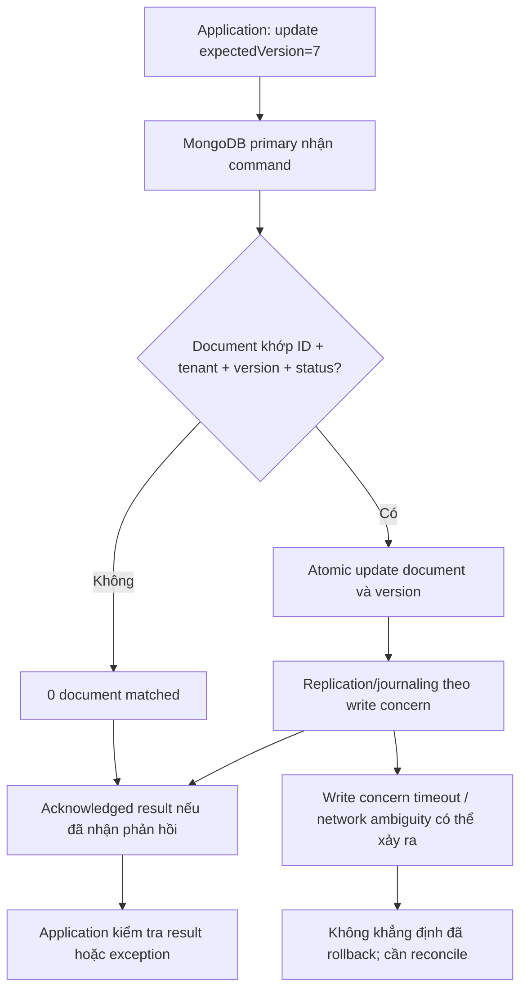

# Write concern phù hợp để nhận biết lỗi ghi hoặc xung đột version

## 1. Vấn đề thực tế và mục tiêu học tập

Giả sử hai nhân viên cùng mở một đơn hàng đang có `status = READY_TO_SHIP` và `version = 7`. Nhân viên A xác nhận đã giao, còn nhân viên B muốn hủy. Nếu cả hai đọc phiên bản cũ rồi ghi lại toàn bộ document, một thay đổi có thể **ghi đè** thay đổi kia. Bài toán khác xảy ra khi MongoDB đã nhận lệnh ghi nhưng ứng dụng mất kết nối trước khi nhận câu trả lời: thao tác đó thành công hay thất bại, có nên gửi lại không?

Có hai cơ chế thường bị nhầm:

1. **Write concern**: xác định mức **xác nhận lệnh ghi** từ MongoDB, ví dụ `w: 1` hoặc `w: "majority"`, cùng tùy chọn journaling và timeout.
2. **Kiểm soát đồng thời bằng version/điều kiện ghi**: xác định thao tác chỉ được áp dụng khi document vẫn ở trạng thái và phiên bản mong đợi, rồi kiểm tra kết quả như `matchedCount` hoặc exception optimistic locking.

Chúng **bổ trợ nhau, không thay thế nhau**. Write concern đủ mạnh giúp client biết kết quả được xác nhận đến mức nào; nó **không tự so sánh version**. Một điều kiện `version = 7` giúp ngăn ghi đè, nhưng nếu ứng dụng gửi write không chờ acknowledgment, nó có thể **không nhận biết được** lệnh đó có match hoặc bị server từ chối không.

Bài thuộc chương **Kiểm soát đồng thời** của module **SPRING_DATA_MONGODB**. Phạm vi module là dùng Spring Data MongoDB để kết nối, ánh xạ document và thao tác qua `MongoTemplate` hoặc repository; thực hành truy vấn, aggregation, index, transaction, reactive access, kiểm thử và chẩn đoán hiệu năng dữ liệu.

Sau bài học, bạn có thể:

- Phân biệt `w: 0`, `w: 1`, `w: "majority"`, `j` và `wtimeout` theo khả năng quan sát và độ bền ghi.
- Giải thích vì sao **acknowledged write là điều kiện cần để quan sát xung đột optimistic locking**.
- Dùng `@Version` với `MongoTemplate.save(...)` và xử lý `OptimisticLockingFailureException`.
- Viết lệnh compare-and-set với `MongoOperations.updateFirst(...)`, filter version, `UpdateResult` và version increment.
- Phân biệt duplicate key, document không match, write concern timeout, network timeout và transaction conflict.
- Thiết kế retry/idempotency đúng khi không rõ lệnh đã được áp dụng hay chưa.
- Cấu hình write concern trong Spring Data/driver, đo latency và viết integration test có ý nghĩa.

> **Nguyên tắc:** Chọn write concern dựa trên SLA, độ bền và topology; chọn điều kiện ghi dựa trên business invariant; chỉ báo «thành công» khi có **bằng chứng phù hợp với contract**. Không đồng nhất `w: "majority"` với «không bao giờ xảy ra xung đột».

## 2. Ba câu hỏi độc lập của một thao tác ghi

Mọi command ghi cần trả lời:

| Câu hỏi | Cơ chế chính | Bằng chứng |
| --- | --- | --- |
| **Server đã nhận/xử lý lệnh và báo lỗi gì?** | Write concern được acknowledged và kết quả/exception từ driver | `UpdateResult`, `MongoWriteException` hoặc exception được Spring dịch |
| **Thay đổi đã được xác nhận trên bao nhiêu replica?** | `w`, journaling `j`, `wtimeout`, topology | Write acknowledgment hoặc write concern error |
| **Trạng thái/version vẫn hợp lệ khi ghi không?** | Filter điều kiện, `@Version`, atomic update | Matched count, optimistic-locking failure hoặc kết quả CAS |

Trong một lệnh cụ thể, có thể vừa xảy ra lỗi mạng, vừa không biết chắc write đã được áp dụng hay chưa. Vì thế, một phần quan trọng của kiểm soát đồng thời là **không đoán kết quả** chỉ từ tên exception.



**Đọc sơ đồ đúng cách:** Condition thất bại không nhất thiết tạo một server error. Với một lệnh update có acknowledged write, kết quả **match = 0** là một kết quả hợp lệ của command; business layer mới quyết định đó có phải xung đột, không tìm thấy hoặc điều kiện trạng thái không phù hợp.

## 3. Dữ liệu và domain model ví dụ

### 3.1. Document BSON

Trong collection `orders` thực hành:

```javascript
db.orders.insertMany([
  {
    _id: "ord-101",
    tenantId: "tenant-a",
    externalKey: "partner-evt-101",
    status: "READY_TO_SHIP",
    version: NumberLong("7"),
    updatedAt: ISODate("2026-11-19T08:00:00Z")
  },
  {
    _id: "ord-102",
    tenantId: "tenant-a",
    externalKey: "partner-evt-102",
    status: "READY_TO_SHIP",
    version: NumberLong("3"),
    updatedAt: ISODate("2026-11-19T09:00:00Z")
  },
  {
    _id: "ord-201",
    tenantId: "tenant-b",
    externalKey: "partner-evt-201",
    status: "READY_TO_SHIP",
    version: NumberLong("1"),
    updatedAt: ISODate("2026-11-19T10:00:00Z")
  }
]);
```

Các lệnh seed chỉ dành cho **database test trống/được reset trước**, không chạy nguyên trạng trên dữ liệu thực. Thao tác update ở các ví dụ dưới đây có thể làm thay đổi trạng thái hoặc version; hãy reset fixture khi cần so sánh kết quả độc lập.

### 3.2. Entity Spring Data

```java
package com.example.orders.persistence;

import java.time.Instant;
import org.springframework.data.annotation.Version;
import org.springframework.data.mongodb.core.mapping.Document;
import org.springframework.data.mongodb.core.mapping.FieldType;
import org.springframework.data.mongodb.core.mapping.MongoId;

@Document(collection = "orders")
public record OrderDocument(
    @MongoId(FieldType.STRING) String id,
    String tenantId,
    String externalKey,
    String status,
    @Version Long version,
    Instant updatedAt
) {
    public OrderDocument withStatus(String newStatus, Instant now) {
        return new OrderDocument(
            id, tenantId, externalKey, newStatus, version, now
        );
    }
}
```

`@Version` đánh dấu thuộc tính dùng cho **optimistic locking** trong những operation Spring Data hỗ trợ. `Long` là wrapper nên có thể null khi entity mới chưa có phiên bản; framework quản lý giá trị version lúc insert/save theo quy tắc của phiên bản đang chạy. `@MongoId(FieldType.STRING)` quy định BSON `_id` là String, phù hợp fixture.

Đừng tạo một document mới với `version = 7` rồi tin rằng MongoDB tự thực hiện optimistic locking chỉ vì field tồn tại. **Thao tác ghi phải có filter version hoặc dùng API có cơ chế version-aware phù hợp.**

### 3.3. Unique index cho khóa nghiệp vụ

Nếu mỗi sự kiện đối tác chỉ được tạo một đơn trong mỗi tenant:

```javascript
db.orders.createIndex(
  { tenantId: 1, externalKey: 1 },
  { unique: true, name: "uk_orders_tenant_external" }
);
```

Index này phục vụ **ngăn dữ liệu trùng** khi hai request cùng tạo; nó giải quyết một loại race **khác** với optimistic version conflict. Không coi `DuplicateKeyException` và `OptimisticLockingFailureException` là hai tên cho cùng một tình huống.

## 4. Write concern là gì và nằm ở đâu?

Write concern xác định MongoDB cần đạt mức acknowledgment nào cho một write operation. Với replica set, mức `w` liên quan tới số hoặc tập thành viên cần xác nhận; tùy chọn `j` liên quan journaling; `wtimeout` đặt giới hạn chờ write concern.

```javascript
db.orders.updateOne(
  {
    _id: "ord-101",
    tenantId: "tenant-a",
    version: NumberLong("7")
  },
  { $set: { status: "SHIPPED" }, $inc: { version: NumberLong("1") } },
  {
    writeConcern: {
      w: "majority",
      j: true,
      wtimeout: 10000
    }
  }
);
```

Trong ví dụ, `wtimeout: 10000` là **10.000 ms**. Lệnh trên vừa có:

- **CAS filter** `version: 7`, giúp tránh ghi đè nếu version đã đổi.
- **Write concern** `w: "majority"` và `j: true`, để yêu cầu mức xác nhận đã lựa chọn.

Hai phần độc lập: bỏ version filter vẫn có thể nhận majority acknowledgment cho một lần ghi đè sai nghiệp vụ; bỏ acknowledgment đủ mạnh có thể khiến ứng dụng không quan sát được CAS result.

## 5. w: 0 — unacknowledged write và nguy cơ mất tín hiệu lỗi

`w: 0` yêu cầu không đợi server gửi acknowledgment về kết quả ghi theo cơ chế thông thường.

```javascript
db.orders.updateOne(
  { _id: "ord-101", version: NumberLong("7") },
  { $set: { status: "SHIPPED" } },
  { writeConcern: { w: 0 } }
);
```

**Không dùng `w: 0` cho giao dịch nghiệp vụ cần biết ghi thành công, xung đột version hay duplicate key.**

Với unacknowledged write:

- Client không thể tin vào matched count/modified count như với acknowledged write.
- Lỗi xảy ra khi server xử lý command, bao gồm nhiều validation/write errors, có thể không đến được application dưới dạng kết quả đáng tin cậy.
- Không nên mong Spring Data phát hiện đầy đủ `OptimisticLockingFailureException`.
- Việc client «gửi command không lỗi ngay» **không chứng minh** database đã cập nhật document.
- Tên `UNACKNOWLEDGED` không nói rằng network không bao giờ báo lỗi; nó nói **không có acknowledgment ghi đáng tin**.

Trong Spring Data MongoDB, tài liệu về optimistic locking lưu ý phải dùng **acknowledged write concern**, nếu không lỗi optimistic locking có thể bị bỏ qua mà ứng dụng không biết.

### 5.1. Java driver: không đọc count khi unacknowledged

```java
UpdateResult result = collection.updateOne(
    Filters.eq("_id", "ord-101"),
    Updates.set("status", "SHIPPED")
);

if (!result.wasAcknowledged()) {
    throw new IllegalStateException(
        "Cannot decide business success from unacknowledged write"
    );
}

long matched = result.getMatchedCount();
long modified = result.getModifiedCount();
```

Snippet này giả định `collection` là `MongoCollection<Document>` đã cấu hình sẵn. Khi write result **không được acknowledged**, không được gọi các getter count rồi coi chúng là một kết quả hợp lệ; một số getter có thể ném exception cho result unacknowledged.

## 6. w: 1 — primary acknowledgment

`w: 1` trong replica set yêu cầu primary xác nhận write. Đây là mức **acknowledged**, nên application có thể nhận kết quả matched/modified hoặc server-side write error khi command hoàn tất bình thường.

```javascript
db.orders.updateOne(
  { _id: "ord-101", version: NumberLong("7") },
  { $set: { status: "SHIPPED" }, $inc: { version: 1 } },
  { writeConcern: { w: 1 } }
);
```

Một response với `matchedCount: 1` cho biết filter đã match một document trong command đó. Nhưng `w: 1` **không bảo đảm write đã được majority replicas xác nhận**, nên dữ liệu có thể có rủi ro rollback khi primary failover dưới một số kịch bản.

### 6.1. Khi nào w: 1 phù hợp?

- Workload chấp nhận mức xác nhận primary và trade-off về failover/durability.
- Thao tác có thể được khôi phục hoặc tái tạo, sau khi đã phân tích rủi ro mất write.
- Ứng dụng vẫn cần biết validation errors và result counts trong trường hợp command trả về thành công.

Không coi `w: 1` luôn đúng cho mọi đơn hàng, thanh toán hoặc kho. Quyết định phụ thuộc rủi ro nghiệp vụ và topology.

### 6.2. w: 1 không đồng nghĩa j: true

`w: 1` yêu cầu primary acknowledgment, còn `j: true` là yêu cầu bổ sung liên quan tới journaling. Việc journal có được đợi hay không còn tùy cấu hình write concern và server. Không suy ra «đã ghi bền xuống journal» chỉ từ chuỗi `w: 1`.

## 7. w: "majority" — yêu cầu xác nhận bởi đa số

`w: "majority"` yêu cầu mức acknowledgment tương ứng với **đa số thành viên theo cấu hình replica set** và các quy tắc MongoDB áp dụng; chi tiết khi có arbiter, thành viên đặc biệt hoặc topology riêng phải kiểm tra theo phiên bản.

```javascript
db.orders.updateOne(
  { _id: "ord-101", version: NumberLong("7") },
  { $set: { status: "SHIPPED" }, $inc: { version: 1 } },
  { writeConcern: { w: "majority" } }
);
```

Đây thường là lựa chọn đáng cân nhắc cho trạng thái quan trọng mà ứng dụng muốn giảm rủi ro rollback sau failover.

### 7.1. Majority không loại bỏ xung đột nghiệp vụ

Nếu hai request cùng ghi:

```javascript
// Request A
{ $set: { status: "SHIPPED" } }

// Request B
{ $set: { status: "CANCELLED" } }
```

và cả hai chỉ filter theo `_id`, cả hai có thể nhận majority acknowledgment theo thứ tự thực thi. Giá trị cuối cùng có thể là của request ghi sau. **Majority bảo vệ mức xác nhận replication, không tự phát hiện lost update**.

Để ngăn lost update, dùng expected state hoặc version ngay trong điều kiện ghi.

### 7.2. Chi phí latency và availability

So với primary acknowledgment, majority có thể phải đợi thêm replication, ảnh hưởng:

- Write latency, nhất là khi secondary chậm hoặc network xa.
- Khả năng hoàn tất khi không đạt majority.
- Backpressure trong thời gian replica lag.
- Hiệu năng tổng thể khi workload ghi cao.

Không có quy tắc «majority chậm X ms» phổ quát. Đo p95/p99 với topology và write distribution thật.

### 7.3. Journaling đi cùng majority

Mức độ gắn giữa majority acknowledgment và journal phụ thuộc cấu hình server, ví dụ `writeConcernMajorityJournalDefault`. Nếu yêu cầu độ bền cụ thể tới journal, phải chọn/kiểm chứng `j: true` và cấu hình storage engine/cluster thực tế; không dùng khẩu hiệu «majority luôn đã fsync mọi disk».

## 8. j: true và wtimeout: không nhầm bền dữ liệu với hạn chờ

### 8.1. j: true

`j: true` yêu cầu chờ điều kiện journaling theo semantics MongoDB trước khi acknowledgment. Nó tăng mức bảo đảm về write được ghi nhận trong journal so với cấu hình không đợi journal, đổi lại có thể thêm độ trễ.

```javascript
{
  writeConcern: {
    w: "majority",
    j: true
  }
}
```

Trên môi trường không hỗ trợ journaling hoặc với tổ hợp write concern không hợp lệ, hành vi có thể bị từ chối. Hãy xem config/storage engine/server version. Journal acknowledgment không thay thế backup, disaster recovery hoặc replication phù hợp.

### 8.2. wtimeout

`wtimeout` đặt thời gian tối đa chờ đạt write concern yêu cầu:

```javascript
{
  writeConcern: {
    w: "majority",
    wtimeout: 5000
  }
}
```

Khi timeout:

- Có thể nhận **write concern error**.
- Primary **có thể đã áp dụng update** trước khi hết thời gian chờ replication.
- Việc write concern không đạt đúng hạn **không tự rollback thay đổi đã được áp dụng**.
- Ứng dụng **không được mặc định retry một phép `$inc` hoặc trừ tiền vô điều kiện**.

### 8.3. Khác với timeout kết nối

| Tín hiệu | Điều cần hiểu |
| --- | --- |
| Write concern timeout | Lệnh có thể đã thay đổi dữ liệu nhưng chưa đạt mức acknowledgment yêu cầu đúng hạn |
| Network/socket timeout | Không rõ command có tới server, server có xử lý hoặc response có bị mất |
| Server selection timeout | Có thể chưa chọn được server để gửi lệnh |
| Application HTTP timeout | Client HTTP không đợi nữa; backend/database có thể vẫn đang thực hiện |

Không gộp tất cả thành `WRITE_FAILED_AND_NOT_APPLIED`. Một số tình huống chỉ có kết luận an toàn là **UNKNOWN/NEEDS_RECONCILIATION**.

## 9. Bảng chọn write concern theo mục tiêu

| Mức | Có thể quan sát kết quả ghi bình thường? | Mục đích / đánh đổi chính |
| --- | --- | --- |
| `w: 0` | **Không đáng tin để kiểm tra matched/modified** | Không đợi acknowledgment; không phù hợp optimistic locking cần phát hiện lỗi |
| `w: 1` | Có, nếu response nhận được | Primary xác nhận; vẫn còn rủi ro failover rollback |
| `w: "majority"` | Có, nếu response nhận được | Mức replication acknowledgment cao hơn; latency/availability trade-off |
| `w: "majority", j: true` | Có, nếu response nhận được | Thêm yêu cầu journal; cần kiểm tra cấu hình và workload |
| `w: 2` hoặc số tùy chỉnh | Có theo điều kiện đã xác nhận | Phải bảo đảm topology đủ thành viên và hiểu membership |

Đây là **khung quyết định**, không phải bảng cấu hình bắt buộc. Ứng dụng có thể dùng server default, client default hoặc override từng operation. MongoDB version, arbiter và cấu hình cluster có thể thay đổi implicit default write concern. **Đọc cấu hình hiệu lực**, không giả định mọi môi trường đều mặc định `w: 1` hoặc đều `majority`.

Một chiến lược thực dụng:

1. Với mọi command cần phát hiện version conflict, **không dùng unacknowledged write**.
2. Với dữ liệu cần chống rollback qua failover, đánh giá `majority` và yêu cầu journaling.
3. Đo write latency và khả năng hoàn tất dưới replica lag, network issues.
4. Thiết kế timeout/retry/idempotency đồng thời với write concern, không làm sau.
5. Kiểm tra write concern hiệu lực từ MongoClient/URI/template/transaction settings.

## 10. Optimistic locking bằng @Version trong Spring Data MongoDB

### 10.1. Cơ chế

Khi entity đã có version và thao tác `save(...)` theo đường persistence hỗ trợ optimistic locking, Spring Data đưa **version hiện tại** vào điều kiện update và tăng version khi lưu. Nếu một request khác đã đổi version, thao tác save stale có thể bị từ chối với `OptimisticLockingFailureException`.

```text
Ban đầu:
  ord-101   status=READY_TO_SHIP   version=7

Worker A đọc version 7
Worker B đọc version 7

A save với expected version 7
  → match → status=SHIPPED, version=8

B save với expected version 7
  → không match → optimistic locking failure
```

**Điều kiện tiên quyết:** Write phải acknowledged để framework có đủ kết quả nhằm phát hiện việc update không match. Điều kiện này là một phần quan trọng của việc cấu hình optimistic locking đúng.

### 10.2. Ví dụ MongoTemplate.save(...)

```java
import java.time.Instant;
import org.springframework.data.mongodb.core.MongoOperations;
import org.springframework.dao.OptimisticLockingFailureException;

public final class OrderVersionedWriter {
    private final MongoOperations mongo;

    public OrderVersionedWriter(MongoOperations mongo) {
        this.mongo = mongo;
    }

    public OrderDocument changeStatus(
        OrderDocument snapshot, String newStatus
    ) {
        OrderDocument proposed = snapshot.withStatus(
            newStatus, Instant.now()
        );
        try {
            return mongo.save(proposed);
        } catch (OptimisticLockingFailureException ex) {
            throw new OrderConflictException(
                "Order has changed; reload before retrying", ex
            );
        }
    }
}

class OrderConflictException extends RuntimeException {
    OrderConflictException(String message, Throwable cause) {
        super(message, cause);
    }
}
```

Ở đây `OrderDocument` là record có `@Version Long version` từ mục 3. Vì là object bất biến, cần sử dụng **entity được trả về từ save** nếu ứng dụng còn dùng snapshot đó. Đừng giữ mãi object mang version cũ.

### 10.3. Version conflict không nhất thiết là version mismatch duy nhất

Một lần save stale thất bại có thể xảy ra vì document đã bị xóa, mapping/ID không đúng hoặc version khác. Ở API multi-tenant, không suy ra quyền của người gọi chỉ từ exception. Nếu cần phân biệt «không tồn tại» và «version cũ», làm phép đọc có kiểm soát theo tenant/authorization.

### 10.4. Nếu @Version là null?

Entity **mới** và entity **đã lưu** được phân biệt bằng quy tắc phát hiện new entity của Spring Data. Wrapper `Long` có thể có trạng thái null trước insert; primitive và wrapper có quy tắc khởi tạo version khác nhau. Vì vậy, phải dùng test theo entity thật; không hardcode mong đợi mọi bản ghi mới luôn bắt đầu bằng một con số cố định nếu chưa kiểm chứng.

## 11. CAS tường minh bằng MongoOperations.updateFirst

Một update đặt tên nghiệp vụ như «chuyển READY_TO_SHIP thành SHIPPED» thường không cần tải entity, chỉnh trong Java rồi save. Có thể dùng **compare-and-set** (CAS) trong một MongoDB update.

### 11.1. Query phải chứa ID + tenant + expected state/version

```java
import java.time.Instant;
import com.mongodb.client.result.UpdateResult;
import org.springframework.data.mongodb.core.MongoOperations;
import org.springframework.data.mongodb.core.query.Criteria;
import org.springframework.data.mongodb.core.query.Query;
import org.springframework.data.mongodb.core.query.Update;

public final class ShippingCommandGateway {
    private final MongoOperations mongo;

    public ShippingCommandGateway(MongoOperations mongo) {
        this.mongo = mongo;
    }

    public boolean markShipped(
        String authenticatedTenantId,
        String orderId,
        long expectedVersion,
        Instant shippedAt
    ) {
        if (authenticatedTenantId == null
                || authenticatedTenantId.isBlank()
                || orderId == null || orderId.isBlank()
                || expectedVersion < 0
                || shippedAt == null) {
            throw new IllegalArgumentException("Invalid command");
        }

        Query filter = Query.query(
            Criteria.where("id").is(orderId)
                .and("tenantId").is(authenticatedTenantId)
                .and("status").is("READY_TO_SHIP")
                .and("version").is(expectedVersion)
        );

        Update update = new Update()
            .set("status", "SHIPPED")
            .set("updatedAt", shippedAt)
            .inc("version", 1L);

        UpdateResult result = mongo.updateFirst(
            filter, update, OrderDocument.class
        );

        if (!result.wasAcknowledged()) {
            throw new IllegalStateException(
                "Write was not acknowledged"
            );
        }
        return result.getMatchedCount() == 1;
    }
}
```

**Ý nghĩa nghiệp vụ:** Chỉ một command với filter version dự kiến được phép thắng. Trong ví dụ, thao tác đổi status, timestamp và version trên **một document** có tính nguyên tử. Không có một cửa sổ đọc-kiểm tra-ghi tách rời giữa các request.

### 11.2. Tránh tăng version hai lần

Spring Data có cơ chế xử lý `@Version` trên một số đường update (ví dụ khi version không được cung cấp trong update). Trong code trên, `.inc("version", 1L)` là **chủ động** và phải được kiểm thử trên Spring Data version thực tế để bảo đảm version tăng **đúng một lần**, không bị can thiệp thêm bởi mapping/update logic. Không cùng lúc vừa tự tăng, vừa áp dụng một đường custom auto-version tăng thêm mà chưa kiểm tra.

### 11.3. MongoDB tương đương

```javascript
const result = db.orders.updateOne(
  {
    _id: "ord-101",
    tenantId: "tenant-a",
    status: "READY_TO_SHIP",
    version: NumberLong("7")
  },
  {
    $set: {
      status: "SHIPPED",
      updatedAt: new Date()
    },
    $inc: { version: NumberLong("1") }
  },
  {
    writeConcern: { w: "majority", j: true, wtimeout: 10000 }
  }
);

printjson(result);
```

Khi một request khác đã tăng version thành 8, lệnh filter `version: 7` **không match**. Nếu client nhận acknowledgment bình thường, `matchedCount = 0` cho biết điều kiện ghi không còn đúng; write concern majority không phải thứ tạo ra sự so sánh này.

## 12. matchedCount, modifiedCount và upsertedId

Với acknowledged `UpdateResult`, có thể kiểm tra:

```java
UpdateResult result = mongo.updateFirst(
    filter, update, OrderDocument.class
);

if (!result.wasAcknowledged()) {
    throw new IllegalStateException("No reliable result");
}

long matched = result.getMatchedCount();
long modified = result.getModifiedCount();
Object upsertedId = result.getUpsertedId();
```

| Trường | Diễn giải |
| --- | --- |
| `wasAcknowledged()` | Có nhận write acknowledgment để đọc result theo contract không |
| `matchedCount` | Số document phù hợp filter |
| `modifiedCount` | Số document thực sự thay đổi |
| `upsertedId` | ID được tạo khi command upsert thành công theo API |

### 12.1. Phân loại kết quả cho CAS

| Kết quả | Diễn giải an toàn |
| --- | --- |
| `matchedCount=1, modifiedCount=1` | Đã thay đổi một document phù hợp filter |
| `matchedCount=0` | Không có document đáp ứng **toàn bộ** filter; có thể version/status/tenant/ID |
| `matchedCount=1, modifiedCount=0` | Document khớp nhưng update không làm thay đổi; có thể là no-op |
| `upsertedId != null` | Có nhánh tạo mới bằng upsert, nếu đã bật |
| Không acknowledged | Không suy luận business success từ counts |

Trong ví dụ `markShipped`, `$set status` cùng `$inc version` bảo đảm document khớp sẽ có thay đổi (trừ lỗi); vì vậy `matchedCount=1` được dùng làm thành công. Với một update chỉ `$set` field đã có cùng giá trị, `matchedCount=1` vẫn có thể đi cùng `modifiedCount=0`.

### 12.2. CAS version không được bật upsert

```javascript
// KHÔNG nên upsert một transition cần document đã tồn tại.
db.orders.updateOne(
  { _id: "ord-101", version: NumberLong("7") },
  { $set: { status: "SHIPPED" } },
  { upsert: true }
);
```

Nếu version đã thay đổi, filter không match; với `upsert:true` server có thể cố tạo một document mới và gặp duplicate key hoặc tạo dữ liệu không mong muốn. **Dùng update không upsert cho state transition**.

## 13. Phân biệt write error và version conflict

Không phải mọi bất thường ở write đều nên chuyển thành HTTP 409 «version conflict».

### 13.1. Phân loại điển hình

| Tình huống | Bản chất | Phản ứng gợi ý |
| --- | --- | --- |
| CAS `matchedCount=0` | Điều kiện nghiệp vụ không còn khớp | Trả conflict/invalid state phù hợp, có thể đọc lại có quyền |
| `OptimisticLockingFailureException` | Framework phát hiện optimistic lock thất bại trên đường hỗ trợ | Yêu cầu reload/retry có kiểm soát |
| Duplicate-key (11000) | Vi phạm unique index | Xử lý idempotency/duplicate theo business key |
| Schema validation/write error | Server từ chối nội dung write | Sửa input/contract hoặc xử lý lỗi dữ liệu |
| Write concern timeout | Không đạt mức replication acknowledgment đúng hạn | Trạng thái có thể chưa xác định; reconcile |
| Network timeout giữa write | Có thể không biết server đã áp dụng lệnh hay chưa | Reconcile, tránh retry side effect mù |
| Transaction write conflict | Cạnh tranh trong transaction | Retry transaction phù hợp nếu có chính sách |
| Authorization/permission error | Tài khoản không được phép ghi | Kiểm tra quyền/config, không báo version conflict |

### 13.2. Duplicate key không đồng nghĩa optimistic locking

Ví dụ hai request dùng cùng `externalKey`, unique index `{tenantId,externalKey}` chặn duplicate. Một request nhận duplicate key có thể do event đã được xử lý, hoặc một request khác tạo record trước.

Với idempotency, cần đọc record theo **khóa tin cậy và tenant**, kiểm tra payload/operation identity, rồi trả kết quả phù hợp. Đừng bắt mọi duplicate-key exception và luôn trả «thành công» nếu không kiểm tra xem dữ liệu trùng có đúng cùng request logic.

### 13.3. Spring exception translation

Trong Spring Data, driver errors có thể được dịch thành các exception như `DuplicateKeyException`, `DataAccessException` hoặc exception optimistic locking. Nhưng **không giả định mọi lỗi write concern đều luôn được dịch thành một class duy nhất ở mọi version**.

Phân biệt trường hợp có `UpdateResult` hợp lệ với trường hợp command ném exception. Khi cần chẩn đoán, xem cause/driver error label hoặc error code theo API được hỗ trợ.

## 14. Retryable writes và kết quả không xác định

MongoDB Java driver có cơ chế **retryable writes** cho những thao tác được hỗ trợ khi cấu hình và topology đáp ứng điều kiện. Điều này có thể giúp chống lỗi mạng tạm thời, nhưng không cho phép ứng dụng tự kết luận rằng mọi lần retry tùy ý đều không tạo side effect.

### 14.1. Ba tình huống phải phân biệt

1. **Đã nhận acknowledged result:** đánh giá counts/exception theo contract.
2. **Nhận lỗi chắc chắn trước khi write được gửi/xử lý:** có thể retry theo chính sách, nhưng chỉ nếu phân loại được an toàn.
3. **Không rõ kết quả sau network/write concern timeout:** không được mặc định write đã thất bại; cần đọc/reconcile theo operation identity.

### 14.2. Vì sao $inc đặc biệt nguy hiểm khi retry thủ công?

```javascript
db.orders.updateOne(
  { _id: "ord-101" },
  { $inc: { retryCount: 1 } }
);
```

Nếu server đã tăng `retryCount` nhưng response bị mất, application chạy lại cùng update **không có điều kiện** có thể tăng thêm lần nữa. Tính idempotency của driver-level retryable write trong phạm vi hỗ trợ **khác** với việc application tự gửi một command mới nhiều lần.

### 14.3. CAS làm retry dễ kiểm soát hơn nhưng chưa đủ mọi trường hợp

```javascript
db.orders.updateOne(
  {
    _id: "ord-101",
    tenantId: "tenant-a",
    version: NumberLong("7")
  },
  {
    $inc: { version: 1, retryCount: 1 }
  }
);
```

Lần đầu thành công thì version thành 8; gửi lại với expected version 7 thường không match. Tuy nhiên, nếu ứng dụng **mất response**, một kết quả `matchedCount=0` khi retry **không chứng minh** lần đầu thành công: writer khác cũng có thể đã thay version.

Giải pháp khi cần kết luận chính xác: dùng operation ID/idempotency key có unique constraint hoặc trạng thái hành động ghi cùng transaction/atomic document update, rồi truy vấn đối soát theo khóa tin cậy.

### 14.4. Không retry toàn bộ request một cách mù quáng

Nếu request còn gửi email, tạo vận đơn, trừ tiền hoặc phát message, retry chỉ phần database có thể tạo hệ quả sai. Thiết kế **outbox, idempotency hoặc state machine** phù hợp với toàn workflow.

## 15. Cấu hình write concern trong MongoDB Java driver

### 15.1. Cấu hình ở MongoClient

```java
import java.util.concurrent.TimeUnit;
import com.mongodb.ConnectionString;
import com.mongodb.MongoClientSettings;
import com.mongodb.WriteConcern;
import com.mongodb.client.MongoClient;
import com.mongodb.client.MongoClients;

String mongoUri = System.getenv("MONGODB_URI");
if (mongoUri == null || mongoUri.isBlank()) {
    throw new IllegalStateException("Missing MongoDB URI");
}

WriteConcern chosen = WriteConcern.MAJORITY
    .withJournal(true)
    .withWTimeout(10, TimeUnit.SECONDS);

MongoClientSettings settings = MongoClientSettings.builder()
    .applyConnectionString(new ConnectionString(mongoUri))
    .writeConcern(chosen)
    .build();

MongoClient client = MongoClients.create(settings);
```

Đây là ví dụ cấu hình **một MongoClient ở mức ứng dụng**, không tạo client mới cho mỗi request. Trong Spring Boot, thường dùng auto-configuration/customizer hoặc cấu hình client factory phù hợp; tránh tạo hai MongoClient độc lập nếu không cần.

`WriteConcern.MAJORITY` là constant của Java driver. `withJournal(true)` và `withWTimeout(...)` mô tả mức độ xác nhận mong muốn. Chỉ chọn `majority+journal` khi topology và SLA có thể đáp ứng; test connection/replica availability.

### 15.2. Override cho một collection

```java
MongoCollection<org.bson.Document> orders =
    client.getDatabase("commerce")
        .getCollection("orders")
        .withWriteConcern(WriteConcern.MAJORITY);

// Các writes thực hiện qua handle orders dùng WriteConcern đã chọn.
```

Giá trị `"commerce"` chỉ là database ví dụ. Không lấy database name/collection name từ input người dùng không tin cậy.

### 15.3. Mức default không phải lúc nào giống nhau

MongoClient, URI `w`/`journal` và server implicit default có thể tạo hiệu lực khác nhau theo deployment. Vì vậy:

- Xem cấu hình MongoClient/Spring Boot thực tế.
- Đọc URI options nếu có `w`/`journal`.
- Kiểm tra server write concern default và MongoDB/FCV.
- Không chẩn đoán chỉ từ một constant trong code nếu có nhiều config sources.

## 16. Cấu hình Spring Data MongoTemplate

### 16.1. Cấu hình rõ trên MongoTemplate

Ở những phiên bản Spring Data MongoDB hỗ trợ:

```java
import java.util.concurrent.TimeUnit;
import com.mongodb.WriteConcern;
import org.springframework.data.mongodb.core.MongoTemplate;

MongoTemplate mongoTemplate = /* bean được cấu hình */;

mongoTemplate.setWriteConcern(
    WriteConcern.MAJORITY
        .withJournal(true)
        .withWTimeout(10, TimeUnit.SECONDS)
);
```

Ví dụ thể hiện cấu hình **ở startup/configuration**, không phải thay đổi `setWriteConcern(...)` trên singleton template trong một request đang có traffic. Nếu nhiều nơi dùng cùng template, thay đổi global write concern có thể ảnh hưởng các use case khác.

### 16.2. Cấu hình theo loại thao tác

Một số phiên bản Spring Data cung cấp `WriteConcernResolver` để quyết định write concern theo context `MongoAction`:

```java
mongoTemplate.setWriteConcernResolver(action -> {
    // Đây là chính sách minh họa; phải chọn theo dữ liệu/operation.
    return WriteConcern.MAJORITY;
});
```

Cần xem **API và precedence thực tế** của Spring Data version dự án, cũng như cách action được phân loại. Không nhận tenant hoặc operation type tùy ý từ client rồi đổi write concern không kiểm soát.

### 16.3. Chỉ bật acknowledged cho optimistic lock là đủ chưa?

**Đủ để nhận biết kết quả ghi ở mức bình thường**, nhưng không đủ cho các mục tiêu khác:

- `w: 1` có thể phát hiện CAS conflict nhưng rủi ro failover khác majority.
- `w: "majority"` giúp chọn replication acknowledgment nhưng không tự chống lost update.
- `j: true` thêm yêu cầu journaling chứ không sửa query logic.
- Timeout/network error vẫn có trường hợp chưa biết kết quả.
- Một lệnh update không có version filter không tự khóa lạc quan dù template có write concern mạnh.

## 17. Spring Data Repository: save, update và hậu quả của API rộng

### 17.1. Repository.save với @Version

```java
import org.springframework.data.mongodb.repository.MongoRepository;

public interface OrderRepository
    extends MongoRepository<OrderDocument, String> {}
```

`repository.save(entity)` theo đường Spring Data hỗ trợ optimistic locking sẽ dùng `@Version`. Trong service, vẫn phải xác thực tenant/authorization **trước khi save**; `save` không tự thêm filter tenant chỉ vì entity có field `tenantId`.

### 17.2. Repository @Update không tương đương save

Một method annotated update hoặc `MongoTemplate.updateFirst(...)` có thể ghi trực tiếp lên database và **không đi qua toàn bộ entity lifecycle** giống `save(entity)`. Không mặc định mọi đường update tự đưa **expected version của người dùng** vào filter.

Nếu use case yêu cầu CAS, thể hiện version predicate và kết quả rõ:

```java
@org.springframework.data.mongodb.repository.Query(
    "{ 'tenantId': ?0, '_id': ?1, 'version': ?2, 'status': 'READY_TO_SHIP' }"
)
@org.springframework.data.mongodb.repository.Update(
    "{ '$set': { 'status': 'SHIPPED', 'updatedAt': ?3 }, '$inc': { 'version': 1 } }"
)
long markShippedIfVersion(
    String tenantId, String orderId, long expectedVersion,
    java.time.Instant now
);
```

Ví dụ minh họa annotated repository update trên **phiên bản Spring Data hỗ trợ** và cần integration test. Với những yêu cầu phân biệt `matchedCount`/`modifiedCount`/write errors, `MongoTemplate` cho `UpdateResult` chi tiết hơn.

### 17.3. Giới hạn public API

Nếu domain chỉ cho phép `markShippedIfVersion`, cân nhắc kế thừa marker `Repository<T, ID>` thay vì phơi bày mọi `saveAll/deleteAll`:

```java
interface OrderWriteRepository
    extends org.springframework.data.repository.Repository<
        OrderDocument, String> {
    // Chỉ các command đã được phê duyệt.
}
```

Thiết kế API hẹp giúp giảm đường ghi bypass policy, nhưng **không thay thế** server-side authorization, unique index, schema validation và integration test.

## 18. Tách business conflict khỏi ambiguity bằng result type

Một application service không nên gộp mọi lỗi thành `boolean false` nếu caller cần hành động khác nhau.

### 18.1. Phân biệt kết quả

```java
public enum WriteOutcome {
    APPLIED,
    PRECONDITION_NOT_MET,
    RETRYABLE_ERROR,
    UNKNOWN_NEEDS_RECONCILIATION
}
```

Ý nghĩa:

- `APPLIED`: có response đủ để xác nhận write theo contract.
- `PRECONDITION_NOT_MET`: có **acknowledged result matched=0**, điều kiện ID/tenant/status/version không khớp.
- `RETRYABLE_ERROR`: một lỗi đã phân loại là có thể thử lại theo chính sách/operation idempotency.
- `UNKNOWN_NEEDS_RECONCILIATION`: network/write concern timeout không đủ chứng minh đã hay chưa được áp dụng.

**Không dùng `PRECONDITION_NOT_MET` khi chỉ có network timeout.** Nó yêu cầu một kết quả đã được xác nhận với matchedCount=0.

### 18.2. HTTP mapping chỉ là chính sách API

Một gợi ý:

| Outcome | API behavior |
| --- | --- |
| `APPLIED` | 200/204 hoặc response nghiệp vụ |
| `PRECONDITION_NOT_MET` | 409 Conflict hoặc 412 Precondition Failed theo contract |
| `RETRYABLE_ERROR` | 503/Retry-After nếu phù hợp, không tạo side effect trùng |
| `UNKNOWN_NEEDS_RECONCILIATION` | Response yêu cầu tra cứu trạng thái bằng operation ID, không báo chắc chắn đã rollback |

Trong multi-tenant API, không tùy ý tiết lộ rằng một order ID thuộc tenant khác; status code và thông báo cần theo chính sách bảo mật.

## 19. Find-and-modify có thể giúp trả trạng thái sau CAS

Khi cần biết document đã thay đổi mà không thực hiện thêm một query riêng, cân nhắc `findAndModify`:

```java
import org.springframework.data.mongodb.core.FindAndModifyOptions;

OrderDocument updated = mongo.findAndModify(
    Query.query(
        Criteria.where("id").is(orderId)
            .and("tenantId").is(authenticatedTenantId)
            .and("version").is(expectedVersion)
            .and("status").is("READY_TO_SHIP")
    ),
    new Update()
        .set("status", "SHIPPED")
        .set("updatedAt", Instant.now())
        .inc("version", 1),
    FindAndModifyOptions.options()
        .returnNew(true)
        .upsert(false),
    OrderDocument.class
);

if (updated == null) {
    throw new OrderConflictException(
        "Order did not match expected conditions",
        null
    );
}
```

Đoạn code giả định imports `MongoOperations`, `Query`, `Criteria`, `Update`, `Instant` và biến đã xác thực như phần trước. `returnNew(true)` yêu cầu trả document sau cập nhật nếu match; nếu không có match, thường trả null. Vẫn phải có acknowledged write và xử lý exception/ambiguous outcomes; trả null không phải cơ chế chứng minh riêng rằng «version chắc chắn sai».

Nếu cần thống nhất câu trả lời business-level, thiết kế result type và mapping theo contract; không để client dựa vào chi tiết nội bộ MongoDB để đoán quyền hay trạng thái.

## 20. Transaction, read concern và write concern

### 20.1. Một document đã atomic có cần transaction không?

Thao tác cập nhật **một document** của MongoDB vốn nguyên tử. Nếu business invariant chỉ liên quan trạng thái/version trong cùng document, CAS với một command có thể là lựa chọn đơn giản hơn transaction nhiều lệnh.

### 20.2. Khi sửa nhiều collection

Ví dụ vừa đổi trạng thái order, vừa trừ tồn kho trong collection khác. Nếu cả hai phải cùng commit/rollback, cần xem xét multi-document transaction với topology và transaction manager phù hợp.

Ở driver, có thể khai báo transaction options:

```java
import com.mongodb.ReadConcern;
import com.mongodb.TransactionOptions;
import com.mongodb.WriteConcern;

TransactionOptions options = TransactionOptions.builder()
    .readConcern(ReadConcern.SNAPSHOT)
    .writeConcern(WriteConcern.MAJORITY)
    .build();
```

Đây là **cấu hình transaction**, không phải một transaction đang chạy. Trong transaction, write concern thường được cấu hình ở **mức transaction/commit**, không tùy ý áp write concern riêng cho từng lệnh bên trong. Spring `MongoTransactionManager`/`ReactiveMongoTransactionManager`, session và topology phải tương thích.

### 20.3. Read concern khác write concern

| Khái niệm | Điều nó quyết định |
| --- | --- |
| **Write concern** | Mức acknowledgment khi ghi |
| **Read concern** | Mức nhất quán/độ mới/cách nhìn dữ liệu khi đọc |
| **Read preference** | Node/loại node được chọn để đọc |
| **Causal consistency** | Quy tắc phiên đọc/ghi có quan hệ nhân quả khi được dùng đúng |
| **Transaction** | Ranh giới commit/rollback cho nhiều thao tác phù hợp |

`w: "majority"` **không tự buộc mọi lần đọc từ secondary ngay sau đó phải nhìn thấy dữ liệu vừa ghi**, nếu không thiết kế read concern/session và lựa chọn node phù hợp.

### 20.4. Commit error khác transaction conflict

Một transaction có thể báo lỗi kiểu `TransientTransactionError` hoặc `UnknownTransactionCommitResult` theo nhãn lỗi driver. Trong trường hợp outcome commit không rõ, không mặc định rollback; cần quy trình retry commit hoặc reconcile theo hướng dẫn driver và idempotency policy.

## 21. ReactiveMongoOperations và xác nhận kết quả

Stack reactive phải dùng `ReactiveMongoOperations`/`ReactiveMongoTemplate`, không bọc một command blocking trong `Mono.just(...)`.

### 21.1. Ví dụ reactive CAS

```java
import com.mongodb.client.result.UpdateResult;
import org.springframework.data.mongodb.core.ReactiveMongoOperations;
import org.springframework.data.mongodb.core.query.Criteria;
import org.springframework.data.mongodb.core.query.Query;
import org.springframework.data.mongodb.core.query.Update;
import reactor.core.publisher.Mono;

public final class ReactiveShippingGateway {
    private final ReactiveMongoOperations mongo;

    public ReactiveShippingGateway(ReactiveMongoOperations mongo) {
        this.mongo = mongo;
    }

    public Mono<Boolean> markShipped(
        String tenantId, String orderId, long expectedVersion
    ) {
        Query query = Query.query(
            Criteria.where("id").is(orderId)
                .and("tenantId").is(tenantId)
                .and("status").is("READY_TO_SHIP")
                .and("version").is(expectedVersion)
        );

        Update update = new Update()
            .set("status", "SHIPPED")
            .inc("version", 1);

        return mongo.updateFirst(
            query, update, OrderDocument.class
        ).map(result -> {
            if (!result.wasAcknowledged()) {
                throw new IllegalStateException(
                    "Write not acknowledged"
                );
            }
            return result.getMatchedCount() == 1;
        });
    }
}
```

Đây là khung kỹ thuật; production cần validate tenant/ID/version, audit timestamp, security context và exception mapping. `Mono<Boolean>` chỉ thực thi khi publisher được subscribe trong reactive chain tương ứng; không gọi `block()` trong non-blocking event loop.

### 21.2. Retry reactive cũng cần phân loại

Không thêm `.retry(3)` cho mọi lỗi mạng trên một write có side effect. Chỉ retry khi chính sách xác nhận operation phù hợp (idempotent/CAS/retryable command) và nếu có **UNKNOWN outcome**, phải reconcile trước khi phát lại command khác.

## 22. Monitoring: đo độ tin cậy và độ trễ

Khi nâng write concern từ primary acknowledgment lên majority hoặc bổ sung journal, cần theo dõi:

| Metric | Vì sao quan trọng |
| --- | --- |
| Write p50/p95/p99 latency | Đánh đổi khi chờ replication/journal |
| Error count theo loại | Duplicate, optimistic conflict, write concern timeout, network |
| CAS matched=0 rate | Tỷ lệ precondition fail; không mặc định là hạ tầng lỗi |
| Replication lag | Secondary có theo kịp workload không? |
| Primary elections/failovers | Tác động tới acknowledged writes |
| Journal/disk latency | Có bottleneck lưu trữ không? |
| Retry count và idempotency hit | Có phát nhiều command do retry không? |
| Reconciliation queue | Bao nhiêu request outcome chưa rõ |
| Throughput inserts/updates | So sánh hiệu năng cùng phân bố workload |

### 22.1. Không báo mọi CAS conflict là lỗi hệ thống

Một `matchedCount=0` có thể là **cạnh tranh hợp lệ** do hai người cùng cập nhật. Nó là tín hiệu nghiệp vụ có thể trả 409/412 và hướng dẫn tải lại. Nếu tỷ lệ tăng đột biến, tìm nguyên nhân: UI giữ snapshot quá lâu, workflow cạnh tranh, thiếu idempotency hoặc phân vùng công việc kém.

### 22.2. Phân loại lỗi an toàn cho logs

Log correlation/operation ID, tenant ID đã được chuẩn hóa theo policy, expected version, loại lệnh, result counts và error category. Không log trọn document có dữ liệu khách hàng, access token hoặc thông tin tài chính nhạy cảm.

### 22.3. Đo theo topology thật

Test write concern trên MongoDB standalone không kiểm chứng hành vi failover/replication của replica set. Nếu mục tiêu là majority availability và rollback risk, cần replica set test, trường hợp lag hoặc lỗi mạng có kiểm soát, và đánh giá hậu quả với driver version thật.

## 23. Integration test: phát hiện optimistic locking

### 23.1. Test hai snapshot stale

Khung JUnit 5 dưới đây cần MongoDB test context, database riêng và collection được reset. Có thể dùng Testcontainers với MongoDB phiên bản phù hợp:

```java
import static org.junit.jupiter.api.Assertions.*;
import java.time.Instant;
import org.junit.jupiter.api.Test;
import org.springframework.beans.factory.annotation.Autowired;
import org.springframework.dao.OptimisticLockingFailureException;
import org.springframework.data.mongodb.core.MongoOperations;

class OptimisticVersionIntegrationTest {
    @Autowired MongoOperations mongo;

    @Test
    void staleSnapshotCannotOverwriteNewStatus() {
        Instant created = Instant.parse("2026-11-20T00:00:00Z");

        mongo.insert(new OrderDocument(
            "test-101", "tenant-a", "event-test-101",
            "READY_TO_SHIP", null, created
        ));

        OrderDocument a = mongo.findById(
            "test-101", OrderDocument.class
        );
        OrderDocument b = mongo.findById(
            "test-101", OrderDocument.class
        );
        assertNotNull(a);
        assertNotNull(b);

        OrderDocument saved = mongo.save(
            a.withStatus("SHIPPED", created.plusSeconds(60))
        );
        assertEquals("SHIPPED", saved.status());

        assertThrows(
            OptimisticLockingFailureException.class,
            () -> mongo.save(
                b.withStatus("CANCELLED", created.plusSeconds(120))
            )
        );

        OrderDocument actual = mongo.findById(
            "test-101", OrderDocument.class
        );
        assertNotNull(actual);
        assertEquals("SHIPPED", actual.status());
    }
}
```

Test trên yêu cầu **acknowledged write concern** và môi trường test được cấu hình. Không giả định giá trị version khởi tạo cụ thể khi chưa kiểm tra version handling của mapping. Test xóa/reset fixture giữa các lần chạy để tránh duplicate ID.

### 23.2. Test CAS trả matched=0

```java
@Test
void conditionalUpdateRejectsStaleVersion() {
    // Giả định đã seed test-102 với version 3 và READY_TO_SHIP.
    ShippingCommandGateway gateway =
        new ShippingCommandGateway(mongo);

    boolean first = gateway.markShipped(
        "tenant-a", "test-102", 3L,
        Instant.parse("2026-11-20T01:00:00Z")
    );
    boolean second = gateway.markShipped(
        "tenant-a", "test-102", 3L,
        Instant.parse("2026-11-20T01:01:00Z")
    );

    assertTrue(first);
    assertFalse(second);
}
```

Đây là method bổ sung cho test class có `mongo` đã inject và cần seed riêng. Nó kiểm tra **đường updateFirst conditional**; test `@Version save` ở mục 23.1 là **đường save khác**. Không coi một test pass thay cho đường còn lại.

### 23.3. Test tenant isolation

Với cùng ID nhưng tenant khác ở request, CAS phải không match. Tuy nhiên, một API không nên tiết lộ ID thuộc tenant nào; test chỉ xác nhận document không thay đổi và kết quả trả về theo policy.

## 24. Integration test: write concern và lỗi không rõ kết quả

### 24.1. Kiểm thử acknowledged vs unacknowledged

Trên database test riêng, tạo collection handle với write concern tùy chỉnh:

```java
import com.mongodb.WriteConcern;
import com.mongodb.client.MongoCollection;
import org.bson.Document;

MongoCollection<Document> unack = mongoTemplate
    .getCollection("orders")
    .withWriteConcern(WriteConcern.UNACKNOWLEDGED);

var result = unack.updateOne(
    new Document("_id", "test-101"),
    new Document("$set", new Document("status", "SHIPPED"))
);

assertFalse(result.wasAcknowledged());
```

Đây là test kỹ thuật trên **collection test**, không phải cấu hình được khuyến nghị cho business write. Không dùng matched/modified của result unacknowledged; không biến test này thành một lệnh production.

### 24.2. Test majority cần replica set

Các giả định cần xác nhận:

- Replica set có đủ thành viên/voting topology tương thích.
- Client và transaction options dùng write concern mong muốn.
- Có thể mô phỏng secondary lag/primary failover theo cách kiểm soát được.
- Kết quả write concern timeout được phân loại thành **unknown/reconcile**, không tự kết luận «chưa ghi».
- Không làm hỏng dữ liệu production để test; dùng test topology, chaos harness hoặc môi trường cô lập.

### 24.3. Một test không thể chứng minh điều gì?

| Test | Điều kiểm được | Điều **chưa** chứng minh |
| --- | --- | --- |
| Hai snapshot save stale | Logic `@Version`/acknowledgment trên test MongoDB | Durability qua failover thật |
| CAS matched=0 | Atomic precondition update | Unique external key không trùng |
| Unique index test | Database chặn duplicate | Application retries không gây side effect ngoài DB |
| Majority write trên single node | API write concern được chấp nhận trong topology test | Behavior khi replica lag/failover nhiều node |
| Network timeout mô phỏng | App mapping lỗi/unknown policy | Server chắc chắn đã hoặc chưa apply |
| Readback từ primary | Dữ liệu hiện thấy sau write | Snapshot consistency trên mọi secondary |

## 25. Các lỗi và anti-pattern thường gặp

| Triệu chứng | Sai lầm/nguyên nhân | Cách xử lý |
| --- | --- | --- |
| Stale save không báo conflict | Dùng `w:0` hoặc đường ghi không kiểm version | Acknowledged write và `@Version`/CAS đúng |
| Nghĩ `w:majority` loại bỏ lost update | Write concern không chứa version predicate | Dùng filter expected version/status |
| `matchedCount=0` bị coi là lỗi mạng | Không phân biệt business precondition | Trả conflict/invalid state phù hợp |
| `matchedCount=1, modified=0` bị coi là xung đột | `$set` no-op | Xem semantics thao tác và matched count |
| Write concern timeout bị báo «đã rollback» | Timeout chỉ nói mức ack chưa đạt đúng hạn | Reconcile theo operation ID |
| Tự retry `$inc` hai lần | Retry thủ công không idempotent | CAS/idempotency key/driver behavior |
| `save(entity)` ghi đè tenant khác | Save theo ID/version không tự ràng buộc quyền tenant | Authorization trước write, API command hẹp |
| Dùng upsert cho state transition | Version mismatch có thể dẫn đến insert branch | Update không upsert |
| Catch mọi exception thành 409 | Gộp duplicate, network, write concern, version | Phân loại theo evidence |
| Không bắt duplicate key trên event insert | Chỉ check exists ở Java | Unique index và xử lý race |
| Version tăng không đúng một lần | Trộn manual increment và auto version behavior | Test BSON/version theo API |
| Dùng `w:1` nhưng kỳ vọng majority durability | Hiểu sai mức replication ack | Chọn và test write concern phù hợp |
| Dùng `j:true` như backup | Journal không thay thế DR/backup | Thiết kế backup và replica |
| Tăng `w` quá cao với topology thiếu member | Không thể đạt điều kiện ack | Kiểm tra topology, availability và timeout |
| Kiểm thử majority trên standalone | Không có failover/replication thật | Replica set integration/chaos test |
| Secondary read không thấy write mới | Read preference/concern/session khác | Cấu hình consistency thích hợp |
| `@Transactional` dùng để sửa filter sai | Transaction không thay logic update | Thêm tenant/status/version predicate |
| Log trọn document khi conflict | Rò rỉ dữ liệu nhạy cảm | Structured logs, redaction |

### 25.1. Quy trình chẩn đoán nhanh

```text
1. Command có acknowledged write concern không?
                       ↓
2. Có exception nào? (write error / concern / network)
                       ↓
3. Có UpdateResult hợp lệ? wasAcknowledged?
                       ↓
4. matchedCount = 0 hay 1? modifiedCount?
                       ↓
5. Filter có _id + tenant + expected status/version?
                       ↓
6. Version được tăng đúng một lần? Có upsert không?
                       ↓
7. Nếu timeout: kết quả có thể UNKNOWN → reconcile.
                       ↓
8. Kiểm tra topology, latency, retry policy, replica lag.
```

## 26. Bài thực hành có lời giải

### Bài 1 — w:0 có phát hiện optimistic conflict không?

**Đề bài:** Một repository dùng `@Version` nhưng MongoClient được cấu hình `UNACKNOWLEDGED`. Hai worker save stale entity. Có thể tin rằng loser sẽ luôn nhận `OptimisticLockingFailureException`?

**Lời giải:** Không. Optimistic locking cần write acknowledgment để kiểm tra server match/update result. `w:0` có thể làm lỗi bị bỏ qua; cần cấu hình acknowledged write concern và integration test.

### Bài 2 — Majority có tự ngăn ghi đè không?

**Đề bài:** Hai request cùng dùng `w: "majority"` và update theo ID, không có version/status filter. Có tránh lost update không?

**Lời giải:** Không. Majority liên quan mức replication acknowledgment, không phải điều kiện nghiệp vụ. Thêm expected version/status vào filter và kiểm tra result.

### Bài 3 — CAS filter và matchedCount

**Đề bài:** Đơn version 7, status READY_TO_SHIP. Viết filter để chỉ đổi status sang SHIPPED khi version không đổi.

**Lời giải:**

```javascript
db.orders.updateOne(
  {
    _id: "ord-101",
    tenantId: "tenant-a",
    status: "READY_TO_SHIP",
    version: NumberLong("7")
  },
  {
    $set: { status: "SHIPPED" },
    $inc: { version: 1 }
  },
  { writeConcern: { w: "majority" } }
);
```

Nếu nhận acknowledged result `matchedCount=0`, biết **toàn bộ precondition không thỏa**, nhưng chưa biết phần nào trong ID/tenant/status/version đã sai.

### Bài 4 — Matched nhưng không modified

**Đề bài:** Update `$set: {status:"PAID"}` trên document đã PAID, trả `matchedCount=1, modifiedCount=0`. Có phải version conflict?

**Lời giải:** Không. Document khớp nhưng không thay đổi giá trị. Khi muốn phát hiện CAS conflict, dùng matched count; khi cần chứng minh dữ liệu đổi, xem modified count cùng semantics của update.

### Bài 5 — Write concern timeout

**Đề bài:** Lệnh `$inc` với `w:"majority",wtimeout:5000` báo write concern error. Có thể kết luận bộ đếm chưa tăng rồi gửi lại không?

**Lời giải:** Không. Primary có thể đã áp update nhưng chưa đạt mức acknowledgment đúng hạn. Cần reconcile theo request/operation ID hoặc dùng CAS/idempotency trước khi retry.

### Bài 6 — Duplicate key và version conflict

**Đề bài:** Hai request cùng tạo record có `tenantId,externalKey` trùng, một request nhận duplicate key. Có báo lỗi version stale không?

**Lời giải:** Không. Đây là unique constraint violation, không phải optimistic version mismatch. Kiểm tra existing operation theo khóa/idempotency và xử lý theo business contract.

### Bài 7 — Cấu hình Java write concern

**Đề bài:** Chọn write concern majority, journaling và timeout 10 giây trong Java driver.

**Lời giải:**

```java
WriteConcern concern = WriteConcern.MAJORITY
    .withJournal(true)
    .withWTimeout(10, TimeUnit.SECONDS);
```

Phải dùng cùng MongoClient/Template cấu hình thực tế và kiểm chứng topology hỗ trợ. Đây là lựa chọn policy, không thay thế version predicate.

### Bài 8 — Vì sao retry sau timeout không rõ kết quả?

**Đề bài:** Một lệnh CAS expectedVersion=7 bị mất response, gửi lại thì match=0. Có chứng minh lần đầu đã thành công?

**Lời giải:** Không. Có thể lần đầu thành công và version tăng lên 8, **hoặc** writer khác đã thay version. Cần operation ID và đọc đối soát trạng thái gắn với operation, tránh suy luận từ CAS retry một mình.

### Bài 9 — @Version hay updateFirst?

**Đề bài:** UI sửa entity người dùng đã tải, cần phát hiện bản cũ. Một command khác chỉ đổi trạng thái nếu đúng version, không cần tải entity. Chọn gì?

**Lời giải:** Với save entity, dùng `@Version` và acknowledged write; với command trạng thái, dùng `updateFirst` có tenant/status/version predicate và `UpdateResult`. Cả hai phải kiểm thử đường ghi thật; không cho rằng một cơ chế tự áp vào mọi đường.

### Bài 10 — Read concern và write concern

**Đề bài:** Ghi bằng majority rồi đọc từ một secondary; có thể cam kết ngay lập tức thấy write không nếu không có session/read concern phù hợp?

**Lời giải:** Không cam kết. Write concern và read concern/read preference là các cấu hình khác nhau. Thiết kế causal consistency/read semantics nếu cần read-your-writes trong topology phù hợp.

### Bài 11 — Kiểm thử failover

**Đề bài:** Unit test với embedded/standalone MongoDB chạy save version thành công. Đã chứng minh majority write vẫn bền qua primary failover chưa?

**Lời giải:** Chưa. Test đó chứng minh một đường logic. Muốn kiểm tra majority/failover cần replica set test, secondary lag hoặc fault injection có kiểm soát, xác nhận write concern errors, recovery và retry policy.

### Bài 12 — Phân loại kết quả

**Đề bài:** API nhận ba tình huống: (A) acknowledged matched=0; (B) acknowledged matched=1; (C) network timeout không rõ response. Hãy trả outcome.

**Lời giải:** (A) `PRECONDITION_NOT_MET`; (B) `APPLIED` nếu update có thay đổi theo contract (như tăng version); (C) `UNKNOWN_NEEDS_RECONCILIATION`. Không biến C thành A và không kết luận C đã rollback.

## 27. Checklist trước khi triển khai

| Câu hỏi review | Tiêu chí đạt |
| --- | --- |
| Write có acknowledgment không? | Không dùng `w:0` khi cần biết conflict/lỗi ghi |
| Mức durability được chọn theo SLA chưa? | `w:1` vs `majority` có rationale |
| Journaling có cần cho contract? | Cấu hình `j` và topology được kiểm chứng |
| `wtimeout` có chính sách xử lý không? | UNKNOWN/reconcile, không coi như rollback |
| Có phân biệt server selection/network/write concern? | Exception categories và tests |
| Có duplicate-key index cho idempotency? | Unique constraint và race tests |
| Có expected version/status trong command? | CAS filter rõ ràng |
| Có tenant scope từ authentication context? | Không tin tenant tùy ý từ client |
| `@Version` dùng ở đường API phù hợp? | Save stale test |
| MongoTemplate update đã đọc counts? | `wasAcknowledged()`, `matchedCount`/`modifiedCount` |
| Version tăng một lần? | BSON readback sau update |
| Không upsert state transition? | `upsert:false` hoặc updateFirst |
| Có thể phân biệt not found/conflict an toàn? | Business contract và authorization |
| Trả outcome rõ ràng cho unknown? | Operation ID, reconcile plan |
| Có tránh retry `$inc` không kiểm soát? | CAS/idempotency hoặc retry policy |
| Có side effects ngoài DB? | Outbox/transaction workflow phù hợp |
| Write concern hiệu lực ở đâu? | URI, driver, template, transaction config |
| Có read-your-writes requirement? | Read concern/read preference/session |
| Có test replica set cho majority? | Không chỉ standalone |
| Có benchmark p95/p99 và replica lag? | Workload đại diện và error taxonomy |
| Có log an toàn, metrics theo outcome? | Không lộ dữ liệu nhạy cảm |
| Có kiểm tra Spring Data/server version? | API và dependency thực tế |

## 28. Tóm tắt và tài liệu đối chiếu

Để kiểm tra cú pháp và những giới hạn theo đúng phiên bản deployment, đối chiếu tài liệu chính thức:

- MongoDB — [Write concern](https://www.mongodb.com/docs/manual/reference/write-concern/).
- MongoDB — [Write concern acknowledgement và timeout](https://www.mongodb.com/docs/manual/core/write-concern/).
- MongoDB — [Retryable writes](https://www.mongodb.com/docs/manual/core/retryable-writes/).
- MongoDB Java driver — [Write concern](https://www.mongodb.com/docs/drivers/java/sync/current/connection/specify-connection-options/write-concern/).
- Spring Data MongoDB — [Optimistic locking với @Version](https://docs.spring.io/spring-data/mongodb/reference/mongodb/template-crud-operations.html#mongo-template.optimistic-locking).
- Spring Data MongoDB — [Transactions](https://docs.spring.io/spring-data/mongodb/reference/mongodb/client-session-transactions.html).

### Ghi nhớ

1. **Write concern trả lời «được xác nhận tới mức nào?»; version/CAS trả lời «có còn được phép ghi không?»** Đây là hai cơ chế khác nhau.
2. **Optimistic locking cần acknowledged write** để nhận biết update không match và ném exception đúng khi dùng API hỗ trợ. Tránh `w:0` cho command nghiệp vụ.
3. **`w:1`** có thể trả kết quả từ primary nhưng không mang bảo đảm replication giống **`w:"majority"`**; **`j:true`** bổ sung yêu cầu journaling theo cấu hình.
4. **`wtimeout` hoặc network timeout không chứng minh write đã rollback**; phải reconcile trước khi retry có side effect.
5. **`@Version` trên save** và **`updateFirst` với filter version** là hai đường optimistic concurrency hợp lệ khi được thiết kế đúng; không giả định một đường tự bảo vệ tất cả đường kia.
6. **`matchedCount=0`** chứng minh toàn bộ filter không khớp khi result đã acknowledged; nó không tự chỉ ra version, tenant, ID hay status nào đã sai.
7. **Unique index, idempotency, transaction, read concern và retry policy** xử lý những bài toán khác nhau; chọn theo invariant nghiệp vụ và topology.
8. Chỉ coi một giải pháp là hoàn chỉnh khi đã **đọc lại dữ liệu, kiểm thử stale writes, đo majority latency và xác minh các tình huống outcome không rõ**. Nội dung học thuật chuyên sâu sẽ được rà soát trong bước QA tiếp theo của quy trình.
