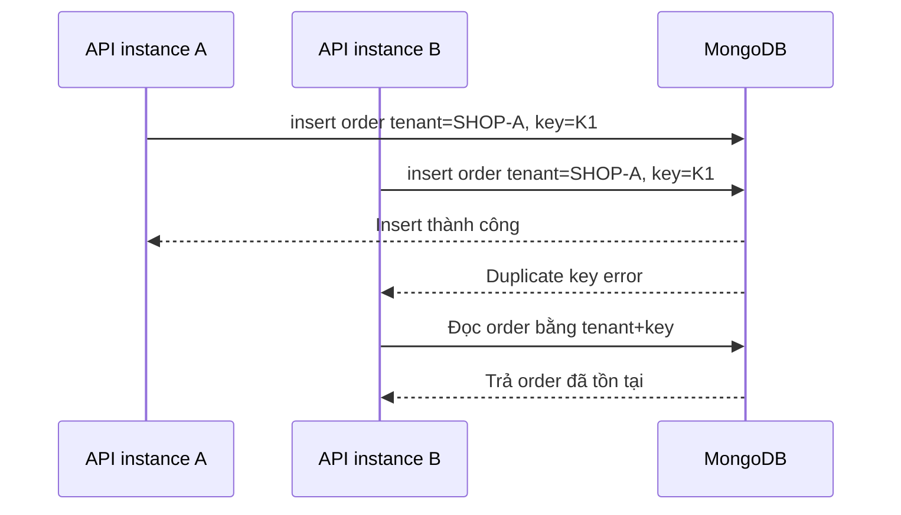
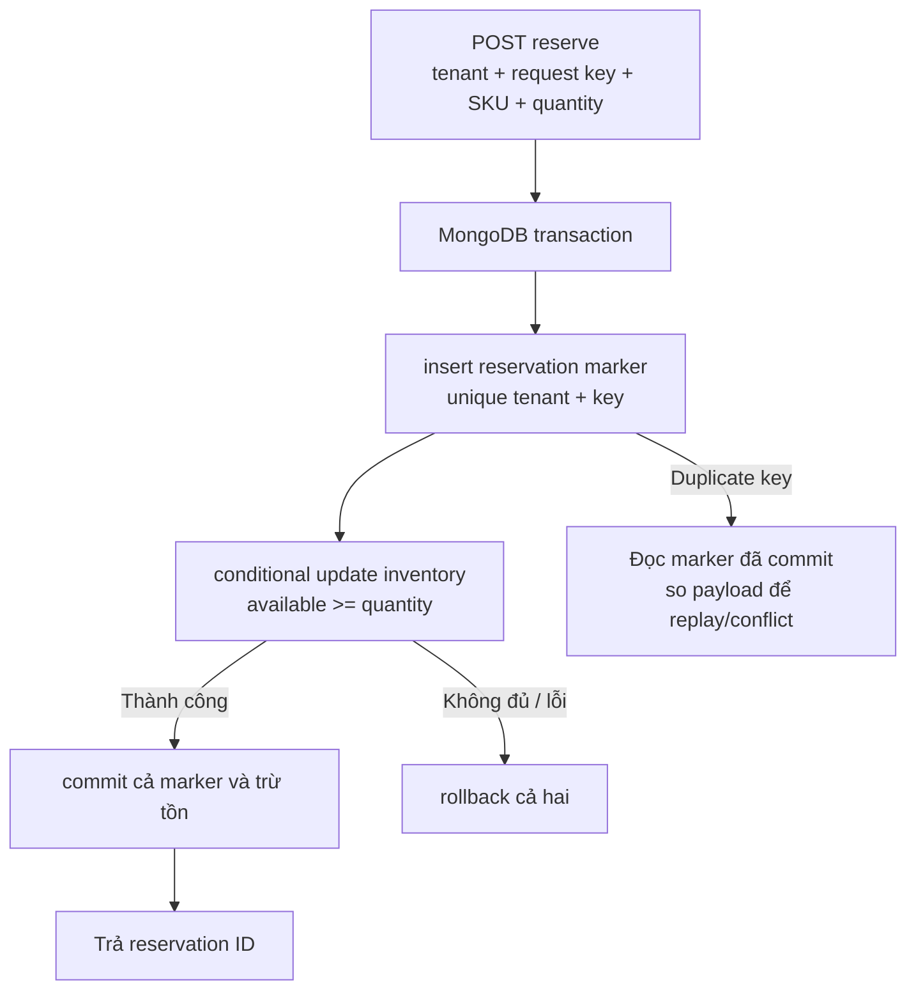
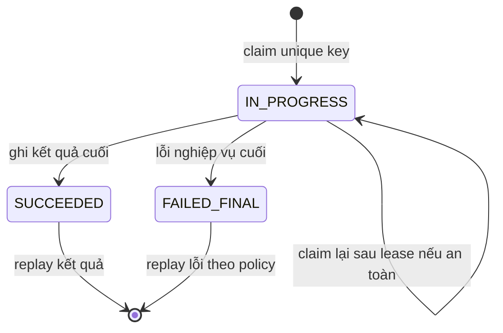
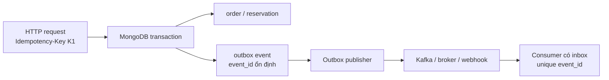

# Idempotency, unique index và yêu cầu ghi lặp

## 1. Vì sao một yêu cầu ghi có thể tới MongoDB nhiều lần?

Trong **Spring Data MongoDB**, một API tạo đơn hàng có thể được gọi nhiều lần dù người dùng chỉ bấm nút một lần. Client có thể mất mạng sau khi server đã ghi thành công, load balancer có thể retry, job xử lý message có thể chạy lại sau crash hoặc nhà cung cấp thanh toán có thể gửi lại webhook khi chưa nhận được xác nhận.

Ví dụ:

```text
Client                   API Spring Boot               MongoDB
  | POST /orders, key=K1       |                           |
  |--------------------------->| insert order ORD-101      |
  |                            |-------------------------->|
  |                            |       insert thành công    |
  |                            |<--------------------------|
  |         mất kết nối        X
  |                                                       |
  | POST /orders, key=K1                                  |
  |--------------------------->| ? Tạo đơn thứ hai hay trả  |
  |                            |   kết quả của đơn trước?   |
```

Nếu ứng dụng tạo một `_id` ngẫu nhiên mới ở mỗi lần gọi `insert` mà không có cơ chế nhận diện request lặp, có thể tồn tại **hai đơn hàng, hai lần trừ tồn kho hoặc hai lần tính phí**.

**Idempotency** là tính chất: gửi cùng một yêu cầu nghiệp vụ với cùng định danh lặp lại sẽ không tạo ra **tác dụng nghiệp vụ mới** sau lần áp dụng đầu tiên. Không nhất thiết mọi lần gọi đều trả lại cùng HTTP status hay cùng timestamp; hợp đồng API cần nói rõ kết quả nào được phát lại hoặc trả về.

### Những khái niệm không nên đánh đồng

| Khái niệm | Bảo đảm / ý nghĩa | Không bảo đảm |
| --- | --- | --- |
| **Atomicity một document** | Một thao tác MongoDB trên một document không để lộ cập nhật nửa chừng | Không ngăn *hai lần* `$inc` riêng biệt cùng thành công |
| **Unique index** | Ngăn lưu hai document vi phạm cùng khóa duy nhất | Không so sánh nội dung hai request; không ngăn một API gọi hệ thống ngoài hai lần |
| **Idempotency key** | Nhận diện cùng một *lần yêu cầu nghiệp vụ* | Chỉ có ý nghĩa khi được lưu và bảo vệ bằng ràng buộc/logic đúng |
| **Optimistic locking / CAS** | Chỉ update khi phiên bản/trạng thái kỳ vọng còn đúng | Không tự nhận ra hai request có cùng mục đích và payload |
| **Retryable writes của driver** | Hỗ trợ thử lại một số lệnh ghi theo cơ chế driver/session | Không bảo đảm retry toàn bộ HTTP request/job nhiều ngày sau chỉ chạy một lần |
| **Transaction** | Gom nhiều thao tác DB thành một commit/rollback theo điều kiện hỗ trợ | Không giao dịch nguyên tử với cổng thanh toán, email hoặc Kafka ở ngoài DB |
| **Outbox + consumer idempotent** | Hỗ trợ phát sự kiện đáng tin cậy qua ranh giới DB/message | Không tự biến mọi hệ thống bên ngoài thành exactly-once |

Trong hệ thống phân tán, thường thực tế hơn khi thiết kế **at-least-once delivery + idempotent effect** thay vì chỉ tuyên bố “exactly once”. Phải chỉ rõ **trong phạm vi nào** có thể chứng minh một tác dụng nghiệp vụ chỉ được áp dụng một lần.

### Mục tiêu của bài

Sau bài học, bạn có thể:

1. Định nghĩa idempotency key theo tenant và loại thao tác.
2. Dùng unique index của MongoDB làm hàng rào cạnh tranh giữa hai request cùng khóa.
3. Phân biệt `insert`, `save`, `upsert` và `$setOnInsert` khi nhận request lặp.
4. Dùng `MongoTemplate`/repository và xử lý `DuplicateKeyException` đúng ngữ nghĩa.
5. Bảo vệ thao tác không idempotent như `$inc` hoặc giữ tồn kho.
6. Hiểu ranh giới transaction, outbox, retry, TTL và kiểm thử đồng thời.

## 2. Xác định đúng “cùng một yêu cầu”

Không phải hai request có body giống nhau đều là một yêu cầu. Người dùng có thể **cố ý mua cùng một sản phẩm hai lần**. Ngược lại, một request retry có thể có header HTTP khác hoặc do một instance khác xử lý, nhưng vẫn cần được coi là cùng thao tác.

Một hợp đồng phổ biến:

```http
POST /api/orders
Idempotency-Key: 9c3c4dc2-5b11-4c4c-9d21-4141e579f881
Content-Type: application/json

{
  "sku": "BOOK-101",
  "quantity": 2,
  "amountMinor": 300000,
  "currency": "VND"
}
```

Trong ví dụ, client **tạo một key mới cho mỗi lần muốn đặt đơn mới** và **dùng lại key đó** khi retry cùng lần đặt đơn.

### Phạm vi định danh

Một request được nhận diện bằng tổ hợp phù hợp với hợp đồng:

\[
\text{requestIdentity}
=
(\text{tenantId},\ \text{operationType},\ \text{idempotencyKey})
\]

- `tenantId`: lấy từ ngữ cảnh đã xác thực, **không tin** một tenant tùy ý trong body.
- `operationType`: ví dụ `CREATE_ORDER`, `RESERVE_STOCK`, `REFUND_PAYMENT`. Có thể được ngầm xác định từ collection/endpoint nếu mỗi loại thao tác có kho khóa riêng.
- `idempotencyKey`: chuỗi đủ khó đoán, có giới hạn chiều dài, do client giữ ổn định cho lần retry.

Một người dùng tạo **đơn thứ hai có chủ đích** phải dùng key mới. Hai tenant có thể có cùng chuỗi key mà vẫn là hai request độc lập nếu scope được thiết kế theo tenant.

### Key trùng nhưng payload khác

| Lần gọi | Tenant | Key | SKU/quantity | Kết quả mong muốn |
| --- | --- | --- | --- | --- |
| Lần đầu | SHOP-A | K1 | BOOK-101 × 2 | Tạo một đơn |
| Retry | SHOP-A | K1 | BOOK-101 × 2 | Không tạo thêm; trả đơn cũ |
| Request sai | SHOP-A | K1 | BOOK-101 × 3 | **Conflict**: cùng key nhưng payload khác |
| Mua mới | SHOP-A | K2 | BOOK-101 × 2 | Có thể tạo đơn mới |
| Tenant khác | SHOP-B | K1 | BOOK-101 × 2 | Không bị khóa của SHOP-A chi phối |

Vì vậy **unique index trên key** chưa đủ cho hợp đồng API. Khi phát hiện key đã tồn tại, ứng dụng phải **đối chiếu dữ liệu nghiệp vụ bất biến** hoặc dấu vân tay payload (fingerprint) đã chuẩn hóa. Không được trả “thành công” cho request quantity 3 chỉ vì đã có đơn quantity 2 dùng cùng key.

### Fingerprint và chuẩn hóa input

Nếu payload lớn, có thể lưu `request_hash` (ví dụ SHA-256) của dữ liệu *đã chuẩn hóa*. Tập field cần hash phải được định nghĩa rõ: tenant/scope, operation, SKU, quantity, amount, currency, phiên bản schema, và các thuộc tính làm thay đổi tác dụng nghiệp vụ.

Hai JSON sau khác thứ tự key nhưng có thể mang cùng ý nghĩa:

```json
{"sku":"BOOK-101","quantity":2,"currency":"VND"}
{"currency":"VND","quantity":2,"sku":"BOOK-101"}
```

Nếu hash trực tiếp chuỗi JSON đầu vào, có thể cho ra hash khác nhau dù nội dung nghiệp vụ tương đương. Hãy chuẩn hóa biểu diễn có kiểu, thứ tự trường, format số và String; hoặc lưu và so sánh các field nghiệp vụ một cách tường minh.

**Không dùng hash như bằng chứng tuyệt đối rằng hai người dùng được phép truy cập cùng một dữ liệu.** Phân quyền và tenant vẫn phải được áp dụng khi đọc bản ghi theo idempotency key. Không log raw token, thông tin thanh toán hoặc payload bí mật chỉ để debug key trùng.

## 3. Unique index là hàng rào chống cạnh tranh

Giả sử hai instance Spring Boot cùng nhận `(SHOP-A, K1)`:



Ở MongoDB, ràng buộc duy nhất được thực thi **ngay trên thao tác ghi**, không cần ứng dụng khóa bộ nhớ hay thực hiện “find trước rồi insert”. Với collection `orders`:

```javascript
db.orders.createIndex(
  { tenant_id: 1, client_request_id: 1 },
  {
    unique: true,
    name: "orders_tenant_client_request_unique"
  }
)
```

Index này ngăn **hai document có cùng cặp** `(tenant_id, client_request_id)`. Cặp `(SHOP-A,K1)` và `(SHOP-B,K1)` là khác nhau.

### Vì sao `find` rồi `insert` là sai dưới cạnh tranh?

```java
// SAI nếu đây là cơ chế duy nhất chống trùng:
if (!orderRepository.existsByTenantIdAndClientRequestId(
        tenantId, key)) {
    orderRepository.save(newOrder);
}
```

Cả A và B đều có thể thấy “chưa tồn tại” rồi cùng insert. Trong đó `save(...)` cũng không tạo được tính nguyên tử giữa **lệnh đọc** và **lệnh ghi**. Nếu **không có unique index**, cả hai có thể ghi thành công.

Chính unique index khiến một lần ghi bị từ chối. Ứng dụng cần xử lý kết quả từ chối theo đúng hợp đồng idempotency.

### Những điều cần kiểm tra trước khi tạo index

- Collection hiện tại có **khóa trùng** không? Nếu có, tạo unique index sẽ thất bại cho tới khi xử lý.
- Field `tenant_id`/`client_request_id` có luôn tồn tại và đúng kiểu không? Unique index có semantics với giá trị null/missing; một compound unique index còn cho phép một số tổ hợp null/missing nhưng **không** cho phép hai document có cùng tuple đã index.
- Có chuẩn hóa `client_request_id` chưa? `"K1"` và `"k1"` thường khác nhau với collation mặc định; đừng tự giả định chúng là một.
- Có sharding không? Unique index trên sharded collection có **điều kiện liên quan đến shard key**, thường cần shard key làm prefix của unique index. Không tự tuyên bố uniqueness toàn cluster bằng một index không đáp ứng ràng buộc của phiên bản/shard design đang chạy.
- Một document có thêm unique index khác không? `DuplicateKeyException` có thể bắt nguồn từ **bất kỳ unique constraint** nào, không nhất thiết là idempotency key.

### `_id` có thể làm idempotency key không?

Có. Nếu nghiệp vụ đã có một ID ổn định được cấp trước khi retry và **không thay đổi** qua các lần gọi, dùng `_id` trực tiếp là giải pháp gọn vì MongoDB tạo unique index trên `_id` theo mặc định.

Tuy nhiên, nhiều API cần ID đơn hàng do server tạo và idempotency key do client cấp. Khi đó nên lưu **hai giá trị**: `_id` kỹ thuật của order và unique key nghiệp vụ `(tenant_id, client_request_id)`.

## 4. Bài toán thực hành: tạo đơn một lần, retry không tạo thêm

Ta sử dụng collection `orders` với schema:

```javascript
{
  _id: "ORD-2026-0001",
  tenant_id: "SHOP-A",
  client_request_id: "K1",
  sku: "BOOK-101",
  quantity: NumberLong("2"),
  amount_minor: NumberLong("300000"),
  currency: "VND",
  status: "CREATED",
  created_at: ISODate("2026-11-20T07:00:00Z")
}
```

Trong demo, một order chỉ có một SKU để dễ quan sát tính lặp. Hệ thống thật có thể có nhiều line items, giá, giảm giá, thuế và trạng thái thanh toán; khi mở rộng phải xác định rõ những field nào là **payload của yêu cầu tạo đơn bất biến** để so sánh khi key trùng.

Khởi tạo unique index trên collection demo:

```javascript
use idempotency_demo

db.orders.createIndex(
  { tenant_id: 1, client_request_id: 1 },
  {
    unique: true,
    name: "orders_tenant_client_request_unique"
  }
)
```

Chỉ thực hành trên database demo hoặc test cô lập. Index trên dữ liệu đang tồn tại cần kế hoạch migration và phát hiện bản ghi trùng; không tự chạy các câu lệnh tạo/xóa index tùy tiện trên production.

### Bảng dự kiến khi request lặp

| Tình huống | Tác dụng ghi | Kết quả API gợi ý |
| --- | --- | --- |
| Key K1 chưa tồn tại | Chèn một order mới | `201 Created` |
| Retry K1, cùng payload | Không chèn thêm | `200 OK` (hoặc phát lại response theo hợp đồng) |
| Retry K1, khác payload | Không chèn thêm | `409 Conflict` |
| Hai instance cùng K1 | **Một insert thắng** nhờ unique index | Một kết quả tạo mới, một kết quả phát lại |
| MongoDB không chắc đã commit do timeout | Không được kết luận là thất bại | Tra cứu/reconcile theo key |

Các HTTP status chỉ là **một hợp đồng minh họa**, không phải MongoDB tự trả. Nếu dùng Spring MVC/WebFlux, tầng controller quyết định status và error body.

## 5. Spring Data MongoDB: entity, unique index và service idempotent

Ví dụ dùng Java 17+, Spring Boot 3.x, `spring-boot-starter-data-mongodb` và `MongoTemplate`. Nguồn dữ liệu được ánh xạ bằng entity với tên BSON rõ ràng.

### 5.1. Entity `OrderDocument`

```java
package com.example.orders;

import java.time.Instant;
import org.springframework.data.mongodb.core.mapping.Document;
import org.springframework.data.mongodb.core.mapping.Field;
import org.springframework.data.mongodb.core.mapping.FieldType;
import org.springframework.data.mongodb.core.mapping.MongoId;

@Document(collection = "orders")
public class OrderDocument {

    @MongoId(FieldType.STRING)
    private String id;

    @Field("tenant_id")
    private String tenantId;

    @Field("client_request_id")
    private String clientRequestId;

    private String sku;
    private long quantity;

    @Field("amount_minor")
    private long amountMinor;

    private String currency;
    private String status;

    @Field("created_at")
    private Instant createdAt;

    protected OrderDocument() {}

    public OrderDocument(
            String id, String tenantId, String clientRequestId,
            String sku, long quantity, long amountMinor,
            String currency, String status, Instant createdAt) {
        this.id = id;
        this.tenantId = tenantId;
        this.clientRequestId = clientRequestId;
        this.sku = sku;
        this.quantity = quantity;
        this.amountMinor = amountMinor;
        this.currency = currency;
        this.status = status;
        this.createdAt = createdAt;
    }

    public String getId() { return id; }
    public String getTenantId() { return tenantId; }
    public String getClientRequestId() { return clientRequestId; }
    public String getSku() { return sku; }
    public long getQuantity() { return quantity; }
    public long getAmountMinor() { return amountMinor; }
    public String getCurrency() { return currency; }
    public String getStatus() { return status; }
    public Instant getCreatedAt() { return createdAt; }
}
```

Đối với tiền tệ, sử dụng số nguyên `long` theo **đơn vị nhỏ nhất** giúp tránh một số sai số của `double`. Nhưng ứng dụng thật phải kiểm tra giá, đơn vị tiền, giới hạn số và discount/tax ở **phía server**, không tin hoàn toàn giá trong request.

### 5.2. Tạo unique index qua `IndexOperations`

`@Indexed`/`@CompoundIndex` có thể khai báo index, nhưng Spring Data MongoDB không tự bảo đảm mọi index annotation được tạo ở production. Ví dụ sau chủ động dùng `MongoTemplate.indexOps` trong **migration hoặc bước setup**, không chạy trong mỗi HTTP request:

```java
import org.springframework.data.domain.Sort;
import org.springframework.data.mongodb.core.index.Index;

Index requestKeyIndex = new Index()
    .on("tenantId", Sort.Direction.ASC)
    .on("clientRequestId", Sort.Direction.ASC)
    .unique()
    .named("orders_tenant_client_request_unique");

mongoTemplate.indexOps(OrderDocument.class)
    .ensureIndex(requestKeyIndex);
```

Khi `indexOps(OrderDocument.class)` biết metadata entity, các property `tenantId` và `clientRequestId` sẽ được mapping sang `tenant_id` và `client_request_id`. Kiểm tra metadata thật trong `mongosh`:

```javascript
db.orders.getIndexes()
```

Cần thấy `key: {tenant_id: 1, client_request_id: 1}` và `unique: true`. `ensureIndex` được dùng trong nhiều phiên bản Spring Data MongoDB; các nhánh mới có `createIndex`. Chọn API theo phiên bản thực tế và quản lý schema bằng migration được kiểm soát.

**Bước này phải hoàn tất trước khi ứng dụng chấp nhận ghi đồng thời.** Nếu chưa có unique index, logic bắt `DuplicateKeyException` không thể ngăn hai insert thành công.

### 5.3. Kiểu input và kết quả

```java
package com.example.orders;

public record CreateOrderCommand(
    String sku,
    long quantity,
    long amountMinor,
    String currency
) {}
```

```java
package com.example.orders;

public record CreateOrderResult(
    OrderDocument order,
    boolean replayed
) {}
```

Trong demo, kết quả `replayed = true` nghĩa là MongoDB đã có order tương ứng key từ trước; không được hiểu là một **thao tác thanh toán bên ngoài** cũng đã được thực hiện hoặc đối soát an toàn.

### 5.4. Service: để unique index phân xử insert tranh chấp

```java
package com.example.orders;

import java.time.Clock;
import java.util.Objects;
import java.util.UUID;
import org.springframework.dao.DuplicateKeyException;
import org.springframework.data.mongodb.core.MongoTemplate;
import org.springframework.data.mongodb.core.query.Criteria;
import org.springframework.data.mongodb.core.query.Query;
import org.springframework.stereotype.Service;

@Service
public class IdempotentOrderCreationService {

    private final MongoTemplate template;
    private final Clock clock;

    public IdempotentOrderCreationService(
            MongoTemplate template, Clock clock) {
        this.template = template;
        this.clock = clock;
    }

    public CreateOrderResult create(
            String authorizedTenantId,
            String idempotencyKey,
            CreateOrderCommand request) {

        validate(authorizedTenantId, idempotencyKey, request);

        OrderDocument candidate = new OrderDocument(
            UUID.randomUUID().toString(),
            authorizedTenantId,
            idempotencyKey,
            request.sku(),
            request.quantity(),
            request.amountMinor(),
            request.currency(),
            "CREATED",
            clock.instant()
        );

        try {
            OrderDocument inserted = template.insert(candidate);
            return new CreateOrderResult(inserted, false);
        } catch (DuplicateKeyException duplicate) {
            // Index unique quyết định insert nào thắng.
            Query byRequest = Query.query(
                Criteria.where("tenantId").is(authorizedTenantId)
                    .and("clientRequestId").is(idempotencyKey)
            );

            OrderDocument existing = template.findOne(
                byRequest, OrderDocument.class);

            // Duplicate có thể phát sinh từ một unique index KHÁC
            // hoặc chưa đọc được outcome ở thời điểm này.
            if (existing == null) {
                throw duplicate;
            }

            if (!sameImmutableRequest(existing, request)) {
                throw new IdempotencyConflictException(
                    "Idempotency-Key đã dùng với nội dung khác");
            }

            return new CreateOrderResult(existing, true);
        }
    }

    private static boolean sameImmutableRequest(
            OrderDocument existing, CreateOrderCommand request) {
        return Objects.equals(existing.getSku(), request.sku())
            && existing.getQuantity() == request.quantity()
            && existing.getAmountMinor() == request.amountMinor()
            && Objects.equals(
                existing.getCurrency(), request.currency());
    }

    private static void validate(
            String tenantId, String key, CreateOrderCommand request) {
        if (tenantId == null || tenantId.isBlank()
                || key == null || key.isBlank()
                || key.length() > 128
                || request == null
                || request.sku() == null
                || request.sku().isBlank()
                || request.quantity() <= 0
                || request.amountMinor() < 0
                || !Objects.equals(request.currency(), "VND")) {
            throw new IllegalArgumentException(
                "Yêu cầu tạo đơn không hợp lệ");
        }
    }
}
```

Exception nghiệp vụ:

```java
package com.example.orders;

public class IdempotencyConflictException
        extends RuntimeException {
    public IdempotencyConflictException(String message) {
        super(message);
    }
}
```

Khi tích hợp controller, có thể ánh xạ `IdempotencyConflictException` thành `409 Conflict`, và phân biệt lỗi không biết kết quả với lỗi validation. **Không được đổi mọi `DuplicateKeyException` thành 200 OK**; unique constraint khác (ví dụ một mã đơn hàng do hệ thống cấp) có thể gây lỗi dù không có bản ghi theo key hiện tại.

### 5.5. Tại sao gọi `insert` thay vì `save`?

`insert` biểu diễn ý định **chỉ tạo document mới**. `save` có thể thay thế/cập nhật document đã tồn tại với cùng `_id`; nếu request lặp dùng lại ID nhưng payload khác, `save` có thể ghi đè dữ liệu cũ. Việc sử dụng một key duy nhất và `insert` với unique constraint khiến ứng dụng phải **xử lý xung đột một cách tường minh**.

Trong service minh họa, `UUID.randomUUID()` được dùng để tạo một ID kỹ thuật mới, nhưng uniqueness của request **không phụ thuộc** ID đó — nó phụ thuộc index duy nhất cho cặp `(tenant_id, client_request_id)`. Hai instance có ID khác nhau nhưng cùng key sẽ không thể lưu hai document nếu index đã tồn tại và có hiệu lực.

### 5.6. Những giới hạn của service tạo đơn

Service trên chỉ thực thi **một tác dụng nghiệp vụ trong một document**: tạo một order chứa toàn bộ dữ liệu bất biến của lệnh tạo. Nó chưa trừ tồn kho, chưa thu tiền, chưa gửi email hoặc publish event.

Nếu một lần gọi thành công `insert` rồi code **gọi cổng thanh toán** trước khi trả HTTP response, một lần retry có thể bỏ qua insert nhưng hệ thống vẫn có nguy cơ gửi thanh toán lặp nếu luồng thiết kế sai. Để giữ nhiều document nhất quán hoặc phát event bên ngoài, cần transaction/outbox hay quy trình bù và consumer idempotent — không thể chỉ trông chờ index duy nhất của order.

Ngoài ra, khi retry đọc order hiện tại, `status` có thể đã từ `CREATED` sang `PAID`. Nếu API yêu cầu trả **chính xác response của lần đầu** thay vì trạng thái hiện tại, phải lưu snapshot/response theo hợp đồng idempotency; service này chỉ cam kết **không tạo thêm order**.

## 6. Upsert với `$setOnInsert`: tránh ghi đè, nhưng chưa đủ

Trong một số bài toán “tạo nếu chưa tồn tại”, MongoDB hỗ trợ **upsert**: nếu filter tìm được document thì update; nếu không tìm được thì insert. Với request lặp, `$setOnInsert` hữu ích vì chỉ thiết lập các field khi **document mới được tạo**, không thay đổi chúng trên các lần gọi khớp document cũ.

Ví dụ qua Spring Data MongoDB:

```java
import java.util.UUID;
import java.time.Instant;
import com.mongodb.client.result.UpdateResult;
import org.springframework.data.mongodb.core.query.Criteria;
import org.springframework.data.mongodb.core.query.Query;
import org.springframework.data.mongodb.core.query.Update;

Query byKey = Query.query(
    Criteria.where("tenantId").is(authorizedTenantId)
        .and("clientRequestId").is(idempotencyKey)
);

Update onCreate = new Update()
    .setOnInsert("id", UUID.randomUUID().toString())
    .setOnInsert("sku", request.sku())
    .setOnInsert("quantity", request.quantity())
    .setOnInsert("amountMinor", request.amountMinor())
    .setOnInsert("currency", request.currency())
    .setOnInsert("status", "CREATED")
    .setOnInsert("createdAt", Instant.now());

UpdateResult result =
    mongoTemplate.upsert(byKey, onCreate, OrderDocument.class);
```

Đoạn code nằm trong một component có các biến `authorizedTenantId`, `idempotencyKey`, `request`, `mongoTemplate` đã được cung cấp. Equality filter theo cặp tenant/key và unique index của mục 3 là điều kiện quan trọng.

Nếu document khớp đã tồn tại, những field `$setOnInsert` không bị sửa. Khi tạo mới, MongoDB có thể lấy các equality field từ filter cùng `$setOnInsert` để dựng document. `getUpsertedId()` và `getMatchedCount()` phân biệt một upsert đã tạo mới với update khớp document có sẵn trong kết quả đã xác nhận.

**Nhưng upsert chưa tự hoàn thành hợp đồng idempotency**:

- Hai upsert chạy cạnh tranh vẫn có thể dẫn tới `DuplicateKeyException` nếu không đáp ứng đầy đủ các điều kiện MongoDB cho upsert đồng thời.
- Một request cùng key nhưng `quantity` khác có thể khớp document cũ mà **không bị từ chối**. Ứng dụng cần đọc lại và so sánh payload/fingerprint.
- Nếu filter có những điều kiện ngoài khóa định danh mà không còn đúng, upsert có thể **cố insert một document khác**, thậm chí vấp duplicate key.
- Bất kỳ `$set` hoặc `$inc` cùng nằm trong update đều có thể chạy khi document đã tồn tại; không nên vô ý dùng chúng cho field chỉ được phép ghi một lần.

### Không upsert khi chuyển trạng thái

```javascript
// SAI cho logic "chỉ thanh toán đơn đang CREATED":
db.orders.updateOne(
  {
    _id: "ORD-001",
    status: "CREATED"
  },
  { $set: { status: "PAID" } },
  { upsert: true }
)
```

Nếu order đã ở trạng thái `PAID` hoặc `CANCELLED`, filter không khớp và upsert có thể cố tạo document mới hoặc nhận duplicate key — **không phải** kết quả chuyển trạng thái mong muốn. Đối với transition, dùng **update không upsert** và xử lý trường hợp không khớp như một nhánh nghiệp vụ.

## 7. CAS cho chuyển trạng thái: idempotent theo event đã áp dụng

**Compare-and-set (CAS)** nghĩa là: chỉ ghi giá trị mới khi giá trị cũ còn đúng như kỳ vọng. Giả sử chỉ cho phép đơn hàng chuyển `CREATED → PAID` đúng một lần, theo một `payment_event_id` do hệ thống thanh toán cung cấp.

```javascript
db.orders.updateOne(
  {
    _id: "ORD-001",
    tenant_id: "SHOP-A",
    status: "CREATED"
  },
  {
    $set: {
      status: "PAID",
      payment_event_id: "PAY-EVENT-5001",
      paid_at: ISODate("2026-11-20T09:00:00Z")
    }
  }
)
```

Nếu hai request đồng thời cùng chuyển một order từ `CREATED` sang `PAID`, chỉ một thao tác có thể thắng điều kiện `status = CREATED` trên document đó. Các update này là **atomic theo một document**.

Với `MongoTemplate`:

```java
import java.time.Instant;
import com.mongodb.client.result.UpdateResult;
import org.springframework.data.mongodb.core.query.Criteria;
import org.springframework.data.mongodb.core.query.Query;
import org.springframework.data.mongodb.core.query.Update;

Query expected = Query.query(
    Criteria.where("id").is(orderId)
        .and("tenantId").is(authorizedTenantId)
        .and("status").is("CREATED")
);

Update paymentChange = new Update()
    .set("status", "PAID")
    // Tên BSON tường minh khi entity chưa khai báo property này.
    .set("payment_event_id", paymentEventId)
    .set("paid_at", Instant.now());

UpdateResult changed = mongoTemplate.updateFirst(
    expected, paymentChange, OrderDocument.class);

boolean changedThisTime = changed.getModifiedCount() == 1;
```

Ví dụ này cố ý dùng hai tên BSON `payment_event_id`/`paid_at` vì `OrderDocument` trong mục 5 chưa khai báo mapping cho chúng. Trong ứng dụng hoàn chỉnh, nên bổ sung property Java cùng `@Field` thích hợp và dùng tên property tương ứng, rồi kiểm tra BSON thực tế.

### `matchedCount = 0` không có một ý nghĩa duy nhất

Một lần retry nhận `modifiedCount = 0` hay `matchedCount = 0` **không đủ** để kết luận lần trước đã thành công. Có thể:

- Lần trước **đã** chuyển sang `PAID` với **cùng payment event**.
- Một payment event khác đã chuyển đơn sang `PAID`.
- Đơn đã bị chuyển sang `CANCELLED` bởi một request cạnh tranh.
- Order không tồn tại hoặc người gọi không có quyền trên tenant.

Muốn idempotent **theo event**, sau khi update không khớp cần kiểm tra trạng thái hiện tại **và định danh event đã được ghi**. Chỉ coi đó là “đã xử lý đúng request này” nếu event ID trùng và các bất biến nghiệp vụ cũng hợp lệ. Nếu event khác đã thắng hoặc trạng thái không cho phép, phải áp chính sách xung đột/đối soát phù hợp.

### CAS bằng version

Với entity có `@Version`, Spring Data MongoDB hỗ trợ optimistic locking qua các API thích hợp như repository `save`. Nhưng **không suy ra** mọi raw update hoặc bulk update sẽ tự áp `@Version` đúng như `save`. Nếu dùng `MongoTemplate.updateFirst` và cần kiểm tra version, hãy đưa expected version vào filter, quản lý cách tăng version và kiểm thử với phiên bản Spring Data thực tế.

```javascript
// Ví dụ CAS tường minh trong mongosh:
db.orders.updateOne(
  { _id: "ORD-001", version: NumberLong("7") },
  {
    $set: { status: "PAID" },
    $inc: { version: NumberLong("1") }
  }
)
```

Nếu version đã đổi, update không khớp. Đừng retry một cập nhật đã lỗi version bằng cách tự động bỏ điều kiện version; như vậy sẽ phá vỡ mục đích chống ghi đè cạnh tranh.

## 8. Giữ tồn kho: `$inc` nguyên tử nhưng phải chống request lặp

Giả sử document tồn kho:

```javascript
{
  _id: "SHOP-A:BOOK-101",
  tenant_id: "SHOP-A",
  sku: "BOOK-101",
  available: NumberLong("10"),
  reserved: NumberLong("0"),
  applied_request_ids: []
}
```

Lệnh giảm `available` 2 đơn vị có điều kiện tồn kho đủ:

```javascript
db.inventory.updateOne(
  {
    _id: "SHOP-A:BOOK-101",
    tenant_id: "SHOP-A",
    available: { $gte: NumberLong("2") }
  },
  {
    $inc: {
      available: NumberLong("-2"),
      reserved: NumberLong("2")
    }
  }
)
```

Mỗi lần gọi chỉ thành công khi `available >= 2`, nên không làm tồn âm. **Nhưng hai lần retry vẫn có thể giữ hàng hai lần** khi còn đủ tồn:

```text
Trước request:  available=10, reserved=0
Lần thứ nhất:   available=8,  reserved=2
Retry cùng key: available=6,  reserved=4
```

### 8.1. Ghi dấu request trong cùng một document

Nếu chỉ có một lượng **nhỏ và có giới hạn** request cần ghi dấu, có thể dùng array `applied_request_ids`. MongoDB cho phép điều kiện “chưa có key” và thao tác trừ tồn + ghi dấu trong **một lệnh atomic trên document**:

```javascript
db.inventory.updateOne(
  {
    _id: "SHOP-A:BOOK-101",
    tenant_id: "SHOP-A",
    available: { $gte: NumberLong("2") },
    applied_request_ids: { $ne: "RESERVATION-K1" }
  },
  {
    $inc: {
      available: NumberLong("-2"),
      reserved: NumberLong("2")
    },
    $addToSet: {
      applied_request_ids: "RESERVATION-K1"
    }
  }
)
```

Lần đầu thành công sẽ giảm tồn và ghi dấu `RESERVATION-K1`. Lần retry dùng lại key không khớp `$ne`, nên **không giảm tồn lần nữa**.

Qua Spring Data MongoDB:

```java
import com.mongodb.client.result.UpdateResult;
import org.springframework.data.mongodb.core.query.Criteria;
import org.springframework.data.mongodb.core.query.Query;
import org.springframework.data.mongodb.core.query.Update;

// Validate quantity > 0 và requestId trước khi tạo query.
Query eligible = Query.query(
    Criteria.where("id").is(inventoryId)
        .and("tenantId").is(authorizedTenantId)
        .and("available").gte(quantity)
        .and("appliedRequestIds").ne(requestId)
);

Update reserve = new Update()
    .inc("available", -quantity)
    .inc("reserved", quantity)
    .addToSet("appliedRequestIds", requestId);

UpdateResult result = mongoTemplate.updateFirst(
    eligible, reserve, InventoryDocument.class);
```

`InventoryDocument` là entity tương ứng với collection `inventory`, có mapping `@Field("applied_request_ids")` cho property `appliedRequestIds`. Đoạn trên minh họa biểu thức query/update chứ không phải class chạy độc lập; `quantity` phải là `long` dương trong phạm vi nghiệp vụ.

**Giới hạn rất quan trọng:** array dấu request tăng theo số lần giữ hàng; document MongoDB có giới hạn kích thước BSON (thường 16 MiB). Với một SKU có hàng triệu lượt giữ hàng, mô hình array này **không phù hợp**. Nếu xóa dấu request quá sớm, một retry muộn có thể lại giảm tồn. Thực tế thường cần **collection ledger riêng với unique index** và transaction hoặc cơ chế nhất quán khác.

### 8.2. Phân biệt request lặp với hết tồn kho

Nếu `matchedCount = 0`, có thể do:

1. Request ID đã được áp dụng.
2. Tồn kho không đủ.
3. SKU không tồn tại.
4. Tenant không khớp hoặc request không có quyền.

Không trả ngay “hết hàng” cho mọi trường hợp. Khi cần trả kết quả nghiệp vụ chính xác, đọc trạng thái theo quyền truy cập và kiểm tra dấu idempotency; cần hiểu rằng một lần đọc sau đó cũng có thể chứng kiến **trạng thái đã đổi** bởi request khác.

### 8.3. Khi cần hai document

Một đơn hàng có thể giữ tồn của **nhiều SKU ở nhiều document** và tạo reservation record riêng. Cập nhật mỗi SKU bằng lệnh atomic không khiến **toàn bộ đơn hàng** nguyên tử. Để bảo đảm “hoặc cùng giữ đủ các SKU, hoặc không giữ gì”, cần transaction nhiều document khi hạ tầng hỗ trợ, hoặc saga/compensation được thiết kế rõ.

## 9. Idempotency ledger + transaction nhiều document

Khi không thể lưu hàng nghìn request ID trên từng document tồn kho, có thể tạo collection `stock_reservations` làm **sổ ghi nhận request đã áp dụng**. Mỗi reservation có unique key `(tenant_id, client_request_id)`.

Luồng mong muốn:



Unique index ngăn hai marker có cùng request key. Transaction giúp **không có trạng thái marker đã commit nhưng trừ tồn thất bại** hoặc trừ tồn đã commit mà marker chưa được ghi, với điều kiện **cả hai thao tác thực sự tham gia cùng transaction**.

### 9.1. Tạo collection và index

```javascript
db.stock_reservations.createIndex(
  { tenant_id: 1, client_request_id: 1 },
  {
    unique: true,
    name: "reservations_tenant_request_unique"
  }
)

db.inventory.insertOne({
  _id: "SHOP-A:BOOK-101",
  tenant_id: "SHOP-A",
  sku: "BOOK-101",
  available: NumberLong("10"),
  reserved: NumberLong("0")
})
```

Lệnh `insertOne` chỉ để chuẩn bị database demo **trống**; chạy lại với cùng `_id` sẽ nhận duplicate key. Trong production phải dùng migration/seed phù hợp và kiểm soát quyền.

### 9.2. Entity cho ledger và tồn kho

```java
package com.example.inventory;

import java.time.Instant;
import org.springframework.data.mongodb.core.mapping.Document;
import org.springframework.data.mongodb.core.mapping.Field;
import org.springframework.data.mongodb.core.mapping.FieldType;
import org.springframework.data.mongodb.core.mapping.MongoId;

@Document(collection = "stock_reservations")
public class StockReservation {
    @MongoId(FieldType.STRING)
    private String id;

    @Field("tenant_id")
    private String tenantId;

    @Field("client_request_id")
    private String clientRequestId;

    private String sku;
    private long quantity;

    @Field("created_at")
    private Instant createdAt;

    protected StockReservation() {}

    public StockReservation(
            String id, String tenantId, String clientRequestId,
            String sku, long quantity, Instant createdAt) {
        this.id = id;
        this.tenantId = tenantId;
        this.clientRequestId = clientRequestId;
        this.sku = sku;
        this.quantity = quantity;
        this.createdAt = createdAt;
    }

    public String getId() { return id; }
    public String getTenantId() { return tenantId; }
    public String getClientRequestId() { return clientRequestId; }
    public String getSku() { return sku; }
    public long getQuantity() { return quantity; }
    public Instant getCreatedAt() { return createdAt; }
}
```

```java
package com.example.inventory;

import org.springframework.data.mongodb.core.mapping.Document;
import org.springframework.data.mongodb.core.mapping.Field;
import org.springframework.data.mongodb.core.mapping.FieldType;
import org.springframework.data.mongodb.core.mapping.MongoId;

@Document(collection = "inventory")
public class InventoryDocument {
    @MongoId(FieldType.STRING)
    private String id;

    @Field("tenant_id")
    private String tenantId;

    private String sku;
    private long available;
    private long reserved;

    protected InventoryDocument() {}

    public String getId() { return id; }
    public String getTenantId() { return tenantId; }
    public String getSku() { return sku; }
    public long getAvailable() { return available; }
    public long getReserved() { return reserved; }
}
```

Trong mã thực tế, cần thêm chính sách chuẩn hóa SKU, kiểm tra tên tenant, giới hạn số lượng, số tồn ban đầu và các bất biến tổng tồn. Demo dùng ID `tenantId + ":" + sku`; các giá trị từ client phải được xác thực/chuẩn hóa để **không tạo va chạm delimiter**.

### 9.3. Cấu hình transaction manager

MongoDB multi-document transaction yêu cầu hạ tầng tương thích, thường là **replica set hoặc sharded cluster**. Một MongoDB standalone mặc định không đáp ứng bài test transaction này.

```java
package com.example.inventory;

import org.springframework.context.annotation.Bean;
import org.springframework.context.annotation.Configuration;
import org.springframework.data.mongodb.MongoDatabaseFactory;
import org.springframework.data.mongodb.MongoTransactionManager;

@Configuration
public class MongoTransactionConfiguration {

    @Bean
    MongoTransactionManager transactionManager(
            MongoDatabaseFactory factory) {
        return new MongoTransactionManager(factory);
    }
}
```

Spring transaction manager này áp dụng cho các thao tác MongoDB **đồng bộ** trong cùng transaction context. Với reactive MongoDB, dùng quản lý transaction reactive thích hợp, **không** tự áp `MongoTransactionManager` này vào `ReactiveMongoTemplate`.

### 9.4. Service thực hiện hai thao tác trong cùng transaction

```java
package com.example.inventory;

import java.time.Clock;
import java.util.UUID;
import com.mongodb.client.result.UpdateResult;
import org.springframework.data.mongodb.core.MongoTemplate;
import org.springframework.data.mongodb.core.query.Criteria;
import org.springframework.data.mongodb.core.query.Query;
import org.springframework.data.mongodb.core.query.Update;
import org.springframework.stereotype.Service;
import org.springframework.transaction.annotation.Transactional;

@Service
public class ReservationTransactionService {

    private final MongoTemplate template;
    private final Clock clock;

    public ReservationTransactionService(
            MongoTemplate template, Clock clock) {
        this.template = template;
        this.clock = clock;
    }

    @Transactional
    public StockReservation reserveInTransaction(
            String authorizedTenantId,
            String idempotencyKey,
            String sku,
            long quantity) {

        if (authorizedTenantId == null
                || authorizedTenantId.isBlank()
                || idempotencyKey == null
                || idempotencyKey.isBlank()
                || sku == null || sku.isBlank()
                || sku.contains(":")
                || quantity <= 0) {
            throw new IllegalArgumentException(
                "Yêu cầu giữ kho không hợp lệ");
        }

        StockReservation marker = new StockReservation(
            UUID.randomUUID().toString(),
            authorizedTenantId,
            idempotencyKey,
            sku,
            quantity,
            clock.instant()
        );

        // Ghi dấu yêu cầu, unique index cấm ghi trùng key.
        template.insert(marker);

        Query eligibleStock = Query.query(
            Criteria.where("id").is(
                    authorizedTenantId + ":" + sku)
                .and("tenantId").is(authorizedTenantId)
                .and("available").gte(quantity)
        );

        Update takeStock = new Update()
            .inc("available", -quantity)
            .inc("reserved", quantity);

        UpdateResult result = template.updateFirst(
            eligibleStock, takeStock, InventoryDocument.class);

        if (result.getModifiedCount() != 1) {
            // Exception runtime => rollback transaction.
            throw new StockUnavailableException(
                "Không đủ tồn kho hoặc SKU không tồn tại");
        }

        return marker;
    }
}
```

```java
package com.example.inventory;

public class StockUnavailableException
        extends RuntimeException {
    public StockUnavailableException(String message) {
        super(message);
    }
}
```

**Điều kiện để ví dụ đúng:** cả `template.insert(marker)` và `template.updateFirst(...)` phải tham gia đúng transaction đang hoạt động. Nếu update không đủ tồn, exception runtime khiến transaction rollback, nên **không để lại marker được commit**. Với request giữ một SKU, transaction này cung cấp một ranh giới nhất quán hơn hai lệnh độc lập.

### 9.5. Bắt duplicate ở **ngoài** ranh giới transaction

Không nên bắt `DuplicateKeyException` bên trong method `@Transactional` rồi tiếp tục gửi thêm lệnh MongoDB như thể transaction vẫn lành mạnh. Một lỗi ghi có thể khiến transaction phải abort; tình huống rollback/commit cần được quản lý rõ.

Đặt một facade khác gọi method qua **Spring proxy**, bắt lỗi sau khi transaction method đã kết thúc và đọc lại marker:

```java
package com.example.inventory;

import java.util.Objects;
import org.springframework.dao.DuplicateKeyException;
import org.springframework.data.mongodb.core.MongoTemplate;
import org.springframework.data.mongodb.core.query.Criteria;
import org.springframework.data.mongodb.core.query.Query;
import org.springframework.stereotype.Service;

@Service
public class ReservationFacade {

    private final ReservationTransactionService transactions;
    private final MongoTemplate template;

    public ReservationFacade(
            ReservationTransactionService transactions,
            MongoTemplate template) {
        this.transactions = transactions;
        this.template = template;
    }

    public StockReservation reserveOnce(
            String authorizedTenantId,
            String key, String sku, long quantity) {

        try {
            return transactions.reserveInTransaction(
                authorizedTenantId, key, sku, quantity);
        } catch (DuplicateKeyException duplicate) {
            StockReservation prior = template.findOne(
                Query.query(
                    Criteria.where("tenantId")
                        .is(authorizedTenantId)
                        .and("clientRequestId").is(key)),
                StockReservation.class
            );

            if (prior == null) {
                // Duplicate có thể từ unique index khác hoặc
                // outcome chưa đọc được.
                throw duplicate;
            }

            if (!Objects.equals(prior.getSku(), sku)
                    || prior.getQuantity() != quantity) {
                throw new IllegalArgumentException(
                    "Idempotency key trùng với payload khác");
            }

            return prior;
        }
    }
}
```

Mẫu này **không tự xử lý toàn bộ lỗi transaction tạm thời**. Dưới cạnh tranh, MongoDB có thể trả write conflict hoặc nhãn `TransientTransactionError`; ứng dụng cần retry **toàn bộ transaction** có giới hạn và backoff, rồi kiểm tra idempotency key khi kết quả commit không rõ. Không được tự bắt mọi exception thành “request đã xử lý” hoặc chuyển `DuplicateKeyException` thành thành công nếu marker/payload không khớp.

### 9.6. Ý nghĩa của request thất bại do hết hàng

Trong thiết kế trên, nếu không đủ hàng, transaction rollback **cả reservation marker**. Một retry sau khi kho được bổ sung có thể **thành công**, dù dùng cùng key. Nếu API yêu cầu “cùng request phải luôn phát lại kết quả thất bại ban đầu”, cần thiết kế ledger lưu outcome thất bại **bền vững** và quy tắc retry/TTL phù hợp; không thể vừa rollback marker vừa hứa phát lại lỗi mãi mãi.

Một thiết kế khác là lưu trạng thái `PENDING`, `SUCCEEDED`, `FAILED` trong idempotency record, nhưng phải định nghĩa rõ **khi nào ghi outcome cuối**, chính sách claim lại request bị crash và tác dụng phụ trong thời gian `PENDING`. Đừng thêm status mà mặc định các trạng thái đó tự giải quyết được consistency.

## 10. Nhận diện request đang xử lý dở

Các yêu cầu nhiều bước (gọi provider, tạo tài nguyên ngoài MongoDB, chuẩn bị hóa đơn...) thường không thể commit toàn bộ trong một transaction database. Khi đó có thể dùng collection `idempotency_requests` riêng:

```javascript
{
  _id: "SHOP-A:CREATE_ORDER:K1",
  tenant_id: "SHOP-A",
  operation: "CREATE_ORDER",
  client_request_id: "K1",
  request_hash: "HASH_OF_CANONICAL_PAYLOAD",
  status: "IN_PROGRESS",
  response_ref: null,
  lease_expires_at: ISODate("2026-11-20T09:05:00Z"),
  created_at: ISODate("2026-11-20T09:00:00Z")
}
```

Một state machine:



**Thận trọng:** một `IN_PROGRESS` bị bỏ quên sau crash không được tự động coi là thất bại trước khi đối soát. Nếu job trước đã gọi provider thành công nhưng crash trước khi lưu `SUCCEEDED`, job mới có thể gọi provider lần thứ hai. Việc claim lại cần CAS theo lease **và fencing token/owner generation** để worker cũ không thể ghi kết quả sau khi worker mới đã giành quyền.

### Phản hồi HTTP gợi ý

| Trạng thái tìm thấy theo key | Hành động hợp lý |
| --- | --- |
| Chưa có key | Thử claim/tạo mới dưới unique index |
| `IN_PROGRESS`, cùng payload | Trả `202 Accepted`/`409 Conflict` hoặc hướng dẫn retry theo hợp đồng; **không** khởi chạy lần hai |
| `SUCCEEDED`, cùng payload | Trả kết quả đã lưu hoặc tham chiếu tài nguyên |
| `FAILED_FINAL`, cùng payload | Phát lại lỗi cuối nếu chính sách yêu cầu |
| Bất kỳ trạng thái, khác payload | `409 Conflict`; không chạy thêm tác dụng nghiệp vụ |
| Outcome không xác định vì timeout | Tra cứu/reconcile; không suy ra thất bại |

Khi lưu cả HTTP response để phát lại, phải xác định **thời hạn lưu, dữ liệu nhạy cảm, quyền tenant, header nào có thể phát lại** và cách đổi schema response sau deploy. Một số API chỉ lưu `resourceId` rồi trả resource hiện tại; một số API lưu snapshot của phản hồi đầu. Cả hai đều được, nhưng phải được công bố nhất quán.

## 11. Transactional outbox: tránh “ghi DB xong nhưng quên gửi event”

Idempotency ở MongoDB không tự biến việc gửi email, gọi webhook hay publish Kafka thành một phần của transaction. Ví dụ:

```text
1. Insert order thành công.
2. Ứng dụng crash.
3. Chưa publish sự kiện OrderCreated.
4. Client retry cùng Idempotency-Key.
5. Order đã tồn tại nên bỏ qua insert.
6. Không có event nào được phát.
```

Ngược lại, nếu publish event trước khi ghi order, một lỗi ghi có thể tạo event **không có đơn hàng tương ứng**.

**Transactional outbox** là một cách tách hai trách nhiệm:

1. Trong **cùng MongoDB transaction**, lưu document nghiệp vụ và một document `outbox_events` mô tả sự kiện cần phát.
2. Một worker riêng đọc outbox đã commit, publish tới message broker và đánh dấu tiến độ.
3. Nếu worker crash trước khi đánh dấu hoàn tất, event có thể được gửi lại. Consumer phải có **idempotency/inbox unique key** để không áp dụng tác dụng nghiệp vụ lần hai.



Ví dụ schema outbox:

```javascript
{
  _id: "ORDER:ORD-001:CREATED",
  tenant_id: "SHOP-A",
  event_id: "ORDER:ORD-001:CREATED",
  aggregate_id: "ORD-001",
  type: "OrderCreated",
  status: "PENDING",
  created_at: ISODate("2026-11-20T09:00:00Z"),
  payload: {
    order_id: "ORD-001"
  }
}
```

Khi `_id` hoặc một `event_id` có unique index ổn định, việc ghi lặp cùng sự kiện sẽ bị chặn ở database. Nhưng **không** có nghĩa publisher gửi chính xác một lần tới broker. Sau khi broker nhận event, publisher có thể mất ACK và gửi lại. Đó là lý do consumer cần dedupe với key **do producer cấp**, không dựa vào một UUID mới sinh ở mỗi lần phát lại.

### Không gọi API bên ngoài trong MongoDB transaction rồi nghĩ có rollback

`@Transactional` quản lý những thao tác MongoDB tham gia session/transaction; nó **không rollback một khoản tiền đã trừ qua HTTP** khi MongoDB transaction sau đó abort. Không đặt một lời gọi cổng thanh toán có thể chậm hoặc không rõ kết quả vào transaction rồi giả định mọi thứ đều ACID xuyên hệ thống.

Với provider hỗ trợ idempotency key, dùng **định danh ổn định** (chẳng hạn `paymentAttemptId`) trên mọi lần gọi lại; đồng thời lưu trạng thái local và đối soát callback. Nếu provider không có idempotency API, cần thiết kế reconciliation và chính sách phòng tránh double-charge phù hợp. **Outbox một mình không làm provider idempotent**.

## 12. Retry: lỗi có thể là “đã ghi nhưng chưa nhận ACK”

Một trong những ca khó nhất là **unknown outcome**:

```text
API gửi lệnh ghi ----> MongoDB commit
         X mạng đứt trước ACK

API chỉ thấy timeout, không thể kết luận MongoDB chưa ghi.
```

Đối với thao tác `$inc` không có idempotency guard, chạy lại nguyên lệnh có thể **áp dụng thêm lần nữa**. Đối với insert được bảo vệ bởi unique request key, retry và đọc lại document thường dễ xác minh hơn.

### 12.1. Phân loại lỗi trước khi retry

| Loại kết quả | Ví dụ | Hành động nên xem xét |
| --- | --- | --- |
| Thành công đã xác nhận | `insert` trả kết quả thành công | Ghi nhận kết quả; không tạo effect mới khi retry |
| Duplicate key trên key nghiệp vụ | Hai request cùng khóa | Đọc bản ghi hiện có, đối chiếu scope/payload, replay hoặc conflict |
| Validation thất bại | Quantity âm, currency không hỗ trợ | Không retry nguyên payload mãi; trả lỗi dữ liệu |
| Không đủ tồn | Conditional update không khớp | Trả kết quả nghiệp vụ hoặc policy retry đã định |
| Network timeout/connection reset | Mất ACK | **Không biết chắc** đã commit; reconcile theo key |
| Write concern error | Không nhận được xác nhận mức yêu cầu | Không mặc định mọi thao tác chưa áp dụng |
| Transient transaction error | Write conflict trong transaction | Retry **toàn bộ transaction** an toàn, có giới hạn/backoff |
| Unknown transaction commit result | Không biết commit đã thành công chưa | Dùng chiến lược retry commit/kiểm tra marker, không tự chạy side effect mới |

Với Spring Data, `DuplicateKeyException` thường là một `DataAccessException` đã được dịch từ lỗi MongoDB. Không nên viết một `catch (Exception e) { retry(); }` cho mọi lỗi: có lỗi vĩnh viễn, lỗi do xung đột dữ liệu và lỗi mà lần trước **đã thành công**.

### 12.2. Retryable writes không thay business idempotency

MongoDB Java Driver hỗ trợ **retryable writes** trên những lệnh đủ điều kiện và topology phù hợp. Driver sử dụng thông tin session/transaction number để hỗ trợ xử lý retry của chính lệnh đó theo cơ chế MongoDB; cấu hình thường liên quan `retryWrites=true` khi được hỗ trợ.

Nhưng nếu HTTP client **gửi một request mới**, hoặc Kafka worker chạy lại sau nhiều phút với một session mới, đó là một **business retry** riêng. Không tự suy ra tính năng driver sẽ nhận diện yêu cầu nghiệp vụ cũ. Cần idempotency key được lưu trong dữ liệu hoặc sổ ghi nhận.

Tương tự, một bulk write chứa nhiều operation không phải transaction toàn bộ batch. Nếu một số `$inc` trong bulk đã thành công trước lỗi, retry nguyên batch không có guard có thể làm tăng số lần cập nhật. Hãy thiết kế từng operation idempotent hoặc có cơ chế đối soát/replay an toàn.

### 12.3. Backoff, giới hạn retry và một nguồn định danh ổn định

Một retry loop production nên có:

- Phân loại lỗi tạm thời/thường trực; chỉ retry loại được phép.
- Giới hạn số lần retry và tổng thời gian xử lý.
- Exponential backoff cùng jitter để tránh hàng nghìn client retry đồng loạt.
- Giữ nguyên `Idempotency-Key` và payload nghiệp vụ đã chuẩn hóa.
- Không phát sinh payment ID, reservation ID hoặc event ID mới cho **cùng effect** nếu điều đó phá dedupe.
- Ghi nhận timeout/outcome không rõ để điều tra, có dead-letter queue hoặc quy trình reconciliation khi hết retry.

**Không nhất thiết trả lỗi 500 rồi yêu cầu client dùng key mới.** Với một outcome không chắc chắn, key cũ chính là thông tin giúp hệ thống tra cứu hoặc đồng bộ với thao tác đã gửi. Key mới có thể tạo effect mới ngoài ý định.

### 12.4. Durability và read concern

Idempotency chỉ đáng tin nếu marker và hiệu ứng nghiệp vụ có mức bền vững phù hợp rủi ro. MongoDB có **write concern** và **read concern** khác nhau; trong trường hợp payment/đặt hàng quan trọng, cần đánh giá `w: "majority"`, transaction commit và chiến lược đọc trạng thái sau lỗi/failover.

Một write được acknowledge dưới write concern thấp có thể có rủi ro rollback khi primary chuyển đổi, tùy topology và tình huống. Không nên hứa “đã ghi unique key thì chắc chắn mãi mãi không lặp” nếu chưa xác định tính bền vững và retention. Cấu hình đọc từ secondary trễ cũng có thể không thấy marker vừa được commit; quy trình reconcile cần xử lý độ trễ/consistency tương ứng.

## 13. Giữ idempotency key trong bao lâu? TTL và yêu cầu replay muộn

Key không nhất thiết được lưu mãi. API có thể công bố “key có hiệu lực 24 giờ” hoặc “đến khi đối soát hoàn tất”. Tuy nhiên, thời gian retention phải dài ít nhất bằng **cửa sổ retry/redelivery** và những yêu cầu lưu giữ nghiệp vụ có liên quan.

Một collection chuyên lưu idempotency state có thể có field `expires_at` là BSON Date và TTL index:

```javascript
db.idempotency_requests.createIndex(
  { tenant_id: 1, operation: 1, client_request_id: 1 },
  {
    unique: true,
    name: "idempotency_identity_unique"
  }
)

db.idempotency_requests.createIndex(
  { expires_at: 1 },
  {
    expireAfterSeconds: 0,
    name: "idempotency_expiry_ttl"
  }
)
```

Đây là **hai index khác nhau** vì TTL index là **single-field index** trên BSON Date. Không thể tạo một compound TTL index cho tenant và thời gian rồi mong nó làm cả hai nhiệm vụ.

### TTL xóa record dedupe cũng xóa sự bảo vệ của record đó

Giả sử:

```text
Ngày 1:  request K1 tạo đơn và trừ tồn; marker K1 được lưu.
Ngày 2:  marker K1 đủ điều kiện TTL và bị xóa.
Ngày 3:  queue bị replay cũ với key K1.
```

Nếu chỉ có marker đã bị TTL xóa để ngăn lặp, request ngày 3 có thể bị xử lý **như request mới**. Đây là hệ quả của chính sách retention, không phải lỗi của TTL. Có một số lựa chọn:

1. Giữ marker lâu hơn **mọi nguồn retry có thể xảy ra**.
2. Dùng một unique business identity còn tồn tại trên order/reservation để bảo vệ effect lâu dài ngay cả khi marker tạm hết hạn.
3. Đặt hợp đồng rõ rằng replay sau thời hạn bị từ chối hoặc phải qua bước đối soát, **không tự tạo effect mới** khi không còn bằng chứng cũ.
4. Với payment/refund hoặc yêu cầu không được lặp vô thời hạn, cần lưu chứng cứ/tài nguyên đủ bền vững và phân quyền phù hợp; TTL ngắn có thể không phù hợp.

MongoDB TTL xóa **bất đồng bộ**, có độ trễ. Không được suy ra một key luôn bị xóa đúng giây `expires_at`. Nếu API có quy tắc hết hiệu lực ở thời điểm cụ thể, service phải tự kiểm tra thời hạn và xử lý nhánh “key quá hạn” theo hợp đồng. **Độ trễ TTL không phải là gia hạn hợp đồng idempotency.**

### Index unique và field thiếu/null

Unique index bình thường có semantics cụ thể khi field thiếu hoặc null. Nếu collection chứa các document legacy không có `client_request_id`, việc tạo unique index có thể thất bại vì những tổ hợp khóa lặp nhau. Có thể chọn:

- Migration chuẩn hóa dữ liệu cũ rồi tạo unique index đầy đủ.
- Collection riêng cho idempotency records, với validator bắt buộc `tenant_id`/`operation`/`client_request_id`.
- **Partial unique index** cho một tập document đáp ứng điều kiện, khi phù hợp.

Ví dụ partial:

```javascript
db.orders.createIndex(
  { tenant_id: 1, client_request_id: 1 },
  {
    unique: true,
    name: "orders_with_request_id_unique",
    partialFilterExpression: {
      client_request_id: { $exists: true }
    }
  }
)
```

Index này **không bảo vệ** các document bị loại khỏi partial filter. Field có tồn tại nhưng `null` vẫn có thể được index; nếu muốn chỉ chấp nhận String key hợp lệ, nên dùng schema validation và kiểm tra ở service. Đừng dùng partial index như cách “bỏ qua validation” rồi giả định uniqueness bao phủ mọi request.

### Collation và chuẩn hóa key

Unique index có collation có thể coi các String khác nhau về chữ hoa/thường là bằng nhau, tùy cấu hình. Ngược lại, với collation phân biệt hoa/thường, `"AbC"` và `"abc"` có thể là hai khóa khác nhau. **Không thay đổi quy tắc chuẩn hóa key sau khi hệ thống đã có dữ liệu** mà không đánh giá rủi ro xung đột hoặc tạo effect lặp.

Nếu token/key là chuỗi ngẫu nhiên, thường tốt hơn yêu cầu **một format ổn định**, ví dụ UUID ở dạng chuẩn. Không dùng các biến thể được format lại làm những request khác nhau nếu hợp đồng định nghĩa chúng là cùng định danh.

## 14. Những lỗi thiết kế thường ẩn sau “duplicate key”

### Duplicate key không có nghĩa request đã thành công

Một lỗi `E11000 duplicate key` cho biết có một unique constraint bị vi phạm, không nói ngay:

- Document vi phạm thuộc tenant nào và caller có quyền đọc không.
- Payload của request này có giống payload ban đầu không.
- Effect bên ngoài đã được thực hiện/đối soát chưa.
- Sự kiện đang ở `IN_PROGRESS` hay `SUCCEEDED`.

Do đó, handler cần xác định **index/khóa liên quan**, tìm đúng record theo **scope đã xác thực** và so sánh dữ liệu trước khi quyết định replay, conflict hoặc điều tra.

### Chỉ lưu payload hash nhưng không lưu trạng thái cũng chưa đủ

Một document có `(key, hash)` chỉ chứng minh key đã được claim với một payload nhất định. Nếu process crash **sau khi claim nhưng trước business write**, record có thể tồn tại mãi trong khi tác dụng nghiệp vụ chưa hoàn tất. Cần lưu state, kết quả hoặc tham chiếu, lease/claim có điều kiện và cơ chế phục hồi. Đối với cùng MongoDB, transaction giúp tránh “claim commit rồi business effect không commit”.

### Chỉ xử lý ở API gateway chưa bảo vệ worker

Một gateway có thể chặn hai POST giống nhau, nhưng message queue consumer, callback thanh toán và batch reconciliation vẫn có thể cập nhật MongoDB trực tiếp. **Hàng rào correctness cần tồn tại ở nơi effect được ghi**, chẳng hạn unique index + conditional update/transaction. Cache hoặc distributed lock có thể giúp giảm tải nhưng không nên là bằng chứng duy nhất khi dữ liệu quan trọng.

### Unique index không loại bỏ mọi lost update

Một unique index ngăn hai bản ghi cùng key; nó không bảo vệ document khỏi hai update khác nhau ghi đè field. Nếu hai người cùng sửa giá đơn hàng, cần thêm CAS, `@Version` hoặc một chính sách kiểm soát đồng thời tương ứng. **Uniqueness, concurrency control và idempotency là ba lớp có thể cùng cần thiết.**

## 15. Reactive MongoDB: cùng bất biến, API bất đồng bộ

Với `ReactiveMongoTemplate` và Spring WebFlux, ta vẫn dùng unique index, compare payload và xử lý duplicate theo cùng ngữ nghĩa nghiệp vụ. Reactive chỉ thay đổi cách lập trình asynchronous, **không làm MongoDB tự có tính idempotent**.

```java
package com.example.orders;

import java.time.Clock;
import java.util.Objects;
import java.util.UUID;
import org.springframework.dao.DuplicateKeyException;
import org.springframework.data.mongodb.core.ReactiveMongoTemplate;
import org.springframework.data.mongodb.core.query.Criteria;
import org.springframework.data.mongodb.core.query.Query;
import org.springframework.stereotype.Service;
import reactor.core.publisher.Mono;

@Service
public class ReactiveIdempotentOrderService {

    private final ReactiveMongoTemplate template;
    private final Clock clock;

    public ReactiveIdempotentOrderService(
            ReactiveMongoTemplate template, Clock clock) {
        this.template = template;
        this.clock = clock;
    }

    public Mono<CreateOrderResult> create(
            String authorizedTenantId,
            String idempotencyKey,
            CreateOrderCommand request) {

        if (authorizedTenantId == null
                || authorizedTenantId.isBlank()
                || idempotencyKey == null
                || idempotencyKey.isBlank()
                || idempotencyKey.length() > 128
                || request == null
                || request.sku() == null
                || request.sku().isBlank()
                || request.quantity() <= 0
                || request.amountMinor() < 0
                || !Objects.equals(request.currency(), "VND")) {
            return Mono.error(new IllegalArgumentException(
                "Yêu cầu không hợp lệ"));
        }

        return Mono.defer(() -> {
            OrderDocument candidate = new OrderDocument(
                UUID.randomUUID().toString(),
                authorizedTenantId,
                idempotencyKey,
                request.sku(),
                request.quantity(),
                request.amountMinor(),
                request.currency(),
                "CREATED",
                clock.instant()
            );

            Query byKey = Query.query(
                Criteria.where("tenantId").is(authorizedTenantId)
                    .and("clientRequestId").is(idempotencyKey)
            );

            return template.insert(candidate)
                .map(inserted ->
                    new CreateOrderResult(inserted, false))
                .onErrorResume(DuplicateKeyException.class,
                    duplicate ->
                        template.findOne(byKey, OrderDocument.class)
                            .switchIfEmpty(Mono.error(duplicate))
                            .flatMap(prior -> {
                                if (!sameRequest(prior, request)) {
                                    return Mono.error(
                                        new IdempotencyConflictException(
                                            "Key dùng với payload khác"));
                                }
                                return Mono.just(
                                    new CreateOrderResult(prior, true));
                            })
                );
        });
    }

    private static boolean sameRequest(
            OrderDocument prior, CreateOrderCommand command) {
        return Objects.equals(prior.getSku(), command.sku())
            && prior.getQuantity() == command.quantity()
            && prior.getAmountMinor() == command.amountMinor()
            && Objects.equals(
                prior.getCurrency(), command.currency());
    }
}
```

`Mono.defer` giúp tạo candidate khi có subscription. Vẫn phải chú ý mỗi subscription là một lần chạy luồng ghi; nếu cùng `Mono` bị subscribe nhiều lần, unique index sẽ chặn insert trùng khi key được dùng lại. Reactive service không được xử lý duplicate bằng `block()` hoặc gọi `save` vô điều kiện.

### Transaction trong reactive

Nếu cần ghi idempotency ledger cùng inventory/outbox trong một transaction reactive, hãy cấu hình **`ReactiveMongoTransactionManager`** và dùng transaction context reactive phù hợp. `MongoTransactionManager` đồng bộ không tự quản lý session của `ReactiveMongoTemplate`.

**Đừng gọi `retryWhen(...)` vô điều kiện** trên một pipeline có `$inc`, gọi provider hoặc những tác dụng không idempotent. Cần biết loại lỗi, kết quả commit có chắc chắn không và key nào sẽ bảo vệ effect.

## 16. Kiểm thử tích hợp: hai request tranh chấp một unique key

Các đặc tính cạnh tranh phải được chứng minh với **MongoDB thật** trong database test cô lập. Mock repository trả `DuplicateKeyException` giả không chứng minh database có unique index đúng hoặc hai instance thật không tạo hai document.

Ví dụ dưới đây dùng Spring Boot 3.x và `@DataMongoTest`. Cần tự cấu hình MongoDB test (ví dụ Testcontainers); annotation này không tự bảo đảm kết nối test hoàn toàn tách biệt trong mọi dự án.

### 16.1. Kiểm tra lại unique index trên database test

Trong `@BeforeEach`, tạo index trước khi chạy hai request. **Không được** bỏ bước tạo index rồi chỉ assert logic ở service; nếu index thực không tồn tại, test có thể để hai insert thắng.

```java
package com.example.orders;

import java.time.Clock;
import java.time.Instant;
import java.time.ZoneOffset;
import java.util.List;
import java.util.concurrent.Callable;
import java.util.concurrent.CountDownLatch;
import java.util.concurrent.ExecutorService;
import java.util.concurrent.Executors;
import java.util.concurrent.Future;
import java.util.concurrent.TimeUnit;
import org.bson.Document;
import org.junit.jupiter.api.BeforeEach;
import org.junit.jupiter.api.Test;
import org.springframework.beans.factory.annotation.Autowired;
import org.springframework.boot.test.autoconfigure.data.mongo.DataMongoTest;
import org.springframework.data.domain.Sort;
import org.springframework.data.mongodb.core.MongoTemplate;
import org.springframework.data.mongodb.core.index.Index;
import org.springframework.data.mongodb.core.query.Query;

import static org.assertj.core.api.Assertions.assertThat;
import static org.assertj.core.api.Assertions.assertThatThrownBy;

@DataMongoTest
class IdempotentOrderCreationTest {

    @Autowired
    MongoTemplate template;

    IdempotentOrderCreationService service;

    private static final CreateOrderCommand REQUEST =
        new CreateOrderCommand(
            "BOOK-101", 2, 300_000L, "VND");

    @BeforeEach
    void setUpIsolatedDatabase() {
        // NGUY HIỂM: chỉ chạy trên database test riêng!
        template.getCollection("orders")
            .deleteMany(new Document());

        template.indexOps(OrderDocument.class).ensureIndex(
            new Index()
                .on("tenantId", Sort.Direction.ASC)
                .on("clientRequestId", Sort.Direction.ASC)
                .unique()
                .named("orders_tenant_client_request_unique")
        );

        service = new IdempotentOrderCreationService(
            template,
            Clock.fixed(
                Instant.parse("2026-11-20T08:00:00Z"),
                ZoneOffset.UTC));
    }

    @Test
    void sameKeyAndPayloadCreatesOneDocument() {
        CreateOrderResult first =
            service.create("SHOP-A", "K1", REQUEST);

        CreateOrderResult replay =
            service.create("SHOP-A", "K1", REQUEST);

        assertThat(first.replayed()).isFalse();
        assertThat(replay.replayed()).isTrue();
        assertThat(replay.order().getId())
            .isEqualTo(first.order().getId());
        assertThat(template.count(
            new Query(), OrderDocument.class)).isEqualTo(1L);
    }

    @Test
    void reusedKeyWithDifferentPayloadIsConflict() {
        service.create("SHOP-A", "K1", REQUEST);

        CreateOrderCommand changed = new CreateOrderCommand(
            "BOOK-101", 3, 450_000L, "VND");

        assertThatThrownBy(() ->
            service.create("SHOP-A", "K1", changed))
            .isInstanceOf(IdempotencyConflictException.class);

        assertThat(template.count(
            new Query(), OrderDocument.class)).isEqualTo(1L);
    }

    @Test
    void sameKeyFromDifferentTenantsIsIndependent() {
        service.create("SHOP-A", "K1", REQUEST);
        service.create("SHOP-B", "K1", REQUEST);

        assertThat(template.count(
            new Query(), OrderDocument.class)).isEqualTo(2L);
    }

    @Test
    void twoConcurrentRequestsCannotCreateTwoOrders()
            throws Exception {

        ExecutorService pool = Executors.newFixedThreadPool(2);
        CountDownLatch gate = new CountDownLatch(1);

        try {
            Callable<CreateOrderResult> operation = () -> {
                gate.await();
                return service.create("SHOP-A", "K1", REQUEST);
            };

            Future<CreateOrderResult> one =
                pool.submit(operation);
            Future<CreateOrderResult> two =
                pool.submit(operation);

            gate.countDown();
            CreateOrderResult a = one.get(10, TimeUnit.SECONDS);
            CreateOrderResult b = two.get(10, TimeUnit.SECONDS);

            assertThat(a.order().getId())
                .isEqualTo(b.order().getId());
            assertThat(List.of(a.replayed(), b.replayed()))
                .containsExactlyInAnyOrder(false, true);

            assertThat(template.count(
                new Query(), OrderDocument.class)).isEqualTo(1L);
        } finally {
            pool.shutdownNow();
        }
    }
}
```

**Cảnh báo:** `deleteMany(new Document())` xóa **toàn bộ document** trong collection kết nối. Chỉ dùng trên MongoDB dành riêng cho test; tuyệt đối không chạy trên production hoặc database chung. Nếu test chạy song song, mỗi test suite nên có database/collection cô lập thay vì cùng xóa dữ liệu của nhau.

Test cạnh tranh dùng một `CountDownLatch` để hai thread bắt đầu gần nhau, nhưng **không bảo đảm chúng đến MongoDB đúng cùng một nano-giây**. Điều quan trọng là unique index tồn tại, và sau tất cả kết quả, không có hai document cùng business key. Với topology/độ trễ khác nhau, có thể cần bổ sung retry/reconciliation trong test nếu đang kiểm tra một hệ thống phức tạp hơn service demo.

### 16.2. Test transaction + ledger riêng

Đối với `ReservationTransactionService`, nên có suite khác chạy trên **replica set test** tương thích transaction, với các assertion:

| Tình huống | Kết quả cần chứng minh |
| --- | --- |
| Giữ 2 khi available = 10 | Có một ledger marker, available = 8, reserved = 2 |
| Gọi lại cùng key và quantity 2 | Vẫn một ledger, available = 8, reserved = 2 |
| Gọi lại cùng key nhưng quantity 3 | Conflict; không trừ thêm |
| Hai request khác key, mỗi request giữ 7 khi available = 10 | Tối đa một yêu cầu thắng; kho không âm |
| Giữ 20 khi available = 10 | Transaction rollback marker và tồn kho |
| Lỗi sau marker insert trước inventory update | Transaction rollback cả hai khi exception |
| MongoDB trả transient write conflict | Retry transaction có giới hạn, không áp dụng effect lặp |
| Timeout trong commit | Reconcile theo ledger key; không tự kết luận rollback |

Không dùng MongoDB standalone rồi tuyên bố transaction đã được kiểm chứng. Nếu cần fault injection, thực hiện trên môi trường test tách biệt, theo dõi commit/abort và xác minh không có dữ liệu lưng chừng.

### 16.3. Test unknown outcome, outbox và key hết hạn

Các ca production quan trọng không chỉ là duplicate key:

- **Mất ACK sau commit:** lần retry cùng key phải tra được order/reservation đã commit, không tạo thêm effect.
- **Process chết trước khi commit transaction:** không có marker thành công và không trừ tồn.
- **Process chết sau commit nhưng trước publish event:** outbox còn event chưa phát, worker phải có thể tiếp tục.
- **Consumer xử lý cùng event hai lần:** unique inbox/event ID bảo vệ tác dụng nghiệp vụ.
- **Idempotency marker bị TTL xóa:** request quá hạn phải tuân thủ hợp đồng replay muộn, không vô tình thu tiền hoặc trừ tồn lần nữa.
- **Hai tenant dùng cùng key:** chỉ scope của từng tenant bị ảnh hưởng; không trả dữ liệu tenant khác.
- **Cùng key nhưng payload khác:** phải conflict ở cả đường HTTP lẫn message consumer phù hợp.

Không nên kiểm thử TTL bằng cách sleep một giây rồi đòi marker biến mất; TTL chạy nền và không có SLA xóa đúng giây. Nếu dùng `Clock` cố định để kiểm tra hiệu lực idempotency key, tách nó khỏi một bài test TTL deletion bất đồng bộ.

## 17. Observability: làm sao biết hệ thống đang nhận request lặp?

Một hệ thống idempotent đúng không chỉ “không tạo thêm order”; nó cần phân biệt **request mới**, **replay hợp lệ**, **trùng key khác payload**, **request đang xử lý** và **kết quả không chắc chắn**. Những trạng thái này hữu ích cho support, SRE và kiểm soát rủi ro.

| Metric | Điều muốn biết |
| --- | --- |
| `idempotency_claim_created_total` | Có bao nhiêu key nghiệp vụ mới được nhận |
| `idempotency_replayed_total` | Bao nhiêu lần client/worker gửi lại một key cũ |
| `idempotency_conflict_total` | Bao nhiêu lần key cũ được gửi với payload khác |
| `idempotency_in_progress_total` | Số lần request đến khi effect trước chưa hoàn tất |
| `idempotency_unknown_outcome_total` | Số tình huống timeout/write concern/commit không rõ |
| `mongodb_duplicate_key_total` | Số duplicate key theo collection/loại index |
| `transaction_retry_total` | Số lần thử lại transaction do lỗi tạm thời |
| `outbox_pending_events` | Event đã ghi DB nhưng chưa được publish/xác nhận |
| `consumer_duplicate_event_total` | Số lần event đã xử lý bị nhận lại |
| `idempotency_expired_key_retry_total` | Số retry đến sau cửa sổ giữ key |
| `business_effect_applied_total` | Số tác dụng nghiệp vụ đã commit, khác với HTTP requests |

**Không đưa nguyên idempotency key, account ID, order ID hoặc token vào label metric** nếu số giá trị rất lớn. Điều đó gây cardinality cao và có thể lộ dữ liệu. Dùng correlation ID trong log đã kiểm soát quyền, các nhãn low-cardinality như `operationType`, `outcome` và `errorCategory` trong metrics.

### Alert nên dựa vào hậu quả, không chỉ số lượng duplicate

`DuplicateKeyException` tăng không nhất thiết là sự cố: một đợt retry hợp lệ có thể làm tăng duplicate nhưng không gây thêm effect. Cần kết hợp với tỷ lệ `409 Conflict`, `unknown_outcome`, backlog outbox, số order thực sự được tạo và thời gian phục hồi các request `IN_PROGRESS`.

Ngược lại, nếu `business_effect_applied_total` tăng nhanh hơn số request key duy nhất được chấp nhận, có thể tồn tại đường ghi bypass idempotency hoặc side effect bên ngoài bị lặp. Đó là một tín hiệu đáng điều tra.

### Chẩn đoán MongoDB bằng chỉ số đúng

Quan sát:

- `db.orders.getIndexes()`: unique index có đúng key và options hay không?
- `explain("executionStats")` cho truy vấn đọc lại bằng tenant/key: có dùng index mong đợi không?
- Chênh lệch write latency khi có nhiều request cùng key (contention).
- Transaction abort, write conflict, unknown commit result và write concern errors.
- Mức độ đồng bộ dữ liệu với outbox/consumer cùng định danh event.

`explain` chỉ cho biết đường đọc dữ liệu, **không chứng minh** operation toàn hệ thống exactly-once. Correctness cần test cạnh tranh và kiểm tra tác dụng nghiệp vụ ở nơi được ghi.

## 18. Bảng lỗi thường gặp và cách xử lý

| Triệu chứng | Nguyên nhân thường gặp | Cách xử lý |
| --- | --- | --- |
| Hai order cùng request key được tạo | Không có unique index thực tế hoặc index sai key/scope | Xác minh `getIndexes()`, migrate dữ liệu trùng, tạo unique constraint đúng |
| Dùng `existsBy...` trước `insert` nhưng vẫn trùng | TOCTOU race giữa read và write | Để unique index phân xử insert, xử lý duplicate |
| Retry cùng key khác quantity vẫn trả success | Không đối chiếu payload bất biến | So sánh canonical payload/fingerprint, trả `409 Conflict` |
| `DuplicateKeyException` bị bắt rồi trả 200 cho mọi trường hợp | Không kiểm tra index/record gây lỗi | Đọc đúng key theo tenant, xác nhận payload và outcome |
| Retry cùng key nhưng trả order của tenant khác | Query replay thiếu scope đã xác thực | Dùng tenant trong unique key **và** trong truy vấn đọc lại |
| `save` thay đổi order cũ | Dùng save/upsert thay insert và thiếu kiểm tra business state | Dùng `insert` cho create-only; CAS cho update |
| `upsert` cố tạo order đã tồn tại | Filter thêm `status` không khớp rồi bật upsert | Transition dùng update với `upsert=false` |
| Hai lần giữ kho làm available giảm hai lần | `$inc` không idempotent theo request | Atomic guard + request marker, hoặc ledger/transaction |
| Marker tồn tại nhưng kho chưa trừ | Claim và effect ghi bằng hai lệnh ngoài transaction | Dùng transaction hoặc quy trình state/saga có reconciliation |
| Cùng payment bị thu hai lần | External provider không nhận/không dùng key ổn định | Provider-side idempotency, payment attempt ID, đối soát |
| Gửi OrderCreated hai lần | Publisher mất ACK và gửi lại | Outbox + unique event ID + consumer inbox/dedupe |
| Không gửi OrderCreated dù order đã tạo | Crash giữa insert order và publish event | Transactional outbox hoặc quy trình hồi phục phù hợp |
| Key `IN_PROGRESS` tồn tại mãi | Worker crash, không có lease/recovery | Lease + CAS/fencing, reconcile trước khi claim lại |
| Retry sau timeout tạo effect mới | Coi timeout là chắc chắn chưa ghi | Giữ nguyên key, kiểm tra unknown outcome và readback |
| Unique index không tạo được trên dữ liệu cũ | Có khóa trùng/null/missing không hợp lệ | Kiểm kê/migrate dữ liệu trước |
| Unique index không bảo vệ toàn sharded cluster | Key không thỏa quy tắc shard key/index | Thiết kế index và shard key theo version/topology |
| Key hết hạn rồi retry cũ trừ tồn lần hai | TTL đã xóa marker | Retention đủ dài, business identity còn bền hoặc reject replay muộn |
| `@Version` có nhưng raw bulk vẫn ghi đè | Giả định mọi API tự áp optimistic locking | CAS tường minh/test API, hoặc dùng repository save phù hợp |
| Retry vô hạn làm quá tải MongoDB | Không phân loại lỗi, không backoff/jitter | Retry có giới hạn, phân loại transient, circuit breaker khi cần |
| Test concurrency xanh nhưng production vẫn trùng | Test không có unique index/không dùng DB thật/khác shard topology | Test MongoDB thật, kiểm metadata và race end-to-end |
| Đổi index nhưng app vẫn chạy khi index lỗi | Không fail startup/migration khi unique chưa có | Chặn đường ghi nhạy cảm cho tới khi schema được xác nhận |

Một phương pháp điều tra hiệu quả là bắt đầu từ **business identity**, không chỉ timestamp của request: xác định tenant, operation type, idempotency key, phiên bản payload, resource ID, trạng thái ledger/outbox và số tác dụng thực sự được áp dụng. Không log thông tin bí mật hoặc gửi payload cá nhân qua kênh giám sát ngoài chính sách.

## 19. Bài tập thực hành và đáp án

### Bài tập 1. Hai POST giống nhau có luôn là replay?

**Câu hỏi:** Người dùng mua hai lần cùng SKU, số lượng và số tiền nhưng dùng hai key khác nhau. Có nên chặn lần thứ hai không?

**Đáp án:** Không, nếu đó là hai lần mua **có chủ đích**. Idempotency nhận diện cùng một **request identity**, không chỉ so sánh body giống nhau. Cần key mới cho intent mới.

### Bài tập 2. Unique index cho nhiều tenant

**Câu hỏi:** Tạo index nào để `SHOP-A/K1` và `SHOP-B/K1` cùng tồn tại, nhưng `SHOP-A/K1` không thể có hai order?

**Đáp án:**

```javascript
db.orders.createIndex(
  { tenant_id: 1, client_request_id: 1 },
  { unique: true }
)
```

### Bài tập 3. Hai instance cùng tạo đơn

**Câu hỏi:** A và B đều thấy `find` chưa có key K1, rồi insert gần như đồng thời. Vì sao `find` không đủ?

**Đáp án:** Hai lệnh đọc và ghi không tạo một ranh giới atomic trên điều kiện “không tồn tại”. Unique index ngăn hai insert cùng business key được commit; service cần xử lý duplicate và đọc lại.

### Bài tập 4. Trùng key khác payload

**Câu hỏi:** Lần trước K1 đặt 2 sản phẩm; lần sau K1 đặt 3 sản phẩm. Có nên trả đơn cũ và `200 OK`?

**Đáp án:** Không. Cùng key nhưng payload khác nghĩa vụ nghiệp vụ phải trả **conflict** (ví dụ HTTP 409), không tạo order mới và không giả vờ request quantity 3 đã được áp dụng.

### Bài tập 5. CAS sau retry

**Câu hỏi:** `updateFirst` lọc `status=CREATED` và set `PAID`. Retry trả `matchedCount=0`. Có đủ bằng chứng lần trước thành công không?

**Đáp án:** Không. Đơn có thể đã bị hủy hoặc do payment event khác chuyển trạng thái. Cần đọc trạng thái và **payment event ID** đã ghi, đối chiếu theo quyền tenant để phân biệt replay với conflict.

### Bài tập 6. Trừ kho hai lần

**Câu hỏi:** available = 10, giữ 2 bằng `$inc` có điều kiện `available >= 2`. Cùng request bị gửi lại hai lần. Có thể available xuống 6 không?

**Đáp án:** Có. Mỗi lần đều atomic và không âm, nhưng không idempotent theo key. Cần dấu request trong cùng document hoặc ledger unique + transaction.

### Bài tập 7. Ledger và tồn kho ngoài transaction

**Câu hỏi:** Insert marker thành công, sau đó update inventory thất bại. Chỉ có unique key của marker đã bảo đảm yêu cầu được xử lý đúng chưa?

**Đáp án:** Chưa. Marker có thể báo “đã nhận” trong khi effect chưa xảy ra. Cần transaction hoặc state/recovery có thể đối soát. Một unique index riêng không khiến hai document commit nguyên tử.

### Bài tập 8. Kết quả không chắc chắn

**Câu hỏi:** API nhận network timeout sau khi gửi lệnh ghi. Có nên tạo key mới và thử lại ngay?

**Đáp án:** Không. Lệnh cũ có thể đã commit. Giữ cùng key và thực hiện retry/reconciliation đúng chính sách; tránh sinh một effect mới ngoài ý định.

### Bài tập 9. Outbox

**Câu hỏi:** Vì sao ghi order và outbox trong MongoDB transaction chưa bảo đảm consumer chỉ xử lý một lần?

**Đáp án:** Worker có thể publish event rồi mất ACK, sau đó publish lại. Consumer phải nhận diện `event_id` ổn định và ghi dấu/deduplicate hiệu ứng.

### Bài tập 10. TTL cho idempotency record

**Câu hỏi:** Marker K1 bị TTL xóa sau 24 giờ; queue có thể replay sau 72 giờ. Rủi ro gì?

**Đáp án:** Replay muộn có thể được xử lý như request mới, dẫn tới effect lặp. Cần kéo dài retention, giữ business unique identity bền vững hoặc từ chối/đối soát retry quá hạn.

### Bài tập 11. Reactive

**Câu hỏi:** Đổi `MongoTemplate.insert` sang `ReactiveMongoTemplate.insert` có khiến hai POST cùng key tự idempotent không?

**Đáp án:** Không. Cần unique index, scope, xử lý duplicate, so sánh payload và giới hạn retry như bản đồng bộ.

### Bài tập 12. Phân biệt correctness và performance

**Câu hỏi:** Có thể dùng distributed lock trong Redis nhưng không tạo unique index ở MongoDB không?

**Đáp án:** Lock có thể hữu ích để giảm contention, nhưng có thể hết lease/partition/crash. Với dữ liệu quan trọng, nên có ràng buộc tại **nơi ghi effect** (unique index/CAS/transaction) để bảo vệ tính đúng ngay cả khi tầng lock thất bại.

## 20. Checklist triển khai idempotency cho ghi dữ liệu

1. **Xác định tác dụng nghiệp vụ cần chống lặp.** Tạo order, giữ kho, chuyển trạng thái, refund, phát event hay gọi provider?
2. **Định nghĩa scope của key.** Tenant đã xác thực + loại thao tác + key; không dùng chỉ một chuỗi toàn hệ thống không có thiết kế rõ.
3. **Phân biệt intent mới và retry.** Cùng intent dùng lại key; intent mới dùng key mới.
4. **Đối chiếu payload bất biến.** Chuẩn hóa field/format trước khi so sánh; cùng key khác payload phải conflict.
5. **Tạo unique index đúng và xác minh metadata.** Không dựa vào `find` trước `insert` hay annotation chưa được triển khai.
6. **Chọn API ghi có chủ đích.** `insert` cho create-only; `upsert + $setOnInsert` cho create-if-absent có kiểm soát; CAS cho transition.
7. **Xử lý `DuplicateKeyException` theo scope.** Không nuốt mọi duplicate thành “success”.
8. **Đọc đúng matched/modified/upserted.** `modifiedCount=0` không tự có nghĩa lần trước đã thành công.
9. **Bảo vệ phép không idempotent.** `$inc`, `$push`, side effect ngoài DB cần request marker/dedupe riêng.
10. **Chọn ranh giới transaction.** Với ledger + inventory/outbox trên nhiều document, cấu hình transaction và rollback/retry đúng.
11. **Không gọi hệ thống ngoài với giả định Mongo transaction sẽ rollback được.** Sử dụng outbox và provider-side idempotency/đối soát khi phù hợp.
12. **Định nghĩa trạng thái IN_PROGRESS và recovery.** Lease, owner/fencing token, status cuối và phản hồi retry cần rõ.
13. **Phân loại unknown outcome.** Timeout không chứng minh chưa commit; giữ nguyên key, reconcile và retry có giới hạn.
14. **Cân nhắc write concern/read concern.** Độ bền marker phải phù hợp rủi ro, topology và failover.
15. **Thiết kế retention của key.** TTL không được xóa bằng chứng trước cửa sổ replay; chính sách hết hạn phải có hành vi rõ.
16. **Giữ bí mật và phân quyền.** Không tra cứu marker của tenant khác hoặc đưa key/payload nhạy cảm vào metric label.
17. **Kiểm thử với MongoDB thật.** Race hai request, duplicate payload, same key different payload, failure rollback, unknown commit, event replay.
18. **Theo dõi outcome và side effect.** Created/replayed/conflict/in-progress/unknown cùng số business effects đã commit.

## 21. Tài liệu tham khảo

Các nguồn chính thức cần đối chiếu theo đúng phiên bản MongoDB/Spring Data đang chạy:

1. **MongoDB — Unique Indexes:** https://www.mongodb.com/docs/manual/core/index-unique/
2. **MongoDB — Atomicity and Transactions:** https://www.mongodb.com/docs/manual/core/write-operations-atomicity/
3. **MongoDB — Retryable Writes:** https://www.mongodb.com/docs/manual/core/retryable-writes/
4. **MongoDB — Transactions:** https://www.mongodb.com/docs/manual/core/transactions/
5. **MongoDB — `$setOnInsert`:** https://www.mongodb.com/docs/manual/reference/operator/update/setOnInsert/
6. **Spring Data MongoDB — Template CRUD Operations:** https://docs.spring.io/spring-data/mongodb/reference/mongodb/template-crud-operations.html
7. **Spring Data MongoDB — Client Sessions and Transactions:** https://docs.spring.io/spring-data/mongodb/reference/mongodb/client-session-transactions.html

Những API về `ensureIndex`/`createIndex`, transaction và optimistic locking thay đổi theo nhánh thư viện. Hãy kiểm tra Javadoc/tài liệu đúng release của dự án trước khi đưa ví dụ vào production. Bài này là **bước viết kiến thức**, chưa thay cho vòng QA chuyên môn hay kiểm thử build của repository.

## 22. Kết luận

**Idempotency** không phải chỉ là thêm một header hay bắt lỗi `E11000`. Nó là hợp đồng **nhận diện cùng một yêu cầu**, bảo đảm cùng request không gây thêm **tác dụng nghiệp vụ**, và xác định rõ cách phản hồi khi request đang xử lý, đã hoàn tất hoặc chưa biết kết quả. Trong MongoDB, **unique index** là hàng rào quan trọng để chống hai insert cùng business key, nhưng phải đi kèm **kiểm tra payload, tenant scope, CAS và xử lý duplicate đúng ngữ nghĩa**.

Với thao tác không idempotent như `$inc`, cần request marker ghi nguyên tử hoặc ledger + transaction để chống trừ tồn hai lần. Với nhiều collection và các hệ thống bên ngoài, dùng **transaction, outbox, provider-side idempotency và reconciliation** theo đúng ranh giới có thể kiểm soát. Retryable writes của driver và TTL cleanup đều hữu ích, nhưng **không thay thế business idempotency**. Cuối cùng, hãy kiểm thử cạnh tranh trên MongoDB thật, quan sát số tác dụng đã commit và bảo vệ key đủ lâu để một request lặp không trở thành một yêu cầu ghi mới ngoài ý định.
