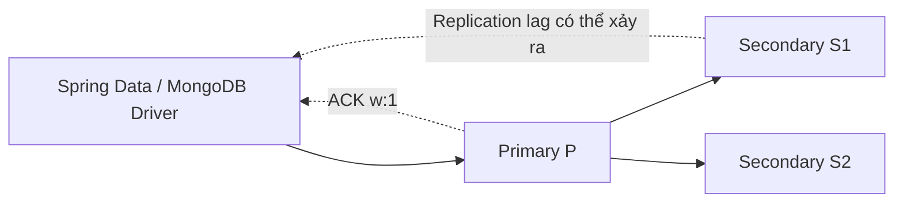
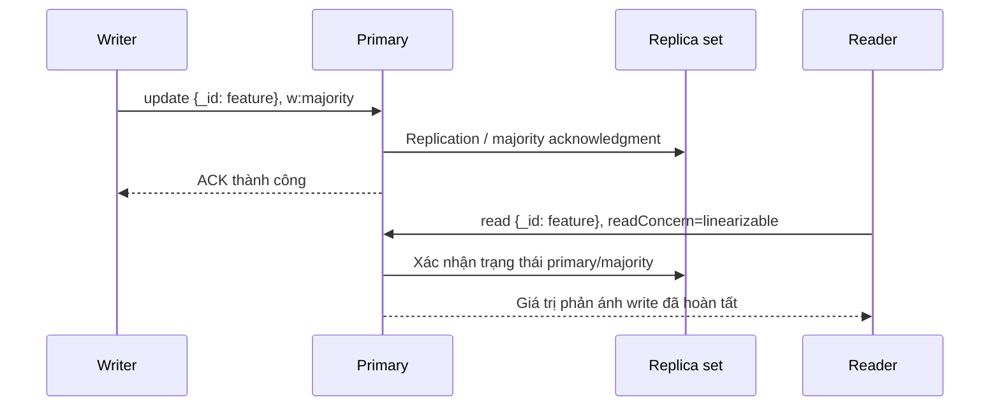
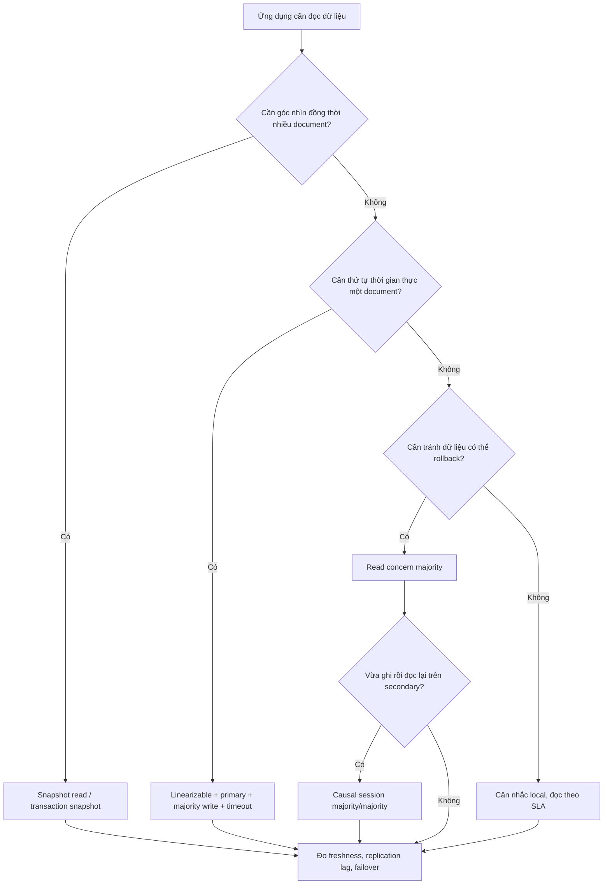

# Read concern và mức bảo đảm của dữ liệu đọc trong Spring Data MongoDB

## 1. Vấn đề: đọc một document không đồng nghĩa đọc dữ liệu đã bền vững

Trong **Spring Data MongoDB**, một repository method như `findById` hoặc thao tác `MongoTemplate.findOne(...)` có vẻ đơn giản: gửi query và nhận một Java object. Nhưng ở MongoDB replica set hoặc sharded cluster, câu hỏi quan trọng hơn là **phiên bản dữ liệu nào đã được trả về, phiên bản đó có thể bị rollback không, và các thao tác có thấy cùng một ảnh chụp dữ liệu không?**

Giả sử một ứng dụng bán hàng có collection `orders`. Người dùng thanh toán đơn `O-101`, service cập nhật `status = PAID` trên primary P1 rồi một request khác đọc lại đơn hàng:

```text
T0  P1 nhận write: status=PAID
T1  P1 trả acknowledgment theo write concern đã cấu hình
T2  Một read chạy trên P1 hoặc secondary S1
T3  Có thể xảy ra election hoặc lỗi mạng

Câu hỏi:
- Write ở T1 đã được bao nhiêu node xác nhận?
- Read ở T2 đi tới node nào?
- Node đó có cập nhật mới nhất chưa?
- Dữ liệu trả về có thuộc phần đã majority commit không?
- Read có cần phản ánh các write hoàn tất trước nó không?
```

**Read concern** là tùy chọn MongoDB điều khiển mức nhất quán và cô lập của **dữ liệu được đọc**, đặc biệt trên replica set và sharded cluster. Các mức phổ biến gồm `local`, `available`, `majority`, `linearizable` và `snapshot`. Mỗi mức có **hợp đồng khác nhau**; chúng không phải một thang đo đơn giản từ “chậm” đến “nhanh”.

Trong module **SPRING_DATA_MONGODB**, bài này gắn read concern với các thao tác repository, `MongoTemplate`, Java Driver, session và transaction, đồng thời phân biệt rõ read concern với read preference và write concern.

### 1.1. Mục tiêu học tập

Sau bài học thuộc chương **Nhất quán dữ liệu**, người học cần:

1. Giải thích từng mức read concern, điều gì được và **không được** bảo đảm.
2. Phân biệt **rollback safety**, **freshness**, **read-your-own-writes**, **causal consistency**, **linearizability** và **snapshot isolation**.
3. Chọn đúng tổ hợp read concern, write concern, read preference theo nghiệp vụ.
4. Cấu hình read concern qua MongoDB Java Driver và nhận biết cách nó ảnh hưởng `MongoTemplate`/repository.
5. Dùng transaction với `snapshot`, write concern `majority` và session theo ngữ nghĩa chính xác.
6. Kiểm chứng hành vi trước failover, replication lag và network partition mà không chỉ dựa vào một lần chạy trên standalone MongoDB.

### 1.2. Các khái niệm dễ nhầm

| Tùy chọn | Trả lời câu hỏi | Ví dụ |
|---|---|---|
| **Read concern** | Phiên bản dữ liệu đọc cần có bảo đảm nhất quán/cô lập gì? | `majority`, `snapshot` |
| **Write concern** | Một write phải được xác nhận ở mức nào trước khi được coi là thành công? | `w: 1`, `w: "majority"` |
| **Read preference** | Read được định tuyến tới thành viên replica set nào? | `primary`, `secondary` |
| **Client session** | Những operation có được theo dõi chung về quan hệ nhân quả/transaction không? | Causally consistent session |
| **Transaction** | Một chuỗi thao tác nhiều document có chung ranh giới commit/isolation không? | `startTransaction`, `commitTransaction` |

Read concern **không tự quyết định node được đọc**; read preference đảm nhiệm phần đó. Read concern cũng **không quyết định độ bền của write**; phải kết hợp với write concern.

## 2. Replica set, replication và khả năng rollback

### 2.1. Mô hình ba thành viên

Giả sử replica set có:

- `P`: primary hiện tại, nhận write.
- `S1`: secondary sao chép dữ liệu.
- `S2`: secondary còn lại.



Write không phải lúc nào cũng xuất hiện trên ba node cùng một thời điểm. Một secondary có thể chưa apply thay đổi mà primary đã nhận. Khi election xảy ra, một write chưa được majority commit có thể không nằm trong lịch sử được chấp nhận của primary mới và có nguy cơ bị rollback.

### 2.2. Ví dụ với write concern w: 1

```text
P : status=NEW ── write PAID ── ACK w:1 ── mất vai trò primary
S1: status=NEW ──────────────────────────── trở thành primary mới
S2: status=NEW ────────────────────────────

Write PAID chưa được majority commit.
Nó có thể bị rollback; các read local trước đó vẫn có thể đã thấy PAID.
```

Điểm chính: **readConcern=local có thể trả dữ liệu đã có trên node nhưng sau đó bị rollback**. Đây không nhất thiết là lỗi ứng dụng hay mất kết nối; nó là một phần trong hợp đồng consistency của mức đọc.

### 2.3. Majority commit point

MongoDB theo dõi một **majority-commit point**: điểm tiến độ replication đã được một majority các thành viên liên quan xác nhận theo mô hình của replica set. Mức `readConcern: "majority"` đọc dữ liệu tại góc nhìn majority-committed của node.

Điều này cho phép tránh đọc những write còn có nguy cơ rollback do chưa majority commit. Tuy nhiên:

- Một write rất mới có thể **chưa** đạt majority commit point.
- Một secondary có thể **chưa apply** write mới nhất.
- Một truy vấn trên node nào đó có thể trả **phiên bản cũ hơn** phiên bản mới nhất đã biết ở nơi khác.

Vì vậy, **“majority” không đồng nghĩa “latest”** và **“đọc trên primary” không tự đồng nghĩa “linearizable”**.

## 3. Tổng quan năm mức read concern

### 3.1. Bảng lựa chọn nhanh

| Level | Bảo đảm chính | Có thể đọc dữ liệu bị rollback? | Những giới hạn đáng nhớ |
|---|---|---|---|
| `local` | Đọc dữ liệu hiện có trên node được chọn; không đòi majority commit | **Có** | Thường là default read concern nếu không cấu hình khác |
| `available` | Ưu tiên khả dụng/latency với bảo đảm majority tương tự local | **Có** | Trên sharded collection có nguy cơ thấy orphaned documents; không dùng trong causal session/transaction |
| `majority` | Chỉ trả dữ liệu đã majority commit, tránh đọc những write có nguy cơ rollback theo guarantee | **Không**, theo bảo đảm majority-committed | Có thể cũ; không phải linearizable hoặc snapshot xuyên nhiều truy vấn |
| `linearizable` | Với read một document đủ điều kiện trên primary, thấy mọi majority-acknowledged write đã hoàn tất **trước lúc read bắt đầu** | Không đối với dữ liệu đáp ứng bảo đảm | Chi phí/độ chờ cao hơn, primary only; dùng `maxTimeMS` |
| `snapshot` | Đọc từ một ảnh chụp dữ liệu tại một thời điểm nhất quán | Phụ thuộc chế độ và bảo đảm majority của transaction commit | Cần phân biệt snapshot trong transaction với snapshot read ngoài transaction |

Mức nào “mạnh hơn” phụ thuộc **thuộc tính ứng dụng cần**: không rollback, thứ tự thời gian thực, hoặc ảnh chụp nhất quán của nhiều document. `snapshot` có thể cho một báo cáo nhất quán ở thời điểm trước đó mà **không phải** cách đọc giá trị vừa được cập nhật mới nhất.

### 3.2. Ngữ nghĩa tương đối của mỗi mức

```text
local        → dữ liệu hiện có ở node, có thể chưa majority commit
available    → giống hướng ưu tiên tính sẵn sàng, rủi ro orphan trong sharding
majority     → dữ liệu majority-committed, có thể chưa phải latest
linearizable → thứ tự thời gian thực cho read một document đúng điều kiện
snapshot     → ảnh chụp nhất quán tại một thời điểm, có thể cũ
```

Không nên đặt tất cả năm mức thành một chuỗi `local < majority < snapshot < linearizable` cho mọi trường hợp. Snapshot và linearizable giải quyết **những vấn đề khác nhau**.

### 3.3. Cú pháp MongoDB chung

```javascript
{
  readConcern: {
    level: "majority"
  }
}
```

Đây là cấu trúc tùy chọn trong command. API Java Driver thường dùng `ReadConcern.MAJORITY`, còn `mongosh` có helper:

```javascript
db.orders.find({ _id: "O-101" })
  .readConcern("majority");
```

Để chạy ổn định và có quyền kiểm soát, cần đối chiếu khả năng hỗ trợ của từng operation, topology, MongoDB Server version và driver API.

## 4. Read concern local: dữ liệu hiện có, nhưng có thể bị rollback

### 4.1. Ý nghĩa

`local` cho phép MongoDB trả dữ liệu hiện có trên node xử lý truy vấn mà **không yêu cầu dữ liệu đó đã được majority commit**. Đây là read concern mặc định phổ biến cho read trên primary/secondary khi không có cấu hình global/client khác.

Ví dụ:

```javascript
db.orders.find({ _id: "O-101" })
  .readConcern("local");
```

Ưu điểm là ngữ nghĩa đơn giản, không đòi xác nhận majority ở tầng đọc. Nhược điểm: nếu dữ liệu vừa được đọc chưa majority commit và primary failover, version đó có thể bị rollback.

### 4.2. local + primary không loại bỏ rủi ro

Lời gọi:

```text
readPreference = primary
readConcern    = local
```

đọc từ primary theo định tuyến, nhưng **không** chuyển dữ liệu chưa majority commit thành bền vững. Primary có thể đã apply một write được ack `w:1` mà secondary chưa kịp sao chép.

### 4.3. local + secondary có thêm độ trễ replication

`readPreference = secondary` có thể trả document cũ vì secondary chưa apply các write mà primary đã thực hiện. `local` không hứa ràng buộc về thời gian “cũ tối đa bao nhiêu giây”.

Những tình huống có thể chấp nhận:

- Dashboard vận hành không yêu cầu tuyệt đối mới nhất.
- Dữ liệu tham khảo có thể được làm mới lại.
- Workload ưu tiên latency/khả dụng và có chấp nhận eventual consistency.

Không dùng chỉ vì “đọc thường là nhanh hơn” mà không xác nhận hợp đồng sản phẩm.

### 4.4. local không tự cung cấp snapshot nhất quán xuyên nhiều query

Hai truy vấn:

```text
read A lúc T1
read B lúc T2
```

với `local` có thể nhìn thấy các phiên bản dữ liệu khác thời điểm. Nếu logic nghiệp vụ cần một ảnh chụp nhất quán của nhiều collection, nên cân nhắc transaction snapshot hoặc thiết kế dữ liệu phù hợp; không giả định hai lần gọi repository liên tiếp là một transaction tự động.

## 5. Read concern available: lưu ý đặc biệt với sharded cluster

### 5.1. Đặc tính

`available` cũng có thể trả dữ liệu chưa majority commit và có nguy cơ rollback. Nó được thiết kế cho trường hợp ưu tiên khả dụng/độ trễ, nhưng **điểm khác biệt quan trọng nhất nằm ở sharded collection**.

Trong quá trình di chuyển chunk giữa các shard, có thể xuất hiện những document **orphaned** trên shard cũ trong giai đoạn cleanup. Read concern `available` có thể cho phép đọc những orphaned documents này, làm kết quả đọc không đúng mong đợi.

```text
Sharded collection "orders"
        |
     mongos
    /     \
 Shard A  Shard B
  (chunk đã chuyển A→B, A còn orphan tạm thời)

Read concern "available" có thể quan sát orphaned document.
```

Mức `local` trên sharded collection tránh rủi ro orphaned-document này theo hợp đồng MongoDB trong các trường hợp tài liệu mô tả. Không dùng `available` như một lựa chọn mặc định chỉ vì tên của nó nghe có vẻ “an toàn hơn”.

### 5.2. Không dùng trong transaction hoặc causally consistent session

MongoDB không hỗ trợ read concern `available` trong multi-document transactions và causally consistent sessions. Nếu một service vừa dùng transaction vừa cố áp `ReadConcern.AVAILABLE`, không nên kỳ vọng server tự nâng nó lên mức mạnh hơn.

Nên giữ `available` cho use case đã đánh giá rõ trade-off ở topology hiện tại, có integration test và monitoring phù hợp.

## 6. Read concern majority: không rollback nhưng chưa chắc mới nhất

### 6.1. Bảo đảm chính

`majority` trả những phiên bản dữ liệu đã **majority-committed**. Theo tài liệu MongoDB, dữ liệu đọc được bằng majority được bảo đảm không rollback trong phạm vi bảo đảm của read concern này.

```javascript
db.orders.find({ _id: "O-101" })
  .readConcern("majority");
```

Đây là lựa chọn phù hợp nếu ứng dụng không muốn dùng một giá trị có thể mất đi sau failover làm đầu vào cho báo cáo, lịch sử nghiệp vụ hoặc thông tin cần giữ lâu dài.

### 6.2. Majority không có nghĩa read-your-own-writes qua mọi node

Giả sử một client vừa nhận thành công `writeConcern: {w:"majority"}` cho đơn hàng, rồi thực hiện read trên secondary. Đặc biệt từ MongoDB 8.0, majority acknowledgment có thể đến trước khi secondary apply thay đổi vào collection của nó. Một query tức thì trên secondary **có thể chưa thấy write vừa được xác nhận**.

Do đó, khi sản phẩm cần đọc lại write của chính mình qua primary/secondary, **hãy dùng causally consistent session** với tổ hợp read concern `majority` và write concern `majority`, hoặc một chiến lược định tuyến/đồng bộ được kiểm chứng theo phiên bản server.

### 6.3. Majority không phải linearizable

Ngay cả khi đọc từ primary, `majority` không tự hứa rằng kết quả phản ánh **mọi majority-acknowledged write hoàn tất trước khi read bắt đầu**, đặc biệt trong những thời điểm election và nhận biết vai trò primary chưa đồng bộ.

Nếu cần thứ tự thời gian thực theo hợp đồng mạnh cho **một document**, xem `linearizable` ở mục 7.

### 6.4. Majority không tự tạo snapshot xuyên nhiều document

Một aggregate đọc majority-committed data **không đồng nghĩa** toàn bộ chuỗi nhiều read độc lập trong Java nhìn thấy một snapshot cố định.

Ví dụ:

```text
T1: find customer balance
T2: một writer cập nhật orders và customer
T3: aggregate customer orders
```

Hai operation có thể phản ánh những thời điểm khác nhau. Khi cần báo cáo nhất quán xuyên nhiều document/collection, cân nhắc transaction với `snapshot` hoặc snapshot read được hỗ trợ.

### 6.5. Cấu hình majority ở client không sửa được writer yếu

Nếu writer dùng `w:1`, một write có thể được người dùng báo “thành công” nhưng sau đó rollback. Reader với `majority` sẽ **không nhất thiết thấy** write đó vì nó chưa majority commit. Để thiết kế end-to-end cần độ bền, phải phối hợp cả **write concern majority**, không chỉ tăng mức đọc.

## 7. Read concern linearizable: đọc theo thứ tự thời gian thực

### 7.1. Linearizability là bảo đảm nào?

Trong bối cảnh MongoDB, read concern `linearizable` cung cấp bảo đảm rằng một read đúng điều kiện **phản ánh mọi write đã thành công với acknowledgment mức majority và hoàn tất trước khi read bắt đầu**. Khi ghép với write concern `majority`, thao tác trên một document có thể được nhìn như có một thứ tự thực thi duy nhất phù hợp thứ tự thời gian thực.

Ví dụ một document giữ quyền mở/đóng một chức năng:

```javascript
{
  _id: "feature:checkout",
  enabled: false,
  version: NumberLong(17)
}
```

Một admin chuyển `enabled` thành true và nhận kết quả từ write concern majority. Một request linearizable read thực hiện **sau khi write hoàn tất** phải thấy bản cập nhật theo bảo đảm nói trên nếu read thành công và đáp ứng các điều kiện hỗ trợ.



### 7.2. Những điều kiện quan trọng

- **Chỉ đọc trên primary**: không đặt `readPreference=secondary` rồi kỳ vọng read linearizable hoạt động.
- **Bảo đảm áp dụng cho read có điều kiện xác định duy nhất một document**, điển hình là `_id`.
- Để việc đọc dùng snapshot nhất quán theo quy tắc của server, dùng khóa tìm kiếm bất biến như `_id`, hoặc khóa không bị cập nhật đồng thời, hoặc unique index phù hợp được query sử dụng.
- **Không dùng `linearizable` trong multi-document transaction hoặc causally consistent session.**
- Aggregation với `linearizable` không hỗ trợ các stage ghi `$out` hoặc `$merge`.
- Nên gắn **`maxTimeMS`** để không chờ vô hạn khi không đủ thành viên để xác nhận trạng thái majority.

Lưu ý về `writeConcernMajorityJournalDefault`: MongoDB mô tả các ngoại lệ độ bền liên quan journal và việc nhiều node cùng crash/restart. Những bảo đảm mạnh nhất giả định cấu hình durability thích hợp; không diễn dịch “linearizable” thành khả năng chống mọi hình thức mất dữ liệu/hỏng phần cứng.

### 7.3. Lệnh mongosh

```javascript
db.feature_flags.find({ _id: "feature:checkout" })
  .readConcern("linearizable")
  .maxTimeMS(10000);
```

Theo tài liệu MongoDB, nếu cụm không thể đáp ứng điều kiện linearizable, query có thể phải chờ; `maxTimeMS(10000)` đặt ngân sách thời gian cho operation và cho phép trả lỗi timeout thay vì chờ không hạn định.

**Timeout không có nghĩa dữ liệu đang false hoặc không tồn tại.** Nó nghĩa là yêu cầu đọc với mức bảo đảm đã chọn **không hoàn thành được trong thời hạn**. Business logic cần báo lỗi/tạm hoãn, không tự biến timeout thành một kết quả nghiệp vụ.

### 7.4. Khi nào cần linearizable?

Cân nhắc cho:

- Đọc một flag kiểm soát thao tác nhạy cảm ngay sau khi thay đổi đã được majority-confirmed.
- Đọc một document quản lý trạng thái/phiên bản có thứ tự thời gian thực rất quan trọng.
- Những điểm quyết định chỉ xoay quanh một document, có read/write semantics được thiết kế và kiểm thử chặt.

**Không dùng `linearizable` mặc định cho danh sách đơn hàng, pagination hoặc aggregation rất lớn.** Nó có thể chậm hơn `local`/`majority` đáng kể và không tạo ra transaction snapshot cho nhiều document.

### 7.5. Linearizable read không tự thay thế atomic update

Giả sử hai request cùng:

```text
read balance=10
if balance >= 8:
    update balance=balance-8
```

Dù read có bảo đảm mạnh, **hai bước read–modify–write tách biệt** vẫn có thể có race nếu thiếu predicate/version bảo vệ ở bước write. Cần dùng **single-document atomic update**, compare-and-set/`@Version` hoặc transaction phù hợp.

Kết hợp tính mới của read với tính nguyên tử của write, thay vì xem read concern là khóa ghi.

## 8. Read concern snapshot: ảnh chụp nhất quán theo thời điểm

### 8.1. Snapshot giải quyết vấn đề khác linearizable

`snapshot` yêu cầu read quan sát dữ liệu theo một **snapshot thời gian nhất quán**. Đặc biệt với transaction đa document trên sharded cluster, snapshot cho phép dữ liệu được đọc từ một góc nhìn được đồng bộ xuyên các shard.

Ví dụ báo cáo cuối tháng có hai collection:

```text
accounts: số dư của customer
orders: các order đã thanh toán

T1: bắt đầu snapshot transaction
T2: đọc accounts
T3: writer khác cập nhật accounts và orders
T4: đọc orders trong cùng transaction

Các read trong transaction cần một snapshot nhất quán,
không phải mỗi read lấy bản mới nhất ở thời điểm nó được gọi.
```

Giá trị đọc có thể **cũ hơn thời điểm hiện tại**, nhưng các thao tác trong scope snapshot được thiết kế để không thấy một hỗn hợp khó giải thích của nhiều thời điểm.

### 8.2. Snapshot trong multi-document transaction

MongoDB cho phép transaction dùng read concern `local`, `majority` hoặc `snapshot`. Với transaction read concern `snapshot`:

- Transaction đọc từ snapshot nhất quán.
- Trên sharded cluster, snapshot view được đồng bộ giữa shards.
- **Bảo đảm snapshot của dữ liệu majority-committed được MongoDB nêu cho transaction khi commit bằng write concern `majority`.** Không cấu hình commit `w:1` rồi tuyên bố có cùng guarantee.
- Read concern được thiết lập **ở transaction level**, không gán riêng cho từng query bên trong.
- Transaction có read operations phải dùng read preference `primary`.

Để ghi kết quả nghiệp vụ nhiều document một cách nguyên tử, các write cần thực sự nằm trong cùng transaction và commit thành công. Chỉ khai báo `@Transactional` mà không có Mongo transaction manager/session wiring phù hợp sẽ không tự mang lại snapshot consistency.

### 8.3. Snapshot ngoài transaction

Từ MongoDB 5.0, một số read operations **ngoài transaction** hỗ trợ read concern `snapshot`, như `find`, `aggregate` và `distinct` trên collection không sharded. Điều kiện hỗ trợ khác nhau giữa operation/topology/version; không áp dụng `snapshot` tùy ý lên mọi command.

Với snapshot read ngoài transaction, MongoDB có thể dùng tham số **`atClusterTime`**:

```javascript
db.runCommand({
  find: "orders",
  filter: { tenant_id: "T-A" },
  readConcern: {
    level: "snapshot",
    atClusterTime: Timestamp(1767225600, 1)
  },
  maxTimeMS: 10000
});
```

Giá trị `Timestamp(...)` trên **chỉ là minh họa cú pháp**. Không tự lấy một timestamp lịch từ đồng hồ rồi coi đó là MongoDB cluster time hợp lệ. `atClusterTime` phải phù hợp thời điểm logic của cluster và snapshot history còn được giữ.

Nếu yêu cầu thời điểm quá cũ và snapshot lịch sử đã bị dọn, server có thể báo lỗi. Nếu node chưa đạt thời điểm yêu cầu, read có thể chờ hoặc timeout. Nếu không chỉ định thời điểm, server sẽ chọn snapshot majority-committed phù hợp theo khả năng/topology.

### 8.4. Snapshot không phải “tua thời gian vô hạn”

MongoDB giữ lịch sử snapshot trong **cửa sổ giới hạn**. `atClusterTime` không biến database thành hệ thống event sourcing hoặc kho lưu lịch sử có thể đọc bất kỳ ngày nào trong quá khứ.

Nếu ứng dụng cần báo cáo đúng tại ngày kết toán từ nhiều tháng trước, hãy xây **business snapshot/materialized report**, event log hoặc chiến lược lưu trữ có vòng đời riêng. Read concern `snapshot` không bảo đảm khả năng truy xuất mọi phiên bản dữ liệu lịch sử.

### 8.5. Snapshot isolation không tự giải quyết mọi ràng buộc cạnh tranh

Một transaction đọc snapshot cố định vẫn cần thiết kế write conflicts và bất biến liên document. Có thể gặp transaction abort, transient errors, snapshot-too-old hoặc commit không chắc chắn kết quả. Cần xử lý retry theo cơ chế transaction của driver/Spring và **idempotency** ở nghiệp vụ.

Không xem transaction snapshot như phép màu tự ngăn mọi kiểu write skew; các bất biến quan trọng cần được biểu diễn bằng atomic predicates, unique indexes hoặc mô hình dữ liệu bảo vệ write conflicts tương ứng.

## 9. Read concern, write concern và read preference: ghép đúng hợp đồng

### 9.1. Ba biến độc lập

Một ứng dụng có thể cấu hình:

```text
readPreference = secondaryPreferred
readConcern    = majority
writeConcern   = majority
```

Điều này diễn giải:

- Driver **ưu tiên** gửi read tới secondary, có fallback theo read preference.
- Read chỉ trả dữ liệu đáp ứng **majority commit**.
- Write chờ acknowledgment theo majority.

Nhưng tổ hợp đó **không tự bảo đảm** lần read tiếp theo ở secondary ngay lập tức thấy write vừa hoàn thành. Cần session causal nếu nghiệp vụ yêu cầu phụ thuộc thời gian giữa các operation.

### 9.2. Bảng tình huống

| Read preference | Read concern | Write concern | Có thể gặp |
|---|---|---|---|
| primary | local | w:1 | Read dữ liệu mới trên primary nhưng có nguy cơ rollback nếu write chưa majority commit |
| secondary | local | w:1 | Vừa replication lag, vừa có nguy cơ rollback |
| primary | majority | majority | Chỉ dữ liệu majority-committed, chưa mặc định linearizable |
| secondary | majority | majority | Dữ liệu majority-committed nhưng có thể stale; dùng causal session nếu cần đọc sau ghi |
| primary | linearizable | majority | Bảo đảm thứ tự thời gian thực cho read một document đủ điều kiện |
| primary trong transaction | snapshot | majority tại commit | Snapshot nhất quán, với guarantee majority ở commit |

Bảng chỉ nêu đặc điểm chính; tùy cluster version, election, operation, transaction và journal configuration có thêm điều kiện cụ thể.

### 9.3. “Read from primary” là định tuyến, không phải consistency level

Read preference `primary` yêu cầu driver định tuyến read tới node đang được coi là primary. Trong giai đoạn election/network partition, có thể tồn tại tình huống một node cũ chưa biết mình bị demote. Read preference không tự bổ sung bước xác nhận majority để cung cấp linearizable semantics.

Đừng viết tài liệu API kiểu “luôn đọc primary nên chắc chắn thấy mới nhất” mà không xét đến failover, acknowledgment và quan hệ giữa các request.

### 9.4. “Write successful” cần định nghĩa bằng write concern

Write concern `w:1` xác nhận từ primary nhưng không có cùng guarantee về replication với `w:"majority"`. Khi API trả 200 sau một write `w:1`, caller nên hiểu mức xác nhận thực tế; không đồng nhất với một write đã durable across majority.

Nếu sử dụng write concern majority với `wtimeout`, timeout có thể báo việc **không nhận đủ acknowledgment trong thời hạn** chứ không có nghĩa chắc chắn write chưa được primary apply. Quy trình retry phải idempotent hoặc dùng unique key/retryable writes phù hợp; không ghi thêm lần thứ hai chỉ vì mạng chậm.

### 9.5. Không nhất thiết tăng mọi level lên “cao nhất”

Đặt mọi report query thành linearizable có thể làm hệ thống kém khả dụng mà không mang lại snapshot across documents. Đặt mọi read vào transaction snapshot có thể tăng tài nguyên và complexity. Cần chọn đúng **invariant**:

- Không đọc dữ liệu có thể rollback → `majority`.
- Đọc một document theo real-time order → `linearizable` cùng majority writes.
- Đọc một nhóm document ở cùng snapshot → `snapshot` với transaction/options phù hợp.
- Đọc dữ liệu tham khảo được phép cũ → cân nhắc `local`/secondary.

## 10. Causal consistency: đọc sau ghi qua session

### 10.1. Vấn đề read-your-own-writes

Người dùng vừa đặt đơn, trang chi tiết lập tức gọi một API khác đọc từ secondary. Nếu secondary chưa apply write, họ có thể nhìn thấy `status = NEW` dù write `PAID` đã được acknowledgment majority.

Khi những operation có quan hệ nhân quả trong cùng **client session**, MongoDB có thể thực thi **causal consistency** bằng việc theo dõi logical operation time/cluster time giữa các operation.

### 10.2. Những bảo đảm cần đọc đúng

Một causally consistent session với:

- read concern `majority`;
- write concern `majority`;
- các operation trong session được thực thi theo thứ tự, không dùng song song một session thiếu an toàn;

được MongoDB mô tả là cung cấp các bảo đảm:

| Thuộc tính | Ý nghĩa |
|---|---|
| **Read your own writes** | Read sau một write trong chuỗi causal không “quên” write của chính session |
| **Monotonic reads** | Các read sau không thấy một lịch sử cũ hơn thứ đã thấy trước đó theo quan hệ causal |
| **Monotonic writes** | Thứ tự write trong session được tôn trọng |
| **Writes follow reads** | Write phụ thuộc read trước đó tuân thủ quan hệ causal |

MongoDB phân biệt guarantee causal **có độ bền dữ liệu** với những tổ hợp read/write concern yếu hơn. Không tuyên bố bốn bảo đảm durability-backed ở bảng trên nếu write đang dùng `w:1`.

### 10.3. Causal không phải transaction

Causal session **không** biến một chuỗi hai update thành một commit nguyên tử. Hai write vẫn có thể thành công một phần nếu không có transaction. Session chủ yếu giúp MongoDB hiểu **thứ tự nhân quả** khi định tuyến các operation/read tới thành viên khác nhau.

Muốn “tạo order + giảm inventory hoặc cùng thành công, hoặc cùng thất bại”, cần transaction hoặc thiết kế atomic single-document; không chỉ bật `causallyConsistent(true)`.

### 10.4. Causal không có nghĩa dữ liệu luôn mới nhất toàn hệ thống

Nếu một writer độc lập thực hiện write sau thời điểm operation cuối của session, causal read không mặc định đảm bảo thấy ngay write của writer đó. Nó bảo vệ **những quan hệ nhân quả đã được truyền tới session**, không thay thế linearizable read cho mọi trường hợp.

### 10.5. Quản lý scope và vòng đời session

Không chia sẻ một mutable `ClientSession` giữa nhiều request đang chạy song song. Session có trạng thái theo thời gian, cần close đúng lifecycle và truyền rõ vào mỗi operation khi dùng MongoDB Java Driver.

Trong Spring Data, session có thể được bind vào template/transaction context theo API hỗ trợ; phải bảo đảm các thao tác liên quan thực sự chạy trong **cùng session**, không chỉ dùng cùng một `MongoClient`. Một request đến server instance khác không tự kế thừa causal context nếu không có cơ chế truyền/duy trì session tương ứng.

## 11. Cấu hình read concern trong MongoDB Java Driver

### 11.1. Các hằng số ReadConcern

MongoDB Java Sync Driver cung cấp các hằng trong `com.mongodb.ReadConcern`:

```java
import com.mongodb.ReadConcern;

ReadConcern local = ReadConcern.LOCAL;
ReadConcern available = ReadConcern.AVAILABLE;
ReadConcern majority = ReadConcern.MAJORITY;
ReadConcern linearizable = ReadConcern.LINEARIZABLE;
ReadConcern snapshot = ReadConcern.SNAPSHOT;
```

Chọn hằng số không tự tạo kết nối hay thay đổi server. Read concern chỉ có tác dụng khi được áp dụng vào client/database/collection/session/transaction và operation tương ứng hỗ trợ level đó.

### 11.2. Cấu hình ở MongoClient

Ví dụ client riêng dành cho các thao tác đọc báo cáo majority:

```java
import com.mongodb.ConnectionString;
import com.mongodb.MongoClientSettings;
import com.mongodb.ReadConcern;
import com.mongodb.ReadPreference;
import com.mongodb.WriteConcern;
import com.mongodb.client.MongoClient;
import com.mongodb.client.MongoClients;

MongoClientSettings settings = MongoClientSettings.builder()
    .applyConnectionString(
        new ConnectionString(
            "mongodb://localhost:27017/?replicaSet=rs0"))
    .readConcern(ReadConcern.MAJORITY)
    .readPreference(ReadPreference.primary())
    .writeConcern(WriteConcern.MAJORITY)
    .build();

MongoClient client = MongoClients.create(settings);
```

`rs0` là **tên replica set minh họa**; dùng hostname, authentication, TLS, replica set name và timeout từ cấu hình an toàn của hệ thống thật. Không hardcode credentials hoặc tạo một `MongoClient` cho mỗi request.

Từ cấu hình này, các database/collection được tạo từ client **thừa hưởng** read concern, read preference và write concern trừ khi bị override ở cấp thích hợp.

### 11.3. Cấu hình trên database và collection

```java
import com.mongodb.ReadConcern;
import com.mongodb.ReadPreference;
import com.mongodb.client.MongoCollection;
import com.mongodb.client.MongoDatabase;
import org.bson.Document;

MongoDatabase database = client.getDatabase("shop")
    .withReadConcern(ReadConcern.MAJORITY)
    .withReadPreference(ReadPreference.primary());

MongoCollection<Document> orders =
    database.getCollection("orders")
        .withReadConcern(ReadConcern.MAJORITY);

Document order = orders.find(
    new Document("_id", "O-101")
).first();
```

`withReadConcern(...)` và `withReadPreference(...)` tạo ra một **database/collection handle mới** với options yêu cầu; chúng không phải lệnh thay đổi read concern global trên cluster hoặc mutate toàn bộ những handle đã tồn tại.

Thứ tự kế thừa thông thường: **client → database → collection**, với override phù hợp ở cấp thấp hơn. Trong transaction, options cấp transaction quyết định read concern thay vì cấu hình riêng của collection.

### 11.4. Cấu hình cùng read preference để đọc secondary

```java
MongoCollection<Document> reportingOrders =
    database.getCollection("orders")
        .withReadPreference(
            ReadPreference.secondaryPreferred())
        .withReadConcern(ReadConcern.MAJORITY);

Document reportInput = reportingOrders.find(
    new Document("_id", "O-101")
).first();
```

Tổ hợp này phù hợp với một số workload báo cáo chấp nhận secondary lag, nhưng **không đảm bảo nhìn thấy write vừa được client khác hoàn tất trong thời gian thực**. Khi cần read-your-own-writes, dùng causally consistent session cùng w majority (mục 12).

### 11.5. URI readConcernLevel

MongoDB Java Driver có thể nhận lựa chọn qua connection string:

```text
mongodb://localhost:27017/shop?replicaSet=rs0&readConcernLevel=majority&readPreference=primary&w=majority
```

Không cấu hình hai giá trị mâu thuẫn trong URI và `MongoClientSettings.builder()` rồi không biết precedence. Cần thống nhất một nguồn cấu hình và test command thực tế. Hãy dùng cơ chế secret management/TLS/connection pool của ứng dụng thay vì đặt URI production vào source code hoặc log.

### 11.6. Linearizable read với timeout ở raw driver

```java
import java.util.concurrent.TimeUnit;
import com.mongodb.ReadConcern;
import com.mongodb.ReadPreference;
import org.bson.Document;
import com.mongodb.client.MongoCollection;

MongoCollection<Document> flags =
    database.getCollection("feature_flags")
        .withReadPreference(ReadPreference.primary())
        .withReadConcern(ReadConcern.LINEARIZABLE);

Document state = flags.find(
        new Document("_id", "feature:checkout"))
    .maxTime(10, TimeUnit.SECONDS)
    .first();
```

Ở đây filter theo `_id` xác định duy nhất document và `maxTime` giới hạn thời gian chờ phía server. Nếu operation timeout, đừng tự trả `enabled=false`; hãy thể hiện sự cố consistency/read availability theo hợp đồng API.

### 11.7. Không thay MongoClientSettings giữa các request

`MongoClientSettings` mô tả cấu hình của một client. Không dùng một singleton service để rebuild hoặc đóng/mở MongoClient mỗi lần một endpoint cần read concern khác.

Thay vào đó:

1. Chọn default cho toàn ứng dụng.
2. Dùng collection/database handle có read concern khác cho workload đặc thù.
3. Hoặc tạo cấu hình client/template riêng khi kiến trúc yêu cầu, với connection pool được quản lý.
4. Với transaction, đặt tùy chọn ngay khi tạo transaction.

Quản lý vòng đời client không đúng có thể gây cạn connection pool hoặc lỗi khi request khác đang thực thi; đó là vấn đề tài nguyên Java, không phải read concern semantics.

## 12. Causally consistent session bằng Java Driver

### 12.1. Cấu hình session

Đây là luồng minh họa một client ghi rồi đọc lại trên secondary trong **cùng session**:

```java
import com.mongodb.ClientSessionOptions;
import com.mongodb.ReadConcern;
import com.mongodb.ReadPreference;
import com.mongodb.WriteConcern;
import com.mongodb.client.ClientSession;
import com.mongodb.client.MongoCollection;
import com.mongodb.client.MongoDatabase;
import com.mongodb.client.model.Filters;
import com.mongodb.client.model.Updates;
import org.bson.Document;

MongoDatabase db = client.getDatabase("shop");

MongoCollection<Document> writing =
    db.getCollection("orders")
        .withWriteConcern(WriteConcern.MAJORITY);

MongoCollection<Document> reading =
    db.getCollection("orders")
        .withReadConcern(ReadConcern.MAJORITY)
        .withReadPreference(
            ReadPreference.secondaryPreferred());

ClientSessionOptions sessionOptions =
    ClientSessionOptions.builder()
        .causallyConsistent(true)
        .build();

try (ClientSession session =
        client.startSession(sessionOptions)) {

    writing.updateOne(
        session,
        Filters.eq("_id", "O-101"),
        Updates.set("status", "PAID"));

    Document afterWrite = reading.find(
        session,
        Filters.eq("_id", "O-101")
    ).first();

    System.out.println(
        afterWrite == null
            ? "Not found"
            : afterWrite.getString("status"));
}
```

Trong ví dụ này, `client` là client Java Driver đã tạo và được quản lý vòng đời trước đó. `WriteConcern.MAJORITY` và `ReadConcern.MAJORITY` được gắn tường minh, còn session cho phép server/driver duy trì quan hệ causal của update rồi read.

**Đừng copy ví dụ vào production mà không xử lý `UpdateResult.getMatchedCount()`, timeout, lỗi network và retry.** Nếu ID không tồn tại, write không thay đổi gì và read có thể trả null; đó không phải vi phạm causal consistency.

### 12.2. Những yêu cầu để bảo đảm thật sự

- Operation phải dùng **đúng ClientSession**.
- Tổ hợp read concern majority + write concern majority phải được áp dụng theo hợp đồng causal durability.
- Các operation phụ thuộc nhau nên được thực hiện tuần tự theo quy tắc session, không dùng cùng session để chạy nhiều lời gọi song song.
- Secondary có thể phải **chờ** cho tới khi đạt logical time yêu cầu, hoặc timeout nếu không thể phục vụ.
- Nếu các request HTTP được xử lý bởi process khác nhau, không tự giả định Java session object sẽ chuyển qua process đó.

### 12.3. Causal context không tự thay thế idempotency

Giả sử update được thực thi, client mất mạng trước khi nhận response và tự retry bằng:

```java
Updates.inc("rewardPoints", 10);
```

Một lần retry độc lập có thể cộng điểm hai lần nếu operation không có idempotency key, retryable write behavior hoặc transaction semantics phù hợp. Causal session bảo vệ thứ tự quan sát, **không phải cơ chế chống thực thi trùng mọi operation**.

Với nghiệp vụ cộng tiền/điểm, nên thiết kế một mã giao dịch duy nhất, conditional update hoặc unique index để ràng buộc idempotency.

### 12.4. Nếu đọc từ API khác thì sao?

Một API update và API read chạy trên hai service instances khác nhau không nhất thiết chia sẻ session. Những lựa chọn thiết kế:

- Đọc lại ngay trong cùng workflow/session và trả kết quả đã xác nhận.
- Gửi một version/operation marker đáng tin cậy để service đọc có thể chờ hoặc đảm bảo version tối thiểu theo thiết kế.
- Sử dụng causal context propagation mà driver và kiến trúc thực sự hỗ trợ.
- Với một document cần real-time ordering, cân nhắc linearizable read trên primary khi thỏa điều kiện và ngân sách latency.

Không trình bày `ReadConcern.MAJORITY` đơn lẻ như cách luôn giải quyết “tôi vừa ghi, sao trang khác chưa thấy”.

## 13. Cấu hình Spring Data MongoDB: MongoTemplate và repository

### 13.1. Read concern trong Spring Data phụ thuộc client/driver

Spring Data MongoDB dùng MongoDB Java Driver ở tầng kết nối. Một `MongoTemplate` thường hoạt động dựa trên `MongoDatabaseFactory`/`MongoClient` được ứng dụng cấu hình. Nếu đọc qua repository, repository cuối cùng cũng dùng hạ tầng MongoDB tương ứng.

Khi tạo client có default read concern `MAJORITY` và dùng client đó trong `MongoTemplate`, các operation thông thường sẽ **kế thừa** setting của driver nếu không bị override.

Ví dụ minh họa một Spring configuration tạo template với client đã được cấu hình:

```java
import com.mongodb.ConnectionString;
import com.mongodb.MongoClientSettings;
import com.mongodb.ReadConcern;
import com.mongodb.ReadPreference;
import com.mongodb.WriteConcern;
import com.mongodb.client.MongoClient;
import com.mongodb.client.MongoClients;
import org.springframework.context.annotation.Bean;
import org.springframework.context.annotation.Configuration;
import org.springframework.data.mongodb.core.MongoTemplate;

@Configuration
class MongoConsistencyConfiguration {

    @Bean
    MongoClient mongoClient() {
        MongoClientSettings settings =
            MongoClientSettings.builder()
                .applyConnectionString(
                    new ConnectionString(
                        "mongodb://localhost:27017/?replicaSet=rs0"))
                .readConcern(ReadConcern.MAJORITY)
                .readPreference(ReadPreference.primary())
                .writeConcern(WriteConcern.MAJORITY)
                .build();

        return MongoClients.create(settings);
    }

    @Bean
    MongoTemplate mongoTemplate(MongoClient mongoClient) {
        return new MongoTemplate(mongoClient, "shop");
    }
}
```

Đoạn này dành cho **ứng dụng tự cấu hình MongoDB beans**; khi Spring Boot auto-configuration đang tạo MongoClient/MongoTemplate, phải tránh khai báo trùng bean hoặc làm mất các thiết lập TLS, credentials, metrics và pool do Boot quản lý. Hãy chọn một cách cấu hình nhất quán theo phiên bản Spring Boot/Spring Data của dự án.

### 13.2. Repository kế thừa ngữ nghĩa của hạ tầng cấu hình

Ví dụ repository:

```java
import org.springframework.data.mongodb.repository.MongoRepository;

public interface OrderRepository
        extends MongoRepository<OrderDocument, String> {
}
```

Và entity:

```java
import org.springframework.data.annotation.Id;
import org.springframework.data.mongodb.core.mapping.Document;

@Document(collection = "orders")
public class OrderDocument {
    @Id
    private String id;
    private String status;

    protected OrderDocument() {}

    public String getId() { return id; }
    public String getStatus() { return status; }
}
```

Một lời gọi:

```java
var order = orderRepository.findById("O-101");
```

không có tham số `ReadConcern` trong signature, nhưng operation được xử lý qua template/driver settings của repository. **Không mặc định** mọi repository cùng process phải dùng một consistency policy khi ứng dụng có nhiều template/client/transaction managers.

### 13.3. Override trên raw MongoCollection từ MongoTemplate

Khi một code path cần policy khác mà bạn kiểm soát rõ, có thể dùng raw driver handle:

```java
import com.mongodb.ReadConcern;
import com.mongodb.ReadPreference;
import org.bson.Document;

Document value = mongoTemplate.getCollection("orders")
    .withReadConcern(ReadConcern.MAJORITY)
    .withReadPreference(ReadPreference.primary())
    .find(new Document("_id", "O-101"))
    .first();
```

`getCollection(...)` trả driver collection handle. Nó **không tự sử dụng domain mapping** như `MongoTemplate.findOne(Query, OrderDocument.class)`. Với entity có `@Field("tenant_id")`, raw query phải dùng tên BSON vật lý, không tự chuyển `tenantId`.

**Đặc biệt:** nếu đang trong Spring-managed transaction/session, một raw driver call không được Spring liên kết session đúng cách có thể chạy **ngoài transaction**. Không lấy raw-driver override này để “nâng read concern” cho một transaction đã bắt đầu.

### 13.4. Không đổi trạng thái cấu hình của singleton template giữa request

Không bật/tắt một thuộc tính chung của `MongoTemplate` hoặc connection factory khi xử lý request A rồi “trả lại như cũ” sau request đó: request B có thể chạy đồng thời và nhận policy không đúng.

Cần xác định scope consistency ngay khi cấu hình bean/client, hoặc chọn collection handle/transaction options có tính bất biến tương ứng. Đồng thời document hóa rõ business endpoint nào cần `majority`, `linearizable` hay `snapshot`.

### 13.5. Spring Data không biến một annotation thành bảo đảm server tự động

`@Document`, `@Version`, repository method names, hoặc `@Transactional` thiếu Mongo transaction manager không tự giải quyết tất cả vấn đề consistency. Khả năng đọc bền vững, mức định tuyến và session context cần được cấu hình và kiểm tra trên **topology MongoDB thật**.

Trong test chỉ dùng một MongoDB standalone, nhiều tình huống replication lag/rollback không xảy ra, nên kết quả “đọc đúng” không đủ để kết luận consistency policy đúng.

## 14. Transaction: đặt read concern ở cấp transaction

### 14.1. Vì sao read concern của collection không đủ?

Khi MongoDB Java Driver hoặc Spring Data bắt đầu một **multi-document transaction**, các operation trong transaction sử dụng **transaction-level read concern**. Read concern riêng ở cấp collection/database không override được read concern đã được transaction thiết lập.

Ví dụ cấu hình:

```text
MongoClient default:  readConcern=MAJORITY
MongoCollection handle: readConcern=LOCAL
TransactionOptions:   readConcern=SNAPSHOT

Query bên trong transaction:
  dùng transaction read concern SNAPSHOT
  không tự chuyển sang LOCAL chỉ vì collection có LOCAL.
```

**Không cấu hình read concern riêng cho từng operation bên trong transaction**. Chọn `LOCAL`, `MAJORITY` hoặc `SNAPSHOT` khi bắt đầu transaction. `LINEARIZABLE` và `AVAILABLE` không phải các mức transaction read concern hợp lệ của MongoDB, dù một số API mapping/enum có thể liệt kê tên của chúng.

### 14.2. TransactionOptions trong Java Driver

```java
import com.mongodb.ReadConcern;
import com.mongodb.ReadPreference;
import com.mongodb.TransactionOptions;
import com.mongodb.WriteConcern;
import com.mongodb.client.ClientSession;
import com.mongodb.client.MongoCollection;
import org.bson.Document;

TransactionOptions options = TransactionOptions.builder()
    .readConcern(ReadConcern.SNAPSHOT)
    .readPreference(ReadPreference.primary())
    .writeConcern(WriteConcern.MAJORITY)
    .build();

MongoCollection<Document> orders =
    client.getDatabase("shop")
        .getCollection("orders");
MongoCollection<Document> payments =
    client.getDatabase("shop")
        .getCollection("payments");

try (ClientSession session = client.startSession()) {
    Long count = session.withTransaction(() -> {
        long orderCount = orders.countDocuments(
            session,
            new Document("tenant_id", "T-A"));

        long paymentCount = payments.countDocuments(
            session,
            new Document("tenant_id", "T-A"));

        // Hai phép đọc chạy trong cùng transaction snapshot.
        // Ví dụ trả một số kiểm tra; không tự chứng minh
        // tính đúng đắn của mọi bất biến nghiệp vụ.
        return orderCount + paymentCount;
    }, options);

    System.out.println(count);
}
```

`withTransaction(...)` quản lý start/commit/abort theo API driver và có thể thực hiện retry theo các error labels tương ứng. **Callback có thể được chạy lại**, vì vậy không gọi API thanh toán ngoài, gửi email hoặc tạo side effect không idempotent trong callback mà không có bảo vệ.

Các collection cần được chuẩn bị, topology hỗ trợ transaction và phiên bản server/driver đúng yêu cầu. Không dùng một MongoDB standalone thông thường để “chứng minh” multi-document transaction hoạt động giống replica set.

### 14.3. Spring Data MongoTransactionManager

Spring Data MongoDB hỗ trợ `MongoTransactionManager`. Một configuration với transaction options rõ ràng:

```java
import com.mongodb.ReadConcern;
import com.mongodb.ReadPreference;
import com.mongodb.TransactionOptions;
import com.mongodb.WriteConcern;
import org.springframework.context.annotation.Bean;
import org.springframework.context.annotation.Configuration;
import org.springframework.data.mongodb.MongoDatabaseFactory;
import org.springframework.data.mongodb.MongoTransactionManager;

@Configuration
class MongoTransactionConfiguration {

    @Bean
    MongoTransactionManager mongoTransactionManager(
            MongoDatabaseFactory factory) {
        TransactionOptions options = TransactionOptions.builder()
            .readConcern(ReadConcern.SNAPSHOT)
            .readPreference(ReadPreference.primary())
            .writeConcern(WriteConcern.MAJORITY)
            .build();

        return new MongoTransactionManager(factory, options);
    }
}
```

Phải dùng **cùng `MongoDatabaseFactory`/transaction infrastructure** mà `MongoTemplate` và repository tham gia; nếu chúng dùng những factories/clients khác nhau, không thể giả định transaction context được chia sẻ.

### 14.4. @Transactional trên service

Giả sử ứng dụng có hai repository MongoDB:

```java
import org.springframework.transaction.annotation.Transactional;
import org.springframework.stereotype.Service;

@Service
class ReconciliationService {
    private final OrderRepository orders;
    private final PaymentRepository payments;

    ReconciliationService(
            OrderRepository orders,
            PaymentRepository payments) {
        this.orders = orders;
        this.payments = payments;
    }

    @Transactional(
        transactionManager = "mongoTransactionManager",
        readOnly = true)
    public ReconciliationView inspect(
            String trustedTenantId) {
        long orderCount = orders.countByTenantId(trustedTenantId);
        long paymentCount =
            payments.countByTenantId(trustedTenantId);

        return new ReconciliationView(
            orderCount, paymentCount);
    }
}

record ReconciliationView(
    long orders,
    long payments
) {}
```

Đoạn này giả định các methods `countByTenantId` được khai báo trong repository tương ứng và entity mapping có `tenantId`. `readOnly = true` giúp thể hiện ý định đọc trong transaction; theo Spring Data, MongoDB transaction manager vẫn gắn một session/transaction theo semantics tương ứng. Không nên dùng `count`/analytics chỉ từ ví dụ rồi suy mọi operation thống kê trong transaction luôn được hỗ trợ giống nhau trên mọi MongoDB version: chọn query/aggregation đếm tương thích và integration test.

**Các lưu ý về AOP:** method `@Transactional` phải được gọi qua Spring proxy hoặc transaction boundary tương ứng. Một lời gọi nội bộ `this.inspect(...)` trong cùng class không tự đi qua proxy trong cấu hình proxy thông thường.

### 14.5. Transaction labels cho options theo method

Ở những phiên bản Spring Data MongoDB hỗ trợ Mongo-specific transaction labels, có thể chỉ định:

```java
@Transactional(
    transactionManager = "mongoTransactionManager",
    readOnly = true,
    label = {
        "mongo:readConcern=SNAPSHOT",
        "mongo:writeConcern=MAJORITY",
        "mongo:readPreference=PRIMARY"
    }
)
public ReconciliationView inspectSnapshot(
        String trustedTenantId) {
    // Các repository/template calls trong transaction.
    // ... return result;
    throw new UnsupportedOperationException(
        "Replace with business implementation");
}
```

Đoạn trên chỉ minh họa **annotation options syntax**, không phải một implementation service hoàn chỉnh vì thân method cần được thay bằng logic thực. Khi dùng, so sánh cách xử lý labels trong dependency hiện hành, loại transaction manager và thứ tự ưu tiên so với default options của manager.

Một số tài liệu hiển thị nhiều giá trị enum có thể parse như `LINEARIZABLE` hoặc `AVAILABLE`, nhưng MongoDB **không hỗ trợ** chúng làm read concern transaction; cần chọn `LOCAL`, `MAJORITY` hoặc `SNAPSHOT` đúng hợp đồng server.

### 14.6. Reactive transaction khác imperative transaction

Với `ReactiveMongoTemplate`, reactive transaction manager là `ReactiveMongoTransactionManager` và session được quản lý qua **Reactor Context** thay vì thread-local imperative.

```java
import com.mongodb.ReadConcern;
import com.mongodb.TransactionOptions;
import com.mongodb.WriteConcern;
import org.springframework.context.annotation.Bean;
import org.springframework.data.mongodb.ReactiveMongoDatabaseFactory;
import org.springframework.data.mongodb.ReactiveMongoTransactionManager;

@Bean
ReactiveMongoTransactionManager reactiveMongoTransactionManager(
        ReactiveMongoDatabaseFactory factory) {
    TransactionOptions options = TransactionOptions.builder()
        .readConcern(ReadConcern.SNAPSHOT)
        .writeConcern(WriteConcern.MAJORITY)
        .build();

    return new ReactiveMongoTransactionManager(factory, options);
}
```

Hãy dùng `TransactionalOperator` hoặc `@Transactional` trên method trả `Mono`/`Flux` với transaction manager phù hợp. **Không gọi `block()` giữa reactive pipeline** để “lấy kết quả cho dễ” rồi mong transaction context tự chuyển qua thread khác.

### 14.7. Transaction snapshot và read-only report

Một report chỉ đọc hai collection vẫn có thể cần transaction/snapshot nếu yêu cầu **góc nhìn nhất quán xuyên các document**. Nhưng transaction tạo thêm overhead và giữ snapshot/history resources; với báo cáo dài trên dữ liệu lớn, cân nhắc read concern snapshot ngoài transaction khi API hỗ trợ hoặc kiến trúc materialized report.

Đừng tạo một transaction kéo dài hàng phút chỉ để xuất một file CSV cực lớn nếu không kiểm tra memory/history window, timeout và ảnh hưởng tới cluster.

## 15. Sharded cluster, secondary lag và giới hạn mức bảo đảm

### 15.1. Majority trên sharded cluster không tự là snapshot toàn cục

Sharded cluster chia dữ liệu trên nhiều shards. Một phép read với `majority` có thể đọc các giá trị đã majority-committed ở mỗi nơi nhưng **không mặc định tạo một snapshot đồng bộ across shards cho một transaction**.

MongoDB nêu rõ transaction trên sharded cluster với read concern `majority` **không đảm bảo** dữ liệu được đọc từ cùng một snapshot view giữa các shard. Nếu cần cùng snapshot, chọn transaction read concern `snapshot` và commit write concern `majority`.

### 15.2. Đừng dùng available khi cần tránh orphaned documents

Trên sharded collection, chunk migration có thể tạo orphan tạm thời. `available` có thể trả orphan, nên phép đếm/group hoặc quyết định business dựa trên dữ liệu ấy có thể sai. Cân nhắc `local`/`majority` hoặc mức phù hợp khác theo topology nếu cần tránh hiện tượng này.

### 15.3. Secondary lag không biến mất khi tăng read concern

Một secondary nhận replication stream nhưng có thể apply chậm. `readConcern=majority` đảm bảo dữ liệu đọc là majority-committed, nhưng không làm secondary **lập tức apply** một write cụ thể.

Nếu cần latest của một primary theo sự kiện vừa xảy ra, lựa chọn:

- Đọc qua primary với hợp đồng phù hợp.
- Dùng causally consistent session để secondary chờ phiên bản tối thiểu theo quan hệ causal.
- Với một document cần linearizable, dùng `linearizable` trên primary và timeout.
- Thiết kế mô hình “đã ghi, đang đồng bộ” phù hợp UX nếu eventual consistency được chấp nhận.

### 15.4. Không có một lựa chọn tối ưu cho mọi report

Một dashboard thống kê tổng số đơn có thể chấp nhận dữ liệu chậm vài giây, trong khi một thao tác phê duyệt tín dụng cần kiểm tra một trạng thái theo thời gian thực. Nếu cả hai dùng cùng read policy mặc định, có thể trả giá bằng latency/availability hoặc mức bảo đảm không đủ.

Quyết định theo business invariants, không theo thói quen cấu hình.

### 15.5. Read preference và causal session cần được thử trên topology thật

Một single-node replica set phù hợp để kiểm tra API transaction cơ bản, nhưng **không mô phỏng secondary replication lag** và không thể tái hiện đa số election scenarios. Để kiểm tra read consistency:

- Dùng replica set ít nhất ba data-bearing members trong môi trường test/chaos khi có thể.
- Cấu hình readPreference primary/secondary riêng trong test.
- Quan sát replication lag và thời điểm commit majority.
- Thử failover có kiểm soát, xác nhận error/timeout semantics.
- Không làm giảm replication/quorum của production chỉ để chứng minh một bài học.

## 16. Chọn read concern theo yêu cầu nghiệp vụ

### 16.1. Ma trận quyết định

| Use case | Điều kiện nhất quán cần thiết | Hướng lựa chọn | Điều phải kiểm tra thêm |
|---|---|---|---|
| Trang danh sách sản phẩm tham khảo | Cho phép hơi cũ | `local` hoặc `majority` + read preference phù hợp | Cache TTL, secondary lag, UX |
| Báo cáo số đơn đã chốt | Không muốn số liệu từ write có thể rollback | `majority` | Index, phạm vi thời gian, snapshot nếu cần nhất quán nhiều read |
| Đọc trạng thái đơn ngay sau khi user vừa đổi | Read-your-own-writes | Session causal với majority read/write | Cùng session/causal context, secondary lag |
| Kiểm tra một flag bảo mật theo thứ tự thời gian thực | Real-time ordering, một document | `linearizable` + majority write, primary | Khóa tra cứu duy nhất, `maxTimeMS`, fallback an toàn |
| Tổng hợp nhiều collection tại một thời điểm | Snapshot thống nhất | `snapshot` transaction hoặc snapshot read hỗ trợ | Commit w majority, thời lượng, retry |
| Dashboard gần thời gian thực | Freshness là mục tiêu riêng | Secondary hoặc primary tùy SLA; majority nếu cần rollback-safe | Đo độ trễ thật, không chỉ chọn read concern |
| Trang thông báo ngay sau khi gửi | Thấy sự kiện của chính session | Causal session majority/majority hoặc trả dữ liệu từ write flow | Truyền context giữa service |
| Khởi tạo số dư và xuất báo cáo kiểm toán | Atomicity + snapshot + durability | Transaction snapshot/majority, unique/atomic invariants | Retry commit, timeout, snapshot retention |
| Phân tích dữ liệu trên sharded cluster | Tránh orphan + yêu cầu snapshot rõ | Tránh `available`; dùng `snapshot` khi cần cùng thời điểm | Topology, sharding, query plan |

Không phải mọi báo cáo kiểm toán đều cần một transaction khổng lồ: đôi khi mô hình báo cáo đã được snapshot theo nghiệp vụ là lựa chọn tốt hơn. Mục tiêu là **nêu hợp đồng trước**, rồi chọn read concern và mô hình dữ liệu.

### 16.2. Ví dụ yêu cầu “không bao giờ hiển thị đơn chưa commit”

Nếu chỉ cần không hiển thị write có thể rollback, có thể bắt đầu từ `readConcern=majority`. Tuy nhiên để API ghi và đọc của cùng người dùng có trải nghiệm nhất quán:

1. Writer dùng `WriteConcern.MAJORITY`.
2. Reader dùng `ReadConcern.MAJORITY`.
3. Chuỗi thao tác phụ thuộc dùng **causally consistent session** hoặc chính sách ràng buộc phiên bản phù hợp.
4. Không đánh đồng “response HTTP 200” với “đã majority committed” nếu write concern chưa được kiểm tra.

### 16.3. Ví dụ “đọc giá trị mới nhất của một cờ”

Nếu một feature flag một document cần được đọc theo thứ tự thời gian thực:

1. Writer majority-acknowledged.
2. Reader primary + linearizable.
3. Query theo `_id` bất biến/duy nhất.
4. Gắn `maxTimeMS`.
5. Nếu timeout, trả lỗi “không xác minh được trạng thái” hoặc áp chính sách an toàn cụ thể; **không bịa dữ liệu thành một trạng thái mặc định**.

Nếu cần flag được lưu trong nhiều documents hoặc quyết định dựa trên nhiều collection, linearizable read đơn lẻ không thay cho một transaction/atomic model.

### 16.4. Ví dụ “số liệu báo cáo tại thời điểm T”

Nếu báo cáo lấy từ `orders`, `payments` và `refunds`:

- Định nghĩa thời điểm/snapshot cần thấy, độ trễ cho phép và số lượng document.
- Dùng transaction `snapshot`/majority commit nếu cần một góc nhìn nhất quán của nhiều thao tác.
- Với snapshot outside transaction, chỉ dùng các read operations server hỗ trợ và thời điểm `atClusterTime` còn trong history window.
- Với báo cáo rất lớn/lịch sử lâu dài, xem xét materialized snapshot được ghi theo kỳ kết toán.

Không chọn `linearizable` cho từng read rồi suy rằng **ba read ở ba thời điểm** tự hợp thành một snapshot.

### 16.5. Tại sao cần SLA thay vì từ khóa “real-time”?

Một yêu cầu nói “dữ liệu real-time” có thể hàm ý những tiêu chí khác nhau:

```text
Freshness:       Lỗi cũ tối đa 2 giây có được không?
Rollback safety: Có chấp nhận dữ liệu từng xuất hiện rồi biến mất?
Causality:       Người vừa ghi có phải thấy ngay write của mình?
Atomicity:       Nhiều document có cần all-or-nothing?
Snapshot:        Các dòng của cùng báo cáo có phải cùng thời điểm?
Availability:    Khi mất majority, trả lỗi hay trả dữ liệu có thể cũ?
Latency:         P95/P99 tối đa bao nhiêu?
```

Trả lời những câu hỏi này trước khi chọn read/write concerns. Không dùng một tùy chọn để giải quyết những yêu cầu mà nó không bảo đảm.

## 17. Cách kiểm thử read concern đúng nghĩa

### 17.1. Ba cấp độ kiểm thử

**Cấp 1 — Unit test cấu hình.** Kiểm tra `MongoClientSettings`, bean/transaction options được xây đúng. Cấp này **không chứng minh** rollback hay lag thực tế.

**Cấp 2 — Integration test trên replica set.** Kiểm tra read/write trên MongoDB thật, xác minh configured concerns, session, transaction. Có thể dùng replica set cục bộ/Testcontainers phù hợp.

**Cấp 3 — Fault-injection test đa node.** Chủ động tạo replication lag/election/network failure trong môi trường riêng để xác minh timeout, rollback và cách ứng dụng phản ứng. Cấp này cần nhiều thành viên, kiểm soát quorum và dữ liệu test.

### 17.2. Unit test cấu hình Java Driver

Một unit test có thể kiểm tra settings đã được thiết lập trước khi tạo client:

```java
import com.mongodb.MongoClientSettings;
import com.mongodb.ReadConcern;
import com.mongodb.ReadPreference;
import com.mongodb.WriteConcern;
import org.junit.jupiter.api.Test;

import static org.assertj.core.api.Assertions.assertThat;

class MongoReadConcernConfigTest {
    @Test
    void clientSettingsDeclareExpectedPolicy() {
        MongoClientSettings settings =
            MongoClientSettings.builder()
                .readConcern(ReadConcern.MAJORITY)
                .readPreference(ReadPreference.primary())
                .writeConcern(WriteConcern.MAJORITY)
                .build();

        assertThat(settings.getReadConcern())
            .isEqualTo(ReadConcern.MAJORITY);
        assertThat(settings.getReadPreference())
            .isEqualTo(ReadPreference.primary());
        assertThat(settings.getWriteConcern())
            .isEqualTo(WriteConcern.MAJORITY);
    }
}
```

Test này chỉ chứng minh cấu hình builder, không chứng minh MongoDB chạy đúng read concern. Trong Spring Boot production, app có thể dùng URI hoặc client bean **khác** settings từ unit test; integration test phải lấy bean thực từ application context.

### 17.3. Integration test với cùng ClientSession

Ý tưởng test:

```java
import com.mongodb.ClientSessionOptions;
import com.mongodb.ReadConcern;
import com.mongodb.WriteConcern;
import com.mongodb.ReadPreference;
import com.mongodb.client.ClientSession;
import com.mongodb.client.MongoCollection;
import org.bson.Document;
import org.junit.jupiter.api.Test;

import static org.assertj.core.api.Assertions.assertThat;

class CausalReadIntegrationTest {
    // client là MongoClient kết nối replica set test
    // được quản lý bởi test fixture.

    @Test
    void readsOwnMajorityWriteInCausalSession() {
        MongoCollection<Document> collection =
            client.getDatabase("consistency_test")
                .getCollection("orders");

        var writer = collection
            .withWriteConcern(WriteConcern.MAJORITY);
        var reader = collection
            .withReadConcern(ReadConcern.MAJORITY)
            .withReadPreference(
                ReadPreference.secondaryPreferred());

        try (ClientSession session = client.startSession(
                ClientSessionOptions.builder()
                    .causallyConsistent(true)
                    .build())) {

            String id = "test-order-101";
            writer.replaceOne(
                session,
                new Document("_id", id),
                new Document("_id", id)
                    .append("status", "PAID"),
                new com.mongodb.client.model.ReplaceOptions()
                    .upsert(true));

            Document read = reader.find(
                session,
                new Document("_id", id)).first();

            assertThat(read).isNotNull();
            assertThat(read.getString("status"))
                .isEqualTo("PAID");
        }
    }
}
```

Đây là đoạn test minh họa **phần thân một class** với `client` do test fixture cung cấp; cần khai báo/inject nó trong test project. Test nên dùng ID/collection riêng cho mỗi case và cleanup trong database cô lập. Không chạy lệnh xóa toàn bộ collection trên development/production.

**Chú ý:** nếu driver chọn primary vì không có secondary sẵn sàng, test có thể pass mà **chưa kiểm tra** khả năng chờ secondary. Muốn test đúng secondary lag, cần instrumentation xác minh node phục vụ read và điều kiện replication.

### 17.4. Transaction snapshot integration test

Một test snapshot cần:

1. Có MongoDB replica set/sharded test deployment hỗ trợ transaction.
2. Có ít nhất hai collection/document đã được tạo trước khi transaction bắt đầu.
3. Bắt đầu transaction với `ReadConcern.SNAPSHOT`, `WriteConcern.MAJORITY`, `ReadPreference.primary()`.
4. Đọc document A, rồi cho một writer độc lập cập nhật B; đọc B trong transaction.
5. Kiểm tra B vẫn phản ánh snapshot của transaction, theo sự đồng bộ/thời điểm snapshot thực tế.
6. Commit/abort và thử read mới ngoài transaction để đối chiếu.

Không dùng `Thread.sleep(10)` như bằng chứng chắc chắn một election hoặc replication đã hoàn tất. Sử dụng coordination primitives, latches và event hooks của test harness; vẫn phải tính tới server scheduling.

### 17.5. Kiểm thử linearizable read

Test nên:

- Tạo document `_id` duy nhất.
- Update với `w:majority`.
- Khi acknowledgment xong, thực hiện `find({_id:...})` với `linearizable` trên primary.
- Xác minh version/status mới và timeout policy.
- Trong fault injection test, làm majority không khả dụng theo cách an toàn và kiểm tra read trả lỗi/timeout, không tự coi đó là trạng thái nghiệp vụ.

Không dùng một read thành công trong cluster khỏe mạnh làm bằng chứng đã thực hiện đúng election/failure case.

### 17.6. Kiểm thử read preference độc lập

Để chứng minh secondary lag, cần xem sự thay đổi trên secondary trước/sau khi apply write. Nhưng **không nên tạo replication lag bằng cách tùy tiện khóa/đóng secondary trong cluster có dữ liệu thật**.

Ở test cluster, có thể kiểm soát failpoint/network proxy hoặc test harness và sử dụng command monitoring để biết read thực sự đi tới node nào. Sau khi test, khôi phục topology/quorum rồi mới kết luận.

### 17.7. Bộ ca kiểm thử bắt buộc trước production

| Ca | Kết quả cần xác nhận |
|---|---|
| Read `local` sau write w:1 trên primary | Có thể thấy write dù chưa majority commit |
| Failover khi write chưa majority commit | Cần hiểu khả năng rollback, không giả định tất yếu xảy ra mỗi lần |
| Read `majority` | Không đọc trạng thái chưa majority committed theo guarantee |
| Read từ secondary vừa có majority-acknowledged write | Có thể stale nếu không có causal ordering |
| Causal session majority/majority | Read-your-own-writes qua session |
| `linearizable` trên primary theo `_id` | Thấy write majority hoàn tất trước read nếu read thành công |
| `linearizable` khi thiếu majority | Timeout/error theo `maxTimeMS`, không giá trị giả |
| `linearizable` dùng secondary | Bị từ chối/không hỗ trợ |
| Snapshot transaction hai collection | Một góc nhìn snapshot ổn định |
| Snapshot transaction commit w:1 | Không tuyên bố cùng majority guarantees |
| Snapshot outside transaction | Chỉ cho các read operations hỗ trợ |
| `atClusterTime` quá cũ | Nhận lỗi snapshot history/timeout phù hợp |
| `available` trên sharded collection | Có rủi ro orphaned documents |
| Read/write concern chỉ ở URI nhưng bean dùng client khác | Integration test phải phát hiện policy lệch |
| Transaction không có MongoTransactionManager | Không tự giả định `@Transactional` tạo Mongo transaction |

### 17.8. Đo latency đúng bối cảnh

Đo P50/P95/P99 và error rate cho từng policy:

- `local` vs `majority` trên cùng read workload.
- `linearizable` khi cluster khỏe mạnh và khi node chậm/majority không đạt.
- `secondaryPreferred` với causal session khi secondary lag.
- Transaction snapshot ngắn so với nhiều read độc lập.

Luôn ghi lại server version, replica set size, quorum, pool settings, read/write concerns, query index, sample count và tải song song. **Không kết luận linearizable luôn chậm N lần** nếu chỉ đo một máy local và vài document.

## 18. Chẩn đoán lỗi consistency khi đọc dữ liệu

### 18.1. Bảng triệu chứng, nguyên nhân và hành động

| Triệu chứng | Nguyên nhân có thể | Hướng xử lý |
|---|---|---|
| Trang chi tiết chưa thấy order vừa chuyển PAID | Secondary lag, readPreference secondary, thiếu causal session | Kiểm tra write concern và routing; dùng majority/majority causal session khi cần |
| Local read thấy dữ liệu rồi sau failover “biến mất” | Write chỉ được w:1, chưa majority commit, bị rollback | Thiết kế writer w majority; chọn reader majority nếu không chấp nhận đọc dữ liệu có thể rollback |
| Majority read trả version cũ | Majority không yêu cầu latest hoặc secondary chưa apply write | Kiểm tra node, logical ordering, causal session |
| Primary read trả version cũ trong election | Read preference primary không đồng nghĩa linearizable | Đánh giá linearizable cho single-document real-time use case |
| Linearizable read timeout | Không đủ majority hoặc không xác nhận được trạng thái chính xác trong thời gian | Dùng `maxTimeMS` và xử lý availability error |
| Linearizable read với secondary báo lỗi | Chỉ hỗ trợ primary | Dùng `ReadPreference.primary()` |
| Linearizable read kỳ vọng nhất quán 100 document | Bảo đảm tuyến tính chỉ áp dụng read query một document đúng điều kiện | Dùng snapshot transaction cho nhiều document |
| Transaction snapshot đọc dữ liệu không như mong đợi | Transaction manager/session chưa cấu hình, operation ngoài transaction, commit w yếu | Kiểm tra factory, session và TransactionOptions |
| @Transactional không tạo transaction MongoDB | Thiếu `MongoTransactionManager`/proxy hoặc khác manager | Cấu hình manager đúng và test command/session |
| Một query riêng đặt `ReadConcern.SNAPSHOT` bị từ chối | Operation/topology/version không hỗ trợ snapshot outside transaction | Kiểm tra danh sách operations hỗ trợ và server version |
| `atClusterTime` gây lỗi hoặc chờ lâu | Snapshot quá cũ, node chưa bắt kịp timestamp | Kiểm tra history window; dùng `maxTimeMS`; không tự chế cluster timestamp |
| Sharded report dùng `available` thấy dữ liệu bất thường | Orphaned documents khi chunk migration | Tránh `available` cho sharded data cần tính đúng |
| Có w majority nhưng secondary vẫn chưa thấy write | Từ MongoDB 8.0 ack không đợi mọi secondary apply dữ liệu | Dùng causal session nếu cần read-your-own-writes |
| Thay read concern ở collection nhưng trong transaction không đổi | Transaction-level read concern có precedence | Thiết lập options lúc bắt đầu transaction |
| Một test replica set một node luôn pass | Không có replication lag/majority failover thực tế | Dùng multi-node test cluster và fault injection |
| Retry callback transaction tạo side effect hai lần | Callback có thể được driver chạy lại sau lỗi transient | Đưa side effect ngoài callback, dùng outbox/idempotency |
| Server trả lỗi “not primary” hoặc “not writable primary” | Election/network split, driver cần rediscover topology | Xử lý retryability/timeout theo driver và idempotency |

### 18.2. Quy trình điều tra theo sáu lớp

1. **Hợp đồng nghiệp vụ:** cần rollback safety, fresh data, read-your-own-writes, linearizable hay consistent snapshot?
2. **Topology thực:** replica set hay sharded, primary/secondary hiện tại, số thành viên có thể đạt majority, lag và election events?
3. **Cấu hình driver:** readConcern, readPreference, writeConcern ở client/database/collection, URI và defaults global có bị override?
4. **Session/transaction:** có dùng cùng `ClientSession`, transaction thực sự bắt đầu chưa, `MongoTransactionManager` có cùng `MongoDatabaseFactory` với template không?
5. **Thao tác cụ thể:** read theo `_id` hay nhiều documents; có `$lookup`, `aggregate`, `atClusterTime`, `maxTimeMS` hoặc operation không hỗ trợ level không?
6. **Bằng chứng và replay:** kiểm tra server error codes/labels, command monitoring, operation timings, thử lại bằng integration test có kiểm soát.

Không sửa bằng cách tăng toàn bộ read concern lên linearizable ngay. Phải biết **điều kiện bảo đảm bị thiếu** nằm ở read, write, route, session hay mô hình atomicity.

### 18.3. Đọc log đúng cách mà không lộ dữ liệu

Các dữ liệu nên ghi:

- Request/correlation ID đã được kiểm soát.
- Mức read concern, write concern, read preference được chọn (từ cấu hình hoặc metadata được phép log).
- Loại operation, collection và thời gian thực hiện.
- Error code/labels, timeout và nhóm nguyên nhân.
- Replication lag, election events và pool metrics từ monitoring.

Không log nguyên document chứa thông tin cá nhân, token, khóa bí mật, chi tiết thanh toán hoặc toàn bộ URI có credentials. Dữ liệu nội bộ khác tenant không được xuất hiện trong log của request.

### 18.4. Timeout là một trạng thái khác “không tìm thấy”

Với read cần bảo đảm mạnh:

```text
Read thành công, trả null:
    Có thể thực sự không có document theo snapshot/level đã chọn.

Read timeout:
    Operation không hoàn thành trong thời gian cho phép.
    Chưa biết giá trị; KHÔNG được kết luận document không tồn tại.

Network error / election:
    Operation có thể chưa chạy, đang chạy hoặc đã chạy.
    Cần xử lý retry/ambiguity theo loại operation.
```

Đặc biệt với màn hình xác nhận thanh toán, không tự hiển thị “thanh toán thất bại” chỉ vì một linearizable read timeout. Phân biệt **không có dữ liệu**, **chưa đủ bảo đảm để đọc** và **nghiệp vụ đã thất bại**.

### 18.5. Giám sát freshness khác giám sát majority

Một metric “readConcern=majority” chỉ cho biết cấu hình, **không đo độ mới** của dữ liệu người dùng nhận. Để giám sát freshness:

- Đo lag từ sự kiện update đến khi read endpoint nhìn thấy version.
- Theo dõi replication lag/majority commit point.
- Gắn version/timestamp đáng tin cậy trong document nếu cần SLA.
- Có synthetic journey “ghi → đọc lại” được cô lập và không tạo dữ liệu thật.
- Phân tích riêng primary, secondary và từng region nếu triển khai đa vùng.

Không dùng timestamp client chưa đồng bộ giữa server/region như một chỉ số thời gian tuyệt đối mà không xét clock skew.

## 19. Bài thực hành: thiết kế read consistency cho hệ thống đơn hàng

### 19.1. Bối cảnh

Một hệ thống Spring Data MongoDB có:

- `orders`: mỗi order gồm `_id`, `tenantId`, `status`, `version`.
- `payments`: payment event/record của order.
- `accounts`: số dư tài khoản hoặc hạn mức.
- Replica set ba thành viên, một primary và hai secondaries.
- API cập nhật trạng thái thanh toán, API đọc chi tiết, API xuất báo cáo và API kiểm tra một feature flag.

Yêu cầu:

1. User vừa thanh toán phải thấy đúng trạng thái mới của chính giao dịch đó.
2. Báo cáo nghiệp vụ không được dựa trên write có thể rollback.
3. Báo cáo đối soát nhiều collection phải có snapshot nhất quán.
4. Feature flag một document nhạy cảm cần phản ánh mọi majority-acknowledged update hoàn tất trước read.
5. Hệ thống phải có cách xử lý khi majority không khả dụng, không trả giá trị giả.

### 19.2. Phần A — Xác định hợp đồng

1. Viết rõ các thuật ngữ: **rollback safety**, **freshness**, **read-your-own-writes**, **linearizability**, **snapshot**.
2. Với mỗi endpoint, ghi nhận mức nào là **bắt buộc**, mức nào chỉ là mong muốn.
3. Ghi rõ khi thiếu majority, endpoint phải **trả lỗi**, **chờ**, hay **trả dữ liệu cũ có nhãn phù hợp**.
4. Phân biệt yêu cầu của UI với yêu cầu của báo cáo/kiểm toán.
5. Nêu lý do một mức concern duy nhất không tối ưu cho mọi API.

### 19.3. Phần B — Tạo client và đọc bằng các read concern

1. Tạo MongoDB replica set test với ít nhất một primary và một secondary, tốt nhất ba data-bearing members.
2. Dùng `MongoClientSettings` cấu hình `ReadConcern.LOCAL` + `ReadPreference.primary()`; thực hiện find.
3. Tạo database/collection handle `withReadConcern(ReadConcern.MAJORITY)`; thực hiện cùng find.
4. Thử `ReadPreference.secondaryPreferred()`; xác nhận node đọc bằng monitoring khi test yêu cầu routing cụ thể.
5. Ghi rõ sự khác nhau giữa **dữ liệu được phép đọc** và **node được chọn**.
6. Quan sát readConcernLevel qua URI hoặc client settings; xác minh app thực sự dùng đúng bean/client, không chỉ một object builder trong unit test.

### 19.4. Phần C — Causal session cho API ghi rồi đọc

1. Ghi status `PAID` với `WriteConcern.MAJORITY`.
2. Tạo `ClientSession` có `causallyConsistent(true)`.
3. Thực hiện write/read tuần tự trong cùng session, read với `ReadConcern.MAJORITY` và `secondaryPreferred`.
4. Xác minh read không trả version cũ đối với write vừa được session thực hiện, khi operation hoàn thành thành công.
5. Thử đọc tương tự **không cùng causal session** và giải thích tại sao không thể tuyên bố luôn thấy mới.
6. Thiết kế thông điệp lỗi khi secondary chậm hoặc read timeout; không đồng nhất với order không tồn tại.
7. Thêm version/idempotency để retry update không tạo hiệu ứng kép.

### 19.5. Phần D — Linearizable read cho một document

1. Tạo `feature_flags` với `_id = "feature:checkout"`.
2. Update flag bằng write concern majority và chờ acknowledgment.
3. Đọc theo `_id` với read concern linearizable, read preference primary và `maxTimeMS`.
4. Thử cấu hình secondary + linearizable trong môi trường test; ghi lại lỗi/giới hạn.
5. Trong fault injection test cô lập, thử tình huống không đạt majority; xác minh read timeout/error thay vì trả giá trị giả.
6. Giải thích vì sao linearizable read không tự làm hai bước read-modify-write trở thành atomic.

### 19.6. Phần E — Snapshot transaction cho đối soát

1. Tạo hai collection `orders` và `payments` với document hợp lệ.
2. Cấu hình `MongoTransactionManager` hoặc raw `TransactionOptions` với `ReadConcern.SNAPSHOT`, `WriteConcern.MAJORITY`, `ReadPreference.primary()`.
3. Đọc hai collection trong cùng transaction, tạo một writer độc lập cập nhật một document giữa hai read.
4. Xác minh transaction không đọc một tổ hợp trạng thái từ hai thời điểm không nhất quán.
5. Thử một transaction commit với write concern yếu trong test và giải thích giới hạn majority guarantee.
6. Phân biệt transaction snapshot với causal session và linearizable single-document read.
7. Thiết kế retry cho transient error và unknown commit result; không gửi side effect ngoài có thể bị thực hiện lặp trong callback.

### 19.7. Phần F — Tối ưu và vận hành

1. Đo latency các read policies trên cùng query có index và dataset test đủ lớn.
2. Đo replication lag; kiểm tra freshness không đồng nghĩa read concern name.
3. Phân biệt lỗi server-selection timeout, maxTimeMS timeout và application timeout.
4. Xác minh connection pool/client settings không bị thay đổi giữa các request.
5. Đặt alert cho lỗi transaction, secondary lag và số lần linearizable read timeout.
6. Viết runbook xử lý mất majority: không trả dữ liệu “đoán”, không retry write không idempotent vô hạn.

### 19.8. Tiêu chí hoàn thành

Người học đạt yêu cầu khi chứng minh được:

- `local` có thể đọc write bị rollback; `majority` chỉ đọc majority-committed data.
- `majority` không đồng nghĩa latest, read-your-own-writes mọi nơi hoặc linearizable.
- `available` có giới hạn rõ trên sharded collection.
- `linearizable` chỉ dành cho primary/single-document phù hợp và cần timeout.
- `snapshot` tạo góc nhìn thời điểm nhất quán, không nhất thiết mới nhất.
- Transaction phải đặt read concern ở **transaction level** và commit majority để nhận majority snapshot guarantees.
- Causal session majority/majority hỗ trợ read-your-own-writes và monotonic reads.
- Read preference, read concern và write concern được cấu hình độc lập.
- Spring Data repository/MongoTemplate sử dụng driver/session/transaction đúng cấu hình.
- Có thể kiểm thử ứng xử khi failover/lag và phân biệt timeout với kết quả nghiệp vụ.

## 20. Tổng kết và checklist triển khai

| Câu hỏi trước khi viết read | Hành động đề xuất |
|---|---|
| Dữ liệu đọc có được phép rollback? | Nếu không, dùng `majority` hoặc stronger guarantee phù hợp |
| Cần phản ánh tất cả majority write hoàn tất trước read? | `linearizable` single-document trên primary, có `maxTimeMS` |
| Cần các document cùng snapshot? | Transaction `snapshot`/majority hoặc snapshot read hỗ trợ |
| Chỉ cần dữ liệu hiện có trên node? | Cân nhắc `local` và chấp nhận rủi ro |
| Có đọc sharded collection? | Tránh `available` khi không chấp nhận orphaned documents |
| Có đọc secondary ngay sau write? | Causal session majority/majority khi cần read-your-own-writes |
| Writer chỉ dùng w:1? | Không tuyên bố write durable majority; xem lại write concern |
| Trong transaction có set readConcern ở collection? | Bỏ giả định override; đặt `TransactionOptions` đúng mức |
| Repository có dùng đúng client không? | Kiểm tra `MongoDatabaseFactory`/Spring Boot auto-configuration |
| Có nhiều readers/writers độc lập? | Thiết kế business version, idempotency và consistency contract |
| Có retry do timeout/network? | Phân biệt ambiguous result, dùng retry-safe logic |
| Có cần lịch sử theo tháng/năm? | Business snapshot/event sourcing, không dựa vào snapshot history vô hạn |
| Có runbook cho mất majority? | Chọn lỗi/timeout/fallback rõ ràng, không tự tạo dữ liệu |

### 20.1. Sơ đồ quyết định



### 20.2. Năm nguyên tắc nhớ nhanh

1. **`local` không phải durable read:** dữ liệu có thể chưa được majority commit và bị rollback.
2. **`majority` không phải latest read:** dữ liệu majority-committed có thể chưa phản ánh write mới nhất hoặc secondary lag.
3. **`linearizable` không phải snapshot báo cáo:** nó phục vụ real-time ordering của read một document đủ điều kiện.
4. **`snapshot` không phải read-your-own-writes mặc định xuyên mọi request:** nó giải quyết góc nhìn nhất quán tại một thời điểm.
5. **Consistency là thuộc tính của cả workflow:** phải tính cả write concern, read preference, client session, transaction, retry, failover và business invariants.

**Kết luận:** Trong Spring Data MongoDB, `ReadConcern` quyết định **mức bảo đảm của phiên bản dữ liệu đọc**, không tự chọn node, không tự nâng độ bền của write và không biến nhiều repository calls thành một transaction. Muốn ứng dụng đúng về dữ liệu khi replication lag và failover, hãy bắt đầu từ hợp đồng nghiệp vụ, chọn read/write concerns đồng bộ, dùng causal session hoặc snapshot transaction khi cần, rồi xác minh trên replica set thật với các tình huống thất bại có kiểm soát.

**Tài liệu tham khảo chính thức (đối chiếu theo phiên bản triển khai):**

- [MongoDB — Read Concern](https://www.mongodb.com/docs/manual/reference/read-concern/): các mức đọc, điều kiện, operation support và transaction behavior.
- [MongoDB — Read Concern majority](https://www.mongodb.com/docs/manual/reference/read-concern-majority/): majority commit và rollback safety.
- [MongoDB — Read Concern linearizable](https://www.mongodb.com/docs/manual/reference/read-concern-linearizable/): single-document/primary requirements và `maxTimeMS`.
- [MongoDB — Read Concern snapshot](https://www.mongodb.com/docs/manual/reference/read-concern-snapshot/): transaction, outside-transaction snapshot và `atClusterTime`.
- [MongoDB — Causal Consistency and Read/Write Concerns](https://www.mongodb.com/docs/manual/core/causal-consistency-read-write-concerns/): các điều kiện read-your-own-writes/monotonic reads.
- [MongoDB — Write Concern](https://www.mongodb.com/docs/manual/reference/write-concern/): acknowledgment và khác biệt đọc secondary sau majority writes.
- [MongoDB — Transactions](https://www.mongodb.com/docs/manual/core/transactions/): read/write concerns ở transaction level.
- [MongoDB Java Sync Driver — Configure Operations on Replica Sets](https://www.mongodb.com/docs/drivers/java/sync/current/crud/read-write-config/): `MongoClientSettings` và `withReadConcern`/`withReadPreference`.
- [MongoDB Java Sync Driver — Transactions](https://www.mongodb.com/docs/drivers/java/sync/current/crud/transactions/): `ClientSession` và `TransactionOptions`.
- [Spring Data MongoDB — Sessions & Transactions](https://docs.spring.io/spring-data/mongodb/reference/mongodb/client-session-transactions.html): `MongoTemplate`, `MongoTransactionManager`, reactive transactions và labels.

**Lưu ý phiên bản:** các thao tác hỗ trợ `snapshot` ngoài transaction, cơ chế acknowledgment/apply khi đọc secondary, transaction options trong Spring Data và hành vi journal/read defaults có thể thay đổi giữa MongoDB Server/Java Driver/Spring Data MongoDB versions. Luôn test topology và dependency thực tế; không giả định một snippet minh họa thay thế kiểm chứng vận hành.
