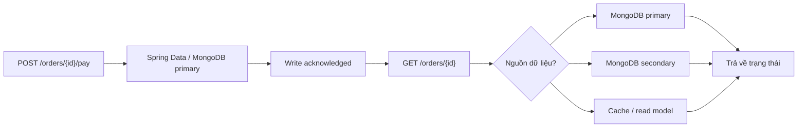
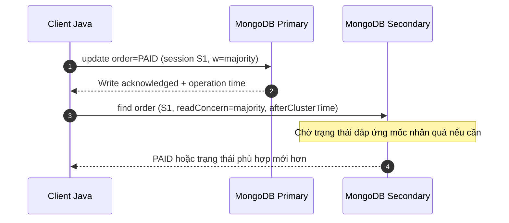
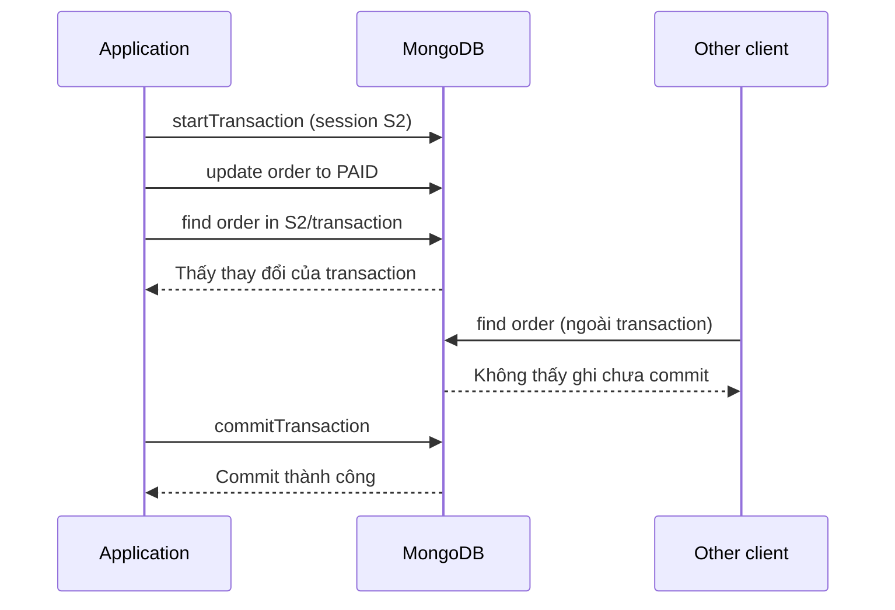

# Đọc thấy dữ liệu vừa ghi (read-after-write) và tính nhất quán nhân quả

## 1. Tình huống: ghi thành công nhưng lần đọc ngay sau vẫn thấy giá trị cũ

Một API trong hệ thống đặt hàng cập nhật trạng thái đơn từ `PENDING` sang `PAID`. MongoDB xác nhận lệnh ghi thành công. Ngay sau đó, ứng dụng điều hướng đến trang chi tiết đơn hàng, nhưng trang vẫn hiển thị `PENDING` trong một khoảng thời gian ngắn.

Đây có thể là hiện tượng **đọc từ một replica chưa áp dụng thay đổi**, chứ không nhất thiết do `MongoTemplate.save(...)` hoặc repository ghi thất bại.

Giả sử MongoDB triển khai replica set gồm một primary và hai secondary:

```text
Thời điểm     Primary            Secondary A          Secondary B
---------     ----------------   -------------------  -------------------
T0            order= PENDING     order= PENDING       order= PENDING
T1 write      order= PAID        order= PENDING       order= PENDING
T2 read       (cập nhật đã có)   (chưa kịp áp dụng)  (chưa kịp áp dụng)
T3            order= PAID        order= PAID          order= PENDING
T4            order= PAID        order= PAID          order= PAID
```

Nếu lần đọc tại `T2` được route tới Secondary B, client có thể nhận `PENDING`. Đổi sang `secondaryPreferred` để giảm tải primary **không** tự bảo đảm dữ liệu được đọc là mới nhất.

Yêu cầu nghiệp vụ **read-after-write** (*read your writes*, đọc thấy lần ghi của chính mình) đặt ra rằng: sau khi một thao tác ghi đã hoàn thành theo điều kiện xác nhận đã chọn, những lần đọc tiếp theo trong **cùng chuỗi hoạt động nhân quả** phải nhìn thấy hiệu ứng của lần ghi đó, hoặc một trạng thái mới hơn tương thích với các thay đổi khác.

Bài thuộc chương **Nhất quán dữ liệu** của module **SPRING_DATA_MONGODB**. Chúng ta sẽ sử dụng Spring Data MongoDB, `MongoTemplate`, repository, MongoDB Java driver, khái niệm session, read/write concern, read preference, transaction, reactive access, kiểm thử và chẩn đoán hiệu năng. Mục tiêu là phân biệt điều gì được **bảo đảm**, điều gì chỉ **thường xảy ra**, và cách thiết kế một luồng ghi–đọc đúng yêu cầu.

## 2. Tách các vấn đề thường bị gọi chung là “nhất quán”

Một câu “không thấy dữ liệu mới” có thể xuất phát từ nhiều cơ chế:

| Câu hỏi | Cơ chế liên quan | Tình huống |
| --- | --- | --- |
| Lệnh ghi đã được server xác nhận ở mức nào? | **Write concern** | `w:1`, `w:"majority"` |
| Lần đọc được thực hiện trên node nào? | **Read preference** | Primary, secondary, secondaryPreferred |
| Bản ghi được phép đọc phải có mức xác nhận nào? | **Read concern** | `local`, `majority`, `snapshot` |
| Những thao tác có liên hệ nhân quả với nhau không? | **Client session** | Cùng session, các thao tác tuần tự |
| Có sự thay đổi đồng thời của người dùng khác không? | **Concurrency control** | Optimistic locking, compare-and-set |
| Nhiều document phải commit hoặc rollback cùng nhau không? | **Transaction** | Chuyển tiền giữa hai tài khoản |
| Dữ liệu đang được đọc từ đâu ngoài MongoDB? | **Cache/search/read model** | Redis, Elasticsearch, CDN, replica analytics |

**Read-after-write không đồng nghĩa với transaction; causal consistency không đồng nghĩa với linearizability; read concern majority không đồng nghĩa luôn đọc giá trị thời gian thực mới nhất.** Những yêu cầu này cần được diễn đạt riêng.

### 2.1. Hai loại độ mới khác nhau

- **Read-your-writes:** client đọc sau một lần ghi của chính mình không được quay lại trạng thái trước lần ghi đó theo cùng quan hệ nhân quả.
- **Read the latest globally:** một lần đọc phải nhìn thấy thao tác hoàn tất gần nhất từ **mọi client** theo thứ tự thời gian thực. Đây là yêu cầu mạnh hơn và thường liên quan tới *linearizable reads* trên phạm vi thao tác thích hợp.

Một session bảo đảm đọc dữ liệu ít nhất tại mốc nhân quả cần thiết **không tự hứa** trả giá trị cuối cùng của tất cả client trên toàn hệ thống.

### 2.2. Một cache cũ có thể gây hiểu nhầm

Nếu MongoDB đọc đúng nhưng một REST endpoint lấy từ Redis hoặc một materialized view chưa cập nhật, việc thêm MongoDB session sẽ **không tự đồng bộ cache**.

Trước khi chỉnh read concern, cần xác minh đường đọc là:



Nếu điểm đọc thực tế là cache hoặc search index, cần thiết kế cơ chế refresh/invalidation hoặc nhất quán của chính hệ thống đó.

## 3. Read preference: ứng dụng đang đọc primary hay secondary?

MongoDB cho phép chọn node thích hợp cho các thao tác đọc, tùy topology và cấu hình:

| Read preference | Ý nghĩa khái quát | Rủi ro về độ mới |
| --- | --- | --- |
| `primary` | Ưu tiên đọc trên primary | Giảm khả năng gặp secondary lag; vẫn cần xét concern/failover |
| `primaryPreferred` | Primary khi khả dụng, có thể đọc secondary khi cần | Có thể đổi nguồn đọc khi topology thay đổi |
| `secondary` | Chỉ đọc từ secondary phù hợp | Có thể gặp replication lag hoặc timeout |
| `secondaryPreferred` | Ưu tiên secondary, fallback primary | Có thể đọc phiên bản cũ ngay sau ghi |
| `nearest` | Chọn node theo độ trễ/tiêu chí phù hợp | Node nhanh nhất không nhất thiết có dữ liệu mới nhất |

Đọc từ primary ngay sau `w:1` write thường thấy lần ghi vừa hoàn thành **trong điều kiện primary không đổi và không có rollback**, nhưng đây không phải bảo đảm bền vững khi failover hoặc khi đường đọc chuyển sang node khác.

### 3.1. Ví dụ readPreference qua MongoDB Java driver

```java
import com.mongodb.ReadPreference;
import com.mongodb.client.MongoCollection;
import com.mongodb.client.MongoDatabase;
import org.bson.Document;

MongoDatabase database = mongoClient.getDatabase("app");

MongoCollection<Document> fromPrimary =
    database.getCollection("orders")
        .withReadPreference(ReadPreference.primary());

MongoCollection<Document> fromSecondary =
    database.getCollection("orders")
        .withReadPreference(ReadPreference.secondaryPreferred());
```

Hai collection handles ở đây cùng trỏ tới một collection logic, nhưng read preference khác nhau. Chúng chưa cấu hình read/write concern hoặc session, vì vậy **đừng coi việc gọi `fromSecondary.find(...)` là bảo đảm read-after-write**.

### 3.2. Đọc secondary không phải lỗi thiết kế

Đọc secondary có thể phù hợp cho:

- Báo cáo chấp nhận độ trễ.
- Tra cứu nội dung có yêu cầu về độ mới mềm.
- Workload đọc rất lớn, có thể đánh đổi độ mới lấy phân tải.

Nếu một luồng nghiệp vụ vừa ghi vừa đọc cần **read your writes**, dùng **causally consistent session + majority concerns**, hoặc một chiến lược khác với mức bảo đảm đã được xác minh.

## 4. Write concern: thành công nghĩa là gì?

**Write concern** quyết định điều kiện MongoDB phải đáp ứng trước khi xác nhận lệnh ghi.

| Write concern | Ý nghĩa | Lưu ý |
| --- | --- | --- |
| `w: 0` | Không chờ xác nhận ghi từ server | Không phù hợp làm cơ sở bảo đảm ghi đã có |
| `w: 1` | Primary xác nhận theo quy tắc của thao tác | Có thể gặp rollback nếu primary đổi trước khi ghi bền vững trên đa số |
| `w: "majority"` | Chờ xác nhận theo đa số thành viên dữ liệu áp dụng cho write concern | Tăng độ bền; cần ghép read concern và session cho causal guarantee |
| `j: true` | Yêu cầu journal theo khả năng/configuration của server | Quan hệ với majority journaling phụ thuộc deployment |
| `wtimeout` | Giới hạn thời gian chờ điều kiện write concern | Timeout không tự chứng minh thao tác đã bị rollback |

Ví dụ:

```javascript
db.orders.updateOne(
  { _id: "order-101" },
  { $set: { state: "PAID" } },
  { writeConcern: { w: "majority", wtimeout: 5000 } }
);
```

Đoạn trên yêu cầu MongoDB xác nhận ghi ở mức majority. Tuy nhiên, **việc chờ đa số không tự bắt secondary mà lần đọc tiếp theo sẽ sử dụng đã áp dụng document đó**.

### 4.1. Một thay đổi quan trọng từ MongoDB 8.0

Từ **MongoDB 8.0**, majority write có thể được xác nhận sau khi phần lớn data-bearing members **ghi bền vững oplog entry**, trong khi việc **áp dụng** thay đổi vào bản dữ liệu cục bộ của secondary vẫn có thể diễn ra bất đồng bộ.

Vì vậy, một lệnh ghi `w:"majority"` được xác nhận **không đồng nghĩa** một lần đọc không có quan hệ nhân quả từ secondary lập tức trả về document mới. MongoDB khuyến nghị dùng **causally consistent session** khi cần đọc từ secondary và lập tức nhìn thấy thay đổi của chính mình.

Đây là một lý do nữa để không thiết kế read-after-write chỉ dựa trên câu “đã ghi majority rồi”.

### 4.2. Write concern timeout không có nghĩa document chắc chắn không tồn tại

Nếu lệnh ghi hết thời gian chờ `wtimeout`, primary có thể đã áp dụng thay đổi nhưng chưa đáp ứng được điều kiện xác nhận mong muốn. Ứng dụng phải xem loại lỗi cụ thể, khả năng retryable writes, idempotency key và hậu quả nghiệp vụ; **không retry mù quáng** những phép cộng tiền hoặc gửi sự kiện nhiều lần.

Một bài toán “ghi rồi đọc” chỉ nên bắt đầu phần đọc dựa trên **kết quả ghi được xác nhận thành công theo chính sách cần thiết**, không suy đoán từ một lỗi timeout.

## 5. Read concern: mức dữ liệu được phép nhìn thấy

Read concern kiểm soát **mức nhất quán/độ bền của dữ liệu trả về** theo cơ chế MongoDB.

| Read concern | Ý nghĩa trọng tâm | Liên hệ read-after-write |
| --- | --- | --- |
| `local` | Đọc từ trạng thái cục bộ của node, có thể gồm thay đổi chưa majority committed | Có thể mới nhưng có rủi ro rollback; secondary có thể trễ |
| `majority` | Đọc dữ liệu đã được xác nhận ở mức majority | Thành phần quan trọng của causal guarantees khi kết hợp session + majority writes |
| `snapshot` | Đọc theo snapshot nhất quán trong ngữ cảnh thao tác được hỗ trợ | Phù hợp một số yêu cầu snapshot/transaction, không mặc nhiên thay causal session |
| `linearizable` | Mức đọc mạnh hơn cho phạm vi được hỗ trợ, theo trật tự thời gian thực | Có điều kiện/topology/chi phí riêng; không thay thế được mọi transaction |
| `available` | Ưu tiên khả dụng với ràng buộc yếu hơn | Không phải lựa chọn để bảo đảm causal consistency |

Read concern **majority** trên một secondary chỉ có nghĩa dữ liệu trả về thuộc trạng thái majority committed mà node đó đã áp dụng; nó **không tự yêu cầu** phải đạt mốc cụ thể của lần ghi vừa xảy ra ở client khác.

### 5.1. Một cặp thông số chưa đủ nếu thiếu session

Giả sử:

```text
Write: w = "majority" -> thành công
Read:  readConcern = "majority", secondaryPreferred
Nhưng write/read thuộc hai session không có liên hệ nhân quả
```

Lần đọc có thể trả snapshot majority committed **cũ hơn mốc ghi**, bởi chưa có ràng buộc mà driver phải chờ. Để tạo đúng quan hệ “lần đọc này xảy ra sau lần ghi của chính tôi”, cần dùng session nhân quả hoặc cơ chế truyền mốc nhân quả có chủ đích.

### 5.2. Không nhầm readConcern với readPreference

Hai dòng sau nói về hai việc khác nhau:

```java
ReadConcern.MAJORITY          // Mức xác nhận của dữ liệu đọc.
ReadPreference.secondary()    // Node đọc được chọn.
```

Không có cấu hình nào trong hai dòng này **một mình** đủ cho đầy đủ causal guarantees.

## 6. Tính nhất quán nhân quả là gì?

**Causal consistency** ràng buộc thứ tự quan sát giữa các thao tác có quan hệ nguyên nhân–kết quả. Nếu thao tác B phụ thuộc vào kết quả của thao tác A, người tham gia chuỗi nhân quả không được quan sát một thứ tự mâu thuẫn với mối liên hệ đó.

MongoDB mô tả bốn bảo đảm khi dùng **causally consistent client sessions** với read/write concern phù hợp:

| Bảo đảm | Diễn giải | Ví dụ |
| --- | --- | --- |
| **Read your writes** | Đọc sau ghi thấy hiệu ứng của chính lần ghi trước | Thanh toán rồi đọc trạng thái đơn |
| **Monotonic reads** | Lần đọc sau không quay về phiên bản cũ hơn lần đọc trước theo chuỗi | Trang chi tiết không nhảy từ PAID về PENDING |
| **Monotonic writes** | Những lần ghi theo thứ tự nhân quả được áp dụng theo thứ tự đó | Ghi sự kiện `CREATED` trước `CONFIRMED` |
| **Writes follow reads** | Ghi sau khi đọc được sắp sau trạng thái đã đọc theo nhân quả | Đọc cấu hình rồi ghi quyết định dựa vào cấu hình |

Để có **đầy đủ bốn bảo đảm với tính bền vững dữ liệu**, MongoDB yêu cầu:

1. Các thao tác được phát trong một **causally consistent session**.
2. **Read concern `"majority"`** cho những lần đọc.
3. **Write concern `"majority"`** cho những lần ghi.
4. Các thao tác trong session được thực hiện **tuần tự theo thứ tự mong muốn**, không chạy đồng thời trên cùng session.

Không nên diễn giải `causallyConsistent(true)` như một công tắc thần kỳ có thể bỏ qua read/write concern.

### 6.1. Sơ đồ một chuỗi hoạt động



`afterClusterTime` là ràng buộc thời gian logic được driver/server sử dụng trong những read operations của causal session. Nó **không** có nghĩa thời gian đồng hồ máy client hay timestamp BSON Date của `updatedAt`.

### 6.2. “Nhân quả” không đồng nghĩa “mọi thao tác đều phụ thuộc nhau”

Hai người dùng sửa hai đơn hàng không liên quan vào cùng lúc không tự có thứ tự nhân quả giữa hai thao tác. Causal consistency không tạo **total order toàn cục theo thời gian thực** như một hệ thống linearizable trên mọi đối tượng.

Ngoài ra, nếu một client khác ghi đè trạng thái sau lần ghi của bạn, lần đọc hợp lệ có thể trả trạng thái **mới hơn**. Causal consistency không đóng băng document để luôn trả đúng giá trị bạn từng ghi.

## 7. ClientSession và dấu thời gian logic của MongoDB

### 7.1. Session là phạm vi của một chuỗi thao tác

MongoDB drivers hỗ trợ **client sessions**, cho phép gắn các lệnh đọc/ghi vào cùng một ngữ cảnh logic. Khi bật causal consistency, driver có thể dùng thông tin cluster/operation time để bảo đảm những lần đọc không bị lùi sau các ghi/đọc trước đó theo quan hệ nhân quả.

Java driver:

```java
import com.mongodb.ClientSessionOptions;
import com.mongodb.client.ClientSession;

try (ClientSession session = mongoClient.startSession(
        ClientSessionOptions.builder()
            .causallyConsistent(true)
            .build())) {
    // Các thao tác MongoDB cần cùng sử dụng 'session'.
}
```

**Chỉ tạo session là chưa đủ.** Nếu lệnh ghi dùng overload không truyền `session` hoặc Spring Data repository chạy ngoài session, những lệnh đó không thuộc chuỗi nhân quả đang muốn bảo đảm.

### 7.2. Operation time, cluster time và afterClusterTime

- **Operation time** biểu diễn một mốc logic gắn với thao tác quan sát được.
- **Cluster time** mô tả tiến trình thời gian logic mà driver/server có thể trao đổi.
- **afterClusterTime** trên read concern đặt điều kiện lần đọc chỉ được thỏa khi đạt mốc nhân quả cần thiết.

Thời gian logic **không thể thay bằng `Instant.now()`** hoặc `createdAt` của document. Đồng hồ trên application instance có thể lệch, và `updatedAt` là dữ liệu nghiệp vụ có thể ghi tùy ý.

Driver thường quản lý việc lan truyền mốc logic **trong cùng session**. Không tự viết Java code thêm `$gte: {updatedAt:...}` rồi tuyên bố đó là causal consistency của MongoDB.

### 7.3. Session không phải transaction

Một session có thể chứa nhiều thao tác độc lập mà **không bắt đầu multi-document transaction**.

```text
Session S1:
  update order-101
  read order-101
  read customer-201

Không có transaction:
  mỗi lệnh được xử lý riêng;
  không có commit/rollback chung cho toàn chuỗi.
```

Session giúp bảo đảm **thứ tự quan sát**, không tự bảo đảm toàn bộ chuỗi sẽ có tính nguyên tử như một transaction.

### 7.4. Không dùng session đồng thời từ nhiều luồng

MongoDB Java driver `ClientSession` không được thiết kế để hai thread phát những thao tác đồng thời trên cùng session như một đối tượng thread-safe. Để có thứ tự nhân quả rõ ràng, **đợi thao tác trước hoàn thành** rồi mới bắt đầu thao tác sau.

Trong ứng dụng reactive, nối publisher đúng thứ tự bằng `then`/`flatMap` khi thực sự có phụ thuộc; không phát đồng thời hai thao tác trên cùng session rồi kỳ vọng driver tự sắp đúng nhân quả.

## 8. Ví dụ Java driver: ghi majority rồi đọc majority trong cùng session

### 8.1. Thiết lập môi trường

Ví dụ dưới đây giả định MongoDB **replica set hoặc deployment hỗ trợ sessions/majority concerns**, Java driver đồng bộ và MongoDB database `store`. Mọi read/write operation trong phần cần bảo đảm nhân quả đều dùng cùng `ClientSession`.

```java
package example.consistency;

import com.mongodb.ClientSessionOptions;
import com.mongodb.ReadConcern;
import com.mongodb.ReadPreference;
import com.mongodb.WriteConcern;
import com.mongodb.client.ClientSession;
import com.mongodb.client.MongoClient;
import com.mongodb.client.MongoCollection;
import com.mongodb.client.MongoDatabase;
import com.mongodb.client.model.Filters;
import com.mongodb.client.model.Updates;
import org.bson.Document;

public final class ReadYourWritesExample {

    private ReadYourWritesExample() {}

    public static String payThenRead(
            MongoClient client,
            String orderId) {

        MongoDatabase db = client.getDatabase("store")
            .withReadConcern(ReadConcern.MAJORITY)
            .withWriteConcern(WriteConcern.MAJORITY)
            .withReadPreference(
                ReadPreference.secondaryPreferred()
            );

        MongoCollection<Document> orders =
            db.getCollection("orders");

        try (ClientSession session = client.startSession(
                ClientSessionOptions.builder()
                    .causallyConsistent(true)
                    .build())) {

            orders.updateOne(
                session,
                Filters.eq("_id", orderId),
                Updates.set("state", "PAID")
            );

            Document observed = orders.find(
                    session, Filters.eq("_id", orderId)
                ).first();

            if (observed == null) {
                throw new IllegalStateException(
                    "Không tìm thấy đơn hàng"
                );
            }
            return observed.getString("state");
        }
    }
}
```

Các điểm thiết yếu:

1. `withWriteConcern(WriteConcern.MAJORITY)` áp dụng cho write operation.
2. `withReadConcern(ReadConcern.MAJORITY)` áp dụng cho lần đọc.
3. `secondaryPreferred` cho phép đọc ở secondary nhưng không bắt buộc luôn chọn secondary; nếu không có secondary phù hợp có thể fallback primary.
4. `startSession(...causallyConsistent(true))` tạo ngữ cảnh nhân quả.
5. **Cả `updateOne(session,...)` và `find(session,...)` đều truyền cùng session.**
6. `try-with-resources` đóng session sau khi chuỗi hoàn tất.

**Điểm cần bổ sung trong service production:** kiểm tra `UpdateResult.getMatchedCount()` và `getModifiedCount()`, xác thực quyền cập nhật, dùng điều kiện trạng thái hợp lệ và xử lý cạnh tranh. Nếu query update không match document, read-after-write không thể làm “xuất hiện” một lần ghi chưa từng xảy ra.

### 8.2. Phiên bản xử lý kết quả ghi cẩn thận hơn

```java
var result = orders.updateOne(
    session,
    Filters.and(
        Filters.eq("_id", orderId),
        Filters.eq("tenantId", authorizedTenantId),
        Filters.eq("state", "PENDING")
    ),
    Updates.set("state", "PAID")
);

if (result.getMatchedCount() != 1) {
    throw new IllegalStateException(
        "Đơn không tồn tại, khác tenant hoặc trạng thái đã đổi"
    );
}

Document observed = orders.find(
    session,
    Filters.and(
        Filters.eq("_id", orderId),
        Filters.eq("tenantId", authorizedTenantId)
    )
).first();
```

Đoạn này được chèn **bên trong try-with-resources của phần 8.1**, với `authorizedTenantId` đã được xác thực. Nó thêm điều kiện tenant và transition `PENDING → PAID`, tránh ghi nhầm document không thuộc quyền.

Một `matchedCount` bằng 1 chưa bảo đảm trạng thái cuối cùng mãi là PAID: một client khác có thể cập nhật thành CANCELLED sau đó. Muốn bảo vệ khỏi lost update, cân nhắc **optimistic locking**, conditional update hoặc transaction tùy invariant nghiệp vụ.

## 9. Java driver: vì sao cùng read/write concern nhưng không dùng session vẫn có thể sai?

So sánh hai phiên bản:

### 9.1. Không bảo đảm quan hệ nhân quả

```java
orders.updateOne(
    Filters.eq("_id", orderId),
    Updates.set("state", "PAID")
);

// Không truyền ClientSession vào find:
Document read = orders.find(
    Filters.eq("_id", orderId)
).first();
```

Ngay cả khi collection handle có `ReadConcern.MAJORITY` và `WriteConcern.MAJORITY`, lần đọc không session ở secondary **không có ngữ cảnh bắt buộc nó phải thấy lần ghi trên**. Kết quả thường đúng khi secondary bắt kịp nhanh, nhưng đó là hành vi quan sát thực tế, không phải bảo đảm causal.

### 9.2. Dùng cùng session nhưng concerns chưa đủ

```java
try (ClientSession session = client.startSession(
        ClientSessionOptions.builder()
            .causallyConsistent(true)
            .build())) {
    // Nếu operation thực tế dùng w:1, readConcern local,
    // không thể khẳng định đủ bốn causal guarantees bền vững.
}
```

Một session `causallyConsistent(true)` chỉ là **một phần của điều kiện**. Đặc biệt trong tình huống failover, một ghi `w:1` có thể bị rollback, làm việc hứa “read your writes” bền vững trở nên không thể bảo đảm.

### 9.3. Dùng concerns + session nhưng đọc qua cache

```text
write MongoDB majority trong session S1 -> thành công
read MongoDB majority trong S1 -> đúng
GET /orders qua Redis cache chưa invalidated -> có thể cũ
```

MongoDB không thể ràng buộc Redis cache bằng `afterClusterTime`. Cần chính sách cache riêng.

## 10. Read-after-write qua Spring Data MongoTemplate

### 10.1. Entity dùng trong ví dụ

```java
package example.consistency;

import org.springframework.data.mongodb.core.mapping.Document;
import org.springframework.data.mongodb.core.mapping.FieldType;
import org.springframework.data.mongodb.core.mapping.MongoId;

@Document(collection = "orders")
public record Order(
    @MongoId(FieldType.STRING) String id,
    String tenantId,
    String state,
    long totalCents
) {}
```

Record này thể hiện schema đơn giản. Trong production, việc thanh toán có thể yêu cầu xử lý event, idempotency, kiểm tra trạng thái, ledger và nhiều document khác; causal consistency không thay thế toàn bộ quy trình đó.

### 10.2. MongoTemplate.withSession(session)

Spring Data MongoDB có API **`MongoOperations.withSession(ClientSession)`** để trả về một đối tượng operations gắn với session đã có.

```java
package example.consistency;

import com.mongodb.ClientSessionOptions;
import com.mongodb.client.ClientSession;
import com.mongodb.client.MongoClient;
import org.springframework.data.mongodb.core.MongoOperations;
import org.springframework.data.mongodb.core.MongoTemplate;
import org.springframework.data.mongodb.core.query.Criteria;
import org.springframework.data.mongodb.core.query.Query;
import org.springframework.data.mongodb.core.query.Update;
import org.springframework.stereotype.Service;

@Service
public class OrderConsistencyService {

    private final MongoClient client;
    private final MongoTemplate template;

    public OrderConsistencyService(
            MongoClient client,
            MongoTemplate template) {
        this.client = client;
        this.template = template;
    }

    public Order payAndRead(
            String authorizedTenantId,
            String orderId) {

        if (authorizedTenantId == null
                || authorizedTenantId.isBlank()) {
            throw new IllegalArgumentException(
                "tenantId không hợp lệ"
            );
        }

        try (ClientSession session = client.startSession(
                ClientSessionOptions.builder()
                    .causallyConsistent(true)
                    .build())) {

            MongoOperations ops = template.withSession(session);

            var updateResult = ops.updateFirst(
                Query.query(
                    Criteria.where("id").is(orderId)
                        .and("tenantId").is(authorizedTenantId)
                        .and("state").is("PENDING")
                ),
                new Update().set("state", "PAID"),
                Order.class
            );

            if (updateResult.getMatchedCount() != 1) {
                throw new IllegalStateException(
                    "Không thể chuyển trạng thái đơn"
                );
            }

            return ops.findOne(
                Query.query(
                    Criteria.where("id").is(orderId)
                        .and("tenantId").is(authorizedTenantId)
                ),
                Order.class
            );
        }
    }
}
```

**Điều kiện bắt buộc để suy ra full causal guarantees:** `MongoClient`/`MongoTemplate` trong đoạn code phải được cấu hình **write concern majority, read concern majority** cho các thao tác thực tế. Mã `withSession` chỉ gắn session vào lệnh; nó **không tự nâng** concern của ứng dụng thành majority. Nếu Spring Data có custom write concern resolver hoặc read concern khác trên từng operation, phải kiểm tra giá trị hiệu lực thật.

### 10.3. Một cách cấu hình MongoClient majority mặc định

Khi ứng dụng tự tạo MongoDB Java client (thay vì dùng toàn bộ auto-configuration), có thể cấu hình:

```java
import com.mongodb.ConnectionString;
import com.mongodb.MongoClientSettings;
import com.mongodb.ReadConcern;
import com.mongodb.ReadPreference;
import com.mongodb.WriteConcern;
import com.mongodb.client.MongoClient;
import com.mongodb.client.MongoClients;

ConnectionString uri = new ConnectionString(
    "mongodb://host1:27017,host2:27017,host3:27017/"
        + "?replicaSet=rs0"
);

MongoClientSettings settings = MongoClientSettings.builder()
    .applyConnectionString(uri)
    .readConcern(ReadConcern.MAJORITY)
    .writeConcern(WriteConcern.MAJORITY)
    .readPreference(ReadPreference.secondaryPreferred())
    .build();

MongoClient client = MongoClients.create(settings);
```

Địa chỉ `host1/host2/host3` là placeholder, **không** phải hệ thống MongoDB thật để copy dùng nguyên trạng. Trong Spring Boot production, client nên được quản lý như **bean**, thông tin kết nối/credential nằm trong cấu hình bảo mật, và service sử dụng đúng client mà `MongoTemplate` được tạo từ đó.

Không tự tạo client mới trong mỗi HTTP request. Client thường được tái sử dụng, còn **ClientSession** được tạo/đóng theo phạm vi tác vụ cần quan hệ nhân quả.

### 10.4. Repository bình thường có tự dùng cùng session không?

```java
repository.save(order);
Order reread = repository.findById(order.id()).orElseThrow();
```

Hai method call trên **không mặc nhiên** thuộc cùng một explicit causally consistent session với read/write concerns majority chỉ vì cùng repository object hoặc cùng request thread.

Repository có thể tham gia session được Spring quản lý trong một **transaction** đã cấu hình, nhưng transaction là một mô hình khác; không suy luận một cặp repository method bình thường tự đạt đầy đủ causal guarantees khi đọc từ secondary.

Nếu cần explicit causal session không transaction, `MongoTemplate.withSession(session)` là một cách diễn đạt rõ ràng. Khi nhiều tầng service cùng cần truy cập MongoDB, phải quyết định **phạm vi session** và tránh để một query đi ra ngoài session.

## 11. Cùng session, nhưng request HTTP khác nhau thì sao?

Một luồng thực tế thường là:

```text
POST /orders/101/pay  -> instance A, MongoDB write
HTTP 200/303           -> trả cho browser
GET  /orders/101      -> instance B, MongoDB read
```

Hai request có thể chạy trên hai pod khác nhau và sử dụng **MongoClient/ClientSession khác nhau**. Việc client Java ở mỗi pod tự bật causal consistency **không tạo ra quan hệ nhân quả xuyên request** nếu mốc nhân quả không được truyền/tổ chức theo cách được hỗ trợ.

### 11.1. Các phương án thiết kế

| Phương án | Phù hợp khi | Hạn chế |
| --- | --- | --- |
| Trả entity/trạng thái mới ngay trong response ghi | UI cần hiển thị kết quả vừa cập nhật tức thì | Lần GET khác qua cache/secondary vẫn cần policy |
| Đọc ngay trong cùng backend session có majority concerns | Một use case gồm ghi rồi đọc trong một request | Session hết phạm vi khi request kết thúc |
| Route lần GET tiếp theo tới primary với concern phù hợp | Độ mới cao, muốn tránh secondary lag | Tăng tải primary; phải tính failover và guarantees |
| Lan truyền causal context/operation time qua tầng ứng dụng được thiết kế riêng | Hệ thống cần causal chain qua service/request | Phức tạp, phải kiểm soát bảo mật và driver semantics |
| Chờ read model/cache đạt version mong đợi | CQRS/search/cache bất đồng bộ | Có latency, timeout, version và error contract |

Một kỹ thuật hệ thống phân tán nâng cao là chia sẻ **operationTime/clusterTime** giữa các session có quan hệ nhân quả, qua cơ chế driver hỗ trợ như `advanceOperationTime`/`advanceClusterTime`. Nhưng không nên tự lấy các timestamp từ request client rồi tin vô điều kiện: chúng liên quan tới cluster metadata, xác thực/độ tin cậy và deadline. Chỉ sử dụng khi hiểu chính xác driver/cluster và có một protocol nội bộ được kiểm thử.

### 11.2. Giao thức dựa trên version nghiệp vụ

Khi dữ liệu hiển thị đến từ read model không trực tiếp ở MongoDB:

```text
Write response:
  { "orderId": "101", "version": 12, "state": "PAID" }

Follow-up read:
  chờ hoặc chỉ chấp nhận bản ghi version >= 12
  hết hạn -> trả trạng thái "đang đồng bộ" hoặc retry có giới hạn
```

Đây là **một chiến lược của ứng dụng**, không phải MongoDB causal consistency tự có. Nó đặc biệt hữu ích với hệ thống event-driven, nhưng phải định nghĩa rõ version tăng thế nào, khi nào được coi đã áp dụng và cách xử lý timeout.

## 12. Read-your-writes không đồng nghĩa linearizable

### 12.1. Bốn mức cần phân biệt

| Yêu cầu | Điều nó thực sự nói |
| --- | --- |
| Eventual consistency | Nếu dừng các cập nhật mới và replication hoàn tất, các bản sao có thể hội tụ |
| Read-your-writes | Người viết không quan sát phiên bản cũ hơn lần ghi đã hoàn tất của mình trong chuỗi nhân quả |
| Causal consistency | Bảo toàn những phụ thuộc nhân quả giữa reads/writes, gồm read-your-writes |
| Linearizability | Các thao tác trong phạm vi được bảo đảm xuất hiện theo một trật tự phù hợp thứ tự thời gian thực |

Read-your-writes không ngăn người dùng khác thay đổi trạng thái sau bạn. Nếu bạn ghi `state=PAID`, một nghiệp vụ hoàn tiền có thể cập nhật `state=REFUNDED` ngay sau đó; read có thể trả `REFUNDED` mà **không vi phạm read-your-writes**.

### 12.2. Khi nào cần cân nhắc linearizable reads?

Một số quyết định cần trạng thái mới nhất của **một document** tại mốc thời gian thực, chẳng hạn bảo vệ một loại cờ quyết định đồng thời. MongoDB có `readConcern: "linearizable"` trong phạm vi và điều kiện hỗ trợ riêng, thường cần read từ primary và sử dụng cùng write concern phù hợp.

Tuy nhiên:

- Linearizable read không mặc nhiên tạo **transaction đa document**.
- Nó có thể gây thêm latency và không phù hợp cho mọi workload.
- Với failover/network problem, cần timeout/deadline phù hợp.
- Nếu yêu cầu là **cập nhật không mất dữ liệu**, một lần đọc tuyến tính vẫn không thay thế compare-and-set hoặc locking.

Tránh tăng mức concern toàn hệ thống chỉ để che một bug cập nhật đồng thời.

## 13. Lost update và optimistic locking là bài toán khác

Giả sử hai service cùng đọc `quantity=5`, rồi mỗi service tính giá trị mới và `save` toàn bộ document:

```text
Client A read quantity=5
Client B read quantity=5
Client A save quantity=6
Client B save quantity=6
Kỳ vọng nghiệp vụ: 7, thực tế có thể chỉ 6.
```

Dù A và B đều đọc trong causal session, **lost update vẫn có thể xảy ra**. Causal consistency bảo vệ thứ tự quan sát của từng session; nó không tự giải quyết xung đột giữa hai writer.

### 13.1. Dùng thao tác nguyên tử trên một document

```java
template.updateFirst(
    Query.query(
        Criteria.where("id").is(orderId)
            .and("tenantId").is(authorizedTenantId)
    ),
    new Update().inc("quantity", 1),
    Order.class
);
```

`$inc` được thực hiện nguyên tử cho một document khi điều kiện khớp, nên tránh mô hình `read → quantity + 1 → save` gây lost update đơn giản. Ví dụ `Order` phía trên chưa khai báo `quantity`; đây là **mẫu cập nhật** áp dụng cho một entity có field `quantity` hoặc document schema phù hợp, không phải code trực tiếp để chạy trên `Order` hiện tại.

### 13.2. Dùng @Version để phát hiện xung đột

```java
import org.springframework.data.annotation.Id;
import org.springframework.data.annotation.Version;
import org.springframework.data.mongodb.core.mapping.Document;

@Document("inventory")
public class InventoryItem {
    @Id
    private String id;
    private long quantity;
    @Version
    private Long version;

    // Constructors/getters/setters theo ứng dụng.
}
```

Với `@Version` và cơ chế optimistic locking của Spring Data MongoDB, một lần save trên entity có version cũ có thể bị từ chối bằng `OptimisticLockingFailureException` thay vì âm thầm ghi đè. Để phát hiện chính xác write conflict, dùng **write concern được xác nhận**, không dùng unacknowledged write.

**So sánh:** causal consistency giải quyết *thứ tự nhìn thấy*, `@Version` giải quyết *ghi đè cạnh tranh*, còn transaction giải quyết *nhiều thao tác cần commit/abort chung*.

## 14. Read-after-write và transaction

MongoDB multi-document transaction tạo một ngữ cảnh **commit/abort chung** trên phạm vi thao tác được hỗ trợ. Trong transaction, session đọc có thể nhìn thấy những thay đổi do chính transaction tạo ra trước khi commit, trong khi các client bên ngoài chưa được phép quan sát những thay đổi chưa commit theo các quy tắc isolation.



### 14.1. Khi nào cần transaction?

Ví dụ chuyển tiền giữa hai tài khoản:

1. Trừ số dư A.
2. Cộng số dư B.
3. Ghi event chuyển tiền.

Nếu cả ba phải cùng thành công hoặc rollback, causal session không đủ; cần một **transaction** hoặc một mô hình workflow/saga được thiết kế chặt. Sau khi commit, read-after-write cho các đọc ở node khác vẫn cần xem read preference và concern.

### 14.2. Spring Data MongoTransactionManager

Trong Spring Data MongoDB đồng bộ, có thể dùng `MongoTransactionManager` và `@Transactional` khi topology hỗ trợ transaction:

```java
import org.springframework.context.annotation.Bean;
import org.springframework.context.annotation.Configuration;
import org.springframework.data.mongodb.MongoDatabaseFactory;
import org.springframework.data.mongodb.MongoTransactionManager;

@Configuration
public class MongoTransactionConfig {

    @Bean
    MongoTransactionManager transactionManager(
            MongoDatabaseFactory databaseFactory) {
        return new MongoTransactionManager(databaseFactory);
    }
}
```

Service:

```java
import org.springframework.stereotype.Service;
import org.springframework.transaction.annotation.Transactional;

@Service
public class PaymentWorkflow {

    private final MongoOperations mongo;

    public PaymentWorkflow(MongoOperations mongo) {
        this.mongo = mongo;
    }

    @Transactional
    public void applyPayment(/* input validated */) {
        // Nhiều MongoOperations dùng session transaction
        // được Spring quản lý trong cùng transaction boundary.
        // Kiểm soát lỗi/retry theo quy tắc transaction.
    }
}
```

Đoạn trên minh họa **cấu hình transaction**, không phải triển khai thanh toán thực tế. Transaction cần replica set/sharded deployment hỗ trợ và yêu cầu retry phù hợp với loại lỗi, session lifecycle, commit semantics, thời gian chạy và giới hạn tài nguyên.

**Không suy luận** mọi `@Transactional` tự cấp read concern majority cho các đọc ngoài transaction; transaction có các read/write concerns và chính sách commit riêng.

## 15. Reactive: đúng thứ tự subscribe mới có quan hệ nhân quả

Reactive Spring Data MongoDB sử dụng `ReactiveMongoTemplate` và `Flux`/`Mono`. Khác biệt chính là **thao tác không chạy ngay khi tạo Publisher**; nó chạy khi có subscription. Do đó, thứ tự **viết code** không tự đồng nghĩa thứ tự **hoàn tất lệnh MongoDB**.

### 15.1. Ví dụ sai: tạo hai publisher độc lập rồi chạy song song

```java
Mono<UpdateResult> write = reactiveTemplate.updateFirst(
    query,
    update,
    Order.class
);

Mono<Order> read = reactiveTemplate.findOne(
    query,
    Order.class
);

// Nếu combine theo cách subscribe cả hai đồng thời:
// không có bảo đảm read xảy ra sau write đã hoàn thành.
```

`Mono.zip(write, read)` thường tạo hai subscription có thể chạy chồng lên nhau; nó **không** diễn đạt “đợi ghi xong rồi đọc”.

### 15.2. Diễn đạt phụ thuộc bằng then

```java
Mono<Order> writeThenRead = reactiveTemplate
    .updateFirst(query, update, Order.class)
    .flatMap(result -> {
        if (result.getMatchedCount() != 1) {
            return Mono.error(new IllegalStateException(
                "Không cập nhật được đơn"
            ));
        }
        return Mono.just(result);
    })
    .then(reactiveTemplate.findOne(query, Order.class));
```

Đoạn code này bảo đảm **thứ tự Publisher**: đọc được subscribe sau khi update hoàn tất thành công. Nhưng nó **chưa đủ để tuyên bố causal consistency** nếu hai thao tác không dùng chung causally consistent reactive session và concerns majority.

### 15.3. Reactive session và quản lý tài nguyên

Spring Data hỗ trợ session-aware operations trong reactive API. Phải:

- Tạo reactive `ClientSession` theo đúng API của driver/version.
- Gắn session đó vào **tất cả operations** thuộc chuỗi nhân quả.
- Đảm bảo các lệnh trong cùng session có thứ tự, không concurrent.
- Dùng `readConcern: majority` và `writeConcern: majority` cho bảo đảm đầy đủ.
- Đóng session khi sequence hoàn tất, lỗi hoặc bị hủy; `usingWhen` là một mẫu Reactor phù hợp khi đã có API lấy và đóng resource.

**Không dùng lại code `com.mongodb.client.ClientSession` của driver synchronous với reactive driver**, vì hai API session không thay thế cho nhau. Kiểm tra phiên bản Spring Data/Reactive Streams driver trước khi triển khai đầy đủ.

### 15.4. Timeout reactive không thay maxTimeMS của server

```java
Mono<Order> bounded =
    writeThenRead.timeout(Duration.ofSeconds(5));
```

Đây là timeout của Publisher ở ứng dụng. Nó không mặc nhiên tương đương server `maxTimeMS`, cũng không làm lệnh ghi đã được xác nhận tự rollback. Khi client timeout sau write nhưng trước read, xử lý retry/idempotency phải dựa vào trạng thái nghiệp vụ và kết quả đã biết.

## 16. Kiểm thử tích hợp: bảo đảm dương tính, không kiểm thử bằng timing may rủi

### 16.1. Mục tiêu test

Một test read-after-write đáng tin cần:

1. Sử dụng MongoDB replica set/sharded deployment hỗ trợ sessions.
2. Dùng cùng `ClientSession` với `causallyConsistent(true)`.
3. Đặt read concern majority và write concern majority một cách **tường minh**.
4. Ghi rồi đọc **tuần tự**.
5. Kiểm tra kết quả write match và giá trị đọc.
6. Tách dữ liệu bằng ID/collection riêng để không va chạm test khác.

Không nên viết test “ghi rồi ngay lập tức đọc secondary phải nhận giá trị cũ” — replication lag không cố định và MongoDB phiên bản/server load khác nhau có thể làm test lúc pass lúc fail.

### 16.2. JUnit 5 + MongoDB driver trong @DataMongoTest

```java
package example.consistency;

import static com.mongodb.client.model.Filters.eq;
import static org.junit.jupiter.api.Assertions.*;

import com.mongodb.ClientSessionOptions;
import com.mongodb.ReadConcern;
import com.mongodb.ReadPreference;
import com.mongodb.WriteConcern;
import com.mongodb.client.ClientSession;
import com.mongodb.client.MongoClient;
import com.mongodb.client.MongoCollection;
import com.mongodb.client.MongoDatabase;
import java.util.UUID;
import org.bson.Document;
import org.junit.jupiter.api.Test;
import org.springframework.beans.factory.annotation.Autowired;
import org.springframework.boot.test.autoconfigure.data.mongo.DataMongoTest;
import org.springframework.data.mongodb.core.MongoTemplate;

@DataMongoTest
class CausalConsistencyIntegrationTest {

    @Autowired
    MongoClient client;

    @Autowired
    MongoTemplate template;

    @Test
    void majoritySessionReadsItsOwnNewlyInsertedDocument() {
        String collectionName = "causal_test_" +
            UUID.randomUUID().toString().replace("-", "");

        MongoDatabase adminDb = client
            .getDatabase(template.getDb().getName());
        adminDb.createCollection(collectionName);

        MongoCollection<Document> collection = adminDb
            .getCollection(collectionName)
            .withReadConcern(ReadConcern.MAJORITY)
            .withWriteConcern(WriteConcern.MAJORITY)
            .withReadPreference(
                ReadPreference.secondaryPreferred()
            );

        String id = "order-" + UUID.randomUUID();

        try {
            try (ClientSession session = client.startSession(
                    ClientSessionOptions.builder()
                        .causallyConsistent(true)
                        .build())) {

                collection.insertOne(
                    session,
                    new Document("_id", id)
                        .append("state", "PAID")
                        .append("tenantId", "test-tenant")
                );

                Document found = collection.find(
                    session, eq("_id", id)
                ).first();

                assertNotNull(found);
                assertEquals(
                    "PAID", found.getString("state")
                );
            }
        } finally {
            adminDb.getCollection(collectionName).drop();
        }
    }
}
```

**Điều kiện chạy test:** `@DataMongoTest` không tự bảo đảm MongoDB replica set được khởi chạy. Testcontainers hoặc một MongoDB test replica set đã cấu hình phải thực sự hỗ trợ sessions và majority concern. Tài khoản test cần quyền tạo/xóa collection.

Test này chứng minh một **chuỗi dương tính** với concerns/session được yêu cầu. Nó không chứng minh mọi lần đọc secondary không session đều stale; đó là một tính chất có thể xuất hiện do lag, không phải một kết quả có thể áp đặt bằng timing đơn giản.

### 16.3. Test update sau insert vẫn theo thứ tự

Trong cùng một session và cùng collection handle có concerns majority:

```java
collection.insertOne(
    session,
    new Document("_id", "test-101")
        .append("state", "PENDING")
);

collection.updateOne(
    session,
    eq("_id", "test-101"),
    new Document("$set",
        new Document("state", "PAID"))
);

Document observed = collection.find(
    session, eq("_id", "test-101")
).first();

assertNotNull(observed);
assertEquals("PAID", observed.getString("state"));
```

Đây là đoạn **minh họa cần đặt bên trong test đã tạo session/collection**, không phải test method độc lập. Nó chứng minh thứ tự insert → update → read khi mỗi lệnh chờ lệnh trước hoàn thành.

### 16.4. Quan sát failover và secondary lag trong môi trường riêng

Một thử nghiệm nâng cao:

1. Tạo replica set nhiều node trong môi trường cô lập.
2. Ghi majority và đọc secondary **không session**, thu thập kết quả; không yêu cầu phải stale.
3. Ghi majority và đọc secondary **trong causal session**, xác nhận read-your-writes.
4. Tạo replication lag/failover theo công cụ test an toàn phù hợp.
5. Đo latency và các timeout khi secondary chưa đủ mốc nhân quả.
6. Đảm bảo test không chạy thao tác phá topology trên production.

Sự khác nhau cần ghi nhận: causal consistency có thể phải **chờ** secondary bắt kịp hoặc gặp lỗi timeout, thay vì trả lại dữ liệu cũ trái với quan hệ nhân quả.

## 17. Kiểm thử đường Spring Data, không chỉ driver

Test driver xác minh server/driver semantics, nhưng một ứng dụng dùng `MongoTemplate` còn phải chứng minh **mọi lời gọi đi qua session-bound operations**.

### 17.1. Ví dụ test service

```java
@DataMongoTest
@Import(OrderConsistencyService.class)
class OrderConsistencyServiceTest {

    @Autowired MongoTemplate template;
    @Autowired OrderConsistencyService service;

    @Test
    void writeThenReadWithinServiceSession() {
        String id = "order-" + UUID.randomUUID();
        String tenant = "tenant-" + UUID.randomUUID();

        template.insert(new Order(
            id, tenant, "PENDING", 1000L
        ));

        Order observed = service.payAndRead(tenant, id);

        assertNotNull(observed);
        assertEquals("PAID", observed.state());
    }
}
```

Đoạn này giả định Java imports (JUnit 5, `@DataMongoTest`, `@Import`, `MongoTemplate`, `UUID`) đã được thêm và **MongoClient của test có read/write majority concerns** tương ứng, như phần 10.3. Nếu không kiểm soát concerns, test chỉ chứng minh thứ tự service trên một môi trường, **không chứng minh đầy đủ causal guarantees trong mọi failover**.

### 17.2. Audit những query “lọt” ra ngoài session

Một lỗi rất dễ mắc:

```java
try (ClientSession session = client.startSession(...)) {
    MongoOperations inSession = template.withSession(session);

    inSession.updateFirst(query, update, Order.class);

    // Sai ngữ cảnh: dùng original template thay vì inSession.
    Order result = template.findOne(query, Order.class);
}
```

Đây là **ví dụ sai để chẩn đoán**, trong đó phần khởi tạo session được rút gọn bằng `...` nên không phải đoạn code copy chạy nguyên vẹn. Query cuối **không được bảo đảm dùng session đã tạo**, dù ở cùng method Java.

Khi code tách qua repository/service khác, cần review phương pháp truyền/giữ session và test command thực tế để biết driver có nhận cùng `lsid` và thông tin causal phù hợp không. Không log nguyên pipeline có dữ liệu nhạy cảm lên production.

## 18. Chẩn đoán read-after-write bị lỗi trong production

### 18.1. Checklist theo lớp

| Lớp | Câu hỏi cần trả lời |
| --- | --- |
| API | Lệnh ghi có thực sự hoàn tất thành công không? Có timeout không? |
| Business | Update có `matchedCount=1`? Có điều kiện tenant/transition? |
| Mongo write | Write concern hiệu lực là gì? Có `wtimeout`/write concern error không? |
| Mongo read | Read preference route tới primary/secondary nào? |
| Read concern | `local` hay `majority`? |
| Session | Ghi và đọc có cùng causally consistent session không? |
| Ordering | Đọc được subscribe/gọi sau khi ghi hoàn tất hay bị chạy song song? |
| Topology | Có replication lag, election, network partition hoặc node lag không? |
| Concurrency | Một client khác có sửa document sau đó không? |
| Cache | Kết quả có đến từ cache/search index/read model không? |
| Monitoring | Command thực có `lsid`/concerns phù hợp không? Có lỗi driver không? |

### 18.2. Phân biệt “không match” và “không thấy”

```java
UpdateResult result = collection.updateOne(
    session,
    Filters.and(
        Filters.eq("_id", id),
        Filters.eq("state", "PENDING")
    ),
    Updates.set("state", "PAID")
);

if (result.getMatchedCount() == 0) {
    // Không có document đủ điều kiện cập nhật:
    // không nên quy lỗi cho replication lag.
}
```

Khi update điều kiện không khớp, không có ghi tương ứng để lần read-after-write phải quan sát. Có thể document đã đổi trạng thái, khác tenant hoặc ID sai.

### 18.3. Đừng dùng Thread.sleep làm cơ chế nhất quán

```java
repository.save(order);
Thread.sleep(500);
return repository.findById(order.id()).orElseThrow();
```

Với secondary lag thay đổi theo tải, 500 ms có thể đủ trong một ngày nhưng không đủ lúc election. `sleep` tăng độ trễ và tạo ra **phỏng đoán về tiến trình replication**, không phải một ràng buộc nhân quả.

Chọn read/write concerns, session hoặc cơ chế version phù hợp; xử lý timeout rõ ràng khi yêu cầu không thể được đáp ứng trong ngân sách thời gian.

## 19. Bốn trường hợp thiết kế và quyết định phù hợp

### 19.1. API thanh toán cần đọc lại tức thì

Yêu cầu: client vừa xác nhận một đơn, API trả trạng thái mới.

Khuyến nghị kỹ thuật:

1. Ghi với idempotency/transition có điều kiện và kiểm tra kết quả.
2. Nếu cần đọc lại MongoDB, dùng cùng causal session + majority concerns.
3. Có thể trả trạng thái/version ngay từ kết quả cập nhật khi business contract cho phép.
4. Nếu GET sau đó đi qua cache, cần invalidation hoặc version-aware read.

### 19.2. Báo cáo theo ngày chịu được độ trễ ngắn

Yêu cầu: thống kê cuối ngày, không bắt buộc thấy đơn mới nhất ngay từng giây.

Có thể dùng secondary/read models với độ mới được định nghĩa và theo dõi lag. Không nhất thiết áp majority causal session cho mọi truy vấn nếu nghiệp vụ không yêu cầu.

### 19.3. Quản lý tồn kho đồng thời

Yêu cầu: hai người dùng đặt hàng không được trừ tồn kho quá mức.

Read-your-writes chỉ là **một phần nhỏ**. Dùng atomic conditional update như:

```java
Query query = Query.query(
    Criteria.where("sku").is(sku)
        .and("available").gte(requested)
);

Update update = new Update().inc(
    "available", -requested
);

UpdateResult result = template.updateFirst(
    query, update, Inventory.class
);
if (result.getModifiedCount() != 1) {
    // Không đủ hàng hoặc document không còn khớp điều kiện.
}
```

`Inventory` là entity minh họa với `sku` và `available`, không phải `Order` ở phần 10. Điều kiện kiểm tra và cập nhật được MongoDB thực hiện nguyên tử trên **một document**, giúp bảo vệ invariant tốt hơn cách đọc số lượng về Java rồi `save` lại.

### 19.4. Workflow hai collection cùng nhất quán

Yêu cầu: ghi order và ghi payment ledger **cùng thành công hoặc cùng thất bại**.

Đây là bài toán transaction hoặc workflow đảm bảo consistency qua sự kiện/outbox, tùy phạm vi hệ thống. Dùng causal session không tự làm hai lần insert trở thành một commit nguyên tử.

## 20. Đánh đổi độ trễ, availability và throughput

Chọn stronger consistency không miễn phí:

- `w:"majority"` có thể phải chờ acknowledgments từ replica set.
- `readConcern:"majority"` có thể có chi phí khác `local` theo topology/trạng thái commit.
- Causal read trên secondary có thể phải **đợi secondary bắt kịp mốc operation time**.
- Trong election hoặc network problems, thao tác có thể chờ rồi timeout thay vì trả dữ liệu cũ.
- Gọi nhiều request qua session/concerns mạnh có thể tăng latency và tải cluster.

Ngược lại, dùng concern yếu để giảm latency có thể làm hỏng hợp đồng nghiệp vụ. Thiết kế cần đặt ngân sách rõ ràng:

| Loại dữ liệu | Yêu cầu thường gặp | Chiến lược cần đánh giá |
| --- | --- | --- |
| Xác nhận thanh toán | Không được hiển thị trạng thái cũ sau ghi của chính client | Majority writes + causal reads, idempotency và ledger |
| Trang profile vừa sửa | UI phải thấy thay đổi của mình | Trả entity mới, causal read hoặc version-aware cache |
| Đếm lượt xem | Có thể chấp nhận trễ ngắn | Eventual consistency/async aggregate |
| Quản lý hạn mức | Không mất cập nhật, không vượt giới hạn | Atomic conditional update/optimistic locking |
| Báo cáo phân tích lớn | Ưu tiên throughput, chấp nhận chậm cập nhật | Secondary/read model với lag budget |

Mỗi chiến lược cần được benchmark trong topology thực tế. Không nên áp một read preference/concern cố định cho mọi màn hình mà chưa xem yêu cầu độ mới.

### 20.1. Timeout và tình trạng “không biết ghi đã thành công hay chưa”

Một client có thể timeout trong lúc chờ majority acknowledgment. Sau đó:

- Write có thể chưa được xác nhận đầy đủ.
- Write có thể đã áp dụng nhưng response bị mất.
- Retry có thể thành công, thất bại hoặc đụng trạng thái đã thay đổi.

Với lệnh thanh toán, cần idempotency key, kết quả transaction/ledger và cơ chế reconcile. **Không coi timeout là chắc chắn thất bại, cũng không coi nó là chắc chắn thành công**.

## 21. Bài tập thực hành

### Bài 1 — Xác định nguồn đọc

Với replica set primary + hai secondary, mô tả vì sao `write w:1` rồi `read secondaryPreferred/local` có thể thấy trạng thái cũ. Đề xuất ba cách cải thiện và nêu rủi ro của từng cách.

### Bài 2 — Read/write concern và causal session

Chạy integration test với `ClientSessionOptions.causallyConsistent(true)`, `WriteConcern.MAJORITY` và `ReadConcern.MAJORITY`. Kiểm tra rằng insert rồi read cùng session nhận document vừa ghi. Thử bỏ session và giải thích vì sao **không được** viết assert “phải stale” cho lần đọc ngoài session.

### Bài 3 — Quan sát operation time

Dùng command monitoring trong môi trường test để quan sát `lsid` và read concern của các lệnh MongoDB. Phân biệt operation time/cluster time/afterClusterTime với `createdAt` dạng BSON Date của document.

### Bài 4 — Reactive ordering

Viết `ReactiveMongoTemplate` update rồi find. So sánh `Mono.zip(write, read)` với `write.then(read)`. Sau đó sử dụng reactive session đúng theo driver version và majority concerns. Nêu vì sao thứ tự reactive pipeline **chưa đủ** nếu concerns/session không phù hợp.

### Bài 5 — Hai HTTP requests

Thiết kế `POST /orders/pay` và `GET /orders/{id}` chạy trên hai pod, đọc từ secondary và cache. Trình bày chiến lược trả version mới trong response, chờ read model đạt version, timeout và xử lý khi cache chưa cập nhật.

### Bài 6 — Concurrent updates

Tạo hai client cùng đọc `quantity=5` và cùng `save quantity=6`. Chứng minh causal session không tự tránh lost update. Viết lại bằng `$inc` hoặc `@Version`, kiểm tra kết quả theo đúng invariant.

### Bài 7 — Transaction và causal consistency

Mô tả chuyển tiền qua hai account documents. Chỉ ra phần nào cần multi-document transaction, phần nào cần read-after-write sau commit khi client đọc từ secondary. So sánh cách xử lý rollback, write concern và response timeout.

### Bài 8 — Secondary lag và kiểm thử không flaky

Trong replica set test được kiểm soát, tạo lag rồi so sánh read ngoài session và causal read. Không hardcode `Thread.sleep` để “bảo đảm secondary bắt kịp”. Đo thời gian, giới hạn chờ và giải thích khả năng timeout thay vì đọc dữ liệu cũ.

### Câu hỏi tự kiểm tra

- Read-after-write và read-latest-globally khác nhau thế nào?
- `ReadPreference.secondaryPreferred()` có bảo đảm đọc giá trị mới nhất không?
- Vì sao `w:"majority"` không đồng nghĩa secondary đã áp dụng document ngay tại lúc acknowledgment, đặc biệt từ MongoDB 8.0?
- `readConcern:"majority"` một mình có biết mốc ghi của client trước đó không?
- Bốn bảo đảm causal consistency gồm những gì?
- Muốn đầy đủ causal guarantees bền vững, cần những read/write concerns nào?
- Tại sao phải truyền cùng `ClientSession` cho cả write và read?
- `afterClusterTime` có phải là giá trị `updatedAt` do application đặt không?
- Causal session có tạo multi-document transaction không?
- Vì sao một lần GET qua cache vẫn có thể stale dù MongoDB causal read đã đúng?
- Vì sao `MongoTemplate.withSession(session)` không tự nâng concern lên majority?
- Khi nào dùng `@Version`/`$inc` thay vì chỉ dựa vào read-your-writes?
- Tại sao `Mono.zip(write, read)` không phải là cách đảm bảo thứ tự write rồi read?
- Vì sao timeout ghi không đủ để khẳng định ghi thất bại?
- Khi nào cần transaction thay vì causal consistency?

## Ghi nhớ

**Read-after-write** bảo đảm một chuỗi thao tác nhân quả nhìn thấy hiệu ứng của lần ghi đã hoàn tất, không nhất thiết thấy giá trị cuối cùng của mọi client. Trong **MongoDB replica set**, đọc từ secondary có thể nhận dữ liệu cũ vì replication lag; kể cả write majority được xác nhận cũng không tự tạo quan hệ nhân quả cho một read ngoài session. Để có **đầy đủ causal guarantees bền vững**, dùng **causally consistent ClientSession**, **writeConcern majority**, **readConcern majority** và các lệnh **tuần tự trong cùng session**. Với **Spring Data MongoDB**, `MongoTemplate.withSession(session)` giúp gắn session, nhưng application phải kiểm soát concerns thực tế và mọi đường đọc/ghi. Causal consistency khác transaction, optimistic locking, linearizable read và cache invalidation; chọn đúng công cụ theo **thứ tự quan sát, tính nguyên tử, bảo vệ cập nhật đồng thời và độ mới của read model**. Hãy kiểm thử trên replica set và quan sát runtime, thay vì dựa vào `Thread.sleep` hoặc một lần chạy không gặp replication lag.

## Tài liệu tham khảo

- [MongoDB Manual — Causal Consistency and Read/Write Concerns](https://www.mongodb.com/docs/manual/core/causal-consistency-read-write-concerns/)
- [MongoDB Manual — Read Isolation, Consistency, and Recency](https://www.mongodb.com/docs/manual/core/read-isolation-consistency-recency/)
- [MongoDB Manual — Write Concern](https://www.mongodb.com/docs/manual/reference/write-concern/)
- [MongoDB Manual — Read Concern](https://www.mongodb.com/docs/manual/reference/read-concern/)
- [MongoDB Manual — Read Preference](https://www.mongodb.com/docs/manual/core/read-preference/)
- [MongoDB Manual — Client Sessions](https://www.mongodb.com/docs/manual/reference/method/Session/)
- [MongoDB Java Sync Driver — Causal Consistency](https://www.mongodb.com/docs/drivers/java/sync/current/crud/transactions/causal-consistency/)
- [Spring Data MongoDB Reference — Client Sessions](https://docs.spring.io/spring-data/mongodb/reference/mongodb/client-session-transactions.html)
- [Spring Data MongoDB API — MongoOperations.withSession](https://docs.spring.io/spring-data/mongodb/reference/api/java/org/springframework/data/mongodb/core/MongoOperations.html)
- [Spring Data MongoDB Reference — Optimistic Locking](https://docs.spring.io/spring-data/mongodb/reference/mongodb/template-crud-operations.html)
