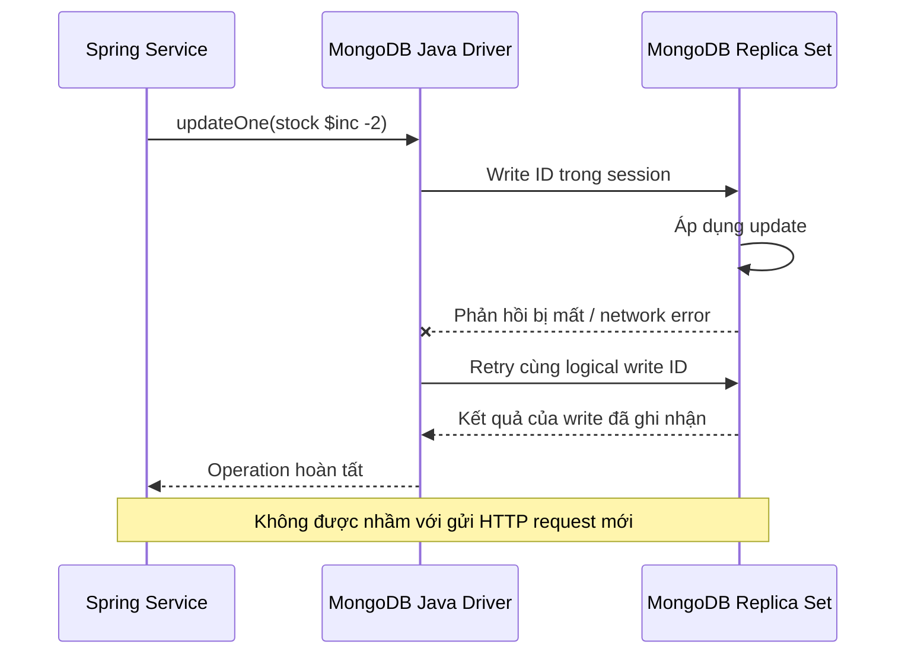
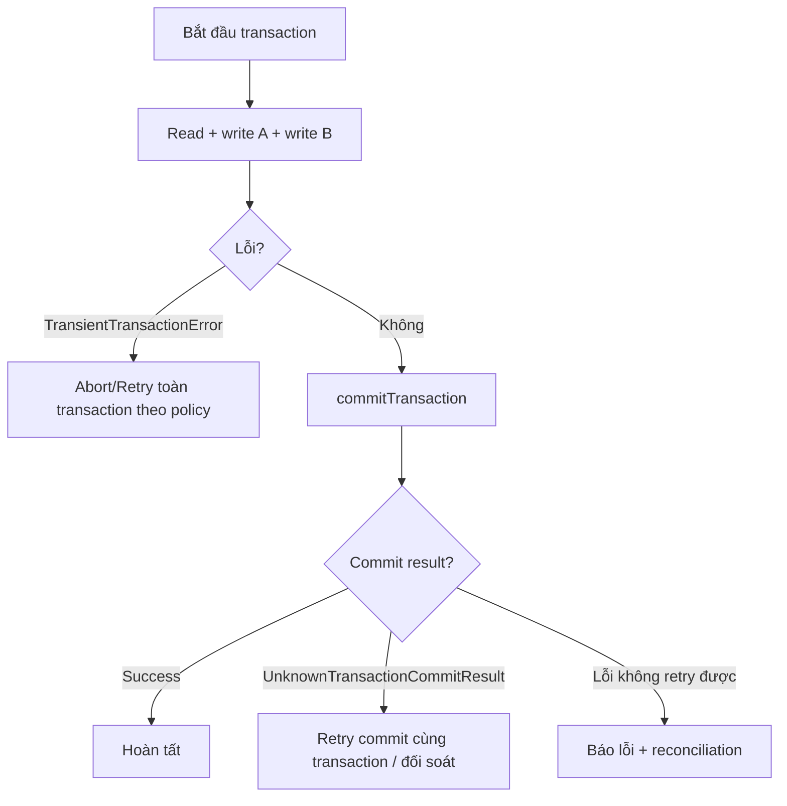

# Retryable reads, retryable writes và điều kiện hỗ trợ

Trong **Spring Data MongoDB**, một request có thể gửi thành công lệnh tới MongoDB nhưng mất kết nối trước khi nhận kết quả. Lúc đó ứng dụng thường không biết ngay **server đã thực hiện lệnh hay chưa**. MongoDB Java Driver có hai cơ chế giúp vượt qua một số lỗi tạm thời:

- **Retryable reads**: driver thử lại **một số lệnh đọc** khi gặp lỗi mạng hoặc lỗi máy chủ đủ điều kiện.
- **Retryable writes**: driver thử lại **một số lệnh ghi** với thông tin nhận diện thao tác để server có thể tránh thực hiện lại một write đã được ghi nhận trong cùng retryable session.
- Đây là **retry ở cấp driver/command**, **không phải** lệnh thử lại toàn bộ HTTP request, toàn bộ service method hay mọi thao tác trong MongoDB transaction.

Bài thuộc chương **Nhất quán dữ liệu** của module **SPRING_DATA_MONGODB**. Module sử dụng Spring Data MongoDB để kết nối, ánh xạ document và thao tác qua `MongoTemplate` hoặc repository; đồng thời thực hành truy vấn, aggregation, index, transaction, reactive access, kiểm thử và chẩn đoán dữ liệu. Trọng tâm ở đây là **điều kiện retry được hỗ trợ, cấu hình thực tế, giới hạn về tính nhất quán và cách xử lý kết quả ghi không chắc chắn**.

Một nguyên tắc xuyên suốt: **retryable không đồng nghĩa exactly-once cho nghiệp vụ**. Một database command được driver retry có cơ chế chống lặp riêng, nhưng việc API hoặc message consumer **tự chạy lại cả luồng xử lý** vẫn cần idempotency, guard và đối soát.

## 1. Tình huống: kết nối mất ngay sau khi ghi

Giả sử hệ thống có collection `inventory_items`:

```javascript
{
  _id: ObjectId("674000000000000000005001"),
  tenant_id: "T1",
  sku: "KB-001",
  stock: 10,
  updated_at: ISODate("2026-11-20T02:00:00Z")
}
```

Ứng dụng gửi lệnh xuất kho hai sản phẩm:

```javascript
db.inventory_items.updateOne(
  {
    _id: ObjectId("674000000000000000005001"),
    tenant_id: "T1",
    stock: { $gte: 2 }
  },
  { $inc: { stock: -2 } }
);
```

Ba kịch bản từ phía client có thể giống hệt nhau: **timeout/mất kết nối**.

1. Lệnh chưa tới server: `stock` vẫn 10.
2. Lệnh đã tới server, ghi thành công nhưng phản hồi bị mất: `stock` là 8.
3. Server nhận lệnh nhưng gặp lỗi trước khi hoàn tất: trạng thái phụ thuộc thời điểm lỗi và cơ chế ghi.

Nếu client **gửi một command mới hoàn toàn** chỉ vì “chưa thấy phản hồi”, trường hợp 2 có thể khiến stock từ 8 thành 6. Nếu MongoDB driver thực hiện **retryable write đúng điều kiện**, nó giữ nhận diện logical write, hỗ trợ server nhận ra một lần thực hiện đã được ghi nhận và tránh áp dụng lại lần nữa.



Sơ đồ minh họa **một retryable write đủ điều kiện**, không phải bảo đảm mọi lỗi sẽ được khắc phục hay mọi server/version đều hỗ trợ.

## 2. Ba tầng retry cần phân biệt

| Tầng | Ai thực hiện? | Đơn vị được chạy lại | Điều kiện đúng |
| --- | --- | --- | --- |
| **Driver retry** | MongoDB Java Driver | Một MongoDB read/write command được hỗ trợ | `retryReads`/`retryWrites`, topology, driver/server, error hợp lệ |
| **Transaction retry** | Transaction helper hoặc tầng service được thiết kế | Toàn transaction hoặc riêng commit khi phù hợp | Error labels, transaction API, xử lý side effects |
| **Business retry** | HTTP client, queue consumer, scheduler, service | Cả yêu cầu/luồng nghiệp vụ | Idempotency key, unique constraints, trạng thái nghiệp vụ |

`retryWrites=true` chỉ có nghĩa driver có thể retry **các write commands đủ điều kiện**. Nó **không** ngăn một webhook gửi lặp, một job chạy lại, hay một controller được gọi hai lần với requestId mới.

Tương tự, `retryReads=true` không tự bảo đảm một lần đọc thứ hai trả **đúng snapshot như lần đầu**: dữ liệu có thể thay đổi giữa hai lần đọc, nhất là với read preference trên secondary.

## 3. Cơ chế nhận diện retryable write ở mức khái niệm

Đối với retryable writes đủ điều kiện, driver/server sử dụng thông tin liên quan đến **logical session** và **transaction number**; trong các batch còn có nhận diện **statement**:

```text
Logical Session ID (lsid)
      +
Transaction Number (txnNumber)
      +
Statement identity (khi cần)
      |
      v
Server nhận biết một retry của cùng logical write
```

Khi một lần gửi trước **đã được ghi nhận**, server có thể trả kết quả của thao tác mà không áp dụng lại `$inc` thêm một lần. Cơ chế này tạo ra khác biệt giữa:

- **Driver retry cùng logical write**: sử dụng session/transaction metadata theo MongoDB retryable-write protocol.
- **Ứng dụng gọi lại `updateOne(...)` thành một operation mới**: driver tạo một logical write khác; MongoDB không thể tự biết đây là cùng một nghiệp vụ đã xử lý.

Không nên tự gán `txnNumber` hoặc mô phỏng retry bằng việc dựng raw command thiếu session protocol. Hãy để MongoDB driver quản lý và dành **requestId/idempotency key** cho tầng nghiệp vụ.

**Giới hạn:** lịch sử session/statement mà server lưu không tồn tại vô hạn. Khi một client mất kết nối rất lâu hoặc session đã hết hạn, các giả định tránh lặp của một logical retry có thể thay đổi. Đừng biến retryable writes thành tuyên bố “mọi lệnh sẽ exactly-once suốt đời hệ thống”.

## 4. Retryable reads và retryable writes khác nhau như thế nào?

| Khía cạnh | Retryable reads | Retryable writes |
| --- | --- | --- |
| Thao tác | `find`, `countDocuments`, `distinct`, aggregation **không ghi**,… | `insertOne`, `updateOne`, `replaceOne`, `deleteOne`, một số bulk,… |
| Cờ kết nối | `retryReads=true` | `retryWrites=true` |
| Mục tiêu | Thử lại read khi mạng/election trục trặc tạm thời | Thử lại write có metadata chống thực hiện lặp trong session |
| Hệ quả khi retry | Có thể thấy dữ liệu khác nếu source thay đổi | Phải nhận diện lại **cùng statement** khi đủ điều kiện |
| Không bao gồm | `getMore`, generic runCommand, aggregation có write stage,… | `updateMany`, `deleteMany`, các bulk có multi-write, `$merge`/`$out` |
| Cần acknowledged write concern | Không áp dụng | **Có**, `w:0` không đủ điều kiện |
| Transaction | Cần tuân thủ quy tắc đọc/transaction tương ứng | Writes **bên trong transaction không retry riêng lẻ** |
| Xử lý lỗi kéo dài | Retry không thay thế xử lý lỗi bền vững | Retry không thay thế idempotency và reconciliation |

Bảng là **tập các trường hợp chính**, không phải lời hứa mọi overload/API variant đều hỗ trợ. Phiên bản driver/server mới có thể thêm quy tắc, nên kiểm tra tài liệu đúng đời đang chạy.

## 5. Điều kiện hỗ trợ retryable writes

Theo MongoDB Manual, retryable writes yêu cầu:

1. **Deployment topology**: replica set hoặc sharded cluster; **không hỗ trợ standalone mongod**.
2. **Storage engine** có document-level locking, ví dụ WiredTiger.
3. **Server** hỗ trợ retryable writes (MongoDB **3.6+**, và `featureCompatibilityVersion` phù hợp trong các triển khai lịch sử).
4. **Driver** có hỗ trợ retryable writes.
5. **Acknowledged write concern**: `{w:0}` không có kết quả xác nhận nên không retryable.
6. **Thao tác nằm trong danh sách eligible**, không phải `updateMany` hoặc arbitrary database command.
7. **Lỗi đủ điều kiện** để retry; validation, duplicate key hay authorization errors thông thường không được chữa bằng retry mạng.
8. **Session và driver settings** phù hợp, không dùng cách gọi driver bỏ metadata cần thiết.

`retryWrites=true` trên một standalone MongoDB **không biến standalone thành replica set**. Vì vậy một bài test chạy MongoDB standalone có thể trả về kết quả khác môi trường production dùng replica set; đừng suy luận “không lỗi khi cấu hình bật” nghĩa là mọi lần retry đã được thử nghiệm.

### Ma trận tương thích tóm tắt

| Môi trường | Retryable writes | Ghi chú |
| --- | --- | --- |
| Standalone mongod | **Không được hỗ trợ** | Có thể chạy CRUD nhưng không có bảo đảm retryable-write protocol |
| Single-node replica set | **Có thể hỗ trợ** | Thường phù hợp cho integration test về retry/transaction |
| Replica set nhiều nodes | **Có**, nếu điều kiện khác đạt | Failover có thể gây lỗi tạm thời |
| Sharded cluster | **Có**, nếu điều kiện khác đạt | Routing, shard key và version server vẫn cần xét |
| Write concern `w:0` | **Không** | Không có acknowledgment |
| MongoDB transaction đang mở | Không retry **mỗi write riêng** | Commit/abort có quy tắc retry khác |
| Multi-document update/delete | Không thuộc retryable writes mặc định | Dùng chiến lược idempotency hoặc transaction riêng |

## 6. Điều kiện hỗ trợ retryable reads

Các driver MongoDB hiện hành hỗ trợ retryable reads trên các operation được chỉ định và mặc định bật tùy chọn `retryReads`. Tài liệu MongoDB Manual **9.0 hiện hành** nêu yêu cầu **server 6.0+** cho retryable reads; trong hệ thống dùng server/driver cũ, hãy đối chiếu **tài liệu đúng nhánh phiên bản**, không suy từ bảng tương thích của retryable writes.

Điều kiện chung:

- Driver hỗ trợ `retryReads` và cờ bật.
- Operation thuộc danh sách được phép retry.
- Lỗi tạm thời có thể retry, không phải mọi lỗi ứng dụng hoặc truy vấn sai.
- Có server thỏa **read preference** ban đầu sau server selection; nếu không, driver có thể trả lỗi.
- Thời gian chờ, topology và tài nguyên cho phép thực hiện lại.
- Một số lệnh/cursor không hỗ trợ retry ở pha đọc tiếp.

**Không đánh đồng retryable reads với read concern `majority`.** Retry giải quyết đường thực thi bị gián đoạn; read concern quyết định điều kiện đọc dữ liệu. Cần “đọc dữ liệu mới nhất”, “read your own writes” hoặc “cùng snapshot” thì phải thiết kế read preference, read concern và session phù hợp.

## 7. Java Driver mặc định bật những gì?

Với MongoDB Java Driver hiện hành, các cờ `retryReads` và `retryWrites` **mặc định là `true`**. MongoDB Manual nêu drivers tương thích MongoDB 4.2+ bật retryable writes mặc định; các driver đời trước có thể cần opt-in.

Không cần khai báo cả hai cờ trong mọi URI nếu bạn chấp nhận default của driver đang dùng, nhưng **cấu hình tường minh** có thể giúp môi trường được kiểm soát:

```text
mongodb://mongo1:27017,mongo2:27017,mongo3:27017/shop
    ?replicaSet=rs0
    &retryReads=true
    &retryWrites=true
    &w=majority
```

URI trên chỉ là **mẫu nhiều dòng cho dễ đọc**. URI thật phải viết trên **một dòng**, với hostname, authentication và TLS thực tế. `w=majority` là lựa chọn write concern riêng nhằm tăng bảo đảm durability, **không phải điều kiện bắt buộc** của retryable writes (acknowledged `w:1` cũng có thể đủ điều kiện).

Trong môi trường sản phẩm, tuyệt đối không hard-code password và token trong source hoặc log URI. Dùng secret manager / environment configuration.

## 8. Cấu hình Spring Boot: giữ cùng MongoClient do Spring quản lý

Trong các phiên bản Spring Boot có property `spring.data.mongodb.uri`, cấu hình:

```yaml
spring:
  data:
    mongodb:
      uri: "mongodb://mongo1:27017,mongo2:27017/shop?replicaSet=rs0&retryReads=true&retryWrites=true&w=majority"
```

Các tên property và auto-configuration có thể thay đổi giữa các đời Spring Boot (đặc biệt khi nâng major), nên xác minh với **phiên bản thực tế** và bean `MongoClient` đang chạy.

**Cách đúng:** cấu hình **MongoClient Spring-managed** dùng chung cho `MongoTemplate`, repository và `MongoTransactionManager` nếu có. Không tạo thêm một `MongoClient` tự phát trong mỗi repository fragment rồi giả định tất cả có cùng session, timeout và retry settings.

Để tắt retry nhằm kiểm tra hoặc giải quyết một giới hạn deployment:

```text
mongodb://mongo1:27017/shop?retryReads=false&retryWrites=false
```

Tắt retry là một quyết định vận hành có chủ đích: không phải cách chữa lỗi dữ liệu, timeout bất thường hay idempotency. Nó thường làm các lỗi mạng tạm thời **lộ ra ứng dụng sớm hơn**.

## 9. Cấu hình trực tiếp với MongoClientSettings

Không dùng Spring Boot auto-config thì MongoDB Java Sync Driver có API:

```java
import com.mongodb.ConnectionString;
import com.mongodb.MongoClientSettings;
import com.mongodb.client.MongoClient;
import com.mongodb.client.MongoClients;

ConnectionString connectionString = new ConnectionString(
    "mongodb://localhost:27017/shop?replicaSet=rs0"
);

MongoClientSettings settings = MongoClientSettings.builder()
    .applyConnectionString(connectionString)
    .retryReads(true)
    .retryWrites(true)
    .build();

try (MongoClient client = MongoClients.create(settings)) {
    // Dùng client để gọi API driver.
}
```

Đây là ví dụ driver **độc lập**, không phải chỉ dẫn để xây MongoClient mới trong từng method của Spring service. Khi chạy với Spring Data, cần để một bean MongoClient đã cấu hình được Spring quản lý và dùng chung cho hạ tầng repository/template.

Nếu ứng dụng cấu hình `MongoClientSettings` qua customizer của Spring Boot, hãy kiểm tra cách đăng ký bean tương ứng phiên bản Boot. Điều cốt lõi là **settings thực tế trên MongoClient được Spring dùng**, chứ không phải có một đoạn builder nằm đâu đó mà Spring không bao giờ gọi.

## 10. Retryable read operations: những API thường gặp

Theo MongoDB Manual, một số read operations đủ điều kiện:

| Driver-level operation | Ví dụ Spring Data tương ứng | Lưu ý |
| --- | --- | --- |
| `Collection.find` | `repository.findById`, `MongoTemplate.find` | Retry command đọc ban đầu khi lỗi eligible |
| `Collection.countDocuments` | `MongoTemplate.count` | Có thể dùng aggregation nội bộ theo driver |
| `Collection.distinct` | `MongoTemplate.query(...).distinct(...)` nếu API hỗ trợ | Cần kiểm tra driver method thực sự phát ra |
| `Collection.aggregate` | `MongoTemplate.aggregate` với pipeline **không có write stage** | `$merge` và `$out` không được tính là retryable read |
| `Database.aggregate` | Một số database-level aggregation | Chỉ pipeline không ghi |
| `listCollections` / `listIndexes` | Các thao tác metadata | Đủ điều kiện trên driver helper được hỗ trợ |
| `watch` | Change streams | Có cơ chế retry/resume riêng cho change stream |
| `find` phục vụ GridFS download | Một phần GridFS APIs | Đọc stream vẫn cần xử lý ngắt kết nối |

**Phân biệt:** API của `MongoTemplate` có thể sinh ra **nhiều MongoDB commands** hoặc có hành vi phân trang. Không nên khẳng định “toàn bộ service call được retry một lần” chỉ vì một lệnh đọc nền có hỗ trợ retry.

## 11. Vì sao getMore không được retry như find?

Một cursor có thể nhận dữ liệu qua nhiều batch:

```text
find() -> batch đầu tiên -> cursorId
       -> getMore() batch 2
       -> getMore() batch 3
       -> ...
```

MongoDB Manual liệt kê **`getMore` là operation không hỗ trợ retryable reads**. Nếu batch đầu đã nhận được và `getMore` sau đó mất kết nối, driver không đơn giản gửi lại `getMore` như retryable read thường.

Hệ quả với stream nhiều document:

- Một lỗi mạng giữa stream có thể làm **iteration bị lỗi** sau khi ứng dụng đã xử lý một phần dữ liệu.
- Không tự khởi động lại `findAll()` rồi nối kết quả vào file/batch cũ mà không chống duplicate.
- Nếu cần resume, hãy thiết kế theo khóa ổn định như `_id` + thứ tự sort phù hợp, lưu checkpoint và điều kiện `_id > lastSeen` khi bảo đảm nghĩa nghiệp vụ.
- Với query có filter hoặc sort phức tạp, một checkpoint `_id` đơn lẻ có thể **không đủ**; phải dùng cùng ordering và tie-breaker.
- Với **change streams**, driver hỗ trợ cơ chế **resume token** của change stream, khác với retry `getMore` thông thường.

### Ví dụ: đọc theo trang có resume token ứng dụng

```java
// Ý tưởng, không phải giải pháp cursor resume tổng quát:
Query next = Query.query(
    Criteria.where("tenantId").is(tenant)
        .and("id").gt(lastSeenId)
);
next.with(Sort.by(Sort.Direction.ASC, "id"));
next.limit(500);

List<InventoryItem> items =
    mongoTemplate.find(next, InventoryItem.class);
```

Cách này chỉ hợp lệ khi xử lý tuần tự theo `_id` và filter dữ liệu không làm thay đổi quan hệ thứ tự mong muốn. Trong một tập dữ liệu liên tục có inserts/deletes, nó không cung cấp snapshot bất biến; nếu cần snapshot, dùng một mô hình nhất quán phù hợp.

## 12. Những lệnh đọc không có retryable-read protection

Cần đặc biệt nhớ:

- `getMore` (đọc batch tiếp theo của cursor).
- Generic `Database.runCommand`/driver helper không nhận diện rõ đây là read operation.
- `mapReduce` theo các trường hợp MongoDB Manual liệt kê.
- Aggregation có stage ghi dữ liệu như `$out` hoặc `$merge`.
- Một lệnh custom/native sử dụng command API khác với read helper chuẩn.

`retryReads=true` không có nghĩa mọi `db.runCommand(...)` đều được driver retry. Nếu một service dùng native command trong `MongoTemplate.executeCommand(...)`, đừng tự suy luận có cùng retry semantics như `find`.

## 13. Retryable write operations: danh sách cơ bản

Với acknowledged write concern và topology hỗ trợ, MongoDB Manual liệt kê:

| Operation | Retryable write? | Lưu ý |
| --- | --- | --- |
| `insertOne` | **Có** | Dùng nhận diện write, không sửa duplicate-key nghiệp vụ |
| `insertMany` | **Có**, theo các batch đủ điều kiện | Có thể đã ghi một phần khi lỗi |
| `updateOne` | **Có** | Bao gồm `$set`, `$inc` với một document |
| `replaceOne` | **Có** | Vẫn có thể gây lost update nếu replace từ entity stale |
| `deleteOne` | **Có** | Chỉ xóa một document |
| `findOneAndUpdate` | **Có** | Update một document, có thể trả trước/sau |
| `findOneAndReplace` | **Có** | Tương tự về retryable write |
| `findOneAndDelete` | **Có** | Xóa một document |
| `findAndModify` | **Có** | Thuộc nhóm single-document |
| `updateMany` | **Không** | Multi-document update không được retry tự động theo protocol này |
| `deleteMany` | **Không** | Tương tự |
| `$merge`/`$out` trong aggregate | **Không** | Aggregation có write stage không thuộc retryable-write command |

Danh sách **eligible** không đồng nghĩa mọi invocation sẽ được retry trong mọi tình huống. Driver còn xét lỗi, acknowledged write concern, topology, session và transaction context.

Một `MongoRepository.save(entity)` thường đi qua lệnh insert/replace tương ứng, nhưng nếu code application-level callback hoặc service chạy lại, callbacks và các side effects **không tự có bảo đảm exactly-once** từ retryable writes.

## 14. Bulk writes: chỉ batch không có multi-document operation

Một bulk có thể chứa nhiều operation:

```java
import java.util.List;
import static com.mongodb.client.model.Filters.eq;
import static com.mongodb.client.model.Updates.inc;

import com.mongodb.client.model.InsertOneModel;
import com.mongodb.client.model.UpdateOneModel;
import com.mongodb.client.model.DeleteOneModel;
import com.mongodb.client.model.WriteModel;
import org.bson.Document;

List<WriteModel<Document>> operations = List.of(
    new InsertOneModel<>(new Document(
        "_id", "movement-1001"
    ).append("tenant_id", "T1")),
    new UpdateOneModel<>(
        eq("_id", "inventory-1"), inc("stock", -2)
    ),
    new DeleteOneModel<>(
        eq("_id", "expired-temp-1")
    )
);

collection.bulkWrite(operations);
```

`collection` là `MongoCollection<Document>` lấy từ MongoClient đã cấu hình. Ví dụ chỉ minh họa **các operation types**: không đưa nó vào production như nghiệp vụ xuất kho vì ba writes **không tự có transaction chung**, và xóa bản ghi audit cũ cần chính sách riêng.

Nếu bulk chỉ gồm `insertOne`, `updateOne`, `replaceOne`, `deleteOne`, các **write commands** nền có thể đủ điều kiện retry. Nếu một batch/command chứa `updateMany` hoặc `deleteMany`, command ấy **không có retryable-write protection**. Driver có thể chia một bulk lớn thành nhiều commands, vì thế cần xét **từng command**, không suy từ tên `bulkWrite`.

**Ordered/unordered không thay thế retryability** và **không bảo đảm atomicity của cả bulk**. Một batch có thể ghi được một số records rồi lỗi.

## 15. Ví dụ Spring Data: updateFirst đủ điều kiện nhưng updateMulti thì không

Entity:

```java
import org.bson.types.ObjectId;
import org.springframework.data.annotation.Id;
import org.springframework.data.mongodb.core.mapping.Document;
import org.springframework.data.mongodb.core.mapping.Field;

@Document(collection = "inventory_items")
public class InventoryItem {
    @Id
    private ObjectId id;

    @Field("tenant_id")
    private String tenantId;

    private String sku;

    private long stock;

    public InventoryItem() {}

    public InventoryItem(
            ObjectId id, String tenantId, String sku, long stock) {
        this.id = id;
        this.tenantId = tenantId;
        this.sku = sku;
        this.stock = stock;
    }

    public ObjectId getId() { return id; }
    public String getTenantId() { return tenantId; }
    public String getSku() { return sku; }
    public long getStock() { return stock; }
}
```

Cập nhật một document:

```java
import com.mongodb.client.result.UpdateResult;
import org.springframework.data.mongodb.core.MongoOperations;
import org.springframework.data.mongodb.core.query.Criteria;
import org.springframework.data.mongodb.core.query.Query;
import org.springframework.data.mongodb.core.query.Update;

public boolean allocateTwo(
        MongoOperations operations,
        ObjectId id,
        String authorizedTenant) {

    Query filter = Query.query(
        Criteria.where("id").is(id)
            .and("tenantId").is(authorizedTenant)
            .and("stock").gte(2)
    );

    Update decrement = new Update().inc("stock", -2);

    UpdateResult result = operations.updateFirst(
        filter, decrement, InventoryItem.class
    );
    return result.getMatchedCount() == 1;
}
```

`MongoOperations.updateFirst(...)` tương ứng một single-document update, nên **operation nền có thể đủ điều kiện retryable write** khi client/server/concern phù hợp.

Trái lại:

```java
// Có thể cập nhật nhiều document:
operations.updateMulti(
    Query.query(Criteria.where("tenantId").is(authorizedTenant)),
    new Update().set("status", "REVIEW"),
    InventoryItem.class
);
```

Đây là **multi-document update**, không thuộc retryable-write protocol mặc định, dù `retryWrites=true`. Đoạn này minh họa loại API; entity mẫu không có property `status` nên không được dùng như migration hợp lệ trừ khi thêm field và mapping tương ứng.

**Cả hai không phải transaction.** Một `updateFirst` chỉ có tính nguyên tử trên document được cập nhật; những lệnh khác trong cùng service method không được tự commit/rollback cùng nó.

## 16. Driver retry không làm HTTP request trở nên idempotent

Một request thường làm nhiều việc:

```text
HTTP POST /stock/allocate
   |
   +-- validate request
   +-- read inventory
   +-- updateOne(stock -2)
   +-- insert audit movement
   +-- publish Kafka event / send email
   +-- return HTTP response
```

Giả sử riêng `updateOne` được driver retry an toàn. **Không có nghĩa**:

- `insert audit` chắc chắn cùng commit với update stock.
- Kafka event được publish đúng một lần.
- Client gửi lại `POST` sẽ không trừ stock lần nữa.
- Một lần `@Retryable` chạy lại toàn service sẽ an toàn.
- Một queue consumer bị redelivery sẽ bỏ qua event đã xử lý.

Driver retry là cơ chế kỹ thuật **bên trong một database operation**. Business idempotency là hợp đồng **giữa nhiều lần gọi nghiệp vụ**, thường cần request ID ổn định, unique constraint, record trạng thái và đôi khi transaction/outbox.

## 17. Tại sao retryable $inc không đồng nghĩa có thể retry thủ công?

MongoDB `$inc` là atomic, nhưng bản thân phép cộng/trừ **không idempotent**:

```javascript
// Từ stock = 10:
db.inventory_items.updateOne(
  { _id: itemId },
  { $inc: { stock: -2 } }
); // stock 8

// Đây là một lệnh mới, KHÔNG phải driver retry cùng statement:
db.inventory_items.updateOne(
  { _id: itemId },
  { $inc: { stock: -2 } }
); // stock 6
```

Nếu retryable write protocol đang hoạt động và driver retry **cùng lệnh**, server dùng logical session/transaction metadata để tránh lặp ngoài ý muốn trong điều kiện hỗ trợ. Nhưng nếu service hoặc người dùng **thực thi lại command mới**, việc trừ thêm là hành vi đúng của `$inc`.

Vì vậy thiết kế business command **“xuất kho 2 sản phẩm theo requestId X”** cần một **bản ghi X đã xử lý**, không chỉ cần cờ `retryWrites=true`.

## 18. Thiết kế idempotency key cho nghiệp vụ xuất kho

Một mô hình thực dụng gồm:

- Collection `inventory_items` có `stock`.
- Collection `stock_movements` chứa `tenant_id`, `request_id`, `item_id`, `quantity`.
- Unique index `{tenant_id:1,request_id:1}`.
- Một MongoDB transaction gói **insert movement + decrement stock** khi phải bảo đảm hai document/collection cùng thành công.

Index:

```javascript
db.stock_movements.createIndex(
  { tenant_id: 1, request_id: 1 },
  {
    unique: true,
    name: "ux_stock_movement_tenant_request"
  }
);
```

Document movement:

```javascript
{
  _id: ObjectId("674000000000000000005101"),
  tenant_id: "T1",
  request_id: "allocate-2026-001",
  item_id: ObjectId("674000000000000000005001"),
  quantity: NumberLong("2")
}
```

Ví dụ Java DTO/entity bổ sung:

```java
import org.bson.types.ObjectId;
import org.springframework.data.annotation.Id;
import org.springframework.data.mongodb.core.index.CompoundIndex;
import org.springframework.data.mongodb.core.mapping.Document;
import org.springframework.data.mongodb.core.mapping.Field;

@Document("stock_movements")
@CompoundIndex(
    name = "ux_stock_movement_tenant_request",
    def = "{'tenant_id': 1, 'request_id': 1}",
    unique = true
)
public class StockMovement {
    @Id
    private ObjectId id;

    @Field("tenant_id")
    private String tenantId;

    @Field("request_id")
    private String requestId;

    @Field("item_id")
    private ObjectId itemId;

    private long quantity;

    public StockMovement() {}

    public StockMovement(
            String tenantId, String requestId,
            ObjectId itemId, long quantity) {
        this.tenantId = tenantId;
        this.requestId = requestId;
        this.itemId = itemId;
        this.quantity = quantity;
    }

    public String getTenantId() { return tenantId; }
    public String getRequestId() { return requestId; }
    public ObjectId getItemId() { return itemId; }
    public long getQuantity() { return quantity; }
}
```

**Chú ý:** annotation unique **không tự bảo đảm index đã tồn tại** nếu auto-index tắt. Production phải tạo/check unique index trước khi nhận traffic xử lý requestId.

## 19. Transaction cho movement + stock, không retry từng write bên trong

Service minh họa (MongoDB replica set/sharded cluster hỗ trợ transaction):

```java
import com.mongodb.client.result.UpdateResult;
import org.bson.types.ObjectId;
import org.springframework.data.mongodb.core.MongoOperations;
import org.springframework.data.mongodb.core.query.Criteria;
import org.springframework.data.mongodb.core.query.Query;
import org.springframework.data.mongodb.core.query.Update;
import org.springframework.stereotype.Service;
import org.springframework.transaction.annotation.Transactional;

@Service
public class AllocationTransactionService {
    private final MongoOperations operations;

    public AllocationTransactionService(MongoOperations operations) {
        this.operations = operations;
    }

    @Transactional(transactionManager = "mongoTransactionManager")
    public void allocateOnce(
            String tenantId, String requestId,
            ObjectId itemId, long quantity) {

        if (tenantId == null || tenantId.isBlank()
                || requestId == null || requestId.isBlank()
                || itemId == null || quantity <= 0) {
            throw new IllegalArgumentException("Yêu cầu không hợp lệ");
        }

        // Insert trước: requestId trùng phải bị unique index từ chối.
        operations.insert(new StockMovement(
            tenantId, requestId, itemId, quantity
        ));

        Query target = Query.query(
            Criteria.where("id").is(itemId)
                .and("tenantId").is(tenantId)
                .and("stock").gte(quantity)
        );

        UpdateResult updated = operations.updateFirst(
            target,
            new Update().inc("stock", -quantity),
            InventoryItem.class
        );

        if (updated.getMatchedCount() != 1) {
            throw new IllegalStateException(
                "Không tồn tại sản phẩm hoặc không đủ hàng"
            );
        }
    }
}
```

Trong MongoDB transaction, nếu insert movement thất bại vì duplicate key, hoặc update stock không match và service ném runtime exception, transaction phải rollback; không để movement tồn tại khi stock không được trừ.

**Nhưng không nhầm:** `retryWrites=true` **không tự retry riêng từng write bên trong transaction**. Transaction có quy tắc xử lý `TransientTransactionError` và `UnknownTransactionCommitResult` riêng. Ngoài ra, không được catch duplicate key bên trong một transaction đã lỗi rồi tiếp tục ghi như thể transaction vẫn khỏe; cần thoát, để rollback, sau đó **đối soát requestId bên ngoài transaction**.

Nếu cùng requestId bị gửi lại, một lớp facade có thể đọc movement đã commit, so sánh tenant/item/quantity và trả kết quả idempotent; nếu payload khác mà cùng key thì phải báo conflict. Không trả thành công chỉ vì thấy duplicate key bất kỳ, vì lỗi có thể đến từ unique constraint khác.

## 20. Kết quả write không chắc chắn: NoWritesPerformed

Một command có thể nhận lỗi sau khi server đã thực hiện **một phần hoặc toàn bộ**. Vì thế chỉ thấy network error **không chứng minh** rằng không có write nào thành công.

MongoDB Server **6.1+** cung cấp error label **`NoWritesPerformed`** trong những trường hợp cả lần đầu và retry đều thất bại mà **không có write nào được thực hiện**.

| Tín hiệu | Có thể kết luận | Không được tự kết luận |
| --- | --- | --- |
| Operation thành công có acknowledgment | Lệnh đã hoàn tất theo write concern được cấu hình | Event nghiệp vụ ngoài DB cũng đã hoàn tất |
| Có label `NoWritesPerformed` theo ngữ nghĩa server | Không write nào được thực hiện trong command đó | Các command trước trong service đều chưa thực hiện |
| Lỗi **không có** label `NoWritesPerformed` | Trạng thái có thể không chắc chắn | Chắc chắn đã ghi hoặc chắc chắn chưa ghi |
| `DuplicateKeyException` | Một unique constraint bị vi phạm | Đây chắc chắn là retry của request đã thành công |
| Timeout sau update | Chưa biết chắc trạng thái write nếu không có bằng chứng | Có thể gửi lại command mới một cách vô điều kiện |

Với `insertMany`/batch, label giúp phân biệt **không có write nào xảy ra** với khả năng **đã có một phần work**, trong những tình huống/version được hỗ trợ. Không có label **không phải bằng chứng có partial write**; nó chỉ không đủ để khẳng định không ghi gì.

### Đọc error labels từ Java Driver

```java
import com.mongodb.MongoException;

public static boolean hasMongoErrorLabel(
        Throwable failure, String label) {

    for (Throwable t = failure; t != null; t = t.getCause()) {
        if (t instanceof MongoException mongo
                && mongo.hasErrorLabel(label)) {
            return true;
        }
    }
    return false;
}

// Khi xử lý lỗi, sau khi đã hiểu operation cụ thể:
public static boolean definitelyNoWrites(Throwable error) {
    return hasMongoErrorLabel(error, "NoWritesPerformed");
}
```

Đây chỉ là helper **đọc label**, không phải policy tự động retry. Spring Data có thể chuyển driver exception thành `DataAccessException`; một số nested causes/metadata có thể không còn, nên phải thiết kế diagnostic dựa vào exception được driver/framework cung cấp trong phiên bản thực tế.

## 21. RetryableWriteError không phải giấy phép retry toàn service

Một số MongoDB driver errors mang label `RetryableWriteError`. Driver dùng thông tin này cùng topology, protocol, request state và retry policy để quyết định thao tác retry đủ điều kiện.

Không làm thế này:

```java
// Pseudocode SAI: không retry cả service method vô điều kiện.
try {
    decrementStock();
    insertAudit();
    sendEmail();
} catch (RuntimeException ex) {
    decrementStock();
    insertAudit();
    sendEmail();
}
```

Nếu `decrementStock()` đã thành công và error xuất hiện ở `sendEmail()`, cách làm trên có thể trừ tồn kho lần hai. `RetryableWriteError` là **database error label**, không phải lời hứa rằng các side effects khác chưa xảy ra.

Cách đúng là đặt mỗi phần vào hợp đồng rõ ràng:

- MongoDB driver xử lý eligible command retry.
- MongoDB transaction xử lý commit/abort và recovery trong phạm vi DB.
- Idempotency receipt đánh dấu business command đã được xử lý.
- Outbox/consumer idempotent cho sự kiện ngoài DB.
- Application retry có giới hạn, đọc lại/đối soát trước khi làm lại thao tác có side effect.

## 22. Retryable writes và transaction: quy tắc rất khác

Khi **không có transaction**, một `updateOne` đủ điều kiện có thể được driver retry theo cơ chế retryable write.

Khi **đang trong multi-document transaction**:

- Driver **không tự retry một write riêng lẻ** bên trong transaction theo `retryWrites`.
- Khi gặp transient transaction error, cần **retry toàn bộ transaction** bằng helper/API phù hợp, vì trạng thái của transaction có thể đã bị abort.
- `commitTransaction` và `abortTransaction` có retry semantics riêng; driver có thể retry một commit/abort đủ điều kiện **ngay cả khi `retryWrites=false`**.
- Với `UnknownTransactionCommitResult`, trạng thái commit chưa chắc chắn; hướng xử lý là thử lại **commit của cùng transaction** theo quy trình driver hỗ trợ, **không lập tức chạy lại business operation thành transaction mới**.
- Mọi side effect **ngoài MongoDB transaction** không được rollback nếu transaction abort.



Không viết một interceptor `@Retryable` bao trùm tùy tiện cả `@Transactional`, publish message và REST callbacks nếu không hiểu thứ tự AOP proxy, tính idempotent của mọi side effect và hành vi transaction manager.

## 23. Retry và readConcern/writeConcern là các chiều độc lập

Có ba khái niệm dễ lẫn:

| Cấu hình | Trả lời câu hỏi gì? | Không bảo đảm |
| --- | --- | --- |
| `retryReads` | Lệnh đọc đủ điều kiện có được thử lại khi lỗi tạm thời không? | Đọc luôn là newest/snapshot cố định |
| `retryWrites` | Lệnh ghi đủ điều kiện có được driver thử lại theo protocol không? | Mọi business command exactly-once |
| `readConcern` | Điều kiện về mức dữ liệu được phép đọc là gì? | Retry mạng hoặc idempotency |
| `writeConcern` | Mức độ xác nhận/durability mà write phải đạt? | Không bao giờ failover hoặc không cần retry |
| `readPreference` | Driver ưu tiên đọc từ primary/secondary nào? | Secondary luôn mới như primary |

Ví dụ `writeConcern=MAJORITY` tăng mức xác nhận sao chép so với `w:1` trong một replica set phù hợp. Nhưng nó **không biến một service method gồm hai writes thành một transaction**, và không tự bảo vệ một queue event khỏi gửi lặp.

`readConcern=MAJORITY` có thể giúp chỉ đọc dữ liệu đã được phần lớn nodes xác nhận, nhưng **không đồng nghĩa linearizable read trên mọi node**, và một retry read vẫn có thể quan sát phiên bản dữ liệu khác nếu source thay đổi.

Nếu cần “read-your-writes” hoặc causal ordering xuyên nhiều operations, hãy nghiên cứu **ClientSession với causal consistency** cùng read/write concerns phù hợp. Retryable reads tự thân không phải giải pháp cho mọi yêu cầu nhất quán.

## 24. Server selection và timeout: vì sao retry không cứu mọi lỗi?

Driver cần tìm được server eligible. Khi replica set primary đang election, một write có thể thất bại nếu:

- Chưa có primary mới đủ sớm.
- `serverSelectionTimeoutMS` hết trước khi chọn được server.
- Network outage kéo dài.
- Server được chọn không phù hợp topology/role.
- Operation gặp lỗi không nằm trong nhóm retryable (validation, duplicate key, thiếu quyền,…).
- Client có request timeout/deadline đã hết.

`serverSelectionTimeoutMS` là khoảng thời gian driver tìm server phù hợp, **không đồng nghĩa thời gian tối đa của cả HTTP request**. `socketTimeoutMS`, `connectTimeoutMS`, `timeoutMS` (trong những driver hiện hành hỗ trợ) và timeout ở API gateway/HTTP client cũng khác nhau.

### Một retry hay nhiều retry?

Tài liệu MongoDB thông thường mô tả **một lần retry** cho lỗi mạng tạm thời của retryable reads/writes. Tuy nhiên, một số phiên bản driver/server mới hỗ trợ chính sách retry mở rộng khi cấu hình `timeoutMS` hoặc nhận **overload-specific error labels** (ví dụ `SystemOverloadedError`). Vì vậy:

- Không hard-code giả định “driver sẽ luôn gửi đúng hai lần” vào alert hay business logic.
- Xác minh version driver, cờ timeout và behavior thực tế.
- Với request có deadline, tính cả thời gian server selection/retry để không vượt budget latency.
- Đừng tăng retry vô hạn để che thiếu tài nguyên hoặc một outage kéo dài.

## 25. findAndModify có retry nhưng có thể tốn chi phí

`findOneAndUpdate`/`findAndModify` là single-document write và thuộc nhóm retryable writes đủ điều kiện.

Ví dụ:

```java
import org.springframework.data.mongodb.core.FindAndModifyOptions;
import org.springframework.data.mongodb.core.query.Criteria;
import org.springframework.data.mongodb.core.query.Query;
import org.springframework.data.mongodb.core.query.Update;

InventoryItem updated = mongoTemplate.findAndModify(
    Query.query(
        Criteria.where("id").is(itemId)
            .and("tenantId").is(tenant)
            .and("stock").gte(2)
    ),
    new Update().inc("stock", -2),
    FindAndModifyOptions.options().returnNew(true),
    InventoryItem.class
);
```

Đây là thao tác atomic **có filter + update và trả document**. Tuy nhiên MongoDB Manual lưu ý với retryable writes, `findAndModify` có thể **copy toàn bộ document vào một side collection** trên mỗi member của replica set trước khi cập nhật, gây chi phí đáng kể với document lớn và replica set nhiều nodes.

MongoDB **8.0** bổ sung khả năng `updateOne` có `sort` để chọn document theo thứ tự với chi phí có thể thấp hơn trong những tình huống tương ứng. Hỗ trợ API sort cụ thể phụ thuộc driver/Spring Data version; không đổi sang `updateOne` nếu nghiệp vụ vẫn cần **trả về document đã cập nhật** mà chưa thiết kế cách đọc thích hợp.

**Chọn API theo yêu cầu thật:** nếu chỉ cần `matchedCount` và không cần image trước/sau, `updateFirst` thường đơn giản và có thể tiết kiệm tài nguyên hơn.

## 26. Reactive MongoDB: driver retry khác Reactor retryWhen

Với `ReactiveMongoTemplate`, driver có các retry settings tương ứng, nhưng một chuỗi Reactor:

```java
import reactor.core.publisher.Mono;

Mono<InventoryItem> result =
    reactiveMongoTemplate.findById(itemId, InventoryItem.class);
```

chỉ thực thi khi có subscription. MongoDB Driver **có thể retry một command bên trong publisher** khi đủ điều kiện. Điều đó không giống với:

```java
import java.time.Duration;
import reactor.util.retry.Retry;

// Đừng thêm vào một side-effecting workflow mà không có idempotency.
Mono<Void> workflow = allocateAndSendEvent()
    .retryWhen(Retry.backoff(3, Duration.ofMillis(100)));
```

`retryWhen` có thể **resubscribe toàn publisher**, dẫn tới **gọi lại cả update + insert + publish**. Nếu một phần đã thành công trước lỗi, subscription mới có thể tạo duplicate business operation.

Với read-only publisher, resubscription cũng có thể tạo một **lần đọc mới** có dữ liệu khác. Với change streams, ưu tiên resume token và khả năng phục hồi do driver/change-stream API cung cấp, thay vì restart stream tùy tiện rồi xử lý lại từ đầu.

Để dùng reactive transaction, cần `ReactiveMongoTransactionManager` và Reactor Context; viết trong transaction không tự được bảo vệ bởi `retryWrites` cho từng write.

## 27. Quan sát retries mà không ghi log nhạy cảm

Để điều tra lỗi mạng/failover, cần biết request nào, command nào, attempt nào, duration và outcome. Nhưng không nên log toàn bộ BSON payload có thông tin khách hàng.

Có thể dùng **MongoDB Java Driver CommandListener** và metrics/tracing:

```java
import com.mongodb.event.CommandEvent;
import com.mongodb.event.CommandFailedEvent;
import com.mongodb.event.CommandListener;
import com.mongodb.event.CommandStartedEvent;
import com.mongodb.event.CommandSucceededEvent;

public class MongoCommandMetricsListener implements CommandListener {

    @Override
    public void commandStarted(CommandStartedEvent event) {
        // Ghi tên command, requestId, serverId và timestamp phù hợp.
        // Không ghi raw command BSON của khách hàng.
    }

    @Override
    public void commandSucceeded(CommandSucceededEvent event) {
        // Ghi latency và command name, không dump response.
    }

    @Override
    public void commandFailed(CommandFailedEvent event) {
        // Ghi loại lỗi/timing; bảo vệ thông tin nhạy cảm.
    }
}
```

Dùng `MongoClientSettings.builder().addCommandListener(...)` trong cấu hình MongoClient được Spring quản lý nếu muốn gắn listener:

```java
MongoClientSettings.Builder builder = MongoClientSettings.builder()
    .applyConnectionString(connectionString)
    .addCommandListener(new MongoCommandMetricsListener())
    .retryReads(true)
    .retryWrites(true);
```

Lưu ý: command monitoring có thể thấy nhiều **driver commands** cho một request, nhưng không tự chỉ ra liệu chúng là retry cùng logical statement hay một business call mới; để chẩn đoán sâu cần gắn correlation ID và server-side metrics theo chính sách vận hành.

Theo MongoDB Manual, `serverStatus` có thống kê retryable writes trong mục `transactions` trên các server/version hỗ trợ. Đừng khẳng định một trường metric cụ thể có mặt trên mọi version hoặc cloud deployment.

## 28. Điều tra lỗi retry theo lớp thay vì chỉ tăng timeout

Một phương pháp xử lý sự cố:

1. Ghi lại **MongoDB Server, Java Driver, Spring Data/Boot version** và effective connection URI/settings.
2. Xác định topology: standalone, replica set hay sharded; trạng thái primary và elections.
3. Xác định command đang lỗi: `find`, `getMore`, `updateOne`, `updateMany`, bulk, `aggregate` có `$merge`/`$out`.
4. Kiểm tra `retryReads`/`retryWrites` có thực sự bật trên **MongoClient được Spring sử dụng** không.
5. Xác nhận write concern: `w:0` không hỗ trợ retryable writes.
6. Xem driver error labels, code, network failure, server selection timeout và command monitoring.
7. Đối soát dữ liệu với **business key** để xác định write đã thành công hay chưa.
8. Nếu có transaction, phân biệt transient transaction error với unknown commit result.
9. Kiểm tra business retry ở controller, API gateway, Kafka consumer, scheduler, Reactor `retryWhen`.
10. Giảm tải, cải thiện indexes/topology hoặc giới hạn concurrency nếu bản chất là overload; retry không bù được thiếu capacity.

Không chỉ bật `retryWrites=false` vì thấy duplicate nghiệp vụ. Nhiều trường hợp duplicate xuất phát từ **API được gọi lại** chứ không phải driver retry logic.

## 29. Integration test: xác minh atomic update và acknowledged result

Dùng MongoDB thật dành cho test (ví dụ Testcontainers). Một test cơ bản chứng minh ý nghĩa của `updateFirst` và filter, **không giả vờ đây là phép thử network failover**.

```java
import static org.assertj.core.api.Assertions.assertThat;

import org.bson.types.ObjectId;
import org.junit.jupiter.api.Test;
import org.springframework.beans.factory.annotation.Autowired;
import org.springframework.boot.test.autoconfigure.data.mongo.DataMongoTest;
import org.springframework.data.mongodb.core.MongoTemplate;
import org.springframework.data.mongodb.core.query.Criteria;
import org.springframework.data.mongodb.core.query.Query;
import org.springframework.data.mongodb.core.query.Update;

@DataMongoTest
class InventoryAtomicUpdateTest {
    @Autowired MongoTemplate template;

    @Test
    void twoGuardedDecrementsCannotMakeStockNegative() {
        ObjectId id = new ObjectId();
        String tenant = "test-" + new ObjectId().toHexString();

        template.insert(new InventoryItem(
            id, tenant, "KB-001", 2
        ));

        Query target = Query.query(
            Criteria.where("id").is(id)
                .and("tenantId").is(tenant)
                .and("stock").gte(2)
        );

        var first = template.updateFirst(
            target,
            new Update().inc("stock", -2),
            InventoryItem.class
        );

        var second = template.updateFirst(
            target,
            new Update().inc("stock", -2),
            InventoryItem.class
        );

        assertThat(first.getMatchedCount()).isEqualTo(1L);
        assertThat(second.getMatchedCount()).isZero();

        InventoryItem actual =
            template.findById(id, InventoryItem.class);

        assertThat(actual).isNotNull();
        assertThat(actual.getStock()).isZero();
    }
}
```

Test này chứng minh **atomic predicate + update**, không chứng minh driver đã retry. Dùng cùng `Query` object trong hai lần `updateFirst` vẫn tạo **hai logical write operations khác nhau**; không nên gọi đó là retryable statement replay.

## 30. Kiểm thử idempotency key bằng unique index

Để kiểm tra unique constraint, có thể dùng một collection test riêng:

```java
import static org.assertj.core.api.Assertions.assertThatThrownBy;

import org.bson.Document;
import org.bson.types.ObjectId;
import com.mongodb.client.model.IndexOptions;

void verifyRequestIdConstraint(MongoTemplate template) {
    String name = "stock_movements_test_" + new ObjectId().toHexString();

    var collection = template.getCollection(name);

    collection.createIndex(
        new Document("tenant_id", 1).append("request_id", 1),
        new IndexOptions().unique(true).name("ux_tenant_request")
    );

    collection.insertOne(
        new Document("_id", new ObjectId())
            .append("tenant_id", "T1")
            .append("request_id", "ALLOC-1")
    );

    assertThatThrownBy(() ->
        collection.insertOne(
            new Document("_id", new ObjectId())
                .append("tenant_id", "T1")
                .append("request_id", "ALLOC-1")
        )
    ).isInstanceOf(com.mongodb.MongoWriteException.class);

    // Cùng requestId ở tenant khác được phép nếu unique theo cặp.
    collection.insertOne(
        new Document("_id", new ObjectId())
            .append("tenant_id", "T2")
            .append("request_id", "ALLOC-1")
    );
}
```

Đây là **helper integration-test** cho unique index; không phải toàn bộ test transaction. Khi đưa vào JUnit, gọi trên MongoTemplate test và cleanup collection theo vòng đời test. Spring Data có thể dịch exception nếu dùng `template.insert`; ví dụ cố ý gọi native `MongoCollection` để minh họa `MongoWriteException`.

Hệ thống production cần test riêng **movement insert và stock update cùng transaction**, bao gồm trường hợp duplicate request, insufficient stock, commit timeout và việc đọc lại receipt ở lớp facade.

## 31. Thử lỗi mạng bằng failpoint/fault injection một cách an toàn

Muốn thực sự chứng minh **driver tự retry**, cần tạo **network failure đủ điều kiện** trên một MongoDB replica set test, chứ không chỉ gọi một operation hai lần.

Có thể dùng MongoDB **`failCommand` failpoint** trên deployment test được phép bật test commands, hoặc dùng proxy mạng như Toxiproxy để ngắt kết nối giữa command và phản hồi. Một kịch bản hữu ích:

```text
1. Dựng MongoDB replica set hoàn toàn riêng cho test.
2. Bật retryWrites=true, retryReads=true trên Java driver.
3. Chèn document có stock=10.
4. Đặt fault injection cho đúng một command updateOne/driver update.
5. Gọi duy nhất một updateFirst(... $inc stock -2).
6. Cho driver gặp lỗi mạng và kiểm tra retry command/terminal result.
7. Đọc stock qua kết nối khỏe: kỳ vọng stock=8, không phải 6.
8. Lặp với retryWrites=false để so sánh behavior, không coi lỗi là no-write.
9. Cleanup failpoint/proxy trong finally.
```

**Điều quan trọng:** failpoint cần được đặt đúng **pha**. Một lỗi xảy ra **trước khi command được thực hiện** không chứng minh server nhận diện được retry sau khi **write đã thực hiện nhưng response thất lạc**. Muốn test bảo đảm này phải dùng fault injection có thể tái tạo chính xác “lost response”/server failover phù hợp, hoặc dùng harness/driver conformance tests đã kiểm chứng.

Không bật failpoint trên production, không giết primary thật chỉ để thử retry. Với môi trường cloud managed, một số failpoints bị cấm; có thể dùng proxy/network simulation trên test deployment. Cần xác minh cleanup trước khi kết thúc test để tránh ảnh hưởng các test khác.

## 32. Những sai lầm phổ biến

| Sai lầm | Vì sao sai | Hướng xử lý |
| --- | --- | --- |
| Nghĩ `retryWrites=true` làm tất cả Mongo writes được retry | Chỉ operations eligible | Đối chiếu command cụ thể |
| Dùng standalone cho bài test retryable-write protocol | Standalone không hỗ trợ | Replica set test |
| Đặt `w:0` và kỳ vọng retryable writes | Không có write acknowledgment | Dùng acknowledged write concern |
| Tưởng `updateMany` có retryable write giống `updateOne` | Multi-document không đủ điều kiện | Idempotency/transaction/reconciliation |
| Thấy bulkWrite nên tưởng retry mọi phần tử | Retry xét từng command; multi-write không eligible | Kiểm tra các write models |
| `getMore` lỗi rồi tin driver retry cả cursor | `getMore` không retryable read | Checkpoint, resume, process dedup |
| Thêm `$out`/`$merge` rồi coi aggregate là retryable read | Hai stage gây write side effects | Job retry/consistency riêng |
| Retry cả `POST` sau timeout mà không requestId | Có thể lặp xuất kho | Idempotency key + unique index |
| Thêm Reactor `retryWhen` lên side-effecting chain | Resubscribe toàn workflow | Giới hạn scope, idempotency |
| Bắt mọi `MongoException` rồi retry vô hạn | Nhiều lỗi không retryable; overload thêm nghiêm trọng | Phân loại lỗi, bounded retry |
| Không có `NoWritesPerformed` nên kết luận chắc đã ghi | Không có label không chứng minh đã ghi | Đối soát trạng thái/receipt |
| Tin `retryWrites` retry từng write trong transaction | Driver không retry riêng | Retry transaction/commit theo labels |
| Lỗi commit unknown rồi chạy transaction mới ngay | Có thể thực thi nghiệp vụ hai lần | Retry commit hoặc reconcile |
| Read retry xong tưởng dữ liệu không đổi | Nguồn có thể thay đổi giữa attempts | Read concern/session/snapshot phù hợp |
| Dùng `majority` để thay idempotency | Durability không chống request lặp | Business key và unique constraint |
| Cấu hình một MongoClient nhưng Spring dùng client khác | Retry config không tác dụng | Kiểm tra effective bean/settings |
| Log raw BSON commands để đếm retry | Rò rỉ thông tin và khó phân biệt attempts | Sanitized command monitoring + correlation |
| Test chỉ gọi `updateOne` hai lần | Đây là hai logical writes mới, không phải retry cùng statement | Fault injection có kiểm soát |

## 33. Bảng lựa chọn theo mục tiêu nghiệp vụ

| Mục tiêu | Cơ chế ưu tiên | Còn phải giải quyết |
| --- | --- | --- |
| Giảm lỗi transient `find` | `retryReads` khi driver/server hỗ trợ | Timeout, freshness, cursor resume |
| Giảm lỗi transient `updateOne` | `retryWrites` + acknowledged concern | Business idempotency, state reconciliation |
| Trừ tồn kho không âm | Atomic `$inc` với filter `stock>=quantity` | Request lặp, audit đa document |
| Chống cùng lệnh xuất kho gửi hai lần | Unique `requestId` + receipt | Transaction/outbox nếu nhiều writes |
| Ghi nhiều documents cùng commit/rollback | MongoDB transaction | Transaction retry và unknown commit |
| Đọc phải thấy lần ghi trước | Session/causal consistency + concerns | Read preference/latency và topology |
| Đọc stream lớn phục hồi sau ngắt | Checkpoint/keyset hoặc change-stream resume | Duplicates, ordering, moving dataset |
| Job aggregate có `$merge`/`$out` | RunId/staging, idempotency, reconciliation | Không thuộc retryable CRUD tự động |
| Giảm lỗi khi failover | Driver retry + server selection tuning | Monitoring/capacity/latency budget |
| Khắc phục overload kéo dài | Capacity, index, backpressure | Retry vô hạn có thể làm overload nặng hơn |

## 34. Bài tập thực hành và tự đánh giá

**Bài thực hành:** tạo MongoDB replica set dành riêng cho test; cấu hình Java Driver với `retryReads=true`, `retryWrites=true` và acknowledged write concern. Dùng Spring Data MongoDB tạo collection `inventory_items` và test `updateFirst` có guard stock. Tiếp theo làm một test idempotency với collection `stock_movements`/unique `tenant+requestId`; ghi cả movement và stock trong transaction. Sau khi logic bình thường đạt, dùng fault injection trong môi trường kiểm thử để mô phỏng lỗi mạng và quan sát command retries thực tế. So sánh `updateOne` và `updateMany`, `find` và `getMore`, rồi làm một pipeline aggregation có `$merge` để chỉ ra vì sao không thể dựa vào retryable reads.

**Câu hỏi 1.** `retryWrites=true` có tự retry `updateMany` không?  
**Đáp án:** không; multi-document update không thuộc retryable-write commands được hỗ trợ.

**Câu hỏi 2.** Retryable writes có chạy trên standalone MongoDB không?  
**Đáp án:** không; cần replica set hoặc sharded cluster phù hợp.

**Câu hỏi 3.** Write concern `w:0` có đủ điều kiện không?  
**Đáp án:** không; write phải được acknowledged.

**Câu hỏi 4.** Driver retry cùng `$inc` có khác với controller gọi lại toàn bộ API không?  
**Đáp án:** có. Driver dùng logical session/statement identity; API call mới tạo logical write mới và có thể trừ thêm.

**Câu hỏi 5.** `getMore` có được retryable reads bảo vệ như `find` không?  
**Đáp án:** không; ứng dụng phải thiết kế xử lý cursor bị ngắt.

**Câu hỏi 6.** Aggregation có `$merge` có phải retryable read không?  
**Đáp án:** không vì pipeline có write stage; cũng không phải retryable-write CRUD thông thường.

**Câu hỏi 7.** Có `NoWritesPerformed` trên error thì ý nghĩa là gì?  
**Đáp án:** theo semantics MongoDB 6.1+ được hỗ trợ, không write nào trong command ấy được thực hiện. Nó không nói gì về những commands khác đã chạy trước.

**Câu hỏi 8.** Không có `NoWritesPerformed` thì có thể kết luận chắc chắn write đã thành công không?  
**Đáp án:** không; trạng thái có thể chưa biết, cần đối soát.

**Câu hỏi 9.** Trong transaction, `retryWrites` có tự retry riêng lệnh insert bị lỗi không?  
**Đáp án:** không; cần retry transaction/commit đúng theo driver transaction semantics.

**Câu hỏi 10.** `UnknownTransactionCommitResult` có nghĩa transaction chắc chắn rollback không?  
**Đáp án:** không; kết quả commit chưa rõ, cần xử lý commit retry hoặc reconciliation phù hợp.

**Câu hỏi 11.** `retryReads` có bảo đảm read mới nhất trên secondary không?  
**Đáp án:** không; retry không thay read preference/read concern/causal consistency.

**Câu hỏi 12.** `Reactor.retryWhen` có giống driver retry một command không?  
**Đáp án:** không; nó có thể resubscribe và chạy lại toàn bộ publisher có side effects.

**Câu hỏi 13.** Nếu có unique idempotency index nhưng quên tạo nó trên production thì sao?  
**Đáp án:** code annotation chưa đủ; nghiệp vụ có thể xử lý duplicate command trước khi unique constraint có hiệu lực.

**Câu hỏi 14.** Vì sao không nên gọi `find` hai lần rồi nói “đã test retryable reads”?  
**Đáp án:** đó là hai read operations khác nhau; muốn test retry phải tạo lỗi eligible và quan sát driver retry cùng một operation.

## 35. Tài liệu chính thức và tổng kết

Tài liệu MongoDB cần đối chiếu theo **phiên bản server/Java Driver** thực tế:

- [MongoDB Manual — Retryable Reads](https://www.mongodb.com/docs/manual/core/retryable-reads/).
- [MongoDB Manual — Retryable Writes](https://www.mongodb.com/docs/manual/core/retryable-writes/).
- [MongoDB Manual — Connection String Options](https://www.mongodb.com/docs/manual/reference/connection-string-options/).
- [MongoDB Java Sync Driver — Configure Client-level CRUD Settings](https://www.mongodb.com/docs/drivers/java/sync/current/connection/specify-connection-options/configure-crud/).
- [MongoDB Manual — Transactions](https://www.mongodb.com/docs/manual/core/transactions/).
- [MongoDB Manual — Read Concern](https://www.mongodb.com/docs/manual/reference/read-concern/).
- [MongoDB Manual — Write Concern](https://www.mongodb.com/docs/manual/reference/write-concern/).
- [MongoDB Manual — Atomicity and Transactions](https://www.mongodb.com/docs/manual/core/write-operations-atomicity/).
- [Spring Data MongoDB — Transactions](https://docs.spring.io/spring-data/mongodb/reference/mongodb/client-session-transactions.html).
- [Spring Data MongoDB — Template CRUD Operations](https://docs.spring.io/spring-data/mongodb/reference/mongodb/template-crud-operations.html).
- [MongoDB Specifications — Retryable Reads](https://specifications.readthedocs.io/en/latest/retryable-reads/retryable-reads/).
- [MongoDB Specifications — Retryable Writes](https://specifications.readthedocs.io/en/latest/retryable-writes/retryable-writes/).

**Kết luận:** `retryReads` và `retryWrites` giúp MongoDB Java Driver phục hồi **một số lệnh đủ điều kiện** sau lỗi tạm thời; chúng không thay thế read/write concern, transaction hay idempotency nghiệp vụ. Retryable writes đòi hỏi **replica set/sharded deployment**, **acknowledged write concern**, operation được hỗ trợ và session/driver phù hợp; multi-document updates, aggregation write stages và writes trong transaction không được retry như single-document CRUD. Retryable reads không bao phủ `getMore` và không hứa cùng một snapshot. Khi kết quả không chắc chắn, hãy xem error labels, đặc biệt `NoWritesPerformed` trong những server hỗ trợ, rồi **đối soát theo business key** thay vì gửi lại toàn bộ workflow mù quáng. Đối với hệ thống thực tế, dùng driver retry có kiểm soát, update atomic, transaction nếu nhiều document cùng commit, unique idempotency keys, observability và integration test có fault injection trên MongoDB riêng.

