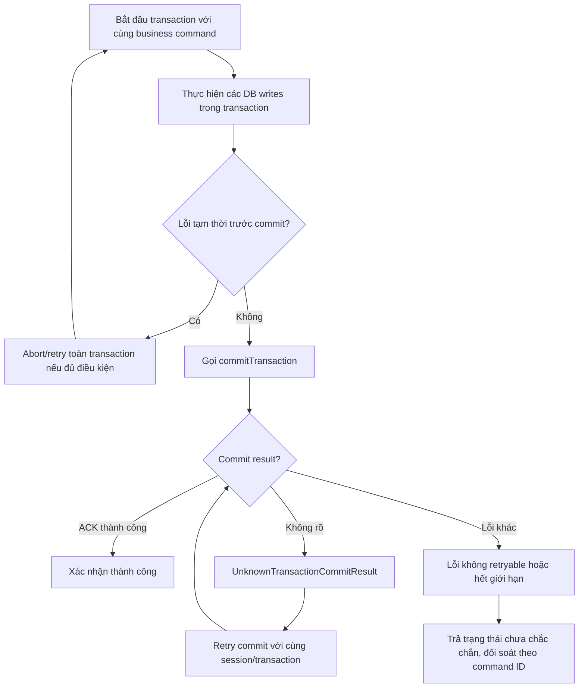
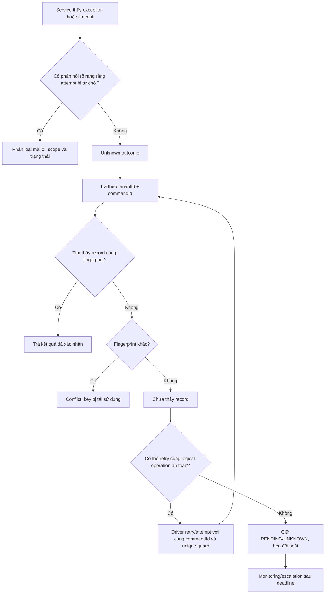

# Phân biệt lỗi ghi thất bại với lỗi chưa biết kết quả cuối

Một request đặt hàng gửi lệnh ghi tới **MongoDB**. Sau đó ứng dụng nhận một exception vì mất kết nối. Liệu đơn hàng **chưa được tạo**, hay MongoDB **đã tạo đơn nhưng phản hồi thành công không đến được ứng dụng**?

Đây là một trong những khác biệt quan trọng nhất khi xây hệ thống đáng tin cậy: **lỗi được quan sát bởi ứng dụng không luôn chứng minh thao tác ghi đã thất bại ở database**. Có trường hợp MongoDB trả lời rõ ràng “không thể ghi”; cũng có trường hợp client không thể xác nhận kết quả cuối vì timeout, mất mạng, thay primary hoặc chưa đạt mức xác nhận ghi yêu cầu.

Ví dụ:

```text
Client / Service                    MongoDB
       │                               │
       │ ── insert order #123 ────────>│
       │                               │ lưu order #123
       │                         ╲     │
       │                     mạng đứt  │
       │ <───── ACK bị mất ──────╱     │
       │                               │
    Nhận timeout                   Đã lưu?
       │                               │
       └── Không thể kết luận chỉ từ timeout.
```

Nếu ứng dụng coi timeout là “chắc chắn chưa ghi” rồi phát lại một **lệnh nghiệp vụ mới**, người dùng có thể bị tạo hai đơn, trừ tiền hai lần, tăng bộ đếm hai lần hoặc gửi hai sự kiện. Ngược lại, nếu ứng dụng coi timeout là “chắc chắn đã ghi”, nó có thể bỏ mất một công việc mà server chưa hề thực hiện.

Trong chương **Nhất quán dữ liệu** của module **SPRING_DATA_MONGODB**, bài này tập trung vào **phân biệt lỗi ghi đã biết kết quả với lỗi chưa biết kết quả cuối**; từ đó lựa chọn retry, reconciliation và idempotency phù hợp. Các ví dụ dùng **Spring Data MongoDB**, `MongoTemplate` hoặc repository, MongoDB write concern, transaction và kiểm thử. Kiến thức liên quan trực tiếp tới thiết kế thao tác ghi an toàn, chẩn đoán lỗi hệ phân tán và những workflow có side effect.

Sau bài học, bạn sẽ có thể:

1. Phân biệt **definite failure**, **confirmed success** và **unknown outcome** mà không suy đoán từ tên exception.
2. Giải thích vì sao **request timeout** không đồng nghĩa với **MongoDB rollback**, và vì sao một **write concern timeout** khác lỗi validation/duplicate key.
3. Nhận diện phạm vi của **acknowledged write**, `w:1`, `w:"majority"`, `wtimeout` và vai trò của read concern.
4. Hiểu **retryable writes** của MongoDB driver và ranh giới của chúng với **business retry** từ client.
5. Phân biệt nhãn `RetryableWriteError`, `NoWritesPerformed`, `TransientTransactionError` và `UnknownTransactionCommitResult` theo điều kiện/phiên bản hỗ trợ.
6. Thiết kế **idempotency key** và cơ chế đối soát sau timeout, tránh nhân đôi tác dụng của `$inc`, `$push` hoặc một giao dịch.
7. Biết khi nào **retry commit transaction**, khi nào **retry toàn transaction** và khi nào phải **đợi/xác minh** thay vì tạo nghiệp vụ mới.
8. Viết test lỗi ghi rõ ràng, test timeout giả lập, dữ liệu nhiều tenant, unique index và trạng thái retry.

## 1. Ba kết quả cần phân biệt trước khi xử lý exception

Một thao tác ghi có thể được ứng dụng quan sát ở ba trạng thái kiến thức:

| Trạng thái | Ứng dụng thực sự biết gì? | Ví dụ | Có nên phát lệnh nghiệp vụ mới ngay? |
| --- | --- | --- | --- |
| **Thành công đã được xác nhận** (*confirmed success*) | Server đã phản hồi thành công theo mức write concern yêu cầu | `insertOne` được xác nhận; result acknowledged | Không cần retry vì lỗi |
| **Thất bại rõ ràng** (*definite failure*) | Có bằng chứng lệnh **không tạo ra tác dụng được yêu cầu**, trong đúng phạm vi thao tác đang xét | Validation error của một insert, duplicate key của một insert cụ thể | Chỉ sửa nguyên nhân hoặc thực hiện bước phù hợp; không retry mù |
| **Chưa biết kết quả cuối** (*unknown/ambiguous outcome*) | Client không đủ bằng chứng biết tác dụng đã được áp dụng hay chưa/đã thỏa durability requirement hay chưa | Mất kết nối lúc chờ ACK; write concern timeout; commit result không rõ | Cần retry đúng cơ chế, đối soát hoặc trả trạng thái chờ |

Từ “**thất bại rõ ràng**” phải được hiểu chính xác: một **single-document insert** bị MongoDB từ chối do thiếu field bắt buộc thường không tạo document đó. Nhưng **bulk write** có thể đã thành công một phần trước khi báo lỗi; một **transaction commit** có thể không rõ kết quả dù client đang thấy lỗi; và một request mới bị duplicate key **không chứng minh request trước chưa thành công**.

### 1.1. Một trục khác: hệ thống đã làm gì so với client biết gì

```text
THỰC TẾ SERVER                     KIẾN THỨC CỦA CLIENT
──────────────────────             ───────────────────────────────
Không áp dụng write       ──────── Có thể biết là failed, nếu có bằng chứng
Áp dụng write             ──────── Có thể biết là succeeded, nếu có ACK
Không áp dụng write       ──────── Hoặc vẫn unknown nếu mất liên lạc
Áp dụng write             ──────── Hoặc vẫn unknown nếu mất ACK
```

Hai dòng cuối chính là vấn đề **ambiguous outcome**. Exception ở client mô tả **điều client quan sát được**, không nhất thiết là lịch sử thực thi đầy đủ ở MongoDB.

### 1.2. “Đã xử lý lệnh” và “đã bền vững theo yêu cầu” cũng khác nhau

Một thao tác có thể đã được primary áp dụng nhưng client chưa nhận xác nhận đủ mức `w:"majority"`. Kể cả khi nhìn thấy document từ một node hoặc một lần đọc, không nên tự suy ra mọi điều kiện durability đã thỏa. Mức đảm bảo phụ thuộc write concern, read concern, journaling và cấu hình replica set/sharded cluster.

**Quy tắc thực hành:** xác định rõ “thành công” trong API của bạn nghĩa là gì:

- Đã được primary xác nhận?
- Đã được xác nhận theo majority?
- Đã commit transaction?
- Đã hoàn thành **cả** MongoDB write lẫn side effect bên ngoài như gửi message?

Không dùng một biến boolean `success` cho bốn hợp đồng khác nhau.

## 2. Các điểm thời gian khi một lệnh ghi được gửi đi

Giả sử service muốn tạo một order với `commandId = "checkout-42"`:

```text
T0  Client tạo lệnh nghiệp vụ checkout-42
T1  Driver serialize và bắt đầu gửi write tới MongoDB
T2  MongoDB nhận lệnh và kiểm tra filter/validator/unique index
T3  MongoDB áp dụng thay đổi trên primary (nếu lệnh phù hợp)
T4  MongoDB chờ điều kiện write concern, nếu có
T5  Server gửi response/ACK
T6  Client nhận response và trả kết quả cho người gọi
```

Nếu kết nối đứt **trước T1 và có bằng chứng lệnh chưa từng được gửi**, ứng dụng có thể biết không có write do lần thử đó. Nhưng nếu đứt trong khoảng T1–T6, client thường **không biết** lệnh đã đến T2, T3, T4 hay T5.

Sự bất định có thể đến từ:

- Network connection reset khi server đang xử lý.
- Client-side timeout trong lúc chờ phản hồi.
- Primary stepdown/failover đúng thời điểm write.
- Driver timeout sau một hoặc nhiều lần retry.
- `wtimeout` khi dữ liệu chưa đạt mức xác nhận write concern đúng hạn.
- Kết quả `commitTransaction` không đến được client.

Không nên phân loại chỉ theo chuỗi message như `"timeout"` hoặc `"connection closed"`. Một lỗi có thể do server trả lời rõ ràng, hoặc do transport mất khả năng truyền kết quả. Cần xét **nguồn lỗi, response nhận được, error label, loại thao tác và khả năng đối soát**.

### 2.1. Một lệnh insert bị MongoDB chủ động từ chối

```javascript
// Collection có validator yêu cầu status ∈ ["NEW", "PAID"].
db.orders_consistency_lab.insertOne({
  _id: ObjectId(),
  status: "INVALID"
});
```

Nếu server trả `DocumentValidationFailure` (thường code `121`) đối với **insert đơn lẻ này**, nghĩa là document không được chấp nhận do schema. Sửa payload/rule trước khi gửi lại; tăng timeout không giải quyết được validation failure.

### 2.2. Một lệnh insert bị duplicate key

```javascript
// Giả sử unique index đang bảo vệ tenantId + commandId.
db.orders_consistency_lab.insertOne({
  tenantId: "T1",
  commandId: "checkout-42",
  status: "NEW"
});
```

Nếu lệnh insert **mới** nhận duplicate key (thường code `11000`), lệnh mới không thêm được một document với khóa trùng. Tuy nhiên, cần hỏi tiếp: **document đã tồn tại có phải là kết quả của chính nghiệp vụ checkout-42 đã thành công trước khi ACK bị mất không?**

Vì vậy, duplicate key là **một lỗi rõ ràng của attempt insert hiện tại**, nhưng **không tự là thất bại của nghiệp vụ tổng thể**. Sau ambiguous timeout, nó có thể là tín hiệu để truy vấn theo idempotency key và xác nhận tác dụng đã tồn tại.

### 2.3. Một lệnh `$inc` mất phản hồi

```javascript
db.counters_consistency_lab.updateOne(
  { _id: "views-2026-11-20" },
  { $inc: { views: 1 } }
);
```

Nếu write đã áp dụng nhưng ACK mất, việc gửi một **write nghiệp vụ mới** sẽ tăng từ 1 lên 2. `$inc` **nguyên tử trên một document**, nhưng không **idempotent khi thực thi lại như một nghiệp vụ mới**.

Phân biệt:

```text
Atomic     = không bị mất cập nhật khi nhiều write cùng sửa một document.
Idempotent = thực thi lại cùng tác vụ nghiệp vụ không tăng thêm tác dụng.
```

Một operation có thể atomic mà không idempotent.

## 3. Bảng phân loại lỗi khi ghi MongoDB

| Tình huống | Kết luận an toàn cho **attempt** | Kết luận cho **nghiệp vụ** | Hành động thường phù hợp |
| --- | --- | --- | --- |
| Validator server trả lỗi 121 cho một insert | Insert ấy bị từ chối | Chưa tạo document bằng attempt đó | Sửa dữ liệu/schema, không retry nguyên payload |
| Duplicate key 11000 cho một insert | Attempt mới không tạo record trùng | Có thể nghiệp vụ cũ đã thành công | Tìm record theo khóa nghiệp vụ, đối chiếu payload |
| `writeResult` acknowledged thành công | Được xác nhận theo write concern yêu cầu | Có thể hoàn tất phần ghi MongoDB theo contract | Trả kết quả, hoặc tiếp tục workflow |
| `updateOne` trả `matchedCount=0` | Không có document khớp filter của lần ghi này | Có thể do đã xử lý, version cũ, sai tenant, sai trạng thái hoặc chưa tồn tại | Phân biệt bằng read/đối chiếu điều kiện |
| `modifiedCount=0` nhưng `matchedCount=1` | Có document khớp, có thể không thay đổi value | Không mặc định nghiệp vụ thất bại | Kiểm tra semantics update |
| Network timeout khi chờ ACK | **Không đủ bằng chứng** về kết quả | Có thể đã thành công hoặc chưa | Dùng retry an toàn/đối soát, không tạo nghiệp vụ mới |
| Write concern timeout | Chưa xác nhận đạt write concern trước hạn | Write có thể đã áp dụng trên primary | Đối soát theo durability policy, không coi rollback |
| Driver hết retry và ném exception | Retry tự động không đưa về kết quả xác nhận | Chưa thể mặc định không có write | Đọc label, truy vấn trạng thái, idempotency |
| `NoWritesPerformed` trong trường hợp/version hỗ trợ | Driver/server cho biết không có write nào ở các attempt tương ứng | Có bằng chứng mạnh hơn cho việc chưa thực hiện | Vẫn kiểm tra scope/operation và lỗi cụ thể |
| Lỗi `commitTransaction` có `UnknownTransactionCommitResult` | Kết quả commit chưa biết | Transaction có thể đã commit | **Retry commit** với cùng session/transaction |
| Lỗi transaction có `TransientTransactionError` theo điều kiện hỗ trợ | Transaction gặp lỗi tạm thời trước khi commit xong | Có thể cần làm lại transaction đã abort | Retry **whole transaction** đúng API, không lặp side effect ngoài DB |
| Bulk write báo lỗi ở giữa | Có thể một phần write đã thành công | Không thể coi batch toàn bộ failed | Đọc per-item result/errors, đối soát theo key |

**Một exception class không nhất thiết ánh xạ 1–1 sang một trạng thái.** Spring Data có thể chuyển exception của MongoDB Java Driver sang các subtype của `DataAccessException`. Khi cần phân tích retryable label, write concern hoặc command result, phải hiểu cách lưu/unwrap nguyên nhân ở phiên bản driver/Spring Data đang chạy; đừng dựa vào catch theo tên class để suy ra “write không xảy ra”.

## 4. Write concern: “đã ACK” có nghĩa gì?

MongoDB **write concern** xác định mức xác nhận mong muốn khi thực hiện write. Hai cách thường gặp là:

```javascript
// Chờ primary xác nhận write theo cấu hình.
{ w: 1 }

// Chờ đa số thành viên voting data-bearing phù hợp xác nhận.
{ w: "majority", wtimeout: 5000 }
```

Nội dung chính:

- `w: 1` xác nhận từ primary theo semantics của deployment; một write chỉ được primary xác nhận có thể bị rollback khi failover trong một số trường hợp.
- `w: "majority"` yêu cầu xác nhận theo majority. Với cấu hình replica set/journal phù hợp, nó cung cấp mức durability mạnh hơn trước failover so với `w:1`.
- `wtimeout` giới hạn thời gian chờ điều kiện write concern; **không phải lệnh rollback** những thay đổi đã được áp dụng.
- `w: 0` là unacknowledged write: client không nhận xác nhận per-write như acknowledged mode, không phù hợp khi nghiệp vụ cần biết chắc kết quả.

Đừng gọi một write `w:1` là “đã commit như transaction durable trên majority” chỉ vì driver trả về không exception. Cũng không tuyên bố majority có thể bảo đảm mọi side effect bên ngoài database hoặc chống mọi trường hợp hỏng hệ thống.

### 4.1. Phân biệt write error và write concern error

| Loại | Ý nghĩa phổ biến | Suy luận an toàn |
| --- | --- | --- |
| **Write error** | Server từ chối hoặc không thể áp dụng một thao tác do điều kiện như duplicate key/validation | Cần xem thao tác đơn hay bulk và result của phần đã thực hiện |
| **Write concern error** | Server không đạt mức xác nhận yêu cầu hoặc gặp vấn đề xác nhận | **Không đồng nghĩa** tác dụng write đã được hoàn tác |

Ví dụ tình huống:

```text
Primary nhận insert → áp dụng insert thành công
      ↓
Secondary đang chậm/không thể xác nhận majority đúng hạn
      ↓
write concern trả timeout
      ↓
Client thấy lỗi, nhưng document có thể đã tồn tại trên primary.
```

Hệ quả thực hành: sau `wtimeout`, không lập tức phát lệnh “tạo đơn mới” với ID mới; cần đọc lại theo idempotency key và mức nhất quán tương ứng, hoặc để một tiến trình đối soát giải quyết.

### 4.2. Cấu hình write concern trong Java

MongoDB Java Driver cung cấp `WriteConcern`:

```java
import com.mongodb.WriteConcern;
import java.util.concurrent.TimeUnit;

WriteConcern concern = WriteConcern.MAJORITY
    .withWTimeout(5, TimeUnit.SECONDS);
```

Với raw driver:

```java
var collection = mongoTemplate.getCollection("orders_consistency_lab")
    .withWriteConcern(concern);

collection.insertOne(document);
```

`document` ở đây là một `org.bson.Document` đã được xây và validate hợp lệ. Cấu hình write concern ở cấp client/database/collection/template có thể khác theo API và phiên bản; **không giả định một raw collection được cấu hình lại tự thay đổi write concern của mọi lời gọi repository khác**. Hãy thống nhất chính sách ở mức ứng dụng phù hợp.

## 5. Retryable writes của MongoDB driver không phải business retry

MongoDB Java Driver hỗ trợ **retryable writes** cho các thao tác/triển khai đủ điều kiện. Với kết nối cấu hình phù hợp (thường có `retryWrites=true`), driver có thể tự retry **một lần** khi gặp một loại lỗi tạm thời đủ điều kiện trong một write operation được hỗ trợ.

Ví dụ URI có tùy chọn:

```text
mongodb://host1,host2,host3/orders?replicaSet=rs0&retryWrites=true
```

Đây là **ví dụ cấu hình**, không phải URI thật để kết nối. Hãy sử dụng hostname/authentication/TLS/replica set của môi trường và tránh ghi credential vào tài liệu hoặc log.

### 5.1. Retryable write nhận diện cùng một operation bằng gì?

Với hạ tầng hỗ trợ retryable writes, driver và server phối hợp bằng thông tin về **logical session** và **transaction number** của lệnh ghi retryable. Khi retry đúng cùng thao tác, cơ chế này giúp tránh áp dụng lặp một write vốn đã được server xử lý, trong phạm vi history/cơ chế retryable write được hỗ trợ.

```text
Driver gửi write #1 với session S và txnNumber N
       │
       ├─ Server chưa áp dụng? Driver retry cùng operation
       │
       └─ Server đã áp dụng nhưng ACK mất?
              │
              └─ Retry hợp lệ có thể nhận biết write đã thực hiện,
                 tránh áp dụng lại theo cơ chế retryable write.
```

**Không đồng nhất** cơ chế này với:

```text
HTTP client nhận timeout
    ↓
Tạo một HTTP request MỚI với commandId MỚI
    ↓
Server gọi MongoTemplate.updateFirst(...) như một write MỚI
```

Lời gọi nghiệp vụ mới thường có operation/session/transaction number mới; không còn được tự nhận diện là retry của write cũ chỉ vì payload giống nhau. Đây là lý do ứng dụng vẫn cần **idempotency key** và semantics cấp business.

### 5.2. Không phải write nào cũng retryable

Khả năng retry phụ thuộc:

- Phiên bản server/driver và topology được hỗ trợ, thường là replica set hoặc sharded cluster; không coi một standalone MongoDB có hành vi giống hệt.
- Loại write. Những single-document writes hoặc các lệnh write đủ điều kiện có thể hỗ trợ; một số thao tác bulk/multi-document không nằm trong cùng phạm vi.
- Session, trạng thái transaction và cấu hình kết nối.
- Error labels hoặc loại lỗi mà driver/server cho phép retry.
- Thời điểm lỗi và khả năng lưu lịch sử retryable write.

**Đặc biệt:** một thao tác `updateMany` không trở thành idempotent chỉ vì URI bật `retryWrites=true`. Transaction cũng có cơ chế retry khác, không thể thay thế bằng retryable writes ngoài transaction.

### 5.3. Nếu driver tự retry mà vẫn ném exception?

Không kết luận “chưa có gì được ghi”. Driver có thể đã thử lệnh nhiều lần và không lấy được ACK cuối cùng. Lịch sử trên server có thể khác điều client nhìn thấy.

Một số phiên bản MongoDB hiện đại (từ MongoDB 6.1 trong những trường hợp được hỗ trợ) có error label **`NoWritesPerformed`** để cho biết **cả lần thử ban đầu và lần retry liên quan không thực hiện write nào**. Nhưng:

- Label này không có ở mọi server/driver và không phải lúc nào cũng xuất hiện.
- Nếu không thấy label, không thể kết luận ngược rằng write chắc chắn đã xảy ra.
- Label chỉ nói về **operation/các attempt mà server phân loại**, không phải mọi side effect của toàn bộ workflow bên ngoài DB.
- Hãy kiểm tra đúng tài liệu/behavior của phiên bản production trước khi xây logic dựa vào label.

### 5.4. Đừng tự thêm vòng retry bao quanh mọi exception

Mã nguy hiểm:

```java
// KHÔNG NÊN: lỗi bất kỳ đều được xem là "chưa ghi".
for (int attempt = 0; attempt < 3; attempt++) {
    try {
        mongoTemplate.updateFirst(
            query,
            new Update().inc("balance", -100),
            Wallet.class
        );
        break;
    } catch (RuntimeException ex) {
        // Retry không giới hạn phân loại lỗi/operation.
    }
}
```

Nếu một lần cập nhật đã trừ 100 nhưng ACK mất, vòng lặp mới có thể trừ thêm 100. Đây **không** phải cách đảm bảo at-least-once an toàn cho một debit. Với thao tác tiền/tồn kho, cần định nghĩa **business command identity** và cơ chế lưu nhận dạng đã xử lý, hoặc thiết kế transaction/conditional update phù hợp.

### 5.5. `RetryableWriteError` khác `UnknownTransactionCommitResult`

| Nhãn | Ngữ cảnh chính | Hàm ý thao tác |
| --- | --- | --- |
| `RetryableWriteError` | Lỗi có thể retry đối với write operation theo cơ chế driver/server | Có thể để **driver** retry thao tác đủ điều kiện; không tự coi đó là nghiệp vụ mới |
| `NoWritesPerformed` | Một số lỗi retryable writes theo phiên bản hỗ trợ | Bằng chứng các write attempt liên quan không được thực hiện |
| `TransientTransactionError` | Lỗi tạm thời trong transaction theo quy tắc hỗ trợ | Có thể retry **toàn transaction** khi transaction đã thất bại/abort |
| `UnknownTransactionCommitResult` | Commit transaction có kết quả chưa rõ | Retry **commit của cùng transaction**, không chạy lại nghiệp vụ |

Các error label thường được driver cung cấp trên `MongoException` qua API phù hợp, nhưng Spring Data có thể translation/wrap exceptions. Một label **không thay thế** việc hiểu context, điểm lỗi và hướng dẫn retry chính thức.

## 6. Transaction: lỗi trước commit và lỗi commit không giống nhau

MongoDB transaction dùng session và commit để quyết định một tập thay đổi. Với transaction, phân biệt **lỗi trong phần thân transaction** và **lỗi khi gọi commit** cực kỳ quan trọng.

### 6.1. Lỗi tạm thời trong thân transaction

Ví dụ một transaction chuyển tiền giữa hai tài khoản MongoDB (chỉ minh họa):

```text
startTransaction
    ├─ Giảm số dư A với điều kiện đủ tiền
    ├─ Tăng số dư B
    └─ commitTransaction
```

Nếu có lỗi được gắn `TransientTransactionError` trong giai đoạn phù hợp, driver/API transaction có thể abort/retry **toàn bộ transaction callback**. Phần chưa commit được xử lý theo transaction semantics, nhưng đoạn code callback có thể **chạy nhiều lần**.

Vì vậy:

```java
// KHÔNG NÊN đặt side effect bên ngoài vào callback
// có thể được chạy lại.
sendEmail("Đã chuyển tiền");
chargeExternalPaymentGateway();
```

Một email hoặc giao dịch cổng thanh toán ngoài MongoDB không tự rollback cùng transaction. Đặt những side effect đó vào workflow **outbox/inbox/idempotency** được thiết kế riêng.

### 6.2. Lỗi commit với `UnknownTransactionCommitResult`

Timeline:

```text
Client                                 MongoDB
  │ startTransaction                      │
  │ write A, write B                      │
  │ ── commitTransaction ────────────────>│
  │                                      │ có thể đã commit
  │                 ╲                    │
  │ <──── ACK commit bị mất ╲            │
  │                                      │
  │ Nhận UnknownTransactionCommitResult  │
  └─ KHÔNG chạy lại toàn bộ transaction   │
     chỉ vì không nhận ACK commit         │
```

Hướng xử lý MongoDB transaction API thường là **retry commit của chính session và transaction đó**, trong phạm vi cơ chế/timeout và khả năng API hỗ trợ. Đừng tạo session/transaction mới rồi thực thi lại phần thân như một nghiệp vụ mới khi kết quả commit trước chưa rõ.

### 6.3. Phân biệt hai nhánh retry



Sơ đồ thể hiện **ý tưởng**, không phải yêu cầu lặp retry vô hạn. Driver có giới hạn timeout và API như callback transaction có thể quản lý retry thay ứng dụng. Mọi retry phải có deadline, logging có kiểm soát và kế hoạch đối soát khi không thể biết kết quả.

### 6.4. Java Driver: tư duy khi tự điều phối commit

Đoạn mã khung sau nhấn mạnh **session nào dùng để retry commit**:

```java
import com.mongodb.MongoException;
import com.mongodb.client.ClientSession;

// session là một ClientSession đã startTransaction,
// callback writes của transaction đã được thực thi.
try {
    session.commitTransaction();
} catch (MongoException ex) {
    if (ex.hasErrorLabel("UnknownTransactionCommitResult")) {
        // Retry *commit* của cùng session/transaction,
        // theo policy timeout và khả năng API hỗ trợ.
        // Không gọi lại save/debit/transfer từ đầu ở đây.
    } else {
        // Phân loại lỗi theo context của transaction.
        throw ex;
    }
}
```

Đây là **khung giải thích**, chưa phải vòng retry production hoàn chỉnh. Khi dùng driver callback API `withTransaction` hoặc Spring `MongoTransactionManager`/`@Transactional`, cần xác định rõ framework đã retry bước nào, exception nào được wrap và cách giữ commandId qua lần thử. Không tự retry bên ngoài một transaction manager theo cảm tính.

### 6.5. Thành công commit không đồng nghĩa side effect ngoài MongoDB đã xong

Sau commit MongoDB, service có thể gửi message tới broker nhưng bị timeout ở broker; hoặc gửi message xong rồi mất HTTP ACK với client. Đây là **hai kết quả độc lập**. Mô hình **transactional outbox** có thể ghi sự kiện cần phát **cùng transaction MongoDB** (nếu phù hợp), rồi một worker gửi đi idempotent. Consumer cũng cần xử lý message trùng; outbox không tự tạo exactly-once với mọi hệ thống ngoài.

## 7. Idempotency: khóa để retry đúng nghiệp vụ

Một giải pháp quan trọng là gán **một identity ổn định** cho mỗi yêu cầu nghiệp vụ:

```text
tenantId       = T1
commandId      = checkout-42
payload        = tạo đơn 150.00 cho C-100
```

Client gửi lại cùng nghiệp vụ phải dùng **cùng commandId**, không tự sinh một UUID mới ở mỗi lần retry. Server bảo vệ:

1. Không có hai record khác nhau cho cùng `(tenantId, commandId)`.
2. Nếu commandId trùng nhưng **payload khác**, trả conflict — không coi đó là retry hợp lệ.
3. Nếu commandId trùng và payload cùng ý nghĩa, trả lại kết quả đã biết hoặc trạng thái đang xử lý.
4. Nếu kết quả chưa xác định, không đoán “failed”; có thể trả **PENDING/UNKNOWN** và tiếp tục đối soát.

### 7.1. Unique index là ranh giới cuối cho một commandId

```javascript
db.order_commands_consistency_lab.createIndex(
  { tenantId: 1, commandId: 1 },
  {
    name: "uniq_tenant_command",
    unique: true
  }
);
```

Unique index là **ràng buộc database**, giúp bảo đảm không thể insert hai document chứa cùng cặp key, miễn index tồn tại/được tạo thành công và dữ liệu/hợp đồng trường hợp null, collation, sharding được thiết kế phù hợp.

Một pre-check kiểu “tìm không có record → insert” **không đủ** để chống race giữa hai request đồng thời. Phải có unique index hoặc thiết kế atomically reserve key tương đương.

### 7.2. Idempotency key khác request ID trong log

| Giá trị | Vai trò | Có đổi khi client retry? |
| --- | --- | --- |
| `traceId` | Theo dõi một HTTP request | Có thể đổi |
| `correlationId` | Theo dõi chuỗi sự kiện | Có thể giữ hoặc sinh theo workflow |
| `commandId/idempotencyKey` | Nhận diện **một tác dụng nghiệp vụ** | **Không đổi** khi retry cùng tác dụng |
| MongoDB `_id` | Khóa định danh một document | Có thể do server tạo; không thay thế ý nghĩa commandId nếu client không biết |

Nếu HTTP client retry mỗi lần với commandId khác, database chỉ thấy **những lệnh nghiệp vụ khác nhau**, dù người dùng bấm một nút hai lần. Thỏa thuận idempotency phải nằm trong API contract và được kiểm tra ở server.

## 8. Spring Data MongoDB: tạo một command idempotent

Ví dụ này dùng **một document** để ghi nhận lệnh tạo đơn với `(tenantId, commandId)` duy nhất. Đây là trường hợp có thể thiết kế đơn giản vì **tạo document chính là tác dụng nghiệp vụ cần xác nhận**. Nếu còn phải giảm stock, trừ ví hoặc ghi outbox ở collection khác, bạn cần giao dịch/workflow riêng như mục 10.

### 8.1. Entity có khóa nghiệp vụ duy nhất

```java
package com.example.orders;

import java.math.BigDecimal;
import java.time.Instant;
import org.bson.types.ObjectId;
import org.springframework.data.annotation.Id;
import org.springframework.data.mongodb.core.index.CompoundIndex;
import org.springframework.data.mongodb.core.mapping.Document;
import org.springframework.data.mongodb.core.mapping.Field;
import org.springframework.data.mongodb.core.mapping.FieldType;

@Document(collection = "order_commands_consistency_lab")
@CompoundIndex(
    name = "uniq_tenant_command",
    def = "{ 'tenantId': 1, 'commandId': 1 }",
    unique = true
)
public class OrderCommand {

    @Id
    private ObjectId id;

    private String tenantId;
    private String commandId;
    private String payloadFingerprint;
    private String customerId;
    private String status;
    private Instant createdAt;

    @Field(targetType = FieldType.DECIMAL128)
    private BigDecimal totalAmount;

    protected OrderCommand() {}

    public OrderCommand(
            String tenantId, String commandId,
            String payloadFingerprint, String customerId,
            BigDecimal totalAmount, Instant createdAt) {
        this.tenantId = tenantId;
        this.commandId = commandId;
        this.payloadFingerprint = payloadFingerprint;
        this.customerId = customerId;
        this.totalAmount = totalAmount;
        this.status = "CREATED";
        this.createdAt = createdAt;
    }

    public ObjectId getId() { return id; }
    public String getTenantId() { return tenantId; }
    public String getCommandId() { return commandId; }
    public String getPayloadFingerprint() {
        return payloadFingerprint;
    }
    public String getCustomerId() { return customerId; }
    public String getStatus() { return status; }
    public BigDecimal getTotalAmount() { return totalAmount; }
    public Instant getCreatedAt() { return createdAt; }
}
```

Lưu ý:

- `@CompoundIndex` là metadata Spring Data; **không chứng minh index thực đã tồn tại** nếu cơ chế auto-index creation bị tắt. Với production, triển khai unique index qua migration và xác minh `getIndexes()` trước khi cho lưu command.
- `payloadFingerprint` cần được tính **ở server từ payload nghiệp vụ đã chuẩn hóa** (thứ tự field, kiểu số, version quy tắc, đơn vị tiền). Không lấy một chuỗi hash do client tự khai báo rồi xem là đáng tin.
- `tenantId` phải được xác định từ authentication/authorization, không để client đổi tenant chỉ bằng tham số JSON.
- `commandId` cần giới hạn format/độ dài và cùng một command chỉ được dùng lại trong phạm vi tenant được thiết kế.
- `BigDecimal` được lưu Decimal128 để không vô tình dùng Double cho tiền.

### 8.2. Repository truy vấn theo identity của lệnh

```java
package com.example.orders;

import java.util.Optional;
import org.bson.types.ObjectId;
import org.springframework.data.mongodb.repository.MongoRepository;

public interface OrderCommandRepository
        extends MongoRepository<OrderCommand, ObjectId> {

    Optional<OrderCommand> findByTenantIdAndCommandId(
        String tenantId, String commandId);
}
```

Phương thức lookup luôn bao gồm tenant để tránh trả trạng thái command của người dùng khác.

### 8.3. Service tạo và đọc lại kết quả đã biết

```java
package com.example.orders;

import java.math.BigDecimal;
import java.time.Instant;
import java.util.Optional;
import org.bson.types.ObjectId;
import org.springframework.dao.DuplicateKeyException;

public class OrderCommandService {

    private final OrderCommandRepository repository;

    public OrderCommandService(OrderCommandRepository repository) {
        this.repository = repository;
    }

    public record Result(
        String state,
        ObjectId orderId,
        String commandId
    ) {}

    public Result create(
            String trustedTenantId,
            String commandId,
            String serverPayloadFingerprint,
            String customerId,
            BigDecimal totalAmount) {

        requireIdentity(
            trustedTenantId, commandId, serverPayloadFingerprint
        );
        if (customerId == null || customerId.isBlank()
                || totalAmount == null
                || totalAmount.signum() < 0) {
            throw new IllegalArgumentException("Payload không hợp lệ");
        }

        OrderCommand command = new OrderCommand(
            trustedTenantId, commandId,
            serverPayloadFingerprint, customerId,
            totalAmount, Instant.now()
        );

        try {
            OrderCommand created = repository.insert(command);
            return new Result("CREATED", created.getId(), commandId);
        } catch (DuplicateKeyException duplicate) {
            // Chỉ coi là retry thành công nếu tìm được
            // đúng command và payload cùng ý nghĩa.
            OrderCommand existing = repository
                .findByTenantIdAndCommandId(
                    trustedTenantId, commandId
                )
                .orElseThrow(() -> duplicate);

            return verifiedResult(
                existing, serverPayloadFingerprint
            );
        }
        // Các lỗi khác được phân loại ở tầng coordinator:
        // không catch RuntimeException rồi mặc định FAILED.
    }

    public Result inspectAfterUnknownOutcome(
            String trustedTenantId,
            String commandId,
            String serverPayloadFingerprint) {

        requireIdentity(
            trustedTenantId, commandId, serverPayloadFingerprint
        );

        Optional<OrderCommand> found = repository
            .findByTenantIdAndCommandId(
                trustedTenantId, commandId
            );

        return found
            .map(command -> verifiedResult(
                command, serverPayloadFingerprint
            ))
            .orElse(new Result("UNKNOWN", null, commandId));
    }

    private Result verifiedResult(
            OrderCommand existing,
            String fingerprint) {
        if (!fingerprint.equals(existing.getPayloadFingerprint())) {
            throw new IllegalStateException(
                "Idempotency key bị dùng lại với payload khác"
            );
        }
        return new Result(
            "ALREADY_RECORDED", existing.getId(),
            existing.getCommandId()
        );
    }

    private void requireIdentity(
            String tenantId, String commandId, String fingerprint) {
        if (tenantId == null || tenantId.isBlank()
                || commandId == null || commandId.isBlank()
                || fingerprint == null || fingerprint.isBlank()) {
            throw new IllegalArgumentException(
                "Thiếu identity/fingerprint"
            );
        }
    }
}
```

**Điểm quan trọng trong thiết kế:**

1. Service dùng `repository.insert(...)` cho nghiệp vụ tạo mới, **không dùng `save(...)` như một lệnh upsert vô điều kiện có thể ghi đè record cũ**.
2. Unique index trên `(tenantId,commandId)` là lớp chống trùng khi hai request chạy cạnh tranh.
3. `DuplicateKeyException` chỉ được diễn giải là “đã có kết quả của command” **nếu** đọc được record trùng key và fingerprint đúng. Nếu duplicate do ràng buộc khác, việc không tìm được command sẽ ném lại lỗi.
4. `inspectAfterUnknownOutcome` được gọi **sau khi tầng gọi đã phân loại một lỗi là ambiguous**. Nó không bắt mọi exception và cũng không tự thử một write khác.
5. Kết quả `"UNKNOWN"` khi **chưa tìm thấy record** không có nghĩa “server chắc chắn chưa insert”. Attempt ban đầu có thể còn đang xử lý hoặc chưa đạt mức đọc nhất quán bạn dùng.
6. Service không tự xử lý quyền user, canonical hashing và HTTP response; các phần này thuộc lớp orchestration/boundary, cần triển khai đủ trong ứng dụng thật.

### 8.4. Tại sao “không tìm thấy” không chứng minh thất bại?

Một lần read có thể diễn ra:

- Trước khi write đang treo được hoàn tất.
- Trên node đọc thứ cấp chưa thấy cập nhật mới.
- Trong lúc replica set failover/recovery.
- Với read concern không tương ứng mức durability mà business yêu cầu.

Vì vậy, sau ambiguous write, hệ thống có thể trả `PENDING/UNKNOWN` và tiếp tục đối soát với retry có deadline, thay vì kết luận `FAILED` từ một `findBy...` trả empty.

Nếu API cần kết luận “đã hoàn tất bền vững”, nên xác định **read concern/read preference/write concern** tương ứng và kiểm tra hành vi thật trên topology. Chọn `ReadConcern.MAJORITY` có thể hữu ích cho những workflow yêu cầu majority-committed data, nhưng **một lần majority read không tìm thấy record cũng không chứng minh write khác đang in-flight sẽ không commit sau đó**.

### 8.5. Duplicate key có thể là tín hiệu thành công của lần trước

Ví dụ hai HTTP request cùng command:

```text
Request A: tenant=T1, commandId=checkout-42
   └─ Insert thành công ở MongoDB, mất HTTP ACK.

Request B (retry): tenant=T1, commandId=checkout-42
   └─ Insert lại bị duplicate key.
       └─ Query tenantId + commandId.
           ├─ Fingerprint giống: trả cùng orderId.
           └─ Fingerprint khác: trả conflict.
```

Không dùng duplicate key để tự động tạo ID khác rồi insert lại — cách đó làm mất mục đích idempotency.

### 8.6. TTL và vòng đời idempotency key

Nếu lưu commandId vĩnh viễn, collection có thể phát triển lớn. Nếu dùng TTL để xóa các record idempotency sau một thời gian, hãy định nghĩa rõ **thời hạn retry được hỗ trợ**. Khi record bị TTL xóa, một request quá cũ với cùng key có thể được xem là mới nếu không còn hàng rào khác.

Đối với nghiệp vụ tài chính, đơn hàng hoặc hành động không được phép trùng vô thời hạn, có thể cần giữ identity trong chính business record, lưu lịch sử bền hơn hoặc policy chống lặp riêng. **TTL không được phép vô tình làm mất bằng chứng hoàn tất** mà hệ thống vẫn cần cho reconciliation.

## 9. Trường hợp `$inc`: bảo vệ tác dụng, không chỉ nhận diện request

Một counter đơn giản:

```javascript
db.counter_consistency_lab.updateOne(
  { _id: "stock-A" },
  { $inc: { reserved: 1 } }
);
```

Nếu service nhận timeout rồi gọi lại một operation nghiệp vụ mới, `reserved` có thể tăng hai lần. Đọc counter thấy giá trị 2 cũng không chứng minh **lần nào** tăng; có thể có nhiều user đồng thời.

### 9.1. Idempotency cho lệnh cập nhật khác tạo document

Nếu cần ghi **một event/command record** và cập nhật counter cùng một tác dụng, có thể dùng transaction MongoDB được hỗ trợ:

```text
Trong transaction:
  1. Ghi command marker duy nhất (tenantId, commandId).
  2. Conditional update counter/stock theo tenant và điều kiện.
  3. Ghi outbox record nếu cần side effect.
  4. Commit.
```

Khi một lần retry cùng commandId bắt gặp unique marker đã commit, workflow có thể đọc kết quả đã biết thay vì tăng counter lần hai. Nhưng để thực thi đúng còn cần:

- Transaction manager và topology MongoDB hỗ trợ transaction.
- Ràng buộc unique index đã được triển khai.
- Không ghi side effect ngoài database trực tiếp trong transaction callback có thể retry.
- Một quy trình xử lý **UnknownTransactionCommitResult** và kết quả đang pending.
- Cách xử lý khi conditional update không match (ví dụ stock không đủ) mà không ghi marker “thành công” sai.

### 9.2. Conditional update và `@Version` chưa đủ cho dedup

`@Version` của Spring Data và filter compare-and-set có thể ngăn hai writer ghi đè cùng một version. Nhưng một client retry với **version mới** vẫn có thể tạo một nghiệp vụ mới nếu không gắn commandId ổn định.

Vì vậy:

```text
Optimistic locking  → bảo vệ một bản ghi khỏi lost update/race.
Idempotency key     → bảo vệ một command khỏi nhân đôi tác dụng.
Transaction         → ràng buộc nhiều DB writes vào cùng commit/abort.
Outbox              → kết nối DB commit với việc phát side effect có retry.
```

Các cơ chế này giải quyết những loại rủi ro khác nhau và thường cần được kết hợp.

## 10. Đối soát sau khi kết quả chưa rõ

Sau ambiguous write, ứng dụng không nên chỉ làm hai việc “retry vô hạn” hoặc “trả lỗi”. Một **reconciliation workflow** có thể chuyển trạng thái chưa biết thành kết quả đã được chứng minh.

### 10.1. Trạng thái của command trong API

Một hợp đồng có thể tách:

| Trạng thái API | Ý nghĩa | Điều kiện chuyển |
| --- | --- | --- |
| `ACCEPTED/PENDING` | Server đã nhận hoặc đang tìm cách xử lý command, chưa khẳng định tác dụng cuối | Cần xử lý tiếp hoặc đối soát |
| `CONFIRMED` | Có bằng chứng command đạt mức hoàn tất theo hợp đồng | Trả cùng kết quả cho mọi retry của command |
| `REJECTED` | Có bằng chứng command bị từ chối theo nghiệp vụ/input và không tạo tác dụng | Trả lý do ổn định, không chạy thêm |
| `UNKNOWN` | Không thể biết kết quả sau một khoảng thời gian/attempt | Không coi là `REJECTED`; mở đường tra cứu và điều tra |

Nếu request chưa hề được gửi tới service, client có thể cần retry **cùng commandId**. Nếu service đã nhận và lưu marker, nó có thể trả PENDING. Nhưng **chỉ trả HTTP 202 Accepted không tự bảo đảm lệnh đã được lưu bền vững**: API phải nói rõ có thể đối soát qua endpoint nào và ý nghĩa của trạng thái 202.

Ví dụ hợp đồng:

```text
POST /orders
Idempotency-Key: checkout-42

201 Created:
  { status: "CONFIRMED", orderId: "..." }

202 Accepted:
  { status: "PENDING", commandId: "checkout-42" }

409 Conflict:
  { code: "IDEMPOTENCY_KEY_REUSED_WITH_DIFFERENT_PAYLOAD" }

GET /orders/commands/checkout-42
  → CONFIRMED / PENDING / UNKNOWN / REJECTED (theo bằng chứng)
```

Đây là hợp đồng gợi ý, không phải HTTP API có sẵn của Spring Data. Việc truy vấn status phải yêu cầu authentication và scoped theo tenant, không cho phép một user suy ra trạng thái lệnh của tenant khác.

### 10.2. Quy trình recovery có giới hạn



Trong thực tế, một read failure khi reconciliation cũng có thể ambiguous; không được chuyển thành FAILED. Có thể cần backoff, retry budget, circuit breaker và queue xử lý sau. Khi hết budget, đưa vào trạng thái **đang chờ xác minh** và báo động có chủ đích; không xóa commandId rồi gửi nghiệp vụ mới.

### 10.3. Dữ liệu đối soát nên chứa gì?

Đối với một lệnh quan trọng, nên cân nhắc lưu:

```text
tenantId
commandId
payloadFingerprint / canonical request version
businessRecordId
operationType
createdAt / updatedAt
finalStatus hoặc processingStatus
lastObservedErrorClass / sanitizedErrorCode
attemptCount hoặc generation
request correlation ID
```

Không cần đưa mọi field vào một document nếu có thể suy ra chính xác từ business record, nhưng phải có **dữ liệu truy vấn được và đủ ổn định** để phân biệt một command cụ thể.

Không lưu raw exception chứa secret, thông tin cá nhân hoặc connection string. Việc tái dựng outcome cần dựa trên **dữ liệu nghiệp vụ đã commit**, không chỉ trên log vốn có thể đến chậm hoặc mất.

### 10.4. Nếu record đã có nhưng side effect chưa xong?

Ví dụ `OrderCommand` đã được tạo, nhưng message “ORDER_CREATED” chưa được phát:

- **Phần MongoDB write:** đã được xác nhận khi tìm record dưới chính sách read concern phù hợp.
- **Phần message:** chưa có bằng chứng đã phát thành công.

Không trả “toàn bộ workflow thành công” nếu hợp đồng yêu cầu phát message hoàn tất. Với transactional outbox, có thể có:

```text
Order + Outbox event được commit cùng transaction.
        ↓
Outbox publisher gửi event.
        ↓
Broker nhận event (ACK có thể mất).
        ↓
Publisher retry; consumer deduplicate theo eventId.
```

Outbox giúp tránh mất ý định phát message khi DB commit, nhưng **không tự bảo đảm exactly-once delivery xuyên mọi thành phần**. Consumer cần idempotency cho side effect của message.

## 11. Read concern và cách đọc lại kết quả

### 11.1. Vì sao không chỉ gọi `findById` một lần?

Một read có thể trả empty dù:

1. Write của lần trước vẫn đang xử lý.
2. Record mới chưa xuất hiện trên node đang đọc.
3. Primary stepdown vừa diễn ra; tác dụng/durability chưa ổn định.
4. Query lọc sai tenant/commandId hoặc ánh xạ BSON khác dự định.
5. Write thật sự không được thực hiện.

Năm trường hợp có cùng **triệu chứng** nhưng cách xử lý khác. Vì vậy, read empty chỉ là **observation tại một thời điểm**, không tự chứng minh nguyên nhân.

### 11.2. Read concern có thể hỗ trợ xác nhận durability

MongoDB cung cấp `ReadConcern` như `LOCAL` và `MAJORITY`, với semantics tùy topology/version:

```java
import com.mongodb.ReadConcern;
import com.mongodb.ReadPreference;

var collection = mongoTemplate
    .getCollection("order_commands_consistency_lab")
    .withReadConcern(ReadConcern.MAJORITY)
    .withReadPreference(ReadPreference.primary());
```

`collection` ở đây là raw driver collection được cấu hình cho **đường đọc đối soát này**; không tự thay đổi mọi repository khác. Một majority read nhìn thấy document là bằng chứng hữu ích rằng document đã được majority-committed theo semantics của MongoDB đang chạy. Nhưng một majority read không thấy document **không phải bằng chứng** rằng một attempt in-flight không thể commit sau đó.

Nếu ứng dụng cần read-your-writes hoặc causal consistency qua nhiều lệnh trong một session, phải xem **causally consistent session** và read/write concern thích hợp. Không suy ra một sequence hai HTTP requests độc lập có cùng causal session chỉ vì chung user ID.

### 11.3. Việc thấy document không nhất thiết kết thúc workflow

Sau timeout, đọc lại thấy document:

```javascript
{
  tenantId: "T1",
  commandId: "checkout-42",
  status: "CREATED"
}
```

Hãy kiểm tra:

- `payloadFingerprint` có khớp command ban đầu?
- Document được nhìn thấy với read concern nào?
- Business invariant nào được coi là hoàn tất khi status CREATED?
- Có các bước bổ sung như payment settlement, reservation, outbox không?
- Có transaction hoặc workflow khác đang tạo marker chưa ở trạng thái final không?

**Một record tồn tại không tự nghĩa mọi thành phần trong một saga đã hoàn tất.** Phân biệt “command đã được ghi nhận” với “nghiệp vụ end-to-end đã hoàn tất”.

## 12. Phân biệt kết quả ghi MongoDB ở cấp API

### 12.1. `acknowledged`, `matchedCount` và `modifiedCount`

Với raw driver:

```java
import com.mongodb.client.result.UpdateResult;

UpdateResult result = collection.updateOne(
    filter,
    update
);

if (!result.wasAcknowledged()) {
    // Không có xác nhận để diễn giải các count như ACK.
}
long matched = result.getMatchedCount();
long modified = result.getModifiedCount();
```

| Điều kiện | Ý nghĩa cơ bản |
| --- | --- |
| Acknowledged và `matched=1, modified=1` | Một document khớp, một document được sửa |
| Acknowledged và `matched=1, modified=0` | Document khớp, nhưng giá trị cuối có thể không đổi |
| Acknowledged và `matched=0` | Không có document khớp filter tại thời điểm thực thi |
| Không có ACK/result do lỗi network | Chưa biết count thực tế ở server chỉ từ exception |

`matched=0` có thể do version đã đổi, trạng thái đã chuyển, tenant không khớp hoặc record không tồn tại. Không gán tất cả trường hợp này vào cùng một `"FAILED"` mà không xem hợp đồng nghiệp vụ.

### 12.2. Upsert và kết quả không tạo mới

Một `updateOne(..., upsert=true)` có thể tạo document mới hoặc cập nhật document đã tồn tại. Với result acknowledged, `getUpsertedId()` có thể cho biết upsert đã insert record mới; tuy nhiên:

- Điều kiện filter và unique index phải được thiết kế để chống race.
- Nếu dùng `$set` trên field đã tồn tại, retry có thể thay đổi dữ liệu dù không tạo bản ghi mới.
- `$setOnInsert` là lựa chọn có ích để chỉ đặt giá trị khi document mới được tạo.
- Upsert với filter không được bảo vệ bởi unique key có thể sinh trùng khi nhiều writer chạy đồng thời.

Ví dụ ý tưởng:

```javascript
db.order_commands_consistency_lab.updateOne(
  { tenantId: "T1", commandId: "checkout-42" },
  {
    $setOnInsert: {
      payloadFingerprint: "SHA256_OF_CANONICAL_REQUEST",
      status: "CREATED",
      createdAt: new Date()
    }
  },
  { upsert: true }
);
```

Đoạn này **chỉ đặt mặc định khi insert**. Nếu commandId đã tồn tại với payload khác, nó **không tự phát hiện conflict**. Phải đọc lại và kiểm tra fingerprint, đồng thời giữ unique index. Nếu workflow có nhiều side effect, một upsert marker đơn lẻ vẫn chưa đủ.

### 12.3. `@Version` và optimistic locking

Spring Data MongoDB có `@Version` để hỗ trợ optimistic locking trong những đường ghi entity phù hợp. Khi cập nhật một entity với version cũ, ứng dụng có thể gặp `OptimisticLockingFailureException` hoặc điều kiện update không còn khớp, tùy API và cấu hình.

Một lỗi optimistic lock ở attempt hiện tại có thể là bằng chứng **attempt ấy không áp dụng thay đổi theo version kỳ vọng**, nhưng nó không chứng minh command không được thực hiện trước đó bởi một request khác. Hãy phân biệt:

```text
Stale version    → cần đọc lại trạng thái/version của document.
Duplicate command→ cần đọc lại kết quả theo idempotency key.
Unknown ACK      → cần đối soát thay vì kết luận.
```

Đối với đường ghi yêu cầu bảo đảm optimistic locking, cần sử dụng acknowledged write concern và kiểm thử version behavior của API chính xác. Không giả định một raw `updateMany` hay repository `@Update` tự áp dụng cùng semantics version như `save`.

### 12.4. Bulk write: partial success là một trạng thái khác

Giả sử một bulk request chứa 5 inserts, phần thứ ba duplicate key. Với **ordered bulk**, các thao tác trước lỗi có thể đã được áp dụng còn các thao tác sau không chạy; với **unordered bulk**, một số thao tác còn lại có thể tiếp tục tùy semantics. Nếu thêm network failure, client có thể còn thiếu thông tin chính xác về subset đã thực hiện.

Vì vậy không được:

```text
catch BulkWriteException
   → đánh dấu cả 5 inserts FAILED
   → gửi lại cả 5 như 5 nghiệp vụ mới
```

Hãy gắn identity cho **từng mục** nếu nghiệp vụ yêu cầu, xem per-operation success/error từ result khi có, rồi đối soát các mục chưa rõ. Một bulk operation không tự biến thành transaction chỉ vì gọi một API duy nhất.

## 13. Thực hành `mongosh`: duplicate, validation và “mất ACK”

Mục tiêu của bài thực hành là **thấy rõ sự khác biệt giữa lỗi bị từ chối** và **nghiệp vụ đã được ghi nhận nhưng client có thể chưa biết**. Ta không cố tình phá mạng/step down primary trên server dùng chung. Thay vào đó, mô phỏng **client không nhận/không giữ kết quả** sau một write thành công, rồi đối soát bằng khóa nghiệp vụ.

**Chỉ thực hành trên MongoDB test.** Bộ lệnh tạo một collection tên ngẫu nhiên chỉ thuộc phiên học tập; không ghi lên collection production hay drop collection người khác.

### 13.1. Tạo collection riêng với unique index và validator

Trong một phiên `mongosh`:

```javascript
use spring_data_training

const labName = "order_commands_consistency_lab_" +
  new ObjectId().toHexString();
const tenant = "T1-" + new ObjectId().toHexString();

db.createCollection(labName, {
  validator: {
    $jsonSchema: {
      bsonType: "object",
      required: [
        "tenantId",
        "commandId",
        "payloadFingerprint",
        "status",
        "totalAmount",
        "createdAt"
      ],
      properties: {
        _id: { bsonType: "objectId" },
        tenantId: {
          bsonType: "string", minLength: 1
        },
        commandId: {
          bsonType: "string", minLength: 1
        },
        payloadFingerprint: {
          bsonType: "string", minLength: 1
        },
        status: {
          enum: ["CREATED", "CANCELLED"]
        },
        totalAmount: {
          bsonType: "decimal",
          minimum: NumberDecimal("0.00")
        },
        createdAt: { bsonType: "date" }
      }
    }
  },
  validationLevel: "strict",
  validationAction: "error"
});

const lab = db.getCollection(labName);

lab.createIndex(
  { tenantId: 1, commandId: 1 },
  { name: "uniq_tenant_command", unique: true }
);

printjson({ labName: labName, tenant: tenant });
printjson(lab.getIndexes());
```

Giữ các biến `labName`, `tenant` và `lab` trong **cùng phiên mongosh** cho các bước sau.

### 13.2. Ghi một command hợp lệ và nhận ACK

```javascript
const commandId = "checkout-42";
const fingerprint = "canonical-payload-v1-hash-abc";
const orderId = new ObjectId();

const commandDoc = {
  _id: orderId,
  tenantId: tenant,
  commandId: commandId,
  payloadFingerprint: fingerprint,
  customerId: "C-100",
  status: "CREATED",
  totalAmount: NumberDecimal("150.00"),
  createdAt: new Date()
};

const insertResult = lab.insertOne(commandDoc);

printjson({
  acknowledged: insertResult.acknowledged,
  insertedId: insertResult.insertedId
});
// Dự kiến: acknowledged=true với môi trường mặc định
// có write concern acknowledged phù hợp.
```

Ở đây `insertOne` trả thành công, vì vậy **phần insert vào MongoDB** đã được xác nhận theo mức write concern áp dụng. Không suy ra những side effect ngoài database (ví dụ gửi email) đã hoàn tất.

### 13.3. Cố insert command trùng và phân tích duplicate key

```javascript
try {
  lab.insertOne({
    _id: new ObjectId(),
    tenantId: tenant,
    commandId: commandId,
    payloadFingerprint: fingerprint,
    customerId: "C-100",
    status: "CREATED",
    totalAmount: NumberDecimal("150.00"),
    createdAt: new Date()
  });

  print("UNEXPECTED: duplicate insert accepted");
} catch (error) {
  printjson({
    duplicateInsertErrorCode: error.code,
    message: String(error.message).slice(0, 180)
  });
  // Thường là code 11000: duplicate key.
}

const stored = lab.findOne({
  tenantId: tenant,
  commandId: commandId
});

printjson({
  storedId: stored._id,
  samePayload: stored.payloadFingerprint === fingerprint
});
```

Attempt insert mới bị **từ chối**, nhưng record của lệnh nghiệp vụ đã tồn tại. Nếu client trước đó mất ACK sau insert đầu tiên, xử lý duplicate key bằng cách **tạo commandId khác rồi insert tiếp** sẽ gây tác dụng trùng; ngược lại, **tra record theo key và đối chiếu payload** cho phép trả lại kết quả đã ghi.

### 13.4. CommandId giống nhưng payload khác

```javascript
const suspiciousFingerprint = "different-business-payload";
const previous = lab.findOne({
  tenantId: tenant,
  commandId: commandId
});

if (previous.payloadFingerprint !== suspiciousFingerprint) {
  printjson({
    outcome: "IDEMPOTENCY_KEY_CONFLICT",
    commandId: commandId
  });
}
```

Không chấp nhận một user thay amount/customer nhưng giữ commandId để “đi tắt” kiểm tra. API production nên trả conflict có mã ổn định và log có kiểm soát, không thay nội dung record đã tồn tại.

### 13.5. Lỗi validator là thất bại có bằng chứng với insert cụ thể

```javascript
try {
  lab.insertOne({
    tenantId: tenant,
    commandId: "checkout-invalid",
    payloadFingerprint: "invalid-payload",
    status: "NOT_A_VALID_STATUS",
    totalAmount: NumberDecimal("20.00"),
    createdAt: new Date()
  });
  print("UNEXPECTED: invalid insert accepted");
} catch (error) {
  printjson({
    validationErrorCode: error.code,
    message: String(error.message).slice(0, 180)
  });
  // Với schema này thường là code 121.
}

print(lab.countDocuments({
  tenantId: tenant,
  commandId: "checkout-invalid"
}));
// Dự kiến: 0.
```

Không có lý do retry nguyên payload sai theo backoff để mong thành công: lỗi có tính **deterministic theo validator** trong ví dụ. Cần sửa input/schema đúng quy trình rồi mới thử.

### 13.6. Mô phỏng ứng dụng không còn biết kết quả insert

Ta **không mô phỏng lỗi mạng thật**, mà cố tình bỏ qua giá trị `insertResult` đã nhận ở mục 13.2, đóng vai một application vừa mất thông tin ACK:

```javascript
// Giả sử service chỉ còn những giá trị đã lưu ở client:
const unknownCommand = {
  tenantId: tenant,
  commandId: "checkout-42",
  payloadFingerprint: fingerprint
};

const recovered = lab.findOne({
  tenantId: unknownCommand.tenantId,
  commandId: unknownCommand.commandId
});

printjson({
  outcome: recovered === null
    ? "UNKNOWN"
    : (recovered.payloadFingerprint ===
        unknownCommand.payloadFingerprint
          ? "ALREADY_RECORDED"
          : "CONFLICT"),
  orderId: recovered === null ? null : recovered._id
});
```

Trong ví dụ này, document đã tồn tại, nên kết quả là `ALREADY_RECORDED`. Trong **tình huống timeout thật**, một lần đọc không thấy record vẫn **không đủ** để khẳng định không có write in-flight; có thể cần chờ, retry với cùng identity và unique index hoặc đối soát thêm.

### 13.7. Mô phỏng lệnh `$inc` bị thực thi lại như request mới

Trên **cùng collection lab riêng**, tạo một counter document đơn giản. Validator của lab yêu cầu nhiều field nên hãy dùng **một collection counter riêng có tên ngẫu nhiên**:

```javascript
const counterName = "counter_consistency_lab_" +
  new ObjectId().toHexString();
db.createCollection(counterName);
const counters = db.getCollection(counterName);

counters.insertOne({
  _id: "view-count",
  value: NumberLong("0")
});

// Lần ghi nghiệp vụ đầu tiên.
counters.updateOne(
  { _id: "view-count" },
  { $inc: { value: NumberLong("1") } }
);

// Một HTTP retry được triển khai sai như operation MỚI:
counters.updateOne(
  { _id: "view-count" },
  { $inc: { value: NumberLong("1") } }
);

printjson(counters.findOne({ _id: "view-count" }));
// Dự kiến: value = 2, dù chỉ muốn đếm một sự kiện nghiệp vụ.
```

Phép thử chỉ ra **hai lần thực thi độc lập** tạo tác dụng kép, không phải nói MongoDB retryable writes của driver sẽ luôn tăng hai lần. Driver retry hợp lệ trong phạm vi cùng operation có cơ chế riêng; ở đây ta chủ động gọi **hai operation mới** để minh họa lỗi application-level retry.

### 13.8. Cleanup hai collection do phiên này tạo

```javascript
printjson({
  labName: labName,
  commandRecords: lab.countDocuments({}),
  counterName: counterName,
  counterRecords: counters.countDocuments({})
});

// Chỉ chạy khi đã xác nhận đây là 2 tên collection
// ngẫu nhiên do chính phiên thực hành này vừa tạo.
lab.drop();
counters.drop();
```

`drop()` xóa cả collection và index, nên **chỉ phù hợp** vì bài tạo collection mới có tên ngẫu nhiên thuộc riêng phiên. Không thay các biến trên bằng tên collection production hay shared database.

### 13.9. Tại sao không cố tạo một `wtimeout` trong lab?

Muốn tái hiện write concern timeout hoặc primary stepdown một cách xác thực thường cần topology replica set, kiểm soát mạng/failpoint và quyền admin trên **cluster thử nghiệm riêng**. Cố tình thay primary hoặc làm nghẽn replication của hệ thống chia sẻ là không phù hợp.

Trong bài thực hành cơ bản, thay vào đó kiểm chứng **các hậu quả có thể quan sát được** (duplicate key, validation reject, replay `$inc`, idempotency lookup). Khi có hạ tầng integration test chuyên dụng, có thể dùng fault injection/failpoints được kiểm soát để tạo các giai đoạn mất ACK và xác minh cơ chế retry/đối soát, nhưng phải gắn test với topology/driver version và cleanup đảm bảo.

## 14. Kiểm thử Spring Data MongoDB: chứng minh hành vi retry an toàn

Một unit test chỉ assert `catch (TimeoutException)` chạy chưa chứng minh MongoDB có thể đã áp dụng write. Cần tách **test logic idempotency** khỏi **test fault injection của driver/server** để biết mình đã kiểm tra điều gì.

### 14.1. Ma trận ca kiểm thử

| Ca | Thiết lập | Assertion quan trọng |
| --- | --- | --- |
| Insert command lần đầu | Chưa có `(tenantId, commandId)` | Đúng một document được tạo |
| Lặp commandId cùng payload | Unique index tồn tại | Trả lại **cùng ID**, không tạo document thứ hai |
| Lặp commandId khác payload | Cùng tenant và commandId | Conflict, không ghi đè payload cũ |
| Client “mất” kết quả thành công | Bỏ qua `Result` đầu, sau đó inspect | Tìm lại đúng record và fingerprint |
| Inspect command chưa tồn tại | Không có record lúc đọc | Trả `UNKNOWN`, **không phải FAILED** |
| Tenant khác dùng cùng commandId | Index unique ghép theo tenant | Được phép là command độc lập nếu quyền đúng |
| Sai schema ở server | BSON status/amount không hợp lệ | Insert bị từ chối có bằng chứng |
| Duplicate key từ request mới | Insert thứ hai với cùng unique key | Attempt thứ hai không tạo record mới |
| `$inc` qua hai operation khác nhau | Gửi hai `updateOne` | Giá trị tăng hai lần, cần dedup business |
| Mất ACK thật | Fault injection trên cluster test | Retry/recovery không tạo command trùng |
| Transaction commit không rõ | Giả lập timeout có `UnknownTransactionCommitResult` | Retry commit cùng session, không chạy lại body |
| Bulk write lỗi một phần | Một item duplicate | Không đánh dấu toàn batch là chưa ghi |

### 14.2. JUnit 5 với `@DataMongoTest`

Ví dụ sau dùng các class `OrderCommand`, `OrderCommandRepository`, `OrderCommandService` ở mục 8, MongoDB dành riêng cho test và Java/Spring Boot có hỗ trợ test slice tương ứng.

```java
package com.example.orders;

import static org.junit.jupiter.api.Assertions.*;

import java.math.BigDecimal;
import java.util.List;
import java.util.UUID;
import org.bson.Document;
import org.bson.types.Decimal128;
import org.junit.jupiter.api.AfterEach;
import org.junit.jupiter.api.BeforeEach;
import org.junit.jupiter.api.Test;
import org.springframework.beans.factory.annotation.Autowired;
import org.springframework.boot.test.autoconfigure.data.mongo.DataMongoTest;
import org.springframework.data.domain.Sort;
import org.springframework.data.mongodb.core.MongoTemplate;
import org.springframework.data.mongodb.core.index.Index;
import org.springframework.data.mongodb.core.query.Criteria;
import org.springframework.data.mongodb.core.query.Query;

@DataMongoTest
class OrderCommandIdempotencyTest {

    @Autowired
    OrderCommandRepository repository;

    @Autowired
    MongoTemplate template;

    private String tenant;

    private OrderCommandService service() {
        return new OrderCommandService(repository);
    }

    @BeforeEach
    void setup() {
        tenant = "test-" + UUID.randomUUID();

        // Không phụ thuộc vào auto-index-creation của test.
        template.indexOps(OrderCommand.class).ensureIndex(
            new Index()
                .on("tenantId", Sort.Direction.ASC)
                .on("commandId", Sort.Direction.ASC)
                .unique()
                .named("uniq_tenant_command")
        );
    }

    @AfterEach
    void cleanup() {
        template.remove(
            Query.query(Criteria.where("tenantId")
                .in(List.of(tenant, tenant + "-OTHER"))),
            OrderCommand.class
        );
    }

    private long count(String tenantId, String commandId) {
        return template.count(
            Query.query(Criteria.where("tenantId").is(tenantId)
                .and("commandId").is(commandId)),
            OrderCommand.class
        );
    }

    @Test
    void duplicateCommandReturnsSameBusinessResult() {
        OrderCommandService svc = service();

        var first = svc.create(
            tenant, "checkout-42", "hash-A",
            "C-100", new BigDecimal("150.00")
        );

        var second = svc.create(
            tenant, "checkout-42", "hash-A",
            "C-100", new BigDecimal("150.00")
        );

        assertEquals("CREATED", first.state());
        assertEquals("ALREADY_RECORDED", second.state());
        assertEquals(first.orderId(), second.orderId());
        assertEquals(1L, count(tenant, "checkout-42"));

        // Giả lập application không còn response của insert đầu.
        var recovered = svc.inspectAfterUnknownOutcome(
            tenant, "checkout-42", "hash-A"
        );
        assertEquals("ALREADY_RECORDED", recovered.state());
        assertEquals(first.orderId(), recovered.orderId());

        // Bảo đảm BSON tiền được lưu đúng kiểu.
        Document raw = template.getCollection(
                "order_commands_consistency_lab")
            .find(new Document("_id", first.orderId()))
            .first();

        assertNotNull(raw);
        assertInstanceOf(
            Decimal128.class, raw.get("totalAmount")
        );
    }

    @Test
    void sameCommandIdWithDifferentPayloadIsConflict() {
        OrderCommandService svc = service();
        svc.create(
            tenant, "checkout-99", "original-hash",
            "C-100", new BigDecimal("150.00")
        );

        assertThrows(IllegalStateException.class, () ->
            svc.create(
                tenant, "checkout-99", "different-hash",
                "C-200", new BigDecimal("900.00")
            )
        );

        assertEquals(1L, count(tenant, "checkout-99"));
    }

    @Test
    void absenceAtReadTimeIsUnknownNotConfirmedFailure() {
        OrderCommandService svc = service();
        var inspected = svc.inspectAfterUnknownOutcome(
            tenant, "new-command", "hash-B"
        );

        assertEquals("UNKNOWN", inspected.state());
        assertNull(inspected.orderId());
        assertEquals(0L, count(tenant, "new-command"));

        // Đây là test logic đọc, không chứng minh server
        // đã xử lý hoặc chưa xử lý một write in-flight.
    }

    @Test
    void uniquenessIsScopedByTenant() {
        OrderCommandService svc = service();
        String secondTenant = tenant + "-OTHER";

        var a = svc.create(
            tenant, "checkout-7", "hash-T1",
            "C-1", new BigDecimal("10.00")
        );
        var b = svc.create(
            secondTenant, "checkout-7", "hash-T2",
            "C-2", new BigDecimal("20.00")
        );

        assertNotEquals(a.orderId(), b.orderId());
        assertEquals(1L, count(tenant, "checkout-7"));
        assertEquals(1L, count(secondTenant, "checkout-7"));
    }
}
```

**Test chưa được chạy khi soạn bài.** Cần phiên bản JUnit 5 phù hợp, database test cô lập, MongoDB đã được cấu hình, package scanning đúng và dependency test slice tương ứng. Nếu test dùng Spring Boot 2/JUnit phiên bản khác, điều chỉnh import/annotation theo dependency thật.

Điểm quan trọng: test tạo unique index **rõ ràng** bằng `indexOps(...).ensureIndex(...)`. Nếu chỉ đặt `@CompoundIndex` nhưng auto-index creation tắt, case duplicate có thể thất bại vì MongoDB chưa hề có ràng buộc unique.

### 14.3. Test ở trên **chưa** tái hiện mất network ACK

Trong `duplicateCommandReturnsSameBusinessResult`, service đã nhận `first` thành công rồi test **cố tình không dùng nó** trước khi gọi `inspectAfterUnknownOutcome`. Điều này kiểm tra **logic recovery**, không phải chứng minh driver retryable writes xử lý socket reset.

Muốn test fault injection:

1. Dùng replica set test tách biệt và cấu hình được phép tạo lỗi.
2. Gửi write với commandId cố định, cố ý gây lỗi ở thời điểm sau khi server có thể xử lý nhưng trước khi client nhận ACK.
3. Quan sát exception, labels, trace và trạng thái thực của document.
4. Retry bằng **cùng commandId** theo policy.
5. Assert số record theo unique key là một, payload nguyên vẹn và kết quả reconciliation đúng.
6. Với transaction, thử riêng lỗi `UnknownTransactionCommitResult` và đảm bảo không chạy lại transaction body khi commit còn chưa rõ.
7. Dọn faultpoint, session, dữ liệu test và ghi nhận phiên bản MongoDB/driver.

Không chạy fault injection trên cluster dùng chung, không tạo primary stepdown ngoài môi trường thử nghiệm có phê duyệt và không dùng fault test để suy ra tuyệt đối mọi đặc tính của production nếu topology khác.

### 14.4. Test transaction phải quan sát số lần callback chạy

Nếu code sử dụng callback transaction có retry, hãy thêm một counter **trong bộ nhớ test** hoặc spy để ghi nhận số lần callback được gọi, rồi assert side effect ngoài DB không bị kích hoạt mỗi lần.

Không dựa vào việc callback chạy đúng một lần trong “happy path”. Một retry hợp lệ có thể thực thi callback nhiều lần. Tác dụng bên ngoài (payment gateway/email) cần thiết kế idempotent hoặc phát qua outbox và dedup ở consumer.

### 14.5. Test write concern theo hợp đồng

Nếu workflow yêu cầu majority acknowledgment, cần test trên replica set hỗ trợ, cấu hình đúng write concern và kiểm tra xử lý `wtimeout`. Một MongoDB standalone dùng cho unit test CRUD **không đại diện** cho semantics majority của replica set khi failover.

Đừng assert “cứ có timeout là MongoDB không lưu” trong test; hãy tạo những ca **đã áp dụng/mất ACK** và **chưa áp dụng/mất liên lạc** để xác minh cả hai nhánh recovery.

## 15. Các tình huống thực tế và cách diễn giải lỗi

### 15.1. API tạo đơn: insert thành công nhưng response mất

Một user bấm “Đặt hàng”. Service đã ghi:

```javascript
{
  tenantId: "T1",
  commandId: "checkout-42",
  status: "CREATED",
  totalAmount: NumberDecimal("150.00")
}
```

nhưng HTTP response bị mất trên đường về app. Client gửi lại với **cùng** `commandId`.

- Nếu có record với fingerprint đúng, trả lại `orderId` và trạng thái đã xác nhận.
- Nếu record có fingerprint khác, trả conflict.
- Nếu chưa thấy record, chưa kết luận thất bại. Retry cùng command ID qua đường an toàn hoặc giữ UNKNOWN để đối soát.
- Nếu client dùng **commandId mới** mỗi lần retry, unique index cũ không bảo vệ được việc tạo hai đơn nghiệp vụ.

### 15.2. API trừ ví: timeout sau `$inc`

Code:

```java
Update update = new Update().inc("balanceCents", -10000L);
mongoTemplate.updateFirst(query, update, Wallet.class);
```

`$inc` là atomic với **một document**, nhưng một operation **mới** có thể trừ tiếp. Ở đây `balanceCents` dùng số nguyên đơn vị nhỏ nhất để dễ minh họa; với số tiền không chia hết theo đơn vị đó hoặc nhiều loại tiền, cần mô hình số học tiền tệ phù hợp.

Giải pháp không phải “retry cho đến khi không timeout”. Thường cần:

- Command ID cho một giao dịch trừ tiền.
- Conditional update đảm bảo đủ số dư.
- Ghi ledger/command marker **cùng transaction** với thay đổi số dư hoặc thiết kế nhất quán tương đương.
- Reconciliation theo ledger/command ID, không đọc số dư hiện tại để suy ra transaction nào đã chạy.
- Outbox/idempotency cho các sự kiện phát ra sau ghi.

**Không dùng ví dụ code một dòng `$inc` như mẫu debit production hoàn chỉnh**. Nó chỉ minh họa rủi ro.

### 15.3. Đặt hàng có tồn kho

Một transaction cần:

```text
1. Insert order command theo unique (tenantId, commandId).
2. Giảm available stock nếu tồn kho đáp ứng.
3. Ghi reservation/order trạng thái xác định.
4. Commit.
```

Nếu transaction thất bại rõ ràng trước commit và được abort, có thể retry đúng policy. Nếu có `UnknownTransactionCommitResult`, **không lập tức chạy lại các bước 1–3 trong transaction mới**; retry commit cùng transaction khi còn có thể hoặc đối soát command. Nếu transaction đã commit, các bước 1–3 phải cho ra một tác dụng nghiệp vụ duy nhất.

### 15.4. Batch nhập dữ liệu 10.000 record

Một job gửi 10.000 inserts bằng bulk API. Kết quả trả lỗi ở record thứ 4.000.

Hãy phân biệt:

- Một số record trước lỗi **đã được áp dụng** nếu không có transaction bao toàn batch.
- Với unordered operations, những phần sau có thể cũng đã chạy.
- Mất connection còn khiến per-item outcome chưa rõ.

Nên có **stable source record ID**, import batch ID, unique index và checkpoint theo từng nhóm đã được xác nhận. Khi retry, đối chiếu những record có ID đã tồn tại thay vì tạo record mới với ObjectId mới cho tất cả.

### 15.5. Gửi email sau khi ghi

```text
Insert order thành công.
Gửi email thành công ở provider.
HTTP ACK email bị mất.
Service gửi lại email.
Khách hàng nhận hai email.
```

MongoDB retryable write không giải quyết được side effect ở email provider. Nếu provider hỗ trợ idempotency key, dùng cùng event/command ID; nếu không, tổ chức outbox, kiểm soát dedup nội bộ và chấp nhận/mô tả rõ các giới hạn của exactly-once delivery.

## 16. Chẩn đoán lỗi theo bằng chứng, không theo tên exception

### 16.1. Ma trận quyết định

| Câu hỏi | Nếu **Có** | Nếu **Không/không rõ** |
| --- | --- | --- |
| Nhận server write error cụ thể như 121/11000 cho đúng attempt? | Phân tích lỗi attempt, xem business record đã tồn tại chưa | Tiếp tục xét ACK/timeout |
| Có result acknowledged thành công với write concern yêu cầu? | Xác nhận phần DB write theo hợp đồng | Không tự kết luận failed |
| Lỗi là write concern timeout? | Xem kết quả **unknown đối với mức xác nhận** yêu cầu | Xem transport/driver labels |
| Có `UnknownTransactionCommitResult`? | Retry commit cùng transaction trong giới hạn | Kiểm tra nhãn/lỗi khác |
| Có `TransientTransactionError` ở ngữ cảnh retry whole txn? | Dùng transaction retry đúng API | Không phát lệnh nghiệp vụ mới |
| Có idempotency key và unique index? | Tra và đối chiếu fingerprint | Không thể an toàn suy ra từ payload giống |
| Đã thấy kết quả majority-committed phù hợp contract? | Có bằng chứng DB record hoàn tất ở mức đó | Để UNKNOWN nếu vẫn có thể in-flight |
| Tất cả side effect ngoài DB đã xác nhận? | Trả trạng thái end-to-end hoàn tất | Theo dõi outbox/saga riêng |

### 16.2. Một số dấu hiệu nhận diện lỗi ở Java

MongoDB Java Driver có:

```java
import com.mongodb.MongoException;

void inspectMongoException(MongoException ex) {
    if (ex.hasErrorLabel("UnknownTransactionCommitResult")) {
        // Hướng đến retry commit theo transaction context.
    } else if (ex.hasErrorLabel("TransientTransactionError")) {
        // Có thể retry transaction theo API/policy.
    } else if (ex.hasErrorLabel("RetryableWriteError")) {
        // Xem driver đã retry chưa và operation có đủ điều kiện.
    } else if (ex.hasErrorLabel("NoWritesPerformed")) {
        // Chỉ diễn giải theo phiên bản và scope được hỗ trợ.
    }
}
```

Đoạn này là **phân loại tham khảo**, không phải một recovery handler hoàn chỉnh. Trong Spring Data, exception có thể được translate:

```java
try {
    repository.insert(command);
} catch (org.springframework.dao.DataAccessException ex) {
    // Xem nguyên nhân gốc và metadata có sẵn.
    // Không tự cast mọi DataAccessException thành MongoException.
    throw ex;
}
```

Nếu framework đã tự retry hoặc wrapping làm mất label ở tầng cao, code phải có chính sách khác để điều tra/truy xuất evidence. Không nên catch `Exception`, kiểm tra `message.contains("timeout")` rồi coi đó là “chưa ghi”.

### 16.3. Đo và log những gì?

Đối với một nghiệp vụ có thể nhận unknown outcome, nên log có kiểm soát:

```text
commandId (đã xác thực/sanitize)
tenant scope identifier (theo chính sách bảo mật)
operation name
driver/server version và deployment topology (ở telemetry)
write concern / read concern
exception type và MongoDB error code
error labels (nếu có)
known acknowledged result metadata
retry attempt count / deadline
reconciliation status
final businessRecordId và timestamp xác nhận
```

Tránh log đầy đủ payload có thông tin cá nhân, số thẻ, secret hoặc raw document. `commandId` nên được thiết kế không chứa dữ liệu nhạy cảm; dùng trace/correlation ID tách biệt để theo dõi mà không làm hỏng idempotency contract.

### 16.4. Alert nào đáng quan tâm?

- Số lượng command `UNKNOWN` không giảm sau deadline.
- Tỉ lệ `wtimeout`/network error tăng đột biến.
- Transaction liên tục gặp `UnknownTransactionCommitResult`.
- Duplicate key conflict với **fingerprint khác** tăng.
- Event outbox chưa phát hoặc consumer dedup lỗi.
- Số lần retry tăng nhưng `CONFIRMED` không tăng tương ứng.
- Phân bố lỗi lệch theo một tenant, shard hoặc primary.
- Khoảng cách replication và write latency tăng.

Một dashboard chỉ đếm “HTTP 500” không đủ phân biệt **write bị từ chối** với **write có thể đã hoàn tất nhưng client chưa biết**.

### 16.5. Deadline, backoff và tính hữu hạn

Retry cần có:

1. **Giới hạn số lần/thời gian**, không vòng lặp vô hạn.
2. **Exponential backoff có jitter** để tránh nhiều client dồn dập retry đồng thời.
3. **Command ID ổn định** trong mọi lần lặp cùng nghiệp vụ.
4. **Phân loại lỗi** để không retry lỗi deterministic như schema invalid.
5. **Đường trạng thái** để client có thể hỏi lại khi server dừng chờ.
6. **Reconciliation job** xử lý những command chưa có kết luận sau deadline.
7. **Audit/monitoring** để operator biết có tác dụng trùng hay trạng thái mắc kẹt.

Khi một command đã chuyển sang trạng thái CONFIRMED, mọi retry cùng ID/payload phải trả kết quả tương thích, không phát thêm cùng side effect.

## 17. Các nhầm lẫn thường gặp

| Nhầm lẫn | Vì sao nguy hiểm | Cách hiểu đúng |
| --- | --- | --- |
| “Client timeout = database chưa ghi” | Server có thể đã áp dụng và ACK mất | Timeout thường là **unknown outcome** |
| “Bắt được exception = rollback” | Không phải mọi write được bao trong transaction | Xem evidence, write concern và scope operation |
| “`wtimeout` là lệnh hủy write” | Primary có thể đã áp dụng write | Không tự động undo; cần đối soát |
| “Retryable writes làm mọi HTTP retry an toàn” | HTTP mới có thể là operation khác | Cần business command ID/unique guard |
| “`$inc` atomic nên retry tùy ý” | Atomic không phải idempotent | Gắn danh tính sự kiện/tác dụng |
| “Duplicate key chứng minh toàn bộ nghiệp vụ thất bại” | Record cũ có thể là tác dụng của lần ACK mất | Đọc theo identity và so fingerprint |
| “Read không thấy document = chắc chắn không ghi” | Write có thể in-flight hoặc read lag | Để UNKNOWN, đọc theo consistency policy |
| “`matchedCount=0` là lỗi network” | Đây là kết quả được xác nhận không match filter | Phân biệt state/version/tenant |
| “`modifiedCount=0` là lệnh không chạy” | Có thể match nhưng giá trị không đổi | Xem `matchedCount` và semantics update |
| “Transaction lỗi ở commit thì retry whole body” | Transaction có thể đã commit | Với `UnknownTransactionCommitResult` retry **commit** |
| “Mọi transaction exception đều retry commit” | Lỗi trước commit có thể cần abort/retry whole transaction | Xem error labels, phase và API |
| “Transaction callback chỉ gọi một lần” | Driver/framework có thể retry callback | Không để external side effects chạy trong callback |
| “Tạo command marker là đủ cho debit” | Marker và balance write có thể tách rời | Dùng transaction/thiết kế nhất quán phù hợp |
| “Unique index cần không cần thiết vì đã pre-check” | Hai request có thể vượt pre-check đồng thời | Dùng ràng buộc database |
| “Hai payload cùng key thì mặc định cùng nghiệp vụ” | User có thể gửi payload khác | Canonical fingerprint + conflict |
| “Trả 202 nghĩa đã lưu bền vững” | HTTP code không tự tạo durability | Phải định nghĩa trạng thái/khả năng đối soát |
| “Outbox bảo đảm exactly-once ở mọi hệ thống” | Broker/consumer vẫn có thể nhận trùng | Consumer idempotency/dedup |
| “Bulk exception nghĩa cả batch không ghi” | Một phần batch có thể thành công | Đối soát theo từng item |
| “Có record thì mọi workflow đã xong” | Payment/message/fulfillment có thể còn pending | Tách DB result và business end-to-end |
| “Một try/catch cho mọi `DataAccessException` là đủ” | Nhiều lỗi có semantics khác nhau | Phân loại code, label, operation và evidence |

## 18. Checklist thiết kế write API an toàn

Trước khi triển khai một API có tác dụng nghiệp vụ, trả lời các câu hỏi:

1. **Định nghĩa một command là gì?** Khi retry, điều gì phải được xem là cùng tác dụng?
2. **CommandId đến từ đâu?** Có giữ nguyên qua retry và được kiểm tra format/giới hạn?
3. **Phạm vi uniqueness là gì?** Theo tenant, tài khoản, loại nghiệp vụ hay toàn hệ thống?
4. **Unique index đã tồn tại trên server chưa?** Có xác minh metadata chứ không chỉ annotation?
5. **Payload có được chuẩn hóa?** Một key với amount/customer khác có bị từ chối?
6. **Write concern nào?** `w:1` hay majority, journaling/topology có phù hợp mục tiêu durability?
7. **Read concern nào cho đối soát?** Có chính sách khi record chưa nhìn thấy không?
8. **Có đường ghi không-idempotent không?** `$inc`, `$push`, external charge/email?
9. **Có transaction nhiều document không?** Trường hợp UnknownCommit có được xử lý đúng?
10. **Driver tự retry những gì?** Operation và topology có đủ điều kiện retryable writes?
11. **Framework đã retry sẵn chưa?** Tránh tự chồng vòng retry gây tác dụng kép.
12. **Có phân loại definite write rejection, write concern error và network ambiguous không?**
13. **Có thể tra trạng thái theo commandId/tenant không?** Endpoint/job đối soát nào phụ trách?
14. **Kết quả read empty có đang bị coi là failed một cách sai lầm không?**
15. **Có deadline/backoff phù hợp không?** Khi hết deadline, command được theo dõi thế nào?
16. **Có thể trả kết quả giống nhau cho cùng command không?**
17. **Outbox/consumer có dedup không?** Workflow nhiều hệ thống có trạng thái riêng?
18. **Test có ca ACK lost/timeout và lỗi được server reject riêng không?**
19. **Có quan sát retry attempts, labels, unknown backlog và final status không?**
20. **Có phân quyền tenant và bảo vệ thông tin lỗi không?**

## 19. Bài tập tự luyện

**Bài 1 — Ba trạng thái kết quả.** Với các trường hợp: insert thành công có ACK, insert bị validator từ chối, socket timeout sau khi gửi write, hãy phân loại thành CONFIRMED/DEFINITE_FAILURE/UNKNOWN. Nêu bằng chứng cho từng trường hợp.

**Bài 2 — Timeline mất ACK.** Vẽ T0–T6 của một lệnh insert. Giải thích vì sao timeout sau T3 không đủ để kết luận chưa ghi; đưa ra cả hai thế giới có cùng exception ở client nhưng trạng thái MongoDB khác nhau.

**Bài 3 — Write concern.** So sánh `w:1` với `w:"majority"` trong replica set. Một `wtimeout` có chứng minh document đã rollback không? Phân biệt “primary áp dụng” với “đạt majority ACK”.

**Bài 4 — Duplicate key sau timeout.** Client gửi commandId `checkout-42`, service insert thành công nhưng response mất. Request thứ hai cùng key nhận code 11000. Đề xuất cách đọc record, so fingerprint và trả kết quả để không tạo hai đơn.

**Bài 5 — Payload thay đổi.** Hai request cùng tenant/commandId nhưng amount là 100 và 200. Vì sao không được trả thành công cho request thứ hai chỉ vì unique index có record? Thiết kế fingerprint và conflict contract.

**Bài 6 — `$inc` không idempotent.** Counter bắt đầu 0, ứng dụng gọi hai `updateOne` độc lập với `$inc:1`. Dự đoán kết quả. Phân biệt với cơ chế driver retry cùng session/txnNumber.

**Bài 7 — Retryable writes.** Nêu điều kiện để driver hỗ trợ retryable writes và giải thích vì sao `retryWrites=true` không làm mọi `updateMany` hoặc mọi HTTP retry trở nên an toàn.

**Bài 8 — `NoWritesPerformed`.** Một server/driver hỗ trợ label này, operation đủ điều kiện bị lỗi sau các attempt mà server nói không có write nào. Điều gì có thể suy ra? Điều gì **không thể suy ra** về side effects ngoài MongoDB? Khi label vắng mặt thì sao?

**Bài 9 — Transaction commit chưa rõ.** Một transaction đã gọi `commitTransaction`, client nhận `UnknownTransactionCommitResult`. Vẽ quy trình retry commit với cùng session. Giải thích vì sao không chạy lại ngay toàn bộ body trong transaction mới.

**Bài 10 — Lỗi tạm thời trước commit.** Một transaction gặp `TransientTransactionError` ở giai đoạn phù hợp. Khi nào nên retry whole transaction? Vì sao gửi email trong callback transaction là sai?

**Bài 11 — `matchedCount` và `modifiedCount`.** Một `updateOne` trả matched=1, modified=0; một lệnh khác trả matched=0. Cho ít nhất hai nguyên nhân cho mỗi kết quả và cách xử lý khác nhau theo nghiệp vụ.

**Bài 12 — Idempotent insert.** Tạo `OrderCommand` có tenantId/commandId/payloadFingerprint, unique compound index và repository. Viết test gọi create hai lần cùng key, assert chỉ có một document và cùng `_id`.

**Bài 13 — Ambiguous read.** Sau network error, một majority read chưa thấy commandId. Vì sao không được kết luận operation không thể commit sau đó? Thiết kế trạng thái UNKNOWN và một reconciliation job có deadline.

**Bài 14 — Upsert an toàn.** Viết `updateOne` theo tenantId/commandId dùng `$setOnInsert`. Giải thích vai trò unique index và vì sao phải kiểm tra fingerprint ngay cả khi upsert không tạo mới.

**Bài 15 — Bulk partial failure.** Một ordered bulk chứa 5 inserts, item thứ ba duplicate key. Phân tích các item trước/sau có thể ở trạng thái nào. Nếu kết nối mất thêm, tại sao phải đối soát từng item?

**Bài 16 — Tồn kho và transaction.** Một reservation cần ghi marker và trừ stock. Đề xuất schema marker, điều kiện stock đủ, transaction, cách nhận biết transaction commit unknown và xử lý retry cùng commandId.

**Bài 17 — Outbox.** Một order đã commit nhưng email/message broker ACK mất. Nêu bước nào cần outbox, bước nào cần consumer dedup. Phân biệt DB commit với hoàn tất end-to-end.

**Bài 18 — Error mapping.** Thiết kế API xử lý code 121, 11000, network timeout, `wtimeout`, `UnknownTransactionCommitResult`. Với mỗi trường hợp, nêu HTTP status/response body theo hợp đồng và hành động client được phép làm. Không trả raw error chứa bí mật.

**Bài 19 — Integration test.** Dùng MongoDB test có unique index; assert insert, duplicate, fingerprint conflict, BSON Decimal128 và lookup UNKNOWN. Mở rộng bằng fault injection trên replica set riêng để thử mất ACK sau write.

**Bài 20 — Observability.** Thiết kế dashboard cho command UNKNOWN quá hạn, transaction commit retry, write concern timeout và message outbox backlog. Những trường nào log được, những trường nào không được phép lộ?

**Bài 21 — Đánh giá kết luận.** Cho câu: “Một `MongoSocketReadTimeoutException` chứng minh DB chưa ghi, nên ta cứ retry với UUID mới.” Chỉ ra ít nhất ba sai lầm và viết lại thuật toán an toàn bằng command ID, unique guard và reconciliation.

**Bài 22 — Mức đảm bảo.** Một API dùng majority write concern cho order insert, nhưng ngay sau đó gửi email bằng HTTP với timeout. Bạn có thể hứa “exactly once toàn workflow” không? Nêu những guarantee có thể kiểm chứng và những guarantee phải thiết kế bổ sung.

### Gợi ý kiểm tra lời giải

- **Bài 1:** exception mất kết nối thường là **UNKNOWN**; lỗi validator rõ ràng cho insert là failure của attempt; ACK đáp ứng write concern là success của write theo hợp đồng.
- **Bài 4:** duplicate key của retry có thể **đi cùng thành công của attempt trước**; cần đọc và so fingerprint, không tạo command mới.
- **Bài 6:** hai independent `$inc:1` khiến counter từ 0 thành 2; atomic không phải idempotent.
- **Bài 9:** `UnknownTransactionCommitResult` dẫn tới **retry commit**, không tự động retry toàn body.
- **Bài 13:** `findBy...` trả empty là **observation**, không phải bằng chứng tất cả write trước và đang chạy đều thất bại.
- **Bài 17:** MongoDB outbox và consumer dedup giải quyết hai ranh giới khác nhau; không tuyên bố exactly once chỉ bằng một transaction.

## 20. Tổng kết và quy tắc ghi nhớ

Một lỗi ghi MongoDB không nên được phân loại chỉ thành “thành công” hoặc “thất bại” dựa vào việc Java trả kết quả hay ném exception. Cần phân biệt **ba trạng thái kiến thức**:

1. **Đã xác nhận thành công:** response/result đáp ứng write concern và phần việc theo contract.
2. **Đã xác nhận thất bại của attempt cụ thể:** ví dụ lỗi validation/duplicate key rõ ràng, với lưu ý bulk hoặc nghiệp vụ nhiều bước có thể đã có tác dụng trước đó.
3. **Chưa biết kết quả cuối:** client không nhận đủ bằng chứng, như timeout, mất ACK, `wtimeout` hoặc `UnknownTransactionCommitResult`.

**Retryable writes của driver** có cơ chế nhận diện cùng logical write theo session/transaction number khi được hỗ trợ, nhưng không thay thế **business idempotency**. Một lần gọi HTTP mới với commandId mới vẫn có thể gây tác dụng thứ hai. `$inc` atomic không có nghĩa idempotent; duplicate key của attempt mới không có nghĩa command cũ thất bại.

Với **transaction**, hãy tách **retry whole transaction khi lỗi tạm thời trước commit** khỏi **retry cùng commit khi kết quả commit chưa rõ**. Không đặt side effects ngoài MongoDB vào callback có thể retry mà không có cơ chế dedup/outbox. Với thao tác tạo record, thiết kế **commandId ổn định, unique index, fingerprint và reconciliation** để retry không tạo nghiệp vụ trùng.

**Điều quan trọng nhất:** *“Tôi không nhận được xác nhận” không đồng nghĩa “MongoDB chưa làm gì”.* Khi không có bằng chứng kết quả cuối, hãy **giữ trạng thái UNKNOWN, đối soát theo identity nghiệp vụ và retry đúng cơ chế**, thay vì tự đưa ra kết luận có thể gây mất hoặc nhân đôi dữ liệu.


