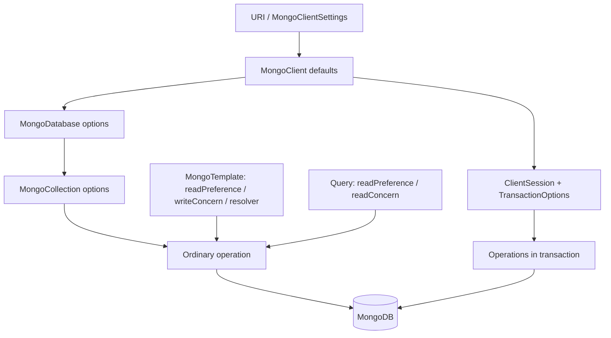

# Tùy chọn ở client, template, thao tác và giao dịch

Trong ứng dụng sử dụng **Spring Data MongoDB**, cùng một câu `find` hoặc `save` có thể đưa ra những quan sát khác nhau tùy **nơi bạn cấu hình tính nhất quán**. Một MongoClient có thể đặt `ReadPreference.secondaryPreferred()` làm mặc định, nhưng một truy vấn quan trọng lại chọn `primary`. Một `MongoTemplate` có thể dùng `WriteConcern.ACKNOWLEDGED`, trong khi collection dành cho nghiệp vụ quan trọng yêu cầu `MAJORITY`. Khi hai thao tác tham gia cùng **transaction**, các tùy chọn concern của transaction lại chi phối chúng theo quy tắc riêng, không còn đơn giản là “cái nào gần method nhất thì thắng”.

Bài thuộc chương **Nhất quán dữ liệu** của module `SPRING_DATA_MONGODB`. Bạn sẽ kết nối MongoDB, ánh xạ document và thao tác qua `MongoTemplate` hoặc repository; đồng thời vận dụng thiết kế truy vấn, aggregation, index, transaction, reactive access, kiểm thử và chẩn đoán hiệu năng. Chủ đề cụ thể ở đây là **phạm vi cấu hình** và **quy tắc hiệu lực** của `ReadPreference`, `ReadConcern` và `WriteConcern` từ MongoDB Java Driver lên Spring Data MongoDB.

> **Điểm quyết định:** Ba tùy chọn giải quyết **ba câu hỏi khác nhau**: đọc ở node nào (`ReadPreference`), đọc dữ liệu ở mức cam kết nào (`ReadConcern`), và chờ xác nhận ghi đến mức nào (`WriteConcern`). Ngoài transaction, settings có thể kế thừa qua client/database/collection rồi được override ở tầng được hỗ trợ; trong transaction, **transaction concern** điều khiển các operation. Không có cấu hình nào tự thay thế authorization, optimistic locking, transaction đa document hoặc idempotency.

## 1. Mục tiêu học tập

Sau bài này, bạn có thể:

1. Phân biệt `ReadPreference`, `ReadConcern`, `WriteConcern`, causal consistency và transaction isolation.
2. Giải thích **client, database, collection, template, query/operation, session và transaction** khác nhau về phạm vi.
3. Cấu hình mặc định qua MongoDB connection URI hoặc `MongoClientSettings`.
4. Hiểu các hàm `MongoDatabase.withReadConcern`, `MongoCollection.withWriteConcern` trả **handle mới**, không sửa handle gốc.
5. Dùng `MongoTemplate.setWriteConcern`, `setReadPreference` và `setWriteConcernResolver` đúng vai trò.
6. Dùng `Query.withReadConcern` và `Query.withReadPreference` khi phương thức truy vấn hỗ trợ.
7. Tránh giả định mọi thao tác Spring Data có thể nhận `WriteConcern` tùy ý trực tiếp từ `Query`.
8. Thiết lập `MongoTransactionManager` và `TransactionOptions` theo nghiệp vụ đa document.
9. Sử dụng transaction labels `mongo:readConcern`, `mongo:writeConcern`, `mongo:readPreference` ở các phiên bản hỗ trợ.
10. Hiểu option của **transaction** khác option của **operation trong transaction**, bao gồm nguyên tắc không dùng write concern riêng cho lệnh con.
11. Phân biệt `majority` với đọc mới nhất, `primary` với độ bền ghi, `snapshot` với `linearizable`.
12. Sử dụng `ClientSession` cho causal consistency và hiểu vì sao có session **không tự đồng nghĩa** đang trong transaction.
13. Phân biệt Spring imperative với reactive transaction context, thời điểm subscribe và việc đóng session.
14. Kiểm chứng cấu hình hiệu lực bằng command monitoring, integration test replica set và các tình huống failover phù hợp.
15. Thiết kế chính sách nhất quán cho nghiệp vụ, kiểm soát latency và không đưa các mức guarantee không có thật vào hợp đồng API.

## 2. Ba loại cấu hình không thể tráo đổi

| Tùy chọn | Câu hỏi được trả lời | Giá trị ví dụ | **Không** bảo đảm |
| --- | --- | --- | --- |
| `ReadPreference` | Đọc từ node nào? | `primary`, `secondaryPreferred`, `nearest` | Bản ghi vừa ghi đã tới node ấy |
| `ReadConcern` | Dữ liệu đọc đạt mức nhất quán/độ bền nào? | `local`, `majority`, `snapshot` | Luôn đọc “mới nhất toàn hệ thống” |
| `WriteConcern` | Bao nhiêu node xác nhận ghi, có chờ journal không? | `w:1`, `majority`, `j:true` | Các request sau sẽ luôn đọc được bản ghi trên mọi secondary |
| `ClientSession` | Các thao tác có liên hệ nhân quả và metadata phiên? | `causallyConsistent(true)` | Mặc định là multi-document transaction |
| `TransactionOptions` | Các thao tác trong giao dịch dùng concern/preference nào? | `snapshot + majority + primary` | Tự bảo đảm mọi external side effect |

Giả sử có 3 node:

```text
P : primary
S1: secondary (độ trễ replication nhỏ)
S2: secondary (độ trễ replication lớn)
```

Client ghi một document vào P. Nếu sau đó đọc qua `secondaryPreferred` và máy chủ chọn S2, dữ liệu có thể chưa tới S2. **`WriteConcern.MAJORITY` của lần ghi không tự buộc một lần đọc thứ cấp tùy ý phải nhìn thấy ngay thay đổi**, nhất là trong các phiên bản MongoDB hiện đại mà việc áp dụng oplog trên secondary có thể diễn ra bất đồng bộ sau xác nhận majority. Để có read-your-writes qua nhiều node, xem `ClientSession` với causal consistency và concerns phù hợp.

## 3. Mô hình dữ liệu dùng xuyên suốt

Một ứng dụng ví điện tử có hai collection `accounts` và `ledger_entries`. Tài khoản chứa số dư, còn ledger mô tả những thay đổi đã được chấp nhận.

```java
package dev.learning.consistency;

import org.springframework.data.annotation.Id;
import org.springframework.data.annotation.Version;
import org.springframework.data.mongodb.core.mapping.Document;
import org.springframework.data.mongodb.core.mapping.Field;

@Document("consistency_accounts")
public class Account {
    @Id
    private String id;

    @Field("tenant_id")
    private String tenantId;

    private long balanceCents;

    @Version
    private Long version;

    protected Account() {}

    public Account(String id, String tenantId, long balanceCents) {
        this.id = id;
        this.tenantId = tenantId;
        this.balanceCents = balanceCents;
    }

    public String getId() { return id; }
    public String getTenantId() { return tenantId; }
    public long getBalanceCents() { return balanceCents; }
    public Long getVersion() { return version; }

    public void setBalanceCents(long balanceCents) {
        this.balanceCents = balanceCents;
    }
}
```

```java
package dev.learning.consistency;

import org.springframework.data.annotation.Id;
import org.springframework.data.mongodb.core.mapping.Document;
import org.springframework.data.mongodb.core.mapping.Field;

@Document("consistency_ledger")
public record LedgerEntry(
    @Id String id,
    @Field("tenant_id") String tenantId,
    String accountId,
    long deltaCents,
    String requestId) {}
```

**Hai class đặt ở hai tệp Java riêng** khi thực hành. Các ví dụ sử dụng ID có tiền tố chữ để tránh việc `String @Id` giống 24-hex được ánh xạ thành ObjectId bất ngờ.

Các yêu cầu nghiệp vụ khác nhau sẽ chọn settings khác nhau:

- Trang danh mục không cần cập nhật ngay có thể chấp nhận một secondary hơi trễ.
- Người dùng vừa chuyển tiền cần thấy trạng thái cập nhật đúng phiên.
- Chuyển khoản thay đổi hai accounts và ghi ledger cần **transaction**, không chỉ majority write.
- Một yêu cầu trừ tiền lặp do retry cần **idempotency**, không chỉ `@Version`.

## 4. Nhìn tổng thể: cấu hình đi từ đâu đến đâu?



Sơ đồ có **hai nhánh**, không phải một mũi tên ưu tiên tuyến tính:

1. **Ngoài transaction:** tùy chọn ở client kế thừa xuống database/collection và có thể bị override ở mức operation theo API hỗ trợ. `MongoTemplate` là một **tầng chính sách Spring Data** khi chuẩn bị collection và command.
2. **Trong transaction:** driver/session/transaction manager xác định concern áp dụng **cho toàn transaction**. Settings concern của database, collection hoặc operation bên trong **không override transaction concern**.

Một Java object `MongoCollection` lấy từ driver và một `Query` do `MongoTemplate` ánh xạ có thể đi qua **hai đường cấu hình khác nhau**. Đừng kết luận option nào thắng chỉ từ tên biến; phải nhìn cách thao tác được thực thi.

## 5. Phạm vi và mức ưu tiên: bảng nền tảng

| Tầng | Phạm vi | Cách cấu hình điển hình | Lưu ý |
| --- | --- | --- | --- |
| **Client** | Mặc định cho các operations của client | URI, `MongoClientSettings` | Dùng chung nhiều repository/template |
| **Database handle** | Operations qua handle đó | `withReadConcern`/`withWriteConcern`/`withReadPreference` | Trả **handle mới** |
| **Collection handle** | Operations qua collection handle đó | Cùng họ `with…` | Override inherited settings ngoài transaction |
| **MongoTemplate** | Operations thông qua instance template | `setReadPreference`, `setWriteConcern`, `setWriteConcernResolver` | Không phải MongoClientSettings mới |
| **Query/operation** | Một số lệnh đọc/ghi cụ thể | `Query.withReadConcern`, `withReadPreference`, driver options | Tùy API có hỗ trợ hay không |
| **ClientSession** | Nhóm thao tác có cùng session | `ClientSessionOptions` | Không tự tạo atomic transaction |
| **Transaction** | Toàn bộ lệnh trong transaction | `TransactionOptions`, `@Transactional(label=…)` | Transaction concerns chi phối các lệnh con |

Quy tắc chính của MongoDB Java Driver **ngoài transaction** là:

```text
client default
   < database setting
   < collection setting
   < per-operation override (nếu được hỗ trợ)
```

Nhưng `MongoTemplate` có thể **chủ động cấu hình lại collection handle** theo template policy; do đó không nên coi template là một phần mặc định của chuỗi Java Driver, hay suy “collection luôn thắng template”. Trong transaction, phần transaction có cơ chế ưu tiên riêng.

### 5.1. Cấu hình thiếu không đồng nghĩa cấu hình yếu

Nếu client không chỉ định `WriteConcern`, MongoDB có **implicit default write concern** theo topology và server configuration; trên nhiều replica sets hiện đại có thể là `w:"majority"`, nhưng một số topology có arbiter có thể mặc định thành `w:1`. Driver `WriteConcern.ACKNOWLEDGED` và server implicit default không phải lúc nào cũng hiển thị y hệt nhau.

Không dạy máy móc “MongoDB mặc định luôn w:1” hoặc “luôn majority”. Kiểm tra `getDefaultRWConcern`, replica-set topology, connection URI và MongoDB version.

## 6. Đặt defaults tại MongoClient: connection URI

URI minh họa cho replica set test:

```text
mongodb://node1.example.test:27017,node2.example.test:27017,node3.example.test:27017/learning?replicaSet=rs0&readPreference=primary&readConcernLevel=majority&w=majority&wtimeoutMS=5000&journal=true
```

Ý nghĩa:

| URI option | Tác động |
| --- | --- |
| `replicaSet=rs0` | Xác định topology replica set |
| `readPreference=primary` | Chọn primary cho read mặc định |
| `readConcernLevel=majority` | Chỉ đọc dữ liệu đã majority committed theo guarantee của read concern |
| `w=majority` | Chờ majority acknowledgement cho write |
| `wtimeoutMS=5000` | Giới hạn thời gian chờ **write concern**, không phải deadline chung cho mọi RPC |
| `journal=true` | Yêu cầu liên quan đến journal write concern theo server/version |

Tên host trên chỉ là ví dụ. Hệ thống thực phải dùng TLS, authentication, secret management, timeouts và URI của môi trường. Không nhúng mật khẩu thật vào mã hay log.

**Không đánh đồng `wtimeoutMS` với `socketTimeoutMS`, `serverSelectionTimeoutMS`, `maxTimeMS` hoặc `maxCommitTimeMS`.** Chúng giới hạn các pha khác nhau. Một lần timeout do write concern có thể xảy ra **sau khi thay đổi đã được áp dụng trên primary**, nên kết quả là **uncertain ở mức mong muốn**, không có nghĩa chắc chắn chưa ghi gì.

## 7. Đặt defaults tại MongoClientSettings

Nếu xây client tường minh:

```java
package dev.learning.consistency;

import com.mongodb.ConnectionString;
import com.mongodb.MongoClientSettings;
import com.mongodb.ReadConcern;
import com.mongodb.ReadPreference;
import com.mongodb.WriteConcern;
import com.mongodb.client.MongoClient;
import com.mongodb.client.MongoClients;

public final class MongoClientsForExamples {
    private MongoClientsForExamples() {}

    public static MongoClient newClient(String uri) {
        MongoClientSettings settings = MongoClientSettings.builder()
            .applyConnectionString(new ConnectionString(uri))
            .readPreference(ReadPreference.primary())
            .readConcern(ReadConcern.MAJORITY)
            .writeConcern(WriteConcern.MAJORITY)
            .build();

        return MongoClients.create(settings);
    }
}
```

Ở đây các setter được gọi **sau** `applyConnectionString` để cho thấy chính sách programmatic có chủ đích; nếu URI cũng chứa cùng option, **thứ tự build** và cơ chế Spring Boot autoconfiguration có thể ảnh hưởng hiệu lực. Với ứng dụng Spring Boot, ưu tiên một nguồn cấu hình rõ ràng và kiểm tra giá trị được áp dụng thay vì tạo một MongoClient “ngoài luồng”.

### 7.1. Spring Boot không đồng nghĩa trực tiếp với MongoClientSettings

Tùy phiên bản Spring Boot, ứng dụng có thể sử dụng URI/properties và `MongoClientSettingsBuilderCustomizer` hoặc một bean client/factory riêng. Tên package/autoconfiguration có thể thay đổi giữa Boot 3.x và 4.x, vì vậy **không copy import package của dòng Boot khác mà chưa kiểm tra dependency BOM**.

**Chỉ định một ownership** cho cấu hình:

- Nếu Boot tạo MongoClient, dùng cơ chế customization do đúng version Boot hỗ trợ.
- Nếu tự tạo MongoClient, bảo đảm `MongoDatabaseFactory` và `MongoTemplate` đang sử dụng **chính client đó**.
- Nếu có nhiều clients/database factories, gắn đúng repository/template/transaction manager bằng tên bean và scope rõ ràng.

Đừng đăng ký một MongoClient custom rồi tưởng tất cả repository lập tức chuyển sang dùng client ấy nếu hệ thống có nhiều `MongoDatabaseFactory`.

## 8. Database handle: withReadConcern / withWriteConcern / withReadPreference

Ở tầng MongoDB Java Driver:

```java
import com.mongodb.ReadConcern;
import com.mongodb.ReadPreference;
import com.mongodb.WriteConcern;
import com.mongodb.client.MongoDatabase;

MongoDatabase base = mongoClient.getDatabase("learning");

MongoDatabase strong = base
    .withReadPreference(ReadPreference.primary())
    .withReadConcern(ReadConcern.MAJORITY)
    .withWriteConcern(WriteConcern.MAJORITY);
```

`base` vẫn giữ settings cũ; `strong` là **handle mới** được cấu hình. Những method `with…` không gửi lệnh `collMod` và **không đổi default lâu dài của server** cho mọi client trong database.

Ví dụ:

```java
System.out.println(base.getReadConcern());
System.out.println(strong.getReadConcern());
```

Nếu code khác vẫn giữ `base`, nó không bị thay đổi chỉ vì `strong` được tạo. Quy tắc immutability này giảm side effects, nhưng cũng làm bug khó thấy nếu lập trình viên gọi `base.withReadConcern(...)` rồi **bỏ giá trị trả về**.

### 8.1. Handle được chọn quyết định hiệu lực

```java
MongoDatabase configured =
    mongoClient.getDatabase("learning")
        .withWriteConcern(WriteConcern.MAJORITY);

// Phải dùng configured trong các thao tác tiếp theo.
configured.getCollection("consistency_accounts")
    .insertOne(new org.bson.Document(
        "_id", "CONFIG-EXAMPLE-1"));
```

Đây là ví dụ Driver raw, không phải mapping Java entity. Không gọi `insertOne` này trên production nếu không có ý định ghi document thật.

## 9. Collection handle: override cho một namespace

```java
import com.mongodb.ReadConcern;
import com.mongodb.ReadPreference;
import com.mongodb.WriteConcern;
import com.mongodb.client.MongoCollection;
import org.bson.Document;

MongoCollection<Document> defaultHandle =
    mongoClient.getDatabase("learning")
        .getCollection("consistency_accounts");

MongoCollection<Document> accountHandle = defaultHandle
    .withReadPreference(ReadPreference.primary())
    .withReadConcern(ReadConcern.MAJORITY)
    .withWriteConcern(WriteConcern.MAJORITY);
```

Tương tự database, `with…` trả một **MongoCollection khác**, không thay đổi `defaultHandle`. Các settings này chỉ áp cho operations **thực hiện thông qua accountHandle**.

Một repository `AccountRepository` do Spring Data khởi tạo **không tự dùng** `accountHandle` chỉ vì nó trỏ cùng collection name. Repository đi qua template/driver handles do Spring Data tạo hoặc quản lý.

### 9.1. “Client → database → collection” không tự bao gồm MongoTemplate

Nếu tự cấu hình `accountHandle`, nhưng service lại gọi:

```java
repository.findById("ACCOUNT-1");
```

thì service có thể sử dụng client/database/template policy khác. Để repository có chính sách nhất quán, cấu hình ở client/template/factory được repository sử dụng, hoặc cung cấp đường truy cập tường minh có kiểm soát.

### 9.2. Tránh direct driver operations ở transaction mà thiếu session

Khi đang trong `@Transactional` của Spring Data, một `MongoCollection` raw lấy trực tiếp từ client và thực hiện `insertOne(document)` **không tự tham gia Spring-bound ClientSession**. Nếu muốn raw driver operation nằm trong cùng transaction, phải dùng session-aware callback hoặc truyền chính `ClientSession` đến driver API phù hợp.

Đây là lỗi kiến trúc nghiêm trọng: bên ngoài nhìn thấy annotation `@Transactional`, nhưng có một thao tác ghi “lọt ra ngoài” giao dịch.

## 10. MongoTemplate: setWriteConcern và setReadPreference

`MongoTemplate` là abstraction mà repository/typed operations thường dùng. Nó có những cấu hình riêng:

```java
import com.mongodb.ReadPreference;
import com.mongodb.WriteConcern;
import org.springframework.data.mongodb.core.MongoTemplate;

MongoTemplate template = new MongoTemplate(
    mongoClient, "learning");

template.setReadPreference(ReadPreference.primary());
template.setWriteConcern(WriteConcern.MAJORITY);
```

Đoạn code minh họa **bước khởi tạo template**. Không thay đổi các settings này trên một singleton `MongoTemplate` đang phục vụ request đồng thời; việc thay state lúc runtime có thể gây vấn đề concurrency/visibility và khiến request dùng concern không dự đoán được.

`setReadPreference` chọn default read preference khi Spring Data chuẩn bị collection nếu `Query` không chỉ định khác. `setWriteConcern` đặt chính sách cho các write operations qua template, trừ khi có resolver hoặc cơ chế khác ảnh hưởng. Nếu template không đặt write concern, thường sẽ dùng policy từ driver/database factory/collection theo đường thực thi.

**Không có quy tắc chung rằng `MongoTemplate` có `setReadConcern(ReadConcern)` giống `setWriteConcern`.** Để tùy chỉnh read concern cho một query, dùng `Query.withReadConcern` hoặc cấu hình client/driver handle phù hợp. Kiểm tra đúng Javadoc của phiên bản.

## 11. WriteConcernResolver: chính sách theo thao tác/entity

Spring Data MongoDB cho phép `WriteConcernResolver` quyết định `WriteConcern` khi template thực hiện **INSERT, SAVE, UPDATE, REMOVE**.

```java
import com.mongodb.WriteConcern;
import org.springframework.data.mongodb.core.MongoAction;
import org.springframework.data.mongodb.core.WriteConcernResolver;

WriteConcernResolver resolver = (MongoAction action) -> {
    String collection = action.getCollectionName();

    if ("consistency_ledger".equals(collection)) {
        return WriteConcern.MAJORITY;
    }

    return action.getDefaultWriteConcern();
};

mongoTemplate.setWriteConcernResolver(resolver);
```

Resolver có thể xem `action.getEntityType()`, loại operation, collection name và thông tin liên quan. Ở ví dụ này, **ledger** được chọn majority, còn các collection khác kế thừa default concern của template.

**Bẫy:** resolver áp vào **đường ghi đi qua MongoTemplate** mà framework hỗ trợ; nếu code lấy raw `mongoClient.getDatabase(...).getCollection(...)` rồi gọi `updateOne`, nó **không đi qua resolver**.

### 11.1. Resolver không phải một luật bảo mật

Không dùng user input để tự hạ durability từ majority xuống unacknowledged, nhất là với tiền, đơn hàng hoặc yêu cầu cần kiểm tra matched count. `WriteConcernResolver` là **policy nội bộ**, không nên làm API để client chọn `w` tùy ý.

### 11.2. Write concern và @Version

Optimistic locking cần **acknowledged write result** để phát hiện update bị từ chối do version đã đổi. `WriteConcern.UNACKNOWLEDGED` có thể làm lỗi optimistic lock không được phát hiện đáng tin cậy. Không cấu hình một resolver có thể trả UNACKNOWLEDGED cho các entity dùng `@Version` mà chưa đánh giá nguy cơ này.

## 12. Cấu hình tại từng Query: readConcern và readPreference

Spring Data MongoDB `Query` có method:

```java
import com.mongodb.ReadConcern;
import com.mongodb.ReadPreference;
import org.springframework.data.mongodb.core.query.Criteria;
import org.springframework.data.mongodb.core.query.Query;

Query query = Query.query(
    Criteria.where("tenantId").is(authorizedTenant)
        .and("id").is(accountId)
);

query.withReadConcern(ReadConcern.MAJORITY);
query.withReadPreference(ReadPreference.primary());

Account account = mongoTemplate.findOne(query, Account.class);
```

Hai method này điều chỉnh **read operation này**, không đổi cấu hình client/template cho mọi lời gọi. Với typed `Account.class`, Spring Data map `tenantId` thành `tenant_id` và `id` thành `_id`.

### 12.1. Không suy mọi Query option áp dụng cho mọi command

Đối với những overload có `Query`, Spring Data sẽ dùng phần settings được hỗ trợ theo loại operation. Nhưng:

- `Query.withReadConcern` là tùy chọn cho **read concern**, không phải write concern.
- `Query.withReadPreference` có thể không có ý nghĩa với **write-only operation**.
- Aggregation, change streams, commands đặc biệt hoặc repository derived methods có đường API khác; không tự suy chúng đều đọc Query được bạn tạo ở một chỗ khác.
- Trong transaction, read concern trên query/collection/database **không override transaction read concern**.

Hãy dựa vào Javadoc của method cụ thể và xác minh command BSON nếu cần mức đảm bảo chính xác.

### 12.2. Không dùng read preference để thay security predicate

`ReadPreference.primary()` chỉ chọn node. Nó không buộc MongoDB tự lọc tenant, quyền người dùng hoặc trường hợp dữ liệu đã bị xóa logic. Query vẫn cần `tenantId` từ principal đã được xác thực, không tin giá trị do client tự khai.

## 13. Bảng đối chiếu ngoài transaction

Giả sử:

- Client mặc định `secondaryPreferred` + `ReadConcern.LOCAL` + `WriteConcern.ACKNOWLEDGED`.
- Một collection handle được tạo với `ReadConcern.MAJORITY`.
- Một template đặt `setReadPreference(primary)` và `setWriteConcern(MAJORITY)`.
- Query đặt `ReadPreference.primary()` và `ReadConcern.MAJORITY`.

| Đường truy cập | Read preference thực | Read concern thực | Write concern thực |
| --- | --- | --- | --- |
| Raw client database/collection không override | Kế thừa client | Kế thừa client | Kế thừa client/server default |
| Raw `collection.withReadConcern(MAJORITY)` | Kế thừa trên handle | MAJORITY | Kế thừa trên handle |
| `MongoTemplate.find(Query)` có override | Theo Query / template policy | Theo Query | Không áp dụng |
| `MongoTemplate.save` | Không áp dụng cho write routing | Không áp dụng | Template/resolver policy |
| Driver raw handle khác | Theo chính handle đó | Theo chính handle đó | Theo chính handle đó |
| Lệnh trong transaction | Theo transaction routing, phải hợp lệ | Transaction read concern | Transaction write concern |

Đây là **bảng suy luận**, không phải snapshot môi trường thực. Muốn kết luận một deployment dùng concern gì, cần kiểm tra chain cấu hình thực tế và command/callback/transaction metadata — đặc biệt khi có nhiều clients/template beans, URI/Boot customizers hoặc raw driver handles.

## 14. ReadConcern: local, majority, linearizable và snapshot

`ReadConcern` quyết định tập dữ liệu đủ điều kiện được đọc. Đây không phải thông số độ trễ replication đơn giản.

| Mức | Ý nghĩa khái quát | Cần chú ý |
| --- | --- | --- |
| `LOCAL` | Đọc dữ liệu hiện có trên node được chọn, có thể chưa majority committed | Có thể đọc dữ liệu về sau bị rollback |
| `AVAILABLE` | Ưu tiên khả năng sẵn có, có thể đọc dữ liệu chưa majority committed | Có đặc điểm riêng trên sharded cluster; không dùng với causal session/transaction |
| `MAJORITY` | Chỉ đọc dữ liệu đã majority committed | Không đồng nghĩa “bản mới nhất toàn cụm” |
| `LINEARIZABLE` | Có guarantee tuyến tính hóa cho các read được hỗ trợ trên primary, kết hợp với writes majority | Điều kiện áp dụng hẹp, có thể chờ lâu; không dùng trong transaction |
| `SNAPSHOT` | Đọc dữ liệu từ một snapshot nhất quán theo contract của operation/transaction | Phạm vi hợp lệ khác nhau trong và ngoài transaction |

**Không suy rằng thay `LOCAL` bằng `MAJORITY` tự giải quyết read-your-writes giữa hai client không có cùng session.** Một secondary có thể đang ở một thời điểm majority-committed cũ hơn bản primary vừa cập nhật.

### 14.1. Majority ≠ linearizable

Nếu query đọc `ReadConcern.MAJORITY`, dữ liệu trả về đã đạt majority-commit guarantees, nhưng hệ thống không cam kết query ấy phản ánh **mọi thay đổi hoàn tất trước lúc query bắt đầu** theo định nghĩa linearizable. `ReadConcern.LINEARIZABLE` có ngữ nghĩa mạnh hơn cho những read đủ điều kiện, nhưng có ràng buộc và trade-off availability/latency đáng kể. Không dùng nó làm “mặc định an toàn” cho mọi truy vấn hoặc aggregation.

### 14.2. Snapshot không phải nút bật trên mọi Query

`ReadConcern.SNAPSHOT` thường dùng cho multi-document transaction; MongoDB cũng hỗ trợ snapshot read ngoài transaction cho **một số** read commands và phiên bản server nhất định, không phải mọi command. Đừng đặt `Query.withReadConcern(SNAPSHOT)` cho bất kỳ repository method nào rồi giả định nó thành transaction hoặc “snapshot nhiều lần gọi”.

### 14.3. Majority trong transaction phụ thuộc commit concern

MongoDB nhấn mạnh rằng những guarantee của `ReadConcern.MAJORITY`/`SNAPSHOT` **trong multi-document transaction** gắn với việc transaction **commit bằng `WriteConcern.MAJORITY`**. Một transaction commit với `w:1` không có cùng bảo đảm về majority durability cho snapshot read sau failover.

## 15. WriteConcern: w, journal, timeout và kết quả không chắc chắn

Ví dụ write concerns trong Java:

```java
import com.mongodb.WriteConcern;

WriteConcern w1 = WriteConcern.W1;
WriteConcern acknowledged = WriteConcern.ACKNOWLEDGED;
WriteConcern majority = WriteConcern.MAJORITY;
WriteConcern journaled = WriteConcern.JOURNALED;
WriteConcern unsafe = WriteConcern.UNACKNOWLEDGED; // Không dùng cho OCC.
```

| Lựa chọn | Tính chất |
| --- | --- |
| `w:1` / `W1` | Chờ một node ghi nhận (thường primary) |
| `w:"majority"` | Chờ điều kiện majority của replica set |
| `j:true` | Yêu cầu journaling theo điều kiện driver/server |
| `wtimeoutMS` | Thời hạn chờ write concern, không nhất thiết hủy thay đổi đã áp dụng |
| `w:0` / `UNACKNOWLEDGED` | Không nhận kết quả ghi đáng tin; không phù hợp optimistic locking hay lệnh cần matchedCount |

Một majority write có thể làm tăng latency khi các thành viên replication bị chậm hoặc mất liên lạc. Nhưng `w:1` có thể cho phép phản hồi nhanh hơn trong khi thay đổi vẫn có nguy cơ rollback dưới failover. Chọn theo RPO/durability và UX, không chỉ benchmark trung bình.

### 15.1. Tại sao timeout không bằng “thất bại chưa ghi”?

```text
Client -> Primary: cập nhật số dư
Primary: áp dụng thay đổi
Primary -> Secondary: replication chậm
Client: writeConcern timeout
```

Request có thể nhận lỗi chờ majority, nhưng server đã thực hiện thay đổi trên primary. Nếu client lập tức retry một `$inc` tùy ý, thay đổi có thể bị thực hiện hai lần. **Cần idempotency key, retryable-write semantics phù hợp và reconciliation**.

### 15.2. Default write concern phụ thuộc topology

MongoDB có implicit default write concern dựa trên cấu hình hệ thống và số thành viên data-bearing/arbiter. Không suy từ `WriteConcern.ACKNOWLEDGED` của Java client rằng server luôn dùng `w:1`; cũng không coi mọi replica set mặc định majority. Đọc `getDefaultRWConcern` và chính sách override đã khai báo.

## 16. ReadPreference: primary và secondary có thể khác dữ liệu nhìn thấy

Các chế độ điển hình:

```java
import com.mongodb.ReadPreference;

ReadPreference primary = ReadPreference.primary();
ReadPreference preferred = ReadPreference.primaryPreferred();
ReadPreference secondary = ReadPreference.secondary();
ReadPreference secondaryPreferred = ReadPreference.secondaryPreferred();
ReadPreference nearest = ReadPreference.nearest();
```

| Chế độ | Node được chọn cho read | Rủi ro hoặc trade-off |
| --- | --- | --- |
| `primary` | Primary | Tải đọc lên primary, phải có primary khả dụng |
| `primaryPreferred` | Ưu tiên primary, fallback secondary khi cần | Fallback có thể thấy dữ liệu chậm |
| `secondary` | Secondary | Có thể stale; lỗi nếu không có secondary phù hợp |
| `secondaryPreferred` | Ưu tiên secondary, fallback primary | Hành vi tùy trạng thái topology |
| `nearest` | Node đủ điều kiện gần nhất theo tiêu chí driver | Không đồng nghĩa gần nhất theo độ mới dữ liệu |

Các read preferences khác `primary` có thể đọc stale data vì replication bất đồng bộ. `ReadPreference` **không tự nâng read concern**, không làm thay đổi **visibility** theo logic read concern và không thay thế causal session.

### 16.1. “nearest” không phải “freshest”

`nearest` liên quan đến lựa chọn node/độ trễ mạng, không đo node nào có dữ liệu mới nhất. Secondary có latency thấp nhất vẫn có thể sau primary nhiều operations.

### 16.2. Ứng dụng hỗn hợp đọc/ghi

Ví dụ chính sách:

- Dashboard thống kê có thể dùng secondary nếu chấp nhận stale.
- Sau khi người dùng vừa cập nhật tài khoản và cần thấy kết quả, ưu tiên primary hoặc causal session với majority concerns.
- Tìm kiếm theo chỉ mục phụ cần hiểu index visibility theo member.
- Trong transaction, read operations phải tuân thủ **read preference hợp lệ của transaction** (thông thường PRIMARY), không mặc định được đọc từ secondary chỉ vì client chọn secondaryPreferred.

## 17. ClientSession và causal consistency không phải transaction

`ClientSession` tạo ngữ cảnh gắn các thao tác theo cùng một session. Chọn `causallyConsistent(true)` để yêu cầu driver/server tôn trọng quan hệ nhân quả giữa các operations được thực hiện theo thứ tự trong session.

```java
import com.mongodb.ClientSessionOptions;
import com.mongodb.ReadConcern;
import com.mongodb.ReadPreference;
import com.mongodb.WriteConcern;
import com.mongodb.client.ClientSession;
import org.springframework.data.mongodb.core.query.Criteria;
import org.springframework.data.mongodb.core.query.Query;

ClientSessionOptions options = ClientSessionOptions.builder()
    .causallyConsistent(true)
    .build();

try (ClientSession session = mongoClient.startSession(options)) {
    mongoTemplate.withSession(() -> session).execute(operations -> {
        Account current = operations.findOne(
            Query.query(Criteria.where("id").is(accountId))
                .withReadConcern(ReadConcern.MAJORITY)
                .withReadPreference(ReadPreference.primary()),
            Account.class
        );

        // Các thao tác được thực thi trong cùng ClientSession.
        // Nếu có ghi, concern hiệu lực của write cần phù hợp chính sách.
        return current;
    });
}
```

`mongoClient`, `mongoTemplate` và `accountId` được tạo/nhận bởi application ở các mục trước. Đoạn này minh họa **chuyển session vào template callback**; chưa gọi `startTransaction` nên **không phải giao dịch nhiều document**.

### 17.1. Điều kiện để cam kết đầy đủ causal consistency

MongoDB tài liệu hóa **bốn** bảo đảm causal consistency khi các operations trong causally consistent session sử dụng **`ReadConcern.MAJORITY` và `WriteConcern.MAJORITY`**:

1. Read your writes.
2. Monotonic reads.
3. Monotonic writes.
4. Writes follow reads.

Các cặp concerns khác có thể thỏa một số tính chất trong điều kiện thực tế, nhưng **không được coi là cung cấp cả bốn guarantee với durability**. Cần thực thi các thao tác tuần tự và đưa đúng session theo mỗi operation.

### 17.2. Session không tự cô lập khỏi bên ngoài

Các operations trong một session **không tự được cô lập** khỏi operations bên ngoài session. Muốn atomic commit/rollback nhiều documents, phải khởi tạo transaction trên session hoặc dùng Spring transaction manager.

### 17.3. Đóng session đúng thời điểm

`ClientSession` là tài nguyên cần đóng. Không chia sẻ một session đang dùng cho nhiều thread chạy song song một cách tùy tiện; MongoDB session có quy tắc sử dụng đồng thời. Nếu dùng lazy references/DBRef, phải tính đến việc tải dữ liệu còn cần session sau thời điểm callback kết thúc.

## 18. TransactionOptions: một mức concern cho toàn transaction

Dùng Java Driver trực tiếp:

```java
import com.mongodb.ReadConcern;
import com.mongodb.ReadPreference;
import com.mongodb.TransactionOptions;
import com.mongodb.WriteConcern;
import java.util.concurrent.TimeUnit;

TransactionOptions options = TransactionOptions.builder()
    .readPreference(ReadPreference.primary())
    .readConcern(ReadConcern.SNAPSHOT)
    .writeConcern(WriteConcern.MAJORITY)
    .maxCommitTime(5, TimeUnit.SECONDS)
    .build();
```

Ý nghĩa:

- `ReadPreference.primary()`: transaction reads được định tuyến phù hợp.
- `ReadConcern.SNAPSHOT`: read view nhất quán của transaction theo semantics MongoDB.
- `WriteConcern.MAJORITY`: yêu cầu majority acknowledgment tại commit để đạt durability mong muốn.
- `maxCommitTime`: giới hạn thời gian commit trên server, **không** giới hạn toàn bộ thời gian hoạt động của transaction từ đầu đến cuối.

### 18.1. Tại sao không override concern cho từng command trong transaction?

MongoDB cho phép cấu hình transaction read/write concern ở **transaction scope**. Read/write concern riêng của database, collection hoặc command bên trong transaction **không có quyền override** transaction setting. Trong một số trường hợp đặt write concern trực tiếp lên command đang trong transaction còn không hợp lệ và bị server/driver từ chối.

Không thực hiện:

```java
// Sai kỳ vọng: đã vào transaction nên collection.withWriteConcern(W1)
// không phải cách biến riêng một lệnh con thành "w:1".
var collection = mongoClient.getDatabase("learning")
    .getCollection("consistency_accounts")
    .withWriteConcern(WriteConcern.W1);
```

Collection handle được định nghĩa như trên vẫn tồn tại; nhưng khi một write **tham gia transaction**, concern của transaction điều khiển việc commit. Cũng không dùng collection handle raw ở đây để “lách” transaction — nếu không truyền session, lệnh có thể **không tham gia transaction**.

### 18.2. Chỉ những giá trị hợp lệ với MongoDB Server mới dùng được

API label/driver có thể liệt kê enum `ReadConcern.LINEARIZABLE` hay `AVAILABLE` nhưng **không có nghĩa chúng hợp lệ trong mọi transaction**. MongoDB có các giới hạn theo operation/topology; ví dụ transaction read concern thông dụng là `LOCAL`, `MAJORITY`, `SNAPSHOT`, không đặt `LINEARIZABLE`/`AVAILABLE` cho một transaction tùy ý.

## 19. Transaction với Spring Data: MongoTransactionManager

Để dùng `@Transactional` với MongoDB, ứng dụng cần transaction manager phù hợp và một MongoDB topology hỗ trợ transactions (replica set hoặc sharded cluster theo server/version).

```java
package dev.learning.consistency;

import com.mongodb.ReadConcern;
import com.mongodb.ReadPreference;
import com.mongodb.TransactionOptions;
import com.mongodb.WriteConcern;
import org.springframework.context.annotation.Bean;
import org.springframework.context.annotation.Configuration;
import org.springframework.data.mongodb.MongoDatabaseFactory;
import org.springframework.data.mongodb.MongoTransactionManager;

@Configuration
class MongoConsistencyConfig {

    @Bean
    MongoTransactionManager mongoTransactionManager(
            MongoDatabaseFactory factory) {

        TransactionOptions options = TransactionOptions.builder()
            .readPreference(ReadPreference.primary())
            .readConcern(ReadConcern.SNAPSHOT)
            .writeConcern(WriteConcern.MAJORITY)
            .build();

        return new MongoTransactionManager(factory, options);
    }
}
```

**Cùng `MongoDatabaseFactory`** phải được template và transaction manager sử dụng, để session gắn vào đúng operations. Nếu có nhiều databases/factories, không tự coi `@Transactional` áp vào mọi MongoTemplate; xác định đúng transaction manager bean.

### 19.1. @Transactional cho hai accounts + ledger

```java
package dev.learning.consistency;

import org.springframework.dao.OptimisticLockingFailureException;
import org.springframework.data.mongodb.core.MongoTemplate;
import org.springframework.data.mongodb.core.query.Criteria;
import org.springframework.data.mongodb.core.query.Query;
import org.springframework.data.mongodb.core.query.Update;
import org.springframework.stereotype.Service;
import org.springframework.transaction.annotation.Transactional;

@Service
public class TransferService {

    private final MongoTemplate mongoTemplate;

    public TransferService(MongoTemplate mongoTemplate) {
        this.mongoTemplate = mongoTemplate;
    }

    @Transactional
    public void transfer(
            String tenantId,
            String fromId,
            String toId,
            long cents,
            String requestId) {

        if (cents <= 0 || fromId.equals(toId)) {
            throw new IllegalArgumentException("Transfer không hợp lệ");
        }

        var debit = mongoTemplate.updateFirst(
            Query.query(Criteria.where("id").is(fromId)
                .and("tenantId").is(tenantId)
                .and("balanceCents").gte(cents)),
            new Update().inc("balanceCents", -cents),
            Account.class
        );

        if (debit.getMatchedCount() != 1) {
            throw new OptimisticLockingFailureException(
                "Tài khoản nguồn không hợp lệ hoặc thiếu số dư");
        }

        var credit = mongoTemplate.updateFirst(
            Query.query(Criteria.where("id").is(toId)
                .and("tenantId").is(tenantId)),
            new Update().inc("balanceCents", cents),
            Account.class
        );

        if (credit.getMatchedCount() != 1) {
            throw new IllegalStateException(
                "Tài khoản nhận không tồn tại hoặc không có quyền");
        }

        mongoTemplate.insert(
            new LedgerEntry(
                "LEDGER-" + requestId,
                tenantId,
                fromId,
                -cents,
                requestId)
        );
    }
}
```

**Đây là ví dụ lõi transaction, không phải hệ thống thanh toán production hoàn chỉnh**: còn thiếu ghi đối ứng cho ledger hai phía, authorization principal, xử lý trùng requestId, unique index/idempotency, retry trên lỗi transient và kiểm tra overflow `long`. Nhưng nó minh họa rõ: ba writes nằm trong một transaction; nếu có exception trước commit, transaction manager rollback cả ba theo contract.

### 19.2. @Transactional không tự kích hoạt ở mọi chỗ

Nếu dùng Spring AOP proxy, self-invocation `this.transfer(...)` trong cùng class có thể **không đi qua proxy**, nên transaction annotation có thể không có hiệu lực. Method cần được gọi qua bean/proxy đúng cơ chế, ở boundary được Spring quản lý.

`@Transactional(readOnly=true)` trong Spring Data MongoDB **cũng có thể bắt đầu một MongoDB transaction** để gắn `ClientSession`. Không coi nó là “read request không có transaction overhead”. Dùng nó có chủ đích theo nhu cầu snapshot/consistency và kiểm tra khả năng server.

### 19.3. Tạo collection trước transaction

Một số DDL/collection operations có giới hạn trong transactions tùy server/topology. Đừng dựa vào MongoDB **implicit create collection on first insert** trong một transaction nhiều document; an toàn hơn là provision collection/index/validator trước khi chạy business transaction, hoặc đối chiếu chính xác server version và loại lệnh được hỗ trợ.

## 20. Transaction labels ở Spring Data MongoDB

Ở các dòng Spring Data hỗ trợ Mongo-specific transaction labels, có thể cấu hình từng transactional method:

```java
import org.springframework.transaction.annotation.Transactional;

@Transactional(label = {
    "mongo:readConcern=SNAPSHOT",
    "mongo:readPreference=PRIMARY",
    "mongo:writeConcern=MAJORITY",
    "mongo:maxCommitTime=PT5S"
})
public void transferWithSnapshot(/* tham số nghiệp vụ */) {
    // Những thao tác MongoTemplate thuộc transaction.
}
```

Đây là **signature minh họa**, không phải method Java có thể biên dịch nguyên xi vì `/* tham số nghiệp vụ */` và body chỉ là placeholder khái niệm. Khi áp vào dự án, giữ implementation service như `transfer` ở mục 19 rồi gắn annotation cho method thực.

Các labels `mongo:readConcern`, `mongo:readPreference`, `mongo:writeConcern`, `mongo:maxCommitTime` được `MongoTransactionOptionsResolver` đọc theo quy tắc phiên bản Spring Data đang sử dụng. Cần xác minh hỗ trợ của release/BOM, chữ hoa enum và định dạng `Duration.parse` như `PT5S`.

### 20.1. Nested transactions không override options của giao dịch đã tham gia

Ví dụ:

```text
outer @Transactional: majority + snapshot
  -> inner @Transactional: local + w1
```

Nếu inner sử dụng propagation mặc định `REQUIRED` và **tham gia transaction outer**, nó không khởi tạo một transaction mới để thay concern. Concern vẫn là concern đã chọn **lúc transaction outer bắt đầu**. Để dùng options riêng, phải là một transaction thực sự mới, có semantics propagation/transaction-manager phù hợp và chi phí tương ứng.

### 20.2. Vì sao labels không đồng nghĩa mọi enum đều hợp lệ?

Bộ parser của Spring có thể nhận một giá trị enum, nhưng **MongoDB Server** vẫn là nơi quyết định read concern/preference nào hợp lệ với transaction type/topology. Dùng `SNAPSHOT + MAJORITY + PRIMARY` làm ví dụ dễ hiểu thay vì thử `AVAILABLE`/`LINEARIZABLE` trong transaction.

## 21. Đừng làm sai transaction bằng raw driver hoặc sai factory

Một service có annotation:

```java
@Transactional
public void placeOrder() {
    mongoTemplate.save(order);

    // Lệnh dưới dùng raw collection lấy trực tiếp từ một MongoClient khác.
    rawMongoClient.getDatabase("learning")
        .getCollection("audit")
        .insertOne(new org.bson.Document("type", "ORDER_PLACED"));
}
```

Code trên là **anti-pattern minh họa**; `order`, `rawMongoClient` chỉ là các biến của ứng dụng. Raw `insertOne` không tự nhận `ClientSession` từ Spring transaction manager. Nếu save order rollback, audit insert có thể **vẫn còn**.

Để raw driver operation tham gia transaction, dùng `MongoOperations.withSession(...)` hoặc callback/proxy đúng contract, hoặc truyền chính `ClientSession` cho driver overload `insertOne(session, document)`. Không dựa vào việc “cùng host/database” để suy chúng tự chia sẻ giao dịch.

### 21.1. Session synchronization là cấu hình lúc khởi tạo

`MongoTemplate.setSessionSynchronization(SessionSynchronization.ALWAYS)` có thể cho phép template tham gia các transactions không phải Mongo-native theo tài liệu Spring, nhưng **đừng bật/tắt mỗi request** trên singleton template. Nếu muốn điều chỉnh session synchronization, cấu hình một lần ở bean creation và hiểu transaction manager nào chịu trách nhiệm.

## 22. Reactive: context transaction không nằm ở ThreadLocal thông thường

Reactive Spring Data MongoDB cần `ReactiveMongoTransactionManager` và `ReactiveMongoTemplate` dùng **cùng `ReactiveMongoDatabaseFactory`**.

```java
package dev.learning.consistency;

import org.springframework.context.annotation.Bean;
import org.springframework.context.annotation.Configuration;
import org.springframework.data.mongodb.ReactiveMongoDatabaseFactory;
import org.springframework.data.mongodb.ReactiveMongoTransactionManager;

@Configuration
class ReactiveMongoConsistencyConfig {

    @Bean
    ReactiveMongoTransactionManager reactiveMongoTransactionManager(
            ReactiveMongoDatabaseFactory factory) {
        return new ReactiveMongoTransactionManager(factory);
    }
}
```

Cần dùng `Reactor Context` để giữ transaction state, thay vì kỳ vọng nó luôn đi cùng Java ThreadLocal như imperative.

### 22.1. TransactionalOperator cho một chuỗi reactive

```java
import org.springframework.transaction.reactive.TransactionalOperator;
import reactor.core.publisher.Mono;

TransactionalOperator operator =
    TransactionalOperator.create(reactiveMongoTransactionManager);

Mono<Void> workflow = reactiveMongoTemplate
    .updateFirst(fromQuery, debitUpdate, Account.class)
    .flatMap(result -> {
        if (result.getMatchedCount() != 1) {
            return Mono.error(new IllegalStateException(
                "Không thể ghi nợ"));
        }
        return reactiveMongoTemplate.updateFirst(
            toQuery, creditUpdate, Account.class);
    })
    .flatMap(result -> {
        if (result.getMatchedCount() != 1) {
            return Mono.error(new IllegalStateException(
                "Không thể ghi có"));
        }
        return reactiveMongoTemplate.insert(ledgerEntry);
    })
    .then()
    .as(operator::transactional);
```

`fromQuery`, `debitUpdate`, `toQuery`, `creditUpdate` và `ledgerEntry` là các giá trị đã validate và được ứng dụng dựng trước. Publisher cần **được subscribe** thì các operation và transaction mới chạy. Chỗ nào đặt `.as(operator::transactional)` quyết định những publishers nào thuộc transaction.

### 22.2. Không nhầm @Transactional reactive với imperative

- Imperative transaction manager gắn `ClientSession` vào thread.
- Reactive transaction manager gắn state vào Reactor Context.
- `block()` trong event loop phá mô hình reactive và có thể gây deadlock/tắc nghẽn.
- Gọi driver synchronous trong reactive flow không tự khiến nó tham gia reactive transaction.
- Một publisher `retryWhen` có thể chạy lại cả chuỗi, cần xử lý duplicate side effects/idempotency.
- Muốn chỉnh concern/default của reactive transaction, dùng manager options/transaction labels phù hợp, không sửa singleton template giữa các subscription.

## 23. Kiểm thử tích hợp: phải dùng MongoDB replica set

Để kiểm thử **transaction, majority, session và failover**, MongoDB standalone đơn giản **không đủ** để xác nhận mọi guarantee. Dùng test replica set (ví dụ MongoDB Testcontainers thiết lập replica set) hoặc cluster test được quản lý riêng.

### 23.1. Test rollback hai documents

Ví dụ Spring Boot test giả định có `MongoTemplate`, `MongoTransactionManager` và collection đã được provision trong database test:

```java
package dev.learning.consistency;

import static org.assertj.core.api.Assertions.assertThat;
import static org.assertj.core.api.Assertions.assertThatThrownBy;

import java.util.UUID;

import org.junit.jupiter.api.Test;
import org.springframework.beans.factory.annotation.Autowired;
import org.springframework.boot.test.context.SpringBootTest;
import org.springframework.data.mongodb.MongoTransactionManager;
import org.springframework.data.mongodb.core.MongoTemplate;
import org.springframework.data.mongodb.core.query.Criteria;
import org.springframework.data.mongodb.core.query.Query;
import org.springframework.transaction.support.TransactionTemplate;

@SpringBootTest
class MongoConsistencyTransactionIntegrationTest {

    @Autowired MongoTemplate mongoTemplate;
    @Autowired MongoTransactionManager transactionManager;

    @Test
    void failedTransactionDoesNotKeepPartialWrites() {
        String suffix = UUID.randomUUID().toString();
        String tenant = "tenant-test-" + suffix;
        String id = "ACCOUNT-" + suffix;

        var tx = new TransactionTemplate(transactionManager);

        assertThatThrownBy(() ->
            tx.executeWithoutResult(status -> {
                mongoTemplate.insert(
                    new Account(id, tenant, 1_000L));

                mongoTemplate.insert(
                    new LedgerEntry(
                        "LEDGER-" + suffix,
                        tenant, id, -100L, "REQ-" + suffix));

                throw new IllegalStateException("rollback-test");
            })
        ).isInstanceOf(IllegalStateException.class);

        Query accountQuery = Query.query(
            Criteria.where("id").is(id)
                .and("tenantId").is(tenant));

        Query ledgerQuery = Query.query(
            Criteria.where("id").is("LEDGER-" + suffix)
                .and("tenantId").is(tenant));

        assertThat(mongoTemplate.exists(
            accountQuery, Account.class)).isFalse();

        assertThat(mongoTemplate.exists(
            ledgerQuery, LedgerEntry.class)).isFalse();
    }
}
```

Test sử dụng IDs duy nhất và không gọi `deleteAll()`. **Quan trọng:** MongoDB replica set và collections `consistency_accounts`/`consistency_ledger` phải được **tạo bên ngoài transaction**; nếu server/version yêu cầu collection đã có, việc insert đầu tiên trong transaction khi namespace còn thiếu có thể gây lỗi DDL ngoài dự kiến. Không chạy test trên production.

### 23.2. Test overrides ngoài transaction

Một test khác tạo Query có:

```java
Query query = Query.query(Criteria.where("id").is(accountId))
    .withReadConcern(ReadConcern.MAJORITY)
    .withReadPreference(ReadPreference.primary());

Account found = mongoTemplate.findOne(query, Account.class);
```

Bảo đảm test chạy với account hợp lệ; **đừng chỉ assert found != null rồi kết luận read concern đã được gửi**. Cần command monitoring hoặc API/driver instrumentation kiểm tra settings đã áp vào operation.

### 23.3. Test các tình huống topology

| Tình huống | Điều cần xác nhận |
| --- | --- |
| Read từ secondary chậm | Dữ liệu có thể stale nếu không causal session |
| Write w:1 rồi failover | Có nguy cơ rollback theo topology |
| Write majority và causal read majority cùng session | Read-your-writes theo contract |
| Write concern timeout | Không tự suy write chưa xảy ra |
| Transaction commit majority | Các writes trở nên atomic theo transaction |
| Transaction fail giữa hai writes | Rollback cả transaction |
| Hai clients khác nhau | Không tự chia sẻ session |
| Raw driver write trong @Transactional | Không tự tham gia nếu thiếu session |
| MongoTemplate khác MongoDatabaseFactory | Không tự tham gia transaction manager khác |
| Query.withReadConcern trong transaction | Không override concern transaction |
| Multi-document transaction với secondary preference | Phải tuân thủ server restrictions |
| Reactive publisher chưa subscribe | Không có thao tác DB nào đã thực thi |
| Trùng requestId sau retry | Cần unique index/idempotency |
| Hai writer cập nhật cùng account | OCC/CAS/trạng thái cần được xử lý riêng |

Không thực hiện chaos/failover trên cụm dùng chung; test topology có chủ đích trên môi trường thử nghiệm cách ly.

## 24. Quan sát cấu hình hiệu lực: không chỉ nhìn properties

Để chẩn đoán một câu “vì sao đọc được dữ liệu cũ”:

1. Xác định **MongoClient bean nào** được repository/template sử dụng.
2. Đọc cấu hình URI và programmatic customizers trong startup diagnostics.
3. Xác định `MongoDatabaseFactory` và database/collection thực.
4. Kiểm tra `MongoTemplate` có `setReadPreference`, `setWriteConcern`, `WriteConcernResolver` không.
5. Kiểm tra Query có `withReadConcern`/`withReadPreference` không.
6. Kiểm tra thao tác thuộc một `ClientSession`/`@Transactional` hay không.
7. Nếu trong transaction, đọc `TransactionOptions`/labels của **transaction ngoài cùng thực sự bắt đầu**.
8. Xem server topology, replica lag, implicit defaults và default RW concern.
9. Đo command `find`/`aggregate`/`update`/`commitTransaction` bằng driver listener/profiler.
10. Xem triệu chứng là stale read, rollback risk, timeout, conflict hay data race nghiệp vụ.

### 24.1. CommandListener trong Java Driver

Một `CommandListener` trong test có thể ghi **tên command và metadata không nhạy cảm**:

```java
import com.mongodb.event.CommandListener;
import com.mongodb.event.CommandStartedEvent;

CommandListener listener = new CommandListener() {
    @Override
    public void commandStarted(CommandStartedEvent event) {
        String name = event.getCommandName();
        if ("find".equals(name)
                || "aggregate".equals(name)
                || "commitTransaction".equals(name)) {
            System.out.println("Mongo command: " + name);
            // Trong test riêng: kiểm tra fields readConcern/lsid/txnNumber.
            // Không log nguyên BSON production chứa PII/credentials.
        }
    }
};
```

Đây là một listener **chưa đăng ký vào client**; muốn dùng phải thêm vào `MongoClientSettings.builder().addCommandListener(listener)` trong cấu hình test. Để chứng minh **read preference** được chọn, việc chỉ nhìn JSON body của một `find` chưa đủ: routing/connection metadata và `$readPreference` có thể nằm ngoài phần command theo topology/driver. Cần đánh giá đúng endpoint/node được chọn hoặc command monitoring có thông tin topology.

### 24.2. Câu lệnh server-side

Trên đúng môi trường, có thể kiểm tra defaults bằng MongoDB commands:

```javascript
db.adminCommand({ getDefaultRWConcern: 1 })
```

Thông tin này là **server default**, không nói hết client/template/query/session overrides. Với replica set, quan sát trạng thái thành viên và replication lag bằng công cụ vận hành thích hợp; không chạy command yêu cầu đặc quyền từ application account chỉ để phục vụ một request thông thường.

## 25. Những lỗi thường gặp

| Triệu chứng | Nguyên nhân thường gặp | Hướng xử lý |
| --- | --- | --- |
| Đặt majority ở URI nhưng thao tác dùng w:1 | Client khác, template resolver, override hoặc server/tooling khác | Truy vết client/factory/template và lệnh thực |
| Đọc từ secondary không thấy ghi vừa xong | Replication lag, thiếu causal session | Dùng primary hoặc majority/causal session phù hợp |
| Nghĩ readPreference=primary là durable | Node routing không quy định write durability | Cấu hình write concern |
| Nghĩ readConcern=majority luôn mới nhất | Majority view có thể trễ | Hiểu read concern vs linearizability |
| Timeout wtimeout rồi retry $inc hai lần | Không phân biệt uncertain write | Idempotency/retry policy |
| Gọi withReadConcern rồi bỏ return | Driver handle bất biến | Dùng handle mới |
| Template.setReadPreference giữa request | Shared mutable singleton policy | Cấu hình một lần lúc startup |
| Template tự có setReadConcern | Nhầm API | Dùng Query.withReadConcern/driver |
| Query.withReadConcern không đổi transaction | Transaction concern chi phối | Đặt TransactionOptions/labels |
| @Transactional không có rollback thật | Thiếu MongoTransactionManager, self invocation, topology sai | Cấu hình manager/proxy/test replica set |
| Ghi raw driver vẫn tồn tại sau rollback | Không truyền ClientSession | Dùng session-aware callback |
| TransactionOptions secondary read thất bại | Transaction read preference phải hợp lệ | Dùng primary |
| Nested @Transactional label không có hiệu lực | Inner joined outer transaction | Chọn options khi bắt đầu transaction |
| @Transactional(readOnly=true) vẫn tốn chi phí | Mongo transaction thực sự được mở | Đánh giá lại read-only use case |
| Set majority thì latency cao | Secondary lag / quorum không đáp ứng | Kiểm tra topology, SLO và WConcern |
| Chọn w:0 vì throughput | Không có write result cho OCC | Giữ acknowledged writes |
| Session không có atomicity | Chưa start transaction | Dùng transaction manager khi cần |
| Reactive flow chạy ngoài transaction | Mất Reactor Context hoặc composition sai | Đặt operator quanh toàn publisher chain |
| Gọi block() trong reactive HTTP | Chặn event loop, có thể deadlock | Compose publishers thuần reactive |
| Test transaction trên standalone | Không hỗ trợ semantics tương ứng | Dùng replica set test |
| Read model hiển thị thiếu bản ghi | Query filter/index/latency, không chỉ concern | Xác minh data shape và execution plan |

### 25.1. Khi dữ liệu “không nhất quán”, cần xác định loại vấn đề

- **Stale read:** đọc phiên bản cũ từ node chọn.
- **Rollback risk:** ghi chưa majority committed có thể mất khi failover.
- **Lost update:** nhiều request lưu từ snapshot cũ; cần `@Version`/CAS.
- **Partial multi-document write:** thao tác A thành công, B lỗi; cần transaction/outbox.
- **Duplicate command:** retry sau timeout; cần idempotency.
- **Dirty/inconsistent read view:** cần read concern hoặc transaction/snapshot phù hợp.
- **Authorization leak:** đọc dữ liệu sai tenant; concern **không giải quyết**.

Đặt đúng tên lỗi trước khi nâng mức consistency; nếu chọn sai công cụ, bạn có thể tăng latency mà bug vẫn còn nguyên.

## 26. Bài tập thực hành

**Bài 1 — Ba concern.** Phân biệt `ReadPreference.primary`, `ReadConcern.MAJORITY` và `WriteConcern.MAJORITY` bằng một câu nghiệp vụ. Vì sao chúng không thay nhau được?

**Bài 2 — Override client.** Client được cấu hình secondaryPreferred/local/w1; tạo driver collection handle majority/primary rồi kiểm tra handle gốc có đổi không. *Đáp án:* không.

**Bài 3 — Template.** Đặt `setReadPreference(primary)` và `setWriteConcern(MAJORITY)` khi startup; thêm `WriteConcernResolver` riêng cho ledger. Lệnh raw driver có dùng resolver không?

**Bài 4 — Query.** Viết `Query` tìm `Account` theo tenant+ID, gọi `withReadConcern(MAJORITY)`/`withReadPreference(primary)` rồi giải thích scope của override.

**Bài 5 — Transaction.** Tạo `MongoTransactionManager` với `SNAPSHOT + MAJORITY + PRIMARY`. Vì sao các lệnh con không tự chuyển về `LOCAL` khi truyền Query override?

**Bài 6 — Transaction labels.** Gắn `@Transactional(label={"mongo:readConcern=SNAPSHOT","mongo:writeConcern=MAJORITY"})` cho method nghiệp vụ; tạo inner method có nhãn khác. Điều gì xảy ra nếu inner chỉ join outer?

**Bài 7 — Causal consistency.** Viết một `ClientSessionOptions.causallyConsistent(true)`; nêu điều kiện concern cần để bảo đảm read-your-writes bền vững khi đọc từ secondary.

**Bài 8 — Timeout.** Một majority write báo `wtimeoutMS` nhưng primary đã áp update. Vì sao retry `$inc` ngay có thể không an toàn?

**Bài 9 — @Transactional + raw handle.** Trong transaction, gọi `MongoTemplate.save` rồi `MongoClient.getCollection().insertOne` không truyền session. Khi rollback, có gì nguy hiểm?

**Bài 10 — Reactive.** Dùng `TransactionalOperator` bao quanh hai reactive updates và một insert. Cần đặt `as(operator::transactional)` ở đâu?

**Bài 11 — Test failover.** Trên replica set test, so sánh khả năng quan sát từ secondary sau majority write với/không có causal session; tránh kết luận cứng chỉ từ một lần chạy.

**Bài 12 — Phân loại sự cố.** Một khách hàng bị trừ tiền hai lần sau timeout. Đó là vấn đề read concern, lost update hay idempotency? Thiết kế xử lý đúng.

**Bài 13 — Default concern.** Dùng `getDefaultRWConcern`, kiểm tra topology có arbiter và so sánh với write concern đặt ở application.

**Bài 14 — Health/observability.** Thiết kế kiểm tra đảm bảo có một MongoTransactionManager, đúng factory, correct `TransactionOptions` và command listener chỉ ghi metadata an toàn.

## 27. Checklist triển khai

- [ ] Xác định đúng loại vấn đề: stale read, rollback, lost update, multi-write atomicity hay retry duplicate.
- [ ] Phân biệt ReadPreference, ReadConcern và WriteConcern.
- [ ] Biết client-level settings chỉ là default, có thể được override.
- [ ] Với driver handles, giữ instance trả về của `withReadConcern/withWriteConcern/withReadPreference`.
- [ ] Kiểm tra MongoTemplate được cấu hình một lần khi khởi tạo, không đổi state giữa requests.
- [ ] Dùng `WriteConcernResolver` như chính sách nội bộ cho các write qua template.
- [ ] Không suy Query có per-write concern; đọc đúng API.
- [ ] Khi cần read setting cho một query, dùng `Query.withReadConcern/withReadPreference` theo method hỗ trợ.
- [ ] Không cho người dùng thay concern hoặc chọn tenant ID tùy ý.
- [ ] Hiểu implicit default write concern thay đổi theo topology/arbiter.
- [ ] Không dùng `UNACKNOWLEDGED` cho optimistic locking/CAS cần matchedCount.
- [ ] Hiểu timeout không chứng minh write chưa được áp dụng.
- [ ] Dùng causal session và majority/majority khi cần đầy đủ causal guarantees bền vững.
- [ ] Có MongoTransactionManager/ReactiveMongoTransactionManager khi muốn `@Transactional` với MongoDB.
- [ ] Template và transaction manager dùng cùng factory.
- [ ] TransactionOptions được đặt ở lúc bắt đầu transaction, concern của operation bên trong không ghi đè.
- [ ] Transaction read preference tuân thủ server restrictions, thường `PRIMARY`.
- [ ] Nested transaction tham gia outer không đổi options của outer.
- [ ] Raw driver commands cần được truyền session nếu muốn thuộc transaction.
- [ ] Không coi @Transactional(readOnly=true) là read không có transaction overhead.
- [ ] Reactive workflow giữ Reactor Context và có subscription.
- [ ] Tạo collections/indexes trước business transactions theo giới hạn server.
- [ ] Viết integration tests bằng MongoDB replica set test và tài nguyên UUID.
- [ ] Đo latency, replication lag, write concern failures và transaction aborts.
- [ ] Có retry/idempotency riêng cho network timeout và uncertain commit.
- [ ] Không coi trạng thái bài học `WRITTEN` là đã hoàn tất Content QA.

## 28. Nguồn tham khảo chính thức

1. [MongoDB Java Sync Driver — Configure Operations on Replica Sets](https://www.mongodb.com/docs/drivers/java/sync/current/crud/read-write-config/): client, database, collection, transaction settings và thứ tự kế thừa.
2. [MongoDB Java Sync Driver — Client-level CRUD Settings](https://www.mongodb.com/docs/drivers/java/sync/current/connection/specify-connection-options/configure-crud/): URI và MongoClientSettings.
3. [MongoDB Java Sync Driver — Custom CRUD Settings](https://www.mongodb.com/docs/drivers/java/sync/current/crud/crud-settings/): `with…` tạo handle mới.
4. [MongoDB Manual — Default Read/Write Concerns](https://www.mongodb.com/docs/manual/reference/mongodb-defaults/): client/operation và transaction concerns, implicit defaults.
5. [MongoDB Manual — Read Concern](https://www.mongodb.com/docs/manual/reference/read-concern/): `local`/`majority`/`snapshot`/`linearizable` và giới hạn.
6. [MongoDB Manual — Read Preference](https://www.mongodb.com/docs/manual/core/read-preference/): chọn node và secondary stale reads.
7. [MongoDB Manual — Write Concern](https://www.mongodb.com/docs/manual/reference/write-concern/): majority, journal, wtimeout và replication.
8. [MongoDB Manual — Causal Consistency and Read/Write Concerns](https://www.mongodb.com/docs/manual/core/causal-consistency-read-write-concerns/): bốn guarantees với majority/majority.
9. [MongoDB Java Sync Driver — Transactions](https://www.mongodb.com/docs/drivers/java/sync/current/crud/transactions/): ClientSession, TransactionOptions và commit/abort.
10. [Spring Data MongoDB — Template Configuration](https://docs.spring.io/spring-data/mongodb/reference/mongodb/template-config.html): `setReadPreference`, `setWriteConcern`, `WriteConcernResolver`.
11. [Spring Data MongoDB — Query API](https://docs.spring.io/spring-data/mongodb/reference/api/java/org/springframework/data/mongodb/core/query/Query.html): `withReadConcern` và `withReadPreference`.
12. [Spring Data MongoDB — MongoTemplate API](https://docs.spring.io/spring-data/mongodb/reference/api/java/org/springframework/data/mongodb/core/MongoTemplate.html): template settings và write operations.
13. [Spring Data MongoDB — Sessions and Transactions](https://docs.spring.io/spring-data/mongodb/reference/mongodb/client-session-transactions.html): session callbacks, manager configuration, labels, reactive.
14. [Spring Data MongoDB — MongoTransactionManager API](https://docs.spring.io/spring-data/mongodb/reference/api/java/org/springframework/data/mongodb/MongoTransactionManager.html): manager với `TransactionOptions`.
15. [MongoDB Manual — Transactions](https://www.mongodb.com/docs/manual/core/transactions/): limitations, isolation, retry và commit.
16. [MongoDB Manual — Retryable Writes](https://www.mongodb.com/docs/manual/core/retryable-writes/): phân biệt driver retry với idempotency nghiệp vụ.

**Kết luận:** Tùy chọn nhất quán trong Spring Data MongoDB không nằm ở một “công tắc” duy nhất. `MongoClientSettings`/URI đặt defaults; database và collection handles có thể override theo scope; `MongoTemplate` cung cấp chính sách đọc/ghi qua template và `WriteConcernResolver`; `Query` có thể chọn read concern/preference cho một truy vấn. **Khi có transaction, TransactionOptions/transaction labels mới là ranh giới nhất quán cho toàn bộ thao tác tham gia**, không phải setting ngẫu nhiên trên một command con. Chọn cấu hình theo yêu cầu nghiệp vụ, dùng causal session khi cần read-your-writes qua nodes, transaction cho atomicity nhiều documents, và idempotency/OCC cho retry/lost update. Luôn kiểm chứng trên replica set thật với command monitoring và thử nghiệm phù hợp.

