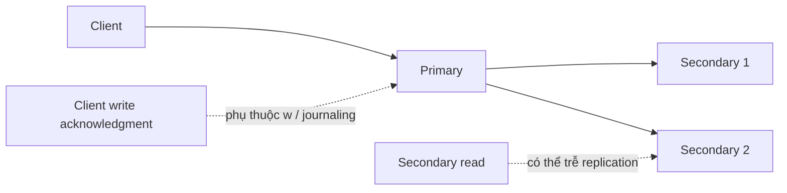
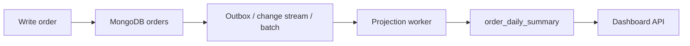
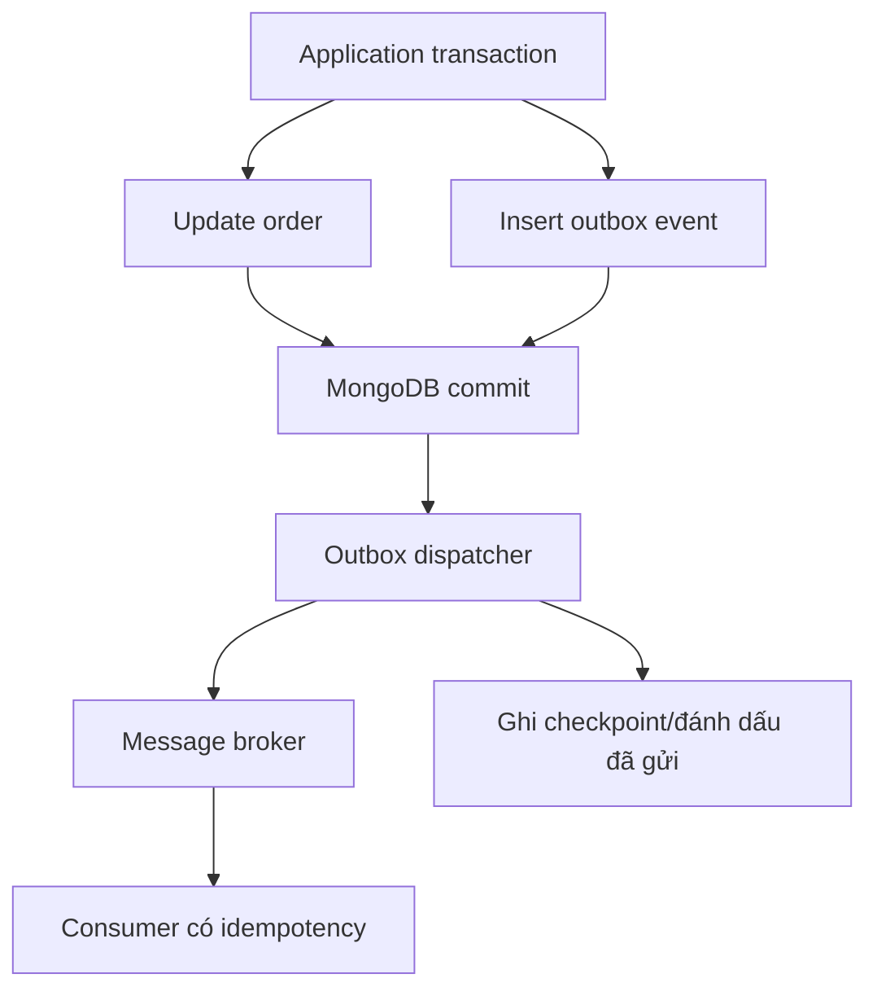

# Đánh đổi độ trễ, tính sẵn sàng và yêu cầu nhất quán nghiệp vụ

## 1. Một hệ thống không chỉ có một mức «nhất quán»

Một website bán hàng lưu đơn hàng, tồn kho, thanh toán và trạng thái vận chuyển trong MongoDB. Người mua vừa đặt hàng muốn nhìn thấy đơn mới ngay. Nhân viên kho cần chắc rằng hai request không cùng giữ một sản phẩm cuối cùng. Ban điều hành muốn dashboard tổng số đơn, nhưng chấp nhận chậm vài giây. Bộ phận kế toán lại yêu cầu mọi giao dịch đối soát được ghi nhận bền vững và truy vết được.

Nếu tất cả chức năng đều bắt buộc đọc từ một primary, chờ majority+journal, mở multi-document transaction rồi thực hiện aggregation nặng, độ trễ và tính sẵn sàng có thể kém đi mà không tạo thêm giá trị cho những màn hình vốn chấp nhận dữ liệu trễ. Nhưng nếu để tất cả đọc từ secondary bất kỳ và ghi với acknowledgment thấp, các thao tác quan trọng có thể xác nhận thành công khi chưa đạt độ bền mong muốn, hoặc dựa trên trạng thái cũ để quyết định sai.

Vì thế, phải bắt đầu bằng câu hỏi:

> **Nghiệp vụ cần bảo đảm điều gì, trong khoảng thời gian và mức lỗi hệ thống nào, rồi mới chọn read concern, write concern, read preference, điều kiện cập nhật và transaction tương ứng?**

Bài thuộc chương **Nhất quán dữ liệu** của module **SPRING_DATA_MONGODB**. Phạm vi module là sử dụng Spring Data MongoDB để kết nối, ánh xạ document và thao tác MongoDB qua `MongoTemplate` hoặc repository; thực hành thiết kế truy vấn, aggregation, index, transaction, reactive access, kiểm thử và chẩn đoán hiệu năng dữ liệu.

Sau bài, bạn có thể:

1. Viết **consistency contract** theo tình huống nghiệp vụ thay vì chọn một mức cấu hình chung theo cảm tính.
2. Phân biệt **freshness, atomicity, isolation, durability, causal consistency** và tính nhất quán của dữ liệu dẫn xuất.
3. Phân tích trade-off của `readPreference`, `readConcern`, `writeConcern` và replica lag.
4. Dùng single-document atomic update, `@Version`, CAS và unique index cho các bất biến cục bộ.
5. Xác định khi nào cần multi-document transaction, outbox hoặc eventual consistency.
6. Nhận diện response không rõ sau timeout và tổ chức retry/idempotency an toàn.
7. Thiết kế metric, thử nghiệm failover và test tích hợp để kiểm chứng những bảo đảm đã hứa.

> Các ví dụ dùng Java 17+, Spring Data MongoDB và MongoDB replica set ở các phiên bản hỗ trợ tính năng tương ứng. Chi tiết semantics, default write concern, behavior của transaction và API có thể thay đổi theo server/driver/Spring Data version. Không xem đoạn mã minh họa là một cấu hình production đã được kiểm chứng.

## 2. Tách các chiều bảo đảm trước khi chọn cấu hình

Từ «consistency» thường được dùng cho nhiều yêu cầu khác nhau:

| Chiều | Câu hỏi | Ví dụ |
| --- | --- | --- |
| **Freshness / độ mới** | Đọc có thấy thay đổi vừa ghi không? | Người mua vừa tạo đơn rồi tải lại |
| **Atomicity / nguyên tử** | Các field cần thay đổi có cùng được áp dụng hoặc cùng không? | Trạng thái đơn và version |
| **Isolation / cô lập** | Giao dịch khác có nhìn thấy trạng thái trung gian không? | Chuyển tiền giữa hai account |
| **Durability / độ bền** | Ghi đã xác nhận có thể tồn tại qua lỗi gì? | Primary failover |
| **Ordering / thứ tự** | Hai thay đổi cạnh tranh được chấp nhận theo quy tắc nào? | READY_TO_SHIP → SHIPPED |
| **Causal ordering** | Đọc/ghi sau có tôn trọng sự kiện trước trong một chuỗi thao tác không? | Ghi đơn xong đọc trạng thái |
| **Derived-data lag** | Dashboard/search index chậm hơn nguồn bao lâu? | Báo cáo doanh thu cập nhật sau 5 giây |
| **Business invariants** | Điều tuyệt đối không được sai là gì? | Không xuất kho vượt số lượng cho phép |

Một API có thể nhận majority acknowledgment mà vẫn trả dashboard **trễ**. Một lần đọc trên primary có thể thấy phiên bản rất mới nhưng **không** tự ngăn hai người ghi đè cùng entity. Một transaction có thể đảm bảo commit của hai document nhưng **không** đưa cuộc gọi HTTP ra cổng thanh toán vào cùng transaction của MongoDB.

### 2.1. Một sự thật cần nhớ

**Read concern**, **write concern** và **read preference** trả lời ba câu hỏi khác nhau:

- `readConcern`: một lần đọc được phép quan sát dữ liệu ở mức cam kết nào.
- `writeConcern`: một lần ghi cần đạt mức xác nhận nào.
- `readPreference`: chọn primary/secondary nào để phục vụ read, khi API cho phép.

Chúng không tự thay thế **CAS filter**, **unique index**, **transaction boundary**, **idempotency** hoặc **authorization**.

## 3. Độ trễ, tính sẵn sàng và nhất quán: những điểm căng thẳng

### 3.1. Vì sao có đánh đổi?

Trong replica set, primary nhận các thao tác ghi thông thường; secondary sao chép và áp dụng thay đổi. Khi secondary bị chậm hoặc đường mạng bất ổn:

- Chờ nhiều thành viên xác nhận có thể **tăng thời gian phản hồi ghi**.
- Đọc từ secondary có thể giúp phân phối tải nhưng **có nguy cơ nhìn thấy dữ liệu cũ** nếu không có cơ chế bảo đảm phù hợp.
- Yêu cầu primary và majority trong tình huống phân hoạch có thể làm một số thao tác **không hoàn tất đúng hạn**.
- Chỉ dựa vào local/primary read để giảm độ trễ có thể không cung cấp độ bền hoặc tính nhất quán như hợp đồng cần.



Sơ đồ chỉ minh họa một replica set đơn giản. Vị trí địa lý, voting members, arbiter, topology, server version và network ảnh hưởng các lựa chọn thực tế.

### 3.2. Đừng giản lược định lý CAP thành «chỉ chọn hai»

CAP mô tả các giới hạn đối với hệ thống phân tán **khi xảy ra network partition**, không phải một menu tĩnh mà có thể đánh dấu hai trong ba ô rồi suy ra toàn bộ độ trễ và khả năng phục vụ. Trong vận hành bình thường, độ trễ còn do read/write concern, replication, cache, query plan, transaction, network và ứng dụng.

Những câu chính xác hơn:

- Khi không đủ thành viên đạt majority, write concern majority có thể **không được xác nhận đúng hạn**.
- Một đọc được phép từ secondary có thể tăng khả năng phục vụ một số request nhưng **không cam kết dữ liệu mới nhất**.
- Cấu hình bảo đảm mạnh hơn thường cần **đồng bộ/chờ** nhiều hơn, và phải đo latency/availability theo topology.
- Một service có thể chọn policy khác nhau cho từng nhóm use case, không cần cưỡng ép cùng policy cho mọi truy vấn.

### 3.3. Phân biệt availability của read và write

Nếu primary không thể phục vụ write, việc một secondary còn sống không đồng nghĩa hệ thống luôn nhận ghi hợp lệ. Ngược lại, có thể đọc trên một node khi write đang bị hạn chế, nhưng mức freshness/read concern của dữ liệu cần được diễn giải đúng.

**Một API trả HTTP 200** chưa chắc đã thỏa **business consistency contract** nếu dữ liệu được đọc quá cũ, hoặc write acknowledgment dưới chuẩn cần thiết.

## 4. Domain mẫu: đơn hàng, tồn kho và báo cáo

### 4.1. Các document trong MongoDB

Collection `orders`:

```javascript
db.orders.insertMany([
  {
    _id: "ord-101",
    tenantId: "tenant-a",
    status: "READY_TO_SHIP",
    version: NumberLong("7"),
    productId: "sku-001",
    quantity: 1,
    operationId: "op-create-101",
    createdAt: ISODate("2026-11-19T08:00:00Z"),
    updatedAt: ISODate("2026-11-19T08:00:00Z")
  },
  {
    _id: "ord-102",
    tenantId: "tenant-a",
    status: "PAID",
    version: NumberLong("2"),
    productId: "sku-002",
    quantity: 2,
    operationId: "op-create-102",
    createdAt: ISODate("2026-11-20T01:00:00Z"),
    updatedAt: ISODate("2026-11-20T01:00:00Z")
  },
  {
    _id: "ord-201",
    tenantId: "tenant-b",
    status: "PAID",
    version: NumberLong("1"),
    productId: "sku-001",
    quantity: 3,
    operationId: "op-create-201",
    createdAt: ISODate("2026-11-20T02:00:00Z"),
    updatedAt: ISODate("2026-11-20T02:00:00Z")
  }
]);
```

Collection `inventory`:

```javascript
db.inventory.insertMany([
  {
    _id: "tenant-a:sku-001",
    tenantId: "tenant-a",
    productId: "sku-001",
    available: 1,
    reserved: 0,
    version: NumberLong("4")
  },
  {
    _id: "tenant-a:sku-002",
    tenantId: "tenant-a",
    productId: "sku-002",
    available: 10,
    reserved: 0,
    version: NumberLong("6")
  }
]);
```

Chỉ chạy script trong **database test riêng** có cleanup/fixture; không dùng các ID này trên production. Tenant-b cố ý hiện diện để kiểm tra tenant isolation.

### 4.2. Read model cho dashboard

Một collection `order_daily_summary` có thể chứa:

```javascript
{
  _id: "tenant-a:2026-11-20",
  tenantId: "tenant-a",
  day: "2026-11-20",
  orderCount: 150,
  totalAmountVnd: NumberLong("75000000"),
  lastRebuiltAt: ISODate("2026-11-20T03:00:00Z")
}
```

Đây là một **read model dẫn xuất**, có thể cập nhật theo event/change stream/batch. Nếu chính sách chỉ cần dashboard cập nhật trong 30 giây, không nhất thiết chạy aggregation đồng bộ trên tất cả đơn sau mỗi lần ghi.

### 4.3. Entity Java

```java
package com.example.orders.persistence;

import java.time.Instant;
import org.springframework.data.annotation.Version;
import org.springframework.data.mongodb.core.mapping.Document;
import org.springframework.data.mongodb.core.mapping.FieldType;
import org.springframework.data.mongodb.core.mapping.MongoId;

@Document(collection = "orders")
public record OrderDocument(
    @MongoId(FieldType.STRING) String id,
    String tenantId,
    String status,
    String productId,
    int quantity,
    String operationId,
    Instant createdAt,
    Instant updatedAt,
    @Version Long version
) {
    public OrderDocument withStatus(
        String newStatus, Instant now
    ) {
        return new OrderDocument(
            id, tenantId, newStatus, productId, quantity,
            operationId, createdAt, now, version
        );
    }
}
```

Code dùng `@Version` để diễn giải optimistic concurrency. Bản ghi đã tồn tại lưu `version` kiểu số phù hợp; trong thử nghiệm dùng entity mới, Spring Data có quy tắc khởi tạo version theo kiểu wrapper/primitive và đường insert.

## 5. Từ yêu cầu nghiệp vụ tới consistency contract

Trước khi viết repository method, mô tả hợp đồng theo từng use case:

| Use case | Bất biến bắt buộc | Freshness cần thiết | Gợi ý ban đầu |
| --- | --- | --- | --- |
| Một đơn chuyển trạng thái | Không có hai transition mâu thuẫn cùng thắng | Phải kiểm trạng thái hiện tại khi ghi | CAS status/version trên một document |
| Giữ một sản phẩm cuối | `available >= 0` và không giữ quá số lượng | Điều kiện phải đúng tại **thời điểm ghi** | Atomic conditional `$inc` inventory |
| Tạo đơn với external operation ID | Không tạo trùng cùng request logic | Kết quả cần đối soát được | Unique index + idempotency |
| Cập nhật đơn và tồn kho | Hai document phải đồng nhất nếu use case yêu cầu | Cùng commit hoặc cùng rollback | Multi-document transaction hoặc workflow bù có thiết kế |
| Đọc ngay sau khi tạo đơn | Người dùng phải thấy write của họ | Read-your-writes | Primary/casual session tùy contract |
| Dashboard số đơn | Chấp nhận sai khác trong giới hạn đã công bố | Trễ tối đa theo policy, ví dụ mục tiêu 30 giây | Read model eventual + lag monitor |
| Danh mục sản phẩm | Giá trị có thể stale vài giây nếu không dùng quyết định tính tiền | Staleness budget rõ | Cache/secondary khi phù hợp |
| Xác nhận thanh toán | Không xác nhận nếu chưa có bằng chứng commit hợp lệ | Ưu tiên correctness/durability | Write concern phù hợp + idempotency + đối soát |

Các policy như «30 giây» chỉ là **giả định của sản phẩm minh họa**, không phải bảo đảm mặc định MongoDB.

### 5.1. Một contract đủ tốt nên có gì?

Ví dụ cho API `POST /orders/{id}/ship`:

```text
Input:
  authenticatedTenantId
  orderId
  expectedVersion
  operationId

Precondition:
  status = READY_TO_SHIP
  version = expectedVersion

Invariant:
  Transition áp dụng tối đa một lần cho một operationId logic
  Không ghi vào document của tenant khác

Acknowledgment:
  Chỉ trả applied nếu có bằng chứng commit/ack phù hợp

Conflict:
  Trả 409/412 theo HTTP contract khi precondition không khớp

Unknown outcome:
  Không báo chắc chắn rollback; tra cứu theo operationId
```

Những thành phần này có thể được triển khai bằng nhiều kỹ thuật MongoDB khác nhau. Điểm quan trọng là **contract có thể kiểm thử**, không chỉ ghi «đọc ghi nhất quán».

## 6. Read preference: đọc từ node nào?

MongoDB Java driver hỗ trợ các chế độ đọc như:

| Read preference | Ý nghĩa khái quát | Đánh đổi chính |
| --- | --- | --- |
| `primary` | Ưu tiên đọc từ primary, yêu cầu chọn primary | Phù hợp khi cần gần dữ liệu mới nhất; tải đọc tập trung hơn |
| `primaryPreferred` | Ưu tiên primary, có thể fallback trong điều kiện phù hợp | Fallback có thể trả dữ liệu cũ |
| `secondary` | Đọc từ secondary phù hợp | Có nguy cơ replication lag; phụ thuộc secondary availability |
| `secondaryPreferred` | Ưu tiên secondary, fallback trong điều kiện phù hợp | Tải đọc phân tán nhưng freshness không cố định |
| `nearest` | Ưu tiên node đáp ứng latency selector | Node nhanh về mạng không có nghĩa dữ liệu mới nhất |

### 6.1. Primary read không tự trở thành linearizable

Đọc từ primary với read concern mặc định vẫn cần xem xét write concern và ranh giới đọc/ghi khác nhau. Đừng viết trong tài liệu API «primary read bảo đảm linearizability» nếu không cấu hình semantics tương ứng và không kiểm thử điều kiện failover.

### 6.2. Secondary read không phải lúc nào «rẻ»

Secondary có thể giảm tải đọc trên primary, nhưng:

- Replication lag có thể khiến ứng dụng đưa ra quyết định từ bản ghi cũ.
- Một secondary chậm hoặc chưa sẵn sàng có thể tăng độ trễ.
- Query vẫn cần index/sort tốt; chuyển node không sửa query shape xấu.
- Read concern mạnh hoặc causal session có thể **chờ secondary bắt kịp**.
- Tính sẵn sàng phụ thuộc số node phù hợp và server selection, không chỉ số lượng replicas.

### 6.3. Ví dụ cấu hình driver

```java
import com.mongodb.ReadPreference;
import com.mongodb.client.MongoCollection;
import org.bson.Document;

MongoCollection<Document> dashboards = client
    .getDatabase("commerce")
    .getCollection("order_daily_summary")
    .withReadPreference(ReadPreference.secondaryPreferred());

Document latest = dashboards.find(
    new Document("tenantId", "tenant-a")
).first();
```

`client` giả định là `MongoClient` đã cấu hình và chia sẻ; collection trên chỉ để minh họa. Chỉ dùng secondaryPreferred cho workload có **staleness tolerance** rõ. Không chuyển đọc tồn kho trước khi quyết định giữ hàng sang secondaryPreferred rồi tin rằng kết quả vẫn đủ để chống oversell.

### 6.4. maxStalenessSeconds không phải SLA tuyệt đối

Driver có cơ chế lọc secondary theo **ước lượng độ trễ replication** bằng `maxStalenessSeconds` trong những chế độ phù hợp. Đây là **server-selection heuristic** với giới hạn/version riêng, không phải cam kết mọi document đọc sẽ mới hơn tối đa đúng N giây.

Nếu API công bố độ trễ read model không quá 30 giây, cần đo thực tế theo event/commit time và có fallback/policy, không dùng maxStalenessSeconds như một SLA tuyệt đối.

## 7. Read concern: đang đọc dữ liệu ở mức nào?

### 7.1. Những mức thường gặp

| Read concern | Ý nghĩa tóm tắt | Cần cẩn thận |
| --- | --- | --- |
| `local` | Đọc dữ liệu hiện có trên node phục vụ | Có thể nhìn thấy write chưa majority-committed, tùy topology |
| `available` | Cho phép đọc dữ liệu sẵn có ở node theo semantics riêng | Không thay thế yêu cầu nhất quán mạnh; nhất là sharded/orphaned documents |
| `majority` | Đọc dữ liệu đã được majority-committed theo quy tắc MongoDB | **Không đồng nghĩa đọc mới nhất tuyệt đối hoặc linearizable** |
| `linearizable` | Bảo đảm tuyến tính hóa cho các read operation đủ điều kiện trên primary | Có thể chờ/không sẵn sàng khi partition, nên có maxTimeMS |
| `snapshot` | Một ảnh chụp nhất quán khi dùng đúng context, đặc biệt trong transaction | Chi phí/điều kiện hỗ trợ và ranh giới snapshot cần xác minh |

Read concern nói về tập dữ liệu được phép quan sát, không quyết định node đọc; vì vậy phải phối hợp với read preference.

### 7.2. Majority read không phải read-your-writes mặc định

Giả sử bạn vừa nhận write concern majority và sau đó gửi request đọc hoàn toàn độc lập tới secondary. Không tự suy rằng mọi secondary đã bắt kịp write ngay lúc đó. Để bảo đảm causal read-your-writes qua các operation liên quan, dùng **causally consistent session** với cấu hình phù hợp hoặc chọn một luồng đọc đã đáp ứng contract.

### 7.3. Linearizable read có giá

`linearizable` dành cho trường hợp cần một read phù hợp có thứ tự quan sát mạnh hơn sau những write majority được hoàn tất. Nó có thể phải chờ/không đáp ứng khi primary không thể xác minh trạng thái với tập thành viên liên quan.

Một command đọc tuyến tính hóa không phải công cụ tối ưu dashboard. Dùng nó khi invariant thật sự cần; đặt timeout để tránh chờ không giới hạn. Khả năng áp dụng bị giới hạn theo loại query/context và server version.

### 7.4. Snapshot read không phải magic snapshot xuyên mọi request

Read concern snapshot trong một transaction cho phép các thao tác thuộc transaction nhìn một snapshot phù hợp theo semantics MongoDB. Nó **không tự giữ nguyên một snapshot** giữa hai HTTP request dùng hai session/transaction khác nhau.

## 8. Write concern: muốn chờ xác nhận đến đâu?

| Write concern | Ý nghĩa khái quát | Ảnh hưởng |
| --- | --- | --- |
| `w: 0` | Không chờ acknowledgment đáng tin của thao tác | Không thể kiểm tra matched/modified hoặc nhiều server errors |
| `w: 1` | Primary xác nhận command theo semantics | Có result; rủi ro rollback qua failover khác majority |
| `w: "majority"` | Đợi mức replication acknowledgment theo đa số | Độ bền/failover tốt hơn cho mục tiêu phù hợp; có thể tăng latency/giảm availability khi mất majority |
| `j: true` | Yêu cầu journaling acknowledgment theo semantics server | Chi phí journal và cấu hình cần được xem xét |
| `wtimeout` | Giới hạn thời gian chờ write concern | Timeout **không chứng minh đã rollback** |

### 8.1. Acknowledged write để nhận biết version conflict

Với `@Version` hoặc compare-and-set update, application cần nhận kết quả server:

```javascript
db.orders.updateOne(
  {
    _id: "ord-101",
    tenantId: "tenant-a",
    version: NumberLong("7")
  },
  {
    $set: { status: "SHIPPED" },
    $inc: { version: 1 }
  },
  {
    writeConcern: {
      w: "majority",
      j: true,
      wtimeout: 10000
    }
  }
);
```

Một acknowledged response với `matchedCount=0` nghĩa là **toàn bộ filter không khớp**; nó có thể do version, trạng thái, tenant hoặc ID. Write concern majority không tự thực hiện version predicate; filter đã làm điều đó.

### 8.2. Timeout có thể là outcome chưa rõ

Nếu primary đã áp dụng write nhưng chưa nhận đủ majority đúng hạn, client có thể nhận write concern error. Không được kết luận rằng write bị rollback, cũng không gửi lại một `$inc`/trừ tiền vô điều kiện.

Tương tự, network timeout khi response bị mất có thể làm client không biết server đã xử lý command chưa. Những trường hợp này cần **operation ID và reconciliation**.

### 8.3. Mức mặc định phụ thuộc deployment

MongoDB có default write concern, và driver/URI/template/transaction có thể override. Không đoán mặc định là `w:1` hay `majority` cho mọi phiên bản/topology. Hãy đọc cấu hình thực tế cùng version và chọn explicit policy cho thao tác quan trọng khi phù hợp.

## 9. Bảng kết hợp đọc/ghi theo mục tiêu

| Mục tiêu | Read preference | Read concern | Write concern | Ghi chú |
| --- | --- | --- | --- | --- |
| Hàng đợi cần dữ liệu hiện tại để **ra quyết định ghi** | Primary | Phụ thuộc contract | Acknowledged, cân nhắc majority | **CAS ở write** mới ngăn race, không dựa vào read |
| Dashboard chấp nhận trễ | SecondaryPreferred hoặc read model | Phù hợp dữ liệu/reporting | Ghi nguồn theo policy | Cần lag monitoring |
| Read-your-writes qua replica | Session phù hợp | Majority | Majority | Causal session và operation order |
| Truy vấn quyết định cần tính tuyến tính hóa | Primary | Linearizable khi đủ điều kiện | Majority cho write liên quan | Có timeout/availability trade-off |
| Báo cáo nhiều document cần một snapshot | Node/session theo transaction | Snapshot | Majority cho commit khi cần durability | Multi-document transaction hoặc snapshot read theo version |
| Tạo bản ghi với unique business ID | Primary cho write | Không phải yếu tố chính | Acknowledged, cân nhắc majority | Unique index + idempotency |

**Đây là ma trận xuất phát**, không phải công thức đặt cấu hình không cần phân tích. Ví dụ:

- Một màn hình chỉ cần xem trạng thái trước khi người dùng bấm hủy có thể hiển thị hơi cũ, **nhưng command hủy bắt buộc kiểm tra status/version tại lúc ghi**.
- Một lần đọc majority không tự cho phép bỏ điều kiện version khi hai request ghi cạnh tranh.
- Read model được cập nhật eventual vẫn có thể là lựa chọn đúng nếu dữ liệu đó **không dùng để quyết định bất biến quan trọng**.

## 10. Đo latency budget ở cấp use case

Một API có ngân sách latency end-to-end, không chỉ thời gian chạy MongoDB command.

```text
Tổng latency request:
  HTTP / gateway
  + authentication/authorization
  + validation/business logic
  + server selection / network
  + MongoDB queue / query / write
  + replication/journal wait nếu write concern yêu cầu
  + mapping/result serialization
  + downstream calls / retries
```

### 10.1. Không lấy latency trung bình làm SLA

Nếu mục tiêu p95 dưới 300 ms và p99 dưới 700 ms (chỉ **giả định** cho ví dụ), một cấu hình majority làm trung bình tăng 10 ms có thể vẫn tốt; nhưng khi secondary lag, tail latency có thể tăng rất lớn. Vì vậy:

- Đo **p50/p95/p99** tách read và write.
- Phân loại theo endpoint, tenant size, query shape và node.
- Đo riêng normal load, peak load, replica lag và failover.
- Ghi nhận số request **không hoàn tất được** bên cạnh latency của request thành công.
- Đánh giá correctness bằng assertion nghiệp vụ, không chỉ thống kê độ trễ.

### 10.2. Đặt deadline phù hợp

Deadline có thể xuất hiện ở HTTP, driver server selection, command maxTimeMS, transaction timeout và write concern wtimeout. Các timeout khác nhau không cùng ý nghĩa.

| Timeout | Điều chưa thể suy ra |
| --- | --- |
| HTTP client timeout | Backend không còn chạy |
| Server selection timeout | Write đã tới primary |
| Socket/network timeout sau khi gửi | Server chắc chắn chưa áp dụng write |
| `wtimeout` | MongoDB đã rollback write |
| Query `maxTimeMS` | Bất kỳ side effect nào từ hệ thống khác cũng đã dừng |

Nếu deadline bị vượt, giao thức API cần quyết định **retry, reconcile hoặc trả trạng thái pending** một cách rõ ràng.

## 11. Read-your-writes và causal consistency

### 11.1. Bài toán

Người dùng tạo đơn, nhận `201 Created`, lập tức mở trang chi tiết. Nếu trang chi tiết đọc một secondary đang trễ, response có thể là `404` hoặc trạng thái cũ dù write đã được xác nhận ở mức majority.

Một cách giải quyết là ưu tiên đọc primary cho luồng ngay sau ghi. Khi cần nhiều thao tác có quan hệ nhân quả qua replica, có thể dùng **causally consistent session** theo điều kiện driver/server.

### 11.2. Driver session ví dụ

```java
import com.mongodb.ReadConcern;
import com.mongodb.ReadPreference;
import com.mongodb.WriteConcern;
import com.mongodb.ClientSessionOptions;
import com.mongodb.client.ClientSession;
import com.mongodb.client.MongoClient;
import com.mongodb.client.MongoCollection;
import org.bson.Document;
import static com.mongodb.client.model.Filters.*;
import static com.mongodb.client.model.Updates.*;

MongoClient client = /* bean chia sẻ */;

try (ClientSession session = client.startSession(
    ClientSessionOptions.builder()
        .causallyConsistent(true)
        .build()
)) {
    MongoCollection<Document> orders = client
        .getDatabase("commerce")
        .getCollection("orders")
        .withReadPreference(ReadPreference.secondaryPreferred())
        .withReadConcern(ReadConcern.MAJORITY)
        .withWriteConcern(WriteConcern.MAJORITY);

    orders.updateOne(
        session,
        and(eq("_id", "ord-101"), eq("tenantId", "tenant-a")),
        set("status", "SHIPPED")
    );

    Document after = orders.find(
        session,
        and(eq("_id", "ord-101"), eq("tenantId", "tenant-a"))
    ).first();
}
```

Đây là ví dụ **driver-level**; không phải Spring repository method mặc định tự dùng chung session. Để có những bảo đảm causal consistency phù hợp, các operation phải dùng **cùng session theo thứ tự**, với **majority read concern và majority write concern** khi tài liệu driver/server yêu cầu.

### 11.3. Đánh đổi availability

Nếu secondary được chọn chưa áp dụng write đủ để đáp ứng causal read, thao tác đọc có thể **phải chờ hoặc không thành công trong deadline**. Read-your-writes không miễn phí khi vừa muốn đọc từ secondary xa vừa muốn dữ liệu ngay lập tức.

### 11.4. Session không được dùng đồng thời tùy ý

Không chia sẻ một `ClientSession` mutable cho nhiều request bất đồng bộ cùng lúc. Lifecycle và ordering của session phải rõ ràng; trong Spring Data có API session-binding thích hợp tùy imperative/reactive stack. Nếu code dùng transaction, cấu hình transaction manager/session theo Spring thay vì mở một session tách rời trong repository method rồi mong `@Transactional` tự nhận nó.

## 12. Linearizable read: khi cần bảo đảm mạnh hơn

Trong một số thao tác **single-document read** đủ điều kiện, `readConcern("linearizable")` với primary phù hợp có thể giúp bảo đảm lần đọc phản ánh thứ tự với những majority-acknowledged writes hoàn tất trước đó.

Ví dụ bằng driver:

```java
import com.mongodb.ReadConcern;
import com.mongodb.ReadPreference;
import com.mongodb.client.MongoCollection;
import org.bson.Document;
import java.util.concurrent.TimeUnit;
import static com.mongodb.client.model.Filters.eq;

MongoCollection<Document> strongOrders = client
    .getDatabase("commerce")
    .getCollection("orders")
    .withReadPreference(ReadPreference.primary())
    .withReadConcern(ReadConcern.LINEARIZABLE);

Document current = strongOrders
    .find(eq("_id", "ord-101"))
    .maxTime(3, TimeUnit.SECONDS)
    .first();
```

Khi primary không thể liên hệ đủ các thành viên để xác nhận bảo đảm cần thiết, read có thể chờ hoặc hết hạn. Vì vậy, chỉ dùng cho use case thực sự cần bảo đảm này. Phải kiểm tra **giới hạn query shape, server version và read concern semantics**; không áp dụng máy móc cho aggregation/reporting nhiều document.

### 12.1. Linearizable read vẫn không thay CAS

Giả sử hai người cùng đọc trạng thái READY_TO_SHIP bằng linearizable read, rồi hai người đều gửi update theo ID mà không có điều kiện. Vẫn có thể tồn tại lost update vì **quyết định và write là hai thao tác riêng**.

Muốn một transition được áp dụng tối đa một lần, dùng atomic conditional update và kiểm tra matched count.

## 13. Single-document atomic update và business invariant

### 13.1. Ví dụ giữ sản phẩm cuối cùng

Inventory có:

```javascript
{
  _id: "tenant-a:sku-001",
  tenantId: "tenant-a",
  productId: "sku-001",
  available: 1,
  reserved: 0
}
```

Hai request muốn giữ cùng một sản phẩm. Nếu mỗi request chỉ đọc `available=1` rồi `$inc: {available:-1}` không có điều kiện, kết quả có thể âm.

**Lệnh đúng phải kiểm tra trên server cùng lúc với cập nhật:**

```javascript
const result = db.inventory.updateOne(
  {
    _id: "tenant-a:sku-001",
    tenantId: "tenant-a",
    available: { $gte: 1 }
  },
  {
    $inc: {
      available: -1,
      reserved: 1
    }
  },
  { writeConcern: { w: "majority" } }
);

printjson(result);
```

Lệnh sửa **một document** là nguyên tử. Nếu request A thắng và làm available từ 1 xuống 0, request B khi áp dụng điều kiện `available >= 1` không còn match. Đây là bảo đảm đến từ **filter+atomic update**, không đến từ mức đọc trước đó.

### 13.2. Spring Data MongoOperations

```java
import com.mongodb.client.result.UpdateResult;
import org.springframework.data.mongodb.core.MongoOperations;
import org.springframework.data.mongodb.core.query.Criteria;
import org.springframework.data.mongodb.core.query.Query;
import org.springframework.data.mongodb.core.query.Update;

public final class InventoryReservationGateway {
    private final MongoOperations mongo;

    public InventoryReservationGateway(MongoOperations mongo) {
        this.mongo = mongo;
    }

    public boolean reserveOne(
        String tenantId, String productId
    ) {
        if (tenantId == null || tenantId.isBlank()
                || productId == null || productId.isBlank()) {
            throw new IllegalArgumentException("Missing identity");
        }

        String id = tenantId + ":" + productId;
        Query query = Query.query(
            Criteria.where("_id").is(id)
                .and("tenantId").is(tenantId)
                .and("available").gte(1)
        );
        Update update = new Update()
            .inc("available", -1)
            .inc("reserved", 1);

        UpdateResult result =
            mongo.updateFirst(query, update, "inventory");

        if (!result.wasAcknowledged()) {
            throw new IllegalStateException(
                "No reliable write acknowledgment"
            );
        }
        return result.getMatchedCount() == 1;
    }
}
```

`updateFirst(Query, Update, String collectionName)` là API template theo tên collection ở các phiên bản hỗ trợ; nếu dự án có entity ánh xạ `InventoryDocument`, nên cân nhắc overload nhận class để mapping rõ hơn. Vì mã này dùng field BSON trực tiếp, phải kiểm tra schema của collection.

### 13.3. Có bảo đảm «mỗi đơn chỉ giữ một lần» không?

Chưa. Lệnh trên ngăn **available âm**, nhưng một client gửi lại cùng request có thể giữ hai lần nếu còn hàng. Để đạt **exactly-once business effect** trong phạm vi một operation ID, cần thêm idempotency record, unique constraint hoặc thiết kế document chứa tập operation ID đã áp dụng (nếu dung lượng/đặc tính phù hợp). Đây là bài toán **khác** với nonnegative stock.

### 13.4. Không mở transaction nếu invariant nằm trọn một document

Với riêng phép `available >= quantity` và tăng `reserved` trong **cùng một inventory document**, atomic update thường đủ. Multi-document transaction có overhead và cơ hội conflict cao hơn; chỉ dùng khi invariant thực sự trải qua nhiều document/collection.

## 14. Optimistic locking với @Version

### 14.1. Hai snapshot cạnh tranh

Khi ứng dụng sửa entity theo kiểu `find → modify → save`, có nguy cơ lost update. `@Version` giúp Spring Data kiểm tra version cũ trên những đường persistence hỗ trợ optimistic locking.

```text
Ban đầu: status=READY_TO_SHIP, version=7

A đọc version 7      B đọc version 7
A cập nhật SHIPPED   B cập nhật CANCELLED

A save(expected=7) → thành công, version=8
B save(expected=7) → không match, optimistic-lock failure
```

### 14.2. MongoTemplate.save

```java
import java.time.Instant;
import org.springframework.data.mongodb.core.MongoOperations;
import org.springframework.dao.OptimisticLockingFailureException;

public final class OrderStateWriter {
    private final MongoOperations mongo;

    public OrderStateWriter(MongoOperations mongo) {
        this.mongo = mongo;
    }

    public OrderDocument ship(OrderDocument snapshot) {
        OrderDocument proposed = snapshot.withStatus(
            "SHIPPED", Instant.now()
        );
        try {
            return mongo.save(proposed);
        } catch (OptimisticLockingFailureException ex) {
            throw new IllegalStateException(
                "Order changed; reload before deciding", ex
            );
        }
    }
}
```

**Điều kiện thiết yếu:** Write concern phải được **acknowledged** để Spring Data quan sát thất bại optimistic locking. Với `w: 0`, một số lỗi có thể không được phát hiện đúng.

### 14.3. @Version không tự kiểm tenant

`mongo.save(entity)` không tự thêm bộ lọc tenant do bạn mong muốn. Application service phải xác thực/ủy quyền quyền truy cập document trước khi lưu. Với command trạng thái, một custom update theo tenant/ID/version có thể rõ ràng và ít đường bypass hơn.

### 14.4. Không tự giả định mọi thao tác đều version-aware

Không suy ra rằng `@Version` sẽ tự đưa expected version của caller vào mọi `updateMulti`, repository `@Update` hoặc pipeline. Cần kiểm chứng **đường API và version cụ thể**. Nếu business yêu cầu CAS, thể hiện version trong filter khi dùng raw update.

## 15. Compare-and-set (CAS) cho chuyển trạng thái

### 15.1. MongoDB command

```javascript
db.orders.updateOne(
  {
    _id: "ord-101",
    tenantId: "tenant-a",
    status: "READY_TO_SHIP",
    version: NumberLong("7")
  },
  {
    $set: {
      status: "SHIPPED",
      updatedAt: new Date()
    },
    $inc: { version: 1 }
  },
  {
    writeConcern: { w: "majority" }
  }
);
```

Nếu nhận acknowledged result `matchedCount = 1`, document đã khớp toàn bộ precondition. Nếu `matchedCount = 0`, không thể tự kết luận phần nào đã sai: ID, tenant, status hoặc version. Không bật upsert cho state transition vốn đòi document đã tồn tại.

### 15.2. Ví dụ Spring Data

```java
import java.time.Instant;
import com.mongodb.client.result.UpdateResult;
import org.springframework.data.mongodb.core.MongoOperations;
import org.springframework.data.mongodb.core.query.Criteria;
import org.springframework.data.mongodb.core.query.Query;
import org.springframework.data.mongodb.core.query.Update;

public final class OrderTransitionGateway {
    private final MongoOperations mongo;

    public OrderTransitionGateway(MongoOperations mongo) {
        this.mongo = mongo;
    }

    public boolean markShipped(
        String tenantId,
        String orderId,
        long expectedVersion,
        Instant when
    ) {
        if (tenantId == null || tenantId.isBlank()
                || orderId == null || orderId.isBlank()
                || when == null || expectedVersion < 0) {
            throw new IllegalArgumentException("Invalid command");
        }
        Query query = Query.query(
            Criteria.where("id").is(orderId)
                .and("tenantId").is(tenantId)
                .and("status").is("READY_TO_SHIP")
                .and("version").is(expectedVersion)
        );
        Update change = new Update()
            .set("status", "SHIPPED")
            .set("updatedAt", when)
            .inc("version", 1);

        UpdateResult result =
            mongo.updateFirst(query, change, OrderDocument.class);

        if (!result.wasAcknowledged()) {
            throw new IllegalStateException(
                "Cannot determine CAS result"
            );
        }
        return result.getMatchedCount() == 1;
    }
}
```

Sử dụng class entity để MongoTemplate có metadata mapping ID và field type. Trường `version` được chủ động tăng; cần **integration test version thực tế** để bảo đảm không tăng hai lần do một cơ chế version augmentation khác của Spring Data.

### 15.3. Result phải có ngữ nghĩa rõ

| Result | Ý nghĩa có thể kết luận |
| --- | --- |
| Acknowledged, `matchedCount=1` | Filter khớp, command đã được áp dụng theo semantics và mức acknowledgment nhận được |
| Acknowledged, `matchedCount=0` | **Toàn bộ precondition** không thỏa |
| `modifiedCount=0` và match=1 | Có thể no-op; không tự coi là version conflict |
| Write concern timeout | Chưa chắc commit/ack đạt yêu cầu; write có thể đã được áp dụng |
| Network timeout | Outcome có thể không rõ; không đánh đồng với match=0 |

### 15.4. Business invariant nên ở filter, không chỉ ở read

Ngay cả khi UI vừa đọc từ primary, giữa lúc đọc và lúc click «Giao hàng», một request khác vẫn có thể đổi trạng thái. Đừng chuyển `status` nếu filter chỉ chứa `_id`. CAS kiểm tra tại thời điểm ghi mới bảo vệ invariant.

## 16. Multi-document consistency và transaction

### 16.1. Khi một document không đủ

Một request đặt hàng cần:

1. Giảm `inventory.available` và tăng `inventory.reserved`.
2. Tạo một document `orders`.
3. Đánh dấu operation ID đã xử lý.

Nếu mọi bước phải cùng commit hoặc cùng rollback ở cấp MongoDB, **multi-document transaction** là một lựa chọn. Nếu bước 3 được ghi vào hệ thống ngoài MongoDB, transaction MongoDB **không** bao trùm nó.

### 16.2. Transaction boundary ở Spring Data

Khung cấu hình imperative:

```java
import org.springframework.context.annotation.Bean;
import org.springframework.context.annotation.Configuration;
import org.springframework.data.mongodb.MongoDatabaseFactory;
import org.springframework.data.mongodb.MongoTransactionManager;

@Configuration
class MongoTxConfig {
    @Bean
    MongoTransactionManager mongoTransactionManager(
        MongoDatabaseFactory factory
    ) {
        return new MongoTransactionManager(factory);
    }
}
```

Service:

```java
import org.springframework.stereotype.Service;
import org.springframework.transaction.annotation.Transactional;

@Service
public class OrderPlacementService {
    private final InventoryReservationGateway inventory;
    private final OrderInsertGateway orders;

    public OrderPlacementService(
        InventoryReservationGateway inventory,
        OrderInsertGateway orders
    ) {
        this.inventory = inventory;
        this.orders = orders;
    }

    @Transactional
    public String placeOne(
        String tenantId, String productId, String operationId
    ) {
        if (!inventory.reserveOne(tenantId, productId)) {
            throw new IllegalStateException("Out of stock");
        }
        return orders.insertIfNew(
            tenantId, productId, operationId
        );
    }
}
```

`OrderInsertGateway` là **hợp đồng persistence minh họa**, phải được định nghĩa/triển khai riêng với unique operation ID trong dự án. Đoạn service không phải ví dụ có thể compile độc lập nếu chưa tạo class đó và cấu hình transaction. Nếu bất kỳ bước nào thất bại, exception phải làm transaction rollback theo policy; không nuốt exception rồi trả success.

### 16.3. Không gộp «transaction» và «stronger write concern»

Transaction xác định **ranh giới nhiều thao tác**. Write concern của transaction/commit xác định **mức xác nhận commit**. Read concern snapshot trong transaction xác định **view đọc**. Chọn một trong ba không tự cung cấp hai cơ chế còn lại.

Transaction có thể tăng latency do session, coordination, conflicts, commit và retry. Vì vậy chỉ dùng khi business invariant cần ranh giới nhiều document.

### 16.4. Một transaction không phải một HTTP distributed transaction

Nếu `orders.insertIfNew(...)` thành công rồi service gọi gateway thanh toán HTTP, giao dịch MongoDB không thể tự rollback charge ở cổng ngoài khi transaction MongoDB thất bại. Cần thiết kế workflow theo trạng thái, outbox, idempotency và compensation.

## 17. Snapshot, write skew và giới hạn của transaction

### 17.1. Snapshot không thay validation write-time

Giả sử hai transaction cùng đọc `inventory.available=1`. Một thiết kế chỉ kiểm tra giá trị trong Java rồi ghi **hai document khác nhau** có thể cho phép cả hai quyết định từ snapshot cũ mà không trực tiếp cạnh tranh trên cùng document. Đây là lớp vấn đề **write skew** trong các hệ thống snapshot isolation.

Để giữ invariant «chỉ một sản phẩm cuối cùng», cả hai luồng phải cùng cạnh tranh trên **inventory document** bằng conditional update, hoặc một cơ chế serializing/constraint phù hợp. Không dựa hoàn toàn vào việc «đã đọc trong transaction».

### 17.2. Transaction conflict không phải lý do retry vô hạn

Driver/Spring Data có thể trả write conflict/transient transaction errors. Retry transaction cần:

- Phân loại đúng loại lỗi và nhãn driver.
- Một số lần retry/hạn thời gian hữu hạn.
- Bảo đảm hàm giao dịch không phát side effect bên ngoài trên mỗi lần chạy lại.
- Kiểm tra idempotency khi transaction đã commit nhưng response không rõ.
- Metrics cho conflict rate và rollback/commit latency.

### 17.3. Snapshot giữa các request

Trang 1 của danh sách đơn và trang 2 ở hai HTTP request **không tự cùng một snapshot** chỉ vì từng request dùng transaction. Nếu contract yêu cầu snapshot dài hạn cho export, cần thiết kế cursor/snapshot read hoặc materialized export job phù hợp phiên bản và giới hạn tài nguyên.

### 17.4. Tính sẵn sàng của transaction

Transaction phụ thuộc topology, session/transaction support và khả năng commit. Trong failover hoặc network partition, latency/availability có thể bị ảnh hưởng nhiều hơn atomic update đơn document. Đừng ép một thao tác chỉ đổi hai field trên cùng document vào transaction nhiều lệnh mà không có lý do.

## 18. Unique index và idempotency: một chiều nhất quán khác

### 18.1. Ngăn tạo trùng bằng database constraint

Nếu client gửi lại `POST /orders` vì mất response, hệ thống không được tạo hai đơn cho cùng một operation logic. Sử dụng operation ID:

```javascript
db.orders.createIndex(
  { tenantId: 1, operationId: 1 },
  {
    unique: true,
    name: "uk_orders_tenant_operation"
  }
);
```

Unique index thực thi ràng buộc ở database, có thể chặn hai request cạnh tranh dù cả hai đã chạy `existsBy...` trong Java.

### 18.2. Duplicate key không tự có nghĩa «trả success»

Nếu insert gặp duplicate key:

1. Tìm record thuộc **cùng tenant** và operation ID.
2. So sánh payload/operation type theo hợp đồng.
3. Nếu đúng cùng request logic, trả lại kết quả đã xác nhận.
4. Nếu khác payload, trả conflict rõ ràng.

Chỉ bắt `DuplicateKeyException` rồi trả 200 có thể che một request khác cố tình reuse operation ID với nội dung không giống nhau.

### 18.3. Idempotency trong transaction

Unique constraint và transaction có thể phối hợp: ghi operation ID + business records trong một transaction để tránh tác dụng lặp. Tuy nhiên, timeout sau commit vẫn có thể tạo **unknown outcome**; client/server cần tra cứu trạng thái bằng operation ID, không chỉ retry vô điều kiện.

### 18.4. Không nhầm exactly-once delivery với exactly-once effect

Network, queues và retry có thể truyền một thông điệp nhiều lần. Thay vì giả định message chỉ được giao một lần, thiết kế **at-least-once delivery + idempotent processing** nếu phù hợp, nhằm đạt tác dụng nghiệp vụ không bị lặp.

## 19. Read model và eventual consistency có chủ đích

### 19.1. Vì sao không tính dashboard đồng bộ mọi lần?

Để tạo đơn, hệ thống thường phải ưu tiên ghi dữ liệu nguồn đúng và trả kết quả cho người dùng. Nếu cùng request còn tính lại thống kê toàn bộ 10 triệu đơn, API sẽ mang chi phí aggregation lớn không cần thiết.

Có thể ghi nguồn rồi cập nhật `order_daily_summary` qua outbox/change stream/batch:



Dashboard lúc này là **eventually consistent view**, phải công bố độ trễ kỳ vọng và có cách phát hiện projection đang lag.

### 19.2. Eventual không đồng nghĩa «đúng lúc nào cũng được»

Một contract tốt:

```text
Nguồn sự thật: orders
Dashboard: order_daily_summary
Mục tiêu lag: p95 <= 30 giây (giả định)
Hành vi khi projection lag vượt ngưỡng:
  - hiển thị "Dữ liệu cập nhật lúc ..."
  - cảnh báo/giảm tính năng theo policy
  - cho phép refresh/đối soát từ nguồn khi cần
Nguồn để ra quyết định xuất kho:
  - inventory + atomic write, KHÔNG lấy dashboard
```

Một báo cáo chậm vài giây có thể hợp lý; một thao tác bán vượt kho vì dựa trên báo cáo chậm thì không.

### 19.3. Event ordering và duplicate processing

Projection worker có thể nhận event trễ, lặp hoặc không đúng thứ tự mong muốn. Nếu một event cũ ghi đè trạng thái mới:

- Gắn `eventId` và deduplicate theo business scope.
- Gắn sequence/version theo aggregate khi cần.
- Áp event chỉ khi version/sequence hợp lệ.
- Có cơ chế rebuild từ source of truth và đối soát lệch.

### 19.4. Change streams không thay thế tất cả các bảo đảm

MongoDB change streams hữu ích để quan sát thay đổi, nhưng consumer vẫn cần quản lý resume token, checkpoint, retry, lag, quyền và idempotency. Không suy rằng một change stream callback **tự là một transaction** với hệ thống ngoài.

## 20. Transactional outbox cho thay đổi MongoDB và hệ thống ngoài

Một đơn SHIPPED cần phát event cho hệ thống giao hàng. Ghi order và gửi message trực tiếp trong cùng service tạo cửa sổ lỗi:

```text
Trường hợp A:
  Order đã commit → service crash trước khi publish
  → mất event

Trường hợp B:
  Publish trước → commit order thất bại
  → hệ thống ngoài nhận sự kiện chưa có order hợp lệ
```

### 20.1. Mô hình outbox



Trong cùng MongoDB transaction (khi cần hai document), cập nhật order và tạo outbox event. Dispatcher gửi event sau commit rồi checkpoint. Nếu crash sau publish trước checkpoint, event có thể được phát lại; consumer phải xử lý duplicate.

### 20.2. Đánh đổi

| Lợi ích | Chi phí/điều kiện |
| --- | --- |
| Tránh mất event giữa DB commit và publish | Thêm outbox collection và dispatcher |
| Có khả năng retry/reconcile | Cần idempotency và checkpoint |
| Order API không đợi broker quá lâu | Eventual propagation lag |
| Có thể giám sát backlog | Cần TTL/retention đúng, không xóa trước khi giao |

Nếu use case cho phép event được phát sau vài giây, outbox thường phù hợp hơn cố biến HTTP call sang dịch vụ ngoài thành một phần MongoDB transaction không tồn tại.

## 21. Cache, search index và nguồn sự thật

Một ứng dụng thường có nhiều bản sao dữ liệu hơn replica set:

- Redis cache cho trang chi tiết sản phẩm.
- Search engine cho tìm kiếm văn bản.
- MongoDB collection tổng hợp cho dashboard.
- CDN hoặc cache của browser.
- Client/mobile lưu local state.

Ngay cả khi MongoDB read/write concern mạnh, những lớp này vẫn có thể **trễ hoặc không đồng bộ** với source of truth. Bài toán cần mô tả từng **consistency boundary**.

### 21.1. Cache-aside không tự đảm bảo read-after-write

```text
Request A:
  update order MongoDB → commit
  invalidate Redis cache

Request B:
  đọc Redis trước khi invalidate hoàn tất
  → thấy trạng thái cũ
```

Một write concern majority chỉ tác động đến kết quả ghi MongoDB, **không tự vô hiệu hóa Redis/CDN**. Nếu cần người dùng thấy trạng thái mới ngay, có thể bypass cache trong luồng read-after-write, gắn version vào cache key, dùng version-aware invalidation hoặc trả snapshot vừa commit theo API.

### 21.2. Cache invalidation có race

```text
T1: Reader lấy giá trị cũ từ MongoDB
T2: Writer commit giá trị mới, invalidates cache
T3: Reader T1 lưu giá trị cũ vào cache
```

Chỉ có «delete cache sau write» chưa chắc loại được mọi race. Cần phiên bản/conditional cache write hoặc TTL và chính sách freshness phù hợp. Với trường hợp bảo đảm mạnh, không dùng cache làm nguồn để quyết định giữ hàng/trừ tiền.

### 21.3. Search index là một projection

Search index độc lập thường được cập nhật bất đồng bộ. Một document mới có thể tồn tại trong MongoDB nhưng chưa xuất hiện trong search. Giao diện cần phân biệt:

| Chức năng | Nguồn nên dùng |
| --- | --- |
| Hiển thị danh sách tìm kiếm | Search projection nếu chấp nhận lag |
| Kiểm tra order ID/tenant có quyền không | MongoDB source of truth |
| Quyết định giữ hàng | Conditional write trên inventory |
| Thống kê gần realtime | Projection có watermark/lastUpdated |

Không dùng «không tìm thấy trong search» làm bằng chứng chắc chắn document không tồn tại.

## 22. Retry, write concern timeout và trạng thái chưa xác định

### 22.1. Ba lớp kết quả

```text
APPLIED:
  Có acknowledged result đáp ứng business contract.

PRECONDITION_NOT_MET:
  Có acknowledged matchedCount=0 từ CAS.

UNKNOWN_NEEDS_RECONCILIATION:
  Không rõ lệnh đã áp dụng chưa do timeout/network/commit ambiguity.
```

Một command ghi có thể đã chạy thành công trên primary nhưng response bị mất. Vì vậy, network timeout **không đồng nghĩa rollback**. Write concern timeout nghĩa là chưa đạt mức xác nhận yêu cầu trong deadline, không nhất thiết write chưa xảy ra.

### 22.2. Vì sao retry một phép cộng có thể sai?

```javascript
// Không có expectedVersion hoặc operation ID:
db.inventory.updateOne(
  { _id: "tenant-a:sku-001" },
  { $inc: { reserved: 1, available: -1 } }
);
```

Nếu response bị mất sau khi đã áp dụng, một application retry độc lập có thể trừ kho **lần thứ hai**. Driver-level retryable writes có cơ chế chống lặp riêng cho những thao tác được hỗ trợ và topology phù hợp, **khác** với application gửi một command mới về sau.

### 22.3. CAS cũng chưa chứng minh request trước đã thành công

Sau một CAS expectedVersion=7 mà response không rõ, retry cùng version=7 và nhận `matchedCount=0`. Điều đó có thể do request đầu tiên đã tăng version lên 8, **hoặc** một writer khác tăng version. Chỉ dựa vào version hiện tại là chưa đủ để xác nhận **operation ID** nào đã thắng.

Để giải quyết nghiêm ngặt:

1. Client tạo một `operationId` ổn định cho cùng thao tác logic.
2. Server ghi nhận operation ID trong cùng ranh giới atomic/transaction phù hợp.
3. Unique index chống tái sử dụng sai khóa.
4. Khi timeout, server tra cứu kết quả cũ theo operation ID và tenant.
5. Không phát lại side effect ngoài database nếu operation đã được xử lý.

### 22.4. HTTP response nên phản ánh mức chắc chắn

| Tình huống | Hướng phản hồi |
| --- | --- |
| CAS thành công và được acknowledged theo policy | Thành công; trả ID/version mới |
| CAS matched=0 | Conflict/Precondition Failed hoặc Not Found theo security contract |
| Operation ID đã được xử lý cùng payload | Trả kết quả cũ/idempotent response |
| Operation ID trùng nhưng payload khác | Báo conflict |
| Commit/write outcome chưa rõ | Trả trạng thái pending/unknown hoặc API tra cứu |
| Không đủ majority trong deadline | Không khẳng định write đã rollback |

**Không trả `200 OK` chỉ vì lệnh đã được gửi.** Cũng không trả «thất bại, thử lại» một cách mù quáng cho mọi network timeout.

## 23. Các kịch bản mất kết nối và failover

### 23.1. Secondary trễ nhưng primary hoạt động

**Hiện tượng:** Khách hàng vừa đổi địa chỉ giao hàng; trang chi tiết đọc secondary và vẫn hiển thị địa chỉ cũ.

**Phân tích:** Có thể là replication lag hoặc cache/projection lag. Chuyển read về primary hoặc dùng causal session với concern phù hợp khi cần read-your-writes; đo chi phí latency.

**Không kết luận:** «MongoDB đã ghi sai» chỉ vì một secondary chưa áp dụng kịp.

### 23.2. Primary vừa xác nhận w:1 rồi failover

**Hiện tượng:** Một write đã nhận acknowledgment từ primary nhưng chưa được nhân bản đủ trước failover. Trong một số tình huống, write đó có thể bị rollback theo cơ chế replica set.

**Hướng thiết kế:** Với dữ liệu cần giảm rủi ro rollback của write đã báo thành công, cân nhắc majority write concern và kiểm tra journaling/server version. Đồng thời cần idempotency để giải quyết trường hợp application không nhận được response.

### 23.3. Không đủ majority

**Hiện tượng:** Primary có thể nhận một số loại request nhưng majority-acknowledged write không hoàn thành trong thời gian chờ.

**Hướng thiết kế:** Chính sách có thể chọn **không xác nhận thành công** với thao tác quan trọng, ghi nhận outcome chưa rõ và đối soát sau khi cluster hồi phục. Không tự giảm write concern xuống `w:1` trong request thanh toán chỉ để đạt SLA latency nếu nghiệp vụ đã yêu cầu bảo đảm mạnh.

### 23.4. Dịch vụ bên ngoài chậm

**Hiện tượng:** Order commit thành công nhưng payment/shipping API chậm.

**Hướng thiết kế:** Outbox/saga hoặc trạng thái `PENDING_EXTERNAL_CONFIRMATION`, retry có idempotency và reconciliation. MongoDB transaction không bao trùm toàn bộ mạng bên ngoài.

### 23.5. Dashboard vẫn dùng dữ liệu cũ sau khi cluster hồi phục

**Hiện tượng:** MongoDB source of truth đã cập nhật nhưng projection worker mất resume token hoặc checkpoint không tiến.

**Hướng thiết kế:** Monitor event lag/consumer checkpoint, rebuild/repair read model, hiển thị `lastUpdatedAt` cho người dùng khi contract cho phép.

## 24. Cấu hình MongoDB Java driver cho các lớp chính sách

### 24.1. Một MongoClient có chính sách mặc định

```java
import java.util.concurrent.TimeUnit;
import com.mongodb.ConnectionString;
import com.mongodb.MongoClientSettings;
import com.mongodb.ReadConcern;
import com.mongodb.ReadPreference;
import com.mongodb.WriteConcern;
import com.mongodb.client.MongoClient;
import com.mongodb.client.MongoClients;

String uri = System.getenv("MONGODB_URI");
if (uri == null || uri.isBlank()) {
    throw new IllegalStateException("Missing MongoDB URI");
}

MongoClientSettings settings = MongoClientSettings.builder()
    .applyConnectionString(new ConnectionString(uri))
    .readPreference(ReadPreference.primary())
    .readConcern(ReadConcern.MAJORITY)
    .writeConcern(
        WriteConcern.MAJORITY
            .withJournal(true)
            .withWTimeout(10, TimeUnit.SECONDS)
    )
    .build();

MongoClient client = MongoClients.create(settings);
```

Đây là **một ví dụ policy có chủ đích**, không phải cấu hình tối ưu chung cho mọi API. Trong ứng dụng Spring Boot, thường dùng auto-config và client customizer tương ứng, không tạo nhiều client song song. Theo dõi config precedence: URI, builder, MongoTemplate và transaction options có thể ảnh hưởng write concern thực sự.

### 24.2. Override trên collection handle chuyên dụng

```java
import org.bson.Document;
import com.mongodb.ReadConcern;
import com.mongodb.ReadPreference;
import com.mongodb.WriteConcern;
import com.mongodb.client.MongoCollection;

MongoCollection<Document> dashboards = client
    .getDatabase("commerce")
    .getCollection("order_daily_summary")
    .withReadPreference(ReadPreference.secondaryPreferred())
    .withReadConcern(ReadConcern.MAJORITY);

MongoCollection<Document> criticalOrders = client
    .getDatabase("commerce")
    .getCollection("orders")
    .withReadPreference(ReadPreference.primary())
    .withWriteConcern(WriteConcern.MAJORITY);
```

Collection handle dùng cấu hình tương ứng cho những lệnh gọi qua handle đó. **Không** lấy toàn bộ `MongoClient` có chính sách phù hợp dashboard để trực tiếp suy ra chính sách của critical write. Mỗi lớp operation phải có contract cụ thể.

### 24.3. Đừng sửa singleton template theo request

```java
// Không thiết kế code này trong HTTP handler:
// mongoTemplate.setWriteConcern(userRequestedConcern);
// mongoTemplate.save(order);
```

`MongoTemplate` thường dùng chung giữa nhiều request. Thay concern toàn cục trên singleton dựa trên một request có thể gây race và làm hỏng policy của request khác. Cấu hình trước khi phục vụ traffic, hoặc dùng API/session/handle được thiết kế cho từng nhóm thao tác.

## 25. Spring Data MongoDB: transaction và configuration

### 25.1. Spring transaction manager

```java
import org.springframework.context.annotation.Bean;
import org.springframework.context.annotation.Configuration;
import org.springframework.data.mongodb.MongoDatabaseFactory;
import org.springframework.data.mongodb.MongoTransactionManager;

@Configuration
public class PersistenceTransactionConfiguration {
    @Bean
    MongoTransactionManager mongoTransactionManager(
        MongoDatabaseFactory factory
    ) {
        return new MongoTransactionManager(factory);
    }
}
```

Khi dùng `@Transactional`, phải kiểm tra transaction manager được Spring chọn, MongoDB deployment hỗ trợ transaction, read/write concerns và session được sử dụng đúng. Không giả định Spring tạo multi-document transaction hợp lệ chỉ vì method có annotation trong dự án chưa cấu hình.

### 25.2. Read/write concern trong transaction

Driver MongoDB có API `TransactionOptions`:

```java
import com.mongodb.ReadConcern;
import com.mongodb.TransactionOptions;
import com.mongodb.WriteConcern;

TransactionOptions options = TransactionOptions.builder()
    .readConcern(ReadConcern.SNAPSHOT)
    .writeConcern(WriteConcern.MAJORITY)
    .build();
```

Trong transaction, write concern thường được đặt ở **mức commit/transaction**, không đơn giản áp riêng từng operation. Spring TransactionManager/Template/driver có phương thức cấu hình options khác nhau theo version; kiểm chứng cơ chế ưu tiên cấu hình.

### 25.3. @Transactional không sửa được query sai

```java
// Dù nằm trong transaction, câu lệnh vẫn nguy hiểm
// nếu quên tenant/status:
// updateFirst({ _id: ? }, { $set: { status: "SHIPPED" } })
```

Transaction có thể giúp các write cùng commit, nhưng nó không tự ngăn một lệnh ghi **nhầm tenant** hoặc vi phạm state transition nếu filter không đủ điều kiện. Authorization và business predicate vẫn cần có.

### 25.4. Spring Data mapping và điều kiện ghi

Với entity mapping:

```java
@Document("orders")
public record OrderDocument(
    @MongoId(FieldType.STRING) String id,
    String tenantId,
    String status,
    // ...
    @Version Long version
) {}
```

`Criteria.where("id")` trên entity class có thể được mapping thành BSON `_id`. Trong raw mongosh/driver, dùng tên field BSON. Phải kiểm thử khi có `@Field` alias, custom converter, UUID representation hoặc dữ liệu legacy sai kiểu.

### 25.5. Chọn repository hay template

| Yêu cầu | API phù hợp |
| --- | --- |
| CRUD đơn giản, entity version-aware | Repository `save`/`MongoTemplate.save` |
| Một conditional state transition | `MongoOperations.updateFirst` hoặc repository command có filter/version |
| Cần matched và modified count | `MongoOperations` trả `UpdateResult` |
| Cần trả document sau update | `findAndModify` với tùy chọn phù hợp |
| Multi-document invariant | Transaction + atomic predicates/unique constraints |
| Query dynamic/reporting | Repository fragment + `MongoOperations.aggregate` |
| Cross-service workflow | Application service + outbox/saga/idempotency |

## 26. Reactive stack: tính nhất quán không tự thay đổi

`ReactiveMongoOperations`/`ReactiveMongoTemplate` dùng reactive driver và publisher, nhưng **semantics MongoDB của write/read concern, CAS và transaction không biến mất**.

### 26.1. Reactive conditional update

```java
import com.mongodb.client.result.UpdateResult;
import org.springframework.data.mongodb.core.ReactiveMongoOperations;
import org.springframework.data.mongodb.core.query.Criteria;
import org.springframework.data.mongodb.core.query.Query;
import org.springframework.data.mongodb.core.query.Update;
import reactor.core.publisher.Mono;

public final class ReactiveOrderGateway {
    private final ReactiveMongoOperations mongo;

    public ReactiveOrderGateway(ReactiveMongoOperations mongo) {
        this.mongo = mongo;
    }

    public Mono<Boolean> markShipped(
        String tenantId, String orderId, long expectedVersion
    ) {
        if (tenantId == null || tenantId.isBlank()
                || orderId == null || orderId.isBlank()) {
            return Mono.error(
                new IllegalArgumentException("Missing identity")
            );
        }
        Query query = Query.query(
            Criteria.where("id").is(orderId)
                .and("tenantId").is(tenantId)
                .and("version").is(expectedVersion)
                .and("status").is("READY_TO_SHIP")
        );
        Update update = new Update()
            .set("status", "SHIPPED")
            .inc("version", 1);

        return mongo.updateFirst(
            query, update, OrderDocument.class
        ).map(result -> {
            if (!result.wasAcknowledged()) {
                throw new IllegalStateException(
                    "Unknown write result"
                );
            }
            return result.getMatchedCount() == 1;
        });
    }
}
```

Kết quả `Mono<Boolean>` chỉ phát khi publisher được subscribe. Trong hệ thống reactive, **đừng dùng `block()`** trên event loop và đừng lưu session/transaction state trong một mutable field singleton.

### 26.2. Transaction reactive

Khi cần multi-document transaction trong stack reactive, phải dùng `ReactiveMongoTransactionManager` và các cơ chế Reactor context/session propagation phù hợp. Một transaction imperative không tự bảo vệ các operation reactive chỉ vì cùng service class.

### 26.3. Retry reactive có thể tạo tác dụng lặp

```java
// Không nên gắn retry vô điều kiện cho mọi lỗi của lệnh
// tăng/trừ số lượng có side effect:
// reserveStock(...).retry(3)
```

Chỉ retry khi đã phân loại lỗi, có idempotency/CAS và chiến lược **unknown outcome**. Retry trong operator chain và retry của HTTP client/queue phải được phối hợp, tránh nhân số lần thực hiện không kiểm soát.

## 27. Index, query plan và latency trade-off

Tính nhất quán mạnh không cứu được một truy vấn thiếu index. Nếu đọc primary với read concern mạnh nhưng query phải scan hàng triệu document, request vẫn có thể không đạt SLA.

### 27.1. Một index ứng viên cho hàng đợi

```javascript
db.orders.createIndex(
  {
    tenantId: 1,
    status: 1,
    createdAt: -1,
    _id: -1
  },
  {
    name: "ix_orders_tenant_status_recent"
  }
);
```

Query:

```javascript
db.orders.find({
  tenantId: "tenant-a",
  status: "READY_TO_SHIP"
})
  .sort({ createdAt: -1, _id: -1 })
  .limit(20)
  .explain("executionStats");
```

Đây là index **ứng viên theo query shape**. Phải kiểm tra `IXSCAN`/`COLLSCAN`, `totalKeysExamined`, `totalDocsExamined`, blocking sort và distribution thực tế.

### 27.2. Ghi mạnh và nhiều index có thể làm nghẽn nhau

Index giúp read nhưng làm tăng work của insert/update/delete. Khi write có majority acknowledgment, secondary cũng phải áp dụng các thay đổi; index maintenance và replication lag có thể ảnh hưởng tail latency. Không phải mọi độ trễ majority đều do index, nhưng phải phân tích cùng:

- Write throughput và p95/p99.
- Index count/size và field bị cập nhật.
- Disk I/O, CPU, cache evictions.
- Replication lag, elections, storage contention.
- Transaction duration/conflict rate.

### 27.3. Count/aggregation ở dashboard

Thay vì chạy `$group` trên hàng triệu orders sau mỗi lần ghi, cân nhắc projection có watermark/lag. Nhưng nếu báo cáo cần snapshot cho một kỳ chốt sổ, phải có workflow tạo snapshot/reconciliation riêng, không lấy eventual dashboard làm số liệu đối soát cuối cùng.

## 28. Observability: đo cả freshness và correctness

Một dashboard chỉ theo dõi MongoDB CPU và request latency chưa đủ cho consistency contract.

| Metric | Câu hỏi trả lời |
| --- | --- |
| Write p50/p95/p99 | Ghi đáp ứng SLA thời gian không? |
| Majority acknowledgment latency/timeout | Mức xác nhận có bị chậm hoặc không đạt? |
| Read latency theo read preference | Secondary/primary có khác biệt? |
| Replica lag | Secondary đang chậm bao nhiêu, theo cách đo đã xác định? |
| CAS matched=0 rate | Có cạnh tranh nghiệp vụ hoặc snapshot quá cũ? |
| Optimistic locking exceptions | Bao nhiêu stale save được phát hiện? |
| Duplicate-key rate | Request trùng/idempotency misuse? |
| Unknown outcome count | Bao nhiêu request đang chờ đối soát? |
| Transaction abort/conflict rate | Multi-doc transaction đang có contention? |
| Outbox backlog age | Event lâu nhất chưa được dispatch? |
| Projection freshness/watermark | Read model trễ bao lâu so với nguồn? |
| Reconciliation mismatch | Có sai lệch thực tế giữa nguồn và dữ liệu dẫn xuất? |

### 28.1. Staleness SLO là metric nghiệp vụ

Ví dụ định nghĩa:

```text
Dashboard projection freshness:
  p95(event commit time → projection visible time) <= 30 giây
  và không có backlog > 5 phút trong giờ kinh doanh

API transition:
  Không có hai transition mâu thuẫn cùng được chấp nhận
  CAS conflict được báo riêng, không tính như 5xx

Checkout:
  Inventory available không âm
  Mỗi operationId chỉ tạo tối đa một đơn logic
```

Các con số chỉ mang tính **ví dụ chính sách**, không phải định mức bắt buộc của MongoDB.

### 28.2. Không đánh giá correctness chỉ bằng counter

Tỷ lệ version conflict thấp không chứng minh không có lost update, vì một code path **quên version predicate** cũng có thể không tạo conflict exception. Cần kiểm thử và audit toàn bộ write paths.

### 28.3. Quan sát theo tenant và use case

Một tenant lớn có số lượng orders và tải concurrent gấp nhiều lần tenant nhỏ. Metric trung bình toàn hệ thống có thể che p99 cao hoặc backlog lớn ở tenant đó. Phân loại metric theo nhóm workload và service mà không lộ dữ liệu cá nhân.

## 29. Chiến lược integration test theo lớp bảo đảm

### 29.1. Bảng coverage

| Test | Bất biến cần chứng minh |
| --- | --- |
| Hai worker cùng giữ món cuối | Chỉ một CAS được áp dụng, available không âm |
| Hai snapshot save stale | Một save thành công, stale save bị optimistic-lock failure |
| Tenant khác cố sửa đơn | Không có document nào bị sửa |
| Cùng operation ID được gửi hai lần | Không tạo hai đơn logic |
| Cùng operation ID nhưng payload khác | Bị từ chối theo contract |
| Transaction gồm order + inventory | Cùng commit hoặc rollback khi một bước lỗi |
| Consumer xử lý event lặp | Read model không cộng đúp |
| Event đến sai thứ tự | Projection không lùi version |
| Secondary trễ | UI/fallback xử lý stale read theo policy |
| Majority timeout | App không tự báo rollback hoặc retry side effect |
| Failover | Reconnect, idempotency và read/write semantics đúng kỳ vọng |
| Outbox dispatcher crash | Event không mất, duplicate được xử lý |
| Query theo tenant | Không trả dữ liệu tenant khác |

Unit test cho service mock repository không chứng minh MongoDB atomicity, write concern hay session semantics. Cần **MongoDB thực trong test environment**, preferably replica set cho transaction/failover use case.

### 29.2. Khung JUnit 5 test optimistic version

```java
import static org.junit.jupiter.api.Assertions.*;
import java.time.Instant;
import org.junit.jupiter.api.Test;
import org.springframework.beans.factory.annotation.Autowired;
import org.springframework.dao.OptimisticLockingFailureException;
import org.springframework.data.mongodb.core.MongoOperations;

class OrderVersionIntegrationTest {
    @Autowired MongoOperations mongo;

    @Test
    void staleSaveMustNotOverwriteWinner() {
        Instant now = Instant.parse("2026-11-20T00:00:00Z");

        mongo.insert(new OrderDocument(
            "test-order-001",
            "tenant-a",
            "READY_TO_SHIP",
            "sku-test",
            1,
            "op-test-001",
            now, now, null
        ));

        OrderDocument a = mongo.findById(
            "test-order-001", OrderDocument.class
        );
        OrderDocument b = mongo.findById(
            "test-order-001", OrderDocument.class
        );
        assertNotNull(a);
        assertNotNull(b);

        mongo.save(a.withStatus(
            "SHIPPED", now.plusSeconds(10)
        ));

        assertThrows(
            OptimisticLockingFailureException.class,
            () -> mongo.save(
                b.withStatus("CANCELLED", now.plusSeconds(20))
            )
        );

        OrderDocument current = mongo.findById(
            "test-order-001", OrderDocument.class
        );
        assertNotNull(current);
        assertEquals("SHIPPED", current.status());
    }
}
```

Đây là **khung test**, không phải class độc lập sẵn chạy: cần MongoDB test context, Spring Data dependencies, dữ liệu seed sạch và cleanup trước/sau mỗi test. Cấu hình write concern **acknowledged** là bắt buộc để kiểm chứng optimistic locking đúng. Không chạy test trong collection production.

### 29.3. Khung test CAS không cho tồn kho âm

```java
@Test
void onlyOneReservationWinsLastItem() {
    // Giả định inventory test đã seed:
    // _id=tenant-a:sku-001, available=1, reserved=0
    InventoryReservationGateway gateway =
        new InventoryReservationGateway(mongo);

    boolean first = gateway.reserveOne(
        "tenant-a", "sku-001"
    );
    boolean second = gateway.reserveOne(
        "tenant-a", "sku-001"
    );

    assertTrue(first);
    assertFalse(second);
}
```

Test tuần tự chỉ xác nhận **precondition** hoạt động khi số lượng đã hết. Để kiểm tra race, chạy hai thao tác đồng thời bằng barrier/latch trong test environment và xác minh **chỉ một thành công**, tổng số lượng bảo toàn. Không bắt buộc kết quả nào thắng.

### 29.4. Test transaction cần replica set

Để chứng minh order insert và inventory update cùng commit hoặc rollback:

1. Khởi chạy MongoDB replica set test phù hợp.
2. Cấu hình Spring `MongoTransactionManager`.
3. Cho order insert fail (ví dụ unique key conflict) **sau** reservation.
4. Kiểm tra inventory được rollback, không mất available.
5. Lặp với lỗi transaction transient và đảm bảo retry không gửi side effect ngoài database.

Một test dùng standalone MongoDB không chứng minh transaction behavior của replica set thật.

### 29.5. Test failover/lag cần fault injection có kiểm soát

Có thể dùng test topology và harness để trì hoãn secondary, restart primary hoặc ngắt kết nối có kiểm soát. Xác minh **loại outcome** của application và metric. Không thực hiện chaos test trên production nếu chưa có change approval và runbook.

## 30. Những anti-pattern thường gặp

| Anti-pattern | Vì sao nguy hiểm | Thay thế |
| --- | --- | --- |
| «Dùng majority cho mọi thứ là xong» | Không ngăn lost update, cache stale hoặc duplicate effect | Business contract + CAS/idempotency |
| «Đọc primary nghĩa là luôn linearizable» | Read concern/operation semantics còn phụ thuộc cấu hình | Chọn read concern phù hợp |
| «SecondaryPreferred bảo đảm dữ liệu trễ tối đa N giây» | Replication lag biến động, maxStaleness chỉ là selector heuristic | Staleness SLO có đo thực |
| Kiểm tra available trong Java rồi `$inc` vô điều kiện | Race giữa read và write | Atomic filter `available >= qty` |
| Ghi cùng ID không kiểm version | Lost update | `@Version` hoặc CAS |
| Dùng `w:0` để tăng throughput checkout | Không biết server xử lý/lỗi gì | Acknowledged concern phù hợp |
| Coi write concern timeout như rollback | Write có thể đã áp dụng | Reconciliation theo operation ID |
| Retry `$inc` vô điều kiện | Side effect có thể lặp | Idempotency/CAS |
| Coi transaction bao trùm REST call | MongoDB không commit cùng hệ thống ngoài | Outbox/saga/compensation |
| Dùng `@Transactional` để bỏ tenant filter | Transaction không sửa authorization | Query scoped đúng tenant |
| Dashboard eventual làm số tồn kho chính thức | Projection có thể stale | Source of truth + conditional write |
| Xóa cache sau write rồi cho là luôn đúng | Race cache repopulation | Version-aware cache/TTL |
| Chỉ test trung bình latency | Che tail latency/failover | p95/p99, availability và correctness |
| Chỉ dùng unit tests mock | Không thấy MongoDB race/replication | Integration + replica set tests |
| Gộp mọi lỗi thành 409 | Che network/majority/permission errors | Error taxonomy rõ |
| Trả dữ liệu tenant khác khi reconcile | Rò rỉ quyền truy cập | Tenant-scoped operation lookup |

### 30.1. Quy trình chẩn đoán

```text
1. Xác định business invariant và freshness SLA.
                     ↓
2. Xác định nguồn sự thật, replica, cache và projections.
                     ↓
3. Kiểm tra readPreference/readConcern/writeConcern thật.
                     ↓
4. Kiểm tra mọi write path có CAS/unique/transaction khi cần.
                     ↓
5. Phân loại timeout, matchedCount, duplicate và conflict.
                     ↓
6. Đo replica lag, projection lag, p95/p99 và availability.
                     ↓
7. Thử concurrency, failover và idempotency trong test topology.
                     ↓
8. Điều chỉnh policy theo workload, không mặc định mạnh nhất.
```

## 31. Ba kiến trúc mẫu và quyết định nhất quán

### 31.1. Ứng dụng quản lý đơn nội bộ

**Mục tiêu:** Nhân viên thấy trạng thái tương đối mới; mỗi đơn không được chuyển trạng thái mâu thuẫn.

**Thiết kế khả thi:**

- UI đọc danh sách theo sort/index phù hợp, có thể chấp nhận refresh nhẹ.
- Khi bấm đổi trạng thái, gửi `orderId + expectedVersion`.
- Server thực thi `updateFirst` với tenant/status/version predicate.
- Write concern acknowledged phù hợp độ bền nghiệp vụ; đánh giá majority.
- Khi matched=0, trả conflict và yêu cầu reload.

Không cần mở transaction nhiều document nếu chỉ sửa order.

### 31.2. Checkout với tồn kho hữu hạn

**Mục tiêu:** Không bán vượt kho, không tạo đơn trùng do retry.

**Thiết kế khả thi:**

- Conditional update trên inventory với `available >= requestedQuantity`.
- Unique index cho operation ID và các khóa nghiệp vụ cần thiết.
- Nếu order + inventory phải cùng commit, transaction MongoDB trên topology được hỗ trợ.
- Nếu thanh toán nằm ngoài MongoDB, outbox/saga và trạng thái pending/confirmed.
- Khi commit timeout, tra cứu trạng thái bằng operation ID.
- Không để dashboard eventual quyết định còn hàng.

### 31.3. Dashboard doanh thu toàn hệ thống

**Mục tiêu:** Có dashboard nhanh, chấp nhận dữ liệu chậm một khoảng được công bố.

**Thiết kế khả thi:**

- Orders là source of truth.
- Projection worker tính read model theo event/batch.
- Dashboard đọc từ read model/index phù hợp, có thể phục vụ bằng node thứ cấp nếu policy cho phép.
- Hiển thị watermark/lastRebuiltAt, đo projection lag và reconciliation.
- Báo cáo chốt sổ quan trọng dùng snapshot/đối soát chính thức riêng.

Điểm cốt lõi: cùng một database MongoDB nhưng **ba use case có thể có ba consistency contracts khác nhau**.

## 32. Bài thực hành có lời giải

### Bài 1 — Nhầm majority với optimistic locking

**Đề bài:** Hai request cùng đọc `version=7` và ghi status qua `updateOne({_id}, {$set:{status}})` với `w:"majority"`. Có thể cả hai được xác nhận không?

**Lời giải:** Có thể. Majority xác định mức acknowledgment, không phải precondition version. Thêm `version:7` và expected status vào filter, tăng version trong cùng atomic update, kiểm tra matched count.

### Bài 2 — User vừa tạo đơn nhưng đọc không thấy

**Đề bài:** API tạo đơn trả thành công với majority write, trang chi tiết dùng secondaryPreferred rồi trả 404 ngay. Có thể do đâu?

**Lời giải:** Secondary chưa áp dụng write hoặc cache/projection stale; majority acknowledgment không có nghĩa mọi secondary đều hiện đã có cùng dữ liệu. Đối với read-your-writes, dùng primary hoặc causally consistent session với read/write concern phù hợp; đo latency/availability của lựa chọn.

### Bài 3 — Tồn kho cuối cùng

**Đề bài:** `available=1`, hai request cùng muốn reserve 1. Viết lệnh tránh tồn âm.

**Lời giải:**

```javascript
db.inventory.updateOne(
  {
    _id: "tenant-a:sku-001",
    available: { $gte: 1 }
  },
  {
    $inc: { available: -1, reserved: 1 }
  }
);
```

Một request thắng; request còn lại không match khi available đã xuống 0. Phải dùng acknowledged write và kiểm tra matched count. Nếu lệnh có thể retry, bổ sung idempotency để cùng request không trừ lặp.

### Bài 4 — Causal consistency có miễn phí không?

**Đề bài:** Sau write majority, service muốn đọc qua secondary bằng cùng causal session. Secondary chưa bắt kịp. Có chắc đọc trả tức thì không?

**Lời giải:** Không. Đọc có thể phải chờ để đáp ứng causal ordering hoặc không hoàn thành trước deadline. Đây là trade-off giữa read-your-writes và latency/availability ở secondary.

### Bài 5 — Khi nào cần transaction?

**Đề bài:** Một command sửa `status` và `version` trong cùng order document. Một command khác đồng thời sửa inventory và tạo order mới. Trường hợp nào nên cân nhắc multi-document transaction?

**Lời giải:** Trường hợp thứ hai nếu invariant yêu cầu order và inventory cùng commit/rollback. Trường hợp đầu chỉ cần single-document atomic conditional update. Transaction không cần thiết chỉ vì sửa hai field cùng document.

### Bài 6 — Timeout khi trừ tồn kho

**Đề bài:** Lệnh `$inc: {available:-1}` trả network timeout. Application nên gửi lại ngay không?

**Lời giải:** Không nếu chưa có idempotency/operation identity đủ mạnh. Lệnh đầu có thể đã áp dụng. Tra cứu/reconcile bằng operation ID và trạng thái đã ghi, hoặc dùng protocol CAS/idempotent command phù hợp.

### Bài 7 — Snapshot và write skew

**Đề bài:** Hai transaction cùng đọc «còn một suất» từ snapshot rồi mỗi transaction ghi một booking document khác nhau. Việc dùng snapshot có tự đảm bảo không quá một booking không?

**Lời giải:** Không tự động. Nếu không cùng cạnh tranh lên một document/constraint bảo vệ quota, có nguy cơ invariant tổng bị vi phạm. Dùng atomic quota update hoặc thiết kế ràng buộc/serializing phù hợp.

### Bài 8 — Dashboard trễ 20 giây

**Đề bài:** Dashboard hiển thị số đơn chậm 20 giây, nhưng chỉ dùng để xem xu hướng và hợp đồng cho phép trễ tối đa 30 giây theo p95. Có nhất thiết chuyển sang transaction/snapshot read cho mọi lượt không?

**Lời giải:** Không. Eventual read model có lag monitoring và SLO phù hợp có thể đúng thiết kế. Đừng dùng dashboard đó để xác nhận số tiền đối soát hoặc kiểm kho chính thức.

### Bài 9 — Unique index hay checkExists?

**Đề bài:** Client retry cùng `operationId`, code Java gọi `existsByOperationId(...)` trước insert. Đã đủ chống tạo trùng chưa?

**Lời giải:** Chưa, vì hai request đồng thời có thể đều thấy false. Dùng unique index theo tenant+operation ID, xử lý duplicate key bằng đối chiếu payload và trả kết quả idempotent.

### Bài 10 — Write concern majority làm p99 xấu hơn

**Đề bài:** Sau khi dùng majority, write p99 tăng khi secondary lag. Có nên chuyển mọi write về `w:1` không?

**Lời giải:** Không quyết định chỉ từ p99. Xem SLA/durability, phân loại use case, đo replica lag, CPU/I/O, index maintenance và availability. Với write quan trọng phải giữ contract độ bền hoặc xin thay đổi yêu cầu nghiệp vụ; với dữ liệu ít quan trọng có thể chọn policy khác khi được phê duyệt.

### Bài 11 — Cache vẫn stale sau write mạnh

**Đề bài:** MongoDB write đã majority-acknowledged nhưng Redis cache còn giá trị cũ. Có phải MongoDB read/write concern sai?

**Lời giải:** Chưa chắc. Cache là consistency boundary khác. Cần invalidation/version-aware cache, read bypass hoặc TTL, đo lag và xử lý race cache repopulation.

### Bài 12 — Chọn contract cho ba chức năng

**Đề bài:** Chọn hướng nhất quán cho: (A) đổi trạng thái đơn, (B) đặt hàng cuối cùng, (C) dashboard xu hướng.

**Lời giải:** (A) CAS theo tenant/status/version + acknowledged concern; (B) atomic conditional inventory update, idempotency, có thể transaction với order nếu invariant nhiều document; (C) projection eventual với staleness SLO và watermark. Không dùng cùng một cấu hình «mạnh nhất» làm lời giải toàn diện.

## 33. Checklist trước khi triển khai

| Câu hỏi review | Cách chứng minh |
| --- | --- |
| Source of truth là gì? | Data-flow và ownership rõ |
| Invariant có thể bị vi phạm khi concurrency? | Test hai writers trên cùng dữ liệu |
| Freshness tối đa theo hợp đồng là bao nhiêu? | Staleness SLO có số liệu |
| Tính sẵn sàng khi mất majority được quyết định thế nào? | Failover/partition policy |
| Read preference có được chọn theo use case? | Primary/secondary có rationale |
| Read concern có phù hợp? | Local/majority/linearizable/snapshot được hiểu đúng |
| Write concern có đáp ứng durability? | w/j/timeout và topology test |
| Có nhận biết write result hay không? | Acknowledged counts/exception |
| Có version/status predicate tại **write-time**? | CAS test |
| Có unique constraint cho operation ID? | Duplicate race test |
| Có xử lý timeout/commit outcome chưa rõ? | Reconciliation runbook |
| Có retry mà không tạo side effect trùng? | Idempotency key và test |
| Multi-doc invariant có transaction nếu cần? | Rollback/commit test trên replica set |
| Có tránh side effects ngoài transaction? | Outbox/saga workflow |
| Read-your-writes có được bảo đảm khi cần? | Causal session/primary read test |
| Session lifecycle/threading được quản lý đúng? | Không chia sẻ concurrent session |
| Projection có checkpoint/idempotency? | Replay/rebuild test |
| Cache có chiến lược consistency? | Invalidation/TTL/version testing |
| Index và query plan đủ nhanh? | Explain, p95/p99 trên dữ liệu đại diện |
| Có đo replica lag và projection lag? | Monitoring/dashboard và alert |
| Tenant authorization hiện diện ở mọi đường đọc/ghi? | Cross-tenant tests |
| Spring Data/driver/server version đã xác minh? | Dependency và integration tests |
| Có quy định HTTP response cho conflict/unknown? | API contract |
| Có kế hoạch failover, rollback và incident response? | Test environment/runbook |

## 34. Tóm tắt và tài liệu đối chiếu

### 34.1. Bảy quyết định quan trọng

1. **Bắt đầu từ business invariant**, không bắt đầu từ việc chọn `readConcern("majority")` hoặc `writeConcern("majority")`.
2. **Freshness, atomicity, durability và consistency của projection là các chiều khác nhau**; cần thiết kế riêng và phối hợp.
3. **Read preference** chọn nơi đọc; **read concern** xác định mức dữ liệu đọc; **write concern** xác định mức xác nhận ghi. Không cơ chế nào tự làm optimistic locking.
4. Với một document, **atomic conditional update/CAS** thường hiệu quả và đủ mạnh cho invariant cục bộ; `@Version` hữu ích khi save snapshot đã đọc.
5. Với nhiều document cần cùng commit/rollback, **transaction** là công cụ phù hợp khi được cấu hình đúng; với hệ thống ngoài MongoDB, dùng **outbox/saga/idempotency**.
6. **Timeout không tự chứng minh thất bại hoặc rollback**. Operation ID và reconciliation là thành phần bắt buộc khi side effect có thể lặp.
7. **Một mức consistency hợp lý là mức đáp ứng contract với latency/availability được đo**, chứ không nhất thiết mức mạnh nhất cho mọi chức năng.

### 34.2. Tài liệu chính thức tham khảo theo phiên bản

- MongoDB — [Read concern](https://www.mongodb.com/docs/manual/reference/read-concern/).
- MongoDB — [Write concern](https://www.mongodb.com/docs/manual/reference/write-concern/).
- MongoDB — [Read preference](https://www.mongodb.com/docs/manual/core/read-preference/).
- MongoDB — [Causal consistency](https://www.mongodb.com/docs/manual/core/causal-consistency-read-write-concerns/).
- MongoDB — [Transactions](https://www.mongodb.com/docs/manual/core/transactions/).
- MongoDB — [Retryable writes](https://www.mongodb.com/docs/manual/core/retryable-writes/).
- Spring Data MongoDB — [Transactions and sessions](https://docs.spring.io/spring-data/mongodb/reference/mongodb/client-session-transactions.html).
- Spring Data MongoDB — [Template CRUD and optimistic locking](https://docs.spring.io/spring-data/mongodb/reference/mongodb/template-crud-operations.html).
- Spring Data MongoDB — [Reactive MongoDB support](https://docs.spring.io/spring-data/mongodb/reference/mongodb/reactive-mongodb.html).

**Kết luận:** Nhất quán dữ liệu trong Spring Data MongoDB không phải một công tắc. Đây là tập hợp những hợp đồng và cơ chế được lựa chọn theo từng nghiệp vụ, từ atomic update một document tới transaction, causal read, idempotency và dữ liệu dẫn xuất eventual. Chỉ khi có bằng chứng kiểm thử concurrency, failover, độ trễ và đối soát, hệ thống mới có thể tuyên bố đáp ứng đúng mức nhất quán đã hứa.

