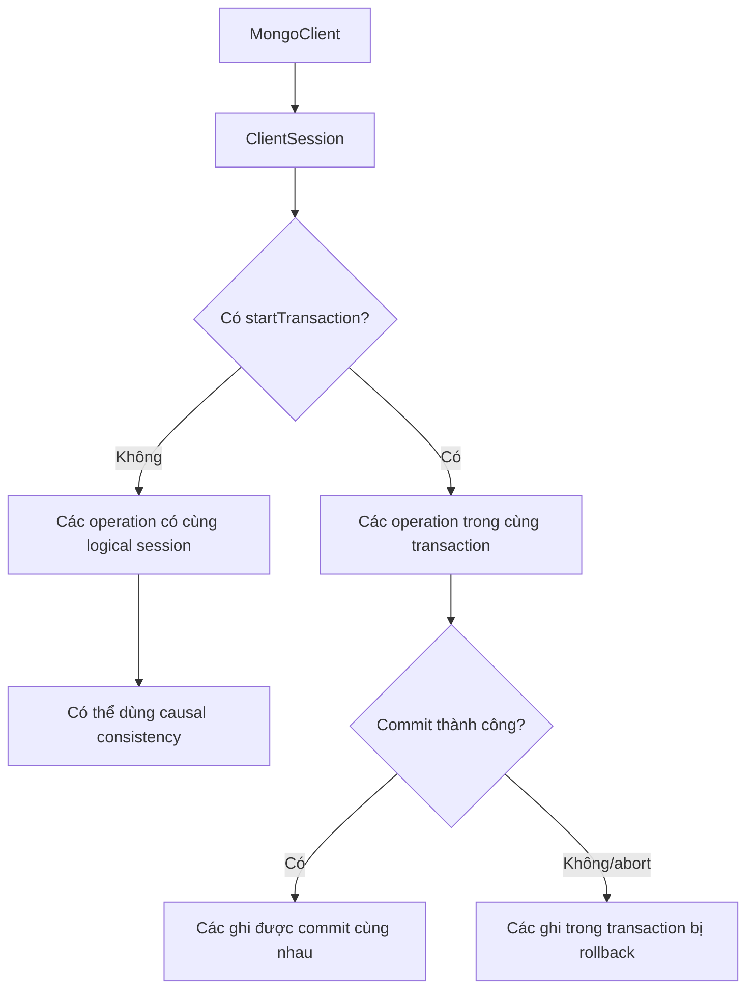
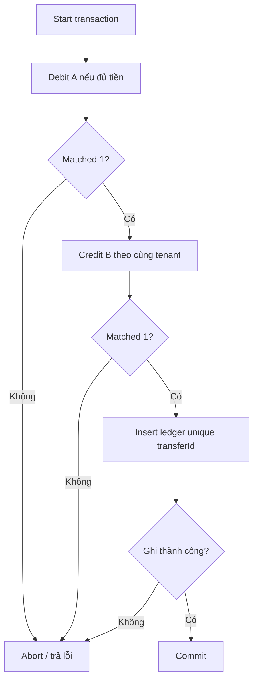
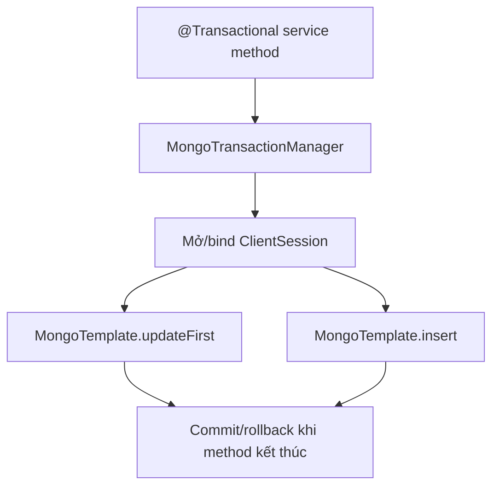
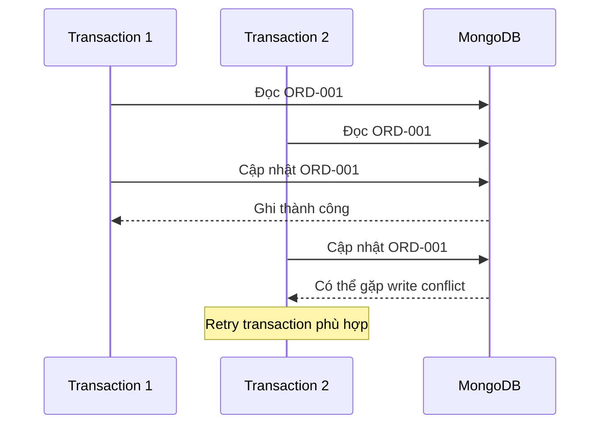

# ClientSession, causal consistency và giao dịch nhiều document

> **Chương:** Session và giao dịch  
> **Module:** `SPRING_DATA_MONGODB` — sử dụng Spring Data MongoDB để kết nối, ánh xạ document và làm việc qua `MongoTemplate` hoặc repository; thực hành thiết kế truy vấn, aggregation, index, transaction, reactive access, kiểm thử và chẩn đoán hiệu năng. Bài tập trung vào vòng đời **`ClientSession`**, ý nghĩa của **causal consistency** và cách thực thi **giao dịch nhiều document** trong MongoDB, bao gồm lập trình đồng bộ lẫn reactive.

## 1. Tại sao cần ClientSession và transaction?

Hãy xét chức năng **chuyển 3.000 cent** giữa hai ví trong cùng một tenant:

1. Trừ 3.000 cent khỏi ví nguồn.
2. Cộng 3.000 cent cho ví đích.
3. Ghi một dòng nhật ký chuyển tiền vào collection `wallet_ledger`.

Nếu ba thao tác được ghi độc lập và bước 2 thất bại sau bước 1, số dư toàn hệ thống có thể sai. Nếu request khác đọc ở giữa, nó có thể quan sát một trạng thái dở dang. **MongoDB bảo đảm atomicity ở cấp một document**, nhưng **không tự gộp nhiều lệnh trên nhiều document thành một giao dịch** nếu ta không mở transaction.

Hai công cụ liên quan nhưng không giống nhau:

- **`ClientSession`** là ngữ cảnh phía MongoDB Java Driver để gắn các operation vào cùng **logical session**. Nó có thể hỗ trợ **causal consistency** và là ngữ cảnh bắt buộc khi chủ động mở transaction.
- **Transaction** là một chuỗi thao tác đọc/ghi thuộc cùng một transaction, được **commit** hoặc **abort** theo một đơn vị nguyên tử trong phạm vi MongoDB hỗ trợ. Transaction được gắn với một session, nhưng **một session không tự động là transaction**.



**Mục tiêu sau bài học:** phân biệt session với connection, nhận biết các bảo đảm nhân quả, viết transaction bằng Java Driver và Spring Data, thiết kế xử lý lỗi/retry, nắm ranh giới transaction/reactive, và kiểm thử rollback thật trên replica set.

## 2. Session, connection, transaction: ba khái niệm riêng

| Khái niệm | Bản chất | Điều không được suy ra |
| --- | --- | --- |
| **Connection** | Kết nối mạng tới một MongoDB server, thường được driver quản lý trong pool | Một logical session không nhất thiết là một connection cố định ngoài transaction |
| **`ClientSession`** | Logical session do `MongoClient.startSession` tạo, chứa session ID và thông tin nhân quả | Chỉ tạo session **không** bắt đầu transaction |
| **Causally consistent session** | Session yêu cầu duy trì các quan hệ nhân quả giữa những thao tác theo điều kiện hỗ trợ | Không bảo đảm “luôn đọc dữ liệu mới nhất toàn cluster” |
| **Transaction** | Nhóm nhiều operation được commit/abort theo một đơn vị | Không bao gồm tự động các gọi HTTP, email, message broker ngoài MongoDB |
| **Snapshot** | Cách quan sát một ảnh nhất quán theo read concern/cơ chế snapshot phù hợp | Không đồng nhất với thứ tự nhân quả của các thao tác ở nhiều thời điểm |
| **Write concern** | Mức độ xác nhận thao tác ghi | Không phải cơ chế khóa hay kiểm tra business invariants |

MongoDB Java Driver có thể dùng **implicit sessions** cho các operation được hỗ trợ. Nhưng khi nghiệp vụ cần quản lý causal chaining hoặc transaction chủ động, ta thường dùng **explicit `ClientSession`** hoặc để **Spring transaction manager** quản lý session.

### 2.1. MongoClient không phải ClientSession

`MongoClient` thường được tạo **một lần** và tái sử dụng, là thread-safe theo hợp đồng driver. Ngược lại, `ClientSession` là đối tượng ngắn hạn gắn với một luồng công việc; **không** lưu một session vào singleton service để nhiều request dùng chung.

### 2.2. Session ID không phải transaction ID nghiệp vụ

Session ID dùng cho logical session và giao thức driver/server. Một mã nghiệp vụ như `transferId = "XFER-001"` phải là định danh **riêng** cho idempotency/audit. Không dùng session ID để thay thế unique key của ledger hay để nhận biết hai request thanh toán trùng nhau.

### 2.3. Một transaction dùng một session nhất quán

Nếu đã bắt đầu transaction bằng Java Driver, **mọi thao tác dự kiến tham gia transaction phải nhận đúng `ClientSession` đó**:

```java
collectionA.updateOne(session, filterA, updateA);
collectionB.updateOne(session, filterB, updateB);
collectionLedger.insertOne(session, ledgerDocument);
```

Nếu vô tình gọi `collectionB.updateOne(filterB, updateB)` **không có tham số session**, thao tác đó chạy **ngoài transaction**. Nếu transaction sau đó abort, cập nhật ngoài transaction không được rollback theo.

## 3. Bộ dữ liệu: hai ví và một ledger

Chạy trên **database test riêng**, không dùng production. Các lệnh `drop()` xóa collection hiện tại:

```javascript
db.wallets.drop();
db.wallet_ledger.drop();

db.wallets.insertMany([
  {
    _id: "WALLET-A",
    tenantId: "TENANT-01",
    ownerId: "USER-A",
    balanceCents: NumberLong(10000),
    currency: "USD"
  },
  {
    _id: "WALLET-B",
    tenantId: "TENANT-01",
    ownerId: "USER-B",
    balanceCents: NumberLong(2000),
    currency: "USD"
  }
]);

db.wallet_ledger.createIndex(
  { tenantId: 1, transferId: 1 },
  { name: "ux_ledger_tenant_transfer", unique: true }
);
```

Ban đầu:

| Ví | Tenant | Số dư (cent) |
| --- | --- | ---: |
| WALLET-A | TENANT-01 | 10.000 |
| WALLET-B | TENANT-01 | 2.000 |
| **Tổng** | | **12.000** |

Chuyển 3.000 cent từ A sang B thì trạng thái sau commit hợp lệ phải là:

| Ví | Số dư sau commit |
| --- | ---: |
| WALLET-A | 7.000 |
| WALLET-B | 5.000 |
| **Tổng** | **12.000** |

Ngoài hai giá trị số dư, collection `wallet_ledger` phải có đúng một bản ghi cho `(tenantId, transferId)`. Không có trường hợp hợp lệ nào chỉ cập nhật một ví nhưng bỏ qua ví kia, hoặc ghi hai ledger rows cho cùng một transfer ID.

**Vì sao dùng cent dạng `NumberLong`?** Để ví dụ không dính lỗi biểu diễn số dấu phẩy động. Hệ thống tiền thật cần thiết kế precision, currency, amount limits, validation và audit đầy đủ; transaction chỉ xử lý **atomicity**, không thay toàn bộ quy tắc kế toán.

### 3.1. Cùng tenant và cùng currency

Trong ví dụ, chỉ cho chuyển giữa hai ví cùng `tenantId` và cùng `currency`. Nếu hệ thống nhiều tenant cho client chỉ gửi source/destination IDs, service phải lấy tenant ID từ security context và đưa điều kiện tenant vào **cả hai update**. Không chỉ dựa vào việc session/transaction được mở để bảo vệ phân quyền.

## 4. Tạo và đóng ClientSession bằng MongoDB Java Driver

Synchronous Java Driver cung cấp `com.mongodb.client.MongoClient` và `com.mongodb.client.ClientSession`. Ví dụ:

```java
import com.mongodb.ClientSessionOptions;
import com.mongodb.client.ClientSession;
import com.mongodb.client.MongoClient;
import com.mongodb.client.MongoCollection;
import org.bson.Document;

// mongoClient được inject/tạo sẵn và tái sử dụng ở ứng dụng.
MongoCollection<Document> wallets = mongoClient
    .getDatabase("wallet_demo")
    .getCollection("wallets");

try (ClientSession session = mongoClient.startSession(
        ClientSessionOptions.builder()
            .causallyConsistent(true)
            .build())) {

    Document wallet = wallets
        .find(session, new Document("_id", "WALLET-A"))
        .first();

    System.out.println(wallet);
}
// Session được đóng ở cuối try-with-resources.
```

`mongoClient` là bean/đối tượng từ cấu hình ứng dụng; snippet chỉ là phần sử dụng. `MongoClient` và session phải thuộc **cùng driver client** với các collections dùng session. Không tạo session từ client A rồi dùng với collection được lấy qua client B.

### 4.1. Vì sao phải close?

Đóng `ClientSession` giải phóng tài nguyên ngữ cảnh ở driver/server theo vòng đời session. Nếu mở explicit session rồi không đóng, tài nguyên có thể tồn tại lâu, gây khó quản lý và làm tăng rủi ro giới hạn tài nguyên. Dùng `try-with-resources` cho synchronous code; reactive cần cơ chế cleanup khi complete, error và cancel.

### 4.2. Không dùng một ClientSession đồng thời ở nhiều thread

`ClientSession` **không thread-safe** theo hướng dẫn MongoDB Java Driver. Không:

```java
// PHẢN VÍ DỤ: không chạy hai thao tác trên cùng session song song.
CompletableFuture.runAsync(
    () -> wallets.find(session, filterA).first()
);
CompletableFuture.runAsync(
    () -> wallets.find(session, filterB).first()
);
```

Đoạn trên chỉ minh họa antipattern; `session` và các filter được giả định đang có. Nếu cần parallel tasks, thiết kế session riêng theo luồng công việc hoặc phối hợp thứ tự tuần tự. **Trong một transaction MongoDB, không hỗ trợ thực thi song song nhiều operation trên cùng session** như một cách tăng tốc.

### 4.3. Session không tự mở transaction

```java
try (ClientSession session = mongoClient.startSession()) {
    wallets.updateOne(session, filter, update);
    // Đây vẫn là write bình thường nếu chưa startTransaction().
}
```

Nếu có nhiều lệnh ghi, tất cả dùng cùng session nhưng không gọi `startTransaction`, không có ràng buộc “tất cả hoặc không có gì” xuyên nhiều document. Causal consistency và atomic multi-document transaction là **hai cơ chế riêng**.

## 5. Causal consistency là gì?

**Causal consistency** giúp những thao tác có quan hệ **nhân quả** trong một session được quan sát với thứ tự phù hợp, đặc biệt quan trọng trong replica set khi đọc từ secondary hoặc khi dữ liệu được ghi rồi ngay sau đó được đọc ở một node khác.

Ví dụ:

1. Request ghi đơn hàng `status=PAID`.
2. Sau khi ghi được xác nhận đúng mức, request đọc lại đơn theo cùng causal session.
3. Bản đọc không được “quay về” trạng thái cũ trước thao tác vừa ghi, trong phạm vi bảo đảm và điều kiện consistency của MongoDB.

Các bảo đảm nhân quả thường được MongoDB mô tả gồm:

| Thuộc tính | Ý nghĩa ở mức nghiệp vụ |
| --- | --- |
| **Read your writes** | Sau khi session ghi thành công, những lần đọc nhân quả sau trong session thấy tác động của ghi đó |
| **Monotonic reads** | Các lần đọc liên tiếp trong session không quan sát dữ liệu “đi lùi” về trạng thái trước một bản đọc đã quan sát |
| **Monotonic writes** | Các lần ghi được xếp theo thứ tự nhân quả, không đảo thứ tự các ghi phụ thuộc |
| **Writes follow reads** | Ghi thực hiện dựa trên một bản đọc có thứ tự nhân quả phù hợp với bản đọc đó |

**Bảo đảm quan trọng:** MongoDB yêu cầu **`readConcern:"majority"` và `writeConcern:"majority"`** để có đầy đủ causal consistency guarantees trong các mô hình được tài liệu hóa. Chỉ bật `causallyConsistent(true)` mà dùng các concern khác **không đủ để khẳng định đầy đủ cả bốn bảo đảm**.

### 5.1. Causal consistency không phải “linearizable read”

`read-your-writes` không có nghĩa mọi read toàn hệ thống luôn thấy **write mới nhất của mọi client khác**. Causal consistency giữ quan hệ nhân quả có thể theo dõi được; các operation độc lập từ client khác có thể không có quan hệ đó.

Nếu nghiệp vụ cần bảo đảm mạnh hơn kiểu **linearizable** cho một operation một document trên primary, phải xem xét read concern, write concern và giới hạn hỗ trợ riêng. Không đổi tên causal session thành “global strong consistency”.

### 5.2. Causal consistency không phải snapshot transaction

Trong một causally consistent session **không mở transaction**, hai lần đọc `walletA` và `walletB` có thể thấy dữ liệu ở **hai thời điểm khác nhau**. Các lần đọc nhân quả có thể tiến về phía trước, nhưng không tự hợp nhất thành một ảnh đồng thời, nhất quán giữa nhiều document.

Nếu yêu cầu kiểm tra bất biến tổng số dư dựa trên một snapshot nhất quán, cần thiết kế transaction/read concern snapshot phù hợp hoặc mô hình dữ liệu khác, không chỉ dùng session.

## 6. Cấu hình majority concerns cho causal session

Ví dụ Java Driver đồng bộ với session nhân quả và database handle cấu hình concern:

```java
import com.mongodb.ClientSessionOptions;
import com.mongodb.ReadConcern;
import com.mongodb.WriteConcern;
import com.mongodb.ReadPreference;
import com.mongodb.client.ClientSession;
import com.mongodb.client.MongoCollection;
import org.bson.Document;

MongoCollection<Document> walletCollection = mongoClient
    .getDatabase("wallet_demo")
    .getCollection("wallets")
    .withReadConcern(ReadConcern.MAJORITY)
    .withWriteConcern(WriteConcern.MAJORITY)
    .withReadPreference(ReadPreference.primary());

try (ClientSession session = mongoClient.startSession(
        ClientSessionOptions.builder()
            .causallyConsistent(true)
            .build())) {

    walletCollection.updateOne(
        session,
        new Document("_id", "WALLET-A"),
        new Document("$set", new Document("lastActivity", "2026-11-20"))
    );

    Document observed = walletCollection
        .find(session, new Document("_id", "WALLET-A"))
        .first();

    System.out.println(observed.getString("lastActivity"));
}
```

**Đây không phải transaction:** nếu thêm một lệnh ghi khác và lệnh thứ hai thất bại, lệnh đã thành công trước đó không tự rollback. Điều đạt được ở ví dụ là dùng **cùng một causal session** và majority concerns cho chuỗi write-then-read.

### 6.1. Primary vs secondary

Causal consistency đặc biệt có ích khi ứng dụng có **read preference cho secondary** và muốn tránh đọc lùi so với những operation nhân quả trước đó. Nhưng việc dùng secondary phải tuân theo topology và lựa chọn read concern thực tế. Đừng giả định chuyển read preference sang secondary luôn phù hợp trong mọi transaction; **transaction có ghi phải chạy theo hạn chế read preference của MongoDB, thông thường `primary`**.

### 6.2. Operation time và cluster time

Driver giữ metadata như **operation time** và **cluster time** trên session, giúp gắn yêu cầu nhân quả vào các command liên quan. Trong Java Driver có các thao tác như:

```java
// Dùng khi đã có session phù hợp:
var operationTime = session.getOperationTime();
var clusterTime = session.getClusterTime();

// Với một session khác và metadata hợp lệ:
// otherSession.advanceOperationTime(operationTime);
// otherSession.advanceClusterTime(clusterTime);
```

Đoạn trên là ý tưởng về **chuyển causal context** qua ranh giới session/service; không phải mã chạy nguyên xi vì `session`/`otherSession` phải được khai báo, metadata có thể null và cần quy trình truyền an toàn. Không tự tạo timestamp giả, không kết luận một log timestamp bất kỳ tương đương causal token MongoDB.

Trong hầu hết API đơn giản, **giữ cùng session cho một chuỗi thao tác tuần tự** là dễ hiểu hơn việc tự truyền operation time/cluster time giữa các service.

## 7. Khi nào cần transaction nhiều document?

MongoDB bảo đảm mỗi update một document có tính nguyên tử. Ví dụ:

```javascript
db.wallets.updateOne(
  { _id: "WALLET-A", tenantId: "TENANT-01",
    balanceCents: { $gte: NumberLong(3000) } },
  { $inc: { balanceCents: NumberLong(-3000) } }
);
```

Lệnh này có thể **nguyên tử** giảm số dư ví A nếu điều kiện đủ tiền vẫn khớp ngay lúc ghi. Nó không cần transaction chỉ để tự bảo vệ một document.

Nhưng muốn **trừ A + cộng B + ghi ledger** như một đơn vị, transaction là một lựa chọn phù hợp:



**Không dùng transaction cho mọi thao tác theo phản xạ.** Chuyển một status trong **một** document thường chỉ cần atomic conditional update, `@Version` hoặc unique constraint. Multi-document transactions tạo chi phí phối hợp, giữ snapshot/tài nguyên, và có giới hạn thời lượng.

### 7.1. Không phải giao dịch phân tán giữa MongoDB và hệ thống ngoài

Transaction MongoDB **không tự rollback** một email đã gửi, một lời gọi HTTP tới payment gateway, hay một Kafka message đã publish ngoài transaction. Với nghiệp vụ cần phát event sau commit, cân nhắc **transactional outbox** lưu event trong MongoDB transaction rồi worker phát ra broker, cùng idempotent consumer.

### 7.2. Nhiều document trong một collection cũng cần transaction khi phải cùng commit

Không chỉ giao dịch **nhiều collection** mới cần transaction. Chuyển tiền giữa hai document `wallets` trong cùng collection là thay đổi **hai document**; nếu business yêu cầu tất cả hoặc không có gì, vẫn cần multi-document transaction hoặc một thiết kế dữ liệu khác bảo đảm bất biến.

## 8. Điều kiện trước khi dùng MongoDB transaction

### 8.1. Topology và phiên bản

Hỗ trợ transaction nhiều document thay đổi theo server version:

| MongoDB topology | Transaction nhiều document |
| --- | --- |
| **Standalone server** | **Không** hỗ trợ multi-document transaction |
| **Replica set** | Hỗ trợ từ **MongoDB 4.0** |
| **Sharded cluster** | Hỗ trợ distributed transactions từ **MongoDB 4.2** |
| **MongoDB Atlas cluster phù hợp** | Có thể hỗ trợ theo topology/tier và phiên bản triển khai |

**Không dùng một standalone mongod làm bằng chứng test transaction thành công.** Với Testcontainers, cần container được khởi tạo làm replica set hoặc dùng MongoDB test replica set có cấu hình đúng. Trong production phải có topology/durability/monitoring phù hợp, không chỉ đổi connection string.

### 8.2. Connection string cần chỉ tới topology đúng

Một URI minh họa:

```properties
spring.data.mongodb.uri=mongodb://localhost:27017/wallet_demo?replicaSet=rs0
```

Giá trị `rs0` là tên replica set **chỉ khi server test thật được cấu hình như vậy**. Không tự thêm `replicaSet=rs0` vào URI khi server chưa chạy replica set. Với sharded cluster, dùng URI của mongos hoặc cấu hình do nhà cung cấp hướng dẫn.

Nếu cấu hình thông qua Spring Boot properties, tránh đồng thời đặt URI và cấu hình host/port/database mâu thuẫn. Trong production nên dùng secret store/config được quản lý; không hardcode credential vào tài liệu hay source code.

### 8.3. Chuẩn bị collection và index trước transaction

Ví dụ này cần collection `wallets`, `wallet_ledger` và unique index trên `(tenantId, transferId)`. Hãy tạo chúng **trước khi phục vụ transaction** qua migration. MongoDB có các hỗ trợ/hạn chế DDL trong transaction phụ thuộc phiên bản và topology; tạo collection/index ngoài transaction giúp hành vi dễ dự đoán.

```javascript
db.wallets.createIndex(
  { tenantId: 1, _id: 1 },
  { name: "ix_wallet_tenant_id" }
);

db.wallet_ledger.createIndex(
  { tenantId: 1, transferId: 1 },
  { name: "ux_ledger_tenant_transfer", unique: true }
);
```

Index trên `_id` đã có sẵn; compound index `{tenantId:1,_id:1}` chỉ là **ứng viên theo workload**, không phải điều kiện bắt buộc cho transaction. Với query luôn theo `_id` duy nhất, unique index mặc định có thể đủ; đo `explain` trước khi tăng write amplification bằng index thừa.

### 8.4. Transaction có giới hạn và chi phí

- Transaction dài giữ snapshot/tài nguyên và tăng nguy cơ write conflicts, áp lực cache và chi phí commit.
- MongoDB có `transactionLifetimeLimitSeconds` (thường mặc định **60 giây**, tùy cấu hình) và các giới hạn về kích thước/cache/oplog/version.
- Distributed transaction trên sharded cluster có overhead cao hơn.
- Không dùng transaction để gọi API bên ngoài và chờ hàng chục giây.
- Cần xem write concern, read concern, read preference và commit retry policy theo topology.

**Một transaction thành công không làm cho hệ thống ngoài MongoDB trở thành một phần của giao dịch.**

## 9. Java Driver: startTransaction, commitTransaction và abortTransaction

### 9.1. TransactionOptions

Java Driver cho phép tạo transaction options:

```java
import com.mongodb.ReadConcern;
import com.mongodb.ReadPreference;
import com.mongodb.TransactionOptions;
import com.mongodb.WriteConcern;

TransactionOptions options = TransactionOptions.builder()
    .readConcern(ReadConcern.SNAPSHOT)
    .writeConcern(WriteConcern.MAJORITY)
    .readPreference(ReadPreference.primary())
    .build();
```

- `ReadConcern.SNAPSHOT` cung cấp cách đọc theo transaction snapshot trong điều kiện hỗ trợ.
- `WriteConcern.MAJORITY` đặt chính sách xác nhận **commit**; cùng với read concern phù hợp có thể giúp bảo đảm durability/consistency cao hơn.
- `ReadPreference.primary()` tránh dùng read preference không được phép cho transaction có ghi.

Chọn concern tùy hợp đồng dữ liệu và topology. Không mặc định một cấu hình demo phù hợp mọi workload. Đặc biệt, không tự phát biểu “majority luôn bằng linearizable” hoặc “snapshot transaction thay thế authorization”.

### 9.2. Chuyển tiền bằng cùng một ClientSession

Trong Java Driver đồng bộ, dùng collection handles từ **cùng `MongoClient`** và truyền `session` vào mọi lệnh:

```java
import com.mongodb.client.ClientSession;
import com.mongodb.client.MongoCollection;
import com.mongodb.client.result.UpdateResult;
import com.mongodb.client.model.Filters;
import com.mongodb.client.model.Updates;
import org.bson.Document;

MongoCollection<Document> wallets = mongoClient
    .getDatabase("wallet_demo")
    .getCollection("wallets");

MongoCollection<Document> ledger = mongoClient
    .getDatabase("wallet_demo")
    .getCollection("wallet_ledger");

long cents = 3000L;

try (ClientSession session = mongoClient.startSession()) {
    session.startTransaction(options);
    try {
        UpdateResult debit = wallets.updateOne(
            session,
            Filters.and(
                Filters.eq("_id", "WALLET-A"),
                Filters.eq("tenantId", "TENANT-01"),
                Filters.eq("currency", "USD"),
                Filters.gte("balanceCents", cents)
            ),
            Updates.inc("balanceCents", -cents)
        );
        if (debit.getMatchedCount() != 1L) {
            throw new IllegalStateException(
                "Wallet source missing or insufficient balance"
            );
        }

        UpdateResult credit = wallets.updateOne(
            session,
            Filters.and(
                Filters.eq("_id", "WALLET-B"),
                Filters.eq("tenantId", "TENANT-01"),
                Filters.eq("currency", "USD")
            ),
            Updates.inc("balanceCents", cents)
        );
        if (credit.getMatchedCount() != 1L) {
            throw new IllegalStateException("Destination wallet not found");
        }

        ledger.insertOne(session,
            new Document("_id", "LEDGER-XFER-001")
                .append("tenantId", "TENANT-01")
                .append("transferId", "XFER-001")
                .append("fromWalletId", "WALLET-A")
                .append("toWalletId", "WALLET-B")
                .append("amountCents", cents)
        );

        session.commitTransaction();
    } catch (RuntimeException error) {
        if (session.hasActiveTransaction()) {
            session.abortTransaction();
        }
        throw error;
    }
}
```

Đoạn trên giả định đã khai báo `options` của mục 9.1, `mongoClient` được cấu hình đúng và đang dùng MongoDB replica set/sharded cluster hỗ trợ transaction. Mã là ví dụ **một luồng thực hiện thành công không có retry nâng cao**, cần thêm cơ chế phân loại lỗi giao dịch và commit uncertainty trước khi dùng production.

Tất cả ba operation (`debit`, `credit`, `insert ledger`) nhận cùng `session`, nên có thể **commit hoặc abort cùng nhau**. Nếu ví đích không tồn tại và exception được ném trước commit, code gọi abort; lệnh debit trước đó **không được commit**.

### 9.3. Vì sao phải kiểm matchedCount?

`updateOne` không mặc định ném exception khi filter không khớp. Nếu ví A không đủ tiền, `matchedCount=0`; nếu code vẫn tiếp tục credit B và insert ledger, transaction có thể commit một kết quả **sai nghiệp vụ** dù hoàn toàn atomic.

Transaction chỉ cam kết các thao tác được giao commit/abort; **không tự hiểu “tiền không thể được tạo ra”**. Service phải kiểm outcome của từng operation và ném exception để abort khi một điều kiện nghiệp vụ không đạt.

### 9.4. Khi commitTransaction gặp lỗi

Lỗi trên thao tác trong transaction và lỗi ở **bước commit** không có cùng ý nghĩa. Nếu network mất kết nối ngay sau commit request, client có thể không chắc commit đã thành công hay chưa (**unknown commit result**). Không được:

```java
// PHẢN VÍ DỤ: thấy exception là lặp nguyên transfer
// bằng transferId mới -> nguy cơ chuyển tiền hai lần.
transfer("XFER-002"); // sau khi XFER-001 commit result không rõ
```

MongoDB Driver cung cấp error labels như `TransientTransactionError` và `UnknownTransactionCommitResult` để định hướng retry. Chiến lược thường là retry **whole transaction** với lỗi transient phù hợp; retry **commit** khi commit outcome chưa rõ. Không được retry tùy tiện mọi `RuntimeException`, và phải giữ **transferId idempotent** xuyên các lần retry.

Java Driver có helper `ClientSession.withTransaction(callback, options)` hỗ trợ retry những trường hợp được định nghĩa. Khi dùng helper, callback có thể chạy lại, vì vậy **không thực hiện side effect ngoài MongoDB** trong callback như gửi email hoặc trừ tiền qua payment gateway.

### 9.5. Commit và abort không thay thế finally/close

`commitTransaction` kết thúc transaction thành công nếu được xác nhận; `abortTransaction` hủy transaction đang hoạt động; `session.close` kết thúc resource lifecycle của client session. Cần cả **transaction outcome handling** và **session cleanup**, không dùng một thay thế cho cái còn lại.

## 10. Spring Data MongoDB: MongoTransactionManager

`MongoTransactionManager` kết nối transaction của Spring với MongoDB `ClientSession`. Thay vì truyền `ClientSession` thủ công vào từng `MongoTemplate` call, Spring transaction manager **bind session với luồng thực thi transaction**, và các `MongoTemplate` operations đi qua cùng database factory sẽ tham gia.

### 10.1. Khai báo bean transaction manager

```java
package demo.wallets;

import org.springframework.context.annotation.Bean;
import org.springframework.context.annotation.Configuration;
import org.springframework.data.mongodb.MongoDatabaseFactory;
import org.springframework.data.mongodb.MongoTransactionManager;

@Configuration
public class MongoTransactionConfig {

    @Bean
    MongoTransactionManager mongoTransactionManager(
        MongoDatabaseFactory databaseFactory
    ) {
        return new MongoTransactionManager(databaseFactory);
    }
}
```

Với một `MongoTransactionManager` bean được cấu hình phù hợp, Spring `@Transactional` có thể điều phối start/commit/rollback. Trong ứng dụng có **nhiều transaction managers** (ví dụ JPA và MongoDB), cần chọn manager đúng:

```java
import org.springframework.transaction.annotation.Transactional;

@Transactional(transactionManager = "mongoTransactionManager")
public void doMongoWork() {
    // ...
}
```

Nếu Spring Boot đã cấu hình một transaction manager tương đương, tránh khai báo trùng và kiểm tra tên bean. Không giả định các annotation transaction của JPA sẽ tự động biến MongoDB thành cùng transaction với RDBMS.

### 10.2. Vì sao MongoTemplate “tự” tham gia transaction?

Trong transaction imperative, `MongoTransactionManager` gắn `ClientSession` vào cơ chế transaction synchronization của Spring. `MongoTemplate` lấy session từ ngữ cảnh này khi dùng cùng `MongoDatabaseFactory`.



**Không được dùng raw Java Driver mà không truyền session rồi nghĩ nó tự kế thừa `@Transactional`.** Nếu gọi trực tiếp `MongoClient.getDatabase(...).getCollection(...).updateOne(...)` không có session, thao tác có thể ở **ngoài** transaction do Spring quản lý.

### 10.3. @Transactional chỉ hoạt động khi đi qua proxy

Một service method public được gọi từ **bean khác** thường đi qua Spring AOP proxy:

```java
@Service
public class WalletService {
    @Transactional(transactionManager = "mongoTransactionManager")
    public void transfer() {
        // các MongoTemplate operations
    }
}
```

Nếu method `transfer()` được gọi qua `this.transfer()` trong cùng object (self-invocation), interceptor transaction theo proxy mode có thể không chạy. Một private method gắn `@Transactional` cũng thường không tạo boundary mong đợi. Thiết kế transaction boundary ở service rõ ràng và kiểm thử rollback thực tế.

### 10.4. Rollback mặc định của Spring

Với Spring declarative transaction, rollback mặc định áp dụng cho **unchecked exception** (`RuntimeException`/`Error`). Với checked exception, cần cấu hình `rollbackFor` nếu muốn rollback:

```java
@Transactional(
    transactionManager = "mongoTransactionManager",
    rollbackFor = Exception.class
)
public void executeBusinessRule() throws Exception {
    // ...
}
```

Không bắt mọi exception rồi nuốt trong transactional method, vì Spring có thể thấy method **trả về bình thường** và commit dù nghiệp vụ đã thất bại. Nếu cần bắt lỗi để trả response, hãy xử lý ở **bên ngoài** transaction boundary hoặc đánh dấu rollback-only một cách chủ động theo API Spring.

## 11. Ví dụ Spring service: trừ ví, cộng ví, ghi ledger atomically

### 11.1. Dùng MongoTemplate trên cùng transaction manager

Ví dụ sau sử dụng collection name để thao tác BSON trực tiếp qua `MongoTemplate`, dễ đối chiếu với `mongosh` của mục 3:

```java
package demo.wallets;

import com.mongodb.client.result.UpdateResult;
import org.bson.Document;
import org.springframework.data.mongodb.core.MongoTemplate;
import org.springframework.data.mongodb.core.query.Criteria;
import org.springframework.data.mongodb.core.query.Query;
import org.springframework.data.mongodb.core.query.Update;
import org.springframework.stereotype.Service;
import org.springframework.transaction.annotation.Transactional;

@Service
public class WalletTransferService {

    private final MongoTemplate mongoTemplate;

    public WalletTransferService(MongoTemplate mongoTemplate) {
        this.mongoTemplate = mongoTemplate;
    }

    @Transactional(transactionManager = "mongoTransactionManager")
    public void transfer(
        String tenantId, String fromId, String toId,
        long amountCents, String transferId
    ) {
        if (tenantId == null || tenantId.isBlank()
            || fromId == null || toId == null
            || fromId.equals(toId)
            || amountCents <= 0
            || transferId == null || transferId.isBlank()) {
            throw new IllegalArgumentException("Invalid transfer request");
        }

        Query source = Query.query(
            Criteria.where("_id").is(fromId)
                .and("tenantId").is(tenantId)
                .and("currency").is("USD")
                .and("balanceCents").gte(amountCents)
        );

        UpdateResult debit = mongoTemplate.updateFirst(
            source,
            new Update().inc("balanceCents", -amountCents),
            "wallets"
        );

        if (debit.getMatchedCount() != 1L) {
            throw new IllegalStateException(
                "Source missing or balance insufficient"
            );
        }

        Query destination = Query.query(
            Criteria.where("_id").is(toId)
                .and("tenantId").is(tenantId)
                .and("currency").is("USD")
        );

        UpdateResult credit = mongoTemplate.updateFirst(
            destination,
            new Update().inc("balanceCents", amountCents),
            "wallets"
        );

        if (credit.getMatchedCount() != 1L) {
            throw new IllegalStateException("Destination not found");
        }

        Document ledger = new Document("_id", tenantId + ":" + transferId)
            .append("tenantId", tenantId)
            .append("transferId", transferId)
            .append("fromWalletId", fromId)
            .append("toWalletId", toId)
            .append("amountCents", amountCents);

        mongoTemplate.insert(ledger, "wallet_ledger");
    }
}
```

**Cấu hình cần thiết:** `MongoTransactionManager` và `MongoTemplate` phải dùng đúng `MongoDatabaseFactory`; MongoDB topology phải hỗ trợ transaction; collection/index phải tồn tại; transaction method phải được gọi qua Spring proxy. Nếu một trong các điều kiện đó không đúng, không thể mặc định ba lệnh chạy chung transaction.

Ở mức khái niệm:

1. `debit` chỉ match nếu A tồn tại trong tenant, đúng currency và đủ tiền.
2. `credit` chỉ match nếu B cùng tenant và đúng currency.
3. `insert ledger` phải không va unique key.
4. Chỉ khi cả ba thành công và method kết thúc hợp lệ, Spring mới commit; một `RuntimeException` làm rollback toàn transaction.

**Lưu ý idempotency:** `transferId` dùng làm unique key của ledger. Nếu request lặp lại với cùng transfer ID, lần sau có thể đi qua debit/credit trước rồi gặp duplicate ledger; transaction phải rollback những thay đổi lần sau. Để trả response idempotent thân thiện, service cần thêm cơ chế tìm receipt đã commit và kiểm tra request payload trùng, kèm xử lý race. Không chỉ bắt mọi duplicate rồi coi đó là “thành công” nếu chưa kiểm payload.

### 11.2. Vì sao vẫn phải kiểm tiền và quyền?

`@Transactional` không chặn overdraft nếu code dùng `$inc` mà không có `balanceCents:{$gte:amount}`. Nó cũng không chặn chuyển tiền sang một wallet của tenant khác nếu query credit chỉ dùng `_id`.

Transaction bảo vệ **sự đồng bộ của những thay đổi đã xác định**, không tự định nghĩa tính hợp lệ của những thay đổi đó.

### 11.3. Repository có tham gia cùng transaction không?

Các repository methods dựa trên cùng `MongoDatabaseFactory` và transaction synchronization có thể tham gia session do `MongoTransactionManager` quản lý. Nhưng một repository method chứa behavior riêng (chẳng hạn raw query, update method, event callbacks) có semantics khác `save(entity)`. Kiểm thử đường ghi thực tế khi business phụ thuộc `@Version`, lifecycle callbacks hoặc unique constraints.

## 12. TransactionTemplate: boundary tường minh khi không dùng @Transactional

Không phải workflow nào cũng tiện đặt transaction boundary trên một public service method. Spring hỗ trợ `TransactionTemplate` để chạy một đoạn đồng bộ trong transaction:

```java
import org.springframework.data.mongodb.MongoTransactionManager;
import org.springframework.transaction.support.TransactionTemplate;

TransactionTemplate tx = new TransactionTemplate(
    mongoTransactionManager
);

tx.execute(status -> {
    // Toàn bộ MongoTemplate operations ở đây phải dùng
    // cùng MongoDatabaseFactory của MongoTransactionManager.
    mongoTemplate.updateFirst(
        sourceQuery, debitUpdate, "wallets"
    );
    mongoTemplate.updateFirst(
        destinationQuery, creditUpdate, "wallets"
    );
    mongoTemplate.insert(ledgerDocument, "wallet_ledger");
    return null;
});
```

`mongoTransactionManager`, `sourceQuery`, `debitUpdate`, `destinationQuery`, `creditUpdate` và `ledgerDocument` ở đây là các biến đã được xây trong service. Đây là **minh họa transaction boundary**, không phải một ví dụ hoàn chỉnh vì chưa kiểm matched count; code production phải thực hiện các kiểm tra như mục 11.

Ưu điểm:

- Boundary bắt đầu/kết thúc transaction được biểu diễn rõ ràng trong code.
- Nếu callback ném unchecked exception, transaction manager xử lý rollback theo contract.
- Có thể đặt các cấu hình transaction như timeout/isolation phù hợp khả năng hỗ trợ.

Lưu ý tránh lồng `TransactionTemplate` với `@Transactional` một cách tùy tiện khi đang dùng nhiều transaction managers hoặc propagation policies. MongoDB transaction có hạn chế riêng, không thể áp dụng máy móc mọi giả định từ transaction RDBMS.

## 13. Reactive transaction: khác biệt về ngữ cảnh

Trong reactive stack, Spring sử dụng **Reactor Context** thay cho thread-local transaction context của imperative. Nếu ứng dụng dùng `ReactiveMongoTemplate`, cần **`ReactiveMongoTransactionManager`** hoặc `TransactionalOperator` phù hợp, không chỉ copy cấu hình `MongoTransactionManager` của imperative.

### 13.1. Đăng ký ReactiveMongoTransactionManager

```java
package demo.wallets;

import org.springframework.context.annotation.Bean;
import org.springframework.context.annotation.Configuration;
import org.springframework.data.mongodb.ReactiveMongoDatabaseFactory;
import org.springframework.data.mongodb.ReactiveMongoTransactionManager;

@Configuration
public class ReactiveMongoTransactionConfig {

    @Bean
    ReactiveMongoTransactionManager reactiveMongoTransactionManager(
        ReactiveMongoDatabaseFactory factory
    ) {
        return new ReactiveMongoTransactionManager(factory);
    }
}
```

Bean trên dành cho ứng dụng reactive. Nếu dự án có cả sync và reactive stack, xác định **transaction manager cụ thể** cho mỗi service, tránh chọn nhầm.

### 13.2. Reactive service với @Transactional

```java
package demo.wallets;

import com.mongodb.client.result.UpdateResult;
import org.bson.Document;
import org.springframework.data.mongodb.core.ReactiveMongoTemplate;
import org.springframework.data.mongodb.core.query.Criteria;
import org.springframework.data.mongodb.core.query.Query;
import org.springframework.data.mongodb.core.query.Update;
import org.springframework.stereotype.Service;
import org.springframework.transaction.annotation.Transactional;
import reactor.core.publisher.Mono;

@Service
public class ReactiveWalletTransferService {

    private final ReactiveMongoTemplate template;

    public ReactiveWalletTransferService(ReactiveMongoTemplate template) {
        this.template = template;
    }

    @Transactional(transactionManager = "reactiveMongoTransactionManager")
    public Mono<Void> transfer(
        String tenantId, String fromId, String toId,
        long cents, String transferId
    ) {
        if (cents <= 0 || fromId.equals(toId)) {
            return Mono.error(
                new IllegalArgumentException("Invalid transfer")
            );
        }

        Query source = Query.query(
            Criteria.where("_id").is(fromId)
                .and("tenantId").is(tenantId)
                .and("currency").is("USD")
                .and("balanceCents").gte(cents)
        );
        Query target = Query.query(
            Criteria.where("_id").is(toId)
                .and("tenantId").is(tenantId)
                .and("currency").is("USD")
        );

        Document receipt = new Document("_id", tenantId + ":" + transferId)
            .append("tenantId", tenantId)
            .append("transferId", transferId)
            .append("amountCents", cents);

        return template.updateFirst(
                source,
                new Update().inc("balanceCents", -cents),
                "wallets"
            )
            .flatMap(debit -> {
                if (debit.getMatchedCount() != 1L) {
                    return Mono.error(new IllegalStateException(
                        "Source missing or insufficient balance"
                    ));
                }
                return template.updateFirst(
                    target,
                    new Update().inc("balanceCents", cents),
                    "wallets"
                );
            })
            .flatMap(credit -> {
                if (credit.getMatchedCount() != 1L) {
                    return Mono.error(new IllegalStateException(
                        "Destination missing"
                    ));
                }
                return template.insert(receipt, "wallet_ledger");
            })
            .then();
    }
}
```

Đây là mô hình transaction trên **một chuỗi reactive duy nhất**. Các thao tác cần liên tục thuộc **publisher được method trả về** để transaction interceptor subscribe và gắn transaction context đúng.

**Những lưu ý cần khắc phục trong ứng dụng thật:**

- Validate `tenantId`, `fromId`, `toId`, `transferId` không null/trống trước khi dùng; ví dụ rút gọn chỉ kiểm `cents` và hai ID khác nhau.
- Dữ liệu `receipt` ở đây chưa chứa toàn bộ from/to metadata để giữ snippet gọn; production nên ghi đầy đủ ledger như service imperative.
- Không gọi `subscribe()` bên trong method để tách một lệnh write ra khỏi publisher; thao tác detached có thể chạy **ngoài transaction**.
- Không dùng `Mono.when(...)`/`zip(...)` để chạy song song hai update trên **cùng transactional session**; MongoDB không hỗ trợ parallel operations trong một transaction.
- Không dùng `block()` trên event loop để chờ operation imperative.

### 13.3. TransactionalOperator

Khi không muốn gắn `@Transactional` ở method, tạo `TransactionalOperator` từ reactive manager:

```java
import org.springframework.transaction.reactive.TransactionalOperator;
import reactor.core.publisher.Mono;

TransactionalOperator operator =
    TransactionalOperator.create(reactiveMongoTransactionManager);

Mono<Void> work = template.updateFirst(
        sourceQuery, debitUpdate, "wallets"
    )
    .flatMap(result -> {
        if (result.getMatchedCount() != 1L) {
            return Mono.error(new IllegalStateException(
                "Debit failed"
            ));
        }
        return template.updateFirst(
            targetQuery, creditUpdate, "wallets"
        );
    })
    .flatMap(result -> {
        if (result.getMatchedCount() != 1L) {
            return Mono.error(new IllegalStateException(
                "Credit failed"
            ));
        }
        return template.insert(receiptDocument, "wallet_ledger");
    })
    .then()
    .as(operator::transactional);
```

`sourceQuery`, `debitUpdate`, `targetQuery`, `creditUpdate` và `receiptDocument` là biến được xây như service ở trên. Phần `.as(operator::transactional)` gắn transaction với **publisher chain**. Không dùng `TransactionalOperator` như một lệnh “bật transaction toàn ứng dụng”.

### 13.4. Reactive ClientSession thủ công: cleanup là bắt buộc

MongoDB Reactive Streams Driver có `ClientSession`/`startSession` dạng publisher, khác đồng bộ. Nếu tự quản lý session:

- Acquire session theo subscription.
- Dùng **cùng session cho mọi operation** thuộc transaction.
- Commit/abort với các publisher được compose tuần tự.
- Cleanup session trên complete/error/cancellation, không để session leak.

Với Spring Data reactive, `ReactiveMongoTransactionManager`/`TransactionalOperator` thường dễ bảo trì hơn việc tự xây cơ chế cleanup/retry của reactive driver. Những publisher chuyển qua thread/scheduler không nhất thiết làm mất Reactor Context nếu compose đúng; nhưng **manual subscribe/detached pipeline** mới là nguồn lỗi dễ gặp.

## 14. Causal consistency trong Spring Data: cấu hình session tường minh

### 14.1. MongoTemplate.withSession

Spring Data MongoDB hỗ trợ làm việc với explicit session khi không muốn mở transaction:

```java
import com.mongodb.ClientSessionOptions;
import com.mongodb.client.ClientSession;
import org.springframework.data.mongodb.core.MongoTemplate;
import org.bson.Document;

ClientSession session = mongoClient.startSession(
    ClientSessionOptions.builder()
        .causallyConsistent(true)
        .build()
);

try {
    mongoTemplate.withSession(() -> session).execute(action -> {
        action.insert(
            new Document("_id", "ORDER-CAUSAL-1")
                .append("status", "CREATED"),
            "causal_orders"
        );
        return action.findById(
            "ORDER-CAUSAL-1",
            Document.class,
            "causal_orders"
        );
    });
} finally {
    session.close();
}
```

`withSession(...)` tạo **session-scoped operations** trong callback, không phải transaction. Ví dụ minh họa cách giữ session cho write-then-read; muốn đầy đủ causal guarantees, database/collection operations vẫn cần **majority read/write concerns** thích hợp theo mục 5–6.

**Không gọi `mongoTemplate.insert(...)` bên ngoài biến `action` trong callback rồi mặc định lời gọi đó dùng session vừa tạo.** Luôn dùng scoped operation được cung cấp hoặc transaction manager đã bind session đúng.

### 14.2. Tránh session lifecycle leak

Ở trên dùng `try/finally` để đảm bảo đóng session. Không tạo session ở constructor của singleton repository và giữ suốt vòng đời web server. Các session có thể gắn causal context và tài nguyên riêng, không phải cache dùng chung cho mọi user.

### 14.3. MongoTemplate và read preference trên causal session

Khi chọn read preference secondary, phải bảo đảm causal requirements và đọc dữ liệu theo tính năng/độ trễ của replica set. Một lần đọc từ secondary ngoài cùng session/causal context **không mặc nhiên read-your-writes**. Với giao dịch có ghi, không tự áp read preference secondary cho transaction; theo hạn chế của MongoDB, transaction có các điều kiện read preference riêng.

## 15. Transaction + @Version: bảo vệ lost update vẫn cần thiết

Transaction bảo đảm atomicity của nhóm thao tác, nhưng **không phải** một phép thay thế trực tiếp cho optimistic locking.

Ví dụ hai transaction cùng đọc một đơn `ORD-001`:



Transaction concurrency control có thể phát hiện **write conflict** khi các transaction cùng sửa document. `@Version` lại là quy tắc so snapshot của domain entity qua các thao tác `save`/`delete` được hỗ trợ, kể cả khi không có transaction tường minh.

Một số điểm:

- Với document riêng lẻ, **atomic update + điều kiện trong query** có thể đủ; không cần transaction chỉ để increment version.
- Với nhiều document, transaction có thể giúp thay đổi cùng commit, nhưng vẫn cần check business predicates và version nếu domain yêu cầu.
- Nếu một raw driver writer bỏ version protocol, `@Version` của Java không tự giám sát được toàn bộ hệ thống.
- Retry một transaction sau write conflict phải **đọc lại trạng thái trong transaction mới** và kiểm lại business rules; không cố commit snapshot cũ.

### 15.1. Version không phải khóa xuyên collection

Version của ví A không tự bảo vệ số dư ví B hay ledger. Một transfer có thể cần điều kiện số dư, unique ledger ID, transaction và kiểm matched count — mỗi thành phần giải quyết một khía cạnh riêng.

### 15.2. Đừng dùng transaction để che lỗi validation

Nếu code chuyển tiền âm, dùng sai currency hoặc ghi trùng ledger, transaction chỉ làm các thao tác được commit/rollback theo quy tắc, không tự phán đoán ý nghĩa tiền tệ. Kiểm tra request hợp lệ, permission, unique constraints và idempotency **trước/trong** transaction ở đúng điểm.

## 16. Retry transaction: phân biệt transient với unknown commit

Khi có lỗi giao dịch, cần trả lời đúng hai câu hỏi:

1. **Transaction đã chắc chắn không thành công hay chưa?** Nếu không chắc, tuyệt đối không tự chạy lại nghiệp vụ với transfer ID mới.
2. **Lỗi thuộc loại có thể retry không?** Một `DuplicateKeyException` do request đã thực hiện trước đó có thể cần lookup receipt, không phải lặp mãi.

### 16.1. Hai error labels quan trọng

| Error label | Ý nghĩa thường gặp | Chiến lược khái niệm |
| --- | --- | --- |
| `TransientTransactionError` | Transaction gặp lỗi transient/write conflict phù hợp để thử lại toàn bộ transaction | Abort nếu cần, **bắt đầu transaction mới**, đọc lại và thực thi lại có giới hạn |
| `UnknownTransactionCommitResult` | Client không chắc kết quả `commitTransaction` | Thử lại **commit** theo hướng dẫn driver, hoặc đối soát kết quả bằng idempotency key |

Không áp bảng này vào mọi lỗi mạng/driver một cách máy móc; error labels và retry driver phụ thuộc phiên bản, topology và loại thao tác. Trong Java Driver dùng `MongoException.hasErrorLabel(...)` để phân loại, hoặc dùng `withTransaction` có retry support.

### 16.2. Retry whole transaction phải idempotent

Ví dụ request `XFER-001` có thể đã commit rồi nhưng HTTP response bị mất. Nếu client gửi lại **cùng transferId**:

- Unique index `(tenantId, transferId)` giúp tránh **hai ledger entries** cùng định danh.
- Code service phải đối soát ledger đã commit, cùng source/destination/amount/currency, trước khi tuyên bố request lặp là thành công.
- Nếu payload cùng transferId nhưng khác amount, phải trả conflict, không ghi đè.
- Nếu transaction mới cố debit/credit rồi insert ledger trùng, duplicate key phải rollback **cả transaction mới**. Không được nuốt exception bên trong transaction rồi commit debit/credit.

Idempotency không tự có chỉ nhờ `@Transactional`, nhưng có thể được thực thi bằng unique index + transaction + protocol trả response có kiểm tra payload.

### 16.3. Không phát external side effect trong callback retryable

```java
// PHẢN VÍ DỤ bên trong transaction callback có thể chạy lại:
paymentGateway.capture(paymentId); // external side effect
mongoCollection.insertOne(session, ledger);
```

Nếu transaction callback được retry, lời gọi gateway có thể lặp. Dùng **transactional outbox** ghi một document event cùng transfer trong MongoDB; worker sau commit gửi event ra ngoài theo cơ chế idempotent. Đây là một thiết kế kiến trúc riêng, không phải phần được MongoDB rollback tự động.

### 16.4. Retry có giới hạn và quan sát được

Chọn ngưỡng retry hợp lý theo loại lỗi, áp backoff/jitter nếu thích hợp, và ghi metrics: số transaction bắt đầu, commit success, abort, write conflicts, retry, unknown commit outcomes, latency và total duration.

Không dùng `while(true)` retry toàn bộ transfer không giới hạn khi có duplicate key, permission error, validation fail hoặc insufficient balance — đây **không** phải lỗi transient để tự retry.

## 17. Integration test transaction trên MongoDB replica set

### 17.1. Điều cần chứng minh

Unit test chỉ mock `MongoTemplate` và xác nhận ba method được gọi **không chứng minh** cả ba thay đổi cùng rollback trên MongoDB. Integration test cần một **replica set test thật**, chạy transaction thực và đọc lại BSON sau commit/abort.

Các case tối thiểu:

| Trường hợp | Kết quả mong đợi |
| --- | --- |
| Chuyển 3.000 từ A sang B | A=7.000; B=5.000; một ledger row |
| Ví nguồn không đủ tiền | Cả hai ví giữ nguyên; không có ledger |
| Ví đích không tồn tại | Debit trước đó rollback; ví A vẫn 10.000; không có ledger |
| Ledger duplicate transferId | Transaction mới rollback; không trừ/cộng lần nữa |
| Sai tenantId | Không cập nhật ví ngoài tenant; không có ledger |
| Exception unchecked ở giữa service | Toàn transaction rollback khi gọi qua Spring proxy |
| Hai transfer cạnh tranh cùng ví | Không làm số dư âm hoặc phá tổng do handling conflicts sai |
| Đọc causal session với majority concerns | Read-after-write trong cùng session phản ánh write đã xác nhận |

Một test chỉ kiểm `service.transfer` không ném exception **chưa đủ**; phải assert **cả ví A, ví B và ledger** sau operation.

### 17.2. Ví dụ lớp JUnit 5 + Spring Boot

Mẫu sau giả định dự án đã có `@SpringBootApplication` dưới package `demo.wallets`, cấu hình `MongoTransactionManager` ở mục 10 và `WalletTransferService` ở mục 11. **Chạy trên replica set thử nghiệm**, có thể dùng Testcontainers MongoDB đã khởi tạo replica set, chứ không phải MongoDB standalone.

```java
package demo.wallets;

import static org.assertj.core.api.Assertions.assertThat;
import static org.assertj.core.api.Assertions.assertThatThrownBy;

import com.mongodb.client.model.IndexOptions;
import org.bson.Document;
import org.junit.jupiter.api.BeforeEach;
import org.junit.jupiter.api.Test;
import org.springframework.beans.factory.annotation.Autowired;
import org.springframework.boot.test.context.SpringBootTest;
import org.springframework.dao.DuplicateKeyException;
import org.springframework.data.mongodb.core.MongoTemplate;

@SpringBootTest
class WalletTransferIntegrationTest {

    @Autowired MongoTemplate template;
    @Autowired WalletTransferService service;

    @BeforeEach
    void seed() {
        // Chỉ MongoDB TEST; tuyệt đối không gọi trên production.
        template.dropCollection("wallet_ledger");
        template.dropCollection("wallets");

        template.insert(
            new Document("_id", "WALLET-A")
                .append("tenantId", "TENANT-01")
                .append("currency", "USD")
                .append("balanceCents", 10_000L),
            "wallets"
        );
        template.insert(
            new Document("_id", "WALLET-B")
                .append("tenantId", "TENANT-01")
                .append("currency", "USD")
                .append("balanceCents", 2_000L),
            "wallets"
        );

        // Index được tạo TRƯỚC transaction.
        template.getCollection("wallet_ledger").createIndex(
            new Document("tenantId", 1)
                .append("transferId", 1),
            new IndexOptions().unique(true)
        );
    }

    private long balance(String walletId) {
        Document wallet = template.getCollection("wallets")
            .find(new Document("_id", walletId))
            .first();
        assertThat(wallet).isNotNull();
        return wallet.getLong("balanceCents");
    }

    private long ledgerCount() {
        return template.getCollection("wallet_ledger")
            .countDocuments();
    }

    @Test
    void committedTransferUpdatesBothWalletsAndLedger() {
        service.transfer(
            "TENANT-01", "WALLET-A", "WALLET-B", 3000L, "XFER-001"
        );

        assertThat(balance("WALLET-A")).isEqualTo(7000L);
        assertThat(balance("WALLET-B")).isEqualTo(5000L);
        assertThat(ledgerCount()).isEqualTo(1L);
        assertThat(balance("WALLET-A") + balance("WALLET-B"))
            .isEqualTo(12000L);
    }

    @Test
    void missingDestinationRollsBackDebit() {
        assertThatThrownBy(() -> service.transfer(
            "TENANT-01", "WALLET-A", "MISSING", 3000L, "XFER-002"
        )).isInstanceOf(IllegalStateException.class);

        assertThat(balance("WALLET-A")).isEqualTo(10000L);
        assertThat(balance("WALLET-B")).isEqualTo(2000L);
        assertThat(ledgerCount()).isZero();
    }

    @Test
    void insufficientBalanceDoesNotCreditDestination() {
        assertThatThrownBy(() -> service.transfer(
            "TENANT-01", "WALLET-A", "WALLET-B",
            11000L, "XFER-003"
        )).isInstanceOf(IllegalStateException.class);

        assertThat(balance("WALLET-A")).isEqualTo(10000L);
        assertThat(balance("WALLET-B")).isEqualTo(2000L);
        assertThat(ledgerCount()).isZero();
    }

    @Test
    void duplicateLedgerCausesSecondTransferToRollback() {
        service.transfer(
            "TENANT-01", "WALLET-A", "WALLET-B", 3000L, "XFER-004"
        );

        assertThatThrownBy(() -> service.transfer(
            "TENANT-01", "WALLET-A", "WALLET-B", 3000L, "XFER-004"
        )).isInstanceOf(DuplicateKeyException.class);

        // Hai ví không bị cập nhật lần hai.
        assertThat(balance("WALLET-A")).isEqualTo(7000L);
        assertThat(balance("WALLET-B")).isEqualTo(5000L);
        assertThat(ledgerCount()).isEqualTo(1L);
    }
}
```

**Điều kiện thực thi:** MongoDB test phải là replica set hỗ trợ transaction, cấu hình URI đúng, database/collection names đúng, service được gọi qua Spring proxy. Tùy phiên bản driver và exception translation, lỗi duplicate có thể được bọc hoặc chuyển thành một subclass thích hợp; nếu assertion `DuplicateKeyException` không khớp ở một stack, kiểm tra root cause và exception translator thực tế trước khi thay logic nghiệp vụ.

Trong test thực nên tạo **database test riêng cho mỗi suite/job** để tránh các test chạy song song xóa dữ liệu của nhau. Các lệnh `dropCollection`/`deleteMany` trong ví dụ chỉ được chạy trên môi trường test cô lập.

### 17.3. Test raw ClientSession causal consistency

Một bài test bổ sung, không nhất thiết là transaction:

```java
import com.mongodb.ClientSessionOptions;
import com.mongodb.ReadConcern;
import com.mongodb.WriteConcern;
import com.mongodb.client.ClientSession;
import org.bson.Document;

var collection = mongoClient.getDatabase("wallet_demo")
    .getCollection("causal_probe")
    .withReadConcern(ReadConcern.MAJORITY)
    .withWriteConcern(WriteConcern.MAJORITY);

try (ClientSession session = mongoClient.startSession(
        ClientSessionOptions.builder()
            .causallyConsistent(true)
            .build())) {

    collection.insertOne(
        session,
        new Document("_id", "PROBE-001").append("value", 42)
    );

    Document read = collection
        .find(session, new Document("_id", "PROBE-001"))
        .first();

    assertThat(read).isNotNull();
    assertThat(read.getInteger("value")).isEqualTo(42);
}
```

Ví dụ phải chạy trên collection test chưa có `PROBE-001` hoặc thay ID mỗi lần. Đây là phép **smoke test read-after-write**, không đủ để kiểm chứng đầy đủ monotonic-read behavior dưới replica lag; bài kiểm thử concurrency/replication riêng cần mô phỏng tình huống topology thích hợp.

### 17.4. Không dựa vào Spring @Transactional của chính test

Nếu test method được bọc trong một transaction của test framework, việc đọc ngay bên trong transaction có thể thấy các write chưa commit và **che mất lỗi commit/rollback thực**. Với ví dụ trên, gọi service từ test method **không có transaction bao quanh**, để service tự mở/đóng transaction; sau đó đọc lại ở bên ngoài.

Đặc biệt, nếu test method được đánh dấu `@Transactional` và tự rollback cuối test, kết quả quan sát có thể khác production. Nên xác nhận chính transaction manager nào được dùng và có transaction thực sự được commit trong service hay không.

## 18. Hiệu năng, giới hạn và quan sát transaction

### 18.1. Transaction nên ngắn

Một transaction giữ nhiều operation/snapshot càng lâu càng tăng xác suất:

- Xảy ra write conflict hoặc cần retry.
- Giữ bộ nhớ và tài nguyên cho dữ liệu lịch sử/snapshot.
- Bị giới hạn thời gian sống transaction.
- Làm tăng latency của commit, nhất là trên sharded topology.
- Gây áp lực cache/oplog hoặc tác động đến các workload khác.

**Quy tắc thực hành:** chuẩn bị dữ liệu cần thiết và validate càng sớm càng tốt, giữ bên trong transaction chỉ những đọc/ghi cần tính nguyên tử. Nhưng đừng di chuyển những điều kiện nghiệp vụ cần kiểm tra tại thời điểm commit hoàn toàn ra ngoài transaction nếu việc đó tạo race.

### 18.2. Index để giảm phạm vi ghi/đọc

Với ví dụ ví tiền, `_id` unique index vốn đã có và đủ để tìm theo ID, sau đó kiểm `tenantId`/`balanceCents`. Không tạo hàng loạt compound index chỉ vì filter có nhiều field; cân nhắc:

```javascript
db.wallets.explain("executionStats").find({
  _id: "WALLET-A",
  tenantId: "TENANT-01",
  balanceCents: { $gte: NumberLong(3000) }
});
```

Với ledger, unique compound index `{tenantId:1,transferId:1}` thực sự phục vụ **idempotency/uniqueness**, không chỉ là performance index. Đọc `getIndexes()` sau migration trước khi nhận traffic.

### 18.3. Kích thước transaction và lệnh

MongoDB áp giới hạn cho BSON document, transaction lifetime, cache pressure, oplog và một số operation/DDL theo version. Nhiều thao tác nhỏ trong một transaction không có nghĩa có thể gói vô hạn dữ liệu; kiểm tra ràng buộc của server version cụ thể.

Nếu cần import/update hàng triệu document, **không nên** mở một transaction kéo dài toàn bộ job. Thiết kế batch có checkpoint/idempotency, hoặc xử lý từng nhóm dữ liệu với transaction boundary nhỏ và theo dõi sự nhất quán cuối cùng.

### 18.4. Theo dõi server và application metrics

Ở môi trường có quyền phù hợp, có thể đọc thông tin transaction từ các công cụ MongoDB:

```javascript
db.serverStatus().transactions;
```

Các trường cụ thể tùy phiên bản/role/topology. Ở phía ứng dụng, ghi các metrics:

- Tỷ lệ commit thành công, abort và retry.
- Latency từ start tới commit, commit latency riêng.
- Số write conflicts và nguyên nhân thất bại.
- Số unknown commit outcomes cần đối soát.
- Số duplicate transfer IDs và lỗi nghiệp vụ (insufficient funds, wrong tenant).
- Độ dài/chi phí các query trong transaction, số lần đọc và số document sửa.

**Không log full payment credential hoặc dữ liệu nhạy cảm** trong exception/payload. Từ client session log chỉ nên giữ correlation ID/transfer ID được kiểm soát, không dùng session ID như tài khoản user.

### 18.5. Chi phí của majority

`WriteConcern.MAJORITY` có thể tăng write latency so với `w:1` tùy replica health/network; `ReadConcern.MAJORITY` có thể ảnh hưởng khả năng đọc/độ trễ và behavior theo topology. Không hạ concern chỉ để benchmark nhanh hơn nếu hợp đồng causal/durability yêu cầu majority.

Tối ưu transaction cần đo **p95/p99 latency, throughput và failover behavior**, không chỉ đo một lệnh đơn lẻ trên laptop.

## 19. Bảo mật, multi-tenancy và kiểm soát rủi ro

### 19.1. Transaction không xác thực tenant

Nếu source và destination wallet thuộc hai tenant khác nhau, transaction vẫn có thể commit những lệnh hợp lệ về mặt BSON nếu query thiếu tenant guard. Ví dụ xấu:

```javascript
// PHẢN VÍ DỤ: chỉ lọc _id.
db.wallets.updateOne(
  { _id: "WALLET-B" },
  { $inc: { balanceCents: NumberLong(3000) } }
);
```

Phải kiểm tenant/permission ở service và dùng filter `tenantId` trong **mọi** update tham gia transfer. Không cho user tự đổi tenantId rồi dùng một session/tranaction được cấp quyền rộng để truy cập tài nguyên tenant khác.

### 19.2. Authorization không thay thế bằng transaction

Session có thể nhóm các lệnh nhưng không tự biết caller là ai. Hãy lấy principal/security context, kiểm quyền chuyển từ wallet A, quyền nhận vào B và phạm vi tenant trước khi thực thi. Nếu không muốn lộ sự tồn tại của wallet thuộc tenant khác, service nên trả một lỗi chung phù hợp chính sách privacy.

### 19.3. Cẩn trọng với rollback và external effects

Không gửi thông báo “chuyển tiền thành công” **trước khi commit đã xác nhận**. Nếu cần audit message, ghi outbox document trong transaction và phát sau khi commit. Khi commit outcome chưa rõ, đối soát theo `transferId` thay vì thông báo thất bại rồi lặp transfer bằng ID khác.

### 19.4. Session lifetime và cancellation

Client có thể ngắt HTTP request giữa chừng. Với reactive stack, cancellation phải đi qua publisher cleanup/transaction operator để abort/close thích hợp. Không để một session có transaction mở lâu sau khi request bị hủy; theo dõi transaction duration và timeout ở server lẫn application.

## 20. Quy trình chẩn đoán lỗi

| Triệu chứng | Nguyên nhân thường gặp | Hướng xử lý |
| --- | --- | --- |
| `Transaction numbers are only allowed ...` | Đang dùng standalone hoặc topology/URI không hỗ trợ transaction | Dùng replica set/sharded topology phù hợp; không chỉ đổi URI trên standalone |
| Hai document thay đổi nhưng rollback không hoàn nguyên một document | Có operation không tham gia cùng session/transaction | Đảm bảo MongoTemplate dùng cùng factory/transaction manager; raw driver phải truyền session |
| `@Transactional` không rollback | Self-invocation, method không qua proxy, exception bị nuốt hoặc sai manager | Gọi qua bean proxy, để exception propagate hoặc mark rollback |
| `MongoTransactionManager` bean không được dùng | Có nhiều transaction managers, chọn nhầm | Chỉ định `transactionManager` rõ |
| `ClientSession` vẫn sống sau request | Quên close/cleanup | `try-with-resources` hoặc reactive cleanup trên complete/error/cancel |
| Read-after-write từ secondary thấy dữ liệu cũ | Không cùng causal session, read/write concerns không phù hợp | Giữ causal chain và majority concerns theo bảo đảm cần |
| Tưởng causal session tạo snapshot nhiều document | Nhầm causal consistency với transaction/snapshot | Dùng transaction khi yêu cầu các ghi cùng commit |
| Debit thành công nhưng credit không có wallet | Không kiểm `matchedCount` | Ném exception để transaction rollback |
| Trùng transferId vẫn trừ tiền lần hai | Thiếu unique ledger ID hoặc nuốt duplicate exception rồi commit | Unique index + rollback + idempotency protocol |
| Commit timeout, client không biết thành công chưa | `UnknownTransactionCommitResult` | Retry commit/đối soát theo key; không tạo transfer mới |
| Write conflict khi nhiều transaction cùng sửa ví | Concurrent writes trên cùng document | Retry transaction hợp lệ có giới hạn, giữ transaction ngắn |
| Reactive transaction không hoạt động | Detached `subscribe()`, sai manager hoặc không compose publishers | Gắn toàn bộ work vào một Reactor chain, dùng reactive manager |
| Spring template trong transaction nhưng raw driver ngoài transaction | Raw call không tự thừa hưởng Spring-bound session | Dùng template/repository cùng factory hoặc explicit session |
| Transaction chậm hoặc timeout | Nhiều operation, queries thiếu index, ngoại tác chờ lâu | Giảm scope/duration, đo explain và transaction metrics |
| Test pass nhưng production rollback sai | Test không chạy replica set hoặc test bị transaction wrapper che commit | Integration test trên replica set thực và đọc sau boundary |
| Lỗi permission/tenant chỉ xuất hiện ở transfer | Chỉ validate ví nguồn, không validate ví đích | Tenant predicate và permission trên cả hai |
| Không tạo được index/collection trong transaction | DDL restriction hoặc namespace chưa có | Migration tạo collection/index trước transaction |

**Checklist 10 bước:** (1) xác minh server/topology và URI; (2) kiểm manager đúng; (3) xác định transaction boundary/proxy; (4) xác minh mọi operation cùng session; (5) kiểm source/destination/tenant filters; (6) kiểm update matched counts; (7) đọc ledger unique index; (8) phân loại error label và commit uncertainty; (9) đo transaction metrics; (10) tái hiện rollback trên replica set test.

## 21. Bài thực hành: chuyển tiền an toàn qua session và transaction

**Bối cảnh:** ví A có 10.000 cent, ví B có 2.000 cent. Yêu cầu chuyển 3.000 cent cùng tenant, ghi ledger unique theo `transferId`. Thực hành trên MongoDB replica set test; tuyệt đối không chạy cleanup trên database dùng thật.

1. **Tạo dữ liệu:** seed hai ví theo mục 3, kiểm tra tổng 12.000 cent và tạo unique index `{tenantId:1,transferId:1}`.
2. **Session cơ bản:** dùng Java Driver `MongoClient.startSession`, đọc một ví với `find(session,filter)`, đóng session bằng `try-with-resources`.
3. **Causal session:** bật `causallyConsistent(true)`, áp `ReadConcern.MAJORITY` và `WriteConcern.MAJORITY`, thực hiện update-then-read trên cùng session. Giải thích vì sao đây **không phải transaction**.
4. **Giải thích nhân quả:** phân biệt read-your-writes, monotonic reads, monotonic writes, writes-follow-reads; giải thích vì sao majority concerns là điều kiện quan trọng.
5. **Manual transaction:** dùng `startTransaction`, debit A, credit B, insert ledger, `commitTransaction`; xác nhận số dư 7.000 + 5.000.
6. **Rollback thủ công:** thay wallet B bằng ID không tồn tại. Ném exception khi `matchedCount=0`, gọi abort và kiểm A vẫn 10.000 trong một lần test được seed lại.
7. **Spring imperative:** tạo `MongoTransactionManager` bean và `@Transactional` service giống mục 11.
8. **Test proxy:** gọi service qua bean được inject. So sánh với self-invocation `this.transfer()` để hiểu vì sao annotation có thể không được áp dụng.
9. **Test commit/rollback:** viết JUnit assertion cho hai số dư và ledger sau success, after missing wallet, after insufficient balance.
10. **Idempotency:** gửi `XFER-001` hai lần với cùng payload; kiểm ledger chỉ có một bản ghi và transaction lặp không làm số dư thay đổi lần hai. Thiết kế cách trả receipt idempotent.
11. **Conflict:** tạo hai request đồng thời dùng chung ví A. Phân loại `TransientTransactionError`/write conflict, retry có giới hạn và luôn kiểm số dư.
12. **Unknown commit:** mô phỏng về mặt thiết kế khi response bị mất sau commit. Giải thích vì sao không đổi sang `XFER-002` rồi chuyển tiền lại.
13. **Reactive:** viết `ReactiveMongoTransactionManager` và một publisher gồm debit → credit → insert; tuyệt đối không `subscribe()` riêng từng thao tác.
14. **TransactionalOperator:** triển khai tương đương bằng `.as(operator::transactional)`; so sánh với annotation.
15. **Sai session:** viết một anti-example dùng raw driver mà không truyền `ClientSession` trong transaction, rồi giải thích vì sao không rollback cùng nhóm.
16. **Read concern:** so sánh `local`, `majority`, `snapshot` về mục tiêu sử dụng; nêu rõ concern không thay thế authorization/business rules.
17. **Performance:** đo thời lượng transaction, phân tích việc không nên gọi payment gateway hay chạy scan lớn trong transaction.
18. **Security:** bắt buộc cả hai filter wallet đều có `tenantId` từ principal và `currency` hợp lệ.
19. **Index:** kiểm `getIndexes()` của ledger, đo query theo `_id` bằng `explain`, không tự thêm compound index nếu chưa có số liệu.
20. **Thiết kế ngoài MongoDB:** phác thảo transactional outbox để gửi sự kiện chuyển tiền sau khi commit, với idempotent consumer.

### Câu hỏi tự kiểm tra

- `ClientSession` khác `MongoClient` và network connection như thế nào?
- Tạo session có tự mở transaction không?
- Vì sao không chia sẻ một `ClientSession` giữa nhiều request/thread?
- Causal consistency mang lại những quan hệ nào và vì sao cần majority read/write concerns để có đầy đủ bảo đảm?
- Causal consistency khác read-your-writes vô điều kiện ở toàn cluster và khác snapshot transaction thế nào?
- MongoDB standalone có hỗ trợ giao dịch nhiều document không? Replica set và sharded cluster yêu cầu phiên bản gì?
- Transaction phải dùng cùng session ở những operation nào?
- Nếu credit không match nhưng code vẫn commit, MongoDB có tự bảo vệ bất biến tổng số dư không?
- `@Transactional` do `MongoTransactionManager` quản lý gắn session với `MongoTemplate` như thế nào?
- Vì sao một raw driver update thiếu tham số session có thể chạy ngoài Spring transaction?
- Khi self-invocation xảy ra, transaction annotation có luôn có hiệu lực không?
- Checked exception có mặc định làm Spring transaction rollback không?
- `ReactiveMongoTransactionManager` dựa vào thread-local hay Reactor Context?
- Vì sao không dùng `Mono.zip` cho hai update song song trong cùng một transaction?
- Khác biệt giữa `TransientTransactionError` và `UnknownTransactionCommitResult` là gì?
- Vì sao retry một transfer với transfer ID mới có thể gây chuyển tiền hai lần?
- Unique index trên ledger có thể thay thế transaction của hai ví không?
- MongoDB transaction có rollback được email đã gửi hoặc payment gateway call không?
- Vì sao transaction dài ảnh hưởng throughput và cần được đo trên replica set?

## 22. Tổng kết và tài liệu tham khảo

### Những nguyên tắc cần ghi nhớ

- **`ClientSession` là logical session** cho một chuỗi MongoDB operations; phải quản lý vòng đời, đóng tài nguyên và không sử dụng đồng thời giữa nhiều threads.
- **Causal consistency không tự bằng transaction**. Đầy đủ causal consistency guarantees cần **majority read concern và majority write concern** trong những trường hợp MongoDB hỗ trợ; nó không có nghĩa mọi read trên toàn cluster thấy dữ liệu mới nhất.
- **Multi-document transaction** cần topology phù hợp (replica set MongoDB 4.0+, sharded cluster MongoDB 4.2+). Standalone MongoDB không thực hiện được loại transaction này.
- **Mọi operation phải tham gia đúng session** nếu được kỳ vọng commit/abort cùng nhau. Chỉ tạo session mà không gọi `startTransaction` không mang lại atomicity xuyên nhiều document.
- **Java Driver** quản lý `startTransaction`/`commitTransaction`/`abortTransaction`; cần xử lý retry và uncertain commit thay vì chỉ bắt tất cả lỗi rồi lặp lại.
- **Spring imperative** dùng `MongoTransactionManager` và `@Transactional` hoặc `TransactionTemplate`; `MongoTemplate`/repository phải dùng cùng factory, method phải qua proxy.
- **Spring reactive** dùng `ReactiveMongoTransactionManager` hoặc `TransactionalOperator`, giữ mọi thao tác trong một reactive publisher chain; không detached subscribe hoặc chạy song song cùng session.
- **Transaction không thay business checks**: phải kiểm tenant, currency, sufficient funds và `matchedCount`; rollback khi một điều kiện không đạt.
- **Idempotency là lớp độc lập**: dùng `transferId`/unique ledger key và đối soát payload, không tự thử lại transfer với ID mới khi commit outcome không rõ.
- **Snapshot/read concern, write concern, `@Version`, unique index và transaction phục vụ các ràng buộc khác nhau**; chọn đúng theo invariants và workload.
- **Test trên replica set thật** và khẳng định cả hai số dư/ledger trước sau commit, rollback. Mock không kiểm chứng atomicity nhiều document.
- **Giữ transaction ngắn, đo metrics và có chiến lược sự cố**; không gọi external service trong callback có thể retry.

### Tài liệu chính thức

Đối chiếu hướng dẫn theo phiên bản server, Java Driver, Spring Data MongoDB và Spring Boot đang được dự án sử dụng:

- [MongoDB — Transactions](https://www.mongodb.com/docs/manual/core/transactions/)
- [MongoDB — Transactions Production Considerations](https://www.mongodb.com/docs/manual/core/transactions-production-consideration/)
- [MongoDB — Read Isolation, Consistency, and Recency](https://www.mongodb.com/docs/manual/core/read-isolation-consistency-recency/)
- [MongoDB — Causal Consistency and Read/Write Concerns](https://www.mongodb.com/docs/manual/core/causal-consistency-read-write-concerns/)
- [MongoDB — Read Concern](https://www.mongodb.com/docs/manual/reference/read-concern/)
- [MongoDB — Write Concern](https://www.mongodb.com/docs/manual/reference/write-concern/)
- [MongoDB — Atomicity of Write Operations](https://www.mongodb.com/docs/manual/core/write-operations-atomicity/)
- [MongoDB Java Sync Driver — Transactions](https://www.mongodb.com/docs/drivers/java/sync/current/crud/transactions/)
- [Spring Data MongoDB — Client Sessions](https://docs.spring.io/spring-data/mongodb/reference/mongodb/client-session-transactions.html)
- [Spring Data MongoDB — Transactions](https://docs.spring.io/spring-data/mongodb/reference/mongodb/client-session-transactions.html#mongo.transactions)
- [Spring Data MongoDB — MongoTransactionManager API](https://docs.spring.io/spring-data/mongodb/docs/current/api/org/springframework/data/mongodb/MongoTransactionManager.html)
- [Spring Data MongoDB — ReactiveMongoTransactionManager API](https://docs.spring.io/spring-data/mongodb/docs/current/api/org/springframework/data/mongodb/ReactiveMongoTransactionManager.html)
- [Spring Framework — Programmatic Transaction Management](https://docs.spring.io/spring-framework/reference/data-access/transaction/programmatic.html)
- [Spring Framework — @Transactional Method Semantics](https://docs.spring.io/spring-framework/reference/data-access/transaction/declarative/annotations.html)
