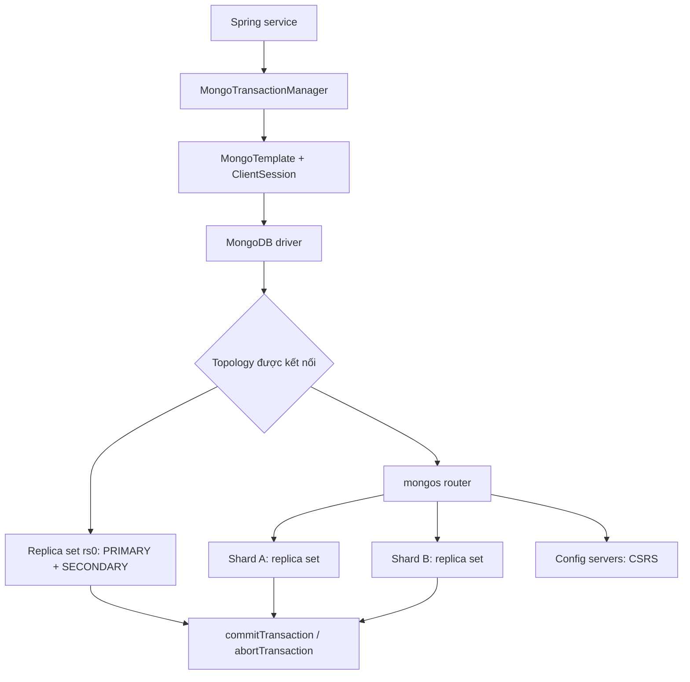
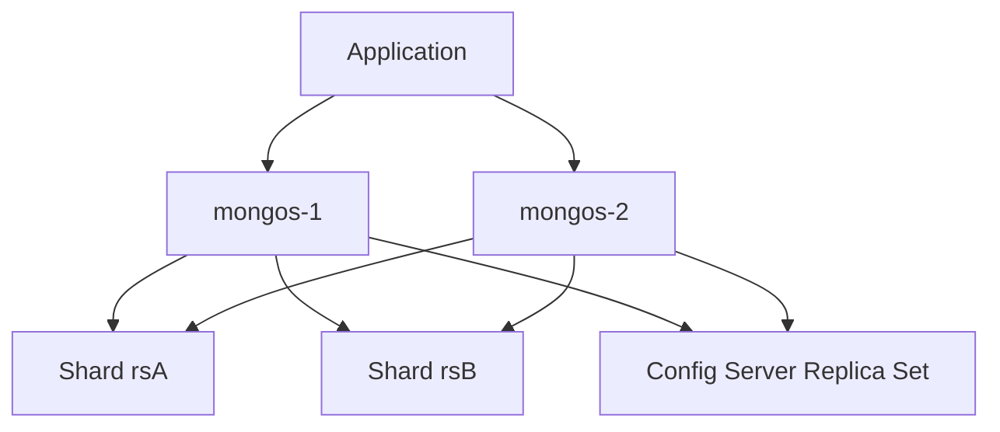

# Điều kiện replica set hoặc sharded cluster cho transaction

## 1. Vấn đề thực tế: `@Transactional` không biến MongoDB standalone thành transaction server

Một ứng dụng ví điện tử dùng **Spring Data MongoDB** lưu số dư và lịch sử chuyển tiền trong hai collection. Chuyển 50.000 đơn vị nhỏ nhất từ ví A sang ví B cần ba thao tác:

1. Trừ tiền ví A nếu còn đủ số dư.
2. Cộng đúng số tiền đó vào ví B.
3. Ghi bản ghi chuyển tiền với mã giao dịch duy nhất.

Nếu trừ ví A thành công nhưng lệnh cộng ví B thất bại, hệ thống xuất hiện trạng thái không nhất quán. Người phát triển thêm `@Transactional` vào service với mong muốn cả ba thao tác **commit hoặc rollback cùng nhau**.

Tuy nhiên, trong MongoDB, **multi-document transaction chỉ hoạt động trên deployment hỗ trợ transaction**. Một tiến trình `mongod` chạy ở **standalone mode** không hỗ trợ kiểu giao dịch này, dù Spring Boot đã tạo bean `MongoTransactionManager` và code Java biên dịch thành công.

Điều kiện cốt lõi:

- **Replica set**: MongoDB hỗ trợ multi-document transaction từ phiên bản **4.0**.
- **Sharded cluster**: MongoDB hỗ trợ distributed/multi-shard transaction từ phiên bản **4.2**; topology phải được thiết lập đầy đủ và ứng dụng thường kết nối qua **`mongos`**.
- **Standalone `mongod`**: không hỗ trợ multi-document transaction; nếu cần kiểm thử giao dịch trên một máy, hãy dùng **single-node replica set**, không chỉ một standalone server.

Bài thuộc chương **Session và giao dịch** của module **SPRING_DATA_MONGODB**. Chúng ta sẽ kiểm tra topology, kết nối, cấu hình `MongoTransactionManager`/`ReactiveMongoTransactionManager`, thực hành `MongoTemplate`/repository, xem xét read/write concern, retry, hiệu năng, index và kiểm thử tích hợp.

**Phạm vi:** bài giải thích **điều kiện hạ tầng** và cách kiểm chứng transaction hoạt động. Nó không biến mọi thao tác đơn document thành giao dịch đa document; những cập nhật nguyên tử trên một document vốn đã có bảo đảm riêng của MongoDB.

## 2. Phân biệt atomic update, session và multi-document transaction

Ba khái niệm dễ bị trộn lẫn:

| Cơ chế | Phạm vi | Yêu cầu topology | Ví dụ |
| --- | --- | --- | --- |
| **Atomic write một document** | Một document cho mỗi thao tác ghi | Hoạt động cả standalone | `updateOne` với `$inc` và filter điều kiện |
| **Client session** | Ngữ cảnh logic cho chuỗi thao tác; causal consistency/retryable writes khi hỗ trợ | Phụ thuộc khả năng logical session của deployment | `MongoClient.startSession()` |
| **Multi-document transaction** | Nhiều thao tác có commit/abort chung | Replica set hoặc sharded cluster được hỗ trợ | Trừ ví A, cộng ví B, ghi ledger |

MongoDB bảo đảm atomicity **ở cấp document** cho một thao tác ghi thông thường. Nếu business chỉ cần:

```javascript
db.inventory.updateOne(
  { _id: "sku-1", available: { $gte: 3 } },
  {
    $inc: {
      available: -3,
      reserved: 3
    }
  }
);
```

thì cập nhật hai field `available` và `reserved` trong **cùng một document** là nguyên tử. Đừng mở transaction chỉ để làm việc mà một conditional update đã giải quyết đúng.

Ngược lại, nếu cần thay đổi hai ví **ở hai document khác nhau**, hoặc ghi thêm một ledger document, một lần `updateOne` không bao trùm cả workflow. Khi đó multi-document transaction có thể phù hợp.

### 2.1. Session chưa chắc là transaction

Việc tạo `ClientSession` hoặc Spring Data `ClientSession` không tự mang lại rollback cho mọi thao tác. Transaction cần được **bắt đầu**, các operation phải **tham gia cùng session/transaction context**, sau đó **commit/abort** theo đúng API.

Trong Spring Data imperative, `MongoTransactionManager` thường gắn một session vào context của transaction để `MongoTemplate` dùng đúng session. Trong reactive, session gắn qua **Reactor context**, không phải thread-local theo cách imperative.

## 3. Ma trận hỗ trợ topology và phiên bản

| MongoDB deployment | Multi-document transaction | Điều kiện chính |
| --- | --- | --- |
| Standalone `mongod` | **Không** | Không có replica set transaction topology |
| Single-node replica set | **Có** | `mongod` chạy `--replSet`, đã `rs.initiate()`, có PRIMARY |
| Replica set nhiều node | **Có** | Cấu hình replica set hợp lệ, PRIMARY sẵn sàng, server đủ phiên bản |
| Sharded cluster | **Có** | `mongos`, config server replica set, các shard replica set phù hợp, phiên bản/FCV tương thích |
| Sharded cluster với từng shard là standalone `mongod` | **Không phải kiến trúc transaction phù hợp** | Phải dùng topology được MongoDB hỗ trợ, không dựa vào từng standalone shard |
| Chỉ cấu hình `@Transactional` trong Spring | **Không tự quyết định** | Server vẫn phải hỗ trợ và Spring phải quản lý transaction/session đúng |

Mốc phiên bản lịch sử:

- MongoDB **4.0** đưa multi-document transaction vào **replica set**.
- MongoDB **4.2** mở rộng transaction sang **sharded cluster**.
- Các phiên bản về sau có thêm khả năng và giới hạn riêng; không giả định mọi operation trong transaction đều có cùng hỗ trợ trên mọi phiên bản.

**Phiên bản binary không phải tiêu chí duy nhất.** Với cluster nâng cấp nhiều node, cần kiểm tra **featureCompatibilityVersion (FCV)** và trạng thái triển khai. Không nên tự bật transaction trên cluster đang nâng cấp dở hoặc có node/router không tương thích.

### 3.1. Một replica set một node đủ để kiểm thử nhưng không có high availability

Single-node replica set cung cấp cơ chế transaction cần thiết cho bài học và integration test. Nhưng nếu node duy nhất dừng, không còn thành viên khác để bầu PRIMARY. Nó **không thay thế** một replica set production có thiết kế bầu chọn, dự phòng và sao lưu phù hợp.

Đừng kết luận “đã chạy được transaction trên máy dev” nghĩa là hệ thống chịu được failover ở production.

## 4. Kiến trúc: replica set và sharded cluster



Trong **replica set**, một member PRIMARY nhận writes và điều phối transaction của dữ liệu trên replica set. Secondary có vai trò nhân bản; read/write concern ảnh hưởng bảo đảm đọc/ghi, nhưng không biến secondary thành primary cho những writes trong transaction.

Trong **sharded cluster**, client kết nối qua **`mongos`** để định tuyến đến các shard liên quan. Khi một transaction tác động nhiều shard, cluster phải điều phối commit giữa những thành phần tham gia. Chi phí của distributed transaction có thể cao hơn transaction chỉ chạm một shard.

### 4.1. “Hai database” và “hai collection” không phải hai transaction độc lập

Một transaction có thể thao tác nhiều collection/document theo giới hạn server và phiên bản. Số lượng repository Java không phải phạm vi transaction: hai repository dùng **cùng MongoDatabaseFactory/session context** có thể tham gia cùng transaction; hai thao tác dùng kết nối/session độc lập thì không tự chung transaction.

Ngược lại, việc cùng dùng một bean `MongoTemplate` cũng **chưa đủ** nếu service không ở trong active transaction và không có transaction manager tương ứng.

## 5. Kiểm tra MongoDB hiện tại là standalone, replica set hay `mongos`

Đừng phỏng đoán topology từ tên host, Docker Compose hay connection string cũ.

### 5.1. Dùng `hello`

Trong `mongosh`:

```javascript
db.adminCommand({ hello: 1 });
```

Những dấu hiệu thường gặp:

| Dấu hiệu trong kết quả | Diễn giải |
| --- | --- |
| `setName: "rs0"` | Node thuộc replica set |
| `isWritablePrimary: true` | Đang là PRIMARY của replica set |
| `hosts` hoặc `passives` | Danh sách thành viên replica set theo cấu hình |
| `msg: "isdbgrid"` | Đang nói chuyện với `mongos` router |
| Không có `setName`, không có `msg:"isdbgrid"` | Có thể là standalone; cần đối chiếu server/config |

Không dựa chỉ vào `isWritablePrimary:true` để khẳng định transaction được hỗ trợ: một standalone cũng có thể nhận write.

### 5.2. Kiểm tra replica set

Khi kết nối trực tiếp vào member replica set bằng account có quyền phù hợp:

```javascript
rs.status();
rs.conf();
```

Cần nhìn thấy tên replica set, member khỏe mạnh và một PRIMARY. Nếu replica set **chưa khởi tạo**, `--replSet` đã được bật nhưng `rs.initiate()` chưa chạy thì transaction vẫn chưa sẵn sàng.

`rs.status()` **không phải** cách chẩn đoán trực tiếp một `mongos`: router có cấu trúc riêng; kiểm tra `sh.status()` hoặc các lệnh cluster thích hợp với quyền phù hợp.

### 5.3. Kiểm tra FCV và phiên bản

Ví dụ trên môi trường được phép quản trị:

```javascript
db.version();

db.adminCommand({
  getParameter: 1,
  featureCompatibilityVersion: 1
});
```

Nếu command bị từ chối do thiếu quyền, yêu cầu DBA cung cấp thông tin hoặc chạy trong môi trường test; không xin cấp tài khoản admin cho ứng dụng bình thường chỉ để đọc FCV.

**Không** chọn các option transaction mới dựa trên version Spring Data đơn thuần. MongoDB Server, driver, router, FCV và topology cùng quyết định phần hỗ trợ thực tế.

## 6. Tạo single-node replica set cho máy phát triển

Đây là cách thử transaction trên một MongoDB duy nhất mà không phải triển khai ba node.

### 6.1. Khởi chạy `mongod` ở chế độ replica set

Ví dụ Docker để học/test:

```bash
docker run --name mongo-rs-dev \
  -p 27017:27017 \
  -v mongo-rs-dev-data:/data/db \
  -d mongo:7.0 \
  --replSet rs0 --bind_ip_all
```

Lệnh trên chỉ là ví dụ cho môi trường phát triển. Nếu máy đã có MongoDB dùng cổng 27017, cần đổi cổng hoặc dừng dịch vụ thử nghiệm tương ứng; không chạy đè database production. Kiểm tra policy bảo mật và cấu hình authentication/network trước khi cho truy cập ngoài localhost.

Khởi tạo replica set khi server đã sẵn sàng:

```bash
docker exec -it mongo-rs-dev mongosh
```

Sau đó trong `mongosh`:

```javascript
rs.initiate({
  _id: "rs0",
  members: [
    { _id: 0, host: "localhost:27017" }
  ]
});

rs.status();
db.adminCommand({ hello: 1 });
```

Đợi member trở thành **PRIMARY** trước khi chạy integration test transaction. `rs.initiate()` không phải lệnh cần gọi mỗi khi ứng dụng startup; chỉ khởi tạo replica set **một lần** cho tập dữ liệu đó.

### 6.2. Vấn đề hostname do Docker network

Ví dụ `host:"localhost:27017"` phù hợp khi **driver chạy trên host** và MongoDB được publish ở localhost. Nhưng một container ứng dụng khác truy cập MongoDB qua Docker network **không** tự hiểu `localhost` là container MongoDB.

MongoDB driver có thể khám phá danh sách `hosts` từ replica set config. Vì vậy:

- Những hostname trong `rs.conf()` phải phân giải được từ **nơi ứng dụng thực sự chạy**.
- Kết nối qua `mongodb://mongo-rs-dev:27017` nhưng replica set quảng bá `localhost:27017` có thể làm driver cố kết nối vào localhost của container ứng dụng.
- Thiết kế hostname/port thống nhất giữa host, container, CI và replica set members.
- Tùy bài test có thể cần `directConnection=true` để kết nối một endpoint đơn lẻ; đó là tùy chọn discovery topology, **không thay thế** `rs.initiate()` và không phải cấu hình chuẩn cho mọi hệ thống HA.

Với authentication, replica set còn cần keyfile hoặc cấu hình bảo mật nội bộ thích hợp. Đừng copy nguyên ví dụ không bật auth lên một server mở mạng production.

### 6.3. Dùng Testcontainers thường ít lỗi cấu hình hơn

Với CI, một MongoDB Testcontainers có hỗ trợ **replica set mode** thường là cách tốt để có transaction mà không phải tự quản lý `rs.initiate()` trong mỗi test. Chọn API và image phù hợp phiên bản Testcontainers đang dùng, dùng connection URI do container cung cấp.

**Tránh** dùng embedded MongoDB standalone hoặc test instance không khởi tạo replica set rồi khẳng định test `@Transactional` đã chứng minh rollback.

## 7. Replica set production: PRIMARY, bầu chọn và write concern

Replica set nhiều thành viên là topology thường dùng để có HA, chứ không chỉ để bật transactions.

Một kịch bản minh họa:

```text
rs-payments
  payment-db-1:27017  PRIMARY
  payment-db-2:27017  SECONDARY
  payment-db-3:27017  SECONDARY
```

Khi PRIMARY lỗi:

1. Replica set cần bầu PRIMARY mới.
2. Những transaction đang chạy có thể bị ngắt hoặc nhận transient error.
3. Client/driver thực hiện server selection theo topology.
4. Ứng dụng phải xử lý retry an toàn và idempotency nếu thao tác đã/không đã commit không rõ.

Không mặc định transaction sẽ tự động được tiếp tục trên PRIMARY mới **từ đúng lệnh dang dở**. Phải dựa trên error labels và cơ chế retry/commit cụ thể của driver/framework, cùng logic đối soát nghiệp vụ.

### 7.1. Primary write preference và read concern

Trong transaction có writes, route theo PRIMARY là cách cấu hình phù hợp; không ép transaction đọc/ghi qua secondary read preference tùy tiện. Read concern và write concern lại giải quyết hai vấn đề khác:

- **`readConcern: "snapshot"`**: xác định góc nhìn dữ liệu cho transaction khi được hỗ trợ.
- **`writeConcern: "majority"` tại commit**: yêu cầu mức xác nhận ghi theo đa số phù hợp với topology.
- **`readPreference: primary`**: chọn nguồn phục vụ lệnh, cần phù hợp semantics transaction.

Dùng `readConcern:"snapshot"` **không** có nghĩa mọi request HTTP sau đó vẫn nhìn cùng snapshot. Snapshot gắn với transaction/session tương ứng.

## 8. Sharded cluster: transaction đi qua `mongos`

Một sharded cluster được thiết kế đúng cho distributed transaction thường có:

- **`mongos`**: router ứng dụng kết nối tới.
- **Config Server Replica Set (CSRS)**: lưu metadata phân mảnh.
- **Shards**: những replica set chứa dữ liệu phân mảnh.
- MongoDB Server/FCV hỗ trợ distributed transaction.

Ví dụ kiến trúc:



**Không kết nối trực tiếp vào một shard replica set** nếu mục tiêu là transaction cần truy cập dữ liệu trên **nhiều shard**. Direct connection vào shard không đóng vai trò router phân mảnh của toàn cluster và có thể bypass luồng ứng dụng mong muốn.

### 8.1. Vì sao distributed transaction phức tạp hơn?

Ví dụ ví A nằm ở shard 1, ví B ở shard 2, ledger cũng ở shard 2 hoặc shard khác. Commit transaction phải phối hợp các shard tham gia. Phát sinh thêm network round trips, xử lý lỗi và tài nguyên giữ trạng thái giao dịch.

Những yếu tố cần thiết kế:

- **Shard key** để định tuyến query đúng shard.
- Phân bố dữ liệu sao cho giao dịch thường chỉ chạm ít shard nhất có thể.
- Index cho `tenant_id`/ID và các điều kiện business.
- Thời gian giao dịch ngắn, ít thao tác không cần thiết.
- Kiểm soát shard migration/chunk movement và các giới hạn DDL/version tương ứng.
- Theo dõi lỗi transaction trong thời gian bầu chọn hoặc thay đổi topology.

Không mặc định một giao dịch cùng API Spring Data có **chi phí như nhau** trên replica set đơn và trên nhiều shard.

### 8.2. Phiên bản, FCV và thao tác được phép

Distributed transaction có mặt từ MongoDB 4.2, nhưng các quy tắc về tạo collection/index, đổi metadata, shard key và những stage đặc biệt đã thay đổi giữa các phiên bản.

Một quy tắc vận hành an toàn:

- Tạo **collection và index trước transaction nghiệp vụ** khi có thể.
- Tránh phụ thuộc vào việc tự động tạo collection trong lần ghi đầu tiên của transaction, nhất là ở sharded cluster.
- Không thực hiện `createIndex`/`collMod` hay thay đổi sharding layout như một phần của chuyển tiền thường ngày.
- Đối chiếu danh sách **Operations Restricted in Transactions** của MongoDB Server version thực tế.

Ví dụ `template.insert(new WalletTransfer(...))` nên ghi vào collection ledger **đã được provision** trước khi service nhận traffic.

## 9. Connection URI: nhận diện replica set và router

### 9.1. Replica set

```properties
spring.data.mongodb.uri=mongodb://db1:27017,db2:27017,db3:27017/walletdb?replicaSet=rs-wallet
```

Lưu ý:

- Tên `rs-wallet` phải đúng `setName` do `hello` trả về.
- Seed hosts phải có thể truy cập và có hostname phù hợp với topology quảng bá.
- Authentication, TLS và credential nên được cấu hình theo secret management, không hard-code vào tài liệu/source.
- Driver khám phá PRIMARY qua topology; không cần tự chọn host PRIMARY tĩnh.

Một URI có `replicaSet=rs-wallet` **không thể biến standalone server thành replica set**. Nếu server thực tế không có cấu hình tương ứng, driver có thể không chọn được server hoặc báo mismatch topology.

### 9.2. Sharded cluster

```properties
spring.data.mongodb.uri=mongodb://mongos1:27017,mongos2:27017/walletdb
```

Trong cluster dùng SRV discovery/managed MongoDB, sử dụng URI do nhà cung cấp cung cấp với TLS/auth và các option cần thiết. Không gắn tên `replicaSet` của một shard riêng vào connection string dành cho `mongos`.

### 9.3. Single-node replica set dev

```properties
spring.data.mongodb.uri=mongodb://localhost:27017/walletdb?replicaSet=rs0
```

URI chỉ hoạt động nếu replica set tên `rs0` đã được khởi tạo và endpoint/advertised host thực sự truy cập được. Trong môi trường Docker có hai network khác nhau, cần điều chỉnh hostname như mục 6.

**Lỗi kết nối không nên được “chữa” bằng cách xóa `replicaSet` khỏi URI** rồi bỏ qua transaction test. Khi đó có thể bạn chỉ đang nói chuyện với topology không như mong muốn.

## 10. Cài transaction manager trong Spring Data MongoDB

Spring Data MongoDB imperative cần một bean **`MongoTransactionManager`** khi muốn `@Transactional` điều phối MongoDB transactions một cách tường minh.

```java
import org.springframework.context.annotation.Bean;
import org.springframework.context.annotation.Configuration;
import org.springframework.data.mongodb.MongoDatabaseFactory;
import org.springframework.data.mongodb.MongoTransactionManager;
import org.springframework.transaction.annotation.EnableTransactionManagement;

@Configuration
@EnableTransactionManagement
public class MongoTransactionConfiguration {

    @Bean("mongoTransactionManager")
    public MongoTransactionManager mongoTransactionManager(
        MongoDatabaseFactory factory
    ) {
        return new MongoTransactionManager(factory);
    }
}
```

Bean này dùng `MongoDatabaseFactory` để mở và quản lý `ClientSession`, rồi điều phối begin/commit/abort cho transaction trong phạm vi Spring.

### 10.1. Đừng hiểu `@Transactional` là lệnh bắt buộc server hỗ trợ

`@Transactional` là khai báo ở phía Spring. Nếu application kết nối vào standalone `mongod`, một thao tác transaction thật có thể lỗi khi server nhận command. Bean transaction manager vẫn có thể được tạo khi startup mà không chứng minh topology đáp ứng yêu cầu.

Một **integration test rollback thật** hoặc một bước kiểm tra topology có chủ đích mới là bằng chứng hữu ích.

### 10.2. Có nhiều transaction manager trong ứng dụng

Một ứng dụng có JPA và MongoDB có thể có nhiều bean transaction manager. Chỉ ghi `@Transactional` mà không chỉ định manager có thể dẫn đến việc chọn nhầm hoặc ambiguity tùy cấu hình Spring.

Với service MongoDB:

```java
@Transactional(
    transactionManager = "mongoTransactionManager"
)
public void transfer(...) {
    // ...
}
```

Đây là ví dụ chữ ký; implementation đầy đủ ở mục 12.

### 10.3. Cùng factory/session mới tham gia cùng transaction

Những thao tác `MongoTemplate` và repository dùng cùng `MongoDatabaseFactory` với manager, được gọi đúng trong transaction context, thường tham gia transaction do Spring quản lý.

Các trường hợp **có thể không tham gia**:

- Tạo `MongoClient` thứ hai và gọi raw driver không gắn cùng session.
- Dùng `MongoTemplate` được cấu hình từ database factory khác mà không phối hợp transaction.
- Chạy công việc trên thread khác bên ngoài context imperative.
- Gọi một service `@Transactional` bằng **self-invocation** trong chính instance đó, bỏ qua Spring proxy.
- Khởi tạo service bằng `new` thay vì lấy bean do Spring quản lý.

Không truyền `ClientSession` bừa bãi vào các lệnh khi đã dùng `MongoTransactionManager`; tránh trộn manual session lifecycle với Spring-managed transaction mà không hiểu rõ thứ tự commit/abort.

## 11. Cấu hình `readConcern`, `writeConcern` và transaction options

Khi nghiệp vụ cần xác định rõ chính sách consistency, có thể cấu hình driver `TransactionOptions` cho manager.

```java
import com.mongodb.ReadConcern;
import com.mongodb.ReadPreference;
import com.mongodb.TransactionOptions;
import com.mongodb.WriteConcern;

import org.springframework.context.annotation.Bean;
import org.springframework.context.annotation.Configuration;
import org.springframework.data.mongodb.MongoDatabaseFactory;
import org.springframework.data.mongodb.MongoTransactionManager;

@Configuration
public class StrictMongoTransactionConfiguration {

    @Bean("mongoTransactionManager")
    public MongoTransactionManager mongoTransactionManager(
        MongoDatabaseFactory factory
    ) {
        TransactionOptions options = TransactionOptions
            .builder()
            .readConcern(ReadConcern.SNAPSHOT)
            .writeConcern(WriteConcern.MAJORITY)
            .readPreference(ReadPreference.primary())
            .build();

        return new MongoTransactionManager(
            factory,
            options
        );
    }
}
```

Chỉ dùng **một** trong hai cấu hình bean cùng tên ở mục 10 và mục này, không đưa cả hai class vào context rồi tạo bean trùng.

Ý nghĩa:

- `ReadConcern.SNAPSHOT`: chọn snapshot read semantics phù hợp cho transaction.
- `WriteConcern.MAJORITY`: commit cần acknowledgement ở mức majority.
- `ReadPreference.primary()`: tránh dùng secondary read preference trong transaction.

Các option không thay thế validation, unique indexes hoặc idempotency. Nếu transaction thực hiện thay đổi bên ngoài MongoDB như HTTP hoặc gửi email, `commitTransaction` không thể rollback side effect đó.

### 11.1. Hiểu giới hạn của read concern trên sharded cluster

Trên sharded cluster, mức `snapshot` được sử dụng khi cần góc nhìn đồng bộ qua các shard tham gia, trong khi những mức khác có semantics riêng và có thể chỉ nhất quán trong phạm vi shard/từng read.

Với những yêu cầu nghiêm ngặt về **majority-committed snapshot**, cần phối hợp readConcern và writeConcern đúng cách theo phiên bản; MongoDB nêu các điều kiện cụ thể khi transaction commit với majority. Không chỉ nhìn thấy chuỗi `"snapshot"` rồi khẳng định mọi client luôn thấy trạng thái vĩnh viễn, hoặc mọi lần đọc ngoài transaction đều có cùng snapshot.

## 12. Ví dụ đầy đủ: chuyển số dư giữa hai document và ghi ledger

Bài dùng đơn vị tiền nhỏ nhất kiểu `long` để minh họa chính xác số học nguyên. Ứng dụng nhiều currency hoặc tiền có fractional precision cần schema/currency policy riêng.

### 12.1. Entity ví

```java
import org.springframework.data.mongodb.core.mapping.Document;
import org.springframework.data.mongodb.core.mapping.Field;
import org.springframework.data.mongodb.core.mapping.FieldType;
import org.springframework.data.mongodb.core.mapping.MongoId;

@Document(collection = "wallet_accounts")
public record WalletAccount(
    @MongoId(FieldType.STRING)
    String id,

    @Field("tenant_id")
    String tenantId,

    @Field("balance_cents")
    long balanceCents
) {}
```

### 12.2. Entity ledger

```java
import java.time.Instant;

import org.springframework.data.mongodb.core.mapping.Document;
import org.springframework.data.mongodb.core.mapping.Field;
import org.springframework.data.mongodb.core.mapping.FieldType;
import org.springframework.data.mongodb.core.mapping.MongoId;

@Document(collection = "wallet_transfers")
public record WalletTransfer(
    @MongoId(FieldType.STRING)
    String id,

    @Field("tenant_id")
    String tenantId,

    @Field("from_wallet_id")
    String fromWalletId,

    @Field("to_wallet_id")
    String toWalletId,

    @Field("amount_cents")
    long amountCents,

    Instant createdAt
) {}
```

`WalletTransfer.id` chính là business `transferId`, phải được sinh ổn định và duy nhất theo chính sách idempotency. MongoDB tự có unique index cho `_id` của collection; không được coi việc query trước khi insert là bảo vệ concurrency đủ mạnh.

### 12.3. Service điều phối transaction

```java
import java.time.Instant;

import com.mongodb.client.result.UpdateResult;
import org.springframework.data.mongodb.core.MongoTemplate;
import org.springframework.data.mongodb.core.query.Criteria;
import org.springframework.data.mongodb.core.query.Query;
import org.springframework.data.mongodb.core.query.Update;
import org.springframework.stereotype.Service;
import org.springframework.transaction.annotation.Transactional;

@Service
public class WalletTransferService {

    private final MongoTemplate template;

    public WalletTransferService(MongoTemplate template) {
        this.template = template;
    }

    @Transactional(
        transactionManager = "mongoTransactionManager"
    )
    public void transfer(
        String trustedTenantId,
        String fromId,
        String toId,
        long amountCents,
        String transferId
    ) {
        if (trustedTenantId == null
                || trustedTenantId.isBlank()
                || fromId == null || fromId.isBlank()
                || toId == null || toId.isBlank()
                || fromId.equals(toId)
                || transferId == null || transferId.isBlank()
                || amountCents <= 0) {
            throw new IllegalArgumentException(
                "Tham số chuyển tiền không hợp lệ"
            );
        }

        // Chỉ là kiểm tra sớm, KHÔNG thay thế unique _id.
        if (template.exists(
            Query.query(
                Criteria.where("id").is(transferId)
            ),
            WalletTransfer.class
        )) {
            throw new IllegalStateException(
                "Transfer ID đã tồn tại: cần đối soát"
            );
        }

        Query debitFilter = Query.query(
            Criteria.where("id").is(fromId)
                .and("tenantId").is(trustedTenantId)
                .and("balanceCents").gte(amountCents)
        );

        UpdateResult debit = template.updateFirst(
            debitFilter,
            new Update().inc("balanceCents", -amountCents),
            WalletAccount.class
        );

        if (debit.getMatchedCount() != 1L) {
            throw new IllegalStateException(
                "Ví nguồn không tồn tại hoặc không đủ số dư"
            );
        }

        Query creditFilter = Query.query(
            Criteria.where("id").is(toId)
                .and("tenantId").is(trustedTenantId)
        );

        UpdateResult credit = template.updateFirst(
            creditFilter,
            new Update().inc("balanceCents", amountCents),
            WalletAccount.class
        );

        if (credit.getMatchedCount() != 1L) {
            throw new IllegalStateException(
                "Ví đích không tồn tại trong tenant"
            );
        }

        template.insert(new WalletTransfer(
            transferId,
            trustedTenantId,
            fromId,
            toId,
            amountCents,
            Instant.now()
        ));
    }
}
```

**Điểm quyết định:** cả ba thao tác `updateFirst + updateFirst + insert` phải được gọi trong **cùng Spring-managed transaction**, trên MongoDB topology hỗ trợ và với cùng factory/session. Khi một bước ném unchecked exception, transaction manager sẽ abort thay vì để phần trừ tiền ví nguồn tồn tại riêng lẻ.

Ví dụ không tự phát HTTP response; cần controller/service ngoại vi diễn giải exception an toàn, không tiết lộ dữ liệu ví của tenant khác.

### 12.4. Tại sao check số dư vẫn đặt trong query?

Bên trong transaction, filter:

```java
Criteria.where("balanceCents").gte(amountCents)
```

giữ điều kiện nghiệp vụ **tại thời điểm server thực hiện update**. Đừng chỉ đọc số dư ở Java trước khi trừ; với concurrent transactions, vẫn cần xử lý write conflicts/transient transaction errors, còn precondition trong atomic update làm nghiệp vụ rõ ràng.

### 12.5. Vì sao unique ledger vẫn cần thiết?

Hai request có cùng `transferId` có thể đồng thời vượt qua `exists(...)`. Unique `_id` tại `wallet_transfers` là ràng buộc cuối; một transaction có thể abort do duplicate key hoặc write conflict. Caller cần **đối soát giao dịch đã ghi**, không retry bằng transferId mới nếu đó là cùng yêu cầu nghiệp vụ.

Không coi `exists` rồi `insert` là “exactly once” nếu không có unique constraint và cơ chế xử lý retry.

## 13. Kết quả kỳ vọng: commit và rollback

Giả sử dữ liệu ban đầu:

```javascript
db.wallet_accounts.insertMany([
  {
    _id: "wallet-A",
    tenant_id: "tenant-A",
    balance_cents: NumberLong("200000")
  },
  {
    _id: "wallet-B",
    tenant_id: "tenant-A",
    balance_cents: NumberLong("10000")
  }
]);
```

Chạy:

```java
walletTransferService.transfer(
    "tenant-A",
    "wallet-A",
    "wallet-B",
    50000L,
    "transfer-001"
);
```

Khi **commit thành công**:

| Document | Trước | Sau |
| --- | ---: | ---: |
| `wallet-A.balance_cents` | 200000 | 150000 |
| `wallet-B.balance_cents` | 10000 | 60000 |
| `wallet_transfers["transfer-001"]` | Chưa có | Có một ledger document |

Nếu ví B bị thiếu hoặc khác tenant, `credit.getMatchedCount()==0` dẫn tới exception và **rollback việc trừ ví A**, nếu transaction thật sự được tạo/chạy trên topology phù hợp.

Nếu chạy cùng code qua standalone MongoDB với transaction manager, kỳ vọng **giao dịch báo lỗi**, không phải hệ thống tự âm thầm chuyển sang ba write độc lập.

### 13.1. Không gộp rollback database với external side effects

Nếu service gửi email “đã chuyển tiền” **trước khi commit**, rồi transaction rollback, email đã gửi không được thu hồi. Dùng outbox pattern hoặc cơ chế thông báo sau commit có xử lý mất kết nối/retry, không giả định `@Transactional` bao trùm broker/HTTP.

## 14. Khi nào transaction thực sự được mở trong Spring?

Spring dùng AOP/proxy trong cấu hình transaction thông dụng.

```java
@Service
public class WalletApiFacade {

    private final WalletTransferService transfers;

    public WalletApiFacade(WalletTransferService transfers) {
        this.transfers = transfers;
    }

    public void execute() {
        // Gọi qua Spring bean/proxy.
        transfers.transfer(
            "tenant-A",
            "wallet-A",
            "wallet-B",
            50000L,
            "transfer-001"
        );
    }
}
```

Các trường hợp cần tránh:

- **Self-invocation**: `this.transfer(...)` trong cùng class thường không đi qua Spring proxy.
- Method không được gọi từ bean do Spring quản lý.
- Method chạy từ thread khác ngoài transaction context imperative.
- Exception bị catch và nuốt khiến method trả bình thường, transaction có thể commit.
- Chỉ bật `@Transactional(readOnly=true)` rồi mong có write/commit nghiệp vụ.
- Chọn nhầm JPA transaction manager khi có nhiều persistence stacks.

### 14.1. Transaction không phải “session cho mọi query của ứng dụng”

Khi method kết thúc, manager commit/abort và đóng session theo lifecycle. Một request HTTP tiếp theo không tự kế thừa transaction trước. Không lưu `ClientSession` trong singleton field rồi dùng chung giữa các request/threads; session lifecycle và thread safety phải được tôn trọng.

## 15. Tự quản lý `ClientSession` khi không dùng Spring manager

Trong một số tác vụ hạ tầng hoặc khi dùng MongoDB Java Driver thuần, developer có thể quản lý session thủ công. Ví dụ `mongosh` để thấy rõ begin/commit/abort:

```javascript
const session = db.getMongo().startSession();
const txDb = session.getDatabase(db.getName());

try {
  session.startTransaction({
    readConcern: { level: "snapshot" },
    writeConcern: { w: "majority" }
  });

  const debit = txDb.wallet_accounts.updateOne(
    {
      _id: "wallet-A",
      tenant_id: "tenant-A",
      balance_cents: { $gte: NumberLong("50000") }
    },
    { $inc: { balance_cents: NumberLong("-50000") } }
  );

  if (debit.matchedCount !== 1) {
    throw new Error("Nguồn không có đủ số dư");
  }

  const credit = txDb.wallet_accounts.updateOne(
    { _id: "wallet-B", tenant_id: "tenant-A" },
    { $inc: { balance_cents: NumberLong("50000") } }
  );

  if (credit.matchedCount !== 1) {
    throw new Error("Ví đích không tồn tại");
  }

  txDb.wallet_transfers.insertOne({
    _id: "transfer-001",
    tenant_id: "tenant-A",
    from_wallet_id: "wallet-A",
    to_wallet_id: "wallet-B",
    amount_cents: NumberLong("50000")
  });

  session.commitTransaction();
} catch (error) {
  try {
    session.abortTransaction();
  } catch (_) {
    // Ví dụ minh họa: không che lỗi gốc.
  }
  throw error;
} finally {
  session.endSession();
}
```

Đây là ví dụ **minh họa quy trình transaction**, không phải một API exactly-once hoàn chỉnh. Nếu commit response bị mất, catch có thể gặp tình huống **UNKNOWN COMMIT RESULT**: không được suy rằng lệnh abort sau đó chắc chắn đảo ngược commit đã xảy ra.

**Không trộn** phương pháp manual session này vào một method đã dùng `MongoTransactionManager` rồi tự gọi `commitTransaction()`, trừ khi bạn thật sự đang thiết kế một framework riêng và đã xác minh việc cùng session.

## 16. Lỗi transaction thường gặp khi chạy trên standalone

Một lỗi điển hình của MongoDB khi ứng dụng gửi transaction command tới standalone:

```text
Transaction numbers are only allowed on a replica set member or mongos
```

Thông báo và error code cụ thể phụ thuộc MongoDB/driver version, nhưng nguyên nhân thường là **server không thuộc topology hỗ trợ transaction**.

Quy trình chẩn đoán:

1. Chạy `db.adminCommand({hello:1})` trên **endpoint URI mà ứng dụng thực sự dùng**.
2. Xác minh có `setName` của replica set hoặc `msg:"isdbgrid"` của `mongos`.
3. Nếu là replica set, xác minh đã `rs.initiate()` và có PRIMARY.
4. Kiểm tra URI có đúng `replicaSet` và host/port reachable từ JVM không.
5. Kiểm tra dependency MongoDB Driver, Spring Data MongoDB và phiên bản server.
6. Với sharded cluster, xác minh đang kết nối qua `mongos` và cấu hình các shard phù hợp.
7. Chạy một **integration test transaction nhỏ** để chứng minh rollback thay vì chỉ test connection ping.

**Không sửa lỗi bằng cách tắt `@Transactional`** nếu nghiệp vụ thực sự cần all-or-nothing nhiều document.

### 16.1. Lỗi “not primary” / server selection

Nếu replica set chưa bầu PRIMARY, election đang diễn ra hoặc advertised hostname không truy cập được, driver có thể timeout server selection. Đây khác với server standalone từ chối transaction.

Một retry không kiểm soát có thể tạo bão request khi cluster đang failover. Dùng timeout hợp lý, backoff và cơ chế readiness monitoring.

## 17. Error labels và retry: transaction không bảo đảm không có kết quả mơ hồ

MongoDB Driver có những error labels liên quan transaction, tiêu biểu:

- **`TransientTransactionError`**: một số lỗi cho biết transaction có thể được retry **từ đầu** với trạng thái mới.
- **`UnknownTransactionCommitResult`**: không biết rõ commit đã thành công hay chưa; xử lý commit retry/đối soát theo contract driver.

Phân biệt hai hành động:

| Tình huống | Cách xử lý định hướng |
| --- | --- |
| Lỗi trong transaction với label transient phù hợp | Abort và thử lại **toàn bộ transaction body** theo policy |
| Commit có unknown result | Retry **commit của transaction đó** theo cơ chế driver/API thích hợp, không mặc định chạy lại business effects |
| Duplicate `transferId` | Đọc/đối soát ledger; có thể request trước đã hoàn tất |
| Kiểm tra số dư thất bại | **Business rejection**, không retry vô hạn |
| Client timeout không có bằng chứng | `UNKNOWN`; đối soát trước khi gửi lại |

Spring `MongoTransactionManager` không nên được giả định sẽ tự làm trọn logic retry và idempotency cho business code. Xác minh hành vi Spring Data/driver version đang sử dụng; nếu thêm retry bằng `@Retryable`, cần đảm bảo retry bao trùm đúng transaction boundary và không trùng side effects.

### 17.1. Ví dụ outcome ambiguous

```text
1. Service gửi commitTransaction.
2. MongoDB commit thành công, ví A/B và ledger đã đổi.
3. Kết nối đứt trước khi ứng dụng nhận phản hồi.
4. API trả lỗi timeout.
5. Client gửi lại cùng transferId.
```

Nếu hệ thống tạo **transferId mới** mỗi lần retry, có thể chuyển tiền hai lần. Nếu giữ `transferId` cố định và unique, hệ thống có căn cứ để đối soát ledger và xác định `ALREADY_APPLIED` khi dữ liệu/payload tương ứng.

Version, transaction và idempotency xử lý những khía cạnh **khác nhau**. Transaction bảo đảm nhóm write cùng commit/abort; idempotency xử lý yêu cầu lặp lại và response bị mất.

## 18. Transaction có các giới hạn tài nguyên và thời gian

Transaction giữ trạng thái và tài nguyên trên MongoDB. Đừng dùng một transaction để:

- Giữ cursor mở hàng giờ cho một job export.
- Gọi API bên ngoài rồi chờ nhiều phút trong lúc vẫn giữ transaction.
- Scan hàng triệu document trước khi bắt đầu thay đổi đơn giản.
- Bulk ghi một số lượng rất lớn không có checkpoint.
- Đợi người dùng xác nhận trên UI giữa transaction.

MongoDB có tham số như **`transactionLifetimeLimitSeconds`** (giá trị mặc định thường là khoảng 60 giây trong nhiều cấu hình), cùng giới hạn bộ nhớ/cache, write conflict và thời gian chờ lock. Giá trị/semantics cần xác minh theo server version và vận hành.

Khi transaction bị abort vì giới hạn tài nguyên, không phải cứ tăng timeout là giải pháp. Cần giảm thời gian, số document/shard bị chạm và số lệnh trong transaction.

### 18.1. Phân biệt timeout

| Timeout/giới hạn | Phạm vi |
| --- | --- |
| Transaction lifetime | Thời gian transaction có thể tồn tại ở server |
| Lock acquisition timeout | Thời gian đợi lock của thao tác |
| Driver server selection/socket timeout | Client tìm server hoặc chờ I/O |
| Spring transaction timeout | Ràng buộc từ framework, phụ thuộc driver/server integration |
| HTTP/gateway timeout | Request bên ngoài MongoDB |

Cấu hình timeout ở Spring không bảo đảm server cho phép giao dịch chạy dài vô hạn. Hãy theo dõi p95/p99 và error labels để biết giới hạn thực.

### 18.2. Việc phân mảnh tăng chi phí

Một transaction trên sharded cluster có thể chạm nhiều shard. Thêm shard làm tăng coordination, khả năng conflict và độ phức tạp chẩn đoán. Nếu business cho phép, đặt các document thường giao dịch cùng nhau theo shard key/partition phù hợp để giảm fan-out, nhưng không phá phân bố tải chỉ vì một use case ít gặp.

## 19. Index và sharding key vẫn quan trọng trong transaction

Transaction không làm `$match` nhanh hơn và không tạo index tự động.

Với ví dụ `WalletAccount`:

```javascript
db.wallet_accounts.createIndex(
  { tenant_id: 1, balance_cents: 1 },
  { name: "idx_wallet_tenant_balance" }
);
```

Index này chỉ là một lựa chọn cho query theo tenant/số dư **khi không có ID**, không mặc nhiên cần cho mỗi CAS có equality theo `_id`.

Với update chứa `_id` duy nhất, index mặc định `_id` thường đủ để định vị document; server vẫn kiểm tra tenant và điều kiện số dư.

Ví dụ đọc tương đương để phân tích plan:

```javascript
db.wallet_accounts.find({
  _id: "wallet-A",
  tenant_id: "tenant-A",
  balance_cents: { $gte: NumberLong("50000") }
}).explain("executionStats");
```

Theo dõi:

| Tín hiệu | Vì sao quan trọng |
| --- | --- |
| `IXSCAN` / `COLLSCAN` | Có đang dùng index hay quét collection? |
| `totalKeysExamined` | Chi phí index scan |
| `totalDocsExamined` | Chi phí đọc document |
| `nReturned` | Filter có chọn đúng document? |
| Write conflict rate | Có nhiều transaction đồng thời ghi cùng ví không? |
| Transaction abort rate | Có rollback hoặc lỗi hạ tầng thường xuyên không? |
| Commit latency | Số shard / write concern có kéo dài commit? |

`explain` của một `find` không chứng minh toàn bộ chi phí commit/replication/lock; cần thêm metrics/profiler hoặc benchmark write transaction.

Trong sharded cluster, query có **đúng shard key** thường giúp định tuyến hiệu quả. Nếu transaction xuyên nhiều shard, thiếu điều kiện shard key có thể dẫn đến broadcast/fan-out và tăng chi phí.

## 20. Reactive transactions: topology giống nhau, session context khác nhau

Trong WebFlux, không dùng `MongoTransactionManager` imperative để quản lý Publisher reactive. Spring Data MongoDB có **`ReactiveMongoTransactionManager`**.

```java
import org.springframework.context.annotation.Bean;
import org.springframework.context.annotation.Configuration;
import org.springframework.data.mongodb.ReactiveMongoDatabaseFactory;
import org.springframework.data.mongodb.ReactiveMongoTransactionManager;

@Configuration
public class ReactiveMongoTxConfiguration {

    @Bean("reactiveMongoTransactionManager")
    public ReactiveMongoTransactionManager transactionManager(
        ReactiveMongoDatabaseFactory factory
    ) {
        return new ReactiveMongoTransactionManager(factory);
    }
}
```

Các thao tác `ReactiveMongoTemplate` bên trong transaction sử dụng reactive context do manager tạo. Nếu một thao tác tự subscribe bên ngoài chain hoặc chuyển qua imperative MongoTemplate không phối hợp session, nó có thể không tham gia cùng transaction.

### 20.1. `TransactionalOperator` trong reactive

```java
import org.springframework.data.mongodb.core.ReactiveMongoTemplate;
import org.springframework.data.mongodb.core.query.Criteria;
import org.springframework.data.mongodb.core.query.Query;
import org.springframework.data.mongodb.core.query.Update;

import org.springframework.transaction.reactive.TransactionalOperator;
import reactor.core.publisher.Mono;

public Mono<Void> transferReactive(
    ReactiveMongoTemplate template,
    TransactionalOperator tx,
    String tenantId,
    String fromId,
    String toId,
    long amount
) {
    if (amount <= 0 || fromId.equals(toId)) {
        return Mono.error(
            new IllegalArgumentException("Transfer invalid")
        );
    }

    Mono<Void> changes = template.updateFirst(
        Query.query(
            Criteria.where("id").is(fromId)
                .and("tenantId").is(tenantId)
                .and("balanceCents").gte(amount)
        ),
        new Update().inc("balanceCents", -amount),
        WalletAccount.class
    ).flatMap(debit -> {
        if (debit.getMatchedCount() != 1L) {
            return Mono.error(
                new IllegalStateException("Không đủ số dư")
            );
        }

        return template.updateFirst(
            Query.query(
                Criteria.where("id").is(toId)
                    .and("tenantId").is(tenantId)
            ),
            new Update().inc("balanceCents", amount),
            WalletAccount.class
        );
    }).flatMap(credit -> {
        if (credit.getMatchedCount() != 1L) {
            return Mono.error(
                new IllegalStateException("Ví đích không hợp lệ")
            );
        }
        return Mono.empty();
    });

    return tx.transactional(changes);
}
```

Đây là **ví dụ minh họa ranh giới transaction reactive cho hai update**, chưa có ledger/idempotency như service imperative ở mục 12. Không dùng nó nguyên xi cho chuyển tiền production nếu chưa thêm mã giao dịch, đối soát và test.

Reactive flow chỉ thực thi khi được subscribe; những thao tác tạo Publisher mà không nối vào chain có thể **không chạy**. Không gọi `block()` trong event loop. `TransactionalOperator` cần được khởi tạo từ đúng `ReactiveMongoTransactionManager`, không phải manager imperative.

**Replica set/sharded cluster requirement vẫn y hệt.** Reactive API không biến standalone thành transaction-capable topology.

## 21. Kiểm thử tích hợp: đừng chỉ mock transaction manager

Một test mock `MongoTemplate.updateFirst(...)` không chứng minh rollback trên MongoDB. Để kiểm chứng hạ tầng, cần test thực thi trên **single-node replica set** hoặc sharded cluster được hỗ trợ.

### 21.1. Các điều kiện của môi trường test

- MongoDB instance phải được khởi tạo thành replica set, có PRIMARY.
- Connection URI test phải trỏ đúng replica set/mongos.
- `MongoTransactionManager` đã được đăng ký trong Spring test context.
- Collection `wallet_accounts` và `wallet_transfers` đã có, tránh ngầm tạo collection trong transaction ở môi trường/version có hạn chế.
- Test dùng database riêng; tránh xóa collection mà test khác đang dùng.
- Dữ liệu test có số dư xác định, không bị background job khác sửa.

Có thể dùng Testcontainers MongoDB với replica set mode. Tùy version Testcontainers, các API như `getReplicaSetUrl()` và cách container khởi tạo replica set khác nhau, nên kiểm tra Javadoc dependency test thực tế.

### 21.2. Ví dụ `@DataMongoTest` kiểm chứng commit và rollback

```java
import static org.assertj.core.api.Assertions.assertThat;
import static org.assertj.core.api.Assertions.assertThatThrownBy;

import org.junit.jupiter.api.BeforeEach;
import org.junit.jupiter.api.Test;
import org.springframework.beans.factory.annotation.Autowired;
import org.springframework.boot.test.autoconfigure.data.mongo.DataMongoTest;
import org.springframework.context.annotation.Import;
import org.springframework.data.mongodb.core.MongoTemplate;

@DataMongoTest
@Import({
    MongoTransactionConfiguration.class,
    WalletTransferService.class
})
class WalletTransferTransactionIntegrationTest {

    @Autowired MongoTemplate template;
    @Autowired WalletTransferService transfers;

    @BeforeEach
    void ensureLedgerCollectionExistsBeforeTransaction() {
        if (!template.collectionExists(WalletTransfer.class)) {
            template.createCollection(WalletTransfer.class);
        }
    }

    @Test
    void commitsAllThreeWritesTogether() {
        template.insert(new WalletAccount(
            "tx-wallet-A", "tx-tenant", 200000L
        ));
        template.insert(new WalletAccount(
            "tx-wallet-B", "tx-tenant", 10000L
        ));

        transfers.transfer(
            "tx-tenant",
            "tx-wallet-A",
            "tx-wallet-B",
            50000L,
            "tx-transfer-success"
        );

        WalletAccount a = template.findById(
            "tx-wallet-A", WalletAccount.class
        );
        WalletAccount b = template.findById(
            "tx-wallet-B", WalletAccount.class
        );
        WalletTransfer ledger = template.findById(
            "tx-transfer-success", WalletTransfer.class
        );

        assertThat(a.balanceCents()).isEqualTo(150000L);
        assertThat(b.balanceCents()).isEqualTo(60000L);
        assertThat(ledger).isNotNull();
    }

    @Test
    void rollsBackDebitWhenDestinationIsMissing() {
        template.insert(new WalletAccount(
            "tx-rollback-A", "tx-tenant", 200000L
        ));

        assertThatThrownBy(() -> transfers.transfer(
            "tx-tenant",
            "tx-rollback-A",
            "tx-missing-wallet",
            50000L,
            "tx-transfer-rollback"
        )).isInstanceOf(IllegalStateException.class);

        WalletAccount after = template.findById(
            "tx-rollback-A", WalletAccount.class
        );

        assertThat(after.balanceCents())
            .isEqualTo(200000L);

        assertThat(template.findById(
            "tx-transfer-rollback",
            WalletTransfer.class
        )).isNull();
    }
}
```

**Lưu ý để chạy:** đây là ví dụ test logic, chưa có đoạn khởi động Testcontainers/`@DynamicPropertySource`. Phải cấp MongoDB replica set thật cho test. Các test tạo ID cố định nên dùng database cô lập, cleanup chính xác và không chạy trùng trên cùng collection dùng chung.

Nếu code dùng Spring Boot 4 trở lên hoặc dòng mới, import `@DataMongoTest` có thể thay đổi; kiểm tra theo version đang dùng.

### 21.3. Vì sao test rollback trên standalone là sai bằng chứng?

Nếu test kết nối standalone rồi chỉ kiểm tra service **ném exception**, đó không phải bằng chứng rollback. Transaction có thể lỗi ngay ở lệnh đầu tiên mà chưa có write nào, khiến tài khoản vẫn giữ nguyên — tình cờ trông giống rollback thành công.

Test đúng phải:

1. Chạy trên replica set/mongos.
2. Quan sát transaction thực sự thực hiện **ít nhất một write hợp lệ** trước lỗi sau.
3. Sau khi abort, kiểm tra write đầu tiên không còn tồn tại.
4. Có test commit thành công để chứng minh cùng môi trường thực hiện được transaction bình thường.

Cặp test ở trên kiểm tra cả **commit thành công** và **rollback sau debit**, nên có giá trị hơn test chỉ dựa vào exception.

## 22. Các trường hợp nên kiểm thử bổ sung

| Tình huống | Kỳ vọng |
| --- | --- |
| MongoDB standalone | Transaction không hoạt động; lỗi topology được phát hiện rõ |
| Replica set một node, PRIMARY | Commit/abort hoạt động |
| URI `replicaSet` sai | Driver không chọn được topology phù hợp |
| Advertised host không resolve | Server selection timeout dù container đang chạy |
| Không có `MongoTransactionManager` | `@Transactional` không tự quản lý MongoDB transaction đúng |
| Có cả JPA và Mongo managers | Chọn đúng transaction manager theo service |
| Self-invocation `@Transactional` | Test phát hiện call path không đi qua proxy |
| Ví nguồn thiếu tiền | Không trừ tiền, không cộng ví đích, không ghi ledger |
| Ví đích không tồn tại | Debit bị rollback |
| Ledger trùng transferId | Một transaction thất bại; đối soát idempotency |
| Failover PRIMARY | Có transient error/retry thích hợp |
| Unknown commit result | Không chuyển tiền lần hai khi request retry |
| Read concern snapshot | Kết quả quan sát theo contract/version |
| Write concern majority | Commit acknowledgement theo chính sách |
| Cross-shard transfer | Commit/abort đúng trên sharded cluster test |
| Reactive manager | Publisher dùng cùng reactive transaction context |
| Write conflict/hot account | Có bounded retry và monitoring |
| DDL trong transaction | Tránh hoặc test riêng theo server version |
| Data encryption/auth | Connection/TLS/keyfile tương thích deployment |

**Không bắt buộc CI thường ngày chạy sharded cluster** nếu chi phí quá cao; nhưng nếu production dùng distributed transactions, nên có kiểm thử định kỳ trong môi trường phân mảnh đại diện.

## 23. Các lỗi phổ biến

**Lỗi 1 — “Một MongoDB standalone vẫn chạy transaction nếu có `@Transactional`.”** Sai. Server phải thuộc topology hỗ trợ.

**Lỗi 2 — “Chỉ cần `mongod --replSet rs0`, không cần `rs.initiate()`.”** Sai. Replica set phải khởi tạo và có PRIMARY.

**Lỗi 3 — “Single-node replica set không thể transaction vì chỉ có một node.”** Sai. Nó dùng được để dev/test; chỉ thiếu HA.

**Lỗi 4 — “Cứ kết nối trực tiếp vào một shard là chạy distributed transaction across shards.”** Sai. Ứng dụng sharded cần routing qua `mongos` theo kiến trúc phù hợp.

**Lỗi 5 — “Replica set URI có `replicaSet=...` sẽ tự biến server thành replica set.”** Sai. URI là yêu cầu/discovery của driver, không phải lệnh cấu hình server.

**Lỗi 6 — “Có bean `MongoTransactionManager` là chắc chắn transaction được server hỗ trợ.”** Sai. Phải test topology và operation thật.

**Lỗi 7 — “Dùng session là mọi thao tác tự động rollback chung.”** Sai. Session và transaction là khái niệm khác nhau.

**Lỗi 8 — “`@Transactional` trên method gọi bằng `this.method()` luôn hoạt động.”** Không với Spring proxy semantics thông dụng.

**Lỗi 9 — “Bất kỳ `MongoTemplate` nào trong JVM cũng cùng transaction.”** Sai nếu dùng factory/session/context khác nhau.

**Lỗi 10 — “Có transaction thì không cần filter kiểm tra số dư.”** Sai. Business preconditions vẫn quan trọng; cần xử lý concurrent write conflicts.

**Lỗi 11 — “Nếu commit timeout thì chắc chắn transaction đã rollback.”** Sai. Commit outcome có thể **UNKNOWN**.

**Lỗi 12 — “Retry toàn business request với transferId mới là an toàn.”** Sai. Có thể áp dụng chuyển tiền trùng.

**Lỗi 13 — “`readConcern:"snapshot"` làm mọi request nhìn một snapshot chung.”** Sai. Transaction snapshot có phạm vi riêng.

**Lỗi 14 — “Transaction MongoDB rollback được HTTP/email gửi ngoài database.”** Sai. Cần outbox/saga hoặc cơ chế phối hợp riêng.

**Lỗi 15 — “MongoDB 4.0 đã hỗ trợ distributed transaction trên sharded cluster.”** Sai. Hỗ trợ sharded transactions xuất hiện từ 4.2.

**Lỗi 16 — “Sharded transaction nhanh ngang một updateOne đơn document.”** Không mặc định. Coordination nhiều shard tốn thêm tài nguyên.

**Lỗi 17 — “Cứ tăng transaction timeout là giải quyết mọi write conflict.”** Không. Cần giảm transaction duration, contention và cải thiện thiết kế.

## 24. Quy trình chẩn đoán khi `@Transactional` không rollback

Một checklist theo thứ tự từ dễ đến khó:

1. **Xác minh endpoint** thực tế mà JVM đang kết nối, không chỉ file cấu hình dự kiến.
2. Chạy `hello`: replica set `setName` hoặc `mongos` `msg:"isdbgrid"`.
3. Kiểm tra replica set đã initiate và có PRIMARY, hoặc cluster sharded khỏe mạnh.
4. Kiểm tra MongoDB Server/FCV/driver/Spring Data versions.
5. Xác minh transaction manager bean được đăng ký và được chọn đúng tên.
6. Xác minh service được gọi qua Spring proxy, không self-invocation.
7. Xác minh các repository/template dùng cùng factory/session.
8. Kiểm tra exception có bị catch rồi return bình thường không.
9. Kiểm tra transaction có read-only, timeout hoặc bị ràng buộc không.
10. Dùng một integration test **debit thành công rồi lỗi credit** để kiểm chứng rollback.
11. Kiểm tra log/metrics cho transient/unknown commit errors, nhưng che dữ liệu nhạy cảm.
12. Nếu chạy sharded cluster, kiểm tra shard routing, shard-key indexes, phiên bản/FCV và hạn chế thao tác.

Không sửa lỗi bằng cách “xóa annotation cho chạy được” khi dữ liệu thực sự cần atomicity đa document.

## 25. Khi nào nên dùng transaction, khi nào không?

| Nhu cầu | Giải pháp thường phù hợp |
| --- | --- |
| Chỉ đổi hai field trong một document | Atomic `updateOne`, không cần transaction đa document |
| Giữ hàng với điều kiện số lượng còn đủ | `updateOne` có `$gte` và `$inc` nguyên tử |
| Trừ ví A, cộng ví B, ghi ledger | Multi-document transaction nếu yêu cầu all-or-nothing |
| Ghi dữ liệu và gửi email | Transaction MongoDB + outbox hoặc workflow ngoài |
| Nhiều document, không cần commit chung | Bulk writes/batch với idempotency |
| Báo cáo lớn/aggregation đọc lâu | Query/aggregation phù hợp; tránh transaction dài không cần thiết |
| Transaction giữa MongoDB và PostgreSQL | Không được MongoTransactionManager tự bao trùm; cần chiến lược distributed workflow riêng |
| Sharded transfer chạm nhiều shards | Distributed transaction, giảm fan-out nếu có thể, kiểm thử theo cluster |
| Dev/test trên một MongoDB | Single-node replica set thay standalone |

Không có nguyên tắc “càng nhiều `@Transactional` càng an toàn”. Transaction có chi phí, phạm vi và failure modes cụ thể; áp dụng nơi nghiệp vụ có **bất biến đa document** cần được bảo vệ.

## 26. Bài thực hành

1. Kết nối vào một MongoDB standalone test và xem `db.adminCommand({hello:1})`.
2. Thử một transaction hai document; ghi nhận lỗi topology nếu server không hỗ trợ.
3. Chạy single-node replica set bằng cấu hình `--replSet` và `rs.initiate()`.
4. Kiểm tra `rs.status()` có PRIMARY; xem lại `setName` và URI.
5. Trên Docker, thử URI dùng hostname/port khác context để hiểu vì sao driver server selection thất bại; sau đó sửa advertised host.
6. Tạo `WalletAccount`/`WalletTransfer` và hai collection.
7. Cấu hình `MongoTransactionManager` với đúng `MongoDatabaseFactory`.
8. Viết `WalletTransferService.transfer(...)` sử dụng `@Transactional`.
9. Chạy tình huống commit: trừ 50.000 ở A, cộng B và ghi ledger.
10. Chạy tình huống lỗi B không tồn tại: xác minh A được rollback.
11. Dùng cùng transferId hai lần; thiết kế hướng đối soát duplicate idempotency.
12. Tạo một method self-invocation để thấy vì sao test qua proxy và test trực tiếp có thể khác nhau.
13. Thử transaction options `ReadConcern.SNAPSHOT` và `WriteConcern.MAJORITY` theo version.
14. Kiểm tra connection tới `mongos` trong một sharded cluster thử nghiệm nếu có.
15. Thiết kế một transfer chạm hai shard, đo thời gian so với transaction cùng shard.
16. Chuyển hai update sang `ReactiveMongoTemplate` và `TransactionalOperator`; không dùng `block()`.
17. Mô phỏng transient transaction error hoặc mất kết nối trong môi trường kiểm thử có kiểm soát; phân biệt retry transaction và unknown commit result.
18. Đánh giá `explain`/metrics và chọn index cần thiết cho query theo tenant/ID.
19. Đặt ngưỡng timeout/monitoring phù hợp; tránh chạy transaction kéo dài.
20. Ghi lại kiến trúc rollout và checklist production cho môi trường đang dùng.

## 27. Checklist production

| Kiểm tra | Câu hỏi cần xác minh |
| --- | --- |
| Topology | Không phải standalone; đúng replica set hoặc sharded cluster? |
| Phiên bản | Replica set ≥ 4.0, sharded transactions ≥ 4.2; FCV tương thích? |
| Replica set | Có PRIMARY khỏe mạnh, election/quorum và HA phù hợp? |
| Sharded | Kết nối qua `mongos`, shard/config server layout hợp lệ? |
| URI | Seed list, `replicaSet`, TLS/auth và advertised hosts đúng? |
| Factory | Repository/template dùng đúng `MongoDatabaseFactory`? |
| Manager | Có `MongoTransactionManager`/reactive manager được chọn? |
| Proxy | `@Transactional` có đi qua Spring proxy? |
| Transaction option | Read concern, write concern, read preference theo yêu cầu? |
| Business filter | Số dư/trạng thái/tenant được kiểm tra tại update? |
| Ledger | Có unique operation/transfer ID, idempotency và đối soát? |
| Retry | Phân biệt transient error với unknown commit result? |
| Side effects | Email, broker, HTTP được xử lý riêng/outbox? |
| Collection/index | Đã provision trước transaction, đúng shard key/index? |
| Thời gian | Transaction ngắn, không chờ HTTP hay người dùng? |
| Tài nguyên | Có giám sát abort, commit latency, lock/write conflicts? |
| Reactive | Cùng reactive context; không trộn imperative manager? |
| Test | Có test commit **và** rollback sau một write đã thực thi? |
| Security | Application không dùng tài khoản admin để kiểm tra FCV/DDL? |
| Deployment | Có test failover và sharded transactions khi production cần? |

## 28. Tài liệu tham khảo chính thức

Các nội dung về topology, session và transaction cần được đối chiếu theo **MongoDB Server, MongoDB Java Driver, Spring Data MongoDB** và phiên bản Spring Boot đang chạy. Không dựa vào một ví dụ trên standalone hoặc một dòng thư viện cũ để suy ra mọi cluster đều hỗ trợ giống nhau.

- [MongoDB Manual — Transactions](https://www.mongodb.com/docs/manual/core/transactions/)
- [MongoDB Manual — Transactions and Operations](https://www.mongodb.com/docs/manual/core/transactions-operations/)
- [MongoDB Manual — Transactions on Sharded Clusters](https://www.mongodb.com/docs/manual/core/transactions-sharded-clusters/)
- [MongoDB Manual — Production Considerations for Transactions](https://www.mongodb.com/docs/manual/core/transactions-production-consideration/)
- [MongoDB Manual — Read Concern "snapshot"](https://www.mongodb.com/docs/manual/reference/read-concern-snapshot/)
- [MongoDB Manual — Replica Set Configuration](https://www.mongodb.com/docs/manual/replication/)
- [MongoDB Manual — Sharding](https://www.mongodb.com/docs/manual/sharding/)
- [Spring Data MongoDB — Sessions and Transactions](https://docs.spring.io/spring-data/mongodb/reference/mongodb/client-session-transactions.html)
- [Spring Data MongoDB — MongoTransactionManager API](https://docs.spring.io/spring-data/mongodb/reference/api/java/org/springframework/data/mongodb/MongoTransactionManager.html)
- [Spring Data MongoDB — Reactive Transactions](https://docs.spring.io/spring-data/mongodb/reference/mongodb/client-session-transactions.html)
- [MongoDB Manual — `hello` Command](https://www.mongodb.com/docs/manual/reference/command/hello/)

**Kết luận:** muốn dùng **multi-document transaction** với Spring Data MongoDB, hạ tầng phải là **replica set đã khởi tạo và có PRIMARY**, hoặc **sharded cluster có `mongos`/replica-set shards và phiên bản/FCV phù hợp**. MongoDB standalone không thể được “nâng cấp” thành transaction-capable server chỉ bằng `@Transactional` hay một URI có tham số `replicaSet`. Ở Java, `MongoTransactionManager` (hoặc `ReactiveMongoTransactionManager`) phải quản lý **cùng session/context** cho tất cả thao tác. Kiểm tra topology bằng `hello`, xác minh transaction bằng cả **commit thành công và rollback sau một write đã thực hiện**, đồng thời dùng **write/read concern, idempotency, retry phân biệt unknown commit, index và monitoring** để vận hành giao dịch ổn định khi có concurrency/failover.

