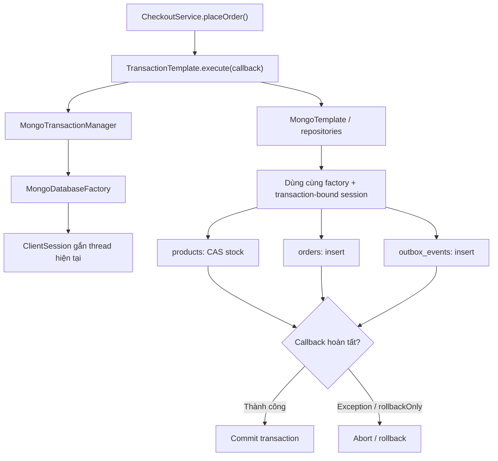
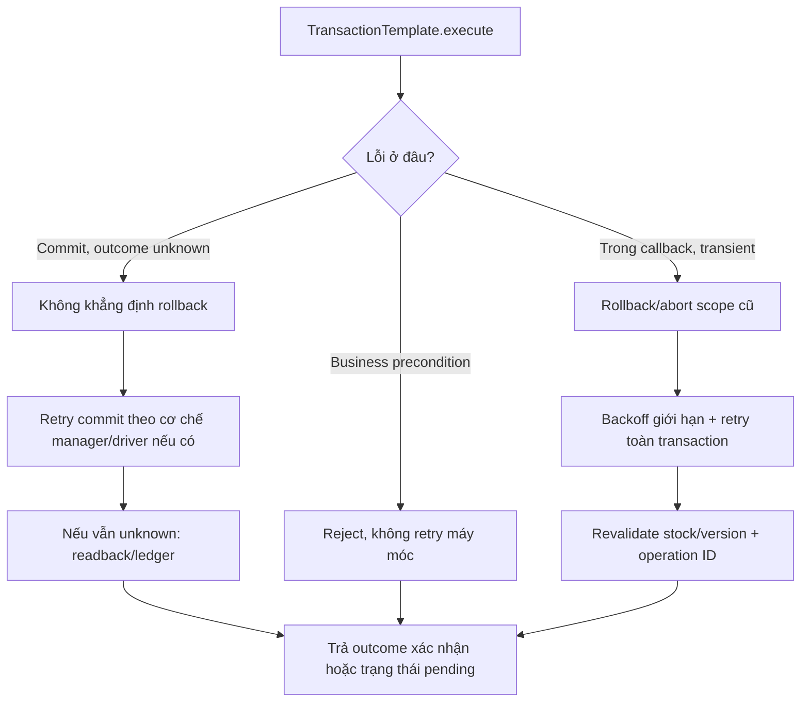

# TransactionTemplate và quản lý giao dịch lập trình

## 1. Bài toán cần giải quyết

MongoDB bảo đảm một thao tác cập nhật **một document** là atomic. Nhưng hệ thống Mini Commerce thường phải cập nhật **nhiều document** trong một thao tác nghiệp vụ. Ví dụ khi khách đặt hàng gồm bàn phím và chuột:

1. Kiểm tra và giảm tồn kho của hai `Product`.
2. Tạo một `Order` với mã đặt hàng không trùng.
3. Ghi một `OutboxEvent` để sau commit hệ thống gửi thông báo.
4. Chỉ chấp nhận kết quả nếu **cả ba phần** đều thành công.

Nếu giảm kho thành công nhưng ghi Order thất bại, hệ thống bị “giữ hàng” mà không có đơn. Nếu tạo Order rồi hết hàng ở sản phẩm thứ hai, không nên để Order vẫn tồn tại. Đây là trường hợp cần một **giao dịch MongoDB nhiều document**, thay vì chỉ dùng CAS riêng lẻ.

Trong **Spring Data MongoDB**, ta có hai phong cách quản lý giao dịch phổ biến:

- **Khai báo**: đặt `@Transactional` trên phương thức service phù hợp.
- **Lập trình**: sử dụng `TransactionTemplate.execute(...)` để chủ động xác định đoạn code chạy trong giao dịch, kết quả trả về và khi nào phải đánh dấu rollback.

Bài **TransactionTemplate và quản lý giao dịch lập trình**, thuộc chương **Session và giao dịch**, tập trung vào phong cách thứ hai. Phạm vi `SPRING_DATA_MONGODB` gồm kết nối MongoDB, ánh xạ document, thao tác qua `MongoTemplate`/repository, truy vấn/CAS, index, transaction, reactive access, kiểm thử và chẩn đoán hiệu năng.

### Mục tiêu

Sau bài này, bạn có thể:

1. Giải thích quan hệ giữa `ClientSession`, `MongoTransactionManager`, `PlatformTransactionManager` và `TransactionTemplate`.
2. Cấu hình transaction manager đúng `MongoDatabaseFactory` của `MongoTemplate`.
3. Sử dụng `TransactionTemplate.execute(...)` cho nghiệp vụ tạo Order + CAS tồn kho + outbox trong một giao dịch.
4. Phân biệt commit, rollback do exception và `TransactionStatus.setRollbackOnly()`.
5. Không nhầm kết quả `matchedCount=0` với exception tự động làm rollback.
6. Hiểu propagation `REQUIRED`, `REQUIRES_NEW`, `NESTED` và giới hạn savepoint của MongoDB.
7. Nhận diện các lỗi do query không cùng session, đổi thread, đổi `MongoDatabaseFactory` hoặc sử dụng raw driver.
8. Xử lý `TransientTransactionError` và `UnknownTransactionCommitResult` theo chiến lược retry/idempotency đúng.
9. Kiểm soát thời gian giao dịch, index, write concern, read concern và external side effects.
10. Kiểm thử commit/rollback thực sự trên replica set và áp dụng `TransactionalOperator` trong reactive.

**Điều kiện thực hành:** Java 17+, Spring Boot tích hợp Spring Data MongoDB, MongoDB **replica set hoặc sharded deployment hỗ trợ transaction**, biết `@Document`, `@Id`, `Query`/`Criteria`, `Update` và cơ bản về `MongoTemplate`.

## 2. TransactionTemplate nằm ở đâu trong kiến trúc?



`TransactionTemplate` thuộc **Spring Framework**, không phải class riêng cho MongoDB:

```java
import org.springframework.transaction.support.TransactionTemplate;
```

Nó dùng một `PlatformTransactionManager` để mở/kết thúc transaction. Khi manager là `MongoTransactionManager`, transaction MongoDB gắn với một `ClientSession` và session được ràng buộc vào **thread hiện tại**. `MongoTemplate` dùng cùng `MongoDatabaseFactory` sẽ phát hiện session đó và đưa các lệnh đọc/ghi phù hợp vào cùng giao dịch.

### 2.1. Transaction khác Session

- **ClientSession** là ngữ cảnh phiên làm việc với MongoDB, phục vụ causal consistency và là nền tảng cho transaction.
- **Transaction** là một chuỗi lệnh được commit/abort theo hợp đồng đa document trong session đó.
- Có `ClientSession` **không có nghĩa** đã gọi `startTransaction`.
- Các operation dùng session nhưng **ngoài transaction** không có cùng bảo đảm atomic nhiều document.
- Giao dịch do Spring quản lý sẽ tự mở, commit/rollback và dọn session qua transaction manager phù hợp.

Đừng trộn `ClientSession` tự tạo bằng driver với transaction do `TransactionTemplate` quản lý nếu chưa có lý do và quy tắc truyền session rõ ràng.

### 2.2. So sánh bốn lựa chọn

| Cách | Phù hợp với | Trách nhiệm quản lý session | Điểm cần tránh |
| --- | --- | --- | --- |
| `@Transactional` | Ranh giới method tương đối ổn định | Spring transaction manager | Proxy/self-invocation, nhầm manager |
| `TransactionTemplate` | Ranh giới cần kiểm soát bằng code/callback | Spring transaction manager | Nuốt exception, đánh dấu rollback sai |
| `ClientSession + withSession(...)` | Chủ động điều khiển driver session/start/commit | Ứng dụng phải đóng session và xử lý mọi lỗi | Quên abort/close, dùng lệnh ngoài session |
| `TransactionalOperator` | `Mono`/`Flux` reactive | Reactive transaction manager/Reactor Context | Dùng `TransactionTemplate` rồi subscribe sau callback |

**Lựa chọn chính của bài:** `TransactionTemplate` cho imperative Java, còn reactive sẽ được đối chiếu ở phần cuối.

## 3. Điều kiện MongoDB server trước khi viết code

Giao dịch MongoDB nhiều document yêu cầu deployment có phiên và topology phù hợp: **replica set** hoặc **sharded cluster** có hỗ trợ transactions. Một MongoDB standalone đơn lẻ không đủ điều kiện.

Ví dụ URI của replica set test (thay host và tên theo môi trường):

```properties
spring.data.mongodb.uri=mongodb://localhost:27017/mini_commerce?replicaSet=rs0
```

Tên `rs0` ở đây là ví dụ: MongoDB thực tế phải được cấu hình và khởi động như replica set với tên tương ứng. Không chỉ thêm `replicaSet=rs0` vào URI của một standalone server rồi kỳ vọng transactions hoạt động.

### 3.1. Vì sao cần tạo collections và indexes từ trước?

Trước khi mở luồng checkout, hãy bảo đảm tồn tại:

- `products` với các index phục vụ lookup theo ID/tenant và schema đã duyệt.
- `orders` với khóa `_id` duy nhất và các ràng buộc idempotency cần thiết.
- `outbox_events` với khóa event duy nhất.

Spring Data MongoDB khuyến nghị chuẩn bị các cấu trúc cần thiết **trước giao dịch**; tạo collection ngầm ở lần insert đầu trong transaction có thể gây lỗi theo server/topology và tài liệu phiên bản. Một số MongoDB server mới hỗ trợ một số DDL giới hạn trong transaction, nhưng **không nên phụ thuộc vào DDL ngầm** trong đường checkout.

Tạo collection/index thuộc bước migration/bootstrap **ngoài transaction nghiệp vụ**; không chạy `createCollection`, `ensureIndex` hoặc thay schema giữa callback checkout.

### 3.2. Testcontainers hoặc replica set test

Integration test bắt buộc sử dụng MongoDB chạy thật với transaction capability. **Mock `MongoTemplate` không chứng minh rollback**. Nếu dùng Testcontainers, chọn cách khởi tạo replica set được thư viện/phiên bản hỗ trợ, chẳng hạn module MongoDB Testcontainers có cấu hình replica set phù hợp. Tránh dùng `mongo:latest` tùy tiện khi CI cần kết quả tái lập.

## 4. Cấu hình MongoTransactionManager

Spring Data MongoDB **không tự bật đầy đủ giao dịch chỉ vì ứng dụng có `MongoTemplate`**. Đăng ký một `MongoTransactionManager` rõ ràng:

```java
package com.example.minicommerce.config;

import org.springframework.context.annotation.Bean;
import org.springframework.context.annotation.Configuration;
import org.springframework.beans.factory.annotation.Qualifier;
import org.springframework.data.mongodb.MongoDatabaseFactory;
import org.springframework.data.mongodb.MongoTransactionManager;
import org.springframework.transaction.PlatformTransactionManager;
import org.springframework.transaction.TransactionDefinition;
import org.springframework.transaction.support.TransactionTemplate;

@Configuration
public class MongoTxConfig {

    @Bean("mongoTransactionManager")
    MongoTransactionManager mongoTransactionManager(
            MongoDatabaseFactory databaseFactory) {

        return new MongoTransactionManager(databaseFactory);
    }

    @Bean("checkoutTxTemplate")
    TransactionTemplate checkoutTxTemplate(
            @Qualifier("mongoTransactionManager")
            PlatformTransactionManager manager) {

        TransactionTemplate template = new TransactionTemplate(manager);
        template.setPropagationBehavior(
            TransactionDefinition.PROPAGATION_REQUIRED);
        template.setName("checkout.placeOrder");
        return template;
    }
}
```

Ứng dụng Spring Boot thường đã có bean `MongoDatabaseFactory` và `MongoTemplate`. Đừng tạo thêm một `MongoClient`/`MongoDatabaseFactory` khác trong config chỉ để transaction nếu muốn các operation đã dùng template hiện có tham gia giao dịch.

### 4.1. Điều kiện “cùng factory”

`MongoTransactionManager` gắn session với **MongoDatabaseFactory mà nó quản lý**. Một `MongoTemplate` tạo từ factory khác có thể không tham gia cùng transaction. Tương tự, nếu dùng nhiều database, nhiều `MongoClient`, nhiều template hoặc nhiều transaction manager, phải phân định transaction boundary và chọn manager đúng.

**Cẩn thận:** hai database cùng một MongoDB deployment không tự đảm bảo hai `MongoTemplate` ở hai factory khác nhau cùng dùng một session. Đừng coi “cùng host MongoDB” là bằng chứng các lệnh đã nằm trong một giao dịch.

### 4.2. SessionSynchronization

Trong cấu hình Spring Data hỗ trợ:

```java
import org.springframework.data.mongodb.SessionSynchronization;

mongoTemplate.setSessionSynchronization(
    SessionSynchronization.ALWAYS);
```

`ALWAYS` là tùy chọn để `MongoTemplate` tham gia cả những transaction Spring không dùng native Mongo manager. **Với `MongoTransactionManager` chuyên biệt và cùng factory**, Spring Data có cơ chế binding session, không cần tùy tiện đổi `SessionSynchronization` trên một `MongoTemplate` đang được thread khác sử dụng.

Nếu phải đổi chính sách synchronization, hãy cấu hình **khi khởi tạo bean**, không đổi qua lại trong mỗi request: tài liệu cảnh báo việc thay đổi runtime có vấn đề thread-safety/visibility. Tránh cấu hình nhiều manager không rõ manager nào đang sở hữu session.

## 5. TransactionTemplate.execute có hợp đồng gì?

API điển hình:

```java
TransactionTemplate tx = new TransactionTemplate(manager);

String result = tx.execute(status -> {
    // Các lệnh MongoTemplate sử dụng transaction-bound session.
    // Trả giá trị khi callback hoàn tất.
    return "success";
});
```

Trình tự ở trường hợp tạo transaction mới:

1. Template yêu cầu transaction từ manager.
2. Manager mở `ClientSession` và transaction phù hợp.
3. Callback thực thi trên thread đang giữ transaction.
4. Callback trả về bình thường → manager thử commit.
5. Callback ném exception phù hợp → manager rollback.
6. Nếu `status.setRollbackOnly()`, manager rollback dù callback kết thúc bình thường.
7. Session và thread-bound resource được dọn sau khi hoàn tất.

**Kết quả trả về từ callback chưa chắc đã được commit.** Ví dụ một callback có thể trả `"success"` nhưng giai đoạn commit phát sinh exception. Chỉ coi transaction thành công khi **`tx.execute(...)` tự nó trả về thành công** và không có trạng thái outcome không chắc chắn.

### 5.1. Execute trả giá trị

```java
String orderId = tx.execute(status -> {
    mongoTemplate.insert(order);
    return order.getId();
});
```

### 5.2. Execute không cần giá trị trả về

```java
tx.executeWithoutResult(status -> {
    mongoTemplate.insert(auditMarker);
    mongoTemplate.insert(otherDocument);
});
```

`executeWithoutResult(...)` là tiện ích trong API Spring TransactionOperations hiện đại; với Spring Framework cũ, có thể dùng `execute(status -> { ...; return null; })`.

### 5.3. TransactionStatus và rollback-only

```java
Boolean accepted = tx.execute(status -> {
    if (!businessPrecondition) {
        status.setRollbackOnly();
        return false;
    }
    mongoTemplate.insert(document);
    return true;
});
```

`businessPrecondition` là boolean do service kiểm tra và `document` là entity ứng dụng. Ở đây giao dịch **rollback** khi điều kiện false dù không ném exception.

Không trả về một `OrderReceipt(status="SUCCESS")` từ callback đã `setRollbackOnly()`; phía caller có thể nhầm kết quả nghiệp vụ “thành công” với thực tế không commit. Nếu cần phản hồi từ chối có lý do rõ ràng, nên dùng kiểu outcome phân biệt `REJECTED` và `COMMITTED` hoặc ném domain exception.

## 6. Mini Commerce: mô hình dữ liệu

### 6.1. Product và inventory

```java
package com.example.minicommerce.domain;

import org.springframework.data.annotation.Id;
import org.springframework.data.annotation.Version;
import org.springframework.data.mongodb.core.mapping.Document;
import org.springframework.data.mongodb.core.mapping.Field;

@Document(collection = "products")
public class Product {

    @Id private String id;
    @Field("tenant_id") private String tenantId;
    private int stock;
    @Version private Long version;

    public Product() {}

    public Product(String id, String tenantId, int stock) {
        this.id = id;
        this.tenantId = tenantId;
        this.stock = stock;
    }

    public String getId() { return id; }
    public String getTenantId() { return tenantId; }
    public int getStock() { return stock; }
    public Long getVersion() { return version; }
}
```

Trong MongoDB, Java `tenantId` được lưu dưới tên `tenant_id`. Khi dùng `Criteria` gắn `Product.class`, ta có thể dùng tên property `tenantId`; khi dùng raw `Document` phải dùng BSON key `tenant_id`.

`@Version` giúp optimistic locking trên các đường entity save thích hợp. Trong ví dụ CAS bên dưới, ta cập nhật version **tường minh bằng `$inc`** để không dựa vào implicit behavior của những overload update.

### 6.2. OrderLine và Order

```java
package com.example.minicommerce.domain;

public record OrderLine(
    String productId,
    int quantity
) {}
```

```java
package com.example.minicommerce.domain;

import java.time.Instant;
import java.util.List;
import org.springframework.data.annotation.Id;
import org.springframework.data.mongodb.core.mapping.Document;
import org.springframework.data.mongodb.core.mapping.Field;

@Document(collection = "orders")
public record Order(
    @Id String id,
    @Field("tenant_id") String tenantId,
    String status,
    List<OrderLine> lines,
    Instant placedAt
) {}
```

`Order` lưu snapshot của từng dòng đặt hàng; trong ứng dụng thực tế có thể bổ sung đơn giá Decimal128, customer ID, địa chỉ, thuế và currency. Không dùng giá catalog hiện hành để tính lại tiền của Order cũ.

### 6.3. OutboxEvent

```java
package com.example.minicommerce.domain;

import java.time.Instant;
import org.springframework.data.annotation.Id;
import org.springframework.data.mongodb.core.mapping.Document;
import org.springframework.data.mongodb.core.mapping.Field;

@Document(collection = "outbox_events")
public record OutboxEvent(
    @Id String id,
    @Field("tenant_id") String tenantId,
    String aggregateId,
    String eventType,
    Instant occurredAt
) {}
```

Mục đích outbox: **ghi ý định công bố sự kiện trong cùng transaction với Order**, còn một worker **sau commit** mới gửi event ra message broker/email. Transaction MongoDB không tự rollback các hệ thống ngoài MongoDB.

## 7. Giao dịch checkout bằng TransactionTemplate

Đây là phần cốt lõi. Service nhận command gồm mã Order ổn định và các dòng hàng, sau đó:

1. Validate dữ liệu đầu vào **trước** khi mở transaction.
2. Insert Order bằng `_id` do caller tạo, dựa trên unique constraint của `_id`.
3. Dùng **CAS stock** cho từng Product trong transaction.
4. Insert OutboxEvent cùng transaction.
5. Trả receipt; `TransactionTemplate` commit sau khi callback hoàn tất.

### 7.1. Command và kết quả

```java
package com.example.minicommerce.service;

import java.util.List;
import com.example.minicommerce.domain.OrderLine;

public record PlaceOrderCommand(
    String tenantId,
    String orderId,
    List<OrderLine> lines
) {}
```

```java
package com.example.minicommerce.service;

public record OrderReceipt(
    String orderId,
    String status
) {}
```

`orderId` phải **ổn định qua retry của cùng yêu cầu**. Không tự sinh `UUID.randomUUID()` mới bên trong callback mỗi lần transaction chạy, vì ứng dụng khó phân biệt yêu cầu mới với replay.

### 7.2. Domain exception

```java
package com.example.minicommerce.service;

public class InsufficientStockException
        extends RuntimeException {

    public InsufficientStockException(String productId) {
        super("Product unavailable or insufficient stock: "
            + productId);
    }
}
```

Exception này cũng có thể xảy ra khi Product không tồn tại hoặc không thuộc tenant; message nên không tiết lộ dữ liệu vượt quyền truy cập. Ở tầng API cần phân loại kết quả nghiệp vụ trong phạm vi tenant đã xác thực.

### 7.3. CheckoutService

```java
package com.example.minicommerce.service;

import java.time.Instant;
import java.util.HashSet;
import java.util.List;
import java.util.Objects;
import java.util.Set;

import com.mongodb.client.result.UpdateResult;
import org.springframework.beans.factory.annotation.Qualifier;
import org.springframework.data.mongodb.core.MongoTemplate;
import org.springframework.data.mongodb.core.query.Criteria;
import org.springframework.data.mongodb.core.query.Query;
import org.springframework.data.mongodb.core.query.Update;
import org.springframework.stereotype.Service;
import org.springframework.transaction.support.TransactionTemplate;

import com.example.minicommerce.domain.Order;
import com.example.minicommerce.domain.OrderLine;
import com.example.minicommerce.domain.OutboxEvent;
import com.example.minicommerce.domain.Product;

@Service
public class CheckoutService {

    private final MongoTemplate mongoTemplate;
    private final TransactionTemplate checkoutTx;

    public CheckoutService(
            MongoTemplate mongoTemplate,
            @Qualifier("checkoutTxTemplate")
            TransactionTemplate checkoutTx) {
        this.mongoTemplate = mongoTemplate;
        this.checkoutTx = checkoutTx;
    }

    public OrderReceipt placeOrder(PlaceOrderCommand command) {
        validate(command);

        // Chỉ trả receipt khi execute bao gồm cả commit thành công.
        return Objects.requireNonNull(
            checkoutTx.execute(status -> {

                // Đặt insert trước để _id duy nhất chặn replay
                // sớm, trước khi tính toán stock.
                mongoTemplate.insert(new Order(
                    command.orderId(),
                    command.tenantId(),
                    "PLACED",
                    command.lines(),
                    Instant.now()));

                for (OrderLine line : command.lines()) {
                    Query guard = Query.query(
                        Criteria.where("id")
                            .is(line.productId())
                            .and("tenantId")
                            .is(command.tenantId())
                            .and("stock")
                            .gte(line.quantity()));

                    Update change = new Update()
                        .inc("stock", -line.quantity())
                        .inc("version", 1L);

                    UpdateResult result = mongoTemplate.updateFirst(
                        guard, change, Product.class);

                    if (!result.wasAcknowledged()) {
                        throw new IllegalStateException(
                            "Unacknowledged stock write");
                    }
                    if (result.getMatchedCount() != 1) {
                        throw new InsufficientStockException(
                            line.productId());
                    }
                }

                mongoTemplate.insert(new OutboxEvent(
                    command.orderId() + ":placed",
                    command.tenantId(),
                    command.orderId(),
                    "ORDER_PLACED",
                    Instant.now()));

                return new OrderReceipt(
                    command.orderId(), "PLACED");
            }));
    }

    private static void validate(PlaceOrderCommand command) {
        Objects.requireNonNull(command, "command");
        if (command.tenantId() == null ||
                command.tenantId().isBlank()) {
            throw new IllegalArgumentException("Tenant required");
        }
        if (command.orderId() == null ||
                command.orderId().isBlank()) {
            throw new IllegalArgumentException("Order ID required");
        }

        List<OrderLine> lines = command.lines();
        if (lines == null || lines.isEmpty() || lines.size() > 50) {
            throw new IllegalArgumentException("Invalid line count");
        }

        Set<String> productIds = new HashSet<>();
        for (OrderLine line : lines) {
            if (line == null || line.productId() == null ||
                    line.productId().isBlank() ||
                    line.quantity() <= 0) {
                throw new IllegalArgumentException("Invalid line");
            }
            if (!productIds.add(line.productId())) {
                throw new IllegalArgumentException(
                    "Duplicate product in one order");
            }
        }
    }
}
```

**Vì sao cách này rollback được?** Nếu giảm stock Product A khớp nhưng Product B không khớp, service ném `InsufficientStockException` **bên trong callback**. `TransactionTemplate` rollback, nên insert Order, phép trừ Product A và OutboxEvent đều không được commit.

**Vì sao cần CAS dù đã có transaction?** Transaction bảo vệ sự thống nhất giữa nhiều write của checkout; `stock >= quantity` bảo vệ **invariant stock không âm** ngay tại update. Khi hai transaction cạnh tranh, MongoDB có thể phát hiện write conflict/transient transaction error; ứng dụng vẫn phải retry có kiểm soát và kiểm tra lại kết quả.

### 7.4. Điều kiện cho phép ví dụ chạy đúng

- Mọi Product ID trong command là duy nhất trong một Order; ví dụ **từ chối dòng hàng trùng Product** thay vì âm thầm trừ kho hai lần.
- `Order._id` và `OutboxEvent._id` phải duy nhất; các collections tồn tại trước giao dịch.
- Entity `Product` có `version` BSON numeric khi dùng `$inc("version",1L)`; migration phải chuẩn hóa document legacy nếu thiếu/sai kiểu.
- Tên `tenantId` trong `Criteria` được Spring Data map thành BSON `tenant_id` khi query gắn `Product.class`.
- `command.tenantId()` phải đến từ identity/authorization được xác thực; service không nên tin tenant do HTTP body tự tuyên bố.
- Mọi lệnh đều đi qua **cùng `MongoTemplate`/`MongoDatabaseFactory`** và **cùng imperative thread**.
- Commit thành công trong MongoDB **không chứng minh outbox đã được publish**; outbox worker xử lý ở bước sau.

## 8. Hai đường thực thi: commit hoặc rollback

### 8.1. Happy path

```text
Product A stock=5, Product B stock=4
Order ID: ord-demo-100
Command: A x 2, B x 2

BEGIN
  INSERT orders(ord-demo-100)
  UPDATE Product A: stock 5 -> 3
  UPDATE Product B: stock 4 -> 2
  INSERT outbox_events(ord-demo-100:placed)
COMMIT

Result:
  Order tồn tại
  Product A stock=3, Product B stock=2
  Outbox event tồn tại
```

### 8.2. Không đủ stock ở Product B

```text
Product A stock=5, Product B stock=1
Order ID: ord-demo-101
Command: A x 2, B x 2

BEGIN
  INSERT orders(ord-demo-101)
  UPDATE Product A: stock 5 -> 3
  UPDATE Product B: matchedCount=0
  THROW InsufficientStockException
ROLLBACK

Result:
  Không có Order ord-demo-101
  Product A vẫn stock=5, Product B vẫn stock=1
  Không có outbox event cho ord-demo-101
```

**Không viết `catch (Exception ignored) {}` ngay trong callback** rồi trả success: transaction manager không biết một lỗi nghiệp vụ đã xảy ra nếu bạn nuốt exception và không đánh dấu rollback.

## 9. Exception, rollback-only và lỗi nghiệp vụ

### 9.1. Throw RuntimeException để rollback

```java
tx.execute(status -> {
    mongoTemplate.insert(order);

    if (!hasEnoughStock) {
        throw new InsufficientStockException(productId);
    }

    mongoTemplate.insert(event);
    return order.getId();
});
```

Với `TransactionTemplate`, exception rời callback khiến transaction được rollback. Khác với thảo luận rollback rules trong `@Transactional`, callback lập trình tự điều khiển luồng: checked exception thường phải được xử lý/chuyển thành runtime exception vì chữ ký callback không khai báo checked throws.

### 9.2. Đánh dấu rollbackOnly khi cần return outcome

```java
public boolean attempt(PlaceOrderCommand command) {
    Boolean accepted = tx.execute(status -> {
        // Một phần work có thể đã diễn ra ở đây.
        if (command.lines().isEmpty()) {
            status.setRollbackOnly();
            return false;
        }

        // Các operation có thể thành công.
        return true;
    });

    return Boolean.TRUE.equals(accepted);
}
```

Đây là ví dụ về `setRollbackOnly`, không phải checkout đầy đủ. Khi validation chưa đòi write, tốt hơn là kiểm tra **trước** khi bắt đầu transaction, tránh giữ session và lock vô ích.

### 9.3. Cẩn trọng với catch

**Sai:**

```java
tx.execute(status -> {
    mongoTemplate.insert(order);
    try {
        reserveInventory();
    } catch (InsufficientStockException e) {
        logBusinessError(e);
        // Quên rollback, callback vẫn trả thành công.
    }
    return "SUCCESS";
});
```

**Đúng khi vẫn muốn trả kết quả từ chối:**

```java
tx.execute(status -> {
    mongoTemplate.insert(order);
    try {
        reserveInventory();
    } catch (InsufficientStockException e) {
        status.setRollbackOnly();
        return "REJECTED";
    }
    return "ACCEPTED";
});
```

Các biến `order`, `reserveInventory` và `logBusinessError` ở đây chỉ minh họa. Với lỗi write thật do MongoDB trả, transaction có thể đã bị server abort; không cố tiếp tục ghi trong callback sau một lỗi nghiêm trọng. Cách đơn giản và thường an toàn hơn là **để exception truyền ra ngoài** rồi chuyển thành response phù hợp ở API.

### 9.4. Rollback-only trong transaction đang tham gia

Khi `PROPAGATION_REQUIRED` tham gia một transaction do caller mở, đánh dấu rollback-only ở scope bên trong có thể khiến **toàn transaction bên ngoài phải rollback**. Nếu caller bên ngoài tưởng commit được, Spring có thể báo `UnexpectedRollbackException`. Không kỳ vọng rollback một phần như savepoint chỉ vì gọi nhiều `TransactionTemplate.execute` lồng nhau.

## 10. Propagation: REQUIRED, REQUIRES_NEW và NESTED

`TransactionTemplate` kế thừa cấu hình của `DefaultTransactionDefinition`:

```java
import org.springframework.transaction.TransactionDefinition;
import org.springframework.transaction.support.TransactionTemplate;

TransactionTemplate tx = new TransactionTemplate(manager);

tx.setPropagationBehavior(
    TransactionDefinition.PROPAGATION_REQUIRED);
tx.setName("checkout.inventory-and-order");
```

| Propagation | Ý nghĩa Spring | Khuyến nghị cho MongoDB |
| --- | --- | --- |
| `REQUIRED` | Tham gia transaction hiện hữu, nếu chưa có thì mở mới | **Mặc định hợp lý** cho một use case |
| `SUPPORTS` | Tham gia nếu có, không có thì không mở mới | Không phù hợp nếu invariant **bắt buộc** atomic nhiều document |
| `MANDATORY` | Phải có transaction từ caller | Dùng trong component chỉ được gọi từ use case đã mở transaction |
| `REQUIRES_NEW` | Yêu cầu một transaction vật lý độc lập, tạm ngưng scope bên ngoài khi khả dụng | Có thêm session/resource; kiểm tra manager/topology, thường không cần cho checkout |
| `NESTED` | Mong đợi savepoint trong một transaction hiện hữu | **Không thiết kế dựa trên savepoint JDBC** khi dùng MongoDB |
| `NOT_SUPPORTED` | Chạy ngoài transaction, tạm ngưng transaction đang có khi hỗ trợ | Chỉ dùng khi nghiệp vụ thực sự cho phép |
| `NEVER` | Từ chối chạy nếu caller đã có transaction | Phù hợp cho một số thao tác chỉ được phép ngoài transaction |

### 10.1. REQUIRED không tạo commit riêng cho callback con

```java
TransactionTemplate outer = new TransactionTemplate(manager);
TransactionTemplate inner = new TransactionTemplate(manager);

outer.execute(status -> {
    mongoTemplate.insert(order);

    inner.execute(child -> {
        mongoTemplate.insert(outboxEvent);
        return null;
    });

    // Chỉ khi outer commit thì những write thuộc cùng
    // transaction REQUIRED mới được commit.
    return null;
});
```

`order` và `outboxEvent` là entity đã được tạo hợp lệ. Cả hai template mặc định dùng `REQUIRED`. Callback trong **không sở hữu một commit tách biệt**; nếu outer rollback, outbox cũng rollback.

### 10.2. REQUIRES_NEW có đúng mục tiêu không?

Khi một callback bên trong mở transaction độc lập, nó không còn atomic với transaction bên ngoài. Ví dụ ghi audit `REQUIRES_NEW` rồi checkout rollback có thể làm audit còn nhưng Order không tồn tại. Điều này đôi khi đúng với **log nỗ lực thất bại**, nhưng không đúng với **outbox sự kiện Order đã được đặt**.

Ngoài ra, MongoDB manager và session/thread resource phải hỗ trợ việc suspend và tạo session mới trong bối cảnh thực tế. Giao dịch độc lập cũng có thể gặp conflict khi truy cập cùng document đang được outer transaction giữ. **Không lấy ví dụ propagation của JDBC và giả định triển khai MongoDB nào cũng giống hệt.**

### 10.3. Không có rollback một phần kiểu JDBC savepoint

`PROPAGATION_NESTED` trong Spring thường dựa trên savepoint của transaction resource. MongoDB transaction không cung cấp một giao thức savepoint tương ứng để `MongoTransactionManager` cho phép rollback một số lệnh rồi tiếp tục như JDBC.

Nếu xử lý `Product A` thành công nhưng `Product B` thất bại, lựa chọn đúng thường là **rollback toàn bộ checkout**, rồi thiết kế nghiệp vụ khác nếu muốn partial fulfillment. Không cố bắt lỗi B rồi “rollback từ đây” bên trong cùng transaction và commit A theo một giả định savepoint không có.

## 11. TransactionTemplate và @Transactional khác nhau thế nào?

`@Transactional` có thể biểu đạt cùng boundary:

```java
@Transactional(transactionManager = "mongoTransactionManager")
public OrderReceipt placeOrder(PlaceOrderCommand command) {
    // Ghi Order, cập nhật stock, ghi outbox.
    return receipt;
}
```

`TransactionTemplate` khác ở chỗ:

- Boundary hiển thị trực tiếp tại chỗ gọi `execute(...)`, không cần Spring AOP proxy cho phương thức đó.
- Dễ đặt **nhiều đoạn giao dịch riêng** trong một workflow dài; có thể làm phần không cần giao dịch bên ngoài callback.
- Dễ đổi propagation/tên/timeout theo use case được quản lý.
- `TransactionStatus` có sẵn trong callback để đánh dấu rollback khi cần.
- Hỗ trợ code gọi từ constructor/helper/service không nằm sau self-invocation proxy (dù không có nghĩa nên mở transaction trong constructor).

Không vì chủ động boundary mà tự động tốt hơn `@Transactional`. Với đa số service đơn giản, annotation dễ đọc và ít code. `TransactionTemplate` phát huy giá trị khi **rằng buộc đoạn transaction rất cụ thể**, muốn ghép nhiều bước non-transactional/transactional hoặc muốn trả một outcome từ callback.

### 11.1. Tránh ghép nhầm transaction managers

Nếu ứng dụng vừa có JDBC vừa có MongoDB:

```java
@Bean("checkoutTxTemplate")
TransactionTemplate checkoutTxTemplate(
        @Qualifier("mongoTransactionManager")
        PlatformTransactionManager mongoManager) {

    return new TransactionTemplate(mongoManager);
}
```

Nếu vô tình inject JDBC `DataSourceTransactionManager` vào `TransactionTemplate` trong khi callback chỉ gọi `MongoTemplate`, đừng kỳ vọng MongoDB writes tự tham gia JDBC transaction. **Hai transaction managers độc lập không tự trở thành distributed transaction**; cần một thiết kế phối hợp riêng như outbox/saga nếu giao dịch trải qua nhiều tài nguyên.

## 12. Session, thread và MongoDatabaseFactory

`MongoTransactionManager` bind `ClientSession` trên **thread hiện tại**. Các operation của `MongoTemplate` cùng `MongoDatabaseFactory` sẽ tham gia session đó.

### 12.1. Sai: đổi thread trong callback

```java
tx.execute(status -> {
    mongoTemplate.insert(order);

    java.util.concurrent.CompletableFuture<Void> task =
        java.util.concurrent.CompletableFuture.runAsync(
            () -> mongoTemplate.insert(outboxEvent));

    task.join();
    return null;
});
```

Đây là **phản ví dụ**: `runAsync` thực hiện insert trên thread khác, trong khi imperative session binding theo thread. Lệnh outbox có thể chạy **ngoài transaction** dù caller chờ bằng `join()`.

**Đúng:** giữ toàn bộ MongoDB writes thuộc transaction trên **cùng thread imperative**:

```java
tx.execute(status -> {
    mongoTemplate.insert(order);
    mongoTemplate.insert(outboxEvent);
    return null;
});
```

Nếu workflow thực sự cần bất đồng bộ, dùng outbox sau commit hoặc reactive transaction manager/Reactor Context tương ứng; không tự chuyển thread rồi tưởng context được truyền.

### 12.2. Sai: dùng MongoCollection raw mà không truyền session

```java
tx.execute(status -> {
    mongoTemplate.insert(order);

    // PHẢN VÍ DỤ: raw driver call không tự mang
    // ClientSession do MongoTransactionManager quản lý.
    mongoTemplate.getCollection("outbox_events")
        .insertOne(rawOutboxDocument);

    return null;
});
```

`getCollection(...)` trả native driver collection; tài liệu Spring Data lưu ý nó **không phải session-proxied object** tự gắn session cho tất cả lời gọi. Nếu cần native driver, phải truyền đúng `ClientSession` vào overload của driver hoặc dùng callback `MongoOperations.execute(...)` phù hợp; cách đơn giản hơn là `mongoTemplate.insert(outboxEntity)` để Spring quản lý session.

### 12.3. Sai: mở một MongoClient mới

```java
tx.execute(status -> {
    mongoTemplate.insert(order);

    // Không làm thế này trong checkout:
    // MongoClients.create(uri).getDatabase("mini_commerce")
    //     .getCollection("outbox_events").insertOne(...);

    return null;
});
```

Một `MongoClient`/`MongoDatabaseFactory` khác không tự chia sẻ transaction-bound session chỉ vì cùng URI/database. Cũng không nên tạo client mới mỗi request: connection pool và session lifecycle phải được quản lý ở tầng cấu hình.

### 12.4. Spring transaction chỉ tác động tới tài nguyên tham gia

Không gọi một dịch vụ HTTP hoặc message broker nằm trong callback rồi mong Spring MongoDB rollback được request bên ngoài:

```java
tx.execute(status -> {
    mongoTemplate.insert(order);
    // BAD: paymentGateway.capture(...) có thể hoàn tất,
    // nhưng MongoDB transaction sau đó lại rollback.
    return null;
});
```

Đối với payment/email/search indexing, hãy dùng **outbox/saga** và idempotency. Nếu bắt buộc gọi ngoài để xác thực, thực hiện trước transaction khi semantics cho phép, nhưng phải nhận biết thông tin có thể thay đổi giữa check và commit.

## 13. TransactionOptions: read concern, write concern, read preference

MongoDB transaction có các thuộc tính database-specific, không phải mọi setting Spring `TransactionDefinition` đều ánh xạ một-một xuống server.

### 13.1. Cấu hình mặc định trên MongoTransactionManager

```java
package com.example.minicommerce.config;

import com.mongodb.ReadConcern;
import com.mongodb.ReadPreference;
import com.mongodb.TransactionOptions;
import com.mongodb.WriteConcern;

import org.springframework.context.annotation.Bean;
import org.springframework.context.annotation.Configuration;
import org.springframework.data.mongodb.MongoDatabaseFactory;
import org.springframework.data.mongodb.MongoTransactionManager;

@Configuration
class DurableMongoTransactions {

    @Bean("mongoTransactionManager")
    MongoTransactionManager mongoTransactionManager(
            MongoDatabaseFactory factory) {

        TransactionOptions options = TransactionOptions.builder()
            .readConcern(ReadConcern.SNAPSHOT)
            .writeConcern(WriteConcern.MAJORITY)
            .readPreference(ReadPreference.primary())
            .build();

        return new MongoTransactionManager(factory, options);
    }
}
```

**Đây là cấu hình thay thế `MongoTxConfig` ở phần 4**, không thêm cả hai bean cùng tên vào một ứng dụng. `ReadConcern.SNAPSHOT` và `WriteConcern.MAJORITY` là các lựa chọn cần cân nhắc theo workload/topology và mục tiêu durability; không phải lời khuyên bật vô điều kiện cho mọi hệ thống.

### 13.2. Ý nghĩa từng option

| Option | Ý nghĩa | Cần nhớ |
| --- | --- | --- |
| `readConcern` | Mức nhất quán dữ liệu đọc trong transaction | `snapshot` phù hợp nhiều tình huống cần snapshot, nhưng không tự tạo serializable isolation |
| `writeConcern` | Mức xác nhận commit | Chọn để đáp ứng durability; không xử lý idempotency |
| `readPreference` | Chọn nguồn đọc phù hợp transaction | Transactions có yêu cầu routing/read preference theo server, thường dùng primary cho luồng ghi |
| `maxCommitTime` | Giới hạn server-side cho commit operation khi được hỗ trợ | Khác thời gian tối đa của toàn business callback |

**Không nhầm:** `TransactionTemplate.setTimeout(seconds)` là attribute ở tầng Spring, nhưng mức độ tác động tới MongoDB server phụ thuộc manager/driver/version. Nếu cần đảm bảo thời gian dài nhất của transaction, kiểm tra thêm MongoDB transaction lifetime/commit options và test thực tế. Không dùng timeout để thay thế giới hạn batch/số document.

### 13.3. Labels ở Spring Data mới

Spring Data MongoDB hiện đại có `MongoTransactionOptionsResolver` hỗ trợ các label như:

```text
mongo:readConcern=SNAPSHOT
mongo:writeConcern=MAJORITY
mongo:readPreference=PRIMARY
mongo:maxCommitTime=PT1S
```

Các label có thể được khai báo trong transaction attributes ở các phiên bản hỗ trợ; với `TransactionTemplate`, cách đưa label cần đúng API `TransactionDefinition`/Spring Framework của dự án. Đừng tự gắn chuỗi cấu hình trên mà không kiểm tra thư viện; cách ổn định, dễ hiểu khi học là đặt `TransactionOptions` ở `MongoTransactionManager`.

**Lưu ý propagation:** nếu callback `REQUIRED` tham gia transaction đã mở, các option mới **không thể thay đổi transaction vật lý đang chạy**. Chọn options tại scope thật sự mở transaction.

## 14. Isolation, write skew và CAS bên trong transaction

Transaction nhiều document bảo đảm các write thuộc transaction commit/abort cùng nhau; tuy nhiên **không tự bảo đảm mọi bất biến toàn hệ thống** trong mọi kiểu cạnh tranh.

Một tình huống kinh điển:

```text
Invariant: cần ít nhất một nhân viên trực ca.
Transaction A đọc: cả An và Bình đang trực.
Transaction B đọc: cả An và Bình đang trực.
Transaction A bỏ trực An.
Transaction B bỏ trực Bình.
```

Nếu hai transaction cập nhật **hai document khác nhau** và chỉ dựa vào snapshot đọc trước đó, có thể có **write skew** theo mô hình snapshot isolation. Một giao dịch không tự biến thao tác đọc-kiểm tra thành một lock trên mọi document liên quan.

Trong Mini Commerce, `stock >= quantity` ở update tránh oversell trên **từng Product**. Unique index/guard document có thể cần để bảo vệ các invariant khác. Khi có điều kiện xuyên nhiều document (ví dụ giới hạn tổng số reservation trong một nhóm), hãy thiết kế thêm **document điều phối, unique constraint, conflict point hoặc quy trình serialization thích hợp**, không chỉ bọc một đoạn read/check/update bằng `TransactionTemplate`.

### 14.1. Write conflict

Hai transaction cùng sửa một Product có thể dẫn đến **write conflict** thay vì một transaction chờ yên cho đến khi hoàn tất. MongoDB có thể gắn error label `TransientTransactionError` để ứng dụng cân nhắc retry **toàn transaction**, đọc lại trạng thái và thử điều kiện nghiệp vụ lần nữa.

Không coi mọi write conflict là “thiếu stock”: đó là vấn đề cạnh tranh tài nguyên, khác với `matchedCount=0` do điều kiện stock thực sự không khớp.

### 14.2. Tách business outcome và infrastructure outcome

| Outcome | Ví dụ | Hành động |
| --- | --- | --- |
| `COMMITTED` | Tất cả writes + commit được xác nhận | Trả receipt |
| `REJECTED` | CAS stock matched=0 | Rollback, trả lỗi nghiệp vụ |
| `RETRYABLE_TRANSACTION_FAILURE` | Write conflict/transient label trước commit | Có thể retry toàn transaction có giới hạn |
| `UNKNOWN_COMMIT_OUTCOME` | Commit response không rõ | **Đối soát / retry commit theo đúng session khi còn khả năng**, không replay mù |
| `PERMANENT_ERROR` | Schema invalid, duplicate key do request sai | Không retry vô hạn |

## 15. Retry: TransientTransactionError khác UnknownTransactionCommitResult

MongoDB driver định nghĩa các nhóm lỗi phục vụ transaction:

- `TransientTransactionError`: lỗi thoáng qua khi **thực thi transaction trước commit**; việc thử lại toàn transaction trên một session mới có thể thành công nếu điều kiện nghiệp vụ còn đúng.
- `UnknownTransactionCommitResult`: lỗi ở **commit**, client không chắc transaction đã commit hay chưa; phải ưu tiên **retry commit khi còn đúng session và contract cho phép**, hoặc đối soát theo operation ID nếu đã mất context.

Đây là hai chiến lược **khác nhau**.



### 15.1. Vì sao không gọi lại toàn checkout ngay sau lỗi commit?

Giả sử:

```text
Order ord-100 và stock đã được commit.
Client mất response ngay tại commit.
Caller thử lại checkout với Order ID mới.
=> Có thể trừ kho lần hai và tạo đơn thứ hai.
```

Vì thế `orderId`/idempotency key phải ổn định giữa các attempt. Trong service ví dụ, **Order được insert trước các update stock**, nên một replay cùng Order ID có thể gặp duplicate key; lúc đó client cần **đọc lại Order cùng tenant, xác minh request fingerprint/status**, không tự coi duplicate key là “mua thất bại”. Nếu Order cũ thuộc một payload khác nhưng cùng ID, phải từ chối request.

### 15.2. TransactionTemplate không thay thế callback retry của driver

MongoDB driver có **convenient transaction API** quản lý retry một số lỗi, nhưng `TransactionTemplate` dùng Spring `PlatformTransactionManager` và không có nghĩa tự động triển khai toàn bộ state machine retry của driver.

Tài liệu Spring Data nêu có thể tùy biến `MongoTransactionManager#doCommit(...)` cho retry commit hoặc dùng Spring Retry với policy kiểm soát. **Không đặt `@Retryable` bao trọn checkout một cách mù quáng** nếu callback có HTTP call/email, sinh ID mới hoặc không có cơ chế idempotency.

### 15.3. Lỗi bị wrap

Một MongoDB driver error có thể được Spring dịch thành `DataAccessException` hoặc `TransactionSystemException`. Nếu cần kiểm tra error labels, phải tìm **driver cause thích hợp** theo phiên bản driver và policy của ứng dụng; không cast mọi exception thành `MongoException`.

Một số lỗi **không đáng retry**, như validation failure, tên collection sai, duplicate key do dữ liệu không hợp lệ hoặc transaction quá lớn. Retry cần số lần tối đa, backoff/jitter, metrics và tránh overload khi hệ thống gặp sự cố.

## 16. Outbox và side effects sau commit

Trong `CheckoutService`, outbox record được insert **cùng transaction** với Order/stock:

```text
BEGIN
  INSERT Order
  UPDATE Product A
  UPDATE Product B
  INSERT OutboxEvent
COMMIT
       |
       v
Background publisher đọc OutboxEvent
       |
       v
Gửi message tới broker
       |
       v
Đánh dấu dispatched (có retry + idempotency)
```

Nếu transaction rollback, outbox cũng rollback. Nếu transaction commit nhưng publisher chết, event vẫn nằm ở MongoDB để gửi lại. Vì publisher có thể gửi cùng event nhiều lần nếu mất ACK, consumer cần **idempotent processing**.

### 16.1. Không nhầm callback afterCommit với outbox

Spring có transaction synchronizations và các cơ chế `afterCommit`. Có thể dùng để **đánh thức worker/publisher**, nhưng chỉ callback sau commit không phải hệ thống gửi sự kiện bền vững: process có thể crash giữa commit và publish. Outbox record tồn tại trên MongoDB mới là bằng chứng có thể truy vấn để phục hồi.

### 16.2. Không đặt network call trong callback

```java
checkoutTx.execute(status -> {
    mongoTemplate.insert(order);
    // Không thực hiện paymentGateway.capture(...)
    // hoặc emailService.send(...) tại đây rồi kỳ vọng
    // MongoDB rollback được tác động bên ngoài.
    return order.getId();
});
```

Nếu thanh toán phải điều phối với đặt hàng, dùng saga/state machine hoặc workflow được thiết kế riêng; MongoDB transaction không bao trùm hệ thống thanh toán bên ngoài.

## 17. Hiệu năng: giữ giao dịch ngắn

Transactions nhiều document có overhead về sessions, locks/concurrency, bộ nhớ và giữ lịch sử phiên bản dữ liệu. Không thay các thao tác một document vốn đã atomic bằng transaction một cách máy móc.

Khuyến nghị:

1. Validate request, parse dữ liệu, xác định tenant, chuẩn bị command **trước khi mở** transaction.
2. Chỉ giữ những MongoDB writes cần atomic bên trong callback.
3. Tạo indexes phục vụ CAS, unique Order ID và outbox trước runtime.
4. Giới hạn số OrderLine/Product được xử lý trong một giao dịch.
5. Không đọc toàn collection, export file, gọi HTTP hoặc sleep/backoff **trong callback**.
6. Nếu retry, backoff **ngoài transaction** và chỉ retry lỗi phù hợp.
7. Đo thời gian transaction và tỷ lệ conflict, abort, timeout; không chỉ đo độ trễ của một `updateFirst`.

### 17.1. Không mở transaction để “cho chắc” khi không cần

Một phép trừ stock **một Product**:

```java
UpdateResult result = mongoTemplate.updateFirst(
    Query.query(Criteria.where("id").is(productId)
        .and("stock").gte(quantity)),
    new Update().inc("stock", -quantity),
    Product.class);
```

Đây đã là một update atomic trên một document (khi query đủ guard/tenant). Nếu không phải ghi Order hay document khác trong cùng invariant, một transaction chỉ thêm chi phí mà không giải quyết vấn đề nào mới.

### 17.2. Count và aggregation trong transaction

Theo Spring Data MongoDB, MongoDB `count` kiểu cũ dựa vào metadata collection không phù hợp khi dùng transaction; `MongoTemplate.count(...)` trong transaction có thể được chuyển thành aggregation với `$match`/`$count`. Các toán tử geo như `$near` có hạn chế ở tình huống này. Không giả định một method đếm trong transaction luôn có cùng query plan như ngoài transaction.

## 18. Chẩn đoán lỗi transaction thường gặp

| Dấu hiệu | Nguyên nhân khả dĩ | Hướng xử lý |
| --- | --- | --- |
| `Transaction numbers are only allowed on a replica set member or mongos` | Dùng standalone MongoDB | Khởi chạy replica set/test deployment phù hợp |
| `No bean of PlatformTransactionManager` | Chưa đăng ký `MongoTransactionManager` hoặc sai qualifier | Cấu hình đúng bean/factory |
| Order rollback nhưng outbox còn | Raw driver call ngoài session hoặc thread khác | Dùng cùng `MongoTemplate`/session |
| Một số Product không rollback | Template khác factory hoặc thao tác ngoài callback | Kiểm tra transaction participation |
| `createCollection` lỗi trong transaction | Chưa pre-create collection/topology không hỗ trợ DDL đó | Bootstrap schema/index trước traffic |
| Callback ném lỗi nhưng vẫn commit | Exception bị nuốt hoặc callback trả bình thường | Propagate exception hoặc `setRollbackOnly()` |
| Outer transaction bị rollback bất ngờ | Inner REQUIRED đánh dấu rollback-only | Thiết kế ranh giới/contract rõ, xử lý `UnexpectedRollbackException` |
| Chạy `REQUIRES_NEW` rồi tưởng cùng atomicity | Scope độc lập với outer | Không tách outbox khỏi checkout transaction |
| `NESTED` không hoạt động | MongoDB không có savepoint JDBC | Tránh partial rollback giả định |
| Commit timeout, không biết Order có tồn tại | `UnknownTransactionCommitResult` | Đối soát bằng orderId/idempotency key |
| Retry tạo Order mới, stock giảm hai lần | Mỗi retry sinh ID mới | Stable operation ID, duplicate handling |
| Write conflict tăng cao | Nhiều transaction cập nhật cùng Product | Giảm thời gian transaction, CAS và retry giới hạn |
| `MongoTemplate` thao tác không vào transaction | Cùng URI nhưng khác factory/session | Kiểm tra bean wiring và thread |
| Reactive pipeline không rollback | Dùng `TransactionTemplate` bao publisher chưa subscribe | `ReactiveMongoTransactionManager` + `TransactionalOperator` |
| Transaction kéo dài, tài nguyên lớn | Nhiều operations hoặc external calls trong callback | Giới hạn batch và tách non-DB work |
| Count/near hoạt động khác khi transactional | Đường count aggregation và geo restrictions | Kiểm tra generated query/giới hạn server |
| Test pass trên mock nhưng production mất atomicity | Không test MongoDB thật | Integration test replica set và failure path |

## 19. Reactive: dùng TransactionalOperator thay cho TransactionTemplate

`TransactionTemplate` là API **imperative**. Với `ReactiveMongoTemplate`, lệnh database được biểu diễn bằng `Mono`/`Flux` và chỉ thực thi khi subscribe. Nếu tạo một publisher trong `tx.execute(...)` rồi return ra ngoài, callback đã kết thúc và transaction imperative có thể đã commit **trước khi publisher chạy**.

### 19.1. Phản ví dụ

```java
// SAI: TransactionTemplate kết thúc trước khi subscribe Mono.
Mono<Order> work = imperativeTransactionTemplate.execute(
    status -> reactiveMongoTemplate.insert(order));

// Work có thể được subscribe sau khi callback đã kết thúc.
return work;
```

Đừng trộn imperative `MongoTransactionManager`/thread-bound session với reactive chain và giả định session tự chuyển giữa các operator/thread.

### 19.2. Cấu hình ReactiveMongoTransactionManager

```java
package com.example.minicommerce.config;

import org.springframework.beans.factory.annotation.Qualifier;
import org.springframework.context.annotation.Bean;
import org.springframework.context.annotation.Configuration;
import org.springframework.data.mongodb.ReactiveMongoDatabaseFactory;
import org.springframework.data.mongodb.ReactiveMongoTransactionManager;
import org.springframework.transaction.ReactiveTransactionManager;
import org.springframework.transaction.reactive.TransactionalOperator;

@Configuration
public class ReactiveMongoTxConfig {

    @Bean("reactiveMongoTransactionManager")
    ReactiveMongoTransactionManager transactionManager(
            ReactiveMongoDatabaseFactory factory) {
        return new ReactiveMongoTransactionManager(factory);
    }

    @Bean("checkoutOperator")
    TransactionalOperator checkoutOperator(
            @Qualifier("reactiveMongoTransactionManager")
            ReactiveTransactionManager manager) {
        return TransactionalOperator.create(manager);
    }
}
```

Đây là **cấu hình cho ứng dụng reactive**, không phải đoạn code bắt buộc thêm vào ứng dụng imperative phía trên. Nếu ứng dụng có cả hai stack, cần đặt bean names/qualifiers rõ ràng và giữ các đường giao dịch độc lập đúng mục đích.

`ReactiveMongoTransactionManager` gắn session qua **Reactor Context**, không phải chỉ bằng `ThreadLocal`. `ReactiveMongoTemplate` phải được dựng từ cùng `ReactiveMongoDatabaseFactory`.

### 19.3. Checkout reactive

```java
import com.mongodb.client.result.UpdateResult;

import java.time.Instant;

import org.springframework.data.mongodb.core.ReactiveMongoTemplate;
import org.springframework.data.mongodb.core.query.Criteria;
import org.springframework.data.mongodb.core.query.Query;
import org.springframework.data.mongodb.core.query.Update;
import org.springframework.transaction.reactive.TransactionalOperator;

import reactor.core.publisher.Flux;
import reactor.core.publisher.Mono;

public Mono<OrderReceipt> placeOrderReactive(
        PlaceOrderCommand command,
        ReactiveMongoTemplate template,
        TransactionalOperator operator) {

    Order order = new Order(
        command.orderId(), command.tenantId(),
        "PLACED", command.lines(), Instant.now());

    OutboxEvent outbox = new OutboxEvent(
        command.orderId() + ":placed",
        command.tenantId(), command.orderId(),
        "ORDER_PLACED", Instant.now());

    Mono<OrderReceipt> work = template.insert(order)
        .thenMany(
            Flux.fromIterable(command.lines())
                .concatMap(line -> {
                    Query filter = Query.query(
                        Criteria.where("id")
                            .is(line.productId())
                            .and("tenantId")
                            .is(command.tenantId())
                            .and("stock")
                            .gte(line.quantity()));

                    Update update = new Update()
                        .inc("stock", -line.quantity())
                        .inc("version", 1L);

                    return template.updateFirst(
                        filter, update, Product.class)
                        .flatMap(result -> {
                            if (result.wasAcknowledged() &&
                                    result.getMatchedCount() == 1) {
                                return Mono.just(result);
                            }
                            return Mono.error(
                                new InsufficientStockException(
                                    line.productId()));
                        });
                }))
        .then(template.insert(outbox))
        .thenReturn(
            new OrderReceipt(command.orderId(), "PLACED"));

    return operator.transactional(work);
}
```

Đây là method minh họa trong reactive service có import các entity/command/exception đúng package, và phải gọi validation input như phần 7 **trước khi tạo workflow**. `concatMap` giúp mỗi cập nhật stock được thực hiện tuần tự trong luồng transaction; không chạy song song nhiều operation trên cùng `ClientSession`.

**Lưu ý:** Subscribe lại cùng `Mono` thường thực thi **một giao dịch mới**. Stable `orderId`, unique key và idempotency vẫn quan trọng. Reactive không biến checkout thành exactly-once và không sửa một transaction thiếu index.

### 19.4. StepVerifier

```java
import reactor.test.StepVerifier;

StepVerifier.create(
    placeOrderReactive(command, reactiveTemplate, operator))
    .assertNext(receipt ->
        org.junit.jupiter.api.Assertions.assertEquals(
            command.orderId(), receipt.orderId()))
    .verifyComplete();
```

Test cần MongoDB replica set reactive thật; không đặt `block()` trong WebFlux event loop và không thay `TransactionalOperator` bằng `TransactionTemplate` chỉ vì tên hai API tương tự.

## 20. SessionCallback thủ công: khi nào nên dùng?

Spring Data có `MongoTemplate.withSession(ClientSession)` để điều khiển session thủ công. Ở mức driver, bạn có thể tự:

1. Gọi `mongoClient.startSession(...)`.
2. `session.startTransaction(...)`.
3. Thực hiện **mọi lệnh** qua operations đã gắn session (hoặc truyền session tường minh cho raw driver).
4. `session.commitTransaction()` hoặc `abortTransaction()`.
5. Đảm bảo `session.close()` trong `finally`/try-with-resources.
6. Xử lý riêng transient error và unknown commit outcome.

Manual session có ích khi một tích hợp buộc bạn kiểm soát `ClientSession` trực tiếp hoặc phải dùng driver capabilities ngoài đường Spring transaction. Nhưng nếu bài toán chỉ cần nhiều lệnh `MongoTemplate` cùng commit/abort thì `TransactionTemplate` giảm đáng kể rủi ro quên lifecycle và xử lý rollback.

### 20.1. Không trộn SessionCallback với managed transaction một cách ngẫu nhiên

Giả sử caller đã ở trong `TransactionTemplate.execute`. Nếu bạn tự `startSession` rồi gọi `withSession(newSession)`, các lệnh trong đó có thể thuộc **transaction khác hoặc ngoài transaction** đang được quản lý. Đừng cho rằng hai client sessions cùng một database sẽ tự kết hợp.

### 20.2. Khi cần read-only transaction

`@Transactional(readOnly=true)` hoặc một transaction definition read-only trên `MongoTransactionManager` vẫn có thể tạo `ClientSession`/transaction tùy chính sách Spring Data; không phải chỉ đơn thuần thêm comment cho lệnh đọc. Khi chỉ đọc một document không có yêu cầu snapshot nhiều thao tác, không nhất thiết mở transaction chỉ để tạo cảm giác an toàn.

## 21. Integration test: chứng minh atomicity trên MongoDB thật

Test cần chạy trên **replica set thực** hoặc Testcontainers MongoDB đã bật transaction. Dùng **database test riêng** và fixture ID cô lập; không chạm vào collection production. Đừng đặt `@Transactional` lên chính test method rồi đọc kết quả khi test transaction chưa commit: việc đó có thể che lỗi boundary của service.

### 21.1. Fixture và cách kiểm tra

Ta muốn test hai kịch bản:

| Kịch bản | Stock A | Stock B | Kết quả mong đợi |
| --- | ---: | ---: | --- |
| Thành công: đặt A×2, B×2 | A=5, B=4 | Sau commit: A=3, B=2 | Order và outbox cùng tồn tại |
| Thất bại: đặt A×2, B×2 | A=5, B=1 | Sau rollback: A=5, B=1 | Không có Order hoặc outbox |

Sử dụng raw `Document` để seed test ngoài transaction; các writes trong checkout vẫn đi qua `MongoTemplate` gắn entity. Pre-create collections trước khi bắt đầu kiểm thử.

### 21.2. Integration test hoàn chỉnh

```java
package com.example.minicommerce;

import static org.junit.jupiter.api.Assertions.*;

import java.util.List;
import java.util.UUID;

import org.bson.Document;
import org.junit.jupiter.api.BeforeEach;
import org.junit.jupiter.api.Test;
import org.springframework.beans.factory.annotation.Autowired;
import org.springframework.boot.test.context.SpringBootTest;
import org.springframework.data.mongodb.core.MongoTemplate;

import com.example.minicommerce.domain.OrderLine;
import com.example.minicommerce.service.CheckoutService;
import com.example.minicommerce.service.InsufficientStockException;
import com.example.minicommerce.service.PlaceOrderCommand;

@SpringBootTest
class TransactionTemplateCheckoutIntegrationTest {

    @Autowired MongoTemplate template;
    @Autowired CheckoutService checkout;

    @BeforeEach
    void prepareCollections() {
        // Chỉ chạy trên DB test riêng, ngoài checkout transaction.
        for (String collection : List.of(
                "products", "orders", "outbox_events")) {
            if (!template.collectionExists(collection)) {
                template.createCollection(collection);
            }
        }
    }

    @Test
    void commitsOrderBothStockUpdatesAndOutbox() {
        verifyCheckout(5, 4, true);
    }

    @Test
    void rollsBackEarlierWritesIfSecondProductHasNoStock() {
        verifyCheckout(5, 1, false);
    }

    private void verifyCheckout(
            int stockA, int stockB, boolean expectedSuccess) {

        String suffix = UUID.randomUUID().toString();
        String tenant = "tx-test-" + suffix;
        String aId = "p-a-" + suffix;
        String bId = "p-b-" + suffix;
        String orderId = "ord-" + suffix;
        String eventId = orderId + ":placed";

        var products = template.getCollection("products");
        var orders = template.getCollection("orders");
        var outbox = template.getCollection("outbox_events");

        try {
            products.insertMany(List.of(
                new Document("_id", aId)
                    .append("tenant_id", tenant)
                    .append("stock", stockA)
                    .append("version", 0L),
                new Document("_id", bId)
                    .append("tenant_id", tenant)
                    .append("stock", stockB)
                    .append("version", 0L)
            ));

            PlaceOrderCommand cmd = new PlaceOrderCommand(
                tenant,
                orderId,
                List.of(
                    new OrderLine(aId, 2),
                    new OrderLine(bId, 2)
                ));

            if (expectedSuccess) {
                var receipt = checkout.placeOrder(cmd);
                assertEquals(orderId, receipt.orderId());
                assertEquals(3, stockOf(aId));
                assertEquals(2, stockOf(bId));
                assertNotNull(orders.find(
                    new Document("_id", orderId)).first());
                assertNotNull(outbox.find(
                    new Document("_id", eventId)).first());
            } else {
                assertThrows(
                    InsufficientStockException.class,
                    () -> checkout.placeOrder(cmd));

                // Product A đã được trừ trong callback,
                // nhưng rollback khôi phục giá trị trước đó.
                assertEquals(stockA, stockOf(aId));
                assertEquals(stockB, stockOf(bId));
                assertNull(orders.find(
                    new Document("_id", orderId)).first());
                assertNull(outbox.find(
                    new Document("_id", eventId)).first());
            }
        } finally {
            products.deleteMany(new Document(
                "_id", new Document("$in", List.of(aId, bId))));
            orders.deleteOne(new Document("_id", orderId));
            outbox.deleteOne(new Document("_id", eventId));
        }
    }

    private int stockOf(String productId) {
        Document saved = template.getCollection("products")
            .find(new Document("_id", productId)).first();
        assertNotNull(saved);
        return saved.getInteger("stock");
    }
}
```

**Điều kiện kỹ thuật của test:**

- `MongoTxConfig` đã cung cấp transaction manager/transaction template đúng `MongoTemplate`; không có manager JDBC bị inject nhầm.
- MongoDB test là replica set hỗ trợ transaction.
- `products`, `orders` và `outbox_events` được tạo **trước** callback.
- Nếu schema validation ở database test đòi thêm field Product/Order, hãy bổ sung fixture hợp lệ hoặc dùng database test cô lập với schema đúng.
- Raw `Document` seed ngoài transaction có `version` kiểu BSON Int64, phù hợp `$inc("version",1L)`.
- Mỗi test có ID riêng; cleanup chỉ nhắm đến fixture của nó.
- Test không tự mở một transaction bao quanh `checkout.placeOrder`, nên có thể quan sát trạng thái **sau commit/rollback**.

### 21.3. Test thiếu manager hoặc sai factory

Một negative test/configuration test có thể chủ động dựng `MongoTemplate` từ factory khác và thực hiện một write “ngoài session” rồi bắt checkout rollback. Nếu write đó vẫn còn, bạn đã chứng minh đường gọi không tham gia transaction. Chỉ thực hiện kiểu test này với database/collection được cô lập: không dùng việc ghi sai để “thử” trên production.

### 21.4. Test cạnh tranh và write conflict

Hai checkout có chung Product có thể đồng thời đi vào transaction và xảy ra write conflict hoặc một transaction fail khi re-check stock. Test nên chấp nhận **outcome hợp lệ theo protocol**, không phụ thuộc thread nào thắng:

- Nếu tổng stock không đủ, không được có hai Order đã commit và stock âm.
- Nếu một transaction abort, Order và Outbox của nó không được còn.
- Khi transient error được retry có giới hạn, mọi attempt phải dùng **stable Order ID**, phải kiểm tra business precondition lại.
- Không gọi transaction của service từ test rồi bỏ qua lỗi commit; cần inspect database sau khi outcome được xác nhận.

### 21.5. Không chỉ test rollback vì exception giả

Một test `throw new RuntimeException()` sau khi insert hữu ích để xác minh rollback cơ bản. Nhưng còn phải test **lỗi thật của ứng dụng**: `UpdateResult.matchedCount=0`, duplicate Order ID, schema violation, transient conflict và unknown commit (nếu có hạ tầng fault injection). Trong ví dụ checkout, `matchedCount=0` được chuyển thành exception nên template biết phải rollback.

## 22. Ma trận kiểm thử cần có

| Kịch bản | Kỳ vọng |
| --- | --- |
| Có MongoTransactionManager đúng factory | Callback có transaction-bound session |
| MongoDB standalone | Transaction không chạy, phải dùng replica set |
| Collections tạo trước | Không vướng DDL ngầm trong checkout |
| Checkout hai Product đủ hàng | Cả stock, Order, Outbox commit |
| Product thứ hai thiếu hàng | Rollback stock Product thứ nhất, không có Order/Outbox |
| `matchedCount=0` nhưng không ném exception | Test chứng minh lỗi thiết kế có thể commit một phần |
| Dùng `setRollbackOnly()` | Rollback dù callback return bình thường |
| Callback ném RuntimeException | Rollback trước khi exception truyền ra |
| Inner REQUIRED rollback-only | Outer không thể commit thành công bình thường |
| Thread khác / factory khác | Chứng minh operation không tham gia cùng session |
| Raw MongoCollection không truyền session | Không mặc định nằm trong Spring transaction |
| Hai checkout cạnh tranh một Product | Không oversell; transient retry có kiểm soát |
| Retry cùng Order ID | Không trừ kho thêm; phân loại duplicate/đã commit |
| Commit outcome không rõ | Readback/ledger, không trả success vô căn cứ |
| Outbox publisher thất bại sau commit | Event vẫn còn để retry |
| Reactive TransactionalOperator | Pipeline commit/rollback trên reactive session |
| Index và slow transaction | Metrics/explain chỉ ra nguyên nhân |
| Tenant khác | Không sửa stock/Order của tenant ngoài phạm vi |

## 23. Những lưu ý vận hành production

### 23.1. Không mở transaction với quyền truy cập không cần thiết

`TransactionTemplate` giúp đồng bộ dữ liệu, **không thay thế authentication/authorization**. Xác định tenant/actor trước callback; filter mọi `Product` theo tenant, bảo vệ Order ID và unique business key. Không để client điều khiển collection name hoặc dùng một template với credentials có thể sửa toàn database mà không qua kiểm soát.

### 23.2. Lập kế hoạch nguồn lực

Đo:

- Số transaction bắt đầu/commit/abort mỗi giây.
- Độ trễ trong callback và thời gian commit.
- Tỷ lệ write conflict, transient retry và unknown outcome.
- Số Product/OrderLine trung bình mỗi checkout.
- Số document/keys examined của CAS filter và query truy xuất receipt.
- Tỷ lệ outbox đang chờ gửi và tuổi của event lâu nhất.

MongoDB có các giới hạn transaction lifetime/cache/resource theo server. Không cố tăng timeout liên tục thay vì giảm phạm vi nghiệp vụ, batch size hoặc contention trên Product bán chạy.

### 23.3. Read concern không thay thế idempotency

Ngay cả với `readConcern=snapshot` và `writeConcern=majority`, khách hàng retry một yêu cầu đã commit vẫn có thể tạo đơn mới nếu application sinh ID mới. Sử dụng idempotency key, unique index và outcome reconciliation.

### 23.4. Transaction chỉ bao bọc MongoDB writes có cùng session

Nguyên tắc quan trọng nhất của bài:

```text
Same MongoDatabaseFactory
        +
Same Spring-managed ClientSession
        +
Same imperative execution scope
        +
No external side effect assumed transactional
        =
MongoDB operations participate as expected
```

Nếu điều kiện này bị phá vỡ, `TransactionTemplate` vẫn có thể chạy và log “commit” nhưng một số writes nằm ngoài giao dịch.

## 24. Bài tập thực hành

**Bài 1 — Cấu hình.** Đăng ký `MongoTransactionManager` và `TransactionTemplate` với cùng `MongoDatabaseFactory`. Thử trên standalone và replica set; ghi rõ kết quả.

**Bài 2 — Rollback nhiều document.** Tạo Order gồm Product A và B, cho B thiếu hàng. Xác minh Product A trở về stock cũ, không có Order/Outbox.

**Bài 3 — Matched count.** Cố ý không kiểm tra `matchedCount` sau CAS rồi quan sát vì sao callback có thể commit sai. Sửa bằng ném domain exception.

**Bài 4 — RollbackOnly.** Trong callback ghi một document, sau đó `status.setRollbackOnly()` và return bình thường. Xác minh document không có sau `execute`.

**Bài 5 — Propagation.** Tạo outer và inner `TransactionTemplate` cùng `REQUIRED`. Để inner yêu cầu rollback; quan sát hành vi của outer. Giải thích vì sao `NESTED` không thể dựa trên MongoDB savepoints kiểu JDBC.

**Bài 6 — Session scope.** Cố ý chuyển một write qua `CompletableFuture.runAsync` hoặc raw `MongoCollection` trong test cách ly. Chứng minh write đó có thể không tham gia transaction và sửa lại.

**Bài 7 — Idempotency.** Retry cùng `orderId` sau kết quả commit không rõ; thiết kế cách readback và kiểm tra request fingerprint. Không phát sinh Order mới khi chỉ là replay.

**Bài 8 — Retry.** Xây retry policy giới hạn cho `TransientTransactionError`, có backoff ngoài transaction. Phân biệt với `UnknownTransactionCommitResult` và giải thích vì sao không replay toàn workflow ngay lập tức.

**Bài 9 — Outbox.** Sau commit giả lập publisher chết trước gửi message. Chứng minh outbox event vẫn tồn tại; worker retry gửi theo event ID và consumer không xử lý hai lần.

**Bài 10 — Transaction options.** Cấu hình một MongoTransactionManager với `ReadConcern.SNAPSHOT`, `WriteConcern.MAJORITY` và primary read preference; so sánh với default trên replica set test, đo latency/abort.

**Bài 11 — Reactive.** Chuyển checkout sang `TransactionalOperator`, dùng `ReactiveMongoTemplate` cùng factory; dùng `StepVerifier` chứng minh rollback khi Product B thiếu stock.

**Bài 12 — Phân biệt CAS và transaction.** Chứng minh `$inc` với filter `stock >= quantity` đã đủ cho một Product, nhưng không đủ để commit cùng Order và Outbox trên ba collections.

### Câu hỏi tự kiểm tra

1. `TransactionTemplate` và `MongoTransactionManager` có vai trò gì?
2. Vì sao MongoDB transaction phải có `ClientSession`?
3. Vì sao `MongoTemplate` phải dùng cùng `MongoDatabaseFactory` với manager?
4. Khi nào nên chọn `TransactionTemplate` thay vì `@Transactional`?
5. `execute(...)` trả value có bảo đảm callback đã commit không?
6. `setRollbackOnly()` khác ném RuntimeException thế nào?
7. `matchedCount=0` có tự rollback transaction không?
8. Vì sao outbox cần được insert trong cùng transaction với Order?
9. Vì sao không gửi email/payment trực tiếp trong callback?
10. Vì sao `PROPAGATION_REQUIRED` lồng nhau không tạo commit riêng?
11. Vì sao `PROPAGATION_NESTED` kiểu savepoint JDBC không phải giải pháp MongoDB?
12. `REQUIRES_NEW` có thể làm thay đổi tính atomicity của checkout ra sao?
13. Chuyển thread bằng `CompletableFuture` ảnh hưởng session thế nào?
14. Native `MongoCollection` có tự gắn Spring-managed session không?
15. `TransientTransactionError` khác `UnknownTransactionCommitResult` thế nào?
16. Vì sao retry toàn transaction sau unknown commit có thể nguy hiểm?
17. Một unique Order ID hỗ trợ idempotency ra sao?
18. Snapshot isolation có tự chặn mọi write skew không?
19. Vì sao cần CAS stock ngay cả trong multi-document transaction?
20. Reactive vì sao cần `TransactionalOperator` thay cho imperative `TransactionTemplate`?
21. Làm thế nào xác minh rollback thật thay vì chỉ mock service?
22. Những chỉ số nào nên giám sát khi có nhiều write conflict?

**Kết quả mong đợi:** người học tự thiết kế được **transaction boundary lập trình** bằng `TransactionTemplate` và `MongoTransactionManager`; hiểu session/thread/factory participation, commit/rollback, propagation, error labels, idempotency và outbox; dùng CAS để bảo vệ invariant từng Product; kiểm thử được transaction nhiều document trên MongoDB thật; đồng thời biết khi nào phải chuyển sang `TransactionalOperator` cho reactive.

## Tài liệu tham khảo

- [Spring Data MongoDB — Sessions and Transactions](https://docs.spring.io/spring-data/mongodb/reference/mongodb/client-session-transactions.html): `MongoTransactionManager`, `TransactionTemplate`, session synchronization, transaction options, reactive và những trường hợp đặc biệt trong transaction.
- [Spring Data MongoDB — MongoTransactionManager API](https://docs.spring.io/spring-data/mongodb/docs/current/api/org/springframework/data/mongodb/MongoTransactionManager.html): quản lý `ClientSession`, `MongoDatabaseFactory` và commit hook.
- [Spring Framework — TransactionTemplate](https://docs.spring.io/spring-framework/reference/data-access/transaction/programmatic.html): transaction programmatic, callback, rollback-only và transaction definition.
- [Spring Framework — Transaction Propagation](https://docs.spring.io/spring-framework/reference/data-access/transaction/declarative/tx-propagation.html): `REQUIRED`, `REQUIRES_NEW` và `NESTED`.
- [MongoDB Manual — Transactions](https://www.mongodb.com/docs/manual/core/transactions/): multi-document transaction, topology, giới hạn và khả năng nhất quán.
- [MongoDB Manual — Handle Transactions in Applications](https://www.mongodb.com/docs/manual/core/transactions-in-applications/): callback/core transaction APIs, `TransientTransactionError` và `UnknownTransactionCommitResult`.
- [MongoDB Manual — Atomicity and Transactions](https://www.mongodb.com/docs/manual/core/write-operations-atomicity/): atomicity một document, conditional update và write conflicts.
- [MongoDB Manual — Retryable Writes](https://www.mongodb.com/docs/manual/core/retryable-writes/): giới hạn retryable writes và sự khác biệt với transaction retries.
- [Spring Data MongoDB — Saving, Updating and Removing Documents](https://docs.spring.io/spring-data/mongodb/reference/mongodb/template-crud-operations.html): `MongoTemplate.updateFirst`, `UpdateResult`, `@Version` và update semantics.
- [Project Reactor — Testing with StepVerifier](https://projectreactor.io/docs/core/release/reference/testing.html): kiểm thử publisher trong luồng reactive.
