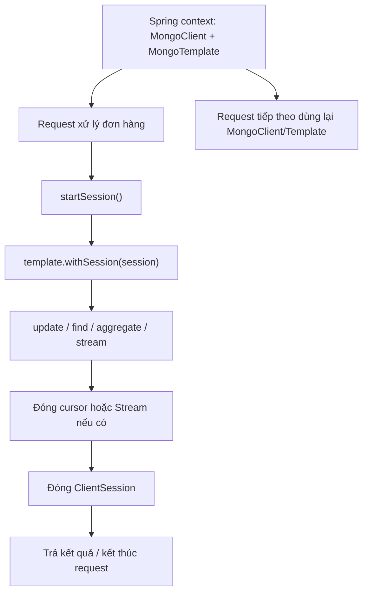
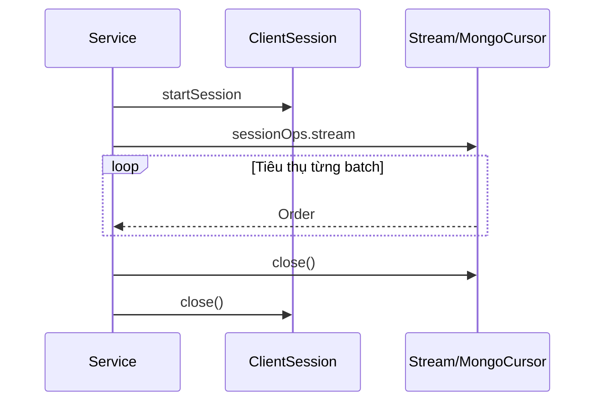

# withSession, phạm vi tài nguyên và đóng session

## 1. Vì sao quản lý session là một vấn đề thiết kế?

Trong **Spring Data MongoDB**, ứng dụng thường giữ một bean `MongoTemplate` hoặc repository để xử lý nhiều request. Nhưng một **MongoDB ClientSession** không có cùng vòng đời với những bean dùng chung này: session đại diện cho **ngữ cảnh của một chuỗi thao tác**, có thể mang thông tin thời gian nhân quả hoặc transaction, và cần được kết thúc đúng lúc.

Giả sử API xác nhận đơn hàng thực hiện:

1. Cập nhật `orders.state` từ `PENDING` sang `PAID`.
2. Đọc lại document trong cùng ngữ cảnh nhân quả.
3. Trả dữ liệu mới cho người gọi.

Một cách tổ chức:

```java
try (ClientSession session = client.startSession(options)) {
    MongoOperations inSession = template.withSession(session);

    inSession.updateFirst(query, update, Order.class);
    Order refreshed = inSession.findOne(query, Order.class);

    return refreshed;
}
```

Ở đây, `withSession` gắn **các lời gọi trên `inSession`** với `ClientSession` đã tạo. Nó **không có nghĩa** mọi lệnh gọi qua bean `template` hoặc repository khác cũng được tự động gắn session đó. `try-with-resources` đóng session khi khối kết thúc, kể cả khi có ngoại lệ.

Nếu quản lý sai phạm vi, ứng dụng có thể:

- Bỏ sót session ở một lời gọi, khiến chuỗi đọc–ghi không còn thuộc cùng causal context.
- Đóng session **quá sớm**, trong khi cursor hoặc luồng reactive vẫn cần lấy dữ liệu.
- Không đóng session khi xảy ra exception/cancellation.
- Chia sẻ một session giữa nhiều request hoặc thread và tạo ra race.
- Nhầm `withSession` với `startTransaction` hoặc `@Transactional`.
- Để MongoDB cursor mở quá lâu, làm tăng chi phí server/client và cản trở dọn dẹp tài nguyên.

**Mục tiêu bài học** trong chương **Session và giao dịch**, module **SPRING_DATA_MONGODB**: hiểu rõ `MongoOperations.withSession`, các **đối tượng sở hữu tài nguyên**, cách đóng session an toàn trong synchronous/reactive code, quan hệ với transaction, ví dụ `MongoTemplate`/repository, cùng kiểm thử và chẩn đoán. Những kiến thức này hỗ trợ thao tác dữ liệu, transaction, kiểm thử, reactive access và đánh giá hiệu năng của hệ thống MongoDB.

## 2. Ba phạm vi vòng đời khác nhau

Hãy tách **client**, **session** và **cursor** trước khi viết code.

| Đối tượng | Vai trò | Vòng đời điển hình | Ai đóng? |
| --- | --- | --- | --- |
| `MongoClient` | Quản lý kết nối/pool, topology, driver settings | Toàn bộ ứng dụng | Spring container hoặc thành phần tạo client |
| `MongoTemplate` | Bean truy cập MongoDB, ánh xạ document | Toàn bộ ứng dụng | Spring container quản lý bean; không đóng sau mỗi query |
| `MongoRepository` | Proxy/abstraction truy cập dữ liệu | Toàn bộ ứng dụng | Spring container |
| `ClientSession` | Ngữ cảnh session của một chuỗi thao tác | Một use case, request hoặc transaction có kiểm soát | Thành phần **tạo/sở hữu session**, trừ khi framework quản lý |
| `template.withSession(session)` | Các `MongoOperations` sử dụng session đã cho | Không vượt quá vòng đời session | Không thay thế hành động đóng session |
| `MongoCursor` / `Stream` từ MongoDB | Tiêu thụ kết quả theo đợt | Tới khi dùng xong dữ liệu | Người tiêu thụ, thường qua `try-with-resources` |
| Reactive `Publisher` | Mô tả công việc sẽ chạy khi được subscribe | Từ subscription đến completion/error/cancel | Dọn session/cursor trong lifecycle reactive |

**Nguyên tắc sở hữu:** thành phần nào **tạo** `ClientSession` thì phải có trách nhiệm **đóng** nó, trừ khi session được cấp và quản lý bởi transaction framework. Đừng đóng một `MongoClient` dùng chung chỉ vì vừa xong một request.

### 2.1. Session không phải một TCP connection cố định

Một logical session không đồng nhất với socket. Driver quản lý pool kết nối và thông tin session; tùy thao tác, nhất là **transaction**, driver có thể cần giữ/pin tài nguyên kết nối theo quy tắc topology. Việc tồn tại session không có nghĩa “một session = một kết nối mới”.

Vì thế:

- Không mở thêm `MongoClient` cho mỗi request để “tạo session riêng”.
- Không lưu session vào singleton bean.
- Không giữ session chờ người dùng nhấn nút trên UI sau nhiều phút.
- Không giả định `session.close()` đóng toàn bộ connection pool.

### 2.2. Sơ đồ phạm vi đúng



`MongoClient` vẫn còn để phục vụ request khác sau khi session của request hiện tại đã đóng.

## 3. withSession thực sự làm gì?

`MongoOperations.withSession(ClientSession)` cung cấp một phiên bản operations được gắn với session đã cho. Các lệnh MongoDB thực hiện thông qua **đối tượng operations này** sử dụng `ClientSession` trong những API được hỗ trợ.

```java
MongoOperations sessionOps = template.withSession(session);

sessionOps.insert(newOrder);
sessionOps.findOne(query, Order.class);
sessionOps.updateFirst(query, update, Order.class);
sessionOps.aggregate(pipeline, Order.class, OrderSummary.class);
```

Điều cần nhớ:

1. `withSession` **không tự tạo transaction**.
2. `withSession` **không tự đặt read concern majority/write concern majority**.
3. `withSession` **không làm mọi repository call khác tự tham gia session**.
4. `withSession` **không có nghĩa session sẽ được đóng khi một lệnh xong**.
5. Session phải xuất phát từ **cùng MongoClient logic** mà `MongoTemplate` thực tế sử dụng.
6. Không tiếp tục gọi `sessionOps` sau khi `session` đã đóng.

### 3.1. Phân biệt original template và session-bound operations

```java
MongoOperations sessionOps = template.withSession(session);

sessionOps.updateFirst(query, update, Order.class); // Trong session.

template.findOne(query, Order.class);                // Không được
                                                    // tự bảo đảm
                                                    // cùng session.
```

Ở dòng thứ hai, bean `template` ban đầu **không phải chính `sessionOps`**. Nếu cần một luồng nhân quả, tiếp tục dùng `sessionOps.findOne(...)`.

Mẫu sai này đặc biệt dễ xuất hiện khi service A gọi `sessionOps.updateFirst`, rồi lại gọi service B dùng repository mặc định để đọc. Cùng transaction/request/thread Java **không phải bằng chứng** các lệnh đang dùng cùng explicit session, trừ khi có cơ chế session/transaction binding phù hợp.

### 3.2. Không tạo session để thay thế tính đúng của lệnh ghi

Nếu update không khớp ID, tenant hoặc trạng thái, `read-your-writes` không thể làm xuất hiện một sự thay đổi chưa từng xảy ra.

```java
UpdateResult result = sessionOps.updateFirst(
    Query.query(
        Criteria.where("id").is(orderId)
            .and("tenantId").is(authorizedTenantId)
            .and("state").is("PENDING")
    ),
    new Update().set("state", "PAID"),
    Order.class
);

if (result.getMatchedCount() != 1) {
    throw new IllegalStateException(
        "Đơn không tồn tại hoặc trạng thái đã thay đổi"
    );
}
```

**Matched count** xác nhận query tìm được document phù hợp. Nó không tự chứng minh payment đã được xử lý đúng hay ngăn những client khác sửa document sau đó. Các invariant nghiệp vụ cần conditional update, idempotency, optimistic locking hoặc transaction theo tình huống.

## 4. Ví dụ dữ liệu và entity

Giả sử collection `orders` có một document:

```javascript
db.orders.insertOne({
  _id: "order-101",
  tenantId: "tenant-01",
  state: "PENDING",
  totalCents: NumberLong("12500"),
  createdAt: ISODate("2026-11-20T08:00:00Z")
});
```

Entity Spring Data:

```java
package example.orders;

import java.time.Instant;
import org.springframework.data.mongodb.core.mapping.Document;
import org.springframework.data.mongodb.core.mapping.FieldType;
import org.springframework.data.mongodb.core.mapping.MongoId;

@Document(collection = "orders")
public record Order(
    @MongoId(FieldType.STRING) String id,
    String tenantId,
    String state,
    long totalCents,
    Instant createdAt
) {}
```

`@MongoId(FieldType.STRING)` biểu thị ID được lưu thành BSON String. Trong các `Query` typed theo `Order.class`, Spring Data có thể ánh xạ Java property `id` sang `_id`. Khi sử dụng **raw BSON** trực tiếp qua driver, phải dùng field thật `_id`.

Để minh họa, nghiệp vụ sau sẽ chuyển `PENDING → PAID` rồi đọc lại trong cùng session. Ví dụ **không** giả định xử lý thanh toán đầy đủ chỉ bằng một field; ở production, có thể cần đối soát, ledger, idempotency và transaction.

## 5. Synchronous: try-with-resources là lựa chọn mặc định

### 5.1. Service sử dụng MongoTemplate.withSession

```java
package example.orders;

import com.mongodb.ClientSessionOptions;
import com.mongodb.client.ClientSession;
import com.mongodb.client.MongoClient;
import com.mongodb.client.result.UpdateResult;
import org.springframework.data.mongodb.core.MongoOperations;
import org.springframework.data.mongodb.core.MongoTemplate;
import org.springframework.data.mongodb.core.query.Criteria;
import org.springframework.data.mongodb.core.query.Query;
import org.springframework.data.mongodb.core.query.Update;
import org.springframework.stereotype.Service;

@Service
public class OrderSessionService {

    private final MongoClient client;
    private final MongoTemplate template;

    public OrderSessionService(
            MongoClient client,
            MongoTemplate template) {
        this.client = client;
        this.template = template;
    }

    public Order confirmThenRead(
            String authorizedTenantId,
            String orderId) {

        if (authorizedTenantId == null
                || authorizedTenantId.isBlank()
                || orderId == null
                || orderId.isBlank()) {
            throw new IllegalArgumentException(
                "Tenant hoặc orderId không hợp lệ"
            );
        }

        ClientSessionOptions options =
            ClientSessionOptions.builder()
                .causallyConsistent(true)
                .build();

        try (ClientSession session =
                client.startSession(options)) {

            MongoOperations ops =
                template.withSession(session);

            Query target = Query.query(
                Criteria.where("id").is(orderId)
                    .and("tenantId").is(authorizedTenantId)
            );
            Query pending = Query.query(
                Criteria.where("id").is(orderId)
                    .and("tenantId").is(authorizedTenantId)
                    .and("state").is("PENDING")
            );

            UpdateResult result = ops.updateFirst(
                pending,
                new Update().set("state", "PAID"),
                Order.class
            );

            if (result.getMatchedCount() != 1) {
                throw new IllegalStateException(
                    "Không thể xác nhận đơn hàng"
                );
            }

            Order updated =
                ops.findOne(target, Order.class);

            if (updated == null) {
                throw new IllegalStateException(
                    "Không tìm thấy đơn sau khi cập nhật"
                );
            }
            return updated;
        }
    }
}
```

Điểm quan trọng:

1. `MongoClient` là bean được **inject**, không tạo mới ở mỗi request.
2. `ClientSession` chỉ sống trong `try` của **một lần gọi nghiệp vụ**.
3. `template.withSession(session)` sinh `ops` với session hiện tại.
4. Cả `updateFirst` và `findOne` đều gọi trên **`ops`**, không gọi lại bean `template` gốc.
5. `matchedCount` được kiểm tra trước khi đọc lại.
6. Nếu update, read hoặc mapping ném exception, Java vẫn gọi `session.close()`.
7. `Order` được trả ra là dữ liệu đã **materialize**, không phải cursor hoặc publisher cần session tiếp tục sống.

### 5.2. Session không tự đặt concern

Để có đầy đủ các bảo đảm **causal consistency bền vững** trong một replica set, MongoDB yêu cầu các thao tác thuộc causally consistent session được thực hiện tuần tự, với:

- `readConcern: "majority"` cho các lần đọc.
- `writeConcern: "majority"` cho các lần ghi.

`withSession` **không tự nâng** read/write concern. Nếu ứng dụng có `MongoTemplate` cấu hình `ReadConcern.LOCAL` và write concern `w:1`, đoạn Java trên là ví dụ **gắn session và đóng tài nguyên đúng**, không phải bằng chứng đủ điều kiện majority-causal trong failover.

Nếu mục tiêu chỉ là minh họa tài nguyên session, không cần gắn nhãn “causal guarantee” cho một test chỉ thấy giá trị ngay trên primary. Nếu cần bảo đảm nhân quả, cấu hình concerns và xác minh command thật.

### 5.3. Cấu hình majority từ MongoDB Java client

Ví dụ tạo client **một lần** cho ứng dụng:

```java
import com.mongodb.ConnectionString;
import com.mongodb.MongoClientSettings;
import com.mongodb.ReadConcern;
import com.mongodb.ReadPreference;
import com.mongodb.WriteConcern;
import com.mongodb.client.MongoClient;
import com.mongodb.client.MongoClients;

ConnectionString connectionString = new ConnectionString(
    "mongodb://node1:27017,node2:27017,node3:27017/"
        + "?replicaSet=rs0"
);

MongoClientSettings settings = MongoClientSettings.builder()
    .applyConnectionString(connectionString)
    .readConcern(ReadConcern.MAJORITY)
    .writeConcern(WriteConcern.MAJORITY)
    .readPreference(ReadPreference.secondaryPreferred())
    .build();

MongoClient client = MongoClients.create(settings);
```

`node1/node2/node3` là **placeholder** cho ví dụ, không phải địa chỉ để copy sử dụng thật. Trong Spring Boot, hãy dùng cấu hình/bean được ứng dụng quản lý, credential từ nguồn bảo mật và bảo đảm `MongoTemplate` cùng sử dụng client này. Không mở một client mới trong mỗi service method; điều đó lãng phí pool và kết nối.

## 6. Vì sao phải đóng ClientSession?

`ClientSession` mang trạng thái logic driver/server, có thể ảnh hưởng tới tài nguyên của những lệnh đang hoạt động. Khi session đã hoàn tất, cần thông báo driver để giải phóng/trả tài nguyên thuộc lifecycle của nó.

### 6.1. close khác commit và abort

| Hành động | Ý nghĩa |
| --- | --- |
| `session.close()` | Đóng lifecycle session do client quản lý; không phải “commit transaction” |
| `session.startTransaction()` | Bắt đầu multi-document transaction trong session |
| `session.commitTransaction()` | Yêu cầu commit transaction đang hoạt động |
| `session.abortTransaction()` | Yêu cầu abort transaction đang hoạt động |
| `mongoClient.close()` | Đóng client dùng chung/pool; thường chỉ khi ứng dụng dừng |

**Đừng dựa vào `close` để commit một transaction chưa hoàn tất.** Khi có transaction, phải chủ động commit hoặc abort theo kết quả nghiệp vụ, sau đó mới đóng session; nếu khối try-with-resources thoát vì exception, logic rollback/abort phải rõ ràng.

### 6.2. Phân biệt tài nguyên ở driver và server

Session có thể được driver quản lý/pool; MongoDB server cũng theo dõi logical session và có cơ chế hết hạn/cleanup. Việc server có TTL cho session **không thay thế** việc client đóng session khi công việc xong. Để tài nguyên tự hết hạn chỉ khiến bug khó phát hiện hơn.

Trong transaction, driver có thể giữ connection/pinning theo topology và phiên bản. Session hoặc cursor tồn tại không cần thiết có thể làm tình hình pool/resource xấu đi, nhất là khi nhiều request đồng thời.

### 6.3. Nguyên tắc cuối cùng

```text
Ai startSession()?  -> Thành phần đó có trách nhiệm close.
Ai tạo cursor?     -> Thành phần tiêu thụ phải đóng cursor.
Ai bắt đầu tx?     -> Thành phần điều phối tx phải commit hoặc abort.
Ai tạo MongoClient?-> Chủ sở hữu cấp ứng dụng đóng khi shutdown.
```

Nếu một framework như Spring transaction manager tạo/quản lý session, **không đóng thủ công session đó** từ một repository helper không sở hữu nó.

## 7. try/finally và try-with-resources

### 7.1. Mẫu gọn được ưu tiên

```java
try (ClientSession session = client.startSession()) {
    MongoOperations ops = template.withSession(session);
    return ops.findOne(query, Order.class);
}
```

Java tự gọi `session.close()` cả khi `findOne` hoàn tất bình thường hoặc ném exception. Đây là lý do `try-with-resources` được ưu tiên cho synchronous code có phạm vi lexical rõ.

### 7.2. Dạng finally khi cần thêm cleanup có kiểm soát

```java
ClientSession session = client.startSession();
try {
    MongoOperations ops = template.withSession(session);
    return ops.findOne(query, Order.class);
} finally {
    session.close();
}
```

Nếu cần đóng nhiều tài nguyên, hãy cân nhắc **thứ tự cleanup** và exception ở bước đóng. `try-with-resources` quản lý suppressed exceptions hợp lý hơn code `finally` tự viết trong nhiều tình huống.

### 7.3. Mẫu sai: close chỉ ở nhánh thành công

```java
ClientSession session = client.startSession();
MongoOperations ops = template.withSession(session);

Order order = ops.findOne(query, Order.class);

session.close();   // Không chạy nếu findOne ném exception.
return order;
```

**Sai vì resource leak tiềm ẩn.** Đừng đặt cleanup ở sau những lệnh có thể lỗi mà không có `finally`/`try-with-resources`.

### 7.4. Mẫu sai: trả một tác vụ lazy ra ngoài scope đã đóng

```java
Stream<Order> openStream() {
    try (ClientSession session = client.startSession()) {
        MongoOperations ops = template.withSession(session);
        return ops.stream(query, Order.class);
    } // Session đã đóng trước khi caller tiêu thụ Stream.
}
```

**Không dùng**: `Stream` đọc từ cursor một cách lazy. Sau khi method trả về, session đã bị đóng, trong khi caller vẫn muốn lấy thêm batch. Kết quả có thể là lỗi cursor/session, dữ liệu không đầy đủ hoặc tài nguyên khó dọn dẹp.

## 8. Cursor và Stream: đóng theo thứ tự ngược lúc tạo

Một nguyên tắc dễ áp dụng là: **đóng tài nguyên sử dụng session trước, rồi mới đóng session**.

### 8.1. Ví dụ đúng với MongoTemplate.stream

```java
import java.util.stream.Stream;

try (ClientSession session = client.startSession()) {
    MongoOperations ops = template.withSession(session);

    try (Stream<Order> orders =
            ops.stream(query, Order.class)) {

        orders.forEach(this::exportOrder);
    } // Đóng Stream/cursor ở đây.

} // Đóng ClientSession sau cùng.
```

Ở đây, `exportOrder` là một method ứng dụng do developer cung cấp; đoạn code đặt trong service có `client`, `template` và `query` đã xác định. Việc dùng `Stream` tránh nạp mọi document vào một `List`, nhưng **không tự giảm số document/byte phải chuyển qua mạng**.

### 8.2. Dùng try-with-resources lồng nhau giúp điều gì?



Ngay cả khi `forEach` ném exception, phần cleanup của `try-with-resources` lồng nhau vẫn chạy theo thứ tự **cursor trước, session sau**.

### 8.3. Không trả cursor/Stream ra ngoài mà không chuyển quyền sở hữu

Nếu API thật sự phải trả một `Stream`, cần chuyển cả lifecycle session/cursor cho người gọi bằng một abstraction `AutoCloseable` có contract rõ ràng. Nhưng cách đó làm API phức tạp, dễ bị caller quên đóng. Đối với hầu hết service methods, nên **tiêu thụ toàn bộ Stream trong scope** và trả về DTO đã materialize hoặc kết quả được xuất ra một đích có kiểm soát.

### 8.4. MongoDB cursor có thể chờ nhiều lượt getMore

Một cursor ban đầu có thể chỉ nhận batch đầu rồi gọi `getMore` khi được tiêu thụ. Đóng session khi cursor còn chờ batch hoặc vẫn có request đang đọc là không an toàn. Với cursor lớn:

- Giới hạn lượng dữ liệu và thời gian thao tác.
- Đóng cursor khi đủ kết quả, khi lỗi, khi client cancel.
- Không dựa vào GC để đóng cursor.
- Không giữ Stream sống qua HTTP response streaming nếu chưa thiết kế toàn bộ lifecycle.

`cursorBatchSize` điều khiển kích thước batch, **không phải tổng số kết quả**, không giải quyết việc quên đóng session.

## 9. Phiên bản callback: giữ quyền sở hữu ở cùng một nơi

Khi nhiều service methods cần sử dụng cùng một mẫu session, có thể trừu tượng hóa **phần tạo và đóng session**:

```java
package example.orders;

import java.util.function.Function;
import com.mongodb.ClientSessionOptions;
import com.mongodb.client.ClientSession;
import com.mongodb.client.MongoClient;
import org.springframework.data.mongodb.core.MongoOperations;
import org.springframework.data.mongodb.core.MongoTemplate;

public final class MongoSessionRunner {

    private final MongoClient client;
    private final MongoTemplate template;

    public MongoSessionRunner(
            MongoClient client,
            MongoTemplate template) {
        this.client = client;
        this.template = template;
    }

    public <T> T run(
            Function<MongoOperations, T> work) {

        try (ClientSession session = client.startSession(
                ClientSessionOptions.builder()
                    .causallyConsistent(true)
                    .build())) {

            MongoOperations ops =
                template.withSession(session);
            return work.apply(ops);
        }
    }
}
```

Sử dụng:

```java
Order order = runner.run(ops ->
    ops.findOne(
        Query.query(Criteria.where("id").is(orderId)),
        Order.class
    )
);
```

**Contract của callback này:** `work` phải hoàn tất **đồng bộ** trước khi trả về; không được trả `Stream`, `Publisher` hoặc object giữ cursor đang hoạt động rồi dùng sau. `MongoSessionRunner` không tự cấu hình read/write concern majority, và nó **không tự tạo transaction**.

Một runner như vậy giúp tránh việc mỗi service copy một `startSession`/`close` khác nhau. Nhưng nếu dự án chủ yếu dùng Spring-managed transactions, không tạo thêm một “transaction manager tự chế” chỉ để bao mọi thao tác.

### 9.1. Cảnh giác với callback lồng nhau

```java
runner.run(ops1 -> {
    return runner.run(ops2 -> {
        // ops2 dùng session khác với ops1.
        return ops2.findOne(query, Order.class);
    });
});
```

Hai lời gọi `run` tạo **hai session khác nhau**. Nếu yêu cầu một chuỗi nhân quả, nên truyền `MongoOperations` đã bound sẵn vào helper bên trong, thay vì âm thầm tạo session mới.

### 9.2. Không làm session thành field dùng chung

Không thiết kế singleton như:

```java
@Service
class BadSharedSessionService {
    private ClientSession session; // Sai nếu dùng chung request.
}
```

Session có trạng thái mutable và yêu cầu tuần tự; nhiều request/threads cùng dùng sẽ khó xác định thứ tự, đóng bất ngờ và vi phạm contract của driver. Trường lưu ở singleton nên là `MongoClient`/`MongoTemplate`; session là biến cục bộ theo use case.

## 10. Session và transaction: hai khái niệm khác nhau

Một transaction **được gắn với session**, nhưng tạo session **không tự bắt đầu transaction**.

```text
ClientSession:
  - Dùng cho causal operation context.
  - Có thể chứa nhiều lệnh read/write độc lập.
  - Không có commit/rollback chung nếu chưa startTransaction.

ClientSession + Transaction:
  - startTransaction.
  - Lệnh trong transaction dùng cùng session.
  - commitTransaction hoặc abortTransaction.
  - close session sau khi transaction đã được xử lý.
```

### 10.1. Ví dụ manual transaction tối thiểu

```java
import com.mongodb.ReadConcern;
import com.mongodb.ReadPreference;
import com.mongodb.TransactionOptions;
import com.mongodb.WriteConcern;
import com.mongodb.client.ClientSession;
import com.mongodb.client.MongoClient;
import org.springframework.data.mongodb.core.MongoOperations;
import org.springframework.data.mongodb.core.MongoTemplate;

TransactionOptions txOptions = TransactionOptions.builder()
    .readConcern(ReadConcern.SNAPSHOT)
    .writeConcern(WriteConcern.MAJORITY)
    .readPreference(ReadPreference.primary())
    .build();

try (ClientSession session = client.startSession()) {
    session.startTransaction(txOptions);

    try {
        MongoOperations txOps =
            template.withSession(session);

        txOps.updateFirst(
            debitQuery, debitUpdate, Account.class
        );
        txOps.updateFirst(
            creditQuery, creditUpdate, Account.class
        );

        // Chỉ sau khi kiểm tra đầy đủ invariant
        // mới yêu cầu commit.
        session.commitTransaction();
    } catch (RuntimeException | Error failure) {
        if (session.hasActiveTransaction()) {
            try {
                session.abortTransaction();
            } catch (RuntimeException abortFailure) {
                failure.addSuppressed(abortFailure);
            }
        }
        throw failure;
    }
} // Sau commit/abort, đóng session.
```

Đây là **khung mô tả lifecycle**, không phải code chuyển tiền production hoàn chỉnh. `debitQuery`, `debitUpdate`, `creditQuery`, `creditUpdate` và `Account` là thành phần của ứng dụng cần định nghĩa riêng; phải kiểm tra số dư, kết quả cập nhật, idempotency và xử lý retry transaction theo nhãn lỗi của MongoDB.

### 10.2. Không coi commit lỗi là chưa hề ghi

Khi `commitTransaction()` gặp network error, client có thể không biết commit có thành công hay chưa. MongoDB có các error labels/khuyến nghị retry, đặc biệt với `UnknownTransactionCommitResult` và `TransientTransactionError`. Một wrapper chỉ `catch RuntimeException → abort` **không** giải quyết toàn bộ retry/commit ambiguity.

Với nghiệp vụ tài chính, cần thiết kế retry đúng mức, khóa idempotency, audit và đối soát; không lặp lại toàn bộ thao tác cộng/trừ tiền mù quáng sau timeout.

### 10.3. Phiên bản chuẩn hơn: để transaction manager quản lý

Nếu ứng dụng Spring dùng các giao dịch thường xuyên, ưu tiên tích hợp `MongoTransactionManager` và `@Transactional` theo cấu hình được hỗ trợ thay vì lặp mã manual commit/abort ở nhiều service.

## 11. Spring-managed transaction: ai sở hữu session?

### 11.1. Cấu hình MongoTransactionManager

```java
package example.orders;

import org.springframework.context.annotation.Bean;
import org.springframework.context.annotation.Configuration;
import org.springframework.data.mongodb.MongoDatabaseFactory;
import org.springframework.data.mongodb.MongoTransactionManager;

@Configuration
public class MongoTransactionConfiguration {

    @Bean
    MongoTransactionManager transactionManager(
            MongoDatabaseFactory factory) {
        return new MongoTransactionManager(factory);
    }
}
```

Khi dùng `@Transactional` với Mongo transaction manager và topology hỗ trợ transaction, Spring tạo, bind và quản lý session/transaction theo transaction boundary.

```java
package example.orders;

import org.springframework.stereotype.Service;
import org.springframework.transaction.annotation.Transactional;

@Service
public class AccountTransferService {

    private final AccountRepository accounts;

    public AccountTransferService(
            AccountRepository accounts) {
        this.accounts = accounts;
    }

    @Transactional
    public void transfer(/* validated transfer command */) {
        // Các repository operations tham gia cùng
        // transaction do Spring quản lý nếu được cấu hình đúng.
        // Kiểm tra điều kiện và kết quả thay đổi trước commit.
    }
}
```

`AccountRepository` và nội dung `transfer` ở đây là khung để minh họa boundary, không phải implementation hoàn chỉnh. Dùng transaction đúng còn cần MongoDB replica set/sharded topology hỗ trợ, timeout, write concern, những trường hợp retry và cấu hình proxy của Spring.

### 11.2. Không đóng session do Spring sở hữu

Khi session được transaction manager bind vào thao tác, **Spring** chịu trách nhiệm kết thúc/cleanup. Không gọi `session.close()` tùy tiện trong repository/helper nếu session đó thuộc transaction đang hoạt động. Đóng trước thời điểm commit có thể làm transaction lỗi.

Một quy tắc:

| Nguồn tạo session | Ai quản lý vòng đời? |
| --- | --- |
| `client.startSession()` trong service | Service, dùng try-with-resources/finally |
| `MongoTransactionManager` thông qua `@Transactional` | Transaction manager/Spring |
| Test tự mở session | Test phải đóng |
| Reactive subscriber tự tạo session | Reactive resource scope phải cleanup khi hoàn tất/error/cancel |

### 11.3. Tránh trộn explicit session và @Transactional vô thức

Nếu một method đang chạy trong transaction do Spring quản lý nhưng lại gọi `client.startSession()` rồi `template.withSession(newSession)`, các thao tác trên session mới **không mặc nhiên** thuộc transaction cũ.

```java
@Transactional
public void confusingFlow() {
    repository.save(orderA); // Có thể thuộc transaction của Spring.

    try (ClientSession other = client.startSession()) {
        template.withSession(other)
            .insert(orderB);  // Session khác.
    }
}
```

Đây là **anti-pattern minh họa**: code trên không nên được coi là một transaction nguyên tử cho `orderA` và `orderB`. Nếu cần chung commit, dùng các operations tham gia cùng Spring transaction hoặc một chiến lược explicit session thống nhất, không trộn hai cơ chế.

### 11.4. Transaction boundary khác request boundary

Không nên mở transaction ở đầu HTTP request rồi giữ đến khi client đọc xong response/chờ stream dài. Transaction nên ngắn, có tập thao tác rõ, kiểm tra kết quả và commit/abort sớm. Nếu phải xuất báo cáo lớn hoặc gửi HTTP streaming, tách nó khỏi write transaction khi có thể.

## 12. Session không tự lan qua repository và thread khác

### 12.1. Lời gọi repository ngoài binding phù hợp

```java
try (ClientSession session = client.startSession()) {
    MongoOperations sessionOps =
        template.withSession(session);

    sessionOps.updateFirst(query, update, Order.class);

    // Không được giả định có cùng explicit session:
    Order order = repository.findById(id).orElseThrow();
}
```

Ở đây `repository.findById` không tự dùng `sessionOps`. Nếu chưa có Spring transaction/session synchronization đặc biệt được cấu hình, đây là **hai đường truy cập khác nhau**.

Đối với explicit session không transaction, nếu mục tiêu là một chuỗi thao tác có nhân quả, hãy dùng `sessionOps` xuyên suốt hoặc xây custom repository nhận session-bound operations rõ ràng.

### 12.2. @Async và thread pool

`ClientSession` không phải đối tượng an toàn để sử dụng đồng thời từ nhiều thread. Đừng đưa nó vào một executor rồi phát nhiều lệnh MongoDB song song.

```java
// Sai: chia sẻ session đang mutable cho tác vụ đồng thời.
CompletableFuture.runAsync(
    () -> sessionOps.insert(a)
);
CompletableFuture.runAsync(
    () -> sessionOps.insert(b)
);
```

Nếu workflow có quan hệ nhân quả, các lệnh trong cùng session nên được thực hiện **tuần tự**, chờ lệnh trước kết thúc. Nếu các tác vụ độc lập chạy song song, chúng có thể có **session riêng** với yêu cầu nhất quán phù hợp; không dùng chung một session cho cả pool.

### 12.3. HTTP request A rồi request B không tự chia sẻ session

```text
POST /orders/101/confirm -> instance A, session A -> đóng.
GET  /orders/101         -> instance B, session B -> mới.
```

Hai session không có quan hệ nhân quả tự động chỉ vì cùng người dùng hoặc cùng order ID. Nếu yêu cầu read-your-writes xuyên request, cần một thiết kế riêng: trả read model mới ngay từ response ghi, đọc từ primary theo chính sách phù hợp, truyền causal context bằng cơ chế tin cậy, hoặc chờ cache/read model đạt version nghiệp vụ yêu cầu.

Không để session của request A sống đến request B bằng một static map để “giữ nhất quán”. Cách đó gây rò rỉ tài nguyên, sai về concurrency, khó scale và khó xử lý client rời đi.

## 13. Lazy data: khi nào được phép thoát khỏi session scope?

| Giá trị trả về | Có phụ thuộc session sau khi method trả? | Cách dùng |
| --- | --- | --- |
| `Order` đã đọc xong qua `findOne` | Thông thường không | Trả DTO/entity như dữ liệu đã materialize |
| `List<Order>` đã tải xong | Không cần cursor mở nữa nếu operation đã hoàn thành | Trả list, cân nhắc bộ nhớ |
| `Stream<Order>` từ `MongoOperations.stream` | **Có thể còn cursor đang mở** | Tiêu thụ và đóng trong session scope |
| MongoDB `MongoCursor<Document>` | Có | Đóng cursor trước session |
| Reactive `Mono<Order>`/`Flux<Order>` chưa subscribe | Chưa thực thi hoặc còn chạy về sau | Session phải sống theo subscription lifecycle |
| DTO chứa `Supplier` làm query sau đó | Có nếu supplier gọi DB về sau | Không lén đóng session trước khi query thực thi |

### 13.1. Materialize trước rồi trả

```java
public List<Order> findOrders(String tenantId) {
    try (ClientSession session = client.startSession()) {
        MongoOperations ops = template.withSession(session);
        Query query = Query.query(
            Criteria.where("tenantId").is(tenantId)
        );
        query.limit(100);
        return ops.find(query, Order.class);
    }
}
```

`ops.find` hoàn thành và trả list dữ liệu đã đọc trước khi session đóng. Ví dụ vẫn cần xác thực `tenantId` và cân nhắc sort/pagination trong ứng dụng thật.

### 13.2. Không hiểu lầm “đóng session sau khi return”

Trong Java, biểu thức `return` được đánh giá **trước** khi `try-with-resources` thực thi cleanup. Nếu biểu thức return tạo **một object lazy** thay vì thực sự tiêu thụ dữ liệu, việc session được đóng sau return không làm object lazy “thành kết quả đã tải”.

Đây là nguyên nhân bug “test small data pass, production lỗi khi getMore” có thể chỉ xuất hiện với cursor lớn, dù cùng method code.

## 14. Reactive: session sống theo subscription, không theo lexical try

Reactive API chỉ bắt đầu thực thi khi có subscription; phương thức Java trả `Mono`/`Flux` không nhất thiết đã phát một lệnh MongoDB nào.

### 14.1. Mẫu sai: try-with-resources bao việc tạo Publisher

```java
Mono<Order> loadOrder(String id) {
    try (ReactiveClientSession session = obtainSession()) {
        return loadWithSession(session, id);
    } // Đóng session trước khi Mono được subscribe.
}
```

`ReactiveClientSession` và `obtainSession` ở đây là **pseudocode để minh họa lỗi vòng đời**, không phải API có thể import nguyên xi. Lỗi thực tế nằm ở chỗ publisher **chưa chạy** khi Java method trả về, nhưng session đã đóng.

### 14.2. Resource scope phải bao subscription

Reactor cung cấp `usingWhen` để quản lý tài nguyên bất đồng bộ với các nhánh **complete, error và cancel**:

```java
Mono<Order> result = Mono.usingWhen(
    createSessionPublisher(),
    session -> workWithSession(session),
    session -> cleanupSession(session),
    (session, error) -> cleanupSession(session),
    session -> cleanupSession(session)
);
```

Ba helper `createSessionPublisher`, `workWithSession`, `cleanupSession` là **hàm giả lập của ứng dụng**; đoạn code trên mô tả mẫu Reactor, không phải implementation MongoDB hoàn chỉnh. Trong code thật, resource là reactive-driver `ClientSession` tương thích với `ReactiveMongoTemplate`.

**Ưu điểm:** session được tạo **khi subscribe**, đóng sau khi công việc hoàn tất hoặc lỗi, và được cleanup khi subscription bị hủy. Không dựa vào Java `finally` của method trả Publisher.

### 14.3. ReactiveMongoTemplate.withSession

Trong Spring Data MongoDB reactive, có API session-aware để các thao tác thuộc cùng reactive client session. Tùy phiên bản, cách truyền session thường đi qua publisher/session callback thích hợp. Ý tưởng:

```text
subscribe:
    acquire reactive ClientSession
    bind session to ReactiveMongoOperations
    update / read theo thứ tự
    emit DTO hoặc error
    cleanup session on complete / error / cancel
```

**Không trộn** `com.mongodb.client.ClientSession` của synchronous driver với `com.mongodb.reactivestreams.client.ClientSession` của reactive driver. Cần dùng API chính xác của phiên bản Spring Data/driver trong dự án để build.

### 14.4. Thứ tự subscription cần rõ ràng

```java
// Hai publisher có thể được subscribe đồng thời:
Mono.zip(writePublisher, readPublisher);

// Đọc chỉ bắt đầu sau khi ghi hoàn tất:
writePublisher.then(readPublisher);
```

Hai dòng trên giả định `writePublisher` và `readPublisher` đã được định nghĩa. `then` diễn đạt thứ tự reactive, nhưng **không tự gắn session hay nâng majority concerns**. Nếu cùng một session mà phát concurrent operations, có thể vi phạm ràng buộc của driver và phá ý nghĩa thứ tự nhân quả.

### 14.5. doFinally có đủ không?

`doFinally` được gọi khi termination/cancel, nhưng khi cleanup cũng là bất đồng bộ, chỉ gọi một side effect trong `doFinally` không đủ để **chờ cleanup hoàn tất**. `usingWhen` mô tả cleanup thành một Publisher có thể được thực thi, theo dõi lỗi và gắn đúng lifecycle.

Nếu session.close() là synchronous, cần chú ý chính sách thread và không đặt thao tác blocking lên event loop. Nếu driver/session có cleanup publisher riêng, dùng đúng cách mà API cung cấp; không gọi `block()` trong reactive service chỉ để đóng session.

## 15. Error path: cleanup phải xảy ra trước khi trả kết quả lỗi

### 15.1. Lỗi database hoặc mapping

```java
try (ClientSession session = client.startSession()) {
    MongoOperations ops = template.withSession(session);
    Order order = ops.findOne(query, Order.class);

    if (order == null) {
        throw new IllegalStateException("Không tìm thấy đơn");
    }

    return order;
}
```

Nếu `findOne`, converter hoặc validation nghiệp vụ gây exception, session vẫn được đóng. **Không nuốt exception chỉ để tránh lộ lỗi tài nguyên**.

### 15.2. Nếu thao tác close tự ném exception?

Trong `try-with-resources`, nếu code nghiệp vụ ném lỗi và `close` cũng ném lỗi, Java thường giữ lỗi chính và bổ sung lỗi cleanup vào danh sách **suppressed exceptions**. Việc này giúp không làm mất nguyên nhân ban đầu.

Không tự viết:

```java
try {
    doWork();
} finally {
    session.close(); // Có thể che lỗi gốc nếu close cũng lỗi.
}
```

Đoạn trên là lời nhắc về trường hợp `finally` phức tạp; trong những tình huống cần nhiều cleanup, `try-with-resources`/resource abstraction thường an toàn hơn.

### 15.3. Khi có transaction, thứ tự cleanup thay đổi

Nếu transaction chưa commit/abort, cần xử lý transaction theo chính sách; chỉ sau đó mới đóng session. Đừng gọi `session.close()` **trước** `commitTransaction()`, và đừng trả thành công khi commit chưa được xác nhận.

Một exception trong `commitTransaction()` cần logic xử lý **unknown commit result**, không chỉ cleanup. Việc đóng tài nguyên đúng **không đồng nghĩa** đã xử lý thành công ngữ nghĩa transaction.

## 16. Chẩn đoán rò rỉ session và cursor

### 16.1. Các triệu chứng thường gặp

- API xuất dữ liệu chạy rất lâu, request khác phải chờ kết nối/pool.
- Số lệnh `getMore` hoặc cursor mở tăng bất thường.
- Transaction bị giữ dài, tăng lock/commit latency hoặc lỗi time limit.
- Tăng lỗi do session đã đóng hoặc sử dụng session từ sai client.
- Luồng reactive bị cancel nhưng dọn session không được gọi.
- Sau deploy chạy ổn một thời gian rồi latency tăng theo traffic.

Không quy mọi vấn đề pool exhaustion cho session leak. Cần quan sát **pool metrics, MongoDB current operations, cursor metrics, transaction metrics**, network, query plan và timeout; một pipeline `$group` kém tối ưu cũng có thể khiến cursor/request sống lâu.

### 16.2. Checklist điều tra

| Câu hỏi | Cách kiểm tra |
| --- | --- |
| Session do ai tạo? | Tìm boundary `startSession`/transaction manager |
| Có try-with-resources hoặc finally không? | Review mọi exit path và exception |
| Stream/cursor đã đóng trước session chưa? | Kiểm tra nested try và return type |
| Có repository gọi ngoài `sessionOps` không? | Theo dõi code path và command `lsid` trong test |
| Session có bị giữ trong singleton/request cache không? | Review field scope và concurrency |
| Transaction có commit/abort đúng không? | Kiểm tra transaction boundaries và error labels |
| Reactive cleanup có chạy khi cancel không? | `usingWhen` tests với cancellation |
| Có session khác MongoClient đang dùng không? | Xác nhận client factory/bean và kết nối |
| Read/write concerns có đúng mục tiêu không? | Quan sát cấu hình hiệu lực và command runtime |
| Lệnh lâu do cursor hay query plan? | `explain`, server metrics và getMore |

### 16.3. Command monitoring ở môi trường test

MongoDB Java driver hỗ trợ `CommandListener` để quan sát lệnh thực thi. Có thể xem command name và `lsid` để xác minh một chuỗi thao tác được gắn đúng session:

```java
import com.mongodb.event.CommandListener;
import com.mongodb.event.CommandStartedEvent;

public final class SessionCommandObserver
        implements CommandListener {

    @Override
    public void commandStarted(CommandStartedEvent event) {
        if (!"find".equals(event.getCommandName())
                && !"update".equals(event.getCommandName())) {
            return;
        }

        boolean hasLsid =
            event.getCommand().containsKey("lsid");
        System.out.println("command=" +
            event.getCommandName()
            + ", hasLsid=" + hasLsid);
    }
}
```

**Quan trọng:** MongoDB drivers còn có **implicit sessions**. Vì vậy, chỉ thấy `lsid` xuất hiện ở cả hai command **không chứng minh** chúng thuộc **cùng explicit ClientSession**. Để test đúng, cần so sánh session identity/`lsid`, concerns, thứ tự và command target trong môi trường được kiểm soát, không chỉ kiểm tra Boolean `hasLsid`.

Không log toàn bộ command có chứa thông tin khách hàng hoặc credential lên production nếu không có quy trình redaction/retention.

### 16.4. Dọn tài nguyên không thay thế giới hạn query

Đóng session đúng giúp tránh leak, nhưng nếu một query xử lý hàng triệu document trong một request vẫn có thể chiếm CPU/RAM/đĩa rất lớn. Cần kết hợp projection/limit/index, cursor batch size, maxTimeMS và giới hạn đồng thời khi phù hợp. Đừng chỉ tăng pool size để bù một query hoặc cursor bị giữ vô hạn.

## 17. Kiểm thử tích hợp: session hoạt động và không bị đóng sớm

### 17.1. Điều kiện môi trường

Để kiểm tra session/transaction thật cần MongoDB deployment hỗ trợ client sessions; test transaction cần replica set/sharded topology hỗ trợ. `@DataMongoTest` không tự bảo đảm luôn có MongoDB server chạy. Dùng MongoDB test instance hoặc Testcontainers phù hợp với Spring Boot/MongoDB driver version.

Tài liệu này **chưa chạy Gradle, Python hoặc integration test**: các ví dụ giúp học cách viết/thiết kế test; bước QA sau có thể xác minh chính xác trong repository thực tế.

### 17.2. Test service với Spring Data MongoTemplate

```java
package example.orders;

import static org.junit.jupiter.api.Assertions.*;

import java.time.Instant;
import java.util.UUID;
import org.junit.jupiter.api.Test;
import org.springframework.beans.factory.annotation.Autowired;
import org.springframework.boot.test.autoconfigure.data.mongo.DataMongoTest;
import org.springframework.context.annotation.Import;
import org.springframework.data.mongodb.core.MongoTemplate;

@DataMongoTest
@Import(OrderSessionService.class)
class OrderSessionServiceTest {

    @Autowired
    MongoTemplate template;

    @Autowired
    OrderSessionService service;

    @Test
    void sessionBoundUpdateThenReadReturnsMaterializedEntity() {
        String id = "order-" + UUID.randomUUID();
        String tenant = "tenant-" + UUID.randomUUID();

        template.insert(new Order(
            id,
            tenant,
            "PENDING",
            12500L,
            Instant.parse("2026-11-20T08:00:00Z")
        ));

        Order updated = service.confirmThenRead(tenant, id);

        assertNotNull(updated);
        assertEquals("PAID", updated.state());
        assertEquals(tenant, updated.tenantId());

        // Sau khi method đóng session, DTO/entity vẫn
        // dùng được vì đã được materialize.
        assertEquals(id, updated.id());
    }

    @Test
    void unmatchedConditionalUpdateFailsCleanly() {
        String id = "order-" + UUID.randomUUID();
        String tenant = "tenant-" + UUID.randomUUID();

        template.insert(new Order(
            id,
            tenant,
            "CANCELLED",
            12500L,
            Instant.now()
        ));

        assertThrows(IllegalStateException.class, () ->
            service.confirmThenRead(tenant, id)
        );
    }
}
```

Test chứng minh service dùng session-bound operations để cập nhật rồi đọc đúng dữ liệu, và xử lý nhánh update không khớp. Nó không tự chứng minh session đã được đóng hoặc rằng mọi read từ secondary đều có causal guarantees. Muốn xác minh cleanup, bổ sung test kiểm tra close; muốn xác minh majority-causal, phải cấu hình concerns và topology thực tế.

### 17.3. Unit test quyền sở hữu bằng mock

`ClientSession` triển khai `AutoCloseable`. Với Mockito:

```java
import static org.junit.jupiter.api.Assertions.*;
import static org.mockito.Mockito.*;

import com.mongodb.client.ClientSession;
import org.junit.jupiter.api.Test;

class SessionCleanupTest {

    @Test
    void tryWithResourcesClosesSessionOnFailure() {
        ClientSession session = mock(ClientSession.class);

        assertThrows(IllegalStateException.class, () -> {
            try (ClientSession ignored = session) {
                throw new IllegalStateException(
                    "Giả lập lỗi nghiệp vụ"
                );
            }
        });

        verify(session, times(1)).close();
    }
}
```

Test này xác minh **cơ chế của Java try-with-resources**, không kiểm tra driver MongoDB thật. Đối với `OrderSessionService`, có thể tách **session factory** thành dependency inject được để mock/verify `startSession` và `close` trong cả nhánh success/failure.

### 17.4. Test Stream phải đóng đúng thứ tự

Trong một integration test có MongoDB và session:

```java
try (ClientSession session = client.startSession()) {
    MongoOperations ops = template.withSession(session);

    try (Stream<Order> stream =
            ops.stream(Query.query(
                Criteria.where("tenantId").is(tenant)
            ), Order.class)) {
        assertTrue(stream.anyMatch(
            order -> order.tenantId().equals(tenant)
        ));
    } // Stream/cursor đóng trước.
} // Session đóng sau.
```

`anyMatch` có thể ngừng đọc sớm khi gặp một phần tử khớp, nên **đóng stream** vẫn rất quan trọng dù không tiêu thụ hết cursor.

### 17.5. Kiểm tra reactive error và cancellation

Một bộ test reactive cần dùng `StepVerifier` hoặc công cụ tương đương để:

1. Subscribe vào pipeline sử dụng session.
2. Với case success, xác minh cleanup được gọi.
3. Với case error, xác minh cleanup được gọi.
4. Với case cancel, cancel subscription trước khi kết thúc và xác minh cleanup.
5. Nếu cleanup bất đồng bộ, chờ publisher cleanup hoàn tất theo quy tắc resource manager.

Không chỉ test `block()` trả đúng DTO rồi kết luận lifecycle reactive đã an toàn khi client disconnect.

## 18. Những sai lầm thường gặp

| Triệu chứng / anti-pattern | Nguyên nhân | Cách xử lý |
| --- | --- | --- |
| `find` chạy trên `template` thay vì `sessionOps` | Query không gắn explicit session | Dùng cùng `MongoOperations` từ `withSession` |
| Session đóng nhưng Stream vẫn chưa đọc xong | Trả lazy result khỏi try scope | Tiêu thụ/đóng cursor trước khi đóng session |
| Session không bao giờ đóng trên exception | Cleanup chỉ ở cuối happy path | `try-with-resources` hoặc `finally` đúng |
| Đóng `MongoClient` sau mỗi API call | Nhầm vòng đời client và session | Để container quản lý MongoClient |
| Dùng một session cho nhiều request | Session giữ trong singleton/static map | Session theo use case/request, không chia sẻ đồng thời |
| `@Transactional` nhưng tự tạo thêm session khác | Hai session/transaction boundaries | Dùng Spring-managed transaction hoặc một explicit session thống nhất |
| Tưởng `withSession` đã start transaction | Nhầm causal context với transaction | Dùng `startTransaction`/transaction manager khi cần atomic commit |
| Đóng session rồi gọi `commitTransaction` | Sai thứ tự lifecycle | Commit/abort trước, close sau |
| Dùng `w:1` và local reads nhưng cam kết causal durability | Thiếu majority concerns | Cấu hình read/write concerns phù hợp |
| Reactive publisher lỗi vì session closed | Mở trong lexical try trước subscribe | Quản lý session bằng subscription/resource scope |
| Reactive cancel không cleanup | Không có cancel cleanup path | Dùng `usingWhen` hoặc resource operator phù hợp |
| Session dùng từ nhiều thread | Vi phạm yêu cầu tuần tự và trạng thái mutable | Mỗi chuỗi tuần tự/session riêng |
| Có `lsid` ở cả hai command rồi khẳng định cùng session | Implicit sessions cũng có lsid | So sánh session ID và command context |
| Ghi thành công nhưng đọc ngoài session thấy cũ | Secondary lag hoặc cache | Ràng buộc causal session hoặc xử lý read model |
| Thấy timeout rồi retry commit/ghi vô hạn | Không xử lý ambiguous result/idempotency | Quy trình retry đúng error label và đối soát |
| Driver pool cạn dù session được đóng | Cursor/query/transaction lâu hoặc nhiều request đồng thời | Xem toàn bộ metrics, query plan và concurrency |

### Checklist trước khi merge code

1. `MongoClient` có phải bean dùng chung, không được tạo theo request?
2. Session có scope theo use case, không lưu trong singleton?
3. Có đúng một chủ sở hữu gọi `close` cho explicit session?
4. Mọi lệnh cần cùng context có gọi qua `template.withSession(session)`?
5. Nếu có cursor/stream, nó được tiêu thụ/đóng **trước** session?
6. Nếu có transaction, code commit/abort trước khi cleanup và xử lý commit ambiguity?
7. Nếu có `@Transactional`, không tạo session mới ngoài transaction một cách vô ý?
8. Nếu reactive, cleanup có cho cả complete/error/cancel?
9. Nếu cần causal guarantees, có majority concerns và thao tác tuần tự?
10. Test có xác minh nhánh lỗi và cleanup, không chỉ happy path?

## 19. Bài tập thực hành

### Bài 1 — Trách nhiệm đóng session

Viết một service sử dụng `client.startSession()`, `template.withSession(session)` và `try-with-resources` để tìm một order theo ID. Giải thích session do ai đóng, còn `MongoTemplate` có được tiếp tục dùng sau method không.

### Bài 2 — Đọc sai đường

Tạo hai lời gọi: cập nhật bằng `sessionOps.updateFirst` rồi đọc bằng `template.findOne`. Chỉ ra lỗi về phạm vi explicit session; sửa để hai lệnh cùng dùng `sessionOps`. So sánh các `lsid` thực tế bằng command monitoring trong test.

### Bài 3 — Stream không được rời scope

Viết một method sai trả `ops.stream(...)` từ bên trong `try (ClientSession ...)`. Sửa thành method tiêu thụ stream trong scope, đóng `Stream` trước `ClientSession`. Đo số lượng cursor còn mở nếu server/test tooling hỗ trợ.

### Bài 4 — Exception path

Giả lập exception sau lệnh update hoặc trong xử lý từng phần tử của stream. Dùng Mockito verify `close` được gọi đúng một lần; không để exception của cleanup làm mất lỗi nghiệp vụ ban đầu.

### Bài 5 — Manual transaction

Tạo một transaction gồm hai update trên hai account documents. Mô tả rõ `startTransaction`, các lần ghi qua session-bound operations, `commit`/`abort` và `close`. Thêm tình huống commit response bị mất và đề xuất chiến lược retry theo error label, idempotency.

### Bài 6 — Spring-managed transaction

Cấu hình `MongoTransactionManager` và viết một service `@Transactional` gồm hai repository updates. Giải thích vì sao không tự `startSession` bên trong service. Xác minh hai lệnh tham gia cùng transaction theo cấu hình test.

### Bài 7 — Reactive cancellation

Thiết kế `Mono.usingWhen` với resource là reactive client session. Tạo ba test: complete, error và cancel. Kiểm tra cleanup được gọi cả ba trường hợp và không dùng `try-with-resources` bọc phương thức chỉ trả Publisher.

### Bài 8 — Độ mới và vòng đời

Ghi majority rồi đọc từ secondary trong cùng causally consistent session với readConcern majority. So sánh với read ngoài session, nhưng **không** yêu cầu lần đọc ngoài session bắt buộc phải cũ. Giải thích vì sao sự khác nhau là **bảo đảm** chứ không phải một timing cố định.

### Câu hỏi tự kiểm tra

- Vì sao `MongoClient` sống dài hơn `ClientSession`?
- `withSession` có tự tạo session, transaction hoặc majority concern không?
- Lệnh gọi trên `template` gốc có chắc thuộc session của `sessionOps` không?
- Ai đóng explicit `ClientSession` được tạo bằng `startSession`?
- `session.close()` có đồng nghĩa `commitTransaction()` không?
- Vì sao phải đóng Stream/cursor trước session?
- Tại sao một method trả `Stream` từ `try-with-resources` là nguy hiểm?
- Tại sao không lưu một session trong singleton bean để nhiều request dùng chung?
- Cách dùng session thủ công khác session do `MongoTransactionManager` quản lý thế nào?
- Vì sao tự tạo session khác trong method `@Transactional` có thể phá tính nguyên tử mong đợi?
- Vì sao `Mono` chưa subscribe lại làm lexical `try-with-resources` sai vòng đời?
- `usingWhen` cần cleanup ở những tín hiệu nào?
- Có `lsid` ở hai command có đủ chứng minh cùng explicit session không?
- Tại sao `w:1` và `readConcern local` không đủ cho đầy đủ causal guarantees bền vững?
- Vì sao cleanup session đúng không thay thế xử lý commit result không rõ hoặc một cursor/query quá nặng?

## Ghi nhớ

**`MongoTemplate.withSession(session)` gắn các thao tác với một `ClientSession` đã có; nó không tự tạo transaction, không nâng read/write concern và không đóng session thay người sở hữu.** Với synchronous code, hãy dùng **`try-with-resources`** bao toàn bộ chuỗi thao tác; nếu có cursor hoặc `Stream`, **đóng chúng trước khi đóng session**. Không chia sẻ `ClientSession` giữa những thread/request đồng thời, không mở `MongoClient` cho từng request và không trả tài nguyên lazy ra ngoài session scope. Nếu dùng **`@Transactional`/`MongoTransactionManager`**, để Spring quản lý session và commit/abort; tránh tạo một explicit session khác vô ý. Với **reactive**, vòng đời phải theo **subscription/complete/error/cancel**, thường qua resource-management operators như `usingWhen`, không theo lexical `try` của method trả Publisher. Luôn kiểm thử nhánh lỗi và cleanup, đồng thời phân biệt **quản lý tài nguyên đúng** với **bảo đảm nhất quán nhân quả**, **tính nguyên tử transaction** và **tối ưu query**.

## Tài liệu tham khảo

- [Spring Data MongoDB Reference — Client Sessions](https://docs.spring.io/spring-data/mongodb/reference/mongodb/client-session-transactions.html)
- [Spring Data MongoDB Reference — Transactions](https://docs.spring.io/spring-data/mongodb/reference/mongodb/client-session-transactions.html#mongo.transactions)
- [Spring Data MongoDB API — MongoOperations](https://docs.spring.io/spring-data/mongodb/docs/current/api/org/springframework/data/mongodb/core/MongoOperations.html)
- [MongoDB Java Sync Driver — Client-Side Sessions](https://www.mongodb.com/docs/drivers/java/sync/current/crud/transactions/)
- [MongoDB Manual — Sessions](https://www.mongodb.com/docs/manual/core/sessions/)
- [MongoDB Manual — Production Considerations for Transactions](https://www.mongodb.com/docs/manual/core/transactions-production-consideration/)
- [MongoDB Manual — Causal Consistency and Read/Write Concerns](https://www.mongodb.com/docs/manual/core/causal-consistency-read-write-concerns/)
- [Reactor Reference — Resource Cleanup with usingWhen](https://projectreactor.io/docs/core/release/reference/coreFeatures/error-handling.html)
