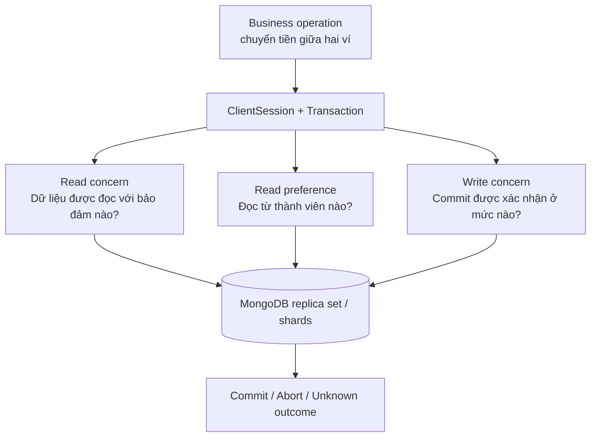
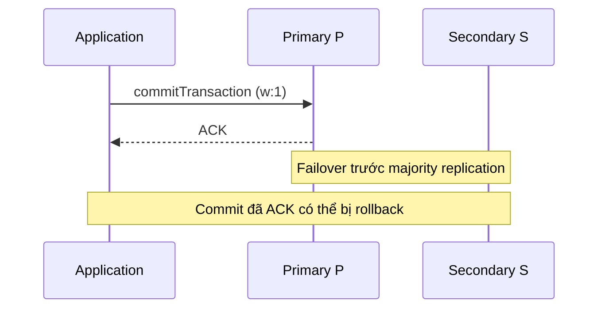
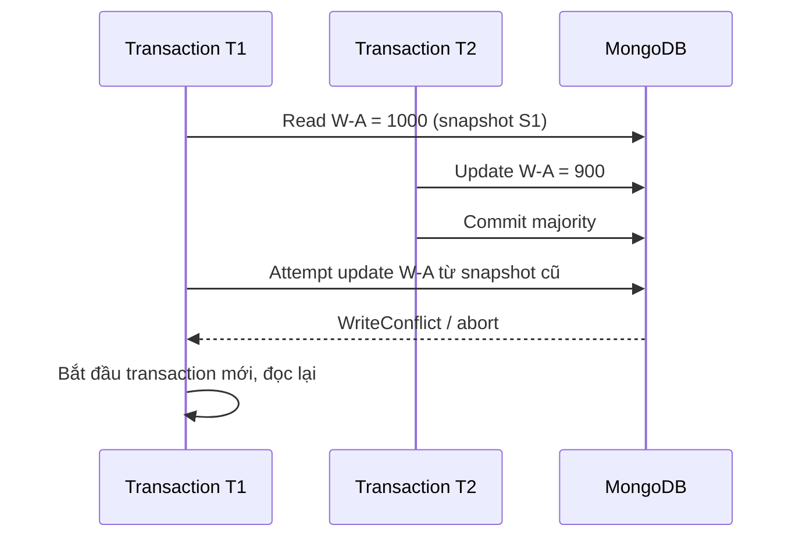

# Read concern, write concern và read preference trong transaction

Một giao dịch MongoDB có thể chuyển tiền giữa hai ví, trừ tồn kho đồng thời ghi lịch sử, hoặc cập nhật nhiều document rồi **commit hoặc rollback như một đơn vị**. Nhưng bật `@Transactional` không trả lời hết các câu hỏi về tính nhất quán: *Dữ liệu đang đọc đã được đa số replica xác nhận chưa? Khi commit thành công, mức độ bền vững là gì? Query sẽ được gửi tới primary hay secondary? Các shard có nhìn cùng một thời điểm không?*

Ba khái niệm cần phân biệt là **read concern**, **write concern** và **read preference**. Trong MongoDB chúng điều khiển ba chiều khác nhau của tính nhất quán, độ bền và định tuyến. Đặc biệt, trong **multi-document transaction**, một số bảo đảm của `readConcern: "majority"` và `readConcern: "snapshot"` còn **phụ thuộc vào write concern tại lúc commit**. Vì vậy, chỉ cấu hình một tùy chọn riêng lẻ không đủ để kết luận toàn bộ giao dịch an toàn.

Bài thuộc chương **Session và giao dịch** của module `SPRING_DATA_MONGODB`. Module tập trung sử dụng Spring Data MongoDB để kết nối, ánh xạ document và làm việc qua `MongoTemplate`/repository; đồng thời thực hành aggregation, index, transaction, reactive access, kiểm thử và chẩn đoán hiệu năng dữ liệu. Nội dung ở đây đi sâu vào **tổ hợp ba cấu hình trong transaction**, cách áp dụng qua `MongoTransactionManager`/`TransactionOptions`, phân biệt session với transaction và kiểm chứng trên replica set thật.

Sau bài, bạn có thể:

1. Giải thích sự khác nhau giữa **đọc dữ liệu nào** (`read concern`), **commit được xác nhận ở mức nào** (`write concern`), và **đọc ở node nào** (`read preference`).
2. So sánh `local`, `majority` và `snapshot` ở phạm vi transaction, đặc biệt trên **sharded cluster**.
3. Hiểu vì sao `snapshot + majority commit` thường được chọn cho giao dịch nhiều document yêu cầu một snapshot majority-committed.
4. Giải thích vì sao một transaction có đọc phải dùng `readPreference: primary`, không thể chỉ chọn secondary để giảm tải.
5. Cấu hình `TransactionOptions` trong Java Driver, Spring Data `MongoTransactionManager` và `ReactiveMongoTransactionManager`.
6. Nhận biết giao dịch bị **write conflict**, **commit chưa rõ kết quả**, **stale read**, hoặc **rollback sau failover**, và chọn chính sách retry đúng.
7. Viết integration test trên MongoDB **replica set**, có fixture và kiểm tra commit/rollback thay vì chỉ mock repository.

## 1. Bản đồ: ba lựa chọn, ba câu hỏi khác nhau



| Thuộc tính | Câu hỏi được giải quyết | Ví dụ | Không tự bảo đảm |
| --- | --- | --- | --- |
| **Read concern** | Mức cô lập/độ bền của dữ liệu đọc | `local`, `majority`, `snapshot` | Không quyết định node đọc; không tự khiến commit majority |
| **Write concern** | Mức xác nhận khi transaction commit | `w:1`, `w:"majority"` | Không xác định snapshot đọc; không thay thế invariant nghiệp vụ |
| **Read preference** | Định tuyến read tới thành viên replica set nào | `primary`, `secondary` | Không quyết định dữ liệu có majority-committed hoặc luôn mới nhất |

Đừng lẫn lộn:

- **`readConcern: "majority"`** không đồng nghĩa **`readPreference: "secondary"`**. Majority là bảo đảm liên quan dữ liệu, còn secondary là nơi đọc.
- **`writeConcern: "majority"`** không đồng nghĩa một transaction đã dùng `readConcern: "snapshot"`. Nó chỉ quy định mức xác nhận ở commit.
- **`readPreference: "primary"`** không đảm bảo một transaction luôn đọc thay đổi mới nhất của mọi writer: snapshot của transaction có thể **cũ hơn** dữ liệu vừa được commit bên ngoài.

### 1.1. Một ví dụ xuyên suốt

Collection `wallets` có hai document:

```javascript
{
  _id: "W-A",
  tenantId: "T-A",
  owner: "Alice",
  balance: NumberLong("1000")
}

{
  _id: "W-B",
  tenantId: "T-A",
  owner: "Bob",
  balance: NumberLong("200")
}
```

Business command: chuyển **300 đơn vị** từ W-A sang W-B. Thành công đúng nghĩa là:

```text
Trước:  W-A=1000, W-B=200, tổng=1200
Sau:    W-A=700,  W-B=500, tổng=1200
```

Nếu trừ W-A thành công nhưng cộng W-B thất bại, hệ thống không được giữ trạng thái nửa chừng. Transaction giúp **commit/abort cả hai lệnh**; read concern, write concern và read preference giúp diễn đạt thêm tính nhất quán đọc và độ bền của commit.

## 2. Trước tiên phải hiểu `ClientSession` và transaction

MongoDB sử dụng **logical session** (`ClientSession`) để gắn ngữ cảnh cho một chuỗi thao tác. Transaction chạy trên một session, nhưng **session không tự động là transaction**:

```text
MongoClient
    └── ClientSession
          ├── thao tác thông thường (có thể dùng causal consistency)
          └── startTransaction(options)
                  ├── read #1
                  ├── update #1
                  ├── update #2
                  └── commitTransaction() hoặc abortTransaction()
```

Hai request riêng sử dụng hai session khác nhau **không tự chia sẻ snapshot**. Một request có session nhưng không gọi `startTransaction` cũng **không có multi-document atomicity**.

Trong Spring Data MongoDB:

- `MongoTransactionManager` gắn một `ClientSession` với **luồng thực thi** (thread-bound transaction resources) của Spring.
- `ReactiveMongoTransactionManager` quản lý session trong **Reactor Context**, không dựa vào ThreadLocal truyền thống.
- `MongoTemplate`/`ReactiveMongoTemplate` được cấu hình cùng database factory có thể dùng session đã được transaction manager liên kết.
- Khi lấy trực tiếp `MongoCollection` hoặc `MongoDatabase` từ driver, phải đảm bảo gọi overload có `ClientSession`; không mặc định một thao tác driver thô sẽ tự tham gia Spring transaction.

### 2.1. Yêu cầu triển khai

Multi-document transaction cần **MongoDB replica set hoặc sharded cluster hỗ trợ transaction**, không chạy trên một standalone `mongod` chưa khởi tạo replica set. Trong local test, có thể dùng **single-node replica set**; trong production, phải kiểm tra topology, feature compatibility version và quyền truy cập.

**Không bọc mọi thao tác đơn-document trong transaction**: MongoDB đã hỗ trợ atomic write trên một document. Nếu mục tiêu là “trừ tồn kho nếu còn đủ”, một `updateOne` có filter `stock >= quantity` thường đơn giản hơn; transaction dành cho invariant trải qua nhiều document/collection.

### 2.2. “Tất cả hoặc không gì” không thay cho business constraint

Ngay cả transaction mạnh vẫn cần kiểm tra:

- W-A có đủ tiền tại lúc ghi.
- Hai ví thuộc cùng tenant được phép.
- W-A và W-B không phải cùng một tài khoản nếu business cấm tự chuyển.
- Một command không được áp dụng hai lần khi client retry.
- Các sự kiện ngoài MongoDB (payment, email, queue) không tự thuộc MongoDB transaction.

Consistency options **không thay thế validate, optimistic locking, unique index hay idempotency**.

## 3. Read concern trong transaction: `local`, `majority`, `snapshot`

Đối với **multi-document transaction**, MongoDB hỗ trợ ba mức read concern chính: `local`, `majority`, `snapshot`. Cấu hình đặt ở **transaction level**, không đặt khác nhau cho từng lệnh đọc bên trong.

| Read concern | Ý nghĩa ở transaction | Điều quan trọng |
| --- | --- | --- |
| `local` | Đọc dữ liệu khả dụng ở node, có thể chưa majority-committed | Trên sharded cluster không bảo đảm snapshot đồng bộ giữa các shard |
| `majority` | Đọc dữ liệu majority-committed với điều kiện commit theo `w:"majority"` | Không bảo đảm các shard cùng một điểm snapshot |
| `snapshot` | Đọc một snapshot; khi commit bằng `w:"majority"`, được bảo đảm là snapshot majority-committed | Với sharded transaction, view được đồng bộ trên các shard |

**Cảnh báo quan trọng:** các bảo đảm dành cho `majority`/`snapshot` **trong transaction** được MongoDB mô tả với điều kiện **transaction commit dùng write concern `"majority"`**. Nếu commit bằng `w:1`, không thể tự khẳng định rằng read concern majority/snapshot đã đọc từ **majority-committed snapshot**.

### 3.1. `readConcern: "local"`

`local` có thể đọc dữ liệu ở node chưa được đa số replica ghi nhận; dữ liệu ấy có khả năng bị rollback khi có failover. Trên một replica set, transaction đôi khi vẫn có isolation mạnh hơn mức tối thiểu, nhưng **không nên suy rằng local luôn tương đương majority/snapshot**.

Trên sharded cluster, `local` **không đảm bảo** các shard cung cấp dữ liệu tại một điểm snapshot đồng bộ. Vì vậy nó không phù hợp khi báo cáo hoặc điều kiện nghiệp vụ cần nhìn hai shard như một bức ảnh chụp nhất quán tại cùng thời điểm.

### 3.2. `readConcern: "majority"`

Khi transaction commit bằng `writeConcern: "majority"`, mức đọc `majority` cung cấp bảo đảm dữ liệu được đa số replica xác nhận. Đây là một tiêu chí về tính bền của **dữ liệu đọc**, không có nghĩa query tự route tới secondary.

Trên sharded cluster, `majority` **không đồng bộ snapshot trên nhiều shard**. Nếu một báo cáo cần diễn giải trạng thái “tại cùng một thời điểm toàn cluster”, `snapshot` thường chính xác hơn.

### 3.3. `readConcern: "snapshot"`

Trong transaction với majority commit, `snapshot` cho view nhất quán từ snapshot của dữ liệu majority-committed. Với **sharded cluster**, đó là snapshot được đồng bộ giữa các shard; lựa chọn này quan trọng khi transaction đọc nhiều collection/partition nằm trên các shard khác nhau.

Nhưng `snapshot` **không đồng nghĩa luôn là phiên bản mới nhất đúng lúc mỗi query chạy**. Snapshot được giữ nhất quán cho giao dịch; một transaction khác commit sau khi snapshot được chọn có thể **không xuất hiện** trong lần đọc tiếp theo của transaction hiện tại.

```text
t0: Transaction T1 bắt đầu, đọc balance(W-A)=1000.
t1: Transaction T2 cập nhật và commit balance(W-A)=900.
t2: T1 đọc W-A trong snapshot của mình;
    có thể vẫn nhìn balance=1000.
```

Nếu T1 cố cập nhật document đã bị T2 sửa, nó có thể gặp **write conflict** và phải abort/retry transaction từ đầu. Không tự tăng read concern lên snapshot rồi cho rằng transaction được “khóa” mọi dữ liệu khỏi writer khác.

### 3.4. Vì sao không dùng `available` hoặc `linearizable`?

MongoDB có thêm những mức read concern cho **các thao tác đọc ngoài transaction**, nhưng trong multi-document transaction các lựa chọn chính được hỗ trợ là `local`, `majority` và `snapshot`. Không sao chép danh sách enum Java Driver hoặc danh sách label Spring Data rồi kết luận server chấp nhận tất cả lựa chọn cho multi-document transaction.

**Kiểm tra phía MongoDB Server** mới là chuẩn về tính hợp lệ. Nếu dùng label `mongo:readConcern=LINEARIZABLE` trong một transaction nhưng server từ chối, không phải lỗi vì Spring Data thiếu enum.

## 4. Write concern: xác nhận **commit** ở mức nào?

Write concern quy định mức ghi nhận mà client yêu cầu khi một transaction **commit**. Hai mức rất thường được cân nhắc là:

| Write concern ở transaction | Nghĩa cơ bản | Rủi ro/đánh đổi |
| --- | --- | --- |
| `w:1` | Xác nhận khi commit đã áp dụng trên primary | Có khả năng rollback nếu failover trước khi được majority chấp nhận |
| `w:"majority"` | Chờ xác nhận từ đa số voting members theo quy tắc server | Độ trễ phụ thuộc replication và khả năng majority, đổi lại có bảo đảm mạnh hơn |

### 4.1. Không đặt write concern cho từng thao tác trong transaction

Đây là đặc điểm dễ nhầm với thao tác ghi thông thường. Với multi-document transaction, **write concern được áp tại cấp transaction/commit**. MongoDB yêu cầu các lệnh ghi bên trong transaction **không tự chỉ định một write concern riêng**.

```javascript
// ĐÚNG: chọn write concern khi bắt đầu transaction.
session.startTransaction({
  readConcern: { level: "snapshot" },
  writeConcern: { w: "majority" }
});

// Các insert/update bên trong dùng cùng session,
// không truyền {writeConcern: ...} trên từng operation.
```

Nếu cố đòi `w:1` cho một update và `w:"majority"` cho update kế tiếp bên trong cùng transaction, ứng dụng **không có hai mức cam kết độc lập**; toàn bộ transaction phải commit hoặc abort theo ranh giới chung.

### 4.2. `w:1` vẫn có thể rollback sau failover

Giả sử transaction commit thành công trên primary và trả xác nhận `w:1`, nhưng primary bị mất trước khi transaction được đa số replica ghi nhận. Khi một secondary khác được bầu làm primary, phần ghi chưa majority-committed **có thể bị rollback**.



**Không diễn giải `ACK` với `w:1` thành dữ liệu đã an toàn như một majority commit**. Nếu giao dịch là chuyển tiền, ghi sổ hoặc thay đổi khó phục hồi, thường nên đánh giá `w:"majority"` cùng các chính sách độ bền/đối soát phù hợp.

### 4.3. `w:"majority"` và journaling

`w:"majority"` đợi số lượng thành viên có quyền bỏ phiếu phù hợp xác nhận theo cấu hình server. Chi tiết **journal durability** còn phụ thuộc storage engine và cấu hình như `writeConcernMajorityJournalDefault`. Với hệ thống cần bảo đảm cao, cần kiểm tra deployment thực, không coi từ `majority` là lời hứa độc lập với mọi cách cấu hình.

Khi majority không sẵn sàng hoặc mạng chậm, việc commit có thể thất bại/chờ lâu/đưa tới kết quả không chắc chắn. `wtimeout` hoặc giới hạn thời gian commit giúp tránh chờ không giới hạn, nhưng **timeout không chứng minh rollback thành công**. Ứng dụng phải xử lý lỗi và trạng thái commit mơ hồ đúng cách.

### 4.4. Mặc định khác nhau theo MongoDB version và topology

Nếu không chọn transaction write concern tường minh, giá trị được kế thừa từ session/client hoặc mặc định deployment. Trong MongoDB 5.0+, implicit default write concern của nhiều replica set là `majority`, **nhưng có ngoại lệ khi có arbiter và cấu hình cụ thể**; những phiên bản trước thường mặc định `w:1`.

Vì vậy, không nên viết bài kiểm thử hoặc contract nghiệp vụ với giả định “MongoDB transaction mặc định luôn majority”, đặc biệt khi deploy lên nhiều môi trường. Với use case cần majority commit, hãy **chọn rõ trong `TransactionOptions`** và kiểm chứng bằng command monitoring/config.

## 5. Read preference: node nào nhận lệnh đọc trong transaction?

Read preference mô tả cách client chọn member replica set để gửi **read operations**:

| Chế độ | Ý nghĩa ngoài transaction | Trong transaction có đọc |
| --- | --- | --- |
| `primary` | Đọc từ primary | **Được yêu cầu** |
| `secondary` | Đọc từ secondary | Không phù hợp/không được hỗ trợ |
| `secondaryPreferred` | Ưu tiên secondary, có thể fallback | Không dùng để lách yêu cầu primary |
| `primaryPreferred` | Ưu tiên primary, có thể fallback | Không coi là tương đương primary bắt buộc |
| `nearest` | Chọn member đủ điều kiện theo độ trễ | Không dùng thay primary trong transaction |

Theo tài liệu MongoDB, **transaction có read operations phải dùng `readPreference: primary`**; các thao tác trong transaction phải route tới thành viên phù hợp cùng transaction. Do đó một query read-only có thể được cân nhắc cho secondary **ngoài transaction**, nhưng một multi-document transaction đọc trước ghi **không thể đơn giản chuyển sang secondary chỉ để giảm tải primary**.

### 5.1. `primary` không bằng `readConcern: "majority"`

Một read trên primary với `readConcern: "local"` vẫn có thể nhìn dữ liệu chưa majority-committed. Ngược lại, query ngoài transaction với `readPreference: secondary` và `readConcern: "majority"` có thể nhìn dữ liệu majority-committed nhưng **không nhất thiết là phiên bản mới nhất đúng lúc query bắt đầu**.

Vì vậy cả ba cấu hình phải được đánh giá **riêng và cùng nhau**.

### 5.2. Read-only report có nhất thiết phải là transaction?

Không. Một báo cáo đọc một collection, không cần nhiều thao tác cùng một snapshot và chấp nhận eventual consistency, có thể chạy bằng **read concern/read preference phù hợp ngoài transaction**.

Ngược lại, một báo cáo cần đọc nhiều document/collection theo **một snapshot nhất quán** có thể yêu cầu snapshot read hoặc transaction tùy MongoDB version và query support. Đặt `@Transactional(readOnly = true)` trong Spring Data MongoDB **vẫn có thể tạo transaction/session**, chứ không phải đơn giản là một hint miễn phí khiến mọi query nhanh hơn.

### 5.3. Client URI đặt secondary thì sao?

Nếu URI hoặc client được cấu hình `readPreference=secondary`, một transaction có read operations **có thể thất bại** khi kế thừa read preference đó. Đừng giả định `MongoTransactionManager` tự chuyển mọi cấu hình thành primary mà không kiểm tra. Cấu hình `TransactionOptions.readPreference(ReadPreference.primary())` một cách tường minh cho giao dịch cần đọc/ghi.

## 6. Ma trận tổ hợp read concern – write concern

Khả năng hoạt động của một transaction còn phụ thuộc topology, phiên bản và các option khác. Bảng này tập trung vào **bảo đảm có thể phát biểu** theo tài liệu MongoDB:

| Read concern | Commit write concern | Kết luận an toàn |
| --- | --- | --- |
| `local` | `w:1` | Thấp hơn về bảo đảm majority; commit có thể rollback sau failover |
| `local` | `majority` | Commit được đa số xác nhận; read concern không nâng thành synchronized majority snapshot |
| `majority` | `w:1` | **Không được bảo đảm** rằng các read trong transaction là majority-committed |
| `majority` | `majority` | Read được bảo đảm majority-committed, nhưng trên sharded cluster **không đồng bộ snapshot across shards** |
| `snapshot` | `w:1` | **Không được bảo đảm** rằng snapshot được đọc là majority-committed |
| `snapshot` | `majority` | Bảo đảm đọc từ synchronized majority-committed snapshot; phù hợp khi cần view nhất quán qua shard |

Trong các ví dụ read/write sau, dùng:

```javascript
{
  readConcern: { level: "snapshot" },
  writeConcern: { w: "majority" },
  readPreference: { mode: "primary" }
}
```

Đây là **một lựa chọn tương đối mạnh cho giao dịch multi-document**, không phải lựa chọn bắt buộc tối ưu cho mọi workload. Với một ứng dụng có độ trễ khắt khe và dữ liệu có thể xử lý eventual consistency, cần đánh giá mức bảo đảm, độ trễ và cách khôi phục lỗi bằng benchmark/test thực.

### 6.1. `snapshot + majority` có đủ để “không bao giờ xung đột”?

Không. Nó không ngăn write conflict, stale snapshot khi writer khác commit sau lúc snapshot được chọn, hoặc lỗi nghiệp vụ. Hai transaction có thể cùng đọc một giá trị rồi cùng cố cập nhật document; MongoDB có thể abort một transaction do write conflict. Cần retry toàn bộ transaction từ đầu theo quy tắc.

### 6.2. `majority` có nghĩa “đọc dữ liệu mới nhất” không?

Không. Majority cho biết dữ liệu đã vượt qua một ngưỡng xác nhận, **không tự trở thành linearizable “mới nhất ngay lập tức”**. Read concern khác, read preference khác và thao tác có thể có snapshot/replication lag. Không dùng “majority” thay cho yêu cầu nghiệp vụ cụ thể về recency.

### 6.3. `snapshot` trên sharded cluster có tác dụng gì đặc biệt?

Một transaction có thể truy cập hai shard với thời điểm replication khác nhau. `majority` bảo đảm mỗi shard đã nhìn dữ liệu majority-committed theo điều kiện commit, nhưng không đảm bảo chúng tạo thành **một lát cắt thời gian đồng bộ**. `snapshot` cung cấp synchronized snapshot across shards khi commit majority, giúp tránh một số báo cáo nhìn thấy trạng thái “shard A mới, shard B cũ” ở các thời điểm không đồng bộ.

**Snapshot consistency không đồng nghĩa external side effects atomic**. Gửi email, gọi ngân hàng hoặc publish thông điệp trong transaction vẫn cần outbox/idempotency, vì MongoDB chỉ quản lý các thao tác MongoDB thuộc transaction.

## 7. Phân biệt mặc định, giá trị kế thừa và cấu hình tường minh

Giả sử ứng dụng không đặt `TransactionOptions`:

```text
Transaction option explicit?
        |
        +-- Có  → dùng option của transaction khi bắt đầu
        |
        +-- Không
              ↓
           Session option?
              |
              +-- Có → kế thừa session
              |
              +-- Không → kế thừa client/deployment
```

Với read concern, MongoDB thường dùng mặc định `local` trên primary khi không có cấu hình khác. Với read preference, mặc định thường là `primary`. Với write concern, implicit default tùy server version/topology, không được suy đoán.

### 7.1. MongoDB Server quyết định tính hợp lệ cuối cùng

Một Java Driver enum hay Spring label có thể cho phép điền nhiều giá trị `ReadConcern`, `ReadPreference` hoặc `WriteConcern`. Tuy nhiên transaction trên server chỉ hỗ trợ **tập hợp và ngữ nghĩa cụ thể**. Chọn option bằng builder không bảo đảm một transaction hợp lệ cho đến khi chạy trên deployment.

### 7.2. Transaction đang mở không tự cập nhật option

Nếu một method `@Transactional` tham gia transaction **đã bắt đầu bởi caller**, các option mới được khai báo ở method bên trong **không tự thay đổi** read concern, write concern hoặc read preference của transaction bên ngoài. Cần xác định **service nào sở hữu ranh giới transaction** và cấu hình option trước khi bắt đầu.

Ví dụ:

```text
OuterService.method()  @Transactional (đã bắt đầu transaction)
    └── InnerService.method() @Transactional (đòi snapshot)

Không được giả định inner method có thể chuyển readConcern
của transaction đang mở sang snapshot giữa chừng.
```

Với Spring transaction propagation, một số tùy chọn có hành vi riêng; không coi `REQUIRES_NEW` là giải pháp miễn phí, vì nó tạo thêm transaction/session và có thể tăng contention. Chỉ thay transaction boundary khi có mục đích nhất quán rõ ràng.

## 8. Thực hành `mongosh`: bắt đầu transaction với ba option tường minh

Trước khi viết Spring Boot, hãy thử một transaction thật bằng `mongosh` trên **replica set test**. Ví dụ sau dùng database `tx_demo` riêng và không được thực thi trên ví production.

### 8.1. Chuẩn bị fixture trước khi mở transaction

```javascript
// Dùng trên database test được phép xóa/reset, không phải production.
const demoDb = db.getSiblingDB("tx_demo");

demoDb.wallets.insertMany([
  {
    _id: "W-A",
    tenantId: "T-A",
    owner: "Alice",
    balance: NumberLong("1000")
  },
  {
    _id: "W-B",
    tenantId: "T-A",
    owner: "Bob",
    balance: NumberLong("200")
  }
]);

// Chuẩn bị collection lịch sử từ trước transaction.
demoDb.createCollection("transferLogs");
```

Các lệnh seed nên chạy **một lần trên database test trống**; nếu đã tồn tại document/collection cùng tên, hãy kiểm tra và dọn fixture trong phạm vi test được cấp quyền. Ví dụ cố tình không chạy `dropDatabase()` để tránh vô tình xóa dữ liệu.

### 8.2. Mở session/transaction và cập nhật

```javascript
const session = db.getMongo().startSession({
  readPreference: { mode: "primary" }
});

const txDb = session.getDatabase("tx_demo");

try {
  await session.withTransaction(async () => {
    const debited = txDb.wallets.updateOne(
      { _id: "W-A", tenantId: "T-A", balance: { $gte: 300 } },
      { $inc: { balance: NumberLong("-300") } }
    );
    if (debited.matchedCount !== 1) {
      throw new Error("Ví nguồn không tồn tại hoặc số dư không đủ");
    }

    const credited = txDb.wallets.updateOne(
      { _id: "W-B", tenantId: "T-A" },
      { $inc: { balance: NumberLong("300") } }
    );
    if (credited.matchedCount !== 1) {
      throw new Error("Ví đích không tồn tại");
    }

    txDb.transferLogs.insertOne({
      _id: "OP-001",
      tenantId: "T-A",
      fromWallet: "W-A",
      toWallet: "W-B",
      amount: NumberLong("300")
    });
  }, {
    readConcern: { level: "snapshot" },
    writeConcern: { w: "majority" }
  });
} finally {
  session.endSession();
}
```

Sau commit thành công:

```javascript
demoDb.wallets.find({}, {
  _id: 1,
  balance: 1
}).sort({ _id: 1 }).toArray();

// W-A: 700; W-B: 500.

demoDb.transferLogs.findOne({ _id: "OP-001" });
// Có transfer log tương ứng.
```

**Lưu ý về xử lý lỗi:** `Session.withTransaction` của `mongosh` có cơ chế retry transaction/commit khi lỗi cho phép, nhưng **callback có thể được thực thi nhiều lần**. Không đặt side effect bên ngoài MongoDB trong callback. Khi `commitTransaction()` báo **`UnknownTransactionCommitResult`**, kết quả có thể đã commit; không thể suy rằng exception nghĩa là rollback. Ở ứng dụng Java thật, dùng helper transaction của driver hoặc framework và retry commit theo quy tắc tương ứng, đồng thời kiểm tra **operation ID** để tránh xử lý lại một lệnh chuyển tiền đã thành công.

### 8.3. Tạm dừng trước commit để thấy thay đổi chỉ nằm trong session

Trong database test, có thể bắt đầu một transaction mới, update W-A rồi **chưa commit**. Từ một session khác, dữ liệu chưa commit **không được nhìn thấy** như một thay đổi đã hoàn tất. Khi abort, số dư phải trở lại trạng thái trước transaction.

Điều này kiểm chứng **atomicity và isolation cơ bản** của transaction. Nó **không phân biệt bằng mắt** được mọi khác biệt giữa `local`/`majority`/`snapshot` trong điều kiện replica set khỏe, bởi cả ba có thể cho output giống nhau trên dữ liệu ít biến động. Để kiểm chứng bảo đảm majority/failover, cần test có điều khiển replication/failover.

### 8.4. Kiểm tra read preference sai bằng test riêng

Đừng sửa transaction đang chứa dữ liệu quan trọng để thử secondary. Trên deployment test, hãy khởi động một transaction có read operation với read preference khác `primary` và xác minh driver/server báo lỗi thích hợp, thay vì chỉ dựa vào API enum cho phép điền giá trị đó.

**Không nên coi một ứng dụng có URI `readPreference=secondaryPreferred` là đã được phép đọc transaction qua secondary**. Đọc trong transaction vẫn có yêu cầu định tuyến riêng.

## 9. Java Driver: `TransactionOptions` và `ClientSession`

Spring Data MongoDB sử dụng Java Driver bên dưới. API cấu hình chính là `com.mongodb.TransactionOptions`:

```java
import com.mongodb.ReadConcern;
import com.mongodb.ReadPreference;
import com.mongodb.TransactionOptions;
import com.mongodb.WriteConcern;

TransactionOptions options = TransactionOptions.builder()
        .readConcern(ReadConcern.SNAPSHOT)
        .writeConcern(WriteConcern.MAJORITY)
        .readPreference(ReadPreference.primary())
        .build();
```

Ba tùy chọn nằm cạnh nhau để biểu diễn đúng ý định:

```text
ReadConcern.SNAPSHOT          → snapshot đọc đồng bộ, cùng một view
WriteConcern.MAJORITY         → commit ở mức majority
ReadPreference.primary()      → read operations đi tới primary
```

### 9.1. Driver sync transaction helper

Java Driver có thể quản lý vòng đời session bằng `try-with-resources` và cung cấp helper `withTransaction(...)`:

```java
import com.mongodb.client.ClientSession;
import com.mongodb.client.MongoClient;
import com.mongodb.client.MongoCollection;
import com.mongodb.client.model.Filters;
import com.mongodb.client.model.Updates;
import com.mongodb.client.result.UpdateResult;
import org.bson.Document;

// client là MongoClient đã cấu hình tới replica set test/production.
try (ClientSession session = client.startSession()) {
    MongoCollection<Document> wallets = client
            .getDatabase("tx_demo")
            .getCollection("wallets");

    String outcome = session.withTransaction(() -> {
        UpdateResult debit = wallets.updateOne(
                session,
                Filters.and(
                        Filters.eq("_id", "W-A"),
                        Filters.eq("tenantId", "T-A"),
                        Filters.gte("balance", 300L)
                ),
                Updates.inc("balance", -300L)
        );
        if (debit.getMatchedCount() != 1) {
            throw new IllegalStateException("Không đủ số dư");
        }

        UpdateResult credit = wallets.updateOne(
                session,
                Filters.and(
                        Filters.eq("_id", "W-B"),
                        Filters.eq("tenantId", "T-A")
                ),
                Updates.inc("balance", 300L)
        );
        if (credit.getMatchedCount() != 1) {
            throw new IllegalStateException("Không có ví đích");
        }

        return "TRANSFER_ACCEPTED";
    }, options);
}
```

Trong ví dụ, `client` và `options` đã được khai báo ở phạm vi chứa đoạn code. Mọi `wallets.updateOne(...)` đều nhận **`session`**; nếu bỏ đối số session, thao tác driver **không tự tham gia transaction** đang mở.

Helper `withTransaction` của driver có cơ chế retry cho lỗi tạm thời/commit chưa rõ theo tài liệu; do đó **body có thể bị thực thi lại**. Không gửi email, tính phí ngân hàng, publish message không-idempotent hoặc thay đổi state ở hệ thống bên ngoài **ngay trong lambda**.

### 9.2. Driver trực tiếp khác `MongoTemplate`

Với `MongoTemplate` nằm trong Spring transaction manager, các operation mà Spring Data thực hiện qua template thường dùng session đã bind. Nhưng nếu trong method ấy bạn gọi thẳng:

```java
MongoCollection<Document> raw = template
        .getCollection("wallets");

raw.updateOne(
        Filters.eq("_id", "W-A"),
        Updates.inc("balance", -300L));
```

thì **không được mặc định** raw driver call tham gia session của Spring transaction. Hãy dùng API `MongoTemplate` được quản lý hoặc phương thức driver có `ClientSession` đúng ngữ cảnh. Đặc biệt, `MongoOperations.getCollection` trả driver gateway và **không tự session-proxy** cho mọi lệnh raw.

### 9.3. Session đơn lẻ và causal consistency

Session **ngoài transaction** có thể dùng `causallyConsistent(true)` để hỗ trợ các bảo đảm về thứ tự quan hệ nhân quả như read-your-writes trong những điều kiện được MongoDB quy định. Để có bảo đảm causal consistency khi đọc/ghi phân tán, tài liệu MongoDB yêu cầu **read concern `majority` và write concern `majority`**, cùng việc sử dụng session đúng quy tắc (các thao tác theo thứ tự phù hợp).

**Causal consistency ≠ multi-document transaction**. Nó không làm hai update trên hai document tự commit cùng nhau; nó giải quyết một yêu cầu khác về thứ tự quan sát giữa các thao tác.

## 10. Spring Data: cấu hình `MongoTransactionManager` với `TransactionOptions`

Trong Spring Boot, cách đơn giản và dễ kiểm toán là cấu hình một `MongoTransactionManager` dùng **cùng `MongoDatabaseFactory`** với `MongoTemplate` và đưa ba option vào lúc transaction bắt đầu.

### 10.1. Configuration cho transaction manager

```java
import com.mongodb.ReadConcern;
import com.mongodb.ReadPreference;
import com.mongodb.TransactionOptions;
import com.mongodb.WriteConcern;
import org.springframework.context.annotation.Bean;
import org.springframework.context.annotation.Configuration;
import org.springframework.data.mongodb.MongoDatabaseFactory;
import org.springframework.data.mongodb.MongoTransactionManager;

@Configuration
public class MongoTxConfig {

    @Bean
    MongoTransactionManager mongoTransactionManager(
            MongoDatabaseFactory factory
    ) {
        TransactionOptions options = TransactionOptions.builder()
                .readConcern(ReadConcern.SNAPSHOT)
                .writeConcern(WriteConcern.MAJORITY)
                .readPreference(ReadPreference.primary())
                .build();

        return new MongoTransactionManager(factory, options);
    }
}
```

Đoạn này sử dụng constructor `MongoTransactionManager(MongoDatabaseFactory, TransactionOptions)` của Spring Data MongoDB. Khi một Spring transaction mới bắt đầu, manager cung cấp `ClientSession` và áp dụng options. Các thao tác `MongoTemplate`/repository sử dụng **cùng factory và session context** có thể tham gia transaction.

**Không cần tự gọi `session.startTransaction()` bên trong một method đã được `MongoTransactionManager` quản lý**. Trộn manual session/transaction với declarative transaction dễ làm thao tác ra ngoài ranh giới commit.

### 10.2. Transaction thực tế: chuyển số dư và ghi lịch sử

Entity:

```java
import org.springframework.data.mongodb.core.mapping.Document;
import org.springframework.data.mongodb.core.mapping.MongoId;

@Document(collection = "wallets")
public record Wallet(
        @MongoId String id,
        String tenantId,
        String owner,
        long balance
) {}

@Document(collection = "transferLogs")
record TransferLog(
        @MongoId String id,
        String tenantId,
        String fromWallet,
        String toWallet,
        long amount
) {}
```

Service dùng những thao tác atomic trên từng document nhưng **gom chúng vào một transaction**:

```java
import com.mongodb.client.result.UpdateResult;
import org.springframework.data.mongodb.core.MongoTemplate;
import org.springframework.data.mongodb.core.query.Criteria;
import org.springframework.data.mongodb.core.query.Query;
import org.springframework.data.mongodb.core.query.Update;
import org.springframework.stereotype.Service;
import org.springframework.transaction.annotation.Transactional;

@Service
public class WalletTransferService {
    private final MongoTemplate template;

    public WalletTransferService(MongoTemplate template) {
        this.template = template;
    }

    @Transactional(transactionManager = "mongoTransactionManager")
    public String transfer(
            String authorizedTenantId,
            String operationId,
            String fromWallet,
            String toWallet,
            long amount
    ) {
        if (authorizedTenantId == null || authorizedTenantId.isBlank()
                || operationId == null || operationId.isBlank()
                || fromWallet == null || fromWallet.isBlank()
                || toWallet == null || toWallet.isBlank()
                || fromWallet.equals(toWallet)
                || amount <= 0) {
            throw new IllegalArgumentException("Thông tin chuyển tiền sai");
        }

        // Nếu command này đã commit trước đó, đọc đúng operationId.
        // Chỉ trả cùng kết quả khi payload trùng, không trả nhầm yêu cầu.
        TransferLog existing = template.findOne(
                Query.query(Criteria.where("_id").is(operationId)
                        .and("tenantId").is(authorizedTenantId)),
                TransferLog.class);
        if (existing != null) {
            if (!existing.fromWallet().equals(fromWallet)
                    || !existing.toWallet().equals(toWallet)
                    || existing.amount() != amount) {
                throw new IllegalStateException(
                        "operationId đã được dùng với nội dung khác");
            }
            return existing.id();
        }

        Query debitFilter = Query.query(
                Criteria.where("_id").is(fromWallet)
                        .and("tenantId").is(authorizedTenantId)
                        .and("balance").gte(amount));

        UpdateResult debit = template.updateFirst(
                debitFilter,
                new Update().inc("balance", -amount),
                Wallet.class);
        if (debit.getMatchedCount() != 1) {
            throw new IllegalStateException(
                    "Không có ví nguồn hoặc số dư không đủ");
        }

        Query creditFilter = Query.query(
                Criteria.where("_id").is(toWallet)
                        .and("tenantId").is(authorizedTenantId));
        UpdateResult credit = template.updateFirst(
                creditFilter,
                new Update().inc("balance", amount),
                Wallet.class);
        if (credit.getMatchedCount() != 1) {
            // Runtime exception => Spring rollback transaction.
            throw new IllegalStateException("Không có ví đích");
        }

        template.insert(new TransferLog(
                operationId,
                authorizedTenantId,
                fromWallet,
                toWallet,
                amount));

        // Commit diễn ra KHI thoát qua Spring transaction interceptor.
        return operationId;
    }
}
```

Khi transaction commit thành công, cả **trừ nguồn, cộng đích và ghi lịch sử** đều được commit. Nếu credit thất bại hoặc insert log bị duplicate key, exception khiến transaction rollback theo cấu hình Spring mặc định cho unchecked exceptions.

**Điều kiện dùng đúng:** `WalletTransferService.transfer` được gọi **qua Spring-managed bean/proxy** từ bên ngoài, chứ không phải `this.transfer(...)` trong cùng class làm bypass transaction advice. `MongoTemplate` phải dùng cùng `MongoDatabaseFactory` do transaction manager quản lý.

### 10.3. Vì sao dùng `operationId`?

MongoDB transaction làm nhiều document commit nguyên tử, nhưng một HTTP request có thể bị **gửi lại sau khi client mất response**. Nếu request gửi lại với `operationId` mới, việc chuyển tiền có thể bị thực hiện lần hai dù transaction đầu đã commit đúng.

Ví dụ này dùng `TransferLog.id` làm khóa duy nhất và trả lại kết quả nếu cùng ID/payload đã được lưu. Trên hệ thống thật, cần kiểm soát **concurrent duplicate requests**, lỗi duplicate key, payload mismatch, dữ liệu operation chưa có kết quả, và commit không rõ trạng thái. Đừng coi đoạn code này là một payment gateway có exactly-once semantics hoàn chỉnh.

### 10.4. Không chạy I/O ngoài MongoDB trong transaction

Tránh làm:

```java
@Transactional(transactionManager = "mongoTransactionManager")
public void transferAndNotify(...) {
    // MongoDB update...
    sendEmail();       // Không thuộc transaction.
    chargePaymentApi(); // Không thuộc transaction.
}
```

Nếu transaction rollback sau khi email hoặc payment API đã hoàn tất, hai hệ thống **không tự rollback cùng nhau**. Khi cần reliability, dùng **transactional outbox**, idempotent consumers, state machine và cơ chế compensation phù hợp.

## 11. Cấu hình transaction option theo từng method

Đối với dự án Spring Data MongoDB **phiên bản hỗ trợ `MongoTransactionOptionsResolver` và transaction labels**, có thể mô tả yêu cầu bằng `@Transactional(label = ...)`:

```java
import org.springframework.transaction.annotation.Transactional;

@Transactional(
    transactionManager = "mongoTransactionManager",
    label = {
        "mongo:readConcern=SNAPSHOT",
        "mongo:writeConcern=MAJORITY",
        "mongo:readPreference=PRIMARY"
    }
)
public void reconcileBalances() {
    // Các thao tác MongoTemplate cùng session/transaction.
}
```

Đây là **minh họa đặt trên method service được Spring quản lý**, không phải method độc lập để copy vào top-level class. Những label dùng prefix `mongo:` được Spring Data diễn giải thành transaction options khi một transaction mới khởi chạy, ở các phiên bản có hỗ trợ.

### 11.1. Label chỉ là cơ chế cấu hình, không vượt giới hạn server

API parser có thể hiểu `mongo:readConcern=AVAILABLE` hoặc `mongo:readPreference=SECONDARY` vì enum hỗ trợ chúng ở những ngữ cảnh khác. Nhưng **MongoDB multi-document transaction** có giới hạn riêng: read concern `local/majority/snapshot` và transaction có read phải đi `primary`. Không dùng một label hợp lệ về cú pháp làm bằng chứng nó có ý nghĩa hợp lệ ở server.

### 11.2. Version Spring Data quan trọng

Các option per-method thông qua `label`/`MongoTransactionOptionsResolver` được hỗ trợ ở các thế hệ Spring Data mới. Với ứng dụng Spring Data cũ, ưu tiên `new MongoTransactionManager(factory, options)` và cấu hình thống nhất ở transaction manager; **không giả định mọi phiên bản đều tự phân tích transaction label**.

### 11.3. Nested method không thể đổi transaction option đang chạy

Nếu method `outer()` đã bắt đầu transaction mặc định `local`, method `inner()` với `label=SNAPSHOT` mà chỉ **tham gia cùng transaction** không thể nâng read concern ở giữa chừng. Hãy đặt option ở **owner của transaction boundary**, hoặc thiết kế một ranh giới transaction mới phù hợp.

### 11.4. `@Transactional(readOnly = true)`

Trong Spring Data MongoDB, read-only transaction vẫn có thể bắt đầu transaction để bind `ClientSession`. Nó không tự bắt driver đọc secondary hoặc biến đọc thành read concern majority. Nếu cần một read-only report rẻ, trước hết xem liệu **transaction có thực sự cần thiết** và query ngoài transaction có đáp ứng yêu cầu nhất quán hay không.

## 12. `TransactionTemplate` và `TransactionalOperator`

Không phải mọi use case đều thích dùng annotation. Với **transaction imperative** cần ranh giới có thể kiểm soát từ method, có thể dùng `TransactionTemplate`:

```java
import org.springframework.data.mongodb.MongoTransactionManager;
import org.springframework.transaction.support.TransactionTemplate;

// manager là bean MongoTransactionManager đã cấu hình ở mục 10.
TransactionTemplate tx = new TransactionTemplate(manager);

String operationId = tx.execute(status ->
        walletTransferService.transfer(
                "T-A", "OP-002", "W-A", "W-B", 100));
```

Đoạn này được minh họa trong một class có bean `manager` và `walletTransferService`. Ở ví dụ, service `transfer` đã có `@Transactional` và sẽ **tham gia transaction hiện tại**, vì vậy **không nhất thiết cần cả TransactionTemplate và @Transactional cùng lúc**; hãy chọn một nơi rõ ràng để sở hữu transaction boundary.

Trong ứng dụng **reactive**, dùng `TransactionalOperator` để bao một Publisher thành một ranh giới giao dịch, thay vì tự mở session theo ThreadLocal:

```java
import org.springframework.transaction.reactive.TransactionalOperator;
import reactor.core.publisher.Mono;

// operator đã được tạo từ ReactiveMongoTransactionManager.
Mono<String> result = reactiveWalletTransferService
        .transfer("T-A", "OP-003", "W-A", "W-B", 50)
        .as(operator::transactional);
```

Để đoạn reactive thực sự nằm trong transaction, các lời gọi bên trong phải dùng **ReactiveMongoTemplate/ReactiveMongoRepository** tham gia cùng reactive transaction context. Một lệnh `MongoTemplate` blocking xen vào pipeline reactive **không tự tham gia** và còn có thể block event loop.

### 12.1. Cấu hình reactive transaction manager với cùng các option

```java
import com.mongodb.ReadConcern;
import com.mongodb.ReadPreference;
import com.mongodb.TransactionOptions;
import com.mongodb.WriteConcern;
import org.springframework.context.annotation.Bean;
import org.springframework.context.annotation.Configuration;
import org.springframework.data.mongodb.ReactiveMongoDatabaseFactory;
import org.springframework.data.mongodb.ReactiveMongoTransactionManager;
import org.springframework.transaction.reactive.TransactionalOperator;

@Configuration
public class ReactiveMongoTxConfig {

    @Bean
    ReactiveMongoTransactionManager reactiveMongoTransactionManager(
            ReactiveMongoDatabaseFactory factory
    ) {
        TransactionOptions options = TransactionOptions.builder()
                .readConcern(ReadConcern.SNAPSHOT)
                .writeConcern(WriteConcern.MAJORITY)
                .readPreference(ReadPreference.primary())
                .build();

        return new ReactiveMongoTransactionManager(factory, options);
    }

    @Bean
    TransactionalOperator mongoTransactionalOperator(
            ReactiveMongoTransactionManager manager
    ) {
        return TransactionalOperator.create(manager);
    }
}
```

Không cấu hình đồng thời bean transaction manager imperative/reactive trùng tên mà không phân biệt nơi sử dụng. Trong ứng dụng hỗn hợp, hãy **đặt tên manager và chọn tường minh ở từng service**, tránh annotation `@Transactional` dùng nhầm manager.

### 12.2. Ví dụ reactive write ở cùng transaction context

```java
import com.mongodb.client.result.UpdateResult;
import org.springframework.data.mongodb.core.ReactiveMongoTemplate;
import org.springframework.data.mongodb.core.query.Criteria;
import org.springframework.data.mongodb.core.query.Query;
import org.springframework.data.mongodb.core.query.Update;
import org.springframework.stereotype.Service;
import org.springframework.transaction.reactive.TransactionalOperator;
import reactor.core.publisher.Mono;

@Service
public class ReactiveWalletTransferService {

    private final ReactiveMongoTemplate template;
    private final TransactionalOperator operator;

    public ReactiveWalletTransferService(
            ReactiveMongoTemplate template,
            TransactionalOperator operator
    ) {
        this.template = template;
        this.operator = operator;
    }

    public Mono<String> transfer(
            String tenantId, String operationId,
            String fromId, String toId, long amount
    ) {
        if (tenantId == null || tenantId.isBlank()
                || operationId == null || operationId.isBlank()
                || fromId == null || toId == null
                || fromId.equals(toId) || amount <= 0) {
            return Mono.error(new IllegalArgumentException(
                    "Input không hợp lệ"));
        }

        Query debitQuery = Query.query(
                Criteria.where("_id").is(fromId)
                        .and("tenantId").is(tenantId)
                        .and("balance").gte(amount));

        Query creditQuery = Query.query(
                Criteria.where("_id").is(toId)
                        .and("tenantId").is(tenantId));

        Mono<String> work = Mono.defer(() ->
                template.updateFirst(
                        debitQuery,
                        new Update().inc("balance", -amount),
                        Wallet.class)
                    .flatMap(debit -> {
                        if (debit.getMatchedCount() != 1) {
                            return Mono.error(new IllegalStateException(
                                    "Ví nguồn không đủ số dư"));
                        }
                        return template.updateFirst(
                                creditQuery,
                                new Update().inc("balance", amount),
                                Wallet.class);
                    })
                    .flatMap(credit -> {
                        if (credit.getMatchedCount() != 1) {
                            return Mono.error(new IllegalStateException(
                                    "Ví đích không tồn tại"));
                        }
                        return template.insert(new TransferLog(
                                operationId, tenantId,
                                fromId, toId, amount));
                    })
                    .map(TransferLog::id));

        return work.as(operator::transactional);
    }
}
```

Ví dụ này **không có bước tra cứu idempotency trước khi chạy**, và cũng không xử lý commit mơ hồ. Nó minh họa đúng **chuỗi reactive update–update–insert trên cùng context**; để trở thành endpoint có retry an toàn phải bổ sung operation ledger/reconciliation giống mục 10.3 và 14.

### 12.3. Retry reactive phải bao cả ranh giới transaction

Một publisher tạo transaction khi được subscribe. Nếu có `TransientTransactionError` phù hợp để retry, lần retry phải bắt đầu **transaction mới và đọc lại state**, không tiếp tục một session đã abort. Khi dùng `retryWhen`, hãy bảo đảm nó bao **toàn bộ workflow transaction**, không chỉ update thứ hai.

Không gọi `block()` trong Reactor event loop; không dùng `Thread.sleep` để backoff. Tránh parallelizing nhiều thao tác trên **cùng `ClientSession`** vì MongoDB session không được dùng đồng thời tùy tiện và các driver giới hạn hoạt động song song trong một transaction.

## 13. Stale read, write conflict và dữ liệu thay đổi trong lúc transaction

Đặt `readConcern: "snapshot"` không làm database ngừng ghi. Một transaction có thể đọc từ một snapshot **cũ hơn giá trị hiện tại**; khi cố cập nhật document mà writer khác vừa thay đổi, MongoDB có thể báo **write conflict**.

### 13.1. Timeline hai transaction tranh chấp



Một transactional read không tự cấp **exclusive lock** lên mọi document được đọc. MongoDB cho phép các transaction cùng đọc snapshot, nhưng xung đột khi ghi có thể cần abort một bên. Vì vậy quy tắc “read, check stock, update” phải xử lý conflict ở **cấp toàn transaction**, không chỉ lặp lại lệnh update sau khi transaction đã thất bại.

### 13.2. Dữ liệu cũ trong transaction không phải lúc nào cũng là bug

Với báo cáo yêu cầu **một thời điểm nhất quán**, việc không nhìn thấy update mới xảy ra sau khi snapshot đã chọn có thể chính là **mục tiêu thiết kế**.

Ngược lại, với workflow cấp quyền hoặc chuyển tiền bắt buộc đọc giá trị mới nhất trước khi thực hiện, cần kiểm tra state ngay tại điều kiện ghi, dùng filter nguyên tử, hoặc cơ chế lock/transaction retry phù hợp. Không suy ra “snapshot” đồng nghĩa luôn nhìn thấy write mới nhất của tất cả session.

### 13.3. Retry phải thực hiện trên transaction mới

```text
Attempt 1:
  startTransaction(snapshot, majority, primary)
  read → validate → write
  write conflict
  abort / cleanup transaction

Attempt 2:
  startTransaction MỚI
  read lại dữ liệu MỚI
  validate lại business invariant
  write → commit
```

Nếu transaction đã abort hoặc driver báo một operation lỗi nghiêm trọng, **không giữ nguyên transaction rồi chạy lại một câu lệnh**. Spring transaction manager có thể yêu cầu thoát method transactional và để một lớp bên ngoài retry cả lời gọi, hoặc dùng driver helper có transaction retry được hỗ trợ.

### 13.4. Mất response khi commit có nghĩa gì?

Một số lỗi từ MongoDB Driver mang **error labels**, trong đó quan trọng:

- `TransientTransactionError`: cho biết transaction có thể cần **thử lại toàn bộ** trong điều kiện cho phép.
- `UnknownTransactionCommitResult`: client **không biết chắc** commit đã thành công hay chưa; cần **retry commit theo quy tắc**, hoặc tra cứu idempotent operation ledger khi thích hợp.

**Không xử lý cả hai bằng một câu “bắt exception và gọi lại `transfer()`”**. Với commit chưa rõ, gọi lại toàn bộ business operation có thể chuyển tiền hai lần nếu không có idempotency. MongoDB Driver helper thường có chính sách retry commit/transaction riêng; Spring transaction manager có thể bọc lỗi commit trong exception Spring, nên việc bắt theo error label cần xác minh nguyên nhân/driver exception theo phiên bản thực.

### 13.5. Thời gian chạy transaction cũng là tài nguyên

MongoDB có `transactionLifetimeLimitSeconds`, mặc định thường khoảng **60 giây** tùy deployment. Transaction dài giữ snapshot và tài nguyên lâu, có thể gây áp lực WiredTiger cache/lock và tăng khả năng write conflict.

Giữ transaction **ngắn và chỉ gồm các thao tác MongoDB cần commit cùng nhau**. Không giữ transaction mở trong lúc chờ người dùng nhập form, gọi API chậm hoặc xử lý file lớn.

## 14. Khi nào dùng causal consistency thay vì multi-document transaction?

Không phải mọi bài toán “đọc thấy write trước đó” đều cần transaction:

| Mục tiêu | Cơ chế nên cân nhắc |
| --- | --- |
| Đọc những thay đổi vừa ghi ở request trước trong một causal session | `ClientSession` causal consistency, `majority` read/write concern theo tài liệu |
| Ghi hai document cùng commit/rollback | MongoDB multi-document transaction |
| Đọc báo cáo nhiều shard theo cùng một snapshot | `snapshot` với bảo đảm phù hợp |
| Tăng bộ đếm hoặc giảm tồn kho một document | Atomic update `$inc`/filter có điều kiện |
| Đọc search/result có thể chậm vài giây so với primary | Read preference ngoài transaction theo SLA |
| Phát message sau commit dữ liệu | Outbox/idempotent consumer thay vì trông chờ một MongoDB transaction bao trùm external system |

### 14.1. Causal session không đồng nghĩa “có thể đọc secondary trong transaction”

MongoDB cho phép dùng read preference secondary cho **một số read ngoài transaction**, kết hợp causal consistency và majority settings khi cần. Nhưng khi chuyển sang transaction có read operations, quy tắc `primary` vẫn được áp dụng.

### 14.2. Một transaction không bảo vệ mọi hiện tượng đồng thời

Transaction không tự tạo database constraint như:

- “Không bao giờ có hai đơn trùng số hóa đơn”: cần unique index/ràng buộc.
- “Không bao giờ chi tiêu vượt hạn mức”: dùng filter/invariant/constraint và conflict handling.
- “Không bao giờ gửi hai email”: cần outbox/idempotent consumer.
- “Không bao giờ mất response commit”: không thể đảm bảo qua mạng; cần xử lý commit outcome.

**Đặt mức concern mạnh đúng chỗ giúp bảo đảm dữ liệu, nhưng business invariant vẫn phải được thực thi bằng câu lệnh và workflow đúng**.

## 15. Kiểm thử transaction trên MongoDB replica set

Các ví dụ `@Transactional` **không thể được kiểm chứng chỉ bằng cách mock repository**. Một unit test có thể chứng minh service gọi `updateFirst` hai lần nhưng không chứng minh MongoDB rollback khi lệnh thứ hai lỗi. Nên có integration test trên **MongoDB replica set test** (có thể một node `rs0` trong Testcontainers hoặc MongoDB Atlas test cluster).

### 15.1. Điều kiện của môi trường test

- MongoDB Server chạy dưới **replica set**, không phải standalone chưa `rs.initiate()`.
- URI kết nối có khả năng xác định đúng primary; với replica set test, thường khai báo `replicaSet=rs0`, điều chỉnh địa chỉ theo cách container/network được cấu hình.
- Test sử dụng database riêng, ví dụ `tx_demo_test`. Không dùng production URI hoặc một database chia sẻ giữa các test chạy song song.
- Các collection `wallets` và `transferLogs` **được tạo trước transaction**.
- `MongoTransactionManager` và `MongoTemplate` dùng chung `MongoDatabaseFactory`.
- Các thao tác ghi trong transaction **không chỉ định write concern riêng ở từng câu lệnh**.

Ví dụ URI **minh họa** cho test replica set đã cấu hình sẵn:

```properties
spring.data.mongodb.uri=mongodb://localhost:27017/tx_demo_test?replicaSet=rs0
```

Đây không phải hướng dẫn chạy một container standalone rồi mặc định transaction hoạt động. Nếu dùng Docker/Testcontainers, phải đảm bảo địa chỉ/hostname được khai báo trong cấu hình replica set thực sự truy cập được từ Java Driver; kiểm tra trạng thái `rs.status()` trong môi trường test.

### 15.2. Test slice và setup fixture ngoài transaction

Sử dụng entity `Wallet`, `TransferLog`, config `MongoTxConfig` và service `WalletTransferService` từ mục 10:

```java
import static org.assertj.core.api.Assertions.assertThat;
import static org.assertj.core.api.Assertions.assertThatThrownBy;

import org.junit.jupiter.api.BeforeEach;
import org.junit.jupiter.api.Test;
import org.springframework.beans.factory.annotation.Autowired;
import org.springframework.boot.test.autoconfigure.data.mongo.DataMongoTest;
import org.springframework.context.annotation.Import;
import org.springframework.data.mongodb.core.MongoTemplate;
import org.springframework.data.mongodb.core.query.Query;

@DataMongoTest
@Import({MongoTxConfig.class, WalletTransferService.class})
class WalletTransactionIntegrationTest {

    @Autowired MongoTemplate template;
    @Autowired WalletTransferService service;

    @BeforeEach
    void prepare() {
        // Chỉ thực hiện trên database test riêng.
        // Chủ động tạo collection NGOÀI transaction.
        if (!template.collectionExists(Wallet.class)) {
            template.createCollection(Wallet.class);
        }
        if (!template.collectionExists(TransferLog.class)) {
            template.createCollection(TransferLog.class);
        }

        template.remove(new Query(), Wallet.class);
        template.remove(new Query(), TransferLog.class);

        template.insert(new Wallet("W-A", "T-A", "Alice", 1000));
        template.insert(new Wallet("W-B", "T-A", "Bob", 200));
    }

    private long balance(String id) {
        return template.findById(id, Wallet.class).balance();
    }

    @Test
    void commitUpdatesBothWalletsAndLog() {
        String op = service.transfer(
                "T-A", "OP-001", "W-A", "W-B", 300);

        assertThat(op).isEqualTo("OP-001");
        assertThat(balance("W-A")).isEqualTo(700);
        assertThat(balance("W-B")).isEqualTo(500);
        assertThat(template.findById(
                "OP-001", TransferLog.class)).isNotNull();
    }

    @Test
    void destinationMissingRollsBackDebit() {
        assertThatThrownBy(() -> service.transfer(
                "T-A", "OP-002", "W-A", "MISSING", 300))
                .isInstanceOf(IllegalStateException.class);

        assertThat(balance("W-A")).isEqualTo(1000);
        assertThat(balance("W-B")).isEqualTo(200);
        assertThat(template.findById(
                "OP-002", TransferLog.class)).isNull();
    }

    @Test
    void insufficientFundsChangesNothing() {
        assertThatThrownBy(() -> service.transfer(
                "T-A", "OP-003", "W-A", "W-B", 2000))
                .isInstanceOf(IllegalStateException.class);

        assertThat(balance("W-A")).isEqualTo(1000);
        assertThat(balance("W-B")).isEqualTo(200);
        assertThat(template.findById(
                "OP-003", TransferLog.class)).isNull();
    }

    @Test
    void repeatingCommittedOperationDoesNotTransferAgain() {
        service.transfer("T-A", "OP-004", "W-A", "W-B", 300);
        service.transfer("T-A", "OP-004", "W-A", "W-B", 300);

        assertThat(balance("W-A")).isEqualTo(700);
        assertThat(balance("W-B")).isEqualTo(500);
        assertThat(template.findById(
                "OP-004", TransferLog.class)).isNotNull();
    }
}
```

Test `destinationMissingRollsBackDebit` là bằng chứng quan trọng: **debit đã match và được thực hiện trong transaction, nhưng vì credit không match, exception khiến debit bị rollback**. Nếu `MongoTransactionManager` không hoạt động hoặc template không dùng session cùng manager, test này có thể lộ trạng thái W-A còn 700 — một lỗi nghiêm trọng.

**Điều kiện đặc biệt:** `@DataMongoTest` không tự đảm bảo một MongoDB Server đã chạy. Phải cấu hình replica set và URI phù hợp. Các test có `@BeforeEach` xóa document **không nên chạy song song** với test khác dùng chung database/collection; dùng test database riêng hoặc cơ chế cô lập.

### 15.3. Test operation ID có payload khác

Sau khi `OP-004` đã commit với amount 300, gọi lại `OP-004` nhưng amount 100 phải **bị từ chối**, không được coi là cùng một request:

```java
@Test
void sameOperationIdWithDifferentAmountIsRejected() {
    service.transfer("T-A", "OP-005", "W-A", "W-B", 300);

    assertThatThrownBy(() -> service.transfer(
            "T-A", "OP-005", "W-A", "W-B", 100))
            .isInstanceOf(IllegalStateException.class);

    assertThat(balance("W-A")).isEqualTo(700);
    assertThat(balance("W-B")).isEqualTo(500);
}
```

Đặt test method này **trong class `WalletTransactionIntegrationTest`** ở trên; nó dùng `service` và `balance(...)` đã có. Trường hợp operation ID trùng nhưng hai request **chạy đồng thời** cần một test riêng có latch và cơ chế xử lý duplicate key/commit conflict phù hợp; test hai lần tuần tự không chứng minh exactly-once với concurrent submissions.

### 15.4. Cách kiểm tra concern thực sự được gửi tới server

Không chỉ nhìn code:

```java
TransactionOptions.builder()
        .readConcern(ReadConcern.SNAPSHOT)
        .writeConcern(WriteConcern.MAJORITY)
        .readPreference(ReadPreference.primary())
        .build();
```

Trong test, có thể dùng **MongoDB Java Driver CommandListener** hoặc profiler trên môi trường được cấp quyền để quan sát những command liên quan `startTransaction`, `readConcern`, `commitTransaction` và `writeConcern`. Driver thường gắn thông tin transaction/session vào command thực khi cần; trong Java, `startTransaction` chuẩn bị trạng thái client trước khi thao tác đầu tiên gửi lệnh lên server.

Đừng đưa raw command chứa payload nhạy cảm vào log production. Cần che giấu tenant ID, account, thông tin giao dịch và token nếu có; ưu tiên ghi **tên command, điều kiện concern, latency và kết quả** ở môi trường test.

### 15.5. Test phân biệt read concern không phải test count đơn giản

Với một replica set khỏe, không có replication lag, cùng một thao tác đọc có thể trả **giá trị giống hệt** dưới `local`, `majority` và `snapshot`. Từ đó **không được kết luận** ba mode tương đương.

Để kiểm thử một bảo đảm chuyên sâu, có thể cần kiểm soát:

- Failover để quan sát khả năng rollback khi commit `w:1`.
- Delayed secondary hoặc replication lag để xác minh cơ chế majority.
- Sharded cluster test để kiểm chứng snapshot đồng bộ giữa các shard.
- Hai transaction tranh chấp để kiểm tra abort/retry.

Những test kiểu **failover/network partition** có thể phá môi trường dùng chung; nên chạy trong cụm cô lập với quy trình phục hồi rõ ràng, không thực hiện trên production chỉ để “thấy sự khác biệt”.

### 15.6. Integration test khi dùng reactive

Trong reactive test, nên dùng `StepVerifier` để subscribe vào một `Mono` chứa **toàn bộ transaction workflow** rồi kiểm tra trạng thái sau complete/error. Cần đảm bảo `ReactiveMongoTransactionManager` đã được đăng ký và các template reactive dùng cùng factory.

Một test “không subscribe nhưng assert bean đã tồn tại” không chứng minh transaction reactive thực thi. Nếu publisher bị hủy giữa chừng, cần xác định cancel/cleanup/rollback theo Reactor transaction manager và API được dùng.

## 16. Vận hành production: những bẫy phổ biến

### 16.1. Transaction dài và cache pressure

Transaction giữ snapshot trong lúc xử lý. Một transaction dài hoặc cập nhật quá nhiều dữ liệu có thể làm tăng memory/cache pressure, ảnh hưởng concurrency và chạm transaction lifetime limit.

Tránh:

```java
@Transactional(transactionManager = "mongoTransactionManager")
public void processLargeBatch(...) {
    for (Item item : millionItems) {
        // Ghi nhiều document và giữ transaction rất lâu.
    }
    callSlowExternalApi(); // Không thuộc Mongo transaction.
}
```

Đây là **pseudo-code anti-pattern**, không phải snippet đầy đủ. Thay vào đó chia thành các đơn vị giao dịch nghiệp vụ nhỏ và dùng checkpoint/job idempotent cho batch.

### 16.2. Collection/index chưa tồn tại

MongoDB có các giới hạn **DDL/collection creation** trong transaction phụ thuộc phiên bản, topology và thao tác. Spring Data mapping có thể tự tạo collection trong lần ghi đầu tiên; nếu thao tác này xảy ra khi transaction đã mở, ứng dụng có thể gặp lỗi ngoài dự kiến.

Phương án ổn định: **tạo collection và index thiết yếu trước khi nhận traffic** thông qua migration/bootstrap kiểm soát, thay vì phụ thuộc vào collection auto-creation ngay trong một transaction quan trọng. Không tự bật runtime DDL ở mọi replica để chữa lỗi thiếu collection.

### 16.3. Không có `MongoTransactionManager`

Annotation `@Transactional` chỉ hoạt động khi Spring có transaction manager phù hợp và method được gọi qua proxy đúng. Một ứng dụng có thể dùng `@Transactional` của hệ thống JDBC trong khi các MongoTemplate operations **không tham gia transaction mong muốn**, hoặc chưa có Mongo transaction manager.

Khi test rollback thất bại, hãy kiểm tra:

1. Bean `MongoTransactionManager` có được đăng ký không?
2. `@Transactional(transactionManager = "...")` có trỏ đúng bean không?
3. `MongoTemplate` có dùng cùng database factory không?
4. Method có `public` và được gọi từ bean khác qua proxy không?
5. Có raw driver operation thoát khỏi session không?
6. MongoDB Server có replica set và URI đúng không?

### 16.4. Nested transaction/propagation

Các propagation mode của Spring điều khiển cách tham gia transaction hiện có. `REQUIRED` thường tham gia transaction bên ngoài, nên **read concern và write concern ban đầu vẫn áp dụng**. Đừng đặt `SNAPSHOT` trong một inner method rồi tin nó thay đổi snapshot mà outer transaction đã tạo.

`REQUIRES_NEW` tạo ranh giới mới và có chi phí khác; với MongoDB transaction manager, cần xác minh khả năng suspend/resume và số session/connections trong deployment/version thực. Không dùng nested transaction để giả lập savepoint nếu framework không hỗ trợ đúng nghiệp vụ.

### 16.5. Read preference secondary trong cấu hình toàn app

Nếu một application muốn read-only query thông thường từ secondary nhưng một số service cần transaction, có thể cần **template/client hoặc transaction options phân tách rõ**. Không thiết lập toàn app `readPreference=secondary` rồi giả định transaction vẫn đọc primary theo phép màu.

Chọn một trong các phương án được kiểm thử:

- Cấu hình `TransactionOptions.readPreference(primary)` tường minh trong transaction manager.
- Dùng client/template phân tách mục đích, nhưng đảm bảo mọi operation trong một transaction dùng cùng factory/session phù hợp.
- Đưa report có thể stale ra ngoài transaction, dùng read preference riêng theo SLA.

### 16.6. Sharded cluster và commit visibility

Một multi-document transaction ghi trên nhiều shard vẫn có ranh giới commit nguyên tử, nhưng **các read bên ngoài transaction** ở một số mức concern (ví dụ `local`) có thể quan sát tác động được công bố ở shard này trước shard khác. Đừng suy rằng mọi câu lệnh đọc ở mọi thành viên ngay lập tức thấy toàn bộ thay đổi trên tất cả shard như một snapshot sau commit.

Với một báo cáo bên ngoài cần thấy nhất quán giữa các shard, hãy xét **read concern snapshot/causal session** ở một ngữ cảnh được server hỗ trợ, thay vì chỉ dùng “transaction writer đã commit” làm bảo đảm cho mọi kiểu external read.

## 17. Chẩn đoán lỗi: đọc đúng option nhưng transaction vẫn sai

| Triệu chứng | Nguyên nhân đáng kiểm tra | Cách xử lý |
| --- | --- | --- |
| `Transaction numbers are only allowed on a replica set member or mongos` | Kết nối tới standalone `mongod` hoặc topology không hỗ trợ | Dùng replica set test và URI/topology đúng |
| Transaction đọc báo lỗi read preference | Đang kế thừa `secondary`, `nearest`... | Dùng `primary` cho transaction có read |
| Read concern `available`/`linearizable` bị từ chối | Mode không được server hỗ trợ trong multi-document transaction | Dùng `local`, `majority` hoặc `snapshot` |
| `@Transactional` không rollback debit | Thiếu `MongoTransactionManager`, sai bean/factory hoặc self-invocation | Xác minh manager, proxy và session; chạy rollback integration test |
| Chỉ một phần thao tác nằm trong transaction | Một raw driver call không dùng `ClientSession` | Dùng template được bind hoặc driver overload có session |
| Commit trả ACK nhưng dữ liệu biến mất sau failover | Có thể commit `w:1` rồi rollback | Đánh giá `w:"majority"` và topology/journaling |
| Có `readConcern:"snapshot"` nhưng không chứng minh majority-committed | Commit không dùng `w:"majority"` | Cấu hình read/write concern thành cặp, xác minh command |
| `majority` vẫn cho báo cáo không đồng bộ giữa shard | `majority` không bảo đảm một synchronized snapshot across shards | Dùng `snapshot` khi cần snapshot liên shard |
| Transaction đọc số dư cũ | Snapshot giữ view trước một update bên ngoài | Xem stale-read semantics, CAS/write conflict/retry |
| `WriteConflict` hoặc `TransientTransactionError` | Các writer cạnh tranh cùng document, lock/cache pressure | Abort và retry **toàn transaction** theo giới hạn |
| `UnknownTransactionCommitResult` | Commit có thể đã thành công dù client không chắc | Retry commit/đối soát operation ID, không chuyển tiền lần hai |
| Transaction bị abort sau thời gian dài | Lifetime limit, cache pressure, lock/timeout | Rút ngắn transaction, chia batch, giảm side effect |
| Thao tác tạo collection/index trong transaction lỗi | Collection chưa tồn tại hoặc DDL bị giới hạn | Migration/bootstrap ngoài transaction theo version |
| `@Transactional(readOnly=true)` vẫn có session/transaction | Behavior của Mongo transaction manager | Xác định có thật sự cần transaction đọc không |
| Label transaction có vẻ không có tác dụng | Spring Data version cũ hoặc method join transaction đã mở | Kiểm tra API version/resolver và owner transaction boundary |
| Reactive workflow commit/rollback sai | Dùng blocking template hoặc mất Reactor context | Dùng ReactiveMongoTransactionManager/Operator, test bằng StepVerifier |
| Từ `getCollection()` raw update không rollback | Driver gateway không tự session-proxy | Dùng MongoTemplate hoặc truyền session tường minh |
| Driver timeout khi majority không sẵn sàng | Replication lag/network/majority failure | Điều tra topology, bounded timeout, commit outcome |
| Bị trừ tiền hai lần khi HTTP retry | Không có idempotency hoặc operation ledger | Stable operationId + unique index + transaction reconciliation |

### 17.1. Phân biệt ba loại thất bại

```text
A. Lỗi TRƯỚC KHI ghi
   - validation, không đủ tiền, sai tenant
   → không cần retry tự động vì input/business không hợp lệ.

B. Transaction đã bị ABORT
   - write conflict, transient error
   → có thể thử transaction MỚI với dữ liệu MỚI,
     số lần và side effects được kiểm soát.

C. COMMIT không rõ kết quả
   - network đứt sau khi gửi commitTransaction
   → KHÔNG suy "rollback" rồi làm lại business command;
     dùng commit retry đúng protocol và operation ID.
```

Nhầm B với C có thể khiến hai lần chuyển tiền hợp lệ đều commit. Nhầm A với B có thể tạo retry loop vô tận khi tài khoản không đủ số dư.

### 17.2. Quy trình điều tra một lỗi “không rollback”

Nếu integration test `destinationMissingRollsBackDebit` thấy W-A bị trừ 300 sau khi credit failed:

1. Xác minh W-A/W-B/transferLogs **trước test** đúng giá trị và không bị test khác thay.
2. Xác minh call tới `service.transfer` đi qua **Spring proxy** của bean được inject.
3. Xác minh `MongoTxConfig` đăng ký `MongoTransactionManager` và đúng bean name.
4. Xác minh `MongoTemplate` dùng cùng `MongoDatabaseFactory`.
5. Kiểm tra collection đã tồn tại; test không dùng standalone.
6. Tìm bất kỳ raw driver/update call nào **không truyền session** hoặc chạy ngoài Spring context.
7. Dùng command monitoring ở test để xác minh các update/insert có session và transaction metadata.
8. Chỉ sau khi khắc phục ranh giới transaction mới chạy lại cả test success/rollback.

Đừng chữa bằng cách gọi một update “cộng lại 300” ở catch mà chưa biết vì sao rollback thất bại. Đó là **compensation không tương đương atomic transaction**, có thể lỗi tiếp hoặc chạy đúp.

### 17.3. Khi read preference không khớp kỳ vọng

Nếu client có `readPreference=secondaryPreferred` nhưng transaction lỗi khi read, kiểm tra:

- Có option `ReadPreference.primary()` trên `TransactionOptions` chưa?
- `MongoTransactionManager` có thật sự nhận options đó không?
- Có transaction bên ngoài đang mở với read preference khác không?
- Các thao tác raw driver có truyền session và phù hợp session settings không?
- Có nhầm một report **ngoài transaction** với query **trong transaction** không?

Không đổi toàn bộ app sang secondary chỉ vì một API báo cáo đọc nhiều; hãy tách workload/report khỏi transaction write nếu nghiệp vụ cho phép.

### 17.4. Khi majority commit chậm

Write concern majority thường chịu ảnh hưởng replication, network và tình trạng các thành viên voting. Nếu latency tăng:

```text
Xem replica set health/replication lag
        ↓
Xem command commitTransaction latency
        ↓
Xem số transaction dài và write conflict
        ↓
Xác minh wtimeout / maxCommitTime policy
        ↓
Tối ưu transaction scope hoặc cluster capacity
```

Không tự hạ `w:"majority"` xuống `w:1` để “sửa chậm” mà không chấp nhận và thiết kế cách khôi phục rủi ro rollback sau failover. Đây là thay đổi **bảo đảm dữ liệu**, không chỉ thay đổi hiệu năng.

### 17.5. Metrics và logging

Những tên metric có thể được thiết kế riêng:

```text
mongo.tx.commit_latency_ms{service="wallet-transfer"}
mongo.tx.abort_total{reason="business|write_conflict|timeout"}
mongo.tx.unknown_commit_total{service="wallet-transfer"}
mongo.tx.retry_total{operation="transfer"}
mongo.tx.retry_exhausted_total{operation="transfer"}
mongo.tx.read_concern{mode="snapshot"}
mongo.tx.write_concern{mode="majority"}
```

Đây là **ví dụ đặt tên**, không phải metric mặc định của Spring Data MongoDB. Không dùng operationId, account ID hay full tenant ID làm metric labels có cardinality quá cao; log/trace cần giữ quyền truy cập và bảo vệ dữ liệu nhạy cảm.

## 18. Bài tập tình huống: chọn ba concern cho ba yêu cầu

Giả sử doanh nghiệp có ba API:

**API A — chuyển tiền nội bộ**: trừ ví nguồn, cộng ví đích, ghi transfer log. Dữ liệu quan trọng, cần rollback toàn bộ khi bất kỳ bước nào thất bại.

**API B — bảng xếp hạng sản phẩm**: đọc hàng trăm nghìn sản phẩm, có thể chấp nhận dữ liệu chậm vài giây; không cần các query cùng một snapshot nếu product owner đồng ý.

**API C — báo cáo đối soát nhiều shard**: cần đọc nhiều collection trên các shard theo cùng một lát cắt dữ liệu, để không lệch tổng theo thời điểm khác nhau.

### 18.1. Hãy tự chọn cấu hình trước khi xem lời giải

| API | Có cần transaction? | Read concern | Commit write concern | Read preference |
| --- | --- | --- | --- | --- |
| A | Có, nhiều ghi cần atomic | `snapshot` khi cần view đồng bộ | `majority` | `primary` |
| B | Thường không | Theo SLA, cân nhắc `local`/`majority` ngoài transaction | Không có transaction commit | Có thể secondary nếu chấp nhận stale read |
| C | Có thể dùng snapshot read/transaction phù hợp | `snapshot` khi cần synchronized snapshot across shards | Nếu có transaction: `majority` | Nếu transaction có read: `primary` |

Đáp án A không có nghĩa mọi thao tác chuyển tiền cần một transaction **rất dài**. Tách input validation, tra cứu dữ liệu có thể cache, network call và thông báo khỏi ranh giới transaction; chỉ giữ những MongoDB writes cần cùng commit.

Với API B, query trên secondary có thể giảm tải primary nhưng vẫn gây độ trễ replication và khả năng đọc dữ liệu cũ; phải ghi rõ freshness SLA của sản phẩm. Không cố đưa secondary vào transaction có read.

Với API C, nếu báo cáo dùng **read concern snapshot bên ngoài multi-document transaction** ở những operation/phiên bản hỗ trợ, cần đọc tài liệu server và cân nhắc ranh giới snapshot/cursor tương ứng; không mặc định mọi API `find` ngoài transaction tự lấy cùng một snapshot qua nhiều collection.

### 18.2. Bài toán con: hai shard và hai mốc thời gian

Giả sử một nghiệp vụ vừa chuyển 100 từ W-A ở shard S1 sang W-B ở shard S2:

```text
Trước commit:
  S1: W-A = 500
  S2: W-B = 100

Sau commit:
  S1: W-A = 400
  S2: W-B = 200
```

Một báo cáo đọc từng shard ở những thời điểm nhìn thấy dữ liệu khác nhau có thể cộng `500 + 200 = 700` hoặc `400 + 100 = 500`, dù tổng đúng ở trạng thái trước/sau đều là 600. Mục tiêu của synchronized snapshot là **tránh trộn các thời điểm không tương thích** trong trường hợp cần tính nhất quán.

Đây là **mô hình tư duy** của một read không có snapshot đồng bộ; không khẳng định mỗi lần read `majority` đều chắc chắn gặp lệch. Môi trường thật còn có transaction commit visibility, read concern/atClusterTime và quy tắc routing riêng.

### 18.3. Bài tập nâng cao: code đang cấu hình gì?

```java
TransactionOptions options = TransactionOptions.builder()
        .readConcern(ReadConcern.MAJORITY)
        .writeConcern(WriteConcern.W1)
        .readPreference(ReadPreference.secondary())
        .build();
```

Câu hỏi: dùng options này cho một transaction **đọc W-A rồi cập nhật W-A/W-B** có hai vấn đề nào?

**Đáp án:**

1. Transaction có read operations phải dùng `primary`; `secondary` không phù hợp.
2. Với commit `w:1`, read concern `majority` trong transaction **không có bảo đảm majority-committed tương ứng**, và commit có thể rollback sau failover.

Để diễn đạt mục tiêu giao dịch nhiều document có view nhất quán và majority commit:

```java
TransactionOptions corrected = TransactionOptions.builder()
        .readConcern(ReadConcern.SNAPSHOT)
        .writeConcern(WriteConcern.MAJORITY)
        .readPreference(ReadPreference.primary())
        .build();
```

Vẫn cần business validation, session đúng, transaction retry/idempotency và test replica set.

### 18.4. Các câu hỏi tự kiểm tra

1. **Session có tự đảm bảo commit/rollback nhiều document không?** Không. Phải bắt đầu transaction.
2. **Read concern `majority` có buộc đọc secondary không?** Không. Read preference quyết định routing.
3. **Read preference `primary` có buộc dữ liệu đã majority-committed không?** Không.
4. **`snapshot + w:1` có cùng bảo đảm như `snapshot + majority` không?** Không.
5. **Trên sharded cluster, `majority` read concern có đảm bảo cùng snapshot across shards không?** Không; `snapshot` phù hợp khi cần đồng bộ.
6. **Một transaction dùng `readConcern:snapshot` có luôn thấy commit mới nhất của session khác không?** Không; snapshot có thể cũ.
7. **Có thể đặt write concern riêng cho mỗi update bên trong transaction không?** Không.
8. **`@Transactional(readOnly=true)` có thể mở transaction MongoDB không?** Có.
9. **Nếu raw driver update không truyền session, có chắc rollback theo @Transactional không?** Không.
10. **`UnknownTransactionCommitResult` có chứng minh đã rollback không?** Không.
11. **Transaction replica set test có chạy trên standalone server không?** Không.
12. **Causal session và transaction multi-document có phải một không?** Không.
13. **Có thể hạ majority xuống w:1 chỉ để giảm độ trễ mà không ảnh hưởng hợp đồng dữ liệu không?** Không.
14. **Một inner method tham gia transaction đang mở có thể thay đổi read concern của nó không?** Không.
15. **Có được gọi payment API trong callback transaction retry rồi trông chờ rollback email/payment không?** Không.

## 19. Checklist áp dụng transaction concern trong production

### 19.1. Trước khi viết code

1. **Đã xác định đúng invariant nghiệp vụ chưa?** Có cần nhiều document cùng commit/rollback hay atomic update một document đã đủ?
2. **Đã phân biệt read concern, write concern và read preference chưa?** Không lấy một option làm đại diện cho cả ba.
3. **Có cần synchronized snapshot across shards không?** Nếu có, đánh giá `snapshot` thay vì chỉ `majority`.
4. **Độ bền sau failover quan trọng tới đâu?** Với nghiệp vụ nhạy cảm, đánh giá majority commit và cấu hình journaling/topology.
5. **Có yêu cầu đọc secondary trong transaction không?** Transaction có read operations cần `primary`; nếu workload cần secondary, cân nhắc tách khỏi transaction.
6. **Có idempotency cho command có thể gửi lại không?** Transaction atomic **không ngăn** hai lần thực thi một nghiệp vụ khi HTTP retry.

### 19.2. Trong Java/Spring Data

7. **`TransactionOptions` có đặt đủ ba option không?** Ví dụ `SNAPSHOT + MAJORITY + primary` nếu contract yêu cầu.
8. **`MongoTransactionManager` có được đăng ký đúng không?** Dùng cùng `MongoDatabaseFactory` với template tham gia.
9. **Method `@Transactional` có đi qua Spring proxy không?** Tránh self-invocation làm bỏ qua advice.
10. **Có lệnh driver raw thoát session không?** Truyền `ClientSession` rõ hoặc dùng `MongoTemplate` đúng cách.
11. **Có thao tác DDL hoặc collection auto-creation trong transaction không?** Chuẩn bị schema/index trước khi chạy luồng nghiệp vụ.
12. **Ghi trong transaction có đặt write concern riêng không?** Không đặt per-operation write concern.
13. **Có method inner cố đổi option của transaction đã bắt đầu không?** Xác định owner của transaction boundary.
14. **Nếu dùng reactive, transaction có được bind qua Reactor Context không?** Không dùng blocking template hoặc `block()` trên event loop.

### 19.3. Khi chạy production

15. **Topology có hỗ trợ transaction và URI có nhận diện replica set/shards không?** Không dùng standalone để test transaction.
16. **Transaction có đủ ngắn không?** Tránh cache pressure, lock wait, runtime limit và external I/O chậm.
17. **Read preference có thể bị kế thừa từ client không?** Kiểm tra khi app có read-only secondary routing.
18. **Có kiểm soát contention không?** Bắt write conflict, retry cả transaction với số lần giới hạn và business validation.
19. **Commit outcome không rõ đã được xử lý khác transient abort chưa?** Không gửi lại business command mù.
20. **Có giám sát commit latency, aborts và retry exhaustion không?** Đánh giá cả tail latency và replication lag.
21. **Có bảo vệ dữ liệu trong log transaction không?** Không ghi raw account/tenant/secret vào metrics labels.
22. **Đã đo hiệu năng trên dữ liệu và concurrency gần production chưa?** Strong consistency có chi phí, không suy từ fixture hai document.

### 19.4. Kiểm thử

23. **Đã chạy trên replica set thật chưa?** Không chỉ mock repository hoặc H2/JDBC transaction.
24. **Rollback test có xác nhận ví nguồn trở về số dư trước khi debit không?** Đây là một bằng chứng ranh giới transaction hoạt động.
25. **Commit test có xác nhận cả hai ví và transferLog không?** Kiểm tra đúng state, không chỉ đếm lời gọi method.
26. **Đã test thiếu đích, thiếu số dư, duplicate operation ID chưa?** Bao phủ đường thất bại và retry.
27. **Đã xác minh concern gửi tới server chưa?** Dùng driver command listener/profiler trong test khi cần.
28. **Có tách test failover/network partition khỏi test CI thông thường không?** Không phá database chia sẻ để thử rollback.
29. **Nếu có sharding, đã kiểm tra yêu cầu synchronized snapshot chưa?** Test giả lập replica set một shard không thay thế được sharded cluster.
30. **Sau thay đổi option, có chạy lại correctness và performance tests không?** Đổi từ `w:majority` sang `w:1` là đổi semantics, không chỉ tuning latency.

**Quy tắc ghi nhớ:** **`readConcern`** quyết định bảo đảm của **dữ liệu đọc**; **`writeConcern`** quyết định mức **xác nhận khi commit**; **`readPreference`** quyết định **node thực hiện read**. Với multi-document transaction cần đọc một snapshot majority-committed đồng bộ, cấu hình thường được cân nhắc là **`readConcern: "snapshot"` + `writeConcern: "majority"` + `readPreference: "primary"`**. Tuy nhiên, transaction vẫn cần business constraints, session đúng, rollback test, retry theo error label và idempotency khi commit outcome không rõ.

### Tài liệu tham khảo chính thức

- [MongoDB Manual — Transactions](https://www.mongodb.com/docs/manual/core/transactions/): read concern, write concern, read preference trong transaction, mặc định và bảo đảm khi commit majority.
- [MongoDB Manual — Read Concern](https://www.mongodb.com/docs/manual/reference/read-concern/): `local`, `majority`, `snapshot`, phạm vi áp dụng và giới hạn trong transaction.
- [MongoDB Manual — Write Concern](https://www.mongodb.com/docs/manual/reference/write-concern/): `w:1`/`majority`, journaling, replication và mặc định theo deployment.
- [MongoDB Manual — Read Preference](https://www.mongodb.com/docs/manual/core/read-preference/): định tuyến read và yêu cầu `primary` trong transaction có đọc.
- [MongoDB Manual — Transactions Production Considerations](https://www.mongodb.com/docs/manual/core/transactions-production-consideration/): transaction lifetime, write conflict, stale reads, cache/lock và topology.
- [MongoDB Manual — Transactions on Sharded Clusters](https://www.mongodb.com/docs/manual/core/transactions-sharded-clusters/): snapshot đồng bộ giữa shards và giới hạn triển khai.
- [MongoDB Manual — Transaction Error Handling](https://www.mongodb.com/docs/manual/core/transactions-in-applications/): retry, commit/abort và error labels.
- [MongoDB Manual — `Session.withTransaction()`](https://www.mongodb.com/docs/manual/reference/method/session.withtransaction/): helper transaction trong `mongosh`.
- [Spring Data MongoDB — Sessions & Transactions](https://docs.spring.io/spring-data/mongodb/reference/mongodb/client-session-transactions.html): `MongoTransactionManager`, `ReactiveMongoTransactionManager`, `ClientSession`, `@Transactional` và transaction labels.
- [Spring Data MongoDB — `MongoTransactionManager` API](https://docs.spring.io/spring-data/mongodb/docs/current/api/org/springframework/data/mongodb/MongoTransactionManager.html): constructor với `TransactionOptions`, session binding và commit lifecycle.
- [Spring Data MongoDB — `ReactiveMongoTransactionManager` API](https://docs.spring.io/spring-data/mongodb/docs/current/api/org/springframework/data/mongodb/ReactiveMongoTransactionManager.html): cấu hình transaction reactive với Reactor context.
- [Spring Framework — Transaction Management](https://docs.spring.io/spring-framework/reference/data-access/transaction.html): propagation, proxy và rollback policy.
