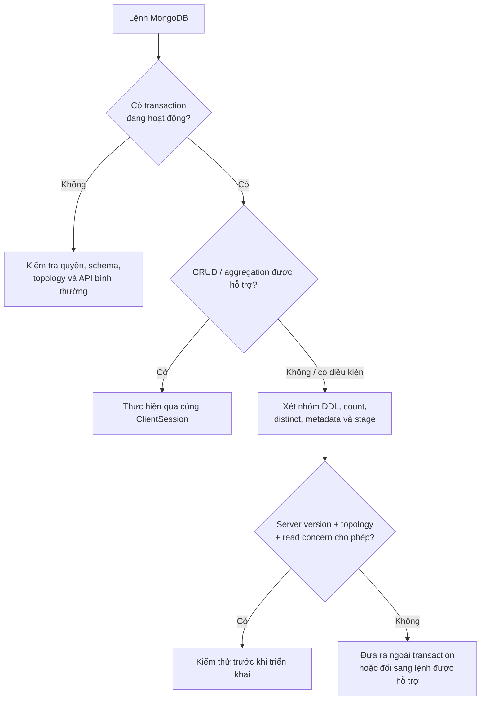

# Giới hạn lệnh collection, chỉ mục, count và truy vấn đặc thù theo phiên bản

## 1. Vì sao cùng một lệnh MongoDB chạy được bên ngoài nhưng lỗi trong transaction?

Trong **Spring Data MongoDB**, một transaction sử dụng `ClientSession` để gom các thao tác đọc/ghi thành một đơn vị commit hoặc rollback. Điều đó **không đồng nghĩa mọi lệnh MongoDB đều được phép chạy trong transaction**. Ngoài các thao tác CRUD thông thường, ứng dụng thường còn:

- Tự tạo collection khi entity được insert lần đầu.
- Tạo chỉ mục unique/TTL trước khi ghi.
- Gọi `count()` để kiểm tra số tài liệu thỏa điều kiện.
- Tìm các giá trị riêng biệt (`distinct`), truy vấn địa lý hoặc chạy aggregation.
- Kiểm tra collection/index, hoặc dùng `explain` để phân tích hiệu năng.

Một số thao tác thuộc **DDL/quản trị**, một số dùng metadata thay vì đọc document nhất quán theo transaction, và một số aggregation stage có hiệu ứng hoặc hạn chế riêng. MongoDB có thể trả lỗi ngay cả khi mã Java hợp lệ.

Ví dụ vấn đề thường gặp:

```text
Spring service với @Transactional
    |
    +--> insert reservation                  [CRUD: thường hợp lệ]
    +--> MongoTemplate.count(query, ...)     [Spring chuyển sang aggregation]
    +--> db.runCommand({ count: "orders" })  [lệnh count cũ: bị cấm]
    +--> createIndex nếu chưa có             [phụ thuộc server, điều kiện DDL]
    +--> explain(query)                      [không được trong transaction]
    |
    +--> lỗi -> transaction abort/rollback
```

**Mục tiêu bài học:** hiểu giới hạn theo **MongoDB server version, topology (replica set/sharded), read concern và API Spring Data** để chọn đúng lệnh, đặt đúng vị trí và kiểm thử được. Đây là một phần của năng lực sử dụng Spring Data MongoDB cho giao dịch, truy vấn, index, reactive access và chẩn đoán hiệu năng.

### Transaction không phải ClientSession thông thường

`ClientSession` có thể phục vụ các thao tác liên quan đến causal consistency **mà không mở transaction**. Chỉ khi transaction được bắt đầu, các hạn chế được mô tả trong bài mới áp dụng đúng ngữ cảnh. Một transaction cũng chỉ gắn với **một session tại một thời điểm** và phải được kết thúc bằng commit/abort; không dùng session như một “khóa dữ liệu” có thể để mở vô thời hạn.



## 2. Ma trận phiên bản và các quy tắc cần nhớ

Những mốc quan trọng:

| MongoDB server | Khả năng liên quan |
| --- | --- |
| Trước **4.0** | Không có multi-document transaction theo cơ chế MongoDB hiện đại |
| **4.0+** | Transaction nhiều document trên replica set phù hợp |
| **4.2+** | Hỗ trợ distributed transaction trên sharded cluster theo ràng buộc của phiên bản/topology |
| **4.4+** | Cho phép một số thao tác tạo collection/index trong transaction với điều kiện chặt chẽ |
| **5.0+** | Có hạn chế cụ thể về đọc capped collection với read concern `snapshot` |
| Các phiên bản mới hơn | Tiếp tục có thay đổi ở sharding, execution, DDL và các stage; phải kiểm tra manual đúng phiên bản deploy |

**Không nên viết “MongoDB cấm mọi createCollection/createIndex trong transaction”** như một quy tắc tuyệt đối cho mọi phiên bản mới. Nhưng cũng **không nên dựa vào việc tạo collection/index động trong transaction nghiệp vụ**: điều kiện về collection rỗng/mới, read concern, cross-shard writes và hỗ trợ phía framework khiến mô hình đó khó kiểm soát. Giải pháp thực tế là **chuẩn bị schema/index bằng migration trước khi xử lý request**.

### So sánh nhanh lệnh trong transaction

| Lệnh/nhóm lệnh | Trong transaction | Ghi chú |
| --- | --- | --- |
| `find`, `insert`, `update`, `delete` | **Được hỗ trợ** | Phải gắn cùng session và thỏa ràng buộc khác |
| `aggregate` với `$match`/`$group`/`$count` | **Được hỗ trợ** | Không dùng các stage bị cấm |
| `countDocuments(filter)` | **Được hỗ trợ** | Cơ chế đếm dựa trên aggregation |
| Lệnh `count` cũ / `db.collection.count()` | **Không** | Dùng `countDocuments` hoặc `$count` |
| `estimatedDocumentCount()` | **Không dùng làm count trong transaction** | Ước lượng dựa metadata, không phản ánh snapshot/count nghiệp vụ |
| `distinct` trên collection không sharded | **Có** | Vẫn cần xét scope, transaction và tài nguyên |
| `distinct` trên sharded collection | **Không** | Thay bằng aggregation `$group` |
| Tạo collection/index mới | **Có điều kiện theo version** | Read concern `local`, collection mới/rỗng, hạn chế cross-shard |
| `listCollections`, `listIndexes` | **Không** | Đưa bước kiểm tra metadata ra ngoài transaction |
| `explain` | **Không** | Chạy ngoài transaction với filter tương đương |
| `$out`, `$merge` | **Không** | Aggregation có stage ghi ra ngoài theo cơ chế riêng |
| Nhiều lệnh transaction chạy song song trên một session | **Không** | Tuần tự hóa thao tác hoặc thiết kế khác |
| Ghi vào capped collection, `system.*` | **Không** | Các collection hệ thống có hạn chế riêng |

### Spring Data MongoDB và MongoDB server có thể mô tả khác nhau

Tài liệu **Spring Data MongoDB** thường khuyến nghị mạnh rằng **collection cần tồn tại trước khi transaction chạy** và mô tả các collection operations là không được hỗ trợ trong giao dịch. Trong khi đó, tài liệu **MongoDB server** từ 4.4+ cho phép **một tập nhỏ các DDL operation** với điều kiện nhất định.

Đây không nhất thiết là mâu thuẫn ở mức thực thi: một tài liệu nhấn mạnh **giới hạn/hành vi an toàn ở tầng framework**, tài liệu còn lại mô tả **khả năng của server**. Với `@Transactional`/`MongoTemplate`, hãy **không phụ thuộc vào auto-create collection/index**. Chỉ sử dụng DDL trong transaction nếu có nhu cầu đặc biệt, đã xác minh đúng driver/Spring Data/server và có kiểm thử tích hợp riêng.

Nguồn tham khảo chính:

- MongoDB Transactions and Operations: https://www.mongodb.com/docs/manual/core/transactions-operations/
- MongoDB Transactions: https://www.mongodb.com/docs/manual/core/transactions/
- Spring Data MongoDB Sessions & Transactions: https://docs.spring.io/spring-data/mongodb/reference/mongodb/client-session-transactions.html

## 3. Chuẩn bị môi trường và mô hình dữ liệu thử nghiệm

Ví dụ xuyên suốt: API giữ tồn kho và tạo `reservation` trong **cùng transaction**, sau đó đếm số reservation đang chờ. Collection `inventory` và `reservations` phải được chuẩn bị **trước** khi transaction nghiệp vụ bắt đầu.

### 3.1. Topology và kết nối

Multi-document transactions yêu cầu MongoDB replica set hoặc sharded cluster được cấu hình phù hợp; một `mongod` standalone thông thường không phải môi trường để chứng minh transaction hoạt động.

URI minh họa cho replica set local đã thiết lập sẵn:

```properties
spring.data.mongodb.uri=mongodb://localhost:27017/tx_limits_demo?replicaSet=rs0
```

Đây chỉ là ví dụ cấu hình; `replicaSet=rs0` phải khớp replica set thực và node phải được khởi tạo đúng. Không tự chép URI này vào production. Khi dùng sharded cluster, URI, read/write concern, khả năng cross-shard transaction và quyền user khác đi.

Kiểm tra **ngoài transaction** trong `mongosh`:

```javascript
db.version()
db.hello()
```

`db.hello()` cho biết thông tin topology phù hợp với quyền hiện có; nó không thay cho kiểm tra cấu hình toàn cluster. Các lệnh quản trị chỉ nên chạy bằng tài khoản giám sát/migration được cấp quyền phù hợp, không dùng tài khoản nghiệp vụ có quyền tối thiểu.

### 3.2. Tạo collection và index bên ngoài transaction

Trên database demo **chưa có dữ liệu quan trọng**:

```javascript
use tx_limits_demo

db.createCollection("inventory")
db.createCollection("reservations")

db.inventory.createIndex(
  { tenant_id: 1, sku: 1 },
  { unique: true, name: "inventory_tenant_sku_unique" }
)

db.reservations.createIndex(
  { tenant_id: 1, request_id: 1 },
  { unique: true, name: "reservation_request_unique" }
)

db.inventory.insertOne({
  _id: "SHOP-A:BOOK-101",
  tenant_id: "SHOP-A",
  sku: "BOOK-101",
  available: NumberLong("10"),
  reserved: NumberLong("0")
})
```

Lệnh `insertOne` sẽ báo duplicate key nếu chạy lại với cùng ID. Trên database có dữ liệu cũ, **unique index cần kiểm tra duplicate trước** và chỉ được tạo bằng migration được kiểm soát. Những lệnh tạo schema ở trên không phải thứ cần đặt trong method `@Transactional` xử lý HTTP.

### 3.3. Những field sử dụng trong bài

| Collection | Field BSON | Ý nghĩa |
| --- | --- | --- |
| `inventory` | `_id`, `tenant_id`, `sku` | Định danh sản phẩm trong tenant |
| `inventory` | `available`, `reserved` | Lượng còn khả dụng và đã giữ |
| `reservations` | `_id`, `tenant_id`, `request_id` | Định danh reservation và idempotency |
| `reservations` | `sku`, `quantity`, `status` | Nội dung và trạng thái yêu cầu giữ hàng |
| `reservations` | `created_at` | BSON Date của thời điểm tạo |

Trong bài, `request_id` phải ổn định khi client/worker retry cùng một yêu cầu. Unique index trên `(tenant_id, request_id)` giúp tránh lưu hai reservation cùng ý định, nhưng không tự xác nhận hai request có cùng payload; ứng dụng cần đối chiếu SKU/quantity khi gặp duplicate.

## 4. Giới hạn tạo collection trong transaction

### 4.1. Có thể làm được trên server mới, nhưng không phải tùy ý

Trên MongoDB 4.4+ và các phiên bản phù hợp, server hỗ trợ một số cách **tạo collection trong transaction**:

- **Tạo tường minh**: lệnh `create`/`db.createCollection()`, khi transaction sử dụng `readConcern: "local"`.
- **Tạo ngầm**: ghi `insert`/`upsert` vào collection chưa tồn tại, với các điều kiện mà server cho phép.
- Transaction không được là kiểu **cross-shard write** có tạo collection mới ở shard khác; trường hợp này bị cấm.

Ví dụ *chỉ dành cho môi trường test* và MongoDB server đáp ứng ràng buộc:

```javascript
// Đặt trong mongosh, chạy trên một database test riêng.
const session = db.getMongo().startSession();
const txdb = session.getDatabase("tx_limits_demo");

try {
  session.startTransaction({
    readConcern: { level: "local" },
    writeConcern: { w: "majority" }
  });

  // Tên collection mới, chưa tồn tại.
  txdb.createCollection("temporary_tx_demo");

  txdb.temporary_tx_demo.insertOne({
    _id: "DOC-1",
    status: "CREATED"
  });

  session.commitTransaction();
} catch (error) {
  session.abortTransaction();
  throw error;
} finally {
  session.endSession();
}
```

Đoạn này **không nên được biến thành migration production** hay lời gọi lặp trong API. Nếu collection đã tồn tại, `createCollection` có thể thất bại; nếu có thao tác cross-shard không được phép hoặc server không đủ phiên bản, transaction sẽ báo lỗi. Ví dụ giả định `temporary_tx_demo` chưa có, và các thao tác được chạy trên session vừa tạo.

### 4.2. Tránh tạo collection “trong lúc xử lý đơn đầu tiên”

Trong Spring Data, nhiều thao tác insert lần đầu có thể dẫn tới việc collection được tạo ngầm nếu không tồn tại. Nhưng nếu nó nằm trong transaction, hành vi thành công/thất bại phụ thuộc topology, version và điều kiện thực tế. Một hệ thống mới triển khai có thể thấy đơn đầu tiên thất bại trong khi đơn sau hoạt động — **không nên dùng điều đó làm cơ chế bootstrap**.

Thực hành an toàn:

1. Migration tạo `inventory`, `reservations`, `outbox` và validator trước khi service bắt đầu xử lý giao dịch.
2. Đặt unique index và kiểm chứng metadata trước khi chấp nhận request đồng thời.
3. Nếu collection cần tạo theo tenant, dùng quy trình provisioning riêng được giám sát; không tự tạo hàng trăm collection dưới transaction của người dùng.
4. Có cơ chế báo lỗi startup/deployment khi schema bắt buộc chưa có.

### 4.3. DDL và transaction có thể tranh khóa

Một transaction đang hoạt động trên collection có thể tương tác với thao tác tạo/drop/rename/index ngoài transaction. DDL đang chờ lock có thể khiến transaction mới bị chặn hoặc abort, tùy phiên bản và thời điểm lấy lock. Vì vậy **tránh migration DDL trong giờ cao điểm**, giữ transaction ngắn và theo dõi lock wait/abort. Nếu tạo/drop collection ngay trước khi bắt đầu transaction, tham khảo yêu cầu write concern và bảo đảm DDL đã được nhìn thấy phù hợp trên cluster.

## 5. Giới hạn tạo chỉ mục trong transaction

### 5.1. Tạo index mới chỉ trong tình huống rất hẹp

Tài liệu MongoDB server hiện hành cho phép `createIndexes`/`createIndex` trong transaction khi **đủ điều kiện**, đặc biệt:

1. Server hỗ trợ transaction DDL tương ứng (mốc giới thiệu **MongoDB 4.4**).
2. Transaction có `readConcern: "local"` cho **DDL tường minh**.
3. Index mới được tạo trên **collection chưa tồn tại**, hoặc trên **collection mới, rỗng, được tạo trước đó trong cùng transaction**.
4. Không vi phạm hạn chế của cross-shard write transaction, quyền tạo index hay loại collection.

Ví dụ minh họa:

```javascript
// Chỉ chạy một lần trên MongoDB test, yêu cầu server phù hợp.
const session = db.getMongo().startSession();
const txdb = session.getDatabase("tx_limits_demo");

try {
  session.startTransaction({
    readConcern: { level: "local" },
    writeConcern: { w: "majority" }
  });

  txdb.createCollection("tx_new_indexed");

  // Collection vừa được tạo, vẫn còn rỗng.
  txdb.tx_new_indexed.createIndex(
    { business_key: 1 },
    { unique: true, name: "tx_demo_business_key_unique" }
  );

  txdb.tx_new_indexed.insertOne({
    _id: "ONE",
    business_key: "K1"
  });

  session.commitTransaction();
} catch (error) {
  session.abortTransaction();
  throw error;
} finally {
  session.endSession();
}
```

**Đừng suy ra** có thể mở transaction rồi tạo một unique index **mới** trên collection `orders` đã tồn tại và có dữ liệu. Quy trình migrate index cho collection hiện hữu nên được thực hiện **ngoài transaction nghiệp vụ**, sau khi đã xử lý duplicate và kiểm soát tải index build.

Nếu gọi `createIndex` với **đúng một index đã tồn tại**, server có thể trả thành công như một bước kiểm tra sự tồn tại trong những tình huống hỗ trợ; điều đó **không có nghĩa** một định nghĩa index mới đã được tạo.

### 5.2. Spring Data `@Indexed`, `indexOps` và auto-index

Trong Java:

```java
import org.springframework.data.domain.Sort;
import org.springframework.data.mongodb.core.index.Index;

Index uniqueRequest = new Index()
    .on("tenantId", Sort.Direction.ASC)
    .on("requestId", Sort.Direction.ASC)
    .unique()
    .named("reservation_request_unique");

mongoTemplate.indexOps(ReservationDocument.class)
    .ensureIndex(uniqueRequest);
```

Ở đây `ReservationDocument` là entity sẽ được định nghĩa ở mục 10. `tenantId` và `requestId` là **property Java**; nhờ metadata, Spring Data ánh xạ sang `tenant_id` và `request_id`.

**Vị trí hợp lý của đoạn code:** bước migration/khởi tạo schema ngoài transaction, sau khi kết nối tới đúng MongoDB. Không đặt `ensureIndex(...)` trong method `@Transactional` tạo reservation, cũng không gọi khi mọi request bắt đầu. Các phiên bản Spring Data mới có thể dùng `createIndex(...)` thay `ensureIndex(...)`; hãy đối chiếu API đang dùng.

Annotation `@Indexed`/`@CompoundIndex` chỉ mô tả định nghĩa; không tự bảo đảm index đã tồn tại, đặc biệt khi cơ chế auto-index bị tắt. Xác minh qua:

```javascript
// Chạy ngoài transaction.
db.reservations.getIndexes()
```

### 5.3. Không gọi `getIndexInfo` / `getIndexes` giữa transaction

`db.collection.getIndexes()` sử dụng `listIndexes`, thuộc nhóm **không hỗ trợ trong transaction**. Tương tự `db.getCollectionNames()`/`listCollections`.

Nếu code Java kiểm tra index rồi mới insert:

```java
@Transactional
public void doWork() {
    // Sai vị trí: metadata/index introspection không thuộc business tx.
    // mongoTemplate.indexOps(ReservationDocument.class).getIndexInfo();
    // ... ghi dữ liệu ...
}
```

Hãy kiểm tra schema ở **thời điểm deploy/startup**, ghi nhận kết quả theo môi trường, rồi chỉ cho phép business flow chạy khi index đã hợp lệ. Nếu có migration đồng thời trong lúc service hoạt động, cần chính sách rollout/locking riêng thay vì đợi mỗi request xác minh index.

### 5.4. Phân biệt DDL và thao tác CRUD bị rollback

Giả sử transaction insert một order, sau đó phát hiện hết hàng và rollback; **insert order** bị hủy. Nhưng không thể giả định **mọi công việc quản trị bên ngoài** (tạo index trước transaction, chạy migration khác, ghi tới hệ thống ngoài) sẽ rollback cùng transaction đó. Ranh giới MongoDB transaction chỉ bao gồm các thao tác hợp lệ thực sự gắn vào **cùng session và transaction**.

## 6. Lệnh `count` cũ không dùng được; `countDocuments` là giải pháp

### 6.1. Vì sao `count` gặp lỗi trong transaction?

Lệnh `count` truyền thống và các helper `db.collection.count()`/`cursor.count()` có thể dùng metadata của collection; trong transaction, cách đếm này **không phản ánh đầy đủ ngữ nghĩa của các document đang giao dịch**. MongoDB không cho chạy lệnh `count` cũ trong multi-document transaction (Spring Data docs ghi ví dụ mã lỗi **50851**).

Không dùng:

```javascript
// Không dùng trong transaction:
db.orders.count({ status: "PENDING" })
db.runCommand({
  count: "orders",
  query: { status: "PENDING" }
})
```

Nếu test code gọi native `runCommand({count: ...})` trong session đang transaction, sẽ nhận lỗi server thay vì một con số. Không nên “fix” bằng cách bắt lỗi rồi trả 0.

### 6.2. `countDocuments` dùng aggregation

Trên MongoDB hỗ trợ, hãy dùng `countDocuments(filter)`:

```javascript
const session = db.getMongo().startSession();
const txdb = session.getDatabase("tx_limits_demo");

try {
  session.startTransaction();

  const total = txdb.reservations.countDocuments({
    tenant_id: "SHOP-A",
    status: "PENDING"
  });

  print("Số reservation đang chờ: " + total);
  session.commitTransaction();
} catch (e) {
  session.abortTransaction();
  throw e;
} finally {
  session.endSession();
}
```

Về mặt ý nghĩa, helper của driver/`mongosh` tính count bằng aggregation `$match` và `$group`/`$sum` (hoặc stage tương đương). Đây là thao tác **đếm document phù hợp**, không đọc số đếm gần đúng từ collection metadata.

Viết trực tiếp aggregation:

```javascript
db.reservations.aggregate([
  {
    $match: {
      tenant_id: "SHOP-A",
      status: "PENDING"
    }
  },
  { $count: "total" }
])
```

Kết quả có thể là:

```javascript
{ total: 3 }
```

**Cẩn trọng:** nếu không có document khớp, `$count` thường **không trả document nào**; cần diễn giải là **0** ở code Java/JavaScript nếu nghiệp vụ cần con số. Với `countDocuments`, helper trả kết quả số (0 khi không có kết quả).

### 6.3. Trong Spring Data, `MongoTemplate.count(...)` được xử lý đặc biệt

Spring Data MongoDB nhận biết khi `MongoTemplate` chạy trong một transaction đã được gắn session, rồi chuyển các overload `count(...)` sang cách đếm bằng aggregation `$match` + `$count` để tránh lệnh `count` không được phép. Các tùy chọn query phù hợp như `collation` vẫn được giữ theo hỗ trợ của framework/server.

```java
import org.springframework.data.mongodb.core.query.Criteria;
import org.springframework.data.mongodb.core.query.Query;

Query pending = Query.query(
    Criteria.where("tenantId").is(authorizedTenantId)
        .and("status").is("PENDING")
);

long count = mongoTemplate.count(
    pending, ReservationDocument.class);
```

**Không nhầm** `MongoTemplate.count(...)` với tự chạy raw driver `count` command; cách chuyển đổi do Spring Data thực hiện chỉ có hiệu lực khi đi qua API và session context tương ứng. Nếu gọi native `MongoCollection` với method có semantics khác hoặc mở session thủ công mà không gắn template, phải kiểm tra API đó riêng.

### 6.4. `estimatedDocumentCount` là bài toán khác

`estimatedDocumentCount()` (hoặc một API estimated count tương ứng) dựa trên metadata và tối ưu cho **ước lượng toàn collection**, không thích hợp để xác minh số document đang được insert/delete trong transaction. Tránh dùng estimated count cho điều kiện nghiệp vụ “chỉ có tối đa N reservation” hoặc tính toán cần ngữ nghĩa transactional.

Ngoài transaction, `estimatedDocumentCount` có thể hữu ích khi cần con số gần đúng cho dashboard tổng quan, nhưng không phải một phép đếm chính xác theo filter. Với nghiệp vụ nhạy cảm, cần dùng điều kiện cập nhật nguyên tử/unique constraint, **không chỉ dựa trên việc count được N rồi quyết định insert**: hai transaction đồng thời đều có thể thấy cùng count và cùng vượt hạn mức nếu không có cơ chế tranh chấp tài nguyên.

### 6.5. `countDocuments` không hỗ trợ mọi filter

Do sử dụng aggregation-based count, các biểu thức filter sau **không được dùng** trong `countDocuments`:

| Biểu thức gốc | Hướng viết lại |
| --- | --- |
| `$where` | Chuyển logic thích hợp sang `$expr` |
| `$near` | Dùng `$geoWithin` với `$center` khi **đúng ngữ nghĩa** |
| `$nearSphere` | Dùng `$geoWithin` với `$centerSphere` khi **đúng ngữ nghĩa** |

Không tự coi tìm kiếm “gần nhất theo khoảng cách” và lọc “nằm trong vùng” là cùng một bài toán. `$near` còn liên quan sắp xếp theo khoảng cách, còn `$geoWithin` chỉ trả document trong vùng; khi đổi operator để **đếm**, cần xác định yêu cầu chỉ là “bao nhiêu document trong bán kính” chứ không phải “N document gần nhất”.

Với Spring Data, các derived query có `Near` hoặc `Criteria.near(...)`/`nearSphere(...)` khi được dùng trong đường count cần xem lại; nếu đúng nhu cầu vùng, dùng `Criteria.within(...)`/`withinSphere(...)` và test trên MongoDB thật.

## 7. `distinct` và `$group`: khác biệt giữa unsharded và sharded

`distinct` trả những giá trị **không trùng** của một field, ví dụ các trạng thái reservation trong tenant. Quy tắc trong transaction phụ thuộc vào **sharding**:

| Collection | `distinct` trong transaction | Hướng triển khai |
| --- | --- | --- |
| **Không sharded** | Được hỗ trợ theo điều kiện transaction | Có thể dùng `distinct` hoặc aggregation `$group` |
| **Sharded** | Lệnh `distinct` **không được dùng** trong transaction | Sử dụng aggregation `$group` |

Ví dụ `distinct` trong `mongosh` khi collection **không sharded**:

```javascript
const session = db.getMongo().startSession();
const txdb = session.getDatabase("tx_limits_demo");

try {
  session.startTransaction();

  const states = txdb.reservations.distinct(
    "status",
    { tenant_id: "SHOP-A" }
  );

  printjson(states);
  session.commitTransaction();
} catch (error) {
  session.abortTransaction();
  throw error;
} finally {
  session.endSession();
}
```

Nếu collection `reservations` được shard, không dùng cùng helper `distinct` trong transaction rồi kỳ vọng nó tự fallback. Có thể thay bằng:

```javascript
db.reservations.aggregate([
  { $match: { tenant_id: "SHOP-A" } },
  { $group: { _id: "$status" } },
  { $project: { _id: 0, status: "$_id" } },
  { $sort: { status: 1 } }
])
```

Kết quả ví dụ:

```javascript
{ status: "CONFIRMED" }
{ status: "PENDING" }
```

Stage `$group` tạo một document cho mỗi giá trị; `$sort` cuối giúp thứ tự xác định nếu response cần. Pipeline này có thể chạy trong transaction khi không dùng stage bị cấm và đáp ứng các hạn chế khác.

### Có thể dùng `$addToSet` trong `$group`?

Có, nếu cần kết quả **một document chứa array các giá trị**:

```javascript
db.reservations.aggregate([
  { $match: { tenant_id: "SHOP-A" } },
  {
    $group: {
      _id: null,
      statuses: { $addToSet: "$status" }
    }
  },
  { $project: { _id: 0, statuses: 1 } }
])
```

Tuy nhiên, `$addToSet` không đảm bảo thứ tự phần tử trong array. Với field có **cardinality rất cao**, gom tất cả giá trị vào một array trong một document có thể chạm giới hạn kích thước BSON; cách nhóm ra từng document rồi phân trang/giới hạn theo nghiệp vụ thường dễ quản lý hơn.

### Java `MongoTemplate.aggregate` thay cho distinct command

```java
import java.util.List;
import org.bson.Document;
import org.springframework.data.mongodb.core.aggregation.Aggregation;
import org.springframework.data.mongodb.core.aggregation.AggregationResults;
import org.springframework.data.mongodb.core.query.Criteria;

Aggregation byStatus = Aggregation.newAggregation(
    Aggregation.match(
        Criteria.where("tenantId").is(authorizedTenantId)),
    Aggregation.group("status"),
    Aggregation.project()
        .and("_id").as("status")
        .andExclude("_id")
);

AggregationResults<Document> results =
    mongoTemplate.aggregate(
        byStatus,
        ReservationDocument.class,
        Document.class);

List<String> statuses = results.getMappedResults()
    .stream()
    .map(d -> d.getString("status"))
    .toList();
```

Trong `Aggregation.match` và `group("status")`, Spring Data sử dụng metadata của `ReservationDocument` để mapping tên property sang BSON. Các aggregation operation này thuộc luồng `MongoTemplate` đã gắn transaction context; không dùng native `MongoCollection` không có session rồi kỳ vọng nó nhìn thấy cùng snapshot.

**Không nên dùng distinct/group để cưỡng chế một điều kiện toàn hệ thống “chỉ có N loại trạng thái” bằng thao tác check-then-write**. Hai transaction đồng thời vẫn có thể vượt qua một phép đếm/đọc trong khi chúng cập nhật tài nguyên khác nhau. Bất biến cạnh tranh cần được thiết kế với unique constraint, CAS, document chứa counter nguyên tử hoặc resource lock phù hợp.

## 8. Aggregation và truy vấn đặc thù: stage nào bị hạn chế?

Transaction hỗ trợ nhiều phép aggregation đọc thông thường, nhưng một số stage **không được phép** bên trong transaction. Theo danh sách của MongoDB server hiện hành:

| Stage không được dùng trong transaction | Vì sao cần tránh trong thiết kế |
| --- | --- |
| `$out`, `$merge` | Ghi kết quả pipeline ra collection theo cơ chế riêng |
| `$collStats`, `$indexStats` | Truy vấn thống kê/metadata collection-index |
| `$currentOp` | Quan sát operation đang chạy |
| `$listSessions`, `$listLocalSessions` | Thông tin session/quản trị |
| `$planCacheStats` | Thống kê query plan cache |
| `$unionWith` | Stage không được hỗ trợ trong transaction theo danh sách này |

Những stage không bị cấm tuyệt đối trong bảng, ví dụ `$match`, `$project`, `$group` và `$count`, vẫn phải đáp ứng quy tắc về collection, topology, memory và driver. **Không nên suy ra “aggregate được phép” nghĩa là mọi stage đều chạy trong transaction**.

### 8.1. Tại sao không dùng `$merge` để thay update nghiệp vụ?

Sai ý định:

```javascript
// Không được đặt pipeline này trong transaction:
db.reservations.aggregate([
  { $match: { tenant_id: "SHOP-A" } },
  { $set: { status: "ARCHIVED" } },
  { $merge: { into: "reservation_archive" } }
])
```

Muốn thay đổi dữ liệu thuộc cùng transaction, hãy dùng API CRUD như `MongoTemplate.updateFirst`/`updateMulti` hay `insert` vào collection đã chuẩn bị, với điều kiện CAS/unique key phù hợp. Nếu cần một pipeline ETL/archive lớn, thiết kế nó như **công việc ngoài transaction nghiệp vụ**, có checkpoint/idempotency riêng.

### 8.2. `$graphLookup` trên sharded collection

MongoDB có thể hỗ trợ `$graphLookup` trong nhiều ngữ cảnh, nhưng **không được dùng `$graphLookup` trong transaction khi stage nhắm tới một sharded collection**. Đây là ví dụ rõ về giới hạn **stage + topology**, không thể chỉ nhìn vào tên stage rồi khẳng định luôn được hoặc luôn bị cấm.

Nếu cần truy vấn đồ thị/phân cấp phức tạp, có thể:

- Tính phần đọc/khảo sát ngoài transaction, rồi truyền một danh sách ID đã được kiểm tra tới transaction ngắn.
- Thiết kế lại dữ liệu, giới hạn chiều sâu và lựa chọn consistency phù hợp.
- Nếu bất biến có thể thay đổi giữa lúc khảo sát và lúc ghi, **xác nhận lại điều kiện dưới transaction** hoặc dùng CAS thay vì tin vào snapshot ngoài transaction.

### 8.3. `$geoNear`, `$near` và `$geoWithin`

Truy vấn vị trí cần phân biệt **tìm nearest**, **lọc trong bán kính** và **đếm document trong một vùng**. Đặc biệt:

```javascript
// Khi countDocuments dùng aggregation, không dùng:
{ location: { $near: { $geometry: point, $maxDistance: 1000 } } }

// Nếu chỉ cần "nằm trong vùng" và cấu trúc tọa độ phù hợp:
{
  location: {
    $geoWithin: {
      $centerSphere: [[106.7, 10.8], 1.0 / 6378.1]
    }
  }
}
```

`$centerSphere` sử dụng bán kính **radian**; ví dụ 1 km / 6378.1 km chỉ minh họa cho hệ tọa độ legacy phù hợp. Với GeoJSON và index 2dsphere, cần tuân thủ định nghĩa geometry, giới hạn và đơn vị của chính operator đang sử dụng. Không dùng một ví dụ khoảng cách để suy ra phép toán hình học chính xác cho mọi dữ liệu.

**Trọng tâm của transaction ở đây:** count helper không nhận `$near`/`$nearSphere` và cách rewrite phải có cùng ý định nghiệp vụ. `$geoNear` là **aggregation stage riêng**, yêu cầu geospatial index và thường phải nằm ở đầu pipeline; cần kiểm tra tính tương thích theo topology/version và thao tác cụ thể, không tự thay nó bằng `$geoWithin` khi cần danh sách sắp theo khoảng cách gần nhất.

### 8.4. Atlas Search, Vector Search và tính năng ngoài server CRUD

Những stage của Atlas Search hoặc Vector Search có yêu cầu về sản phẩm, index và phiên bản riêng, không nên suy ra chúng đều dùng được trong transaction chỉ vì `aggregate()` hỗ trợ `$match`/`$group`. Kiểm tra tài liệu của **stage và môi trường đang dùng**. Một mô hình phổ biến là thực hiện **tìm kiếm/đề xuất ngoài transaction**, sau đó mở transaction ngắn để xác nhận tài nguyên còn hợp lệ và thực hiện thao tác ghi có điều kiện.

## 9. Các lệnh metadata, explain, cursor và collection đặc biệt

Ngoài DDL và count, một số nhóm lệnh bị cấm hoặc có quy tắc rất cụ thể trong transaction:

| Nhóm | Ví dụ | Hệ quả thực hành |
| --- | --- | --- |
| Metadata collection/index | `listCollections`, `listIndexes`, `getIndexes()` | Kiểm tra ngoài transaction |
| Phân tích kế hoạch | `explain()`, `explain` command | Dùng ngoài transaction, với query tương đương |
| Các lệnh admin không phải CRUD/informational | `createUser`, `getParameter` | Không trộn quản trị với giao dịch nghiệp vụ |
| Capped collection | Ghi document vào capped collection | Không được phép trong transaction |
| Capped + snapshot | Đọc capped với read concern `snapshot` (MongoDB 5.0+) | Bị hạn chế |
| Hệ thống | Đọc/ghi collection trong `config`, `admin`, `local`; ghi `system.*` | Bị cấm theo các quy tắc server |
| Cursor | `getMore` ngoài transaction cho cursor tạo trong transaction hoặc ngược lại | Sai phạm vi session/transaction |
| Parallel operations | Gửi nhiều lệnh concurrent trong cùng transaction/session | Không được phép |
| Thông tin trạng thái | `hello`, `buildInfo`, `connectionStatus` | Có thể được phép nhưng **không là lệnh đầu tiên** trong transaction |

### 9.1. `explain` chỉ dùng ngoài transaction

```javascript
// Hợp lệ cho mục đích điều tra ngoài transaction:
db.reservations.find({
  tenant_id: "SHOP-A",
  status: "PENDING"
})
.explain("executionStats")
```

Nếu cần đánh giá hiệu năng của truy vấn dùng trong transaction, chạy `explain` **trước hoặc sau** transaction trên cùng mẫu filter/index/dữ liệu đại diện. Không đưa `explain` vào logic nghiệp vụ để “tự quyết định dùng index nào”.

Nhớ rằng `explain` ngoài transaction **không tái tạo hoàn toàn** snapshot, lock/contention và chi phí commit của transaction. Nó giúp đánh giá đường quét/index, còn tổng latency của transaction cần được đo tại ứng dụng và MongoDB metrics.

### 9.2. Cursor không đi qua ranh giới transaction

Ví dụ sai về ý định:

```text
1. Mở transaction T.
2. Tạo cursor bằng find/aggregate trong T.
3. Commit T.
4. Tiếp tục dùng getMore của cursor đó ở ngoài T.
=> Bị hạn chế; không tách vòng đời cursor khỏi transaction.
```

Với Java, không giữ `CloseableIterator`/`Stream` đang đọc dữ liệu để tiêu thụ **sau khi `@Transactional` method đã return**. Một phương thức trả `Stream` lazy có thể khiến phần thực thi tiếp tục sau khi transaction/session đóng. Nếu kết quả cần lớn hoặc cần streaming lâu, nên cân nhắc query đọc ngoài transaction theo watermark/page, thay vì giữ multi-document transaction mở suốt cả response HTTP.

### 9.3. Nhiều lệnh đồng thời cùng một session

Không viết:

```java
// KHÔNG làm vậy trong cùng một transaction:
// CompletableFuture.allOf(
//   CompletableFuture.runAsync(() -> template.insert(a)),
//   CompletableFuture.runAsync(() -> template.insert(b))
// );
```

MongoDB không cho nhiều operation chạy **song song trong cùng transaction**. Trong Spring imperative, transaction/session còn thường gắn với thread; tạo thread mới có thể **không thừa hưởng transaction context** và khiến thao tác chạy ngoài transaction, nguy hiểm hơn một lỗi rõ ràng.

Trong reactive, `zip`/`flatMap` với concurrency có thể khiến các operation đang dùng một transactional session chạy song song; nên chuỗi thao tác cần tính nguyên tử bằng `then(...)`/`flatMap(...)` **tuần tự**, không fan-out đồng thời vô điều kiện.

### 9.4. Không dùng transaction như công cụ đọc metadata/giám sát

Các công việc thường nên ở ngoài business transaction:

- Kiểm tra phiên bản server, topology, quyền và migration readiness.
- Kiểm tra danh sách collection/index hoặc query plan.
- Chạy ETL dài, archive, aggregate ghi ra collection.
- Tạo/drop/rename/index cho schema đang hoạt động.
- Thực hiện truy vấn báo cáo rất lớn, có thể kéo dài và tốn memory.

Transaction thích hợp hơn cho một **nhóm thao tác ghi/đọc ngắn, có ranh giới nhất quán rõ**. Một yêu cầu thống kê trang dashboard thường không nên mở transaction nhiều document chỉ để lấy số lượng gần đúng rồi trả JSON.

## 10. Spring Data MongoDB: cấu hình và entity minh họa

Spring Data MongoDB có hai hướng chính:

- **Imperative:** `MongoTransactionManager` liên kết `ClientSession` với thread, cho phép `MongoTemplate`/repository tham gia transaction qua `@Transactional`.
- **Reactive:** `ReactiveMongoTransactionManager` liên kết transaction với **Reactor Context**, yêu cầu các publisher nằm cùng chuỗi reactive và được subscribe trong context.

### 10.1. Cấu hình transaction manager imperative

```java
package com.example.tx;

import org.springframework.context.annotation.Bean;
import org.springframework.context.annotation.Configuration;
import org.springframework.data.mongodb.MongoDatabaseFactory;
import org.springframework.data.mongodb.MongoTransactionManager;

@Configuration
public class MongoTxConfiguration {

    @Bean
    MongoTransactionManager mongoTransactionManager(
            MongoDatabaseFactory factory) {
        return new MongoTransactionManager(factory);
    }
}
```

Đối với declarative transaction, `MongoTemplate` phải sử dụng đúng `MongoDatabaseFactory` tương thích với transaction manager. Spring Data **không tự bật giao dịch chỉ vì có `@Transactional`**: ứng dụng cần transaction manager được cấu hình và proxy/AOP hoạt động. Trong Spring Boot, không suy ra rằng mọi starter hoặc môi trường mặc định đều tạo Mongo transaction manager.

### 10.2. Entity tồn kho

```java
package com.example.tx;

import org.springframework.data.mongodb.core.mapping.Document;
import org.springframework.data.mongodb.core.mapping.Field;
import org.springframework.data.mongodb.core.mapping.FieldType;
import org.springframework.data.mongodb.core.mapping.MongoId;

@Document(collection = "inventory")
public class InventoryDocument {

    @MongoId(FieldType.STRING)
    private String id;

    @Field("tenant_id")
    private String tenantId;

    private String sku;
    private long available;
    private long reserved;

    protected InventoryDocument() {}

    public String getId() { return id; }
    public String getTenantId() { return tenantId; }
    public String getSku() { return sku; }
    public long getAvailable() { return available; }
    public long getReserved() { return reserved; }
}
```

### 10.3. Entity reservation

```java
package com.example.tx;

import java.time.Instant;
import org.springframework.data.mongodb.core.mapping.Document;
import org.springframework.data.mongodb.core.mapping.Field;
import org.springframework.data.mongodb.core.mapping.FieldType;
import org.springframework.data.mongodb.core.mapping.MongoId;

@Document(collection = "reservations")
public class ReservationDocument {

    @MongoId(FieldType.STRING)
    private String id;

    @Field("tenant_id")
    private String tenantId;

    @Field("request_id")
    private String requestId;

    private String sku;
    private long quantity;
    private String status;

    @Field("created_at")
    private Instant createdAt;

    protected ReservationDocument() {}

    public ReservationDocument(
            String id, String tenantId, String requestId,
            String sku, long quantity,
            String status, Instant createdAt) {
        this.id = id;
        this.tenantId = tenantId;
        this.requestId = requestId;
        this.sku = sku;
        this.quantity = quantity;
        this.status = status;
        this.createdAt = createdAt;
    }

    public String getId() { return id; }
    public String getTenantId() { return tenantId; }
    public String getRequestId() { return requestId; }
    public String getSku() { return sku; }
    public long getQuantity() { return quantity; }
    public String getStatus() { return status; }
    public Instant getCreatedAt() { return createdAt; }
}
```

Entity sử dụng `@MongoId(FieldType.STRING)` để ID `"SHOP-A:BOOK-101"` và `UUID string` được lưu dưới dạng **BSON String**. `@Field("tenant_id")`/`@Field("request_id")` ánh xạ tên Java sang tên BSON. Các index và dữ liệu demo ở mục 3 phải khớp chính xác các tên này.

### 10.4. Kiểm tra schema trong migration, không trong service

Một bước startup/migration riêng có thể gọi:

```java
import org.springframework.data.domain.Sort;
import org.springframework.data.mongodb.core.index.Index;

mongoTemplate.indexOps(ReservationDocument.class)
    .ensureIndex(new Index()
        .on("tenantId", Sort.Direction.ASC)
        .on("requestId", Sort.Direction.ASC)
        .unique()
        .named("reservation_request_unique"));
```

Nhưng **không** nhúng đoạn này vào transaction của `reserve(...)` dưới đây. Khi chạy trên production, có thể ưu tiên migration do hạ tầng kiểm soát để đảm bảo index được xác nhận trước khi ứng dụng nhận request.

## 11. Service `@Transactional`: ghi hai collection rồi đếm

Giả sử API giữ 2 quyển sách cho SHOP-A:

1. Giảm `inventory.available` và tăng `inventory.reserved` khi còn đủ tồn.
2. Tạo một `ReservationDocument` duy nhất theo `(tenantId, requestId)`.
3. Đếm số reservation `PENDING` trong tenant để trả thống kê.
4. Commit nếu tất cả bước hợp lệ; rollback nếu thất bại.

### 11.1. Kết quả trả về

```java
package com.example.tx;

public record ReservationResult(
    String reservationId,
    long pendingCountInTransaction
) {}
```

### 11.2. Service mẫu

```java
package com.example.tx;

import java.time.Clock;
import java.util.UUID;
import com.mongodb.client.result.UpdateResult;
import org.springframework.data.mongodb.core.MongoTemplate;
import org.springframework.data.mongodb.core.query.Criteria;
import org.springframework.data.mongodb.core.query.Query;
import org.springframework.data.mongodb.core.query.Update;
import org.springframework.stereotype.Service;
import org.springframework.transaction.annotation.Transactional;

@Service
public class ReservationService {

    private final MongoTemplate template;
    private final Clock clock;

    public ReservationService(
            MongoTemplate template, Clock clock) {
        this.template = template;
        this.clock = clock;
    }

    @Transactional
    public ReservationResult reserve(
            String authorizedTenantId,
            String requestId,
            String sku,
            long quantity) {

        if (authorizedTenantId == null
                || authorizedTenantId.isBlank()
                || requestId == null || requestId.isBlank()
                || sku == null || sku.isBlank()
                || sku.contains(":")
                || quantity <= 0) {
            throw new IllegalArgumentException(
                "Dữ liệu đặt giữ hàng không hợp lệ");
        }

        Query available = Query.query(
            Criteria.where("id").is(
                    authorizedTenantId + ":" + sku)
                .and("tenantId").is(authorizedTenantId)
                .and("available").gte(quantity)
        );

        Update reserveStock = new Update()
            .inc("available", -quantity)
            .inc("reserved", quantity);

        UpdateResult stockChanged = template.updateFirst(
            available, reserveStock, InventoryDocument.class);

        if (stockChanged.getModifiedCount() != 1) {
            throw new IllegalStateException(
                "Không đủ hàng hoặc SKU không tồn tại");
        }

        ReservationDocument reservation =
            new ReservationDocument(
                UUID.randomUUID().toString(),
                authorizedTenantId,
                requestId,
                sku,
                quantity,
                "PENDING",
                clock.instant()
            );

        template.insert(reservation);

        // Spring Data nhận ra transaction, dùng aggregation count.
        Query pending = Query.query(
            Criteria.where("tenantId").is(authorizedTenantId)
                .and("status").is("PENDING")
        );
        long count = template.count(
            pending, ReservationDocument.class);

        return new ReservationResult(reservation.getId(), count);
    }
}
```

**Điểm cần quan sát:** `template.updateFirst`, `template.insert` và `template.count` chạy qua cùng `MongoTemplate` đã được transaction manager gắn `ClientSession`. Vì vậy, count sau insert có thể tính cả **write của chính transaction** theo semantics của giao dịch; sau khi rollback, cả giảm tồn và reservation đều không được lưu.

### 11.3. Vì sao không gọi `count` raw?

Không viết trong method:

```java
// Sai hướng bên trong transaction:
// template.getDb().runCommand(
//     new Document("count", "reservations")
//         .append("query", new Document("status", "PENDING")));
```

Lệnh này vẫn là native `count` bị cấm, **không hưởng cơ chế chuyển đổi** của `MongoTemplate.count(...)`. Tương tự, không chèn `getIndexes()` hay `explain()` vào giữa các bước để “debug nhanh”.

### 11.4. Thất bại ở bước cuối thì sao?

Giả sử một request khác đã tạo `(SHOP-A, K1)`, unique index khiến `template.insert(reservation)` báo `DuplicateKeyException`. Vì method đang trong transaction, exception runtime thông thường kích hoạt rollback cả lần giảm tồn kho trước đó. **Không bắt duplicate ở bên trong rồi tiếp tục commit** như thể mọi thứ bình thường.

Muốn replay idempotent đúng cách:

- Để method transaction kết thúc (rollback) khi duplicate.
- Ở một facade **khác Spring bean**, bắt duplicate sau khi transaction đã kết thúc.
- Đọc reservation bằng tenant/request key ở scope đã xác thực.
- So sánh SKU/quantity của request cũ; chỉ replay khi khớp.
- Nếu kết quả commit chưa chắc chắn, chạy reconciliation/retry có giới hạn theo chính sách.

Một transaction không thay thế unique index hay cơ chế kiểm soát retry. Hai transaction đồng thời có thể gặp write conflict; cần thiết kế xử lý lỗi tạm thời, **không** tự bỏ điều kiện tồn kho khi retry.

### 11.5. Lưu ý Spring AOP và rollback

`@Transactional` thông qua proxy Spring thường áp dụng khi được gọi **qua bean proxy**, không đảm bảo khi một method trong cùng class tự gọi method `@Transactional` của chính nó. Đối với imperative, transaction context cũng gắn với thread. Tránh:

- Gọi `this.reserve(...)` từ method cùng class rồi nghĩ transaction luôn được mở.
- Chạy một phần thao tác bằng `CompletableFuture` thread khác.
- Nuốt exception rồi trả “success” mặc dù cần rollback.
- Cố thêm một metadata command giữa transaction.

Nếu muốn rollback với checked exception, phải xét các quy tắc rollback của Spring và cấu hình `rollbackFor` phù hợp. Với ví dụ trên, exception runtime được dùng để thể hiện failure cần rollback.

## 12. ClientSession thủ công và nguy cơ lệnh chạy ngoài session

Khi cần kiểm soát transaction trực tiếp, có thể mở `ClientSession` từ Java Driver và dùng `MongoTemplate.withSession(...)`. Ví dụ đọc count với session:

```java
import com.mongodb.client.ClientSession;
import com.mongodb.client.MongoClient;
import com.mongodb.ReadConcern;
import com.mongodb.WriteConcern;
import com.mongodb.TransactionOptions;
import org.springframework.data.mongodb.core.MongoTemplate;
import org.springframework.data.mongodb.core.query.Criteria;
import org.springframework.data.mongodb.core.query.Query;

public long countPendingWithExplicitSession(
        MongoClient client,
        MongoTemplate template,
        String authorizedTenantId) {

    TransactionOptions options = TransactionOptions.builder()
        .readConcern(ReadConcern.SNAPSHOT)
        .writeConcern(WriteConcern.MAJORITY)
        .build();

    try (ClientSession session = client.startSession()) {
        session.startTransaction(options);

        try {
            Query query = Query.query(
                Criteria.where("tenantId").is(authorizedTenantId)
                    .and("status").is("PENDING")
            );

            long count = template.withSession(session)
                .execute(ops -> ops.count(
                    query, ReservationDocument.class));

            session.commitTransaction();
            return count;
        } catch (RuntimeException failure) {
            // Demo: trong production cần phân biệt lỗi commit
            // "unknown outcome" với lỗi transaction chưa commit.
            try {
                session.abortTransaction();
            } catch (RuntimeException abortFailure) {
                failure.addSuppressed(abortFailure);
            }
            throw failure;
        }
    }
}
```

**Ví dụ chỉ minh họa session-bound API**, chưa phải một chính sách retry transaction hoàn chỉnh. Với `UnknownTransactionCommitResult`, không được đơn giản kết luận commit thất bại rồi chạy lại toàn bộ tác dụng nghiệp vụ; cần chiến lược retry commit/reconciliation theo driver và ứng dụng.

### `getCollection` không tự gắn session trong mọi ngữ cảnh

Spring Data có callback `withSession` nhằm giúp các thao tác template dùng session. Nhưng khi lấy trực tiếp một `MongoCollection` hoặc `MongoDatabase` native (ví dụ `template.getCollection("...")`), các method của driver có overload nhận `ClientSession` riêng; không tự suy ra object native đó đã được session-proxied.

Vì vậy đoạn sau có thể phá hợp đồng:

```java
// Bên trong transaction:
// template.getCollection("reservations").insertOne(document);
// -> Nếu không truyền ClientSession tương ứng,
//    native driver call có thể chạy ngoài transaction.
```

Hãy ưu tiên `MongoTemplate`/repository đã được quản lý, hoặc **truyền đúng session** khi dùng native API, và viết integration test chứng minh rollback thực sự xóa cả tác dụng của các lệnh đó.

### Đừng trộn thủ công và declarative tùy tiện

Mỗi hướng đều hợp lệ khi thiết kế rõ, nhưng tự `session.startTransaction()` bên trong method đã `@Transactional` có thể tạo logic session chồng chéo hoặc hai transaction không được mong đợi. Một session chỉ có **một transaction mở tại một thời điểm**. Chọn một cách quản lý làm nguồn sự thật (transaction manager hoặc manual session), test commit/abort và bảo đảm mọi thao tác dùng đúng context.

## 13. ReactiveMongoTransactionManager và tuần tự hóa operation

Trong ứng dụng reactive, transaction gắn với **Reactor Context**, không phải thread local của service imperative.

### 13.1. Cấu hình reactive transaction manager

```java
package com.example.tx;

import org.springframework.context.annotation.Bean;
import org.springframework.context.annotation.Configuration;
import org.springframework.data.mongodb.ReactiveMongoDatabaseFactory;
import org.springframework.data.mongodb.ReactiveMongoTransactionManager;
import org.springframework.transaction.reactive.TransactionalOperator;

@Configuration
public class ReactiveMongoTxConfiguration {

    @Bean
    ReactiveMongoTransactionManager reactiveMongoTransactionManager(
            ReactiveMongoDatabaseFactory factory) {
        return new ReactiveMongoTransactionManager(factory);
    }

    @Bean
    TransactionalOperator mongoTransactionalOperator(
            ReactiveMongoTransactionManager manager) {
        return TransactionalOperator.create(manager);
    }
}
```

### 13.2. Dùng tuần tự `update → insert → count`

```java
package com.example.tx;

import java.time.Clock;
import java.util.UUID;
import org.springframework.data.mongodb.core.ReactiveMongoTemplate;
import org.springframework.data.mongodb.core.query.Criteria;
import org.springframework.data.mongodb.core.query.Query;
import org.springframework.data.mongodb.core.query.Update;
import org.springframework.stereotype.Service;
import org.springframework.transaction.reactive.TransactionalOperator;
import reactor.core.publisher.Mono;

@Service
public class ReactiveReservationService {

    private final ReactiveMongoTemplate template;
    private final TransactionalOperator tx;
    private final Clock clock;

    public ReactiveReservationService(
            ReactiveMongoTemplate template,
            TransactionalOperator tx,
            Clock clock) {
        this.template = template;
        this.tx = tx;
        this.clock = clock;
    }

    public Mono<ReservationResult> reserve(
            String authorizedTenantId,
            String requestId,
            String sku,
            long quantity) {

        if (authorizedTenantId == null
                || authorizedTenantId.isBlank()
                || requestId == null || requestId.isBlank()
                || sku == null || sku.isBlank()
                || sku.contains(":")
                || quantity <= 0) {
            return Mono.error(new IllegalArgumentException(
                "Dữ liệu giữ hàng không hợp lệ"));
        }

        return Mono.defer(() -> {
            Query available = Query.query(
                Criteria.where("id").is(
                        authorizedTenantId + ":" + sku)
                    .and("tenantId").is(authorizedTenantId)
                    .and("available").gte(quantity)
            );

            Update change = new Update()
                .inc("available", -quantity)
                .inc("reserved", quantity);

            ReservationDocument reservation =
                new ReservationDocument(
                    UUID.randomUUID().toString(),
                    authorizedTenantId,
                    requestId,
                    sku,
                    quantity,
                    "PENDING",
                    clock.instant()
                );

            Query pending = Query.query(
                Criteria.where("tenantId").is(authorizedTenantId)
                    .and("status").is("PENDING")
            );

            return template.updateFirst(
                    available, change, InventoryDocument.class)
                .flatMap(result -> {
                    if (result.getModifiedCount() != 1) {
                        return Mono.error(
                            new IllegalStateException(
                                "Không đủ tồn kho"));
                    }
                    return template.insert(reservation);
                })
                .flatMap(saved ->
                    template.count(
                        pending, ReservationDocument.class)
                        .map(total -> new ReservationResult(
                            saved.getId(), total))
                );
        }).as(tx::transactional);
    }
}
```

Ở đây `flatMap` xâu chuỗi các operation theo đúng thứ tự phụ thuộc, trong cùng Reactor Context đã được `TransactionalOperator` tạo ra. Tránh `Mono.when`/`zip` hoặc `flatMap` có concurrency trên nhiều Mongo operation trong một transaction khi chúng có thể chạy song song trên cùng session.

**Lưu ý:** `Mono.defer(...)` giúp mỗi subscription tạo publisher/ID mới. Nếu toàn bộ luồng bị retry, unique key `(tenantId, requestId)` vẫn phải bảo vệ idempotency nghiệp vụ. Không đặt `retryWhen(...)` vô điều kiện trên transaction chứa `$inc` nếu không có cơ chế xử lý unknown commit và request đã được áp dụng.

## 14. Read concern, write concern và giới hạn DDL

Chọn transaction options là một phần của correctness; không phải chỉ là tối ưu tốc độ.

| Cấu hình | Ảnh hưởng | Lưu ý với bài này |
| --- | --- | --- |
| Read concern `local` | Mức nhìn dữ liệu theo quy tắc `local` | **Bắt buộc** với DDL tạo collection/index *tường minh* được phép trong transaction |
| Read concern `majority` | Đọc dữ liệu theo mức đã majority-acknowledged phù hợp semantics transaction | Không dùng để thực hiện DDL tường minh trong transaction |
| Read concern `snapshot` | Snapshot đọc nhất quán theo điều kiện server; trên sharded cluster giúp snapshot chung giữa các shard | Không dùng để tạo collection/index tường minh trong transaction |
| Write concern `w: "majority"` ở transaction | Mức xác nhận commit bền vững theo cấu hình cluster | Quan trọng khi kết quả transaction có ý nghĩa tài chính/nghiệp vụ |
| Read preference `primary` | Định tuyến transaction theo yêu cầu driver/server phù hợp | Đừng giả định dùng secondary ở mọi transaction |

MongoDB cho phép đặt read concern `local`, `majority` hoặc `snapshot` ở transaction level. Trên sharded cluster, `snapshot` là lựa chọn cần xét nếu yêu cầu một **ảnh chụp nhất quán trên nhiều shard**; `local` không bảo đảm cùng snapshot giữa tất cả shard. Nhưng với DDL tường minh, điều kiện `local` có nghĩa **không thể chỉ bật snapshot rồi tùy ý tạo index trong transaction**.

### 14.1. Cấu hình transaction options ở đâu?

Khi dùng `ClientSession` trực tiếp, options được truyền vào `session.startTransaction(...)`. Khi dùng Spring `MongoTransactionManager`, cấu hình các `TransactionOptions`/labels được hỗ trợ trên **transaction manager/transaction declaration**, không tùy ý đẩy read/write concern vào từng `MongoTemplate.insert(...)`.

Một số nhánh Spring Data hỗ trợ label `@Transactional(label = {"mongo:readConcern=SNAPSHOT", "mongo:writeConcern=MAJORITY"})`. Tuy nhiên, đây là API **phụ thuộc phiên bản Spring Framework/Spring Data**; cần tra Javadoc của release đang chạy, và một transaction lồng tham gia transaction có sẵn không thể đổi options sau khi transaction đã bắt đầu.

### 14.2. Snapshot không có nghĩa mọi bất biến đều được bảo vệ

Giả sử hai transaction đọc `count = 4` rồi mỗi transaction tạo reservation mới cho hai document khác nhau, với quy tắc “tối đa 5 reservation”. **Chỉ đọc count trong snapshot** không tự ngăn cả hai cùng thấy 4 rồi cùng commit, khiến tổng thành 6 (một dạng write skew).

Để bảo vệ giới hạn cạnh tranh, có thể dùng một **document quota/counter** cập nhật bằng điều kiện nguyên tử, unique index hoặc thiết kế tài nguyên chung khiến hai transaction thật sự tranh chấp đúng một điểm kiểm soát. Transaction giúp gom effect nhưng không thay thế **thiết kế bất biến**.

### 14.3. Write concern và kết quả commit không chắc chắn

Một lỗi network lúc `commitTransaction` không chứng minh dữ liệu chưa được commit. Không có chiến lược đúng nếu chỉ:

```text
commit bị timeout -> kết luận rollback -> chạy lại toàn bộ $inc
```

Phải phân biệt:

- Lỗi **trong thân transaction** có thể cần abort rồi retry **toàn bộ transaction**.
- Lỗi **kết quả commit không rõ** có thể cần thử lại bước **commit** hoặc tra cứu marker theo request ID.
- Lỗi do schema/command bị cấm (`listIndexes`, `count` raw, `$out`, DDL sai điều kiện) là **lỗi thiết kế**, không thể chữa bằng cách retry vô hạn.

MongoDB Driver có cơ chế/error labels như `TransientTransactionError` và `UnknownTransactionCommitResult`; ứng dụng cần xử lý theo tài liệu driver và framework đúng phiên bản, với giới hạn retry/backoff và idempotency key. Không bắt mọi `DataAccessException` rồi tự động mở transaction mới.

## 15. Performance, lock và hạn mức giao dịch

Multi-document transactions có chi phí cao hơn thao tác một document, nhất là khi nhiều shard tham gia. Với một operation chỉ sửa một document, **atomic single-document update** và dữ liệu embedded thường đơn giản hơn mở transaction.

### 15.1. Transaction không nên kéo dài

Các transaction dài có thể giữ nhiều tài nguyên, tăng xác suất write conflict, làm DDL/index migration phải chờ và tạo áp lực lên cache/history của storage engine.

MongoDB có tham số `transactionLifetimeLimitSeconds`, thường mặc định **60 giây** trên nhiều cấu hình server; giá trị thật có thể thay đổi theo cluster/version. Đây là giới hạn phía server, **không phải lời hứa rằng mọi transaction dưới 60 giây sẽ thành công**.

Không gọi dịch vụ thanh toán qua HTTP, đợi người dùng xác nhận OTP hoặc stream hàng triệu document **bên trong transaction** rồi mới commit. Những tương tác dài nên được tách khỏi transaction, dùng state machine, idempotency/outbox/reconciliation khi cần.

### 15.2. DDL, index build và lock contention

Index build/migration có thể tranh tài nguyên với transaction. Nếu DDL ở ngoài transaction đang chờ khóa độc quyền, các transaction mới trên collection đó có thể bị timeout/abort. Đừng giải quyết bằng cách tăng tất cả timeout vô hạn; cần:

1. Lên lịch DDL và kiểm tra phiên bản.
2. Giữ transaction nghiệp vụ ngắn.
3. Tránh collection creation động hoặc index inspection trên đường request.
4. Đo lock wait, transaction abort, write conflicts và latency p95/p99.
5. Có phương án rollout/rollback schema có kiểm soát.

### 15.3. Index giúp truy vấn nhanh, không xóa các hạn chế transaction

Một compound index cho `reservations`:

```javascript
// Chạy ngoài transaction khi migration.
db.reservations.createIndex(
  { tenant_id: 1, status: 1, created_at: -1 },
  { name: "reservations_tenant_status_created" }
)
```

Có thể giúp `$match` theo tenant/status và sắp xếp phù hợp, nhưng **không làm lệnh `count` cũ hợp lệ trong transaction**. Vẫn phải dùng `countDocuments`/`MongoTemplate.count` hay aggregation đúng cách. Tương tự, index không biến `$merge`/`$out` thành stage được phép.

Đo plan **ngoài transaction**:

```javascript
db.reservations.find({
  tenant_id: "SHOP-A",
  status: "PENDING"
})
.sort({ created_at: -1 })
.explain("executionStats")
```

Hãy đọc `winningPlan`, `IXSCAN`/`COLLSCAN`, `totalKeysExamined`, `totalDocsExamined` và chi phí sort. Với tập dữ liệu demo nhỏ, query planner có thể hợp lý khi quét collection; không suy diễn được hiệu năng production từ vài document.

### 15.4. Giám sát những gì?

| Metric | Ý nghĩa |
| --- | --- |
| Transaction duration p50/p95/p99 | Tìm transaction kéo dài bất thường |
| Commit/abort rate | Biết workload bị rollback bao nhiêu |
| Write conflict / transient transaction errors | Phát hiện tranh chấp |
| Unknown commit outcome | Xác định nhu cầu reconciliation |
| Lock wait / DDL wait | Phát hiện migration ảnh hưởng request |
| Read/write concern failures | Đánh giá durability/availability |
| Retry count và retry delay | Theo dõi retry storm |
| Business effect count | Phát hiện tác dụng bị áp dụng lặp |
| Query latency, docs examined | Đánh giá hiệu quả index/filter |

Không đưa token, raw session ID hoặc thông tin định danh người dùng vào metric label có cardinality cao. Dùng correlation ID/trace được quản lý theo chính sách log, và tránh in cả document chứa dữ liệu cá nhân khi debug giao dịch.

## 16. Kiểm thử tích hợp với MongoDB replica set

Để chứng minh transaction rollback và hành vi count, cần MongoDB thật có hỗ trợ transactions, không chỉ Mockito. Dùng **database test cô lập** (ví dụ Testcontainers tạo replica set cho phiên bản MongoDB tương thích) và kiểm thử với driver/Spring Data đúng nhánh dự án.

### 16.1. Nguyên tắc chuẩn bị test

- **Tạo collection/index trước** khi mở transaction.
- **Không** gọi `getIndexes`/`createIndex` bên trong transaction test.
- Không dùng `db.collection.count()` hoặc native `count` command trong transaction.
- Test `MongoTemplate.count` thấy write trong transaction và rollback khiến write biến mất.
- Nếu test chạy song song, cô lập database/collection giữa các suite để tránh test này xóa dữ liệu test khác.
- Đánh giá kết quả server/driver cụ thể, không dùng mock để suy ra giới hạn phiên bản.

### 16.2. Ví dụ `@DataMongoTest`

```java
package com.example.tx;

import java.time.Instant;
import org.bson.Document;
import org.junit.jupiter.api.BeforeEach;
import org.junit.jupiter.api.Test;
import org.springframework.beans.factory.annotation.Autowired;
import org.springframework.boot.test.autoconfigure.data.mongo.DataMongoTest;
import org.springframework.context.annotation.Import;
import org.springframework.data.mongodb.MongoTransactionManager;
import org.springframework.data.mongodb.core.MongoTemplate;
import org.springframework.data.mongodb.core.query.Criteria;
import org.springframework.data.mongodb.core.query.Query;
import org.springframework.data.mongodb.core.query.Update;
import org.springframework.data.domain.Sort;
import org.springframework.data.mongodb.core.index.Index;
import org.springframework.transaction.support.TransactionTemplate;

import static org.assertj.core.api.Assertions.assertThat;
import static org.assertj.core.api.Assertions.assertThatThrownBy;

@DataMongoTest
@Import(MongoTxConfiguration.class)
class SessionTransactionRestrictionsTest {

    @Autowired
    MongoTemplate template;

    @Autowired
    MongoTransactionManager manager;

    private TransactionTemplate tx;

    @BeforeEach
    void prepareIsolatedTestSchema() {
        // Tất cả thao tác DDL/cleanup đều ở NGOÀI transaction.
        if (!template.collectionExists(InventoryDocument.class)) {
            template.createCollection(InventoryDocument.class);
        }
        if (!template.collectionExists(ReservationDocument.class)) {
            template.createCollection(ReservationDocument.class);
        }

        template.remove(new Query(), InventoryDocument.class);
        template.remove(new Query(), ReservationDocument.class);

        template.indexOps(ReservationDocument.class)
            .ensureIndex(new Index()
                .on("tenantId", Sort.Direction.ASC)
                .on("requestId", Sort.Direction.ASC)
                .unique()
                .named("reservation_request_unique"));

        template.getCollection("inventory").insertOne(
            new Document("_id", "SHOP-A:BOOK-101")
                .append("tenant_id", "SHOP-A")
                .append("sku", "BOOK-101")
                .append("available", 10L)
                .append("reserved", 0L));

        tx = new TransactionTemplate(manager);
    }

    @Test
    void countInsideTransactionSeesOwnInsert() {
        Long insideCount = tx.execute(status -> {
            template.insert(new ReservationDocument(
                "R1", "SHOP-A", "K1", "BOOK-101",
                2, "PENDING", Instant.now()));

            long count = template.count(
                Query.query(
                    Criteria.where("tenantId").is("SHOP-A")
                        .and("status").is("PENDING")),
                ReservationDocument.class);

            status.setRollbackOnly();
            return count;
        });

        assertThat(insideCount).isEqualTo(1L);
        assertThat(template.count(
            new Query(), ReservationDocument.class)).isZero();
    }

    @Test
    void rollbackCoversMultipleCollections() {
        assertThatThrownBy(() -> tx.execute(status -> {
            Query stock = Query.query(
                Criteria.where("id").is("SHOP-A:BOOK-101")
                    .and("available").gte(2));

            template.updateFirst(
                stock,
                new Update().inc("available", -2)
                    .inc("reserved", 2),
                InventoryDocument.class);

            template.insert(new ReservationDocument(
                "R2", "SHOP-A", "K2", "BOOK-101",
                2, "PENDING", Instant.now()));

            throw new IllegalStateException(
                "Lỗi sau khi ghi hai collection");
        })).isInstanceOf(IllegalStateException.class);

        InventoryDocument inventory = template.findById(
            "SHOP-A:BOOK-101", InventoryDocument.class);

        assertThat(inventory).isNotNull();
        assertThat(inventory.getAvailable()).isEqualTo(10L);
        assertThat(inventory.getReserved()).isZero();
        assertThat(template.count(
            new Query(), ReservationDocument.class)).isZero();
    }
}
```

**Cảnh báo:** `template.remove(new Query(), ...)` xóa toàn bộ document trong collection test đang kết nối. Chỉ dùng với MongoDB **test cô lập**, tuyệt đối không chạy trên production hoặc môi trường chia sẻ.

### 16.3. Những kiểm thử quan trọng chưa thể chứng minh bằng một replica set nhỏ

| Ca kiểm thử | Môi trường cần có |
| --- | --- |
| `distinct` bị từ chối trong sharded transaction | Sharded test cluster |
| `$graphLookup` tới sharded collection | Sharded test cluster và pipeline tương ứng |
| DDL cross-shard write bị từ chối | Sharded test cluster, có thao tác ở nhiều shard |
| Tạo collection/index trong transaction `local` ở version hỗ trợ | MongoDB test đúng version/topology, collection mới và rỗng |
| DDL tường minh với read concern `snapshot` bị từ chối | MongoDB test đúng version |
| Lệnh `count` raw hoặc `explain` trong session | Test riêng mong muốn lỗi; không giữ transaction hỏng để chạy tiếp |
| `listIndexes`/`listCollections` bị từ chối | Test phiên bản server với session thật |
| Retry write conflict/unknown commit | Fault injection trên cluster test chuyên dụng |

Không viết một test “chạy được trên máy cá nhân” rồi khẳng định mọi sharded cluster đều cho cùng kết quả. Mỗi restriction cần được xác minh bằng **server version, topology, driver và đường API** thật.

## 17. Bảng lỗi thường gặp và hướng chẩn đoán

| Triệu chứng | Nguyên nhân khả dĩ | Cách xử lý |
| --- | --- | --- |
| `Transaction numbers are only allowed...` | Đang dùng standalone hoặc topology không hỗ trợ transaction | Dùng replica set/sharded cluster đã cấu hình đúng |
| Giao dịch đầu tiên lỗi khi insert vào collection chưa có | Collection creation ngầm không đáp ứng ràng buộc | Migration tạo collection trước khi nhận request |
| `createCollection` trong transaction báo lỗi | Server/topology/read concern không phù hợp | Dùng migration ngoài transaction; nếu thực sự cần DDL, xác minh `local`/version |
| `createIndex` bị từ chối trong transaction | Index mới trên collection đã tồn tại/có dữ liệu hoặc sai read concern | Tạo index ngoài transaction, kiểm tra collection rỗng và schema |
| `getIndexes()` thất bại trong transaction | Native `listIndexes` bị cấm | Kiểm tra index lúc deploy/startup |
| `db.getCollectionNames()` thất bại | Native `listCollections` bị cấm | Kiểm tra schema ngoài transaction |
| `count` command báo lỗi 50851 | Lệnh count cũ dựa metadata | Dùng `countDocuments` hoặc aggregation `$count` |
| `MongoTemplate.count` hoạt động nhưng native count lỗi | Template chuyển sang aggregation count khi có session | Duy trì API template, không bypass session |
| `countDocuments` báo lỗi với `$near` | Operator không hỗ trợ trong count helper | Cân nhắc `$geoWithin` khi đúng bài toán vùng |
| Đếm số lượng trả 0 mặc dù collection không rỗng | Filter sai field BSON/tenant hoặc transaction snapshot khác | Kiểm tra mapping, filter, session và dữ liệu đang visible |
| `distinct` chạy trên replica set nhưng lỗi ở sharded cluster | Lệnh distinct bị cấm trong sharded transaction | Thay bằng aggregation `$group` |
| Aggregation có `$out`/`$merge` bị từ chối | Stage không được dùng trong transaction | Dùng CRUD trong transaction; ETL ngoài transaction |
| Aggregation `$graphLookup` lỗi trên sharded collection | Restriction theo topology | Đọc ngoài transaction hoặc đổi mô hình dữ liệu |
| `explain` lỗi khi đặt trong transaction | Lệnh xem query plan bị cấm | Chạy `explain` ngoài transaction |
| Query chạy được nhưng transaction commit chậm | Lock contention, nhiều shard, dữ liệu lớn | Rút ngắn transaction, index theo filter, đo metrics |
| Lỗi transaction sau khi migration index chạy | DDL đang chờ/giữ lock, transaction timeout | Lên lịch migration, giảm contention, theo dõi DDL |
| `getMore` lỗi khi tiếp tục đọc cursor | Cursor được tạo trong transaction nhưng dùng ở ngoài, hoặc ngược lại | Tiêu thụ cursor đúng vòng đời/session |
| Reactive operation lỗi khi `zip` nhiều lệnh Mongo | Concurrent operation trên một transaction/session | Chuỗi các lệnh tuần tự bằng `then`/`flatMap` |
| Chỉ một vài lệnh rollback, lệnh khác vẫn lưu | Một lệnh native được gọi không truyền session | Dùng template/repository cùng context hoặc truyền ClientSession |
| `@Transactional` có nhưng không rollback | Không có manager, self-invocation, sai thread hoặc nuốt exception | Kiểm tra proxy/manager/rollback policy/test |
| Lần retry sau timeout tạo reservation thứ hai | Unknown commit bị coi là rollback chắc chắn | Giữ request ID ổn định, unique index và reconciliation |
| Chạy `count` rồi insert vượt quota | Count snapshot không phải guard chống write skew | Dùng conditional update trên resource chung/unique/CAS |
| Đọc capped collection với `snapshot` lỗi | Restriction theo loại collection/version | Không dùng collection đó cho nghiệp vụ transaction yêu cầu snapshot |

### Chẩn đoán theo bốn câu hỏi

1. **Server nào?** Version thực, replica set hay sharded, quyền lệnh và các khả năng theo manual.
2. **Transaction đang ở đâu?** Session nào, read concern nào, Spring transaction manager/Reactive Context có thực sự áp dụng?
3. **Lệnh thật là gì?** `MongoTemplate.count` (aggregation) hay raw `count`? `distinct` hay `$group`? `getIndexes` có phát `listIndexes`?
4. **Schema/metadata đã sẵn sàng chưa?** Collection và unique index có được tạo trước transaction? Dữ liệu legacy có làm index build thất bại không?

Nếu cần xem command thực tế, dùng MongoDB command monitoring/log ở **môi trường test có kiểm soát**, tránh ghi lộ thông tin nhạy cảm, credential hoặc payload thanh toán vào log production.

## 18. Bài tập và đáp án

### Bài tập 1. Có phải MongoDB luôn cấm tạo collection trong transaction?

**Câu hỏi:** Một tài liệu cũ nói “collection creation không được phép”, tài liệu server mới cho phép. Hai nhận định này xử lý thế nào?

**Đáp án:** Không áp một câu trả lời tuyệt đối cho mọi phiên bản. MongoDB **4.4+** có thể cho tạo collection/index trong transaction **khi đáp ứng điều kiện** như read concern `local` cho DDL tường minh và không vi phạm cross-shard write restriction. Tuy nhiên, với Spring Data nghiệp vụ nên **pre-create** schema ngoài transaction để không phụ thuộc hành vi phiên bản/khung.

### Bài tập 2. Tạo index mới trên collection có một triệu document

**Câu hỏi:** Có nên mở `@Transactional`, sau đó gọi `indexOps(...).ensureIndex(...)` tạo unique index mới không?

**Đáp án:** Không. Transaction DDL được hỗ trợ trong một phạm vi rất hẹp, không phải cách migration index trên collection đã có dữ liệu. Hãy xử lý duplicate, tạo index ngoài business transaction và xác minh deployment hoàn tất.

### Bài tập 3. Đếm reservation

**Câu hỏi:** Trong transaction, `db.reservations.count({status:"PENDING"})` bị lỗi. Cần đổi thành gì?

**Đáp án:**

```javascript
db.reservations.countDocuments({
  status: "PENDING"
})
```

Hoặc:

```javascript
db.reservations.aggregate([
  { $match: { status: "PENDING" } },
  { $count: "total" }
])
```

Với Spring Data, dùng `MongoTemplate.count(Query, ReservationDocument.class)` qua transaction manager/template session-aware.

### Bài tập 4. `$count` không khớp document nào

**Câu hỏi:** Một pipeline `$match → $count` có filter không trả document. Kết quả có phải `{total:0}`?

**Đáp án:** Thông thường **không có document kết quả** của `$count`; caller phải chuyển trường hợp rỗng thành 0 nếu nghiệp vụ cần. `countDocuments` helper trả về số 0 cho trường hợp không khớp.

### Bài tập 5. Distinct trên sharded collection

**Câu hỏi:** Collection được shard; trong transaction cần các giá trị `status` riêng biệt. Có được gọi `distinct("status")`?

**Đáp án:** Không. Dùng aggregation `$group: { _id: "$status" }`, kèm `$match` theo tenant và `$project`/`$sort` khi cần.

### Bài tập 6. `$merge` trong transaction

**Câu hỏi:** Trong transaction, pipeline `aggregate([...,$merge])` được gọi để sao chép dữ liệu sang collection audit. Có được không?

**Đáp án:** Không. `$merge`/`$out` bị cấm trong transaction. Nếu cần ghi audit cùng nghiệp vụ, dùng `insert` vào collection audit đã chuẩn bị **trong cùng transaction**; nếu làm ETL lớn, chuyển ra job riêng.

### Bài tập 7. `$near` trong count

**Câu hỏi:** `countDocuments({location: {$near: ...}})` có thể bị từ chối. Nếu chỉ muốn đếm bao nhiêu điểm nằm trong bán kính, cách tiếp cận nào phù hợp?

**Đáp án:** Dùng `$geoWithin` với vùng tròn/hình cầu phù hợp dữ liệu/index, ví dụ `$centerSphere` với đơn vị radian. Không coi việc thay thế này giữ nguyên semantics sắp xếp theo khoảng cách gần nhất của `$near`.

### Bài tập 8. `explain`

**Câu hỏi:** Một service muốn chạy `explain("executionStats")` trước mỗi update trong transaction để kiểm tra index. Có nên không?

**Đáp án:** Không. `explain` bị cấm trong transaction và là việc điều tra hiệu năng, không phải một bước của business flow. Chạy ngoài transaction ở môi trường test/điều tra production theo quyền và quy trình phù hợp.

### Bài tập 9. Manual session với native driver

**Câu hỏi:** Mở `ClientSession` rồi gọi `template.getCollection(...).insertOne(document)` mà không truyền session. Có chắc insert tham gia transaction không?

**Đáp án:** Không. Native driver object lấy từ template không tự session-proxied trong mọi ngữ cảnh. Dùng `template.withSession(session)` cho API template hoặc overload native nhận đúng `ClientSession`.

### Bài tập 10. Reactive concurrency

**Câu hỏi:** Hai `Mono` insert chạy bằng `Mono.zip(...)` trong cùng reactive transaction. Tại sao có thể lỗi?

**Đáp án:** Một transaction/session MongoDB không hỗ trợ các lệnh chạy song song. Dùng chuỗi operation theo thứ tự bằng `then(...)`/`flatMap(...)`, và giữ cùng Reactor Context.

### Bài tập 11. Snapshot và write skew

**Câu hỏi:** Hai transaction đọc `count=4` rồi chèn vào hai document khác nhau. Quy tắc tối đa 5 có luôn được bảo vệ bởi `readConcern: "snapshot"` không?

**Đáp án:** Không. Snapshot không tự tạo một **điểm tranh chấp ghi**. Thiết kế thêm conditional update trên quota document hoặc bất biến nguyên tử phù hợp.

### Bài tập 12. Chọn đường triển khai

**Câu hỏi:** Một endpoint cần tạo reservation, trừ tồn, gửi email và tạo index. Những phần nào đặt trong transaction?

**Đáp án:** Transaction nghiệp vụ có thể gồm **trừ tồn + tạo reservation** (và một outbox record khi cần) trên các collection đã chuẩn bị. **Tạo index** thuộc migration ngoài transaction; **gửi email** thường qua outbox/worker ngoài Mongo transaction, có dedupe/idempotency để tránh gửi hai lần khi retry.

## 19. Checklist trước khi dùng collection/index/count trong transaction

1. **Biết phiên bản server và topology:** replica set hoặc sharded cluster; các tính năng DDL/transaction khác nhau.
2. **Biết mình đang ở session nào:** client session thông thường khác transaction đã bắt đầu.
3. **Cấu hình đúng transaction manager:** imperative và reactive dùng hai cơ chế context khác nhau.
4. **Chuẩn bị schema trước:** tạo collection/index, validator/unique constraints bằng migration.
5. **Không introspect metadata trong transaction:** tránh `listCollections`, `listIndexes`/`getIndexes`.
6. **Không gọi `explain` trong transaction:** dùng ngoài để phân tích cùng query/index tương đương.
7. **Dùng `countDocuments`/aggregation count:** tránh native `count` command và estimated count cho invariant transactional.
8. **Kiểm tra geo filter của count:** thay `$where`/`$near`/`$nearSphere` bằng biểu thức được hỗ trợ khi đúng nghiệp vụ.
9. **Nếu dùng distinct, kiểm tra sharding:** collection sharded phải dùng aggregation `$group`.
10. **Không dùng các stage bị cấm:** `$out`, `$merge`, `$collStats`, `$indexStats`, `$currentOp`, `$unionWith` và các stage khác trong danh sách server.
11. **Xét restriction theo topology cho stage đặc thù:** ví dụ `$graphLookup` tới sharded collection.
12. **Giữ cursor đúng vòng đời:** không `getMore` qua ranh giới transaction.
13. **Không fan-out Mongo operations song song** trong cùng transaction/session.
14. **Không truy cập collection hệ thống/capped sai quy tắc** trong transaction.
15. **Dùng read/write concern phù hợp:** chú ý `readConcern=local` khi có DDL tường minh được hỗ trợ.
16. **Transaction không thay bất biến cạnh tranh:** unique key, CAS, counter atomic/guard vẫn cần thiết.
17. **Có chính sách retry đúng lỗi:** phân biệt transient, duplicate, unsupported command và unknown commit.
18. **Giới hạn thời gian transaction và khối lượng dữ liệu** để giảm lock/contention, bộ nhớ và tỷ lệ abort.
19. **Test MongoDB thật đúng topology:** nhất là sharded distinct, DDL theo version và rollback nhiều collection.
20. **Đặt monitoring cho commit/abort, lock wait, write conflict và latency**, tránh log dữ liệu nhạy cảm.

## 20. Tài liệu tham khảo theo phiên bản

Tài liệu gốc giúp xác minh trước khi triển khai:

1. **MongoDB Manual — Transactions:** https://www.mongodb.com/docs/manual/core/transactions/
2. **MongoDB Manual — Transactions and Operations:** https://www.mongodb.com/docs/manual/core/transactions-operations/
3. **MongoDB Manual — Production Considerations:** https://www.mongodb.com/docs/manual/core/transactions-production-consideration/
4. **MongoDB Manual — Sharded Transactions:** https://www.mongodb.com/docs/manual/core/transactions-sharded-clusters/
5. **MongoDB Manual — Count:** https://www.mongodb.com/docs/manual/reference/method/db.collection.count/
6. **MongoDB Manual — Count Documents:** https://www.mongodb.com/docs/manual/reference/method/db.collection.countDocuments/
7. **MongoDB Manual — Aggregation Commands:** https://www.mongodb.com/docs/manual/reference/command/aggregate/
8. **Spring Data MongoDB — Sessions & Transactions:** https://docs.spring.io/spring-data/mongodb/reference/mongodb/client-session-transactions.html
9. **Spring Data MongoDB — Template CRUD:** https://docs.spring.io/spring-data/mongodb/reference/mongodb/template-crud-operations.html

Những URL dưới `/manual/` có thể trỏ đến **MongoDB server release hiện hành**, không nhất thiết giống version deploy. Khi một câu lệnh có ngoại lệ theo phiên bản (DDL trong transaction, collection sharding, stage đặc thù, index build), hãy dùng bộ tài liệu **đúng phiên bản server/driver/Spring Data**. Tương tự, tài liệu Spring Data có thể trình bày một **khuyến nghị sử dụng an toàn** hẹp hơn khả năng server lý thuyết.

## 21. Kết luận

Trong **Spring Data MongoDB**, transaction không cho phép đưa **mọi lệnh collection, chỉ mục, đếm và aggregation** vào cùng một `@Transactional` method. `find`/`insert`/`update`/`delete` và nhiều pipeline aggregation được hỗ trợ khi dùng đúng `ClientSession`; nhưng **lệnh count cũ, explain, listCollections/listIndexes và một số stage** bị hạn chế. **`MongoTemplate.count(...)`** có xử lý đặc biệt bằng aggregation khi có transaction, trong khi `distinct` yêu cầu phân biệt collection sharded với unsharded.

Đối với **DDL**, server MongoDB mới cho phép một số tình huống tạo collection/index trong transaction, nhưng kèm điều kiện nghiêm ngặt về **version, read concern `local`, collection mới/rỗng và cross-shard writes**. Trong ứng dụng Spring Data, thiết kế ổn định hơn vẫn là **migration tạo schema/index trước**, rồi dùng transaction ngắn chỉ cho các thao tác nghiệp vụ. Kết hợp read/write concern phù hợp, xử lý retry/unknown commit, kiểm thử trên MongoDB thật đúng topology và quan sát lock/contention sẽ giúp giao dịch vừa đúng ngữ nghĩa vừa vận hành dự đoán được.
