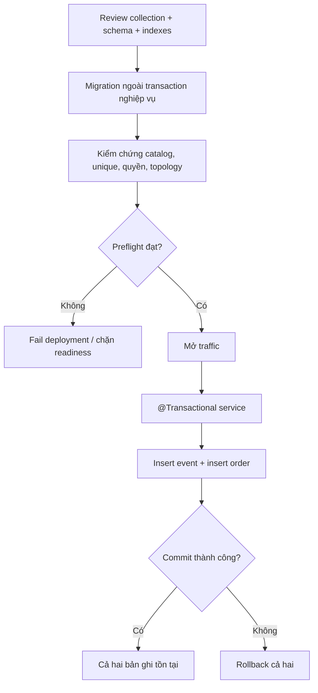
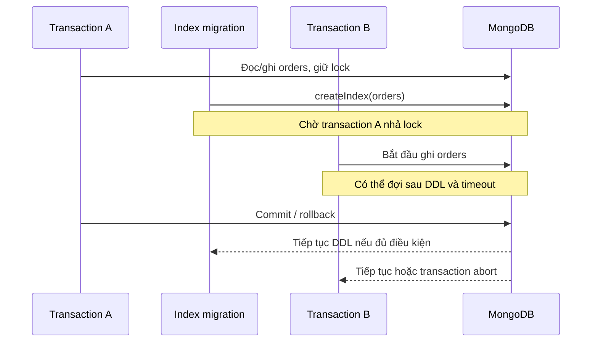

# Chuẩn bị collection và index trước khi bắt đầu giao dịch

Trong **Spring Data MongoDB**, `@Transactional` có thể bảo vệ một nghiệp vụ ghi lên nhiều document hoặc collection bằng một **MongoDB transaction**. Tuy nhiên, giao dịch chỉ nên bắt đầu khi các **collection**, **index**, **ràng buộc dữ liệu** và **quyền truy cập** mà nghiệp vụ phụ thuộc đã sẵn sàng. Nếu lượt ghi đầu tiên vô tình tạo collection, hoặc một đoạn code khởi tạo index chạy ngay trong transaction, hệ thống có thể gặp lỗi theo phiên bản/topology, xung đột metadata lock hoặc mất ràng buộc duy nhất trước khi index tồn tại.

Chủ đề này thuộc chương **Session và giao dịch** của module **SPRING_DATA_MONGODB**. Module sử dụng Spring Data MongoDB để kết nối và ánh xạ document, thao tác qua `MongoTemplate` hoặc repository, đồng thời thực hành truy vấn, aggregation, index, transaction, reactive access, kiểm thử và chẩn đoán hiệu năng. Mục tiêu của bài là phân biệt:

- **Có thể làm theo MongoDB Server**: một số thao tác tạo collection/index được hỗ trợ *ngay trong transaction* trên các phiên bản hiện hành, nhưng chỉ với điều kiện nhất định.
- **Nên làm khi xây hệ thống**: chuẩn bị collection và index **ngoài transaction nghiệp vụ**, kiểm tra trước khi nhận traffic và quản lý thay đổi như **schema/index migration** có kiểm soát.
- **Không được nhầm**: `@Document`, `@Indexed` hoặc việc dùng `save` không bảo đảm tất cả collection/index mong muốn đã được tạo trước lần transaction đầu tiên.

Đến cuối bài, bạn sẽ xây hai collection `orders` và `order_events` với unique index, cấu hình `MongoTransactionManager`, chạy một transaction có rollback thực, biết cách xử lý dữ liệu trùng trước khi tạo index và viết integration test xác nhận mọi điều kiện đã được chuẩn bị.

## 1. Vì sao chuẩn bị hạ tầng dữ liệu trước transaction?

Giả sử một nghiệp vụ tạo đơn hàng đồng thời ghi sự kiện kiểm toán. Các bước nghiệp vụ:

1. Ghi `order_events` với `eventKey` đại diện một yêu cầu đã nhận.
2. Ghi `orders` với `orderKey` duy nhất trong từng tenant.
3. Cả hai cùng **commit** hoặc cùng **rollback**.

Một transaction như vậy phải có các điều kiện từ trước:

| Thành phần | Vai trò trong nghiệp vụ | Rủi ro nếu chưa sẵn sàng |
| --- | --- | --- |
| `orders` | Lưu đơn hàng | Lần insert đầu tiên có thể kích hoạt tạo collection ngoài ý định |
| `order_events` | Lưu biên nhận/idempotency event | Không có unique index thì sự kiện trùng có thể được chấp nhận |
| Unique index trên `orders(tenant_id, order_key)` | Chặn orderKey trùng trong cùng tenant | Có thể tạo hai đơn trùng khi request chạy song song |
| Unique index trên `order_events(tenant_id, event_key)` | Chặn xử lý lặp cùng sự kiện | Retry toàn HTTP request có thể ghi hai lần |
| Index đọc theo `tenant_id, status, created_at` | Tăng hiệu quả truy vấn nghiệp vụ | Chậm khi collection lớn, tăng thời gian giữ transaction |
| `MongoTransactionManager` cùng database factory | Gắn `ClientSession` với thao tác Spring Data | `@Transactional` có thể không tạo MongoDB transaction mong muốn |
| Replica set/sharded deployment | Nền tảng hỗ trợ multi-document transaction | Standalone MongoDB không đáp ứng |

**Không phải mọi ứng dụng đều cần tất cả index trên.** Chọn index từ truy vấn và bất biến dữ liệu thực tế; bảng chỉ minh họa nhu cầu của nghiệp vụ xuyên hai collection.



Điểm chính là **quyền sở hữu vòng đời schema**. Transaction phục vụ **một nghiệp vụ**, còn migration chuẩn bị **khả năng thực hiện mọi nghiệp vụ về sau**. Không nên gộp chúng thành một bước chỉ vì API của MongoDB cho phép một số DDL nằm trong transaction.

## 2. Phân biệt namespace, collection, index và transaction

MongoDB không có bảng/schema theo mô hình quan hệ, nhưng mỗi collection vẫn có cấu trúc vận hành:

- **Namespace**: tên `database.collection`, ví dụ `shop.orders`.
- **Collection**: nơi chứa document, có options như validation, collation, clustered/time-series tùy loại.
- **Index**: cấu trúc được MongoDB dùng để tìm/sắp xếp dữ liệu hoặc áp ràng buộc như `unique`.
- **Catalog metadata**: danh sách collection, index definitions và options.
- **ClientSession**: ngữ cảnh phiên mà MongoDB dùng cho transaction.
- **Transaction**: tập thao tác đọc/ghi có commit hoặc rollback theo ranh giới giao dịch.

Một transaction không tự định nghĩa index của collection được ghi. Một unique index cũng không tạo transaction đa collection. Hai cơ chế giải quyết hai vấn đề:

```text
Unique index:
  "Trong từng tenant, không có hai order cùng orderKey."

Transaction:
  "Ghi receipt vào order_events và order vào orders
   phải cùng thành công hoặc cùng rollback."
```

Nếu không có unique index, hai transaction khác nhau có thể ghi **hai order có cùng orderKey** rồi cả hai commit; transaction không tự biến điều kiện nghiệp vụ này thành ràng buộc duy nhất.

## 3. Giới hạn MongoDB Server: không nên nói "DDL luôn bị cấm"

Tài liệu Spring Data MongoDB về transaction vẫn nhấn mạnh việc chuẩn bị sẵn mọi collection vì không nên để **collection operations** xuất hiện bất ngờ trong transaction. Đây là nguyên tắc vận hành đúng, nhưng **không nên diễn giải thành lệnh cấm tuyệt đối trên mọi phiên bản MongoDB**.

Theo tài liệu **MongoDB Server hiện hành**, trong transaction **không phải cross-shard write transaction**, server cho phép một số trường hợp:

- **Tạo collection** bằng lệnh `create` hoặc tạo ngầm qua `insert`/`upsert`.
- **Tạo index** trên collection **chưa tồn tại**, hoặc trên collection **mới, còn rỗng, được tạo trước đó trong cùng transaction**.
- Gọi `createIndex` để kiểm tra **index đã tồn tại** có thể trả thành công mà không tạo index mới.

Tuy nhiên, các hạn chế đi kèm rất quan trọng:

1. **Không được tạo collection mới trong cross-shard write transaction.**
2. **DDL tạo collection/index một cách tường minh trong transaction yêu cầu `readConcern: "local"`**.
3. **Không được tạo index mới trên collection có dữ liệu đã tồn tại bằng cách coi đó là thao tác DDL tùy ý trong transaction**.
4. Metadata listing như `listCollections` và `listIndexes` **không được chạy bên trong transaction**.
5. Những phiên bản MongoDB cũ hơn, lớp framework hoặc cơ chế triển khai có thể hạn chế nhiều hơn.

Bảng diễn giải:

| Tình huống | MongoDB Server hiện hành | Thực hành khuyến nghị |
| --- | --- | --- |
| Tạo collection mới trong transaction đơn shard | Có thể trong điều kiện hỗ trợ | **Tạo ngoài trước** |
| Insert đầu tiên làm collection được tạo ngầm | Có thể trong điều kiện hỗ trợ | **Không dựa vào tạo ngầm** |
| Tạo index trên collection mới, rỗng, vừa tạo trong cùng transaction | Có thể trong điều kiện hỗ trợ | **Tạo ngoài trước** |
| Tạo index mới trên collection production đã có dữ liệu | Không thuộc trường hợp DDL index được phép ở trên | Migration ngoài transaction |
| Tạo collection khi transaction ghi xuyên nhiều shard | Không hỗ trợ | Provision namespace trước |
| DDL tường minh trong transaction dùng `readConcern:"snapshot"` | Không hỗ trợ | Tách DDL khỏi transaction |
| `getIndexes()`/`listIndexes` bên trong transaction | Không hỗ trợ | Preflight ngoài transaction |

**Chốt lại:** bài này chọn **mẫu chạy được ổn định giữa môi trường**: provision trước, bắt đầu transaction sau. Nếu cần tận dụng ngoại lệ tạo collection/index trong transaction vì một yêu cầu đặc biệt, phải đối chiếu **MongoDB Server version, topology, read concern, Spring Data/driver behavior và integration test**. Không mặc định ngoại lệ đó cho luồng nghiệp vụ chính.

## 4. Dựng dữ liệu mẫu cho nghiệp vụ tạo đơn

Collection nguồn/đích được thiết kế dùng BSON field names ổn định:

```javascript
// orders
{
  _id: ObjectId("674000000000000000007001"),
  tenant_id: "T1",
  order_key: "ORD-1001",
  status: "NEW",
  amount_vnd: NumberLong("250000"),
  created_at: ISODate("2026-11-20T02:00:00Z")
}

// order_events
{
  _id: ObjectId("674000000000000000007101"),
  tenant_id: "T1",
  event_key: "place-order-1001",
  order_key: "ORD-1001",
  event_type: "ORDER_CREATED",
  occurred_at: ISODate("2026-11-20T02:00:00Z")
}
```

Hai bất biến dữ liệu:

- Trong `orders`: một cặp `(tenant_id, order_key)` chỉ xuất hiện một lần.
- Trong `order_events`: một cặp `(tenant_id, event_key)` chỉ xuất hiện một lần.

Các trường ngày được lưu BSON Date; `amount_vnd` dùng BSON Int64 cho số tiền nguyên VND trong bài. Với hệ thống đa tiền tệ nên bổ sung mã tiền và chính sách tính/so sánh phù hợp.

**Quyền tenant phải lấy từ principal/ngữ cảnh xác thực**, không tin chuỗi tenant tùy ý do HTTP client gửi trong body.

## 5. Entity @Document và @CompoundIndex: ý định chưa phải hiện thực

Dùng Spring Data MongoDB mapping metadata:

```java
import java.time.Instant;
import org.bson.types.ObjectId;
import org.springframework.data.annotation.Id;
import org.springframework.data.mongodb.core.index.CompoundIndex;
import org.springframework.data.mongodb.core.mapping.Document;
import org.springframework.data.mongodb.core.mapping.Field;

@Document(collection = "orders")
@CompoundIndex(
    name = "ux_orders_tenant_order_key",
    def = "{'tenant_id': 1, 'order_key': 1}",
    unique = true
)
@CompoundIndex(
    name = "ix_orders_tenant_status_created",
    def = "{'tenant_id': 1, 'status': 1, 'created_at': -1}"
)
public class Order {
    @Id
    private ObjectId id;

    @Field("tenant_id")
    private String tenantId;

    @Field("order_key")
    private String orderKey;

    private String status;

    @Field("amount_vnd")
    private long amountVnd;

    @Field("created_at")
    private Instant createdAt;

    public Order() {}

    public Order(
            ObjectId id, String tenantId, String orderKey,
            String status, long amountVnd, Instant createdAt) {
        this.id = id;
        this.tenantId = tenantId;
        this.orderKey = orderKey;
        this.status = status;
        this.amountVnd = amountVnd;
        this.createdAt = createdAt;
    }

    public ObjectId getId() { return id; }
    public String getTenantId() { return tenantId; }
    public String getOrderKey() { return orderKey; }
    public String getStatus() { return status; }
    public long getAmountVnd() { return amountVnd; }
    public Instant getCreatedAt() { return createdAt; }
}
```

Một entity cho biên nhận sự kiện:

```java
import java.time.Instant;
import org.bson.types.ObjectId;
import org.springframework.data.annotation.Id;
import org.springframework.data.mongodb.core.index.CompoundIndex;
import org.springframework.data.mongodb.core.mapping.Document;
import org.springframework.data.mongodb.core.mapping.Field;

@Document(collection = "order_events")
@CompoundIndex(
    name = "ux_order_events_tenant_event_key",
    def = "{'tenant_id': 1, 'event_key': 1}",
    unique = true
)
public class OrderEvent {
    @Id
    private ObjectId id;

    @Field("tenant_id")
    private String tenantId;

    @Field("event_key")
    private String eventKey;

    @Field("order_key")
    private String orderKey;

    @Field("event_type")
    private String eventType;

    @Field("occurred_at")
    private Instant occurredAt;

    public OrderEvent() {}

    public OrderEvent(
            ObjectId id, String tenantId, String eventKey,
            String orderKey, String eventType, Instant occurredAt) {
        this.id = id;
        this.tenantId = tenantId;
        this.eventKey = eventKey;
        this.orderKey = orderKey;
        this.eventType = eventType;
        this.occurredAt = occurredAt;
    }

    public ObjectId getId() { return id; }
    public String getTenantId() { return tenantId; }
    public String getEventKey() { return eventKey; }
    public String getOrderKey() { return orderKey; }
    public String getEventType() { return eventType; }
    public Instant getOccurredAt() { return occurredAt; }
}
```

**Cảnh báo quan trọng:** từ Spring Data MongoDB **3.0**, automatic index creation **tắt mặc định**. `@CompoundIndex` là metadata dùng để tạo index **nếu bạn bật tự tạo hoặc chạy provisioning**; nó không chứng minh MongoDB Server đã có index.

Dùng tên BSON `tenant_id` và `order_key` tường minh trong `def` giúp người đọc đối chiếu lệnh mongosh. Với Java DSL typed, Spring Data có thể map các property names từ entity sang BSON keys; không được trộn hai kiểu tên mà chưa kiểm tra raw output.

## 6. Tạo collection bằng migration trước khi chạy service

Trong `mongosh`, trên **database test hoặc database được xác nhận là đích deploy**:

```javascript
use shop;

// Chạy trong migration job, KHÔNG trong transaction nghiệp vụ.
if (!db.getCollectionNames().includes("orders")) {
  db.createCollection("orders");
}

if (!db.getCollectionNames().includes("order_events")) {
  db.createCollection("order_events");
}

// Kiểm tra các namespace vừa chuẩn bị.
printjson(db.getCollectionNames().filter(
  name => ["orders", "order_events"].includes(name)
));
```

Đoạn này phù hợp để minh họa **một migration job đã được điều phối chạy một lần**. Việc kiểm tra `getCollectionNames` rồi tạo không phải một phép CAS: hai job song song có thể cùng thấy chưa tồn tại rồi tranh nhau tạo. Trên production, dùng một migration coordinator/leader hoặc hệ thống deployment quản lý migration history.

Một collection mới thường có index `_id_` mặc định, nhưng **không có** hai unique compound indexes hay index tìm kiếm mà bài này cần. Việc collection tồn tại chỉ giải quyết **một phần** preflight.

### Khi vừa tạo ngay trước transaction

MongoDB khuyến cáo: nếu **vừa tạo hoặc drop collection trước lúc mở transaction**, rồi transaction sẽ truy cập collection đó, thực hiện thao tác DDL với **write concern `"majority"`** để bảo đảm metadata đã được xác nhận phù hợp và giảm lỗi không lấy được lock.

Một mẫu command tường minh (dùng khi collection chưa có):

```javascript
db.runCommand({
  create: "orders",
  writeConcern: { w: "majority" }
});
```

Không chạy `create` lặp lại một cách mù quáng trên collection hiện hữu có options khác. Cần preflight, kiểm tra code/error và cơ chế triển khai. `majority` ở đây nói về **DDL vừa xảy ra**; nó không tự biến các transaction sau thành transaction có write concern majority nếu bạn chưa cấu hình.

## 7. Tạo unique index và index phục vụ query ngoài transaction

Với schema ở trên:

```javascript
db.orders.createIndex(
  { tenant_id: 1, order_key: 1 },
  { unique: true, name: "ux_orders_tenant_order_key" }
);

db.order_events.createIndex(
  { tenant_id: 1, event_key: 1 },
  { unique: true, name: "ux_order_events_tenant_event_key" }
);

db.orders.createIndex(
  { tenant_id: 1, status: 1, created_at: -1 },
  { name: "ix_orders_tenant_status_created" }
);
```

Unique index thứ nhất ngăn hai đơn cùng order key **trong T1**, nhưng vẫn cho phép T2 dùng cùng `ORD-1001`. Index thứ hai dùng tương tự với event key.

Index list phù hợp truy vấn:

```javascript
db.orders.find({
  tenant_id: "T1",
  status: "NEW"
})
.sort({ created_at: -1 })
.limit(30);
```

Mẫu filter/sort này có thể tận dụng equality prefix `tenant_id, status` rồi scan theo `created_at DESC`. Nếu sản phẩm cần sort ổn định giữa documents trùng timestamp hoặc phân trang keyset, cân nhắc thêm `_id` vào sort/index và kiểm tra bằng `explain`.

Không có quy tắc rằng “transaction cần index cho mọi field”. Một transaction đúng tính nguyên tử vẫn có thể dùng collection chỉ có `_id_`; index phụ thuộc **truy vấn và invariant**, còn transaction liên quan **commit/rollback**. Nhưng transaction chứa query chậm có nguy cơ giữ locks/tài nguyên lâu hơn và dễ xung đột hơn.

## 8. Unique index phải được xây thành công trước khi nhận traffic

Giả sử collection `orders` đã tồn tại và có hai document:

```javascript
{ tenant_id: "T1", order_key: "ORD-1001", status: "NEW" }
{ tenant_id: "T1", order_key: "ORD-1001", status: "NEW" }
```

Lúc này:

```javascript
db.orders.createIndex(
  { tenant_id: 1, order_key: 1 },
  { unique: true, name: "ux_orders_tenant_order_key" }
);
```

sẽ **thất bại** vì dữ liệu đã trùng. MongoDB không tự xóa document trùng cho bạn.

Trước migration, kiểm tra:

```javascript
db.orders.aggregate([
  {
    $group: {
      _id: { tenantId: "$tenant_id", orderKey: "$order_key" },
      n: { $sum: 1 },
      ids: { $push: "$_id" }
    }
  },
  { $match: { n: { $gt: 1 } } },
  { $limit: 50 }
]);
```

`$push` mọi ID có thể tốn bộ nhớ nếu một nhóm trùng rất lớn; trên dữ liệu lớn, dùng `$first`, `$addToSet` có giới hạn phù hợp hoặc tách thành job audit. Kiểm tra cả các trường hợp `null` hoặc field thiếu:

```javascript
db.orders.find({
  $or: [
    { tenant_id: null },
    { order_key: null }
  ]
}).limit(50);
```

`{field:null}` cũng có thể match document **thiếu field**. Với unique compound index, các tổ hợp null/missing có thể gây xung đột. Cần chọn chính sách schema rõ ràng — không mặc định một unique index với field không bắt buộc sẽ hoạt động như bạn tưởng.

**Quy trình:** rà soát duplicates → repair có kiểm soát → ngăn writers mới tạo trùng → tạo index → xác nhận index thực tế → mở nghiệp vụ dựa vào index. Không được chỉ bắt exception startup rồi bỏ qua để tiếp tục chạy.

## 9. Index uniqueness, idempotency và transaction giải quyết các vấn đề khác nhau

Một request `place order` có thể bị gửi lại sau timeout. Transaction giúp `orders` và `order_events` cùng commit, nhưng transaction **không tự biết** hai request khác nhau có phải cùng nghiệp vụ.

Có unique index:

```javascript
db.order_events.createIndex(
  { tenant_id: 1, event_key: 1 },
  { unique: true }
);
```

thì eventKey trùng trong cùng tenant sẽ bị chặn dù hai request chạy trên hai service replicas khác nhau. Điều này là cơ sở xây **idempotent processing**.

Tuy nhiên, duplicate key exception không đủ để kết luận retry **đã thành công hoàn toàn**. Lớp API phải:

1. Tìm receipt có cùng `tenant + eventKey`.
2. Kiểm tra `orderKey` và những thuộc tính chính của payload có khớp request cũ không.
3. Xác minh trạng thái nghiệp vụ đã commit.
4. Trả kết quả đã lưu cho replay hợp lệ; báo conflict khi cùng key nhưng payload khác.
5. Không chạy lại cả flow có side effect trước khi đối soát.

Transaction, unique index và idempotency cần kết hợp, không thay thế nhau.

## 10. Cấu hình MongoTransactionManager đồng bộ

Trên Spring Data MongoDB synchronous:

```java
import org.springframework.context.annotation.Bean;
import org.springframework.context.annotation.Configuration;
import org.springframework.data.mongodb.MongoDatabaseFactory;
import org.springframework.data.mongodb.MongoTransactionManager;

@Configuration
public class MongoTxConfiguration {

    @Bean("mongoTransactionManager")
    MongoTransactionManager mongoTransactionManager(
            MongoDatabaseFactory factory) {
        return new MongoTransactionManager(factory);
    }
}
```

Điều kiện:

- Ứng dụng chạy MongoDB **replica set hoặc sharded cluster** hỗ trợ transactions; **standalone** không đủ.
- `MongoTransactionManager` phải quản lý **cùng `MongoDatabaseFactory`/MongoClient infrastructure** mà `MongoTemplate` và repository dùng.
- Method `@Transactional` được gọi **qua Spring proxy** trong mô hình AOP thông thường; tự gọi method trong cùng object (self-invocation) có thể không khởi tạo transaction.
- Nếu có nhiều transaction managers (ví dụ JDBC và MongoDB), chỉ định đúng bean bằng `transactionManager`.
- Mọi thao tác cần tham gia transaction phải đi qua hạ tầng Spring Data đồng bộ tương thích; native driver dùng session khác có thể thoát khỏi transaction.

**Không thêm `MongoTransactionManager` bằng cách tạo client/database factory mới bên trong một fragment.** Hai client khác nhau không tự chia sẻ `ClientSession` dù URI cùng trỏ tới một cluster.

## 11. Viết service nghiệp vụ chỉ ghi CRUD khi transaction đã bắt đầu

Giả sử unique indexes và collections đã sẵn. Service tạo receipt trước, sau đó tạo order:

```java
import java.time.Instant;
import org.bson.types.ObjectId;
import org.springframework.data.mongodb.core.MongoOperations;
import org.springframework.stereotype.Service;
import org.springframework.transaction.annotation.Transactional;

@Service
public class PlaceOrderService {
    private final MongoOperations operations;

    public PlaceOrderService(MongoOperations operations) {
        this.operations = operations;
    }

    @Transactional(transactionManager = "mongoTransactionManager")
    public ObjectId placeOrder(
            String authorizedTenant, String orderKey,
            String eventKey, long amountVnd) {

        if (authorizedTenant == null || authorizedTenant.isBlank()
                || orderKey == null || orderKey.isBlank()
                || eventKey == null || eventKey.isBlank()
                || amountVnd <= 0) {
            throw new IllegalArgumentException("Dữ liệu không hợp lệ");
        }

        Instant now = Instant.now();
        ObjectId orderId = new ObjectId();

        operations.insert(new OrderEvent(
            new ObjectId(), authorizedTenant, eventKey,
            orderKey, "ORDER_CREATED", now
        ));

        operations.insert(new Order(
            orderId, authorizedTenant, orderKey,
            "NEW", amountVnd, now
        ));

        return orderId;
    }
}
```

Trong transaction:

- Nếu hai insert đều thành công và commit thành công, receipt và order cùng tồn tại.
- Nếu insert order lỗi **duplicate key** do `orderKey` đã tồn tại, exception runtime dẫn tới rollback receipt vừa insert.
- Nếu insert receipt lỗi vì `eventKey` đã tồn tại, order không được insert.
- Nếu có xung đột transaction hoặc kết quả commit chưa chắc chắn, phải xử lý theo error labels và chính sách retry/idempotency, **không retry mù cả luồng**.

Không gửi email/Kafka event trực tiếp trong transaction rồi nghĩ side effect sẽ rollback nếu database abort. Khi cần liên kết event ngoài DB, dùng outbox trong cùng transaction rồi worker publish có idempotent consumer.

## 12. "Tạo collection nếu chưa có" bên trong @Transactional là anti-pattern

Một mẫu trông có vẻ tiện:

```java
@Transactional(transactionManager = "mongoTransactionManager")
public void createOrderWrongly() {
    if (!mongoTemplate.collectionExists(Order.class)) {
        mongoTemplate.createCollection(Order.class);
    }

    mongoTemplate.insert(order);
}
```

Đoạn này **không phải code hoàn chỉnh** vì các biến chưa khai báo, và quan trọng hơn là **không nên dùng**:

- `collectionExists(...)` thường cần metadata listing (`listCollections`), không được thực hiện trong transaction.
- `createCollection(...)` là DDL; trên MongoDB hiện hành chỉ được phép trong điều kiện nhất định, còn nhiều phiên bản/framework cấu hình khác không hỗ trợ.
- Race giữa nhiều requests/instances có thể khiến cả hai cùng cố tạo collection.
- Collection chỉ vừa được tạo có thể chưa có unique index, khiến nghiệp vụ chạy trong khoảng thời gian **ràng buộc chưa được áp dụng**.
- Nếu read concern transaction là `snapshot`, explicit create collection trong transaction sẽ không được phép.

**Cách sửa:** chạy `collectionExists`, `createCollection` và `indexOps(...).createIndex(...)` trong **migration/init được điều phối, ngoài transaction nghiệp vụ**, rồi service chỉ thực hiện `insert/find/update/delete`.

## 13. Không kiểm tra catalog bên trong transaction

Những thao tác metadata dưới đây phải được thực hiện **ngoài** transaction:

```java
boolean ordersPresent = mongoTemplate.collectionExists(Order.class);

var orderIndexes =
    mongoTemplate.indexOps(Order.class).getIndexInfo();

var eventIndexes =
    mongoTemplate.indexOps(OrderEvent.class).getIndexInfo();
```

Các API có thể dùng `listCollections` hoặc `listIndexes`; MongoDB Server liệt kê các lệnh listing này là **không được dùng trong transaction**.

**Thực hành tốt:** thực hiện preflight một lần ở migration hoặc readiness/diagnostic layer, không chạy listing cho từng transaction. Đọc catalog liên tục còn tăng latency và tạo race: metadata được kiểm tra ở thời điểm A không tự bị khóa bất biến tới thời điểm B.

Đối với môi trường production, **chủ thể có quyền** tạo index và runtime application đọc/ghi nên có vai trò phân biệt; ứng dụng có thể chỉ cần quyền `listIndexes` ở readiness checker được kiểm soát, không cần quyền `dropIndex`.

## 14. Programmatic index provisioning với MongoTemplate

Trong một migration runner **không có `@Transactional`**, Spring Data có `IndexOperations`:

```java
import org.springframework.data.domain.Sort;
import org.springframework.data.mongodb.core.MongoTemplate;
import org.springframework.data.mongodb.core.index.Index;

public class OrderSchemaProvisioner {
    private final MongoTemplate template;

    public OrderSchemaProvisioner(MongoTemplate template) {
        this.template = template;
    }

    public void provisionIndexes() {
        // Collection phải được chuẩn bị trước bởi migration step.
        template.indexOps(Order.class).createIndex(
            new Index()
                .on("tenantId", Sort.Direction.ASC)
                .on("orderKey", Sort.Direction.ASC)
                .unique()
                .named("ux_orders_tenant_order_key")
        );

        template.indexOps(OrderEvent.class).createIndex(
            new Index()
                .on("tenantId", Sort.Direction.ASC)
                .on("eventKey", Sort.Direction.ASC)
                .unique()
                .named("ux_order_events_tenant_event_key")
        );

        template.indexOps(Order.class).createIndex(
            new Index()
                .on("tenantId", Sort.Direction.ASC)
                .on("status", Sort.Direction.ASC)
                .on("createdAt", Sort.Direction.DESC)
                .named("ix_orders_tenant_status_created")
        );
    }
}
```

`createIndex(IndexDefinition)` là API của Spring Data MongoDB **4.5+**. Với các bản cũ hơn, `IndexOperations.ensureIndex(...)` là API tương ứng nhưng đã bị deprecate ở bản mới. Luôn kiểm tra **version Spring Data** của ứng dụng trước khi copy code.

`indexOps(Order.class)` dùng metadata mapping của entity; field Java `tenantId`, `orderKey` và `createdAt` phải được ánh xạ thành BSON `tenant_id`, `order_key` và `created_at`. Phải kiểm chứng qua index catalog, không chỉ đọc tên property trong code.

Đoạn class chỉ là **thành phần cho migration được gọi bởi deployment step**, không phải bean tự động chạy trên mọi application instance. Không đặt lời gọi `provisionIndexes()` vào controller, repository method hay business service mỗi request.

## 15. IndexResolver và annotation có thể hỗ trợ migration

Nếu muốn nguồn định nghĩa index đặt tại annotation, dùng `MongoPersistentEntityIndexResolver`:

```java
import org.springframework.data.mongodb.core.index.IndexDefinition;
import org.springframework.data.mongodb.core.index.IndexResolver;
import org.springframework.data.mongodb.core.index.MongoPersistentEntityIndexResolver;

IndexResolver resolver = new MongoPersistentEntityIndexResolver(
    mongoTemplate.getConverter().getMappingContext()
);

for (IndexDefinition definition :
        resolver.resolveIndexFor(Order.class)) {
    mongoTemplate.indexOps(Order.class).createIndex(definition);
}

for (IndexDefinition definition :
        resolver.resolveIndexFor(OrderEvent.class)) {
    mongoTemplate.indexOps(OrderEvent.class).createIndex(definition);
}
```

Resolver đọc `@CompoundIndex`; **nó không tự gọi MongoDB để tạo index**. Lời gọi `createIndex` mới thực thi phần tạo index.

Spring Data MongoDB **tắt auto-index mặc định từ 3.0**. Bạn có thể opt-in bằng cấu hình, nhưng với production nên có policy:

- **Development/test**: có thể bật auto-index trên database cô lập để đỡ thao tác.
- **Production**: ưu tiên migration riêng để biết chính xác ai tạo, lúc nào, mất bao lâu, index có conflict hay không.
- **Multiple replicas**: tránh để mọi replica boot đồng thời rồi cùng xử lý index migration.
- **Runtime drop/recreate**: auto-index không bảo đảm tái tạo index cho collection bị drop và recreate trong khi ứng dụng còn chạy.

**Khi provisioning là bước bắt buộc để business đúng**, không dùng mỗi `@Indexed` làm “bảo đảm schema” trong checklist go-live.

## 16. Cấu hình auto-index tường minh: biết khi nào không dùng

Trên những Spring Boot phiên bản hỗ trợ property:

```yaml
  # Ví dụ profile development.
spring:
  data:
    mongodb:
      auto-index-creation: true
```

Trong cấu hình kế thừa `AbstractMongoClientConfiguration` có thể override:

```java
@Override
public boolean autoIndexCreation() {
    return true;
}
```

Đây là **hai cách cấu hình ở hai mô hình ứng dụng**; không cần thêm cả hai một cách vô điều kiện. Cần xác minh auto-configuration/bean thực tế đang được Spring sử dụng, nhất là khi ứng dụng tự khai báo `MongoMappingContext` hoặc nhiều MongoTemplate.

Với transaction-sensitive production, thông thường đặt auto-index **tắt** và provision qua một migration. Nếu vẫn chủ động bật auto-index, phải bảo đảm **index creation đã hoàn tất trước khi đánh dấu readiness**, account có quyền phù hợp, index build không đụng traffic quan trọng và job không bị race giữa replicas.

## 17. Preflight kiểm tra index catalog, không chỉ kiểm tra tên

Dùng mongosh:

```javascript
db.orders.getIndexes();
db.order_events.getIndexes();
```

Kiểm tra cụ thể:

| Index | Key pattern mong đợi | Unique? |
| --- | --- | --- |
| `ux_orders_tenant_order_key` | `{tenant_id:1, order_key:1}` | Có |
| `ux_order_events_tenant_event_key` | `{tenant_id:1, event_key:1}` | Có |
| `ix_orders_tenant_status_created` | `{tenant_id:1, status:1, created_at:-1}` | Không |
| `_id_` | `{_id:1}` | Có mặc định |

Dùng raw BSON inspect:

```javascript
db.orders.getIndexes().forEach(ix => {
  printjson({
    name: ix.name,
    key: ix.key,
    unique: ix.unique,
    collation: ix.collation,
    partialFilterExpression: ix.partialFilterExpression,
    expireAfterSeconds: ix.expireAfterSeconds
  });
});
```

Chỉ thấy **cùng tên** chưa đủ: key hoặc option có thể drift. Ví dụ:

- `unique:true` bị bỏ, dẫn tới thiếu invariant.
- Field `orderKey` bị index nhầm thay cho BSON `order_key`.
- `partialFilterExpression` chỉ index subset trong khi nghiệp vụ cần unique toàn bộ.
- `collation` khác khiến `"ABC"` và `"abc"` có semantics khác.
- Một TTL index khiến document bị xóa theo thời gian dù service không muốn.

`createIndex` không phải một “schema migration engine” tự sửa mọi khác biệt. Nếu index cùng tên có options/key khác, MongoDB có thể báo lỗi conflict; không tự `dropIndex` trong app startup để che xung đột.

## 18. Cảnh báo về TTL, partial index và collection validation

Các collection không chỉ có unique index. Có thể cần:

- **Schema validation** bắt buộc `tenant_id`, `order_key`, `amount_vnd` có kiểu đúng.
- **TTL index** cho một số collection tạm hoặc receipt có retention policy.
- **Partial index** cho những nhóm trạng thái xác định.
- **Collation** phục vụ tìm kiếm/uniqueness theo quy tắc chuỗi.
- **Time-series** hoặc clustered collection với options riêng.

Nhưng mỗi yếu tố có giới hạn:

- TTL monitor xóa dữ liệu theo cơ chế nền, **không chính xác từng mili giây**, có thể ảnh hưởng trạng thái được transaction đọc.
- Unique **partial** index chỉ chặn duplicates trong những document thỏa filter; không thay thế unique toàn bộ nếu business yêu cầu global/per-tenant uniqueness không điều kiện.
- Collection validation có thể chặn một transaction khi entity mới vi phạm schema; đó là đúng thiết kế, không phải lỗi nên bỏ qua bằng cách tắt validation.
- Đổi collation/validation/TTL trên production là **schema migration có rủi ro**, không phải chỉ “tăng tốc query”.

Hãy chuẩn bị và kiểm tra options cần thiết **trước** khi cho transaction ghi, với data migration và rollback plan phù hợp.

## 19. Làm gì nếu index chưa tồn tại nhưng giao dịch đã chạy?

Nếu transaction đầu tiên chạy khi unique index chưa được tạo:

```text
Request A: insert (tenant=T1, orderKey=ORD-1001) → commit
Request B: insert (tenant=T1, orderKey=ORD-1001) → commit
```

MongoDB có thể chấp nhận cả hai vì chưa có constraint unique trên cặp đó, dù mỗi transaction riêng lẻ hoàn toàn nguyên tử. Sau đó tạo unique index sẽ thất bại vì dữ liệu đã trùng.

Không có cách đơn giản sửa ngược để “trở thành đúng” bằng việc bật annotation. Cần:

1. Chặn/giới hạn writes gây trùng.
2. Audit dữ liệu và phân loại duplicate cùng tenant/orderKey.
3. Sửa dữ liệu theo quy tắc nghiệp vụ, bao gồm references và external events.
4. Tạo unique index thành công.
5. Kiểm tra lại duplicate counts và hành vi retry.
6. Mở lại traffic khi readiness pass.

**Nếu ràng buộc unique là điều kiện correctness, thiếu index phải là lỗi deployment/readiness, không chỉ là cảnh báo hiệu năng.**

## 20. Quyền truy cập: migration user khác runtime user

Một hệ thống production có thể phân quyền:

| Thành phần | Quyền cần thiết | Không nên cấp mặc định |
| --- | --- | --- |
| Runtime service | `find`/`insert`/`update`/`remove` trên collections được phép | `dropCollection`, `dropIndex` và admin toàn database |
| Migration job | `createCollection`, `createIndex`, `listIndexes`, tùy schema change | Quyền rộng hơn phạm vi cần thiết |
| Readiness checker | Đọc metadata trên namespace được quản lý | Tự sửa index khi check fail |
| DBA/operator | DDL, index build diagnostics, recovery theo chính sách | Credential chung cho mọi service instance |

Chính xác privilege MongoDB cần dựa trên command và RBAC role; không có một role name duy nhất phù hợp mọi hệ thống. Khi app thiếu quyền createIndex nhưng auto-index bật, khởi động hoặc truy cập entity có thể lỗi; **không được kết luận index có sẵn chỉ vì app không crash**.

**Nên quản lý migration credentials và runtime credentials riêng**, đồng thời ghi log migrationId/index spec thay vì log toàn connection URI chứa secrets.

## 21. Index build cạnh tranh với transaction: lock và độ trễ

Tạo index trên collection đang có dữ liệu là thao tác DDL có thể cần lock và dùng CPU/I/O/disk lớn. Khi transaction và DDL nhắm vào cùng namespace:

- Transaction đang chạy có thể giữ lock khiến DDL phải chờ.
- Một DDL đang chờ có thể làm các transaction mới cần cùng namespace **không lấy được lock**.
- Transaction có thể abort sau thời gian chờ `maxTransactionLockRequestTimeoutMillis` theo cấu hình server.
- Các client ngoài transaction cũng có thể bị ảnh hưởng bởi lock waits.
- Index build trên replica set/sharded cluster còn phụ thuộc commit quorum và trạng thái các node.



Vì vậy “đã tạo index trước transaction” còn có nghĩa **không schedule index migration ngay lúc các transaction nghiệp vụ quan trọng đang chạy**, nếu có thể. Dùng change window, metrics, điều phối một migration job và capacity planning phù hợp.

Không tăng `maxTransactionLockRequestTimeoutMillis` tùy tiện để “sửa” mọi abort: nó có thể chỉ kéo dài thời gian chờ và làm deadlock/độ trễ nặng hơn.

## 22. Sharded clusters: tránh implicit create trong cross-shard transaction

Trong sharded cluster, một transaction ghi qua nhiều shards có thêm giới hạn. Theo MongoDB Server:

> Không tạo collection mới trong một cross-shard write transaction.

Ví dụ nghiệp vụ ghi `orders` ở shard A nhưng `order_events` chưa tồn tại, lệnh insert vào `order_events` có thể kích hoạt tạo ngầm ở một shard khác. Một flow tưởng chỉ là hai `insert` đơn giản có thể thất bại vì metadata/shard restrictions.

**Cách an toàn:** tạo sẵn cả collections, index và sharding configuration trước khi chạy business transaction. Các unique index trên sharded collection còn có ràng buộc liên quan **shard key prefix**, nên việc thiết kế tenant + business key phải được review cùng sharding strategy.

Không đủ khi migration chỉ tạo hai collection ở một database local/staging khác; xác nhận trên **đúng deployment** mà production transaction sẽ dùng.

## 23. Read concern và write concern khi vừa chuẩn bị collection

Hai mối quan tâm khác nhau:

- **Schema/metadata visibility**: collection/index vừa được tạo có được xác nhận và nhìn thấy nhất quán bởi các node phù hợp chưa?
- **Transaction data consistency**: các đọc/ghi nghiệp vụ trong transaction có semantics nào?

MongoDB khuyến cáo dùng **`writeConcern:"majority"` cho thao tác create/drop collection ngay trước transaction** nếu transaction truy cập namespace ấy.

Trong transaction:

- `readConcern:"local"`, `"majority"` hoặc `"snapshot"` có semantics khác nhau.
- Explicit DDL tạo collection/index **trong transaction** (nếu được phép) chỉ hỗ trợ `readConcern:"local"`.
- Transaction dùng `snapshot` có thể phù hợp khi cần một snapshot nhất quán, đặc biệt trên sharded cluster.
- **Commit write concern** cần được chọn theo yêu cầu durability; `w:"majority"` thường quan trọng khi cần bảo đảm đọc majority/snapshot liên quan dữ liệu đã commit.

Đừng đặt write concern riêng cho từng write **bên trong transaction**; cần cấu hình ở **transaction level**. Và đừng lấy `majority` làm giải pháp cho missing index: durability không tạo unique constraints thay bạn.

## 24. Preflight và readiness: chặn traffic khi schema chưa sẵn sàng

Một hệ thống khởi động tốt nên xác minh điều kiện nghiệp vụ quan trọng trước khi phục vụ request:

```text
Deployment pipeline:
  1. Migrate collections
  2. Migrate indexes/validation
  3. Verify metadata + duplicate constraints
  4. Deploy application
  5. Readiness checks
  6. Open traffic
```

Một verifier tối giản dùng Spring Data MongoDB:

```java
import java.util.List;
import org.springframework.data.mongodb.core.MongoTemplate;
import org.springframework.data.mongodb.core.index.IndexInfo;

public class OrderSchemaVerifier {
    private final MongoTemplate template;

    public OrderSchemaVerifier(MongoTemplate template) {
        this.template = template;
    }

    public void verify() {
        if (!template.collectionExists(Order.class)
                || !template.collectionExists(OrderEvent.class)) {
            throw new IllegalStateException(
                "Thiếu collection cho giao dịch đặt hàng"
            );
        }

        List<IndexInfo> order = template.indexOps(Order.class)
            .getIndexInfo();
        List<IndexInfo> events = template.indexOps(OrderEvent.class)
            .getIndexInfo();

        if (order.stream().noneMatch(
                i -> "ux_orders_tenant_order_key".equals(i.getName()))
                || events.stream().noneMatch(
                i -> "ux_order_events_tenant_event_key".equals(i.getName()))) {
            throw new IllegalStateException(
                "Thiếu unique index bắt buộc"
            );
        }
    }
}
```

Đây là **verifier rút gọn**, mới kiểm tra **sự hiện diện theo tên**. Với production, so sánh thêm **key pattern, unique option, collation, partial filter** của index; không coi code trên là validation đầy đủ. Chạy bên ngoài transaction, trong cơ chế readiness/lifecycle phù hợp, và fail deployment nếu thiếu invariant.

**Readiness không phải lock.** Nếu DBA drop index sau khi app đã sẵn sàng, một lần check trước không thể ngăn điều đó. Cần RBAC, change management và giám sát schema drift.

## 25. Phân biệt migration readiness với business liveness

Một câu hỏi vận hành: **điều gì xảy ra khi MongoDB không kết nối được lúc startup?**

- **Liveness** trả lời app process còn hoạt động hay không; không nên ép cả hệ thống restart liên tục khi database chập chờn.
- **Readiness** trả lời app có thể nhận traffic nghiệp vụ đúng hay chưa; thiếu collection/index bắt buộc thì phải **không ready**.
- **Migration job** trả lời schema/index đã sẵn sàng với code version mới chưa.

Một kiểu vận hành an toàn là migration chạy **trước** rollout, app có health/readiness từ Spring Boot Actuator được mở rộng để kiểm tra điều kiện cấp thiết. Không nên để readiness checker **tự tạo index** mỗi khi bị gọi, vì probes có thể chạy liên tục và trên nhiều replicas.

Nếu migration thất bại vì duplicate key, hãy dừng rollout và xử lý dữ liệu; không ghi một trạng thái “ready” giả bằng cách tạm tắt unique.

## 26. Kịch bản deploy thay đổi unique index theo nhiều bước

Giả sử trước đây `orders.orderKey` chỉ unique toàn collection, nhưng mô hình mới cần unique **trong từng tenant**. Hoặc index cũ có collation khác.

Không làm:

```javascript
// Nguy hiểm nếu chạy tự động lúc startup:
// db.orders.dropIndex("old_unique_index");
// db.orders.createIndex({tenant_id:1, order_key:1},{unique:true});
```

Thay vào đó:

1. Review query/data model và chính sách uniqueness mong muốn.
2. Kiểm tra duplicate records theo key mới.
3. Làm sạch/migrate dữ liệu và ngăn writer tạo duplicates trong lúc chuyển đổi.
4. Xây index mới trong migration có giám sát.
5. Xác minh index mới đã commit và enforcement hoạt động.
6. Deploy app version mới sử dụng semantics mới.
7. Chỉ ở release sau mới xem xét drop index cũ, có rollback plan.

**Đặc biệt:** giữ đồng thời unique index cũ và mới có thể vẫn làm **chính sách cũ hạn chế hơn** trong giai đoạn chuyển tiếp; điều đó có thể cần xử lý ở rollout. Không giả định việc tạo index mới tự vô hiệu index cũ.

## 27. Một số mẫu sai và mẫu đúng

### Sai: đặt index creation vào một method @Transactional

```java
@Transactional(transactionManager = "mongoTransactionManager")
public void createOrderWithDdlInside() {
    // Không làm:
    // template.indexOps(Order.class).createIndex(...);
    // template.insert(order);
}
```

Ngoại lệ DDL transaction của server **không phải** giấy phép tạo index production trên collection hiện có qua mỗi lần gọi. Nó có thể lỗi vì read concern, collection không mới/rỗng hoặc cross-shard restrictions; chưa kể tăng latency và lock contention.

### Sai: tưởng @CompoundIndex tự bảo vệ uniqueness

```java
@CompoundIndex(
    name = "ux_orders_tenant_order_key",
    def = "{'tenant_id':1,'order_key':1}",
    unique = true
)
class OrderMarker {}
```

Annotation chưa đủ nếu index thực không tồn tại. Code mẫu này chỉ minh họa metadata, không dùng `OrderMarker` thay cho entity `Order` đầy đủ ở trên.

### Đúng: provision rồi mới chạy transaction

```text
Migration (một lần, ngoài transaction):
  - create orders
  - create order_events
  - create compound unique indexes
  - verify schema/catalog/duplicates
  - publish migration success

Runtime:
  - @Transactional:
      insert event
      insert order
      commit / rollback
```

Đây là lựa chọn ít phụ thuộc ngoại lệ server-version và đơn giản để giám sát hơn.

## 28. Unit test không đủ chứng minh schema đã sẵn sàng

Một mock như:

```java
when(mongoTemplate.collectionExists(Order.class))
    .thenReturn(true);
```

chỉ chứng minh Java code nhận `true`; nó **không chứng minh** collection thật tồn tại, có đúng unique index, hoạt động trên đúng MongoDB database hay transaction được server hỗ trợ.

Muốn kiểm tra:

- Chạy trên MongoDB thật dành riêng cho test.
- Dùng replica set (có thể một node) để test multi-document transactions.
- Chỉ gọi code provisioning **trước** các service methods transactional.
- Đọc catalog để kiểm tra index key và unique options.
- Gây duplicate key trong transaction và chứng minh rollback document đã insert trước đó.
- Thử thiếu collection/index trên một database test mới và xác nhận readiness chặn business path.

Không cố ý drop collection/index hoặc bật failpoint trên production.

## 29. Integration test: kiểm tra catalog trước transaction

Ví dụ JUnit 5/Spring Boot test class, giả định một MongoDB replica set test và migration đã chạy trên database test:

```java
import static org.assertj.core.api.Assertions.assertThat;

import java.util.List;
import org.bson.Document;
import org.junit.jupiter.api.Test;
import org.springframework.beans.factory.annotation.Autowired;
import org.springframework.boot.test.context.SpringBootTest;
import org.springframework.data.mongodb.core.MongoTemplate;
import org.springframework.data.mongodb.core.index.IndexInfo;

@SpringBootTest
class SchemaPreflightIntegrationTest {
    @Autowired MongoTemplate template;

    @Test
    void bothCollectionsAndUniqueIndexesExist() {
        assertThat(template.collectionExists(Order.class)).isTrue();
        assertThat(template.collectionExists(OrderEvent.class)).isTrue();

        List<IndexInfo> orderIndexes =
            template.indexOps(Order.class).getIndexInfo();

        List<IndexInfo> eventIndexes =
            template.indexOps(OrderEvent.class).getIndexInfo();

        assertThat(orderIndexes)
            .extracting(IndexInfo::getName)
            .contains("ux_orders_tenant_order_key");

        assertThat(eventIndexes)
            .extracting(IndexInfo::getName)
            .contains("ux_order_events_tenant_event_key");
    }

    @Test
    void rawIndexSpecIsActuallyUnique() {
        List<Document> indexes = template.getCollection("orders")
            .listIndexes(Document.class)
            .into(new java.util.ArrayList<>());

        assertThat(indexes).anySatisfy(ix -> {
            assertThat(ix.getString("name"))
                .isEqualTo("ux_orders_tenant_order_key");
            assertThat(ix.getBoolean("unique")).isTrue();

            Document keys = ix.get("key", Document.class);
            assertThat(keys).containsEntry("tenant_id", 1)
                            .containsEntry("order_key", 1);
        });
    }
}
```

Trong code trên, `@SpringBootTest` phải nạp MongoDB test URI, `MongoTransactionManager` và entity scanning đúng; công cụ như Testcontainers có thể giúp tạo deployment test. **Các assertions là đọc metadata ngoài transaction**.

Đừng chỉ test tên index: ví dụ `rawIndexSpecIsActuallyUnique` kiểm tra cả `unique` và khóa BSON. Với sharded cluster, cần thêm checks về shard key.

## 30. Integration test: lỗi unique thứ hai phải rollback receipt đầu tiên

Ta chủ động gây lỗi **sau** khi đã insert event trong transaction:

```java
import static org.assertj.core.api.Assertions.assertThat;
import static org.assertj.core.api.Assertions.assertThatThrownBy;

import java.time.Instant;
import org.bson.types.ObjectId;
import org.junit.jupiter.api.Test;
import org.springframework.beans.factory.annotation.Autowired;
import org.springframework.boot.test.context.SpringBootTest;
import org.springframework.data.mongodb.core.MongoTemplate;
import org.springframework.data.mongodb.core.query.Criteria;
import org.springframework.data.mongodb.core.query.Query;

@SpringBootTest
class PlaceOrderTransactionIntegrationTest {
    @Autowired MongoTemplate template;
    @Autowired PlaceOrderService service;

    @Test
    void duplicateOrderKeyRollsBackNewEvent() {
        String tenant = "test-" + new ObjectId().toHexString();
        String duplicateOrderKey = "ORD-1001";
        String newEventKey = "new-event-" + new ObjectId();

        // Setup dữ liệu trước transaction nghiệp vụ.
        template.insert(new Order(
            new ObjectId(), tenant, duplicateOrderKey,
            "NEW", 100_000L, Instant.now()
        ));

        // Trong service: event được insert trước, sau đó
        // order insert lỗi vì (tenant_id, order_key) trùng.
        assertThatThrownBy(() -> service.placeOrder(
            tenant, duplicateOrderKey, newEventKey, 200_000L
        )).isInstanceOf(RuntimeException.class);

        Query eventQuery = Query.query(
            Criteria.where("tenantId").is(tenant)
                .and("eventKey").is(newEventKey)
        );

        assertThat(template.exists(
            eventQuery, OrderEvent.class
        )).isFalse();

        Query orderQuery = Query.query(
            Criteria.where("tenantId").is(tenant)
                .and("orderKey").is(duplicateOrderKey)
        );

        assertThat(template.count(orderQuery, Order.class))
            .isEqualTo(1L);
    }
}
```

**Test này có giá trị chỉ khi:**

1. MongoDB test là replica set/sharded deployment hỗ trợ transaction.
2. `MongoTransactionManager` cùng factory với `MongoTemplate` đã được cấu hình.
3. `PlaceOrderService.placeOrder(...)` được gọi **qua Spring proxy**.
4. Index `ux_orders_tenant_order_key` đã được tạo **trước** test.
5. Test method **không tự mở một transaction khác** khiến trạng thái quan sát sau service khác production.

Nếu index bị thiếu, lệnh tạo order trùng có thể **không lỗi**, và test phải fail — đúng mục đích: chứng minh provisioning là tiền đề của consistency.

## 31. Test thiếu collection và implicit create: chỉ trên database cô lập

Để kiểm chứng điều kiện riêng của MongoDB version/server:

```text
Test A: Không tạo collection trước transaction.
  - Thử insert trong transaction với readConcern/topology test.
  - Ghi nhận server version, error/result và namespace thực tế.
  - Không suy luận từ kết quả này cho production topology khác.

Test B: Tạo collection mới/rỗng trong transaction readConcern local.
  - Nếu phiên bản server cho phép, thử createIndex đúng quy tắc.
  - Thử cùng thao tác với readConcern snapshot:
    explicit DDL phải bị từ chối.

Test C: Sharded cross-shard write transaction.
  - Thử tạo ngầm namespace trên shard khác.
  - Kiểm tra lệnh bị từ chối như MongoDB docs mô tả.

Test D: Dùng getIndexes/listIndexes trong transaction.
  - Kiểm tra restricted operation không được phép.
```

Không gộp các test này vào `PlaceOrderService` production. Chúng nhằm **đối chiếu ma trận khả năng theo version**; hệ thống vẫn nên provision trước.

## 32. Sự khác biệt giữa synchronous và reactive transaction

Trong Spring Data MongoDB synchronous:

- `MongoTransactionManager` gắn session/transaction vào Spring transaction context theo luồng thực thi.
- `MongoTemplate`/repository dùng cùng factory có thể tham gia transaction.
- Thực hiện preflight catalog **ngoài** method `@Transactional`.

Với reactive:

- `ReactiveMongoTransactionManager` mang transaction context qua **Reactor Context**.
- `ReactiveMongoTemplate`/reactive repositories phải nằm trong cùng publisher chain; không tự `subscribe()` trong một fragment rồi nghĩ operation tham gia transaction.
- Quy tắc MongoDB Server về **DDL, metadata listing, collections/indexes và sharding** vẫn áp dụng; reactive không cho phép vượt qua restricted operations.

Bean reactive transaction manager:

```java
import org.springframework.context.annotation.Bean;
import org.springframework.context.annotation.Configuration;
import org.springframework.data.mongodb.ReactiveMongoDatabaseFactory;
import org.springframework.data.mongodb.ReactiveMongoTransactionManager;

@Configuration
public class ReactiveMongoTxConfig {

    @Bean("reactiveMongoTransactionManager")
    ReactiveMongoTransactionManager reactiveMongoTransactionManager(
            ReactiveMongoDatabaseFactory factory) {
        return new ReactiveMongoTransactionManager(factory);
    }
}
```

Với reactive provisioning, hoàn tất `Mono` của migration và xác minh thành công **trước khi mở traffic**; đừng chỉ tạo publisher mà không có subscriber. Cũng không cần bật cả sync và reactive transaction managers nếu ứng dụng chỉ dùng một mô hình.

## 33. Chẩn đoán lỗi khi transaction chạm collection/index chưa sẵn

| Triệu chứng | Nguyên nhân cần kiểm tra | Hành động |
| --- | --- | --- |
| Giao dịch đầu tiên thất bại còn các lần sau thành công | Collection được tạo ngầm hoặc index initialization chạy muộn | Provision trước, kiểm tra logs và version |
| Trùng `orderKey` dù có `@CompoundIndex(unique=true)` | Auto-index tắt, index thiếu/sai | `getIndexes()`, migrate unique, audit duplicates |
| `createIndex` thất bại vì duplicate key | Dữ liệu cũ có cặp khóa trùng | Dọn/migrate dữ liệu có kiểm toán |
| `collectionExists`/`getIndexInfo` lỗi trong transaction | Metadata listing restricted | Dời preflight ngoài transaction |
| Explicit DDL trong transaction dùng snapshot read concern | Read concern không hỗ trợ | Không làm DDL trong business tx |
| Tạo ngầm namespace khi write xuyên shard | Cross-shard creation không được phép | Tạo namespace trước |
| `Transaction aborted` khi index build đang chạy | DDL/transaction lock contention hoặc write conflict | Quan sát currentOp, lock waits, schedule migration |
| Có index nhưng write vẫn lỗi validation | Schema/ràng buộc nghiệp vụ không phù hợp | Sửa entity hoặc migration data, không bỏ qua |
| Replica set hoạt động còn standalone test lỗi | Topology khác nhau | Test transaction trên replica set |
| Index trên database không đúng | MongoClient URI/DatabaseFactory trỏ sai | Kiểm tra effective config + namespace |
| App runtime không có quyền createIndex | Auto-index/migration chạy dưới credential sai | Tách quyền migration và runtime |
| Retry transaction làm lặp email/event ngoài DB | Side effect ngoài transaction | Outbox và idempotency |
| Index được tạo sau transaction nhưng latency tăng | Build tốn resource và lock | Capacity planning, stagger rollout |

Đừng chỉ ghi “transaction failed” trong logs. Ghi **transaction ID/correlation ID, logical business key, namespace, phase (preflight/write/commit), MongoDB error code/labels, server topology, deployment version** theo chính sách bảo mật.

## 34. Checklist triển khai trước khi bật giao dịch

- [ ] Đã xác minh MongoDB deployment là **replica set hoặc sharded cluster**, không phải standalone.
- [ ] `MongoTransactionManager` hoặc `ReactiveMongoTransactionManager` dùng **đúng database factory/client** của application.
- [ ] Liệt kê mọi collection có thể chạm tới, bao gồm `orders`, `order_events`, outbox, counters và collections phục vụ audit/receipt.
- [ ] Tạo sẵn collections với options, validation và collation cần thiết.
- [ ] Tạo sẵn unique indexes cho các bất biến và idempotency keys.
- [ ] Làm sạch duplicates/null/missing trước khi tạo unique index.
- [ ] Xác minh index **key + unique + options**, không chỉ tên annotation.
- [ ] Chạy migration **ngoài transaction nghiệp vụ**, bởi một job/actor được phân quyền.
- [ ] Nếu vừa tạo/drop collection sát transaction, cân nhắc `writeConcern:"majority"` theo MongoDB docs.
- [ ] Readiness fail nếu collection/index correctness-critical không tồn tại.
- [ ] Kiểm tra raw BSON mapping `@Field`/`@Id` đúng với index.
- [ ] Không gọi `listCollections`/`listIndexes` trong transaction.
- [ ] Không dựa vào tạo collection ngầm hoặc auto-index khi request đầu tiên tới.
- [ ] Đo index build, disk/CPU/I/O, lock contention và transaction latency.
- [ ] Test commit thành công, duplicate key rollback, race và idempotent replay trên MongoDB test thật.
- [ ] Có kế hoạch rollback, schema drift detection và giám sát sau rollout.

## 35. Câu hỏi tự đánh giá

**1.** `@Document("orders")` có chứng minh MongoDB đã tạo collection `orders` chưa?  
**Đáp án:** không. Nó chủ yếu cung cấp mapping metadata; existence phải kiểm chứng trên server.

**2.** `@CompoundIndex(unique=true)` có chắc index tồn tại nếu Spring Data MongoDB dùng default 3.0+ không?  
**Đáp án:** không. Auto-index mặc định tắt; cần provisioning riêng hoặc opt-in được kiểm tra.

**3.** MongoDB Server hiện hành có cấm tuyệt đối mọi tạo collection trong transaction không?  
**Đáp án:** không. Có ngoại lệ trong transaction không cross-shard write, với điều kiện cụ thể; tuy nhiên production nên chuẩn bị trước.

**4.** Có được tạo index mới trên collection production đã có hàng triệu document bên trong transaction không?  
**Đáp án:** không thuộc các trường hợp index DDL trong transaction được server hỗ trợ. Hãy tạo ngoài bằng migration.

**5.** Vì sao `listIndexes`/`listCollections` không nên đặt trong method `@Transactional`?  
**Đáp án:** MongoDB liệt kê đây là các restricted operations trong transaction.

**6.** Khi explicit create collection/index bên trong transaction được hỗ trợ, read concern nào là bắt buộc?  
**Đáp án:** `local`.

**7.** Khi một transaction ghi trên nhiều shards, có thể tạo collection mới giữa chừng không?  
**Đáp án:** không trong cross-shard write transaction.

**8.** Tại sao unique index phải được tạo trước request đầu tiên?  
**Đáp án:** để server thực thi invariant, tránh hai transaction đều commit dữ liệu trùng.

**9.** Một transaction có làm những thao tác gửi Kafka/email tự rollback không?  
**Đáp án:** không. Side effects bên ngoài MongoDB cần outbox/idempotency.

**10.** Có nên chạy `createIndex` trong readiness probe của mọi app replica không?  
**Đáp án:** không. Provision trong migration có điều phối, readiness chỉ xác minh.

**11.** Index tồn tại thì mọi query chắc chắn dùng index đó không?  
**Đáp án:** không; query planner có thể chọn plan khác, cần `explain("executionStats")` theo workload.

**12.** MongoDB khuyến cáo gì khi vừa tạo/drop collection trước transaction truy cập collection đó?  
**Đáp án:** dùng write concern `majority` cho thao tác metadata để bảo đảm điều kiện lock/visibility phù hợp.

**13.** Vì sao MongoDB transaction và unique index không thay thế nhau?  
**Đáp án:** transaction bảo vệ atomic commit của nhóm operations, unique index bảo vệ uniqueness trên dữ liệu.

**14.** Nếu hai service replicas cùng khởi động với auto-index bật, rủi ro là gì?  
**Đáp án:** tạo index ngoài kế hoạch, cùng gửi DDL, tăng tải, startup delay và lỗi conflict nếu spec khác.

## 36. Bài thực hành và tài liệu tham khảo

**Bài thực hành:** tạo MongoDB replica set dành riêng cho development/test. Bắt đầu từ database mới, chạy một migration mongosh ngoài transaction để tạo `orders`, `order_events` và ba indexes. Kiểm tra `getIndexes()`; chèn một order, thử trùng `(tenant_id,order_key)`, rồi dọn data test. Cấu hình `MongoTransactionManager` và `PlaceOrderService`, viết test commit thành công. Tiếp theo tạo order có key trùng, gọi service với eventKey mới và xác nhận receipt insert trước bị rollback. Thử vô hiệu hóa bước migration trên database test mới để thấy readiness phát hiện thiếu index. Sau cùng, trên môi trường test cô lập, kiểm tra ngoại lệ tạo collection/index trong transaction với `readConcern:"local"` và giới hạn `listIndexes`. Đo `explain("executionStats")` cho query theo tenant/status/createdAt rồi thảo luận kế hoạch rollout index lớn trong production.

**Tài liệu chính thức:**

- [MongoDB Manual — Transactions](https://www.mongodb.com/docs/manual/core/transactions/).
- [MongoDB Manual — Transactions and Operations](https://www.mongodb.com/docs/manual/core/transactions-operations/).
- [MongoDB Manual — Production Considerations for Transactions](https://www.mongodb.com/docs/manual/core/transactions-production-consideration/).
- [MongoDB Manual — createIndexes](https://www.mongodb.com/docs/manual/reference/command/createindexes/).
- [MongoDB Manual — Unique Indexes](https://www.mongodb.com/docs/manual/core/index-unique/).
- [Spring Data MongoDB — Sessions & Transactions](https://docs.spring.io/spring-data/mongodb/reference/mongodb/client-session-transactions.html).
- [Spring Data MongoDB — Index Creation](https://docs.spring.io/spring-data/mongodb/reference/mongodb/mapping/mapping-index-management.html).
- [Spring Data MongoDB — IndexOperations API](https://docs.spring.io/spring-data/mongodb/reference/api/java/org/springframework/data/mongodb/core/index/IndexOperations.html).

**Kết luận:** trước khi bắt đầu một MongoDB transaction nghiệp vụ, hãy bảo đảm **mọi collection và index cần thiết đã được provision và xác minh**. MongoDB Server hiện hành có một số ngoại lệ tạo collection/index trong transaction, nhưng bị giới hạn bởi read concern, trạng thái collection và cross-shard writes; chúng **không phải thay thế cho quy trình migration**. Trong Spring Data MongoDB, annotation không chứng minh index đã tồn tại, auto-index mặc định tắt từ 3.0 và các metadata queries như `listIndexes` không nên chạy trong transaction. Tách **schema/index migration → preflight/readiness → @Transactional business operations**, kết hợp unique index cho bất biến dữ liệu và kiểm thử rollback thực trên replica set. Cách này giúp giao dịch ổn định, truy vấn có khả năng tối ưu và triển khai production có thể giám sát, rollback và đối soát.

