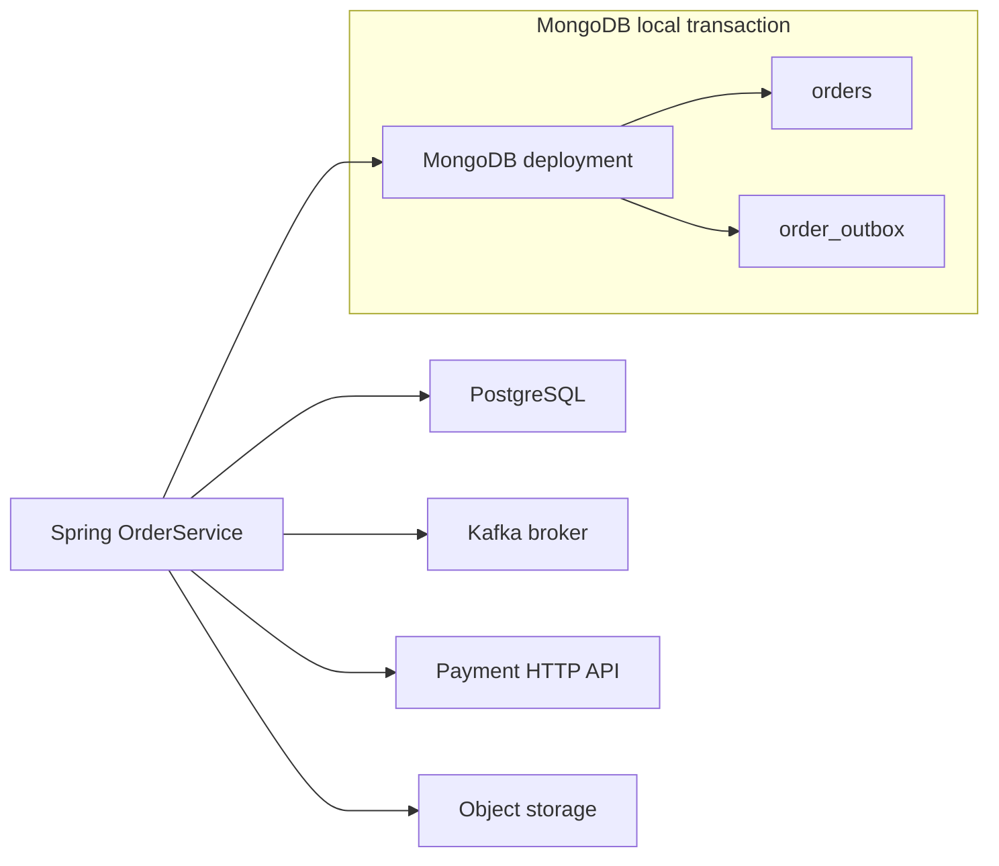
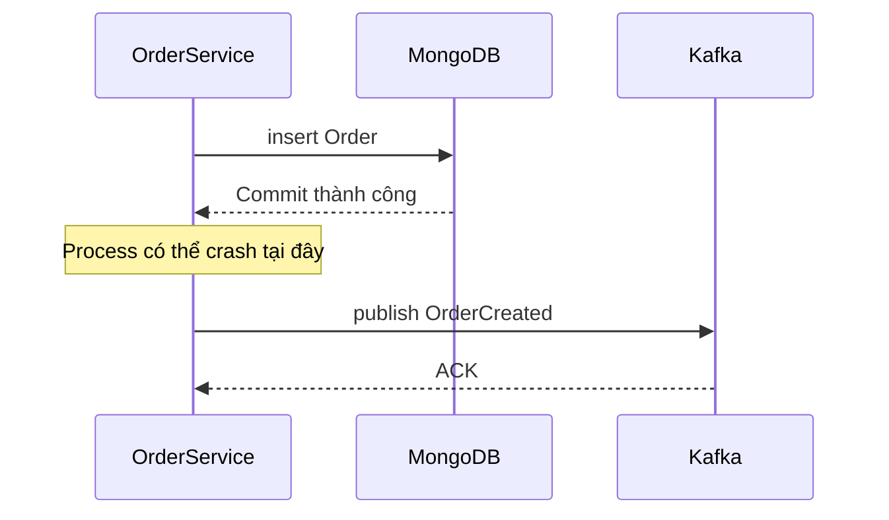
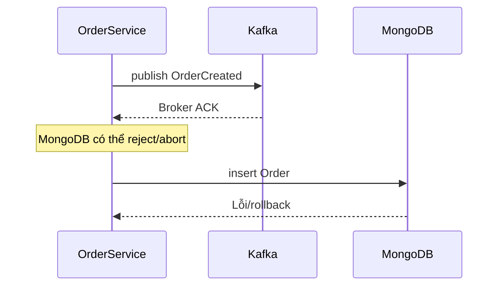
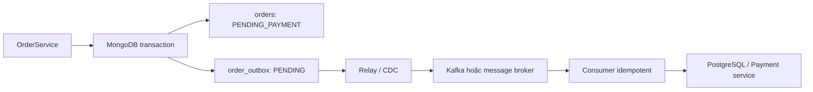
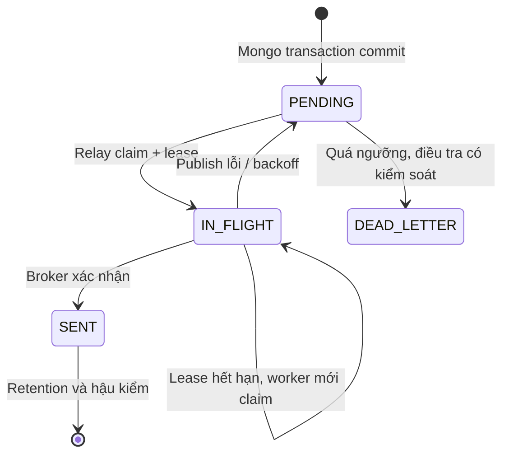
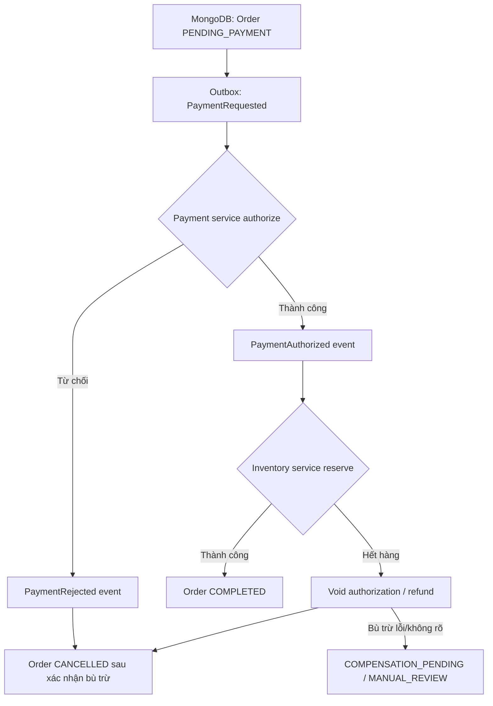
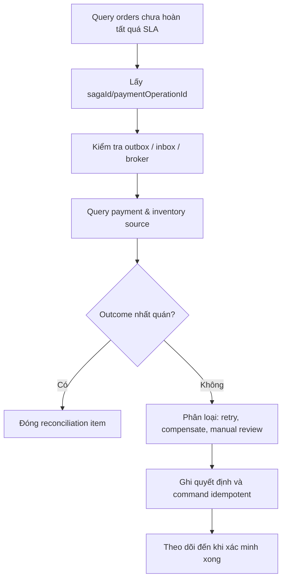
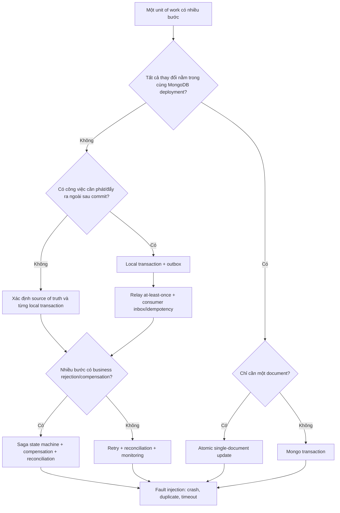

# Giới hạn phối hợp MongoDB với hệ thống dữ liệu khác trong một đơn vị công việc

## 1. Bài toán: một yêu cầu nghiệp vụ, nhiều hệ thống lưu trữ

Ứng dụng **Spring Data MongoDB** có thể sử dụng `MongoTemplate` hoặc repository để thao tác document, dùng `MongoTransactionManager` để quản lý giao dịch MongoDB và `ReactiveMongoTransactionManager` trong luồng reactive. Nhưng một yêu cầu nghiệp vụ thường vượt ra ngoài MongoDB:

- Ghi đơn hàng vào MongoDB.
- Trừ tồn kho ở PostgreSQL.
- Gửi lệnh thanh toán tới dịch vụ qua HTTP.
- Phát sự kiện `OrderCreated` vào Kafka.
- Xóa cache Redis và tạo biên nhận trên object storage.

Người dùng có thể gọi toàn bộ chuỗi là **“một đơn vị công việc”** và mong muốn “hoặc mọi bước thành công, hoặc không bước nào có hiệu lực”. Trên thực tế, mỗi hệ thống có **ranh giới commit, khả năng rollback, retry và thời điểm phản hồi** khác nhau. Chỉ đặt `@Transactional` lên method Java **không biến các hệ thống độc lập thành một giao dịch ACID toàn cục**.

Ví dụ:

```text
POST /orders
     |
     v
Spring OrderService
     |---- MongoDB: lưu order
     |---- PostgreSQL: đặt chỗ inventory
     |---- Kafka: publish OrderCreated
     |---- Payment API: authorize money
     \---- S3: lưu biên nhận
```

Nếu Kafka broker không phản hồi sau khi MongoDB đã commit, transaction MongoDB **không tự thu hồi** sự kiện đã xuất bản ở nơi khác; ngược lại, nếu thanh toán đã bị giữ tiền ở hệ thống bên ngoài, `abortTransaction()` của MongoDB **không tự hoàn tiền**.

Chủ đề thuộc chương **Session và giao dịch** này phân tích chính xác **phạm vi mà MongoDB bảo đảm được**, chỉ ra các failure windows, rồi xây cách phối hợp an toàn hơn bằng **transactional outbox, idempotent consumer, saga, compensation và reconciliation**.

### 1.1. Mục tiêu học tập

Sau bài, người học cần:

1. Phân biệt **business unit of work** với **MongoDB transaction**, **SQL transaction**, **Kafka transaction** và **remote HTTP request**.
2. Hiểu vì sao MongoDB transaction có thể đi qua nhiều collection/database/shard **trong cùng deployment**, nhưng không tự bao trùm PostgreSQL/Kafka/Redis/S3.
3. Phân tích dual-write failure khi đảo thứ tự lưu DB và phát message.
4. Dùng `MongoTransactionManager` đúng scope; không nhầm `@Transactional` với distributed XA transaction.
5. Xây transactional outbox tại MongoDB và relay có retry, lease, idempotency.
6. Phân biệt at-most-once, at-least-once, exactly-once **theo phạm vi**; thiết kế consumer idempotent.
7. Thiết kế saga cho nghiệp vụ nhiều bước với trạng thái, timeout, compensation và unknown outcome.
8. Kiểm thử bằng failure injection, bảo vệ tenant, xử lý partial failure và theo dõi độ trễ hội tụ dữ liệu.

### 1.2. Từ khóa cốt lõi

| Thuật ngữ | Ý nghĩa |
|---|---|
| **Local transaction** | ACID transaction do một resource manager thực hiện, ví dụ MongoDB hoặc một PostgreSQL database |
| **Business unit of work** | Một mục tiêu nghiệp vụ có thể cần nhiều giao dịch cục bộ |
| **Dual write** | Một service ghi hai hệ thống độc lập mà không có commit atomically chung |
| **Transactional outbox** | Lưu trạng thái nghiệp vụ và thông điệp dự định gửi trong cùng một transaction của nguồn |
| **Inbox/deduplication** | Consumer ghi nhận message/event đã xử lý để tránh tác dụng kép |
| **Saga** | Chuỗi giao dịch cục bộ nối bằng sự kiện/command và các bước bù trừ |
| **Compensation** | Hành động nghiệp vụ khôi phục/điều chỉnh hệ quả, không phải rollback ACID |
| **Reconciliation** | Đối soát định kỳ để phát hiện và sửa trạng thái bất đồng giữa các hệ thống |
| **Idempotency key** | Khóa để một yêu cầu lặp không gây thêm tác dụng mới |
| **Commit ambiguity** | Sau timeout/network error, caller không chắc resource đã commit hay chưa |

## 2. MongoDB transaction bảo đảm điều gì — và không bảo đảm điều gì?

### 2.1. Phạm vi thực sự của MongoDB multi-document transaction

MongoDB hỗ trợ ACID transaction cho nhiều thao tác, document, collection, database và shard **nằm trong một MongoDB deployment tương thích** (replica set hoặc sharded cluster). Các thao tác phải tham gia **đúng `ClientSession` và transaction context**.

Ví dụ trong cùng một MongoDB deployment:

```text
MongoDB deployment "shop-rs"
   |
   |-- database shop
   |       |-- orders
   |       \-- order_outbox
   |
   \-- database audit
           \-- order_audit

Một ClientSession + transaction:
   có thể ghi các collections/databases được hỗ trợ ở deployment này
   rồi commit/abort như một MongoDB transaction.
```

Đây **không** phải chỉ là transaction một collection. Trong phạm vi hỗ trợ của MongoDB, một transaction có thể bao gồm cả các collection khác nhau và nhiều shards; tài nguyên, giới hạn operation, commit cost và topology vẫn phải được kiểm tra.

### 2.2. Ranh giới không được MongoDB tự bao trùm



MongoDB transaction **không tự quản lý**:

- `Connection`/`DataSource` của PostgreSQL hoặc một RDBMS khác.
- Kafka producer/broker transaction hoặc RabbitMQ publish acknowledgment.
- HTTP payment gateway, email/SMS provider hoặc bất cứ external API nào.
- Redis commands/cache mutation, S3/object storage PUT và file system.
- Một MongoDB deployment **khác**, có client/factory và transaction coordinator khác.

Việc tất cả operations đều xảy ra trong **cùng method Java**, cùng Spring bean hoặc cùng request HTTP **không thay đổi** các ranh giới đó.

### 2.3. Single-document atomicity vẫn hữu ích

Một write trên **một document MongoDB** đã nguyên tử trong phạm vi document đó. Nếu một nghiệp vụ có thể mô hình hóa đầy đủ bằng một document, việc nhúng các field liên quan và cập nhật có điều kiện thường đơn giản và rẻ hơn multi-document transaction:

```javascript
db.orders.updateOne(
  { _id: "O-101", state: "DRAFT", version: NumberLong(1) },
  {
    $set: { state: "PENDING_PAYMENT" },
    $inc: { version: NumberLong(1) }
  }
);
```

Nhưng atomic single-document write cũng **không** làm một HTTP payment call ở ngoài trở nên atomic với update đó.

### 2.4. Transaction ACID còn phụ thuộc cấu hình độ bền

MongoDB có `readConcern` và `writeConcern` cho transaction. Khi nghiệp vụ muốn dữ liệu commit có độ bền majority, hãy cấu hình `WriteConcern.MAJORITY` cho transaction commit; `ReadConcern.SNAPSHOT` cung cấp góc nhìn nhất quán của các read trong transaction theo điều kiện MongoDB công bố.

Điều đó vẫn chỉ giải quyết dữ liệu **trong deployment MongoDB**. Nó không bổ sung majority acknowledgment cho PostgreSQL hay Kafka.

### 2.5. Không đánh đồng distributed MongoDB transaction với distributed heterogeneous transaction

Từ **distributed transaction** trong tài liệu MongoDB có thể nói về transaction chạy qua các **shards trong MongoDB cluster**. Thuật ngữ này **không** tự hàm ý có coordinator commit toàn cục với các hệ thống bên ngoài. Hãy ghi rõ phạm vi:

```text
Đúng:
  Transaction MongoDB qua nhiều shard cùng deployment.

Sai:
  MongoDB transaction tự rollback PostgreSQL hoặc Kafka message.
```

## 3. Dual write: vì sao thay đổi thứ tự thao tác vẫn không tạo atomicity?

### 3.1. Phương án A — commit MongoDB rồi gửi event



Nếu process crash sau khi MongoDB commit nhưng trước khi gửi Kafka, **order tồn tại nhưng event không được phát**. Consumer không biết order đã được tạo. Không có transaction MongoDB nào có thể chạy lại một dòng Java chưa kịp thực thi sau khi process chết.

### 3.2. Phương án B — gửi event rồi commit MongoDB



Trong trường hợp này, consumer nhận `OrderCreated` nhưng **order chưa từng được commit**. Kafka transaction có thể bao bọc các thao tác Kafka nằm trong phạm vi của nó, nhưng không tự “nhập” MongoDB write vào cùng một XA commit.

### 3.3. Bảng failure windows

| Thời điểm hỏng | MongoDB | Kafka/remote | Hậu quả |
|---|---|---|---|
| Trước khi ghi MongoDB | Chưa ghi | Chưa gửi | Có thể retry tương đối đơn giản |
| MongoDB commit xong, trước publish | Đã commit | Chưa gửi | **Mất thông báo** nếu không có cơ chế phục hồi |
| Publish broker ACK, rồi MongoDB rollback | Chưa có order | Đã gửi | **Event mồ côi** |
| Broker nhận message, client timeout chưa nhận ACK | Đã commit | Không rõ | Retry có thể phát trùng |
| Payment đã authorize, MongoDB commit thất bại | Chưa xác nhận nội bộ | Đã giữ tiền | Cần tra cứu/void/refund, không thể DB rollback payment |
| MongoDB commit xong, tiến trình crash trước trả HTTP response | Đã commit | Client không biết | Retry request có thể tạo order trùng nếu thiếu idempotency |

**Kết luận trọng yếu:** đổi thứ tự hai thao tác chỉ **đổi loại lỗi**, không loại bỏ được khoảng trống atomicity.

### 3.4. Network timeout không chứng minh thao tác thất bại

Một request tới broker hoặc payment provider có thể **đã thành công ở phía nhận** nhưng response/ACK bị mất do mạng. Nếu ứng dụng mặc định timeout = “chưa làm gì” rồi thực hiện lại một thao tác không idempotent, có thể:

- Tạo hai giao dịch thanh toán.
- Gửi hai email hoặc hai shipment.
- Cộng điểm/giảm tồn kho hai lần.
- Phát event trùng với event ID mới không thể deduplicate.

Vì vậy cần phân biệt **definite failure**, **success** và **unknown outcome**. Unknown outcome cần cơ chế **query status theo operation ID/idempotency key**, retry an toàn hoặc reconciliation, không phải rollback tưởng tượng.

## 4. Spring @Transactional và các transaction manager

### 4.1. MongoTransactionManager quản lý một MongoDatabaseFactory

Trong Spring Data MongoDB, `MongoTransactionManager` quản lý `ClientSession` và MongoDB transaction được gắn vào thread (imperative). `MongoTemplate` tham gia khi nó sử dụng cùng `MongoDatabaseFactory`/resource context.

Ví dụ cấu hình:

```java
import com.mongodb.ReadConcern;
import com.mongodb.ReadPreference;
import com.mongodb.TransactionOptions;
import com.mongodb.WriteConcern;
import org.springframework.context.annotation.Bean;
import org.springframework.context.annotation.Configuration;
import org.springframework.data.mongodb.MongoDatabaseFactory;
import org.springframework.data.mongodb.MongoTransactionManager;

@Configuration
public class MongoTxConfig {
    @Bean("mongoTransactionManager")
    MongoTransactionManager mongoTransactionManager(
            MongoDatabaseFactory factory) {
        TransactionOptions options = TransactionOptions.builder()
            .readConcern(ReadConcern.SNAPSHOT)
            .readPreference(ReadPreference.primary())
            .writeConcern(WriteConcern.MAJORITY)
            .build();
        return new MongoTransactionManager(factory, options);
    }
}
```

Điều kiện: MongoDB deployment hỗ trợ transactions, cùng client/factory, collection/index được chuẩn bị đúng, thời lượng và commit semantics được kiểm thử. Tránh đổi `MongoTemplate.setSessionSynchronization(...)` động giữa các request vì đó là trạng thái chung có thể gây vấn đề thread safety/visibility.

### 4.2. Trong cùng app có thể có hai transaction managers

```java
import org.springframework.data.mongodb.MongoTransactionManager;
import org.springframework.jdbc.datasource.DataSourceTransactionManager;

// Các bean thường gặp:
// mongoTransactionManager : quản lý MongoDB ClientSession.
// sqlTransactionManager   : quản lý JDBC Connection/DataSource.
```

Đặt:

```java
@Transactional(transactionManager = "mongoTransactionManager")
public void writeMongo() { /* MongoDB writes */ }

@Transactional(transactionManager = "sqlTransactionManager")
public void writeSql() { /* JDBC writes */ }
```

chỉ chọn **transaction manager cho transaction boundary được khai báo**. Việc ứng dụng có hai bean hoặc hai annotations **không** tạo một global transaction coordinator. Nếu gọi một `@Transactional("sqlTransactionManager")` method từ một MongoDB transaction, mỗi resource có lifecycle commit riêng; một lỗi ở resource thứ hai **không có cơ chế bảo đảm** rollback resource thứ nhất đã commit.

### 4.3. Bẫy @Transactional không chỉ riêng MongoDB

- `@Transactional` có hiệu lực khi Spring transaction infrastructure thực sự được bật và method chạy qua proxy/AspectJ mode tương ứng.
- Self-invocation như `this.innerTransactionalMethod()` thường **không đi qua proxy** trong chế độ proxy mặc định.
- Mặc định `RuntimeException`/`Error` kích hoạt rollback; checked exceptions cần cấu hình rollback rule phù hợp với Spring version/business contract.
- `@Transactional(readOnly = true)` không biến remote HTTP API thành read-only hay atomic.
- Tham số `transactionManager`/qualifier phải chọn chính xác manager; bỏ trống trong app đa resource có thể chọn manager không mong muốn hoặc cấu hình không rõ ràng.

### 4.4. Không mặc định hỗ trợ XA/2PC cho MongoDB trong Spring

Một global XA transaction thường cần các resource managers tham gia một giao thức commit chuẩn, transaction coordinator, recovery logs và khả năng chuẩn bị/commit. `MongoTransactionManager` của Spring Data là một local transaction manager cho MongoDB, **không phải một XAResource** tự động dùng cho cùng một two-phase commit với JDBC/Kafka.

Không suy từ việc MongoDB có hỗ trợ transaction đa shard rằng một JTA/Narayana/Atomikos coordinator có thể “đăng ký” MongoDB như một XA resource chuẩn mà không có bằng chứng sản phẩm, driver, giao thức và recovery semantics tương ứng.

### 4.5. Vì sao chained/best-effort commit vẫn có khoảng hở?

Một số hệ thống có mô hình “lần lượt commit hai transaction managers” hoặc giải pháp custom `ChainedTransactionManager` cũ. Các cách này có thể **giảm lượng code phối hợp**, nhưng **không bảo đảm all-or-nothing**: resource A có thể commit xong và resource B commit lỗi.

Ví dụ:

```text
SQL transaction commit: SUCCESS
Mongo transaction commit: FAILURE

Không có một lệnh rollback SQL nào xóa được commit đã hoàn tất.
```

Không dùng best-effort multi-resource commit như bảo đảm tài chính/kiểm toán “tất cả hoặc không gì” nếu không có cơ chế phục hồi và chấp nhận partial commit trong hợp đồng.

## 5. Mẫu sai: gọi ngoại hệ thống bên trong MongoDB transaction

Giả sử một service làm như sau:

```java
import org.springframework.stereotype.Service;
import org.springframework.transaction.annotation.Transactional;

@Service
public class UnsafeOrderService {
    private final OrderRepository orders;
    private final PaymentGateway paymentGateway;

    public UnsafeOrderService(
            OrderRepository orders,
            PaymentGateway paymentGateway) {
        this.orders = orders;
        this.paymentGateway = paymentGateway;
    }

    @Transactional(transactionManager = "mongoTransactionManager")
    public void placeOrder(OrderDocument order) {
        orders.save(order);
        paymentGateway.charge(order.id(), order.totalCents());
    }
}
```

`PaymentGateway` ở đây là interface tượng trưng cho hệ thống HTTP bên ngoài; code chỉ minh họa **anti-pattern**, không phải ví dụ để dùng trong production.

### 5.1. Những tình huống làm kết quả sai

1. **Gateway charge thành công nhưng MongoDB transaction abort:** bên ngoài đã trừ/giữ tiền, order bị rollback.
2. **MongoDB commit thành công, gateway timeout không rõ kết quả:** caller không biết đã charge hay chưa, retry có thể charge trùng.
3. **Gateway chậm:** MongoDB transaction giữ tài nguyên, snapshot và locks lâu hơn cần thiết; nguy cơ timeout/write conflicts tăng.
4. **Gateway tự retry HTTP:** side effect có thể nhân lên trong khi transaction MongoDB chưa quyết định commit.
5. **Một callback transaction được retry:** nếu network call chạy bên trong callback, có thể tạo side effect lần thứ hai.

### 5.2. Đưa HTTP call ra sau commit có giải quyết hoàn toàn không?

Một cải tiến đơn giản:

```text
Mongo transaction commit
     ↓
Payment API gọi sau commit
```

tránh việc payment xảy ra **trước khi** MongoDB transaction được commit. Tuy nhiên process vẫn có thể crash **giữa commit và HTTP call**, nên payment **không bao giờ được gọi**. Nếu gọi sau commit thành công nhưng crash trước khi lưu trạng thái, lần retry có thể gọi trùng.

Vì vậy “gọi bên ngoài sau commit” là **best-effort**, không phải delivery guarantee. Muốn có một công việc chờ gửi tồn tại bền vững dù service crash, cần lưu **durable intent** trong transaction — đây là vai trò transactional outbox.

### 5.3. Vì sao kéo dài transaction là rủi ro?

MongoDB transaction có giới hạn vận hành, tài nguyên lưu snapshot, khả năng xung đột ghi và chi phí commit. Một API bên ngoài có thể mất hàng giây hoặc phút, vượt xa thời gian nên giữ transaction database. Retry HTTP trong transaction khiến thời lượng càng khó dự đoán.

**Nguyên tắc:** transaction chứa các thao tác MongoDB cần atomic; remote work được biểu diễn thành trạng thái/sự kiện để xử lý sau, với idempotency và compensation thích hợp.

## 6. Những chiến lược phối hợp thông dụng

| Chiến lược | Đảm bảo thực tế | Ưu điểm | Giới hạn / tình huống |
|---|---|---|---|
| Giữ toàn bộ business state trong một MongoDB document | Atomicity một document | Đơn giản, ít phối hợp | Không thích hợp khi phải cập nhật nguồn độc lập |
| MongoDB transaction nhiều collection | Atomicity MongoDB scope | Bao gồm order và outbox cùng deployment | Không bao gồm SQL/Kafka/HTTP |
| Dual write trực tiếp | Không có commit atomic chung | Ít code ban đầu | Có thể mất event, duplicate, partial commit |
| `@TransactionalEventListener(AFTER_COMMIT)` | Chạy listener sau commit khi process còn hoạt động | Đơn giản cho best-effort | Crash window, không có durable delivery |
| Transactional outbox + relay | Durable intent trong DB; delivery thường **at-least-once** | Phục hồi sau crash, retry | Cần relay, dedup, lag monitoring |
| Change Streams/CDC | Theo dõi thay đổi MongoDB sau commit | Giảm polling, phản ứng nhanh | Resume token, oplog/history, consumer recovery |
| Saga (orchestration/choreography) | Eventual coordination với compensations | Hỗ trợ nhiều resource | Không có ACID toàn cục, thiết kế trạng thái phức tạp |
| Reconciliation định kỳ | Phát hiện/sửa sai lệch còn tồn đọng | Khôi phục sau partial failure | Có độ trễ, cần nguồn sự thật |
| XA/2PC thực sự nếu mọi resource hỗ trợ | Có thể đạt atomic distributed commit trong kiến trúc phù hợp | Hợp đồng chặt cho resource hỗ trợ | Không mặc định hỗ trợ MongoDB+Kafka+HTTP; tốn vận hành |

Với một hệ thống order dựa trên MongoDB rồi phát sự kiện sang broker, **transactional outbox + idempotent consumer** thường là điểm bắt đầu hợp lý. Khi nhiều service cùng thực hiện hành động nghiệp vụ có thể từ chối hoặc bù trừ, bổ sung **saga** và **reconciliation**.

## 7. Transactional outbox: lưu order và ý định gửi trong cùng transaction

### 7.1. Ý tưởng

Không gửi Kafka trực tiếp trong method `createOrder`. Thay vào đó, lưu hai document **cùng MongoDB transaction**:

1. `orders`: trạng thái nghiệp vụ, ví dụ `PENDING_PAYMENT`.
2. `order_outbox`: một event/command cần xuất, với `eventId` duy nhất và dữ liệu đủ cho consumer.



Nếu transaction commit, **order và outbox event cùng có mặt**. Nếu transaction abort, **cả hai không có**. Relay sau đó có thể đọc outbox và gửi lại khi broker hoạt động.

### 7.2. Điều được bảo đảm và điều không

| Câu hỏi | Trả lời |
|---|---|
| Order có thể commit mà outbox không được insert trong transaction này? | Không nếu **cả hai operation thật sự thuộc cùng MongoDB transaction** và commit atomic |
| Broker publish có atomic với commit MongoDB không? | **Không** |
| Outbox event có thể được publish lại sau crash không? | **Có**, vì ý định được lưu bền vững |
| Consumer có thể nhận event trùng không? | **Có**, relay thường at-least-once |
| Có luôn đúng một lần business effect ở mọi hệ thống không? | **Không tự động**; cần inbox/idempotency ở nơi nhận |
| Relay chạy thành công có nghĩa payment đã hoàn tất không? | **Không**; cần ACK/outcome event của payment workflow |

**Outbox giải quyết “mất ý định gửi sau khi DB commit”, không tự giải quyết “consumer thực thi chính xác một lần”.**

### 7.3. Schema hai collection

Trong ví dụ Java 17+ dùng record cho entity minh họa:

```java
import java.time.Instant;
import org.springframework.data.annotation.Id;
import org.springframework.data.mongodb.core.mapping.Document;

@Document(collection = "orders")
public record OrderDocument(
    @Id String id,
    String tenantId,
    String requestId,
    long totalCents,
    String state,
    Instant createdAt
) {}
```

```java
import java.time.Instant;
import org.springframework.data.annotation.Id;
import org.springframework.data.mongodb.core.mapping.Document;

@Document(collection = "order_outbox")
public record OutboxEvent(
    @Id String id,
    String aggregateId,
    String tenantId,
    long totalCents,
    String eventType,
    int schemaVersion,
    String state,
    Instant createdAt,
    Instant nextAttemptAt,
    int attempts,
    String leaseToken,
    Instant leaseUntil
) {}
```

Giải thích:

- `OrderDocument.id`: ID order, không dùng cho một thanh toán khác nếu đã có retry.
- `requestId`: idempotency key của yêu cầu tạo đơn, scope theo tenant/client.
- `OutboxEvent.id`: **event ID ổn định**; relay phát lại cùng ID, không tạo ID mới mỗi lần retry.
- `aggregateId`: ID order nguồn để trace/correlate.
- `eventType` + `schemaVersion`: hợp đồng thông điệp có version.
- `state`: `PENDING`, `IN_FLIGHT`, `SENT` hoặc trạng thái lỗi được định nghĩa.
- `nextAttemptAt`, `attempts`, `leaseToken`, `leaseUntil`: phục vụ retry/claim; có thể quản trị qua `MongoTemplate.update...` mà không lưu toàn bộ event trở lại.

Ví dụ dùng tên field CamelCase theo Spring Data domain model; khi ứng dụng chọn `@Field` để đổi tên BSON, mọi index, raw query và CDC pipeline phải dùng tên vật lý thực.

### 7.4. Index bảo vệ idempotency và polling

Trong database test/triển khai, tạo index riêng biệt:

```javascript
db.orders.createIndex(
  { tenantId: 1, requestId: 1 },
  { unique: true, name: "ux_order_tenant_request" }
);

db.order_outbox.createIndex(
  { state: 1, nextAttemptAt: 1, createdAt: 1 },
  { name: "ix_outbox_pending_schedule" }
);

db.order_outbox.createIndex(
  { state: 1, leaseUntil: 1 },
  { name: "ix_outbox_expired_leases" }
);
```

Unique index `(tenantId, requestId)` giúp hai request lặp từ cùng tenant không tạo hai đơn. **Phải tạo index trước** khi dựa vào nó, và xử lý dữ liệu duplicate hiện có khi migrate. Không đưa `requestId` do client tùy ý vào một namespace chung cho mọi tenant mà không có ràng buộc scope.

### 7.5. Transaction service: ghi order và outbox, không gọi remote

```java
import java.time.Instant;
import java.util.UUID;
import org.springframework.data.mongodb.core.MongoTemplate;
import org.springframework.stereotype.Service;
import org.springframework.transaction.annotation.Transactional;

public record CreateOrderCommand(
    String requestId,
    long totalCents
) {}

@Service
public class OrderCreationService {
    private final MongoTemplate template;

    public OrderCreationService(MongoTemplate template) {
        this.template = template;
    }

    @Transactional(transactionManager = "mongoTransactionManager")
    public OrderDocument create(
            String authenticatedTenantId,
            CreateOrderCommand command) {

        if (authenticatedTenantId == null
                || authenticatedTenantId.isBlank()
                || command == null
                || command.requestId() == null
                || command.requestId().isBlank()
                || command.totalCents() < 0) {
            throw new IllegalArgumentException("Invalid order command");
        }

        Instant now = Instant.now();
        String orderId = UUID.randomUUID().toString();
        String eventId = UUID.randomUUID().toString();

        OrderDocument order = new OrderDocument(
            orderId,
            authenticatedTenantId,
            command.requestId(),
            command.totalCents(),
            "PENDING_PAYMENT",
            now
        );

        OutboxEvent event = new OutboxEvent(
            eventId,
            orderId,
            authenticatedTenantId,
            command.totalCents(),
            "OrderCreated",
            1,
            "PENDING",
            now,
            now,
            0,
            null,
            null
        );

        template.insert(order);
        template.insert(event);
        return order;
    }
}
```

Điểm then chốt:

- Cả hai lệnh `template.insert(...)` dùng cùng `MongoTemplate`/`MongoDatabaseFactory` được Spring transaction manager quản lý.
- Method phải được gọi qua transaction proxy/boundary, không gọi nội bộ `this.create(...)` bypass.
- MongoDB deployment phải hỗ trợ transactions. `@Transactional` một mình không đủ khi chưa cấu hình manager.
- Không gửi payment HTTP, Kafka hoặc email **bên trong transaction này**.
- `state=PENDING_PAYMENT` phản ánh **chưa thanh toán xong**, không trả người dùng trạng thái `PAID` chỉ vì order+event commit.
- Khi consumer cần thông tin khác (currency, sku, quantity), bổ sung payload có hợp đồng version và không chứa dữ liệu nhạy cảm thừa.

### 7.6. Retry tạo đơn: unique index mới là điều kiện cần, chưa đủ

Nếu commit đã thành công nhưng response HTTP mất, client có thể gọi `create(...)` lần nữa với cùng `requestId`. Khi đó unique index sẽ ngăn bản ghi thứ hai, có thể ném `DuplicateKeyException`.

Một handler đúng cần **tìm lại đơn đã được tạo** theo `tenantId + requestId` và trả **cùng kết quả**, đồng thời kiểm tra payload tương thích (số tiền, currency, sản phẩm). Không coi mọi duplicate key là thành công: nếu cùng key nhưng payload khác, trả conflict.

Một cách triển khai dễ review:

1. Bên ngoài transaction, thử đọc order theo tenant/requestId.
2. Nếu có, đối chiếu payload/hash rồi trả lại hoặc conflict.
3. Nếu chưa có, gọi transactional `create(...)`.
4. Nếu gặp duplicate key do race, **sau khi transaction đã kết thúc/rollback**, đọc lại theo key rồi đối chiếu và trả kết quả.

Không bắt `DuplicateKeyException` **bên trong transaction bị abort** rồi tiếp tục query/save như transaction vẫn còn hợp lệ. Trong MongoDB, nhiều lỗi ghi đánh dấu transaction không thể commit; cần để framework rollback và xử lý ở scope ngoài.

### 7.7. Outbox event không phải cache tạm để xóa ngay

`order_outbox` cần retention policy đủ dài để xử lý broker downtime, retry, DLQ, investigation và recovery. Không thêm TTL index xóa `PENDING`/`IN_FLIGHT` theo `createdAt` bất kể trạng thái — điều đó có thể làm mất event chưa được gửi.

Nếu muốn xóa `SENT` sau một khoảng thời gian, có thể gắn thời điểm hoàn tất và TTL/filter phù hợp; vẫn phải cân nhắc audit, CDC retention và retry reconciliation.

## 8. Outbox relay: gửi được sau crash nhưng phải chấp nhận duplicate

### 8.1. Vòng đời event



Trạng thái `SENT` **chỉ** nghĩa là relay đã nhận acknowledgment theo hợp đồng của publisher/broker. Nó không chứng minh một consumer khác đã cập nhật PostgreSQL hay thanh toán thành công.

### 8.2. Vì sao cần lease?

Khi có nhiều relay instances, nếu tất cả chạy `find({state:"PENDING"})` rồi gửi, cùng một event có thể được xử lý song song mà không có arbitration. Một `findAndModify` với predicate trạng thái và update lease cho phép một worker **claim atomically** một document.

Nếu worker crash trong lúc `IN_FLIGHT`, lease hết hạn cho phép worker khác thử lại. Điều này cải thiện liveness nhưng **có thể xuất hiện gửi lặp** nếu worker cũ chưa chết thật và vẫn đang publish. Vì thế consumer phải có dedup/idempotency.

### 8.3. Ví dụ claim bằng MongoTemplate.findAndModify

Code minh họa một relay đồng bộ; import cần thiết được chỉ ra:

```java
import java.time.Instant;
import java.util.UUID;

import org.springframework.data.domain.Sort;
import org.springframework.data.mongodb.core.MongoTemplate;
import org.springframework.data.mongodb.core.FindAndModifyOptions;
import org.springframework.data.mongodb.core.query.Criteria;
import org.springframework.data.mongodb.core.query.Query;
import org.springframework.data.mongodb.core.query.Update;
import org.springframework.stereotype.Component;

@Component
public class OutboxStore {
    private final MongoTemplate template;

    public OutboxStore(MongoTemplate template) {
        this.template = template;
    }

    public OutboxEvent claimNext(Instant now) {
        Criteria pending = Criteria.where("state").is("PENDING")
            .and("nextAttemptAt").lte(now);
        Criteria expired = Criteria.where("state").is("IN_FLIGHT")
            .and("leaseUntil").lt(now);

        Query query = Query.query(
            new Criteria().orOperator(pending, expired));
        query.with(Sort.by(
            Sort.Order.asc("createdAt"),
            Sort.Order.asc("id")));

        String token = UUID.randomUUID().toString();
        Update update = new Update()
            .set("state", "IN_FLIGHT")
            .set("leaseToken", token)
            .set("leaseUntil", now.plusSeconds(60))
            .inc("attempts", 1);

        return template.findAndModify(
            query,
            update,
            FindAndModifyOptions.options().returnNew(true),
            OutboxEvent.class);
    }

    public boolean markSent(OutboxEvent event) {
        Query owner = ownedClaim(event);
        Update update = new Update()
            .set("state", "SENT")
            .unset("leaseToken")
            .unset("leaseUntil");

        return template.updateFirst(
            owner, update, OutboxEvent.class
        ).getModifiedCount() == 1;
    }

    public boolean scheduleRetry(
            OutboxEvent event, Instant retryAt) {
        Query owner = ownedClaim(event);
        Update update = new Update()
            .set("state", "PENDING")
            .set("nextAttemptAt", retryAt)
            .unset("leaseToken")
            .unset("leaseUntil");

        return template.updateFirst(
            owner, update, OutboxEvent.class
        ).getModifiedCount() == 1;
    }

    private static Query ownedClaim(OutboxEvent event) {
        return Query.query(
            Criteria.where("id").is(event.id())
                .and("state").is("IN_FLIGHT")
                .and("leaseToken").is(event.leaseToken()));
    }
}
```

Ý nghĩa:

- `claimNext` là **atomic update trên một outbox document**, không phải một distributed lock.
- `leaseToken` giúp worker cũ không được ghi đè trạng thái nếu worker mới đã claim lại.
- `leaseUntil` cần tính theo thời gian hệ thống tin cậy và margin đủ cho network latency; production nên dùng clock policy/lease renewal nếu publish có thể lâu.
- Query, sort và index trên `state`/`nextAttemptAt`/`leaseUntil` cần được benchmark.
- `attempts` được tăng ở claim, có thể dùng để áp exponential backoff/DLQ theo chính sách.

Ví dụ này chưa triển khai tất cả chính sách vận hành như poison-event handling, lease renewal, rate limiting, tracing, timestamp completion hoặc giới hạn kích thước batch. Nó nêu **cơ chế tối thiểu** để relay không mất khả năng phục hồi khi worker bị crash.

### 8.4. Chỉ mark SENT sau khi broker thực sự xác nhận

```java
public interface DurablePublisher {
    // Trả về chỉ khi broker đã gửi ACK theo delivery policy.
    // Nếu chưa biết outcome, ném exception để retry có kiểm soát.
    void publishAndAwaitAck(OutboxEvent event);
}
```

```java
import java.time.Instant;
import org.springframework.stereotype.Component;

@Component
public class OutboxRelay {
    private final OutboxStore store;
    private final DurablePublisher publisher;

    public OutboxRelay(
            OutboxStore store,
            DurablePublisher publisher) {
        this.store = store;
        this.publisher = publisher;
    }

    public void runOne() {
        OutboxEvent event = store.claimNext(Instant.now());
        if (event == null) {
            return;
        }

        try {
            publisher.publishAndAwaitAck(event);
            store.markSent(event);
        } catch (RuntimeException e) {
            Instant retryAt = Instant.now().plusSeconds(30);
            store.scheduleRetry(event, retryAt);
            // Alert/metrics/sanitized log: event.id(), attempt, error class.
        }
    }
}
```

`publishAndAwaitAck` là interface do ứng dụng tự triển khai bằng Kafka/RabbitMQ hoặc transport tương ứng. Với Kafka, chỉ coi Future/send callback thành công theo producer delivery config là broker acknowledgment; một lời gọi `send(...)` **trả về ngay** không đủ để coi message đã được nhận.

Trong production cần ghi log/metrics kể cả khi `markSent` thất bại do database lỗi hoặc lease đã bị worker khác claim, đồng thời xử lý retry của `scheduleRetry` khi chính MongoDB không khả dụng.

### 8.5. Hai thứ tự cập nhật đều có failure window

Nếu đánh dấu `SENT` **trước publish**, worker crash ngay sau mark ⇒ event **mất**.

Nếu publish **trước mark SENT**, broker nhận rồi worker crash ⇒ event được **gửi lại**, có thể trùng.

Transactional outbox chọn **tránh mất event** bằng cách chấp nhận duplicate và yêu cầu consumer idempotent. Không gọi đây là exactly-once end-to-end.

### 8.6. Retry, backoff và poison event

Một chiến lược retry nên có:

- Exponential backoff + jitter cho lỗi mạng/broker tạm thời.
- Giới hạn concurrency theo partition/topic/provider.
- Phân biệt lỗi **tạm thời** (timeout, unavailable) với **vĩnh viễn** (schema event không hợp lệ, unknown eventType).
- Dead-letter hoặc trạng thái `FAILED_NEEDS_REVIEW` sau quá nhiều lần.
- Alert về `oldest pending age` và số event chờ xử lý, không chỉ đếm lỗi cuối cùng.
- Replay có kiểm soát sau khi sửa lỗi consumer/schema.

Đừng xóa event thất bại sau ba lần chỉ để “hàng đợi sạch”. Nếu mất ý định nghiệp vụ sẽ khó hoặc không thể phục hồi đúng.

### 8.7. Khi chuyển event sang Kafka: partition key và ordering

Nếu các sự kiện của cùng một order cần đúng thứ tự, dùng một **key ổn định** như `aggregateId/orderId` để các sự kiện của order đó được định tuyến vào cùng Kafka partition (theo producer partitioner/config phù hợp). Nhưng:

- Thứ tự trong một partition không giải quyết thứ tự **giữa nhiều topics/partitions**.
- Hai relays có thể phát version mới trước version cũ nếu không có kiểm soát claim/order.
- Broker ordering không tự bảo vệ consumer khỏi duplicate hoặc stale update.

Dùng thêm **aggregate version/sequence** và conditional state transitions ở consumer. Không chỉ dựa vào timestamp client.

## 9. Change Streams/CDC: thay polling, không thay idempotency

### 9.1. Change Streams là gì?

MongoDB Change Streams cho phép theo dõi thay đổi data trên replica sets/sharded clusters. Một relay có thể subscribe collection `order_outbox` để nhận insert/update đã được commit thay vì polling liên tục.

```text
MongoDB transaction commit
      |
      v
Outbox insert trong collection
      |
      v
Change Stream event
      |
      v
Relay/connector đọc outbox document
      |
      v
Broker / Kafka
```

Change Streams thường phù hợp để giảm độ trễ, nhưng vẫn cần **quản lý resume token, reconnect/restart, backpressure và retention**.

### 9.2. Những điều Change Streams không tự làm

- Không tạo global transaction với Kafka.
- Không bảo đảm consumer chỉ thực thi business effect đúng một lần.
- Không bảo đảm resume token luôn hợp lệ sau downtime rất lâu; oplog history có giới hạn.
- Không tự khôi phục một event đã bị xóa khỏi outbox trước khi connector theo kịp.
- Không tự xác định event schema version nào consumer hiểu.

Resume token phải được lưu/checkpoint bền vững theo quy tắc connector, và khi token không còn hợp lệ cần có phương án **rescan pending outbox/reconciliation**, thay vì tiếp tục bỏ qua event.

### 9.3. Polling và CDC không phải hai lựa chọn loại trừ nhau

| Cách relay | Điểm mạnh | Rủi ro/điều cần vận hành |
|---|---|---|
| Polling `PENDING` | Triển khai đơn giản, dễ nhìn backlog, không phụ thuộc token | Delay, extra queries, lease/race |
| Change Streams | Phản ứng nhanh sau commit, ít polling khi nhàn | Resume token, oplog window, reconnect, state recovery |
| Kết hợp | CDC gửi nhanh, periodic scan cứu các event sót | Cần dedup và đồng bộ lease/state nhất quán |

Nếu CDC thấy outbox `PENDING` rồi publish, vẫn phải xử lý trường hợp published-but-uncheckpointed trước crash. Event ID và idempotency không trở nên thừa chỉ vì dữ liệu đi qua Change Stream.

### 9.4. Event schema và quyền đọc outbox

Outbox chứa data đưa sang hệ thống khác. Không nhét toàn bộ order document, card details, access token hoặc thông tin cá nhân không cần thiết vào event. Định nghĩa:

- `eventId`, `eventType`, `schemaVersion`, `occurredAt`.
- `aggregateId`, `aggregateVersion` và tenant/context được phép chia sẻ.
- Payload tối thiểu đủ cho consumer.
- Chính sách encryption, access control, retention và PII redaction.

Relay chỉ cần quyền tối thiểu để đọc/claim các event thuộc phạm vi của nó; không nên được cấp quyền quản trị toàn database chỉ để publish event.

## 10. Idempotent consumer và inbox: chống business effect bị thực hiện hai lần

### 10.1. At-least-once có nghĩa event có thể đến trùng

Giả sử consumer nhận `OrderCreated` và ghi một job vào PostgreSQL. Sau khi SQL commit, consumer crash trước khi broker ghi nhận offset/ACK. Broker có thể gửi lại **cùng event**.

```text
Kafka --> Consumer --> PostgreSQL COMMIT
                       |
                       +-- Process crash trước ACK
Kafka --> Consumer (cùng eventId lại tới)
```

Một consumer thiếu dedup có thể tạo hai billing jobs hoặc trừ inventory hai lần. Không đặt niềm tin vào việc relay “chỉ publish một lần”, vì cả relay lẫn consumer đều có cửa sổ lỗi giữa side effect và ACK.

### 10.2. Inbox table và unique constraint

Trong PostgreSQL, tạo một bảng dedup có khóa:

```sql
CREATE TABLE processed_messages (
    consumer_name text NOT NULL,
    event_id text NOT NULL,
    processed_at timestamptz NOT NULL DEFAULT now(),
    PRIMARY KEY (consumer_name, event_id)
);

CREATE TABLE billing_requests (
    order_id text PRIMARY KEY,
    tenant_id text NOT NULL,
    amount_cents bigint NOT NULL,
    status text NOT NULL,
    created_at timestamptz NOT NULL DEFAULT now()
);
```

Bảng `processed_messages` dùng để bảo đảm cùng consumer không áp dụng event ID nhiều lần. Bảng `billing_requests` chứa **ý định thanh toán phía SQL**, không phải một charge HTTP đã diễn ra. Unique `order_id` bổ sung bảo vệ theo business identity.

### 10.3. Cùng một SQL transaction: inbox + hành động cục bộ

```java
import org.springframework.jdbc.core.JdbcTemplate;
import org.springframework.stereotype.Service;
import org.springframework.transaction.annotation.Transactional;

public record OrderCreatedMessage(
    String eventId,
    String orderId,
    String tenantId,
    long totalCents
) {}

@Service
public class BillingInboxService {
    private final JdbcTemplate jdbc;

    public BillingInboxService(JdbcTemplate jdbc) {
        this.jdbc = jdbc;
    }

    @Transactional(transactionManager = "sqlTransactionManager")
    public void accept(OrderCreatedMessage message) {
        int inserted = jdbc.update("""
            INSERT INTO processed_messages(consumer_name, event_id)
            VALUES (?, ?)
            ON CONFLICT (consumer_name, event_id) DO NOTHING
            """, "billing", message.eventId());

        if (inserted == 0) {
            return; // Đã xử lý cùng eventId trong local SQL transaction.
        }

        jdbc.update("""
            INSERT INTO billing_requests(
                order_id, tenant_id, amount_cents, status)
            VALUES (?, ?, ?, 'PENDING')
            ON CONFLICT (order_id) DO NOTHING
            """,
            message.orderId(),
            message.tenantId(),
            message.totalCents()
        );
    }
}
```

Ở ví dụ này, **inbox marker và billing job được commit/rollback cùng nhau trong PostgreSQL**. Nếu tạo billing job lỗi khiến transaction rollback, marker cũng rollback; broker có thể giao lại event và consumer xử lý lại.

**Quan trọng:** câu `ON CONFLICT (order_id) DO NOTHING` là rào chắn chống trùng theo order, nhưng nếu cùng order ID xuất hiện với `amount_cents` khác, ứng dụng cần **phát hiện mâu thuẫn và đưa vào kiểm tra**, không được lặng lẽ bỏ qua như một giao dịch hợp lệ. Tương tự, eventId khác nhưng business command trùng cần quyết định chính sách idempotency.

### 10.4. ACK broker phải sau khi SQL transaction commit

Flow nên là:

```text
Receive event
    |
    v
Begin SQL transaction
    |
    +-- INSERT inbox marker (unique)
    +-- INSERT billing_request
    |
    v
COMMIT PostgreSQL
    |
    v
Broker offset/ACK thành công
```

Không ACK broker **trước** SQL commit. Nhưng ngay cả thứ tự trên vẫn có khả năng ACK thất lạc sau commit, vì vậy vẫn **cần inbox**.

Đối với Kafka, cấu hình offset commit, consumer retry, dead-letter, partition concurrency và Spring Kafka listener container phải được kiểm thử theo đúng phiên bản. Một method `accept(...)` hoàn thành không tự chứng minh broker offset đã được commit.

### 10.5. Inbox không tự idempotent cho external payment

Nếu ngay sau `INSERT inbox`, consumer gọi thẳng payment API rồi SQL transaction rollback, inbox marker biến mất nhưng tiền có thể đã bị giữ. Đây lại là **dual write**.

Vì vậy consumer ở ví dụ chỉ ghi **billing intent** vào PostgreSQL. Một worker thanh toán độc lập cần dùng:

- Idempotency key ổn định (thường gắn với order/payment attempt ID).
- API/query xác minh kết quả nếu timeout.
- Lưu payment state một cách durable.
- Retry với backoff.
- Compensation và reconciliation khi cần.

Transactional outbox/inbox giải quyết biên giới database–message broker từng bước; không tự làm HTTP payment atomic với SQL.

### 10.6. Không phải mọi event duplicate đều có cùng nội dung

Consumer không chỉ kiểm tra event ID. Một producer lỗi có thể phát:

```text
eventId = E-123, orderId = O-101, amount = 25000
eventId = E-123, orderId = O-101, amount = 90000
```

Với cùng `eventId` nhưng payload khác, đây là **xung đột dữ liệu** chứ không phải một duplicate vô hại. Có thể lưu payload hash/schema version trong inbox để so sánh và raise alert. Idempotency nên bảo đảm cùng key dẫn tới **cùng kết quả hoặc conflict**, không âm thầm chấp nhận bất kỳ data nào.

## 11. Saga: phối hợp các local transactions theo trạng thái nghiệp vụ

### 11.1. Saga khác ACID transaction như thế nào?

Một saga gồm nhiều **local transactions** trên các service/resources khác nhau. Mỗi bước có thể commit độc lập; khi một bước thất bại, hệ thống có thể thực hiện **compensating actions** nhằm đạt trạng thái nghiệp vụ chấp nhận được.

Ví dụ đặt hàng:



Trong khoảng thời gian giữa các bước, hệ thống có thể ở trạng thái **chưa hoàn tất**. Đây là **eventual consistency có kiểm soát**, không phải trạng thái tạm được giấu như thể mọi thứ đã commit cùng một lần.

### 11.2. Một state machine rõ ràng

| Trạng thái order | Ý nghĩa | Transition hợp lệ minh họa |
|---|---|---|
| `PENDING_PAYMENT` | Order đã lưu, chưa có kết quả payment đáng tin cậy | `PAYMENT_AUTHORIZED` hoặc `PAYMENT_REJECTED` |
| `PAYMENT_AUTHORIZED` | Payment đã authorize, chưa xong inventory | `RESERVATION_PENDING` |
| `RESERVATION_PENDING` | Đang chờ giữ hàng | `COMPLETED` hoặc `COMPENSATION_PENDING` |
| `COMPENSATION_PENDING` | Cần void/refund/giải phóng resource | `CANCELLED` hoặc `MANUAL_REVIEW` |
| `COMPLETED` | Đơn đã hoàn tất theo hợp đồng | Không tự quay về `PENDING_PAYMENT` |
| `CANCELLED` | Đơn hủy theo business policy | Có thể mở flow mới riêng |
| `MANUAL_REVIEW` | Compensation chưa xác minh | Điều tra/repair theo runbook |

Trạng thái không nên chỉ là một String tùy ý mà không có kiểm tra transition. Cần đồng bộ **transition rules** với API, event consumers, retries và reconciliation.

### 11.3. Orchestration và choreography

**Orchestration:** một saga coordinator theo dõi trạng thái tổng thể, phát command tới payment/inventory, nhận outcome và quyết định bước tiếp. Ưu điểm: luồng rõ ràng, dễ nhìn timeout/compensation, nhưng coordinator phải durable và idempotent.

**Choreography:** các service phản ứng với event của nhau mà không có coordinator tập trung. Ưu điểm: ít coupling tới một orchestrator, nhưng nhiều services có thể tạo vòng lặp/logic phân tán khó quan sát nếu không quản lý hợp đồng event và state.

Không có một phương án tối ưu tuyệt đối. Với thanh toán và giao hàng nhiều bước, orchestration thường giúp kiểm soát compensation rõ hơn; với chuỗi thông báo đơn giản, choreography có thể đủ.

### 11.4. Compensation không phải rollback vật lý

Ví dụ:

```text
Payment authorize 25000 cents thành công
Inventory reserve thất bại
    ↓
Gọi payment void hoặc refund
    ↓
Payment service xác nhận bù trừ thành công
    ↓
Order CANCELLED
```

“Bù trừ” có thể tạo **một transaction tài chính mới**; không xóa dấu vết giao dịch cũ. Phí xử lý, settlement timing, quy định pháp lý, rounding và delay có thể khiến trạng thái cuối không giống “chưa từng có gì xảy ra”. Email đã gửi, gói hàng đã xuất kho hoặc tác vụ vật lý không nhất thiết đảo ngược được.

### 11.5. Compensation cũng có thể thất bại

Nếu payment gateway không phản hồi khi void authorization:

- **Không** lập tức đánh dấu `CANCELLED` như đã hoàn tất.
- Ghi `COMPENSATION_PENDING` cùng operation ID/key và retry schedule.
- Query trạng thái payment theo stable idempotency key.
- Retry với exponential backoff/jitter và circuit breaker phù hợp.
- Alert và chuyển `MANUAL_REVIEW` khi quá SLA.

Nghiệp vụ quyết định thời điểm có thể thông báo khách hàng “đã hoàn tiền”, không được dựa vào việc app vừa gửi một HTTP request chưa nhận kết quả.

### 11.6. Idempotency ở mọi bước saga

Mỗi command nên có:

```json
{
  "commandId": "CMD-RESERVE-O-101-v1",
  "sagaId": "SAGA-O-101",
  "orderId": "O-101",
  "step": "RESERVE_INVENTORY",
  "attempt": 3,
  "schemaVersion": 1
}
```

`commandId` là business operation identity ổn định; `attempt` chỉ thể hiện **lần thử**. Khi retry cùng operation, **không** sinh command ID mới nếu hệ thống đích dùng command ID để chống thực thi trùng. Payment provider có thể định nghĩa yêu cầu riêng về phạm vi và thời hạn lưu idempotency key; phải tuân thủ hợp đồng thực tế.

### 11.7. Out-of-order events và version

Trong hệ phân tán, `PaymentRejected` hoặc event cũ có thể đến sau một event mới hơn do retry, topic partitions hoặc delay. Consumer phải kiểm tra:

- `aggregateId` và `aggregateVersion`.
- Trạng thái hiện tại.
- Transition có được phép không.
- Event ID đã xử lý chưa.
- Sự kiện đã hết hạn/đến sai thứ tự có cần retry, bỏ qua hoặc chuyển conflict không.

**Không** xử lý bằng `mongoTemplate.save(orderWithStateFromEvent)` mà không có predicate phiên bản/trạng thái; có thể ghi đè trạng thái mới bằng một event cũ.

## 12. Conditional update và local inbox trong MongoDB

### 12.1. Chống state regression

Một transition chỉ hợp lệ khi order đang `PENDING_PAYMENT`:

```java
import org.springframework.data.mongodb.core.MongoTemplate;
import org.springframework.data.mongodb.core.query.Criteria;
import org.springframework.data.mongodb.core.query.Query;
import org.springframework.data.mongodb.core.query.Update;

Query condition = Query.query(
    Criteria.where("id").is(orderId)
        .and("tenantId").is(trustedTenantId)
        .and("state").is("PENDING_PAYMENT")
);

Update change = new Update()
    .set("state", "PAYMENT_AUTHORIZED");

long matched = mongoTemplate.updateFirst(
    condition,
    change,
    OrderDocument.class
).getMatchedCount();
```

Đây là **đoạn minh họa trong service** với các biến `orderId`, `trustedTenantId` và `mongoTemplate` đã được cung cấp; không phải một file Java hoàn chỉnh tự chạy. MongoDB update có điều kiện trên một document là atomic. Nếu `matched = 0`, cần phân biệt:

- Event duplicate, order đã chuyển trạng thái đúng.
- Event stale/out-of-order.
- Không tồn tại order/tenant sai.
- Workflow vi phạm bất biến.

Không mặc định `matched = 0` luôn là “đã xử lý thành công”; phải đối chiếu trạng thái hiện tại.

### 12.2. Kết hợp inbox, transition và outbox cùng MongoDB transaction

Trong MongoDB consumer, có thể:

1. Insert một `processed_messages` record keyed bởi `consumer + eventId`.
2. Conditional update order.
3. Insert event `PaymentAcceptedByOrder` hoặc command bước tiếp vào `order_outbox`.
4. Commit cùng MongoDB transaction.

Nếu insert inbox bị duplicate-key do event đã xử lý, kết thúc transaction và trả ACK theo policy; **không** tiếp tục update lại order. Nếu transition bị từ chối vì state conflict không giải thích được, abort transaction để tránh đánh dấu inbox như đã xử lý, hoặc ghi một outcome/reconciliation state có chủ đích.

Để chống race, cần unique index cho `processed_messages.consumerName,eventId`, version check cho order, và test song song hai consumer instances.

### 12.3. MongoDB local inbox không cần 2PC với PostgreSQL

Khi MongoDB consumer xử lý event từ một service SQL, inbox document và MongoDB update có thể cùng một Mongo transaction. PostgreSQL producer làm tương tự bằng **SQL transaction + SQL outbox**. Hệ thống nối qua broker event:

```text
PostgreSQL local tx: SQL state + SQL outbox
             |
             v
Broker (at-least-once)
             |
             v
MongoDB local tx: Mongo inbox + Mongo state + Mongo outbox
```

Không cần coi hai resource như một global XA transaction. Nhưng nghiệp vụ phải **cho phép trạng thái trung gian**, có khả năng retry và đối soát.

## 13. @TransactionalEventListener(AFTER_COMMIT): hữu ích nhưng không đủ bền vững

### 13.1. Listener sau commit có ích ở đâu?

Spring hỗ trợ phát Spring application event và xử lý ở các pha transaction:

```java
import org.springframework.context.event.EventListener;
import org.springframework.stereotype.Component;
import org.springframework.transaction.event.TransactionPhase;
import org.springframework.transaction.event.TransactionalEventListener;

public record OrderCommittedEvent(String orderId) {}

@Component
public class OrderAfterCommitListener {
    @TransactionalEventListener(
        phase = TransactionPhase.AFTER_COMMIT)
    public void onCommitted(OrderCommittedEvent event) {
        // Ví dụ: đánh thức một relay đang polling outbox.
        // Hành động này là best-effort, không phải durable message delivery.
    }
}
```

Nếu event được publish khi đang có Spring-managed transaction, listener mặc định có thể chạy sau khi transaction commit thành công. Phù hợp với **notification nhẹ hoặc tối ưu latency**.

### 13.2. Vì sao không thay thế transactional outbox?

```text
Mongo transaction COMMIT
       |
       +-- Process crash trước AFTER_COMMIT listener
       |
       \-- Listener chưa kịp gửi Kafka

Không có durable record cho công việc này nếu chỉ lưu event trong RAM.
```

`ApplicationEventPublisher.publishEvent(...)` không phải message broker durability guarantee. Listener có thể bị mất khi process chết, exception/timeout, deploy hoặc instance shutdown.

Một thiết kế tốt là:

1. Ghi outbox **trong MongoDB transaction**.
2. Sau commit, có thể publish Spring event để **đánh thức relay** sớm hơn.
3. Nếu listener bị mất, relay định kỳ/CDC recovery vẫn tìm thấy outbox pending.

Như vậy listener là **tín hiệu tối ưu**, không phải nguồn sự thật.

### 13.3. Cẩn thận khi ghi DB trong AFTER_COMMIT

Theo hợp đồng Spring, khi listener `AFTER_COMMIT` chạy, transaction đã commit nhưng transactional resources có thể vẫn còn được bind trong scope. Một thao tác truy cập database ở thời điểm này có thể trông như tham gia resource cũ, **nhưng thay đổi tiếp theo sẽ không được commit như kỳ vọng**.

Nếu thực sự phải ghi DB sau commit, cần bắt đầu **transaction mới** bằng bean/phương thức qua Spring proxy với propagation thích hợp như `REQUIRES_NEW`, và chấp nhận rằng đó là **một commit riêng**:

```java
import org.springframework.stereotype.Service;
import org.springframework.transaction.annotation.Propagation;
import org.springframework.transaction.annotation.Transactional;

@Service
public class AuditWriter {
    @Transactional(
        transactionManager = "mongoTransactionManager",
        propagation = Propagation.REQUIRES_NEW)
    public void writeSeparateAudit(String orderId) {
        // Thao tác MongoDB audit với commit riêng.
    }
}
```

Tạo transaction mới **không khắc phục crash window**: nếu process đã chết trước khi gọi method, audit vẫn mất. Với những việc bắt buộc phải xử lý dù process crash, dùng durable outbox/job record.

### 13.4. Reactive transaction events có quy tắc khác

Imperative `MongoTransactionManager` thường bind session vào thread, còn `ReactiveMongoTransactionManager` dùng **Reactor Context**. Từ Spring Framework 6.1, reactive transactional event listener có hỗ trợ khi context transaction được đưa vào event source theo API tương ứng, ví dụ `TransactionalEventPublisher`.

Không lấy một listener mẫu chạy đúng với ThreadLocal transaction rồi suy rằng nó tự tham gia reactive transaction khi gọi `subscribe()` hoặc đổi scheduler. Reactive transaction boundary phải bao trùm đúng publisher chain trong Reactor context.

### 13.5. Các pha event không phải các mức phân phối dữ liệu

| Event phase | Khi chạy | Không bảo đảm |
|---|---|---|
| `BEFORE_COMMIT` | Trước commit | Không chắc transaction sẽ commit thành công |
| `AFTER_COMMIT` | Sau commit thành công | Không bảo đảm listener chạy nếu process crash |
| `AFTER_ROLLBACK` | Sau rollback | Không hoàn tác HTTP side effect đã xảy ra |
| `AFTER_COMPLETION` | Sau commit hoặc rollback | Không tạo distributed transaction |

Nên đặt resource-specific cleanup/metrics tại phase phù hợp, nhưng không quảng cáo chúng là exactly-once broker delivery.

## 14. Giới hạn theo từng hệ thống dữ liệu bên ngoài

### 14.1. MongoDB + PostgreSQL

`MongoTransactionManager` quản lý MongoDB session; `JdbcTransactionManager`/`DataSourceTransactionManager` quản lý JDBC connection. Kể cả khi một service có cả hai, không có **atomic commit chung** chỉ nhờ `@Transactional`.

Ví dụ:

```text
SQL local transaction:
  INSERT payment_authorizations
  COMMIT

MongoDB local transaction:
  UPDATE orders.status
  COMMIT
```

Nếu commit thứ hai thất bại, commit thứ nhất không tự rollback. Cách phối hợp:

- Chọn **nguồn sự thật** cho từng aggregate.
- Dùng SQL outbox + Mongo inbox hoặc Mongo outbox + SQL inbox.
- Cho phép trạng thái `PENDING` trong giai đoạn đồng bộ.
- Dùng reconciliation job để so sánh business IDs và sửa sai lệch.
- Nếu một số dữ liệu phải có transaction ACID chung thật sự, cân nhắc **đặt chúng trong cùng resource transaction boundary** theo thiết kế dữ liệu, thay vì cố phân tán chúng trên hai databases rồi mong Spring gộp lại.

### 14.2. MongoDB + Kafka

Kafka transactions và exactly-once processing có **phạm vi bảo đảm riêng của Kafka**, như commit atomic các Kafka records/offsets trong những flow Kafka được hỗ trợ. Chúng **không tự enlist MongoDB write** vào cùng một commit.

Trong luồng MongoDB → Kafka:

1. MongoDB order + outbox commit cùng Mongo transaction.
2. Relay publish lên Kafka, nhận broker ACK.
3. Consumer xử lý event idempotently.
4. Mong đợi **at-least-once delivery** trong failure windows; đo duplicate và chặn duplicate effect.

Nếu consumer là Kafka Streams với exactly-once Kafka state/output, vẫn phải kiểm tra side effect ở PostgreSQL/HTTP ngoài Kafka. “Kafka exactly once” **không đồng nghĩa end-to-end exactly once cho tiền**.

### 14.3. MongoDB + Redis cache

Redis cache invalidation không tự atomically commit cùng MongoDB. Hai thứ tự:

```text
Mongo update → Redis DEL:
   Có thể crash trước DEL ⇒ cache stale.

Redis DEL → Mongo update:
   Cache có thể được nạp lại từ Mongo state cũ
   trước khi Mongo commit ⇒ stale cache.
```

Giải pháp thường kết hợp:

- Outbox event `OrderChanged` để invalidate/update cache sau commit.
- TTL cache hợp lý và versioned cache key.
- Consumer bỏ qua event cũ nếu `version` thấp hơn version đã áp dụng.
- Với những dữ liệu đòi hỏi consistency mạnh, **bypass cache** hoặc đọc nguồn sự thật qua policy phù hợp.

Redis Pub/Sub thuần không nên được xem là durable delivery guarantee nếu subscriber offline; phải chọn transport/stream/queue phù hợp yêu cầu.

### 14.4. MongoDB + S3/object storage

Upload file lên S3/object storage và MongoDB transaction không có shared commit. Có thể dùng **staging + finalize**:

```text
Upload object vào staging key (idempotent)
       ↓
Mongo transaction lưu FILE_PENDING + outbox
       ↓
Worker kiểm tra object tồn tại/checksum
       ↓
Chuyển trạng thái FILE_READY trong Mongo transaction
       ↓
Cleanup object staging/orphan theo retention
```

Lưu ý:

- Không đánh dấu `FILE_READY` khi object chưa xác minh.
- Không xóa object chỉ dựa vào Mongo transaction rollback nếu object có thể được dùng chung; cần ownership/reference policy.
- Cleanup object mồ côi phải idempotent và có audit/safety window.
- Nếu S3 operation timeout, query object theo key/checksum trước khi upload lại.
- URL ký số, object key và permission cần được bảo vệ; outbox event không nên chứa secret.

### 14.5. MongoDB + HTTP Payment Gateway

Payment provider có idempotency contract riêng; dùng **stable payment operation ID**, không tạo mỗi retry một key mới. Khi timeout không chắc kết quả:

1. Ghi `PAYMENT_UNKNOWN` hoặc `PAYMENT_PENDING_CONFIRMATION` vào nguồn sự thật.
2. Query payment status hoặc chờ webhook đã xác thực.
3. Deduplicate webhook bằng provider event ID và local inbox.
4. Chỉ chuyển order sang `PAID` khi có bằng chứng hợp lệ.
5. Nếu cần bù trừ, dùng void/refund command có idempotency riêng.

Không gọi “MongoDB rollback payment” vì payment là hiệu lực thuộc hệ thống khác.

### 14.6. MongoDB + email/SMS

Gửi email/SMS thường là side effect **không thể thu hồi**. Một thông báo được gửi hai lần có thể gây trải nghiệm xấu, nhưng không thể “rollback” email đã đến hộp thư.

Thường nên:

- Đợi trạng thái nghiệp vụ đã được xác nhận trước khi tạo notification intent.
- Dùng outbox và notification consumer với dedup key.
- Chấp nhận provider callback/ACK semantics thực tế.
- Đặt delivery state độc lập với business state; gửi thông báo không được quyết định duy nhất việc order đã thanh toán.

### 14.7. MongoDB deployment A + MongoDB deployment B

Ngay cả khi **cả hai đều là MongoDB**, nếu chúng thuộc **hai deployment/connection coordination domains độc lập**, không tự có một multi-document transaction chung:

```text
MongoClient A ── MongoDB cluster A (local tx A)
MongoClient B ── MongoDB cluster B (local tx B)
```

Một `ClientSession` được gắn với client/deployment của nó, không thể dùng tùy ý làm global transaction coordinator cho hai cluster độc lập. Dùng outbox/inbox/saga hoặc thay đổi kiến trúc lưu trữ nếu cần atomicity thật.

## 15. Reactive flow, context và side effects

### 15.1. ReactiveMongoTransactionManager dùng Reactor Context

Trong reactive Spring Data MongoDB, `ReactiveMongoTransactionManager` gắn MongoDB session vào **Reactor Context** thay vì thread-local imperative. Một transaction nên được áp quanh pipeline MongoDB có liên quan bằng `TransactionalOperator` hoặc `@Transactional` reactive phù hợp.

```java
import org.springframework.stereotype.Service;
import org.springframework.transaction.reactive.TransactionalOperator;
import org.springframework.data.mongodb.core.ReactiveMongoTemplate;
import reactor.core.publisher.Mono;

@Service
public class ReactiveOrderCreationService {
    private final ReactiveMongoTemplate template;
    private final TransactionalOperator mongoTx;

    public ReactiveOrderCreationService(
            ReactiveMongoTemplate template,
            TransactionalOperator mongoTx) {
        this.template = template;
        this.mongoTx = mongoTx;
    }

    public Mono<OrderDocument> create(
            OrderDocument order,
            OutboxEvent event) {
        return template.insert(order)
            .flatMap(saved ->
                template.insert(event).thenReturn(saved))
            .as(mongoTx::transactional);
    }
}
```

Ở ví dụ này, `mongoTx` phải thực sự được tạo từ **ReactiveMongoTransactionManager** thích hợp, và cả hai inserts phải chạy trong **cùng MongoDB database factory/reactive context**. Không dùng biến `TransactionalOperator` được tạo từ R2DBC transaction manager rồi kết luận MongoDB được tự động bao phủ.

### 15.2. Gọi Mono của HTTP provider bên trong transaction vẫn là dual write

```java
// ANTI-PATTERN: remote HTTP call vẫn nằm trong business transaction.
return template.insert(order)
    .flatMap(saved ->
        paymentClient.charge(saved.id())
            .thenReturn(saved))
    .as(mongoTx::transactional);
```

Đổi từ synchronous sang reactive **không thay ranh giới ACID**. HTTP call vẫn có thể thành công trong khi MongoDB commit lỗi, và timeout vẫn có unknown outcome.

### 15.3. Không gọi block/subscribe tùy ý trong transaction flow

Nếu service gọi `subscribe()` độc lập cho một MongoDB write hoặc một remote command:

```text
outer reactive pipeline under Mongo tx
    |
    +-- innerPublisher.subscribe()  (tách khỏi transaction composition)
```

inner publisher có thể chạy ngoài transaction scope/context mong đợi. Hãy **compose** các operations bằng `flatMap`/`then` và áp đúng `TransactionalOperator` cho phần MongoDB atomic. Không gọi `block()` trên event loop để chờ side effect với hy vọng giữ transaction.

### 15.4. Context của hai resource managers không tự nhập làm một

Reactor Context có thể truyền nhiều loại metadata, nhưng việc cùng tồn tại trong một reactive chain không làm `ReactiveMongoTransactionManager` và `R2dbcTransactionManager` thành một 2PC coordinator. Hai transactions vẫn có commit boundary riêng và cần saga/outbox khi phối hợp.

### 15.5. Retry reactive pipeline có thể thực thi lại toàn bộ side effect

`retryWhen(...)` có thể **resubscribe** pipeline. Nếu pipeline chứa HTTP charge, resubscribe có thể tạo yêu cầu thanh toán mới. Vì vậy cần:

- Idempotency key ổn định xuyên các lần subscribe/retry.
- Tách remote command khỏi Mongo transaction.
- Có checkpoint durable để biết operation nào đã thực hiện.
- Giới hạn retry và phân biệt transient errors với business rejection.

## 16. Commit ambiguity, retries và trạng thái không chắc chắn

### 16.1. “Không nhận được response” khác “không có commit”

Ngay cả với một MongoDB transaction duy nhất, caller có thể mất kết nối sau khi gửi `commitTransaction` nhưng trước khi nhận kết quả. Điều này tạo **unknown commit outcome**: giao dịch có thể đã commit hoặc chưa rõ.

```text
Client                  MongoDB
  |                       |
  |---- commitTransaction →|
  |                  COMMIT? (server xử lý)
  |<---- response bị mất --X
  |
  \---- Caller không biết kết quả cuối
```

Driver MongoDB có retry labels và cơ chế xử lý lỗi commit, ví dụ `UnknownTransactionCommitResult` và `TransientTransactionError`. Hãy dùng transaction callback/driver helper hoặc Spring transaction manager theo **semantics phiên bản**; không tự retry toàn bộ business method một cách thiếu kiểm soát.

**Phân biệt hai phép retry:**

| Retry | Ý nghĩa | Rủi ro |
|---|---|---|
| Retry commit theo driver guidance | Cố xác nhận outcome của transaction đã thực hiện | Cần đúng session/transaction state |
| Retry toàn bộ business request | Tạo một unit of work mới | Có thể trùng order/payment nếu không idempotent |

Nếu client nhận timeout sau khi create order, cách an toàn là query theo `(tenantId, requestId)` để xác định transaction trước đã tạo đơn chưa; sau đó quyết định retry có guard. Không tạo một ID mới rồi gọi payment lần nữa chỉ vì response thất lạc.

### 16.2. Cần idempotency ở ba tầng

1. **API request:** `requestId`/`Idempotency-Key`, unique theo scope và payload hash.
2. **Message/event:** `eventId`, dedup/inbox tại consumer.
3. **External operation:** `paymentAttemptId` hoặc provider idempotency key được giữ nguyên qua retry.

Một idempotency key chỉ ở API đầu vào **không tự bảo vệ** lần xử lý event trùng ở consumer hoặc external provider.

### 16.3. Lưu outcome để query lại

Với một operation có thể timeout:

```text
operationId: PAY-O-101-1
state: PENDING | UNKNOWN | SUCCEEDED | FAILED | COMPENSATING
lastKnownProviderReference: ...
updatedAt: ...
nextCheckAt: ...
```

Khi không chắc kết quả, dùng provider status API/webhook và reconciliation để chuyển từ `UNKNOWN` sang outcome đã xác minh. Không tự coi `UNKNOWN` là `FAILED` rồi tự phát sinh operation mới.

### 16.4. Retry policy phải phân biệt business failure

| Loại kết quả | Ví dụ | Hành động |
|---|---|---|
| Transient infrastructure | Timeout, broker unavailable | Retry exponential backoff + jitter |
| Permanent input/schema error | Thiếu field event bắt buộc, schemaVersion không hỗ trợ | DLQ/quarantine và sửa |
| Business rejection | Payment bị từ chối, hết hàng | Phát outcome nghiệp vụ, chuyển saga state |
| Unknown outcome | Provider đã xử lý nhưng ACK mất | Query trạng thái theo stable operation ID |
| Conflict stale event | Event version cũ so với aggregate | Bỏ qua có bằng chứng, hoặc reconciliation |
| Authorization failure | Message giả mạo/tenant sai | Không retry vô hạn; security alert |

**Không** cho một business rejection như “insufficient funds” đi vào hàng đợi retry vô hạn như thể gateway đang lỗi mạng.

## 17. Reconciliation: lớp bảo vệ sau cùng khi có nhiều nguồn sự thật

### 17.1. Vì sao outbox và saga vẫn cần đối soát?

Ngay cả khi các thành phần có retry/dedup:

- Relay có thể bị tắt quá lâu, CDC token hết hạn.
- Một event có thể nằm ở DLQ vì schema consumer không hỗ trợ.
- Provider webhook có thể mất hoặc đến sau thời hạn.
- Outbox `SENT` nhưng consumer không thể xử lý vì lỗi nghiệp vụ.
- Saga có thể mắc kẹt ở `COMPENSATION_PENDING`.
- Có người vận hành sửa dữ liệu thủ công ngoài workflow.

Reconciliation là một công việc có chủ đích để so sánh **business outcomes** trên các hệ thống và đưa chúng về trạng thái nhất quán theo quy tắc.

### 17.2. Không dùng “SENT” làm nguồn sự thật của payment

`order_outbox.state = SENT` chỉ chứng minh event đã tới broker theo ACK contract. Nó không nói payment provider đã charge, SQL consumer đã tạo billing job, inventory đã reserve, hay hàng đã ship.

Nguồn sự thật của payment là payment service/provider theo hợp đồng thích hợp. Nguồn sự thật của trạng thái order là MongoDB order state, được cập nhật sau khi nhận **payment outcome đã xác minh**.

### 17.3. Quy trình đối soát mẫu



Đối soát cần lưu **vì sao** một trạng thái được sửa: source references, event IDs, operator/reason codes, timestamp và correlation ID. Đừng tự ý “sửa SQL theo Mongo” hoặc ngược lại mà chưa có quy định nguồn sự thật và quy tắc business.

### 17.4. Cross-store reporting không tự có một snapshot chung

Giả sử một báo cáo cùng lúc đọc:

```text
MongoDB orders tại T1
PostgreSQL payments tại T2
```

MongoDB transaction `ReadConcern.SNAPSHOT` chỉ đảm bảo snapshot **trong MongoDB transaction**. Nó không ép PostgreSQL đọc tại **chính cùng một global snapshot**. SQL transaction `REPEATABLE READ` cũng không tự đồng bộ snapshot với MongoDB.

Để báo cáo có ý nghĩa nhất quán, lựa chọn:

- Dùng **materialized projection** trong một nguồn đọc (SQL hoặc Mongo) cập nhật từ event stream.
- Ghi **business watermark/cutoff** và chỉ tính những event đã được xác nhận tới thời điểm đó.
- Dùng snapshot dữ liệu được tạo định kỳ sau reconciliation.
- Hiển thị rõ **as-of timestamp**, độ trễ đồng bộ và các trạng thái chưa hoàn tất.

Không tuyên bố “báo cáo ở cùng một thời điểm” chỉ vì hai truy vấn bắt đầu gần như đồng thời ở hai databases.

### 17.5. Reconciliation phải idempotent

Nếu job đối soát chạy hai lần hoặc worker crash sau khi gửi compensation:

- Cùng `reconciliationId` không được tạo duplicate refund.
- Mỗi command sửa/đền bù cần operation key ổn định.
- Quyết định sau nên kiểm tra version/trạng thái hiện tại.
- Có thể replay một job mà không làm xấu dữ liệu hơn.

Điều này đặc biệt quan trọng khi có hàng triệu records, job chạy theo chunk với checkpoints và từng chunk có retry.

## 18. Vận hành: metrics, SLA, bảo mật và lifecycle

### 18.1. Metrics nên theo dõi

| Metric | Ý nghĩa | Cảnh báo khi |
|---|---|---|
| `outbox_pending_count` | Số event còn chờ | Tăng liên tục |
| `outbox_oldest_pending_age` | Event chờ lâu nhất | Vượt SLA delivery |
| `outbox_inflight_expired_count` | Lease hết hạn, worker chết/chậm | Tăng bất thường |
| `publish_error_rate` | Lỗi broker/transport | Cao theo topic/partition |
| `consumer_duplicate_count` | Event nhận trùng | Tăng do relay loop/offset issues |
| `consumer_dlq_count` | Event không thể xử lý tự động | Có event quan trọng chưa triage |
| `saga_pending_duration` | Thời gian order chưa hoàn tất | Vượt SLA payment/inventory |
| `compensation_pending_count` | Bù trừ chưa xác minh | Tăng liên tục |
| `reconciliation_mismatch_count` | Sai lệch giữa sources | Không về mức chấp nhận |
| `payment_unknown_outcomes` | Giao dịch chưa có kết quả xác thực | Có nguy cơ financial ambiguity |
| `mongo_transaction_abort_count` | Transaction abort/conflict | Cao hơn baseline |
| `end_to_end_event_lag` | Từ Mongo commit đến consumer apply | Vượt freshness target |

Chỉ đếm `Kafka send success` là không đủ. Một order có thể đang chờ payment hàng giờ dù tất cả events đã được publish thành công.

### 18.2. Runbook khi broker mất kết nối

1. Xác nhận MongoDB order + outbox transaction vẫn commit đúng; đừng chuyển order sang COMPLETED.
2. Kiểm tra pending backlog và oldest age.
3. Giới hạn write throughput nếu backlog vượt năng lực recovery/retention.
4. Không xóa pending events để “giải phóng bộ nhớ”.
5. Khôi phục broker, relay retry theo backoff/rate limit.
6. Monitor duplicate delivery và consumer inbox behavior.
7. Chạy reconciliation các orders vượt SLA.
8. Chỉ đóng sự cố khi business outcomes đã được xử lý, không chỉ khi broker online.

### 18.3. Security và tenant isolation

Trong multi-tenant system:

- `tenantId` trong command tạo order phải đến từ **authenticated context**.
- Producer outbox không được phát data ngoài tenant scope theo quyền.
- Consumer cần xác minh message source/ACL/schema, không tin tenantId tự do từ network.
- Mọi conditional updates, idempotency keys và reconciliation queries phải scope theo tenant.
- Chỉ cấp quyền tối thiểu cho relay, payment worker, CDC connector và SQL consumers.
- Không đưa card data, API token, PII không cần thiết vào event payload hoặc log.
- Không dùng cùng một global idempotency namespace khiến tenant A có thể đoán/chặn key của tenant B.

### 18.4. Event schema evolution

Khi thêm field hoặc đổi format event:

1. Giữ `schemaVersion` tường minh.
2. Triển khai consumer đọc được phiên bản mới trước khi producer bắt đầu phát mới nếu cần backward compatibility.
3. Không xóa support cũ trong khi outbox/DLQ còn event phiên bản cũ.
4. Có test deserialize/schema validation và dead-letter policy cho unknown versions.
5. Lưu event ID/version/order ID qua replay; không “sửa” event cũ thành ID mới vô tình.

Event schema deployment cũng là một **unit of change** có thể kéo dài qua nhiều service versions. Không tự coi nó atomic nhờ một MongoDB transaction.

### 18.5. Transaction timeout và resource usage

MongoDB multi-document transaction giữ resources để duy trì snapshot/commit và có timeout/limits. Với outbox:

- Chỉ ghi các document **cần atomic**.
- Tránh network calls/chờ hàng đợi trong transaction.
- Tạo collection và indexes trước, không phụ thuộc tạo metadata trong transaction.
- Giới hạn batch size và độ dài transaction.
- Chọn read/write concern theo yêu cầu durability; monitor failover/commit errors.

Một outbox document event quá lớn có thể làm vượt BSON document limit hoặc tăng write/CDC cost. Dùng event payload tối thiểu và lưu large blobs ở object storage với reference/operation ID có quản lý.

## 19. Kiểm thử giao dịch và các failure windows

### 19.1. Vì sao chỉ mock MongoTemplate là không đủ?

Mock `template.insert(order)` và `template.insert(event)` chỉ chứng minh hai method được gọi. Chúng **không chứng minh** cùng MongoDB `ClientSession`, cùng transaction, commit atomic, rollback khi lỗi, unique index hay khả năng recovery sau crash.

Để chứng minh:

- Dùng MongoDB replica set/sharded test deployment có transaction support.
- Dùng broker/SQL test instance (Testcontainers hoặc môi trường cô lập) cho integration test xuyên system.
- Tách test “atomic MongoDB local transaction” khỏi test “end-to-end eventual consistency”.
- Không dùng database hay payment gateway production.

### 19.2. Integration test rollback cả order lẫn outbox

Ví dụ JUnit 5 + Spring Boot test, giả định đã cấu hình MongoDB replica set test, `MongoTemplate` và `MongoTransactionManager`:

```java
import java.time.Instant;
import org.junit.jupiter.api.Test;
import org.springframework.beans.factory.annotation.Autowired;
import org.springframework.beans.factory.annotation.Qualifier;
import org.springframework.boot.test.context.SpringBootTest;
import org.springframework.data.mongodb.core.MongoTemplate;
import org.springframework.transaction.PlatformTransactionManager;
import org.springframework.transaction.support.TransactionTemplate;

import static org.assertj.core.api.Assertions.assertThat;
import static org.assertj.core.api.Assertions.assertThatThrownBy;

@SpringBootTest
class OutboxAtomicityIntegrationTest {
    @Autowired
    MongoTemplate mongo;

    @Autowired
    @Qualifier("mongoTransactionManager")
    PlatformTransactionManager txManager;

    @Test
    void abortRemovesBothOrderAndOutboxDocument() {
        String orderId = "test-O-101";
        String eventId = "test-E-101";
        Instant now = Instant.now();

        OrderDocument order = new OrderDocument(
            orderId, "T-TEST", "R-TEST-101",
            25000L, "PENDING_PAYMENT", now);
        OutboxEvent event = new OutboxEvent(
            eventId, orderId, "T-TEST", 25000L,
            "OrderCreated", 1, "PENDING",
            now, now, 0, null, null);

        TransactionTemplate tx = new TransactionTemplate(txManager);
        assertThatThrownBy(() -> tx.execute(status -> {
            mongo.insert(order);
            mongo.insert(event);
            throw new IllegalStateException("Injected fault");
        })).isInstanceOf(IllegalStateException.class);

        assertThat(mongo.findById(
            orderId, OrderDocument.class)).isNull();
        assertThat(mongo.findById(
            eventId, OutboxEvent.class)).isNull();
    }
}
```

Trước test, dùng database/schema test cô lập và **ID duy nhất** trên mỗi lần chạy; không dùng các ID cố định `test-O-101` trong collection chung, nếu không dữ liệu sót từ lần chạy trước có thể làm false failure. Ví dụ minh họa sử dụng ID dễ đọc để quan sát.

Không gắn `@Transactional` lên chính test method rồi coi rollback cuối test là bằng chứng service đã transaction đúng: cần kiểm tra cả **commit thật** của service ở những test khác.

### 19.3. Test commit thành công tạo cả hai document

Sau khi chuẩn bị unique index và gọi `OrderCreationService.create(...)` **qua Spring proxy**, đọc lại ngoài transaction:

```java
OrderDocument created = creationService.create(
    "T-TEST",
    new CreateOrderCommand("REQ-2026-001", 25000L));

OrderDocument saved = mongo.findById(
    created.id(), OrderDocument.class);

long eventCount = mongo.count(
    org.springframework.data.mongodb.core.query.Query.query(
        org.springframework.data.mongodb.core.query.Criteria
            .where("aggregateId").is(created.id())),
    OutboxEvent.class);

assertThat(saved).isNotNull();
assertThat(saved.state()).isEqualTo("PENDING_PAYMENT");
assertThat(eventCount).isEqualTo(1);
```

Đoạn trên là phần **bên trong một integration test** với `creationService` và `mongo` đã inject, không phải một standalone Java file. Cần xác minh `requestId` uniqueness khi test lặp request và đồng thời.

### 19.4. Crash/fault injection giữa publish và mark SENT

Test relay với publisher giả lập:

1. Outbox đã commit và có `state=PENDING`.
2. Relay claim event thành `IN_FLIGHT`.
3. Publisher nhận event và ghi nhận đã gửi; ngay sau đó giả lập process crash **trước markSent**.
4. Chờ lease hết hạn bằng test clock/controlled time, worker khác claim lại event.
5. Publisher nhận **cùng eventId** lần thứ hai.
6. Consumer xử lý hiệu ứng nghiệp vụ đúng một lần bằng inbox unique key.
7. Relay đánh dấu `SENT`, xác minh event không tiếp tục được claim.

Không test failure bằng `Thread.sleep(60_000)` hoặc chờ wall-clock thật nếu có thể inject clock/fake time; test như vậy vừa chậm vừa flakey.

### 19.5. Test SQL consumer sau commit nhưng trước offset ACK

1. Đưa một message với `eventId = E-101` vào handler.
2. Handler `BillingInboxService.accept(...)` commit local SQL transaction, tạo một billing job.
3. Giả lập consumer crash trước khi broker offset commit.
4. Broker gửi lại `E-101`.
5. Handler chạy lại và thấy inbox marker đã tồn tại.
6. Assert `billing_requests` vẫn chỉ có một job cho order tương ứng.

Đây là case quan trọng hơn chỉ test “đưa cùng event vào hai lần tuần tự”, vì nó phản ánh failure window thực.

### 19.6. Test commit ambiguity và retry request

Giả lập:

```text
OrderCreationService đã Mongo commit
HTTP response bị mất
Client retry cùng Idempotency-Key
```

Kỳ vọng:

- Không có thêm order thứ hai cho `(tenantId, requestId)`.
- Không có thêm outbox event khởi tạo với business meaning khác.
- API tìm lại order đã commit và trả cùng trạng thái/ID.
- Nếu payload lần hai khác lần đầu, trả conflict thay vì ghi đè.

Unique index là tuyến phòng thủ cuối, nhưng service vẫn phải **xử lý kết quả** đúng theo contract.

### 19.7. Test payment unknown outcome

Provider mock nhận `PaymentAttempt=P-101` rồi timeout sau khi đã ghi thành công. Service:

1. Ghi `PAYMENT_UNKNOWN`/pending confirmation.
2. Không tạo payment attempt ID mới.
3. Query provider theo `P-101` hoặc nhận webhook.
4. Khi nhận xác nhận, chuyển order theo conditional state transition.
5. Gặp duplicate webhook, inbox dedup và state guard ngăn effect lặp.

Nếu provider thật **không hỗ trợ** idempotency/status lookup, phải ghi nhận limitation trong architecture/contract và đưa trường hợp chưa rõ kết quả sang manual reconciliation. Không giả định API tồn tại.

### 19.8. Test saga compensation

1. Payment authorization thành công.
2. Inventory reservation báo hết hàng.
3. Coordinator ghi `COMPENSATION_PENDING` và phát stable void/refund command.
4. Lần gọi compensation đầu timeout.
5. Retry bằng **cùng operation key**, xác minh provider chỉ bù trừ một lần.
6. Order chỉ chuyển `CANCELLED` sau khi có outcome đã xác minh.
7. Nếu quá SLA, chuyển `MANUAL_REVIEW` và tạo alert.

Không chỉ assert “HTTP 200 được trả về” ở cuối test; cần kiểm tra số lần side effect thực tại provider mock, audit trail và transition history.

### 19.9. Bảng test theo ranh giới

| Ranh giới | Test quan trọng | Điều chứng minh |
|---|---|---|
| Hai Mongo collections cùng tx | Lỗi sau insert thứ hai | Rollback cả hai |
| Mongo → broker | Crash trước publish | Outbox còn pending |
| Broker → Mongo | ACK mất trước markSent | Có replay, eventId giữ nguyên |
| Broker → SQL | SQL commit rồi mất offset ACK | Inbox ngăn billing job trùng |
| SQL → payment HTTP | HTTP timeout sau provider success | Stable idempotency key và status lookup |
| Payment → Mongo order | Outcome event đến hai lần | State conditional update và inbox |
| Payment → inventory | Inventory reject | Compensation bền vững và retry |
| Mongo → Redis | Crash trước cache invalidation | Cache TTL/event replay sửa stale |
| Mongo → S3 | Upload xong, Mongo commit lỗi | Cleanup staging/orphan |
| Read Mongo + SQL | Hai nguồn cập nhật lệch | As-of/watermark và reconciliation |
| Hai tenant cùng requestId | Requests độc lập | Unique scope theo tenant, không chặn chéo |

### 19.10. Quy tắc an toàn cho test

- Không chạy `dropCollection`, `deleteMany({})` hay fault injection trên production/shared development.
- Dùng Testcontainers hoặc isolated databases/brokers.
- Thử MongoDB transaction trên replica set thật, không chỉ mock/standalone.
- Cleanup theo namespace/test IDs, tránh race giữa tests song song.
- Kiểm tra message consumer ACK semantics của đúng broker/driver version.
- Đặt timeout và test clocks có kiểm soát.
- Không dùng real payment credentials hoặc gửi real notification khi test.

## 20. Chẩn đoán lỗi khi một unit of work đi qua nhiều hệ thống

| Triệu chứng | Nguyên nhân có thể | Cách điều tra/sửa |
|---|---|---|
| MongoDB order đã có, Kafka không có event | Publish sau commit bị crash | Dùng durable outbox, kiểm tra pending backlog |
| Kafka có event nhưng MongoDB không có order | Publish trước Mongo commit | Đổi sang order+outbox cùng Mongo transaction |
| Broker ACK rồi event bị gửi lại | Relay crash trước markSent | Bình thường trong at-least-once; consumer inbox dedup |
| SQL billing job có hai bản ghi | Consumer không idempotent | Unique event ID và business key trong local SQL tx |
| Payment bị charge hai lần | Retry với key khác, provider timeout/ambiguous | Stable payment attempt ID, status lookup, reconciliation |
| Mongo @Transactional không rollback SQL | Hai transaction managers độc lập | Đừng giả định XA; dùng outbox/saga |
| Method được annotate nhưng Mongo writes không rollback | Chưa có manager, sai bean/factory, self-invocation | Xác minh proxy, manager, session và test rollback |
| Mongo transaction abort nhưng HTTP vẫn đã chạy | Remote call nằm bên trong Mongo tx | Di chuyển thành durable command/compensation |
| Outbox stuck IN_FLIGHT | Relay crash, lease không được thu hồi | Lease expiry, re-claim, liveness metrics |
| Hai relay cùng publish một event | Lease timeout/race/replay | Lease token và consumer idempotency; chấp nhận duplicate |
| Event bị mất sau downtime dài | TTL xóa pending, CDC resume token quá cũ, thiếu rescan | Giữ pending, token checkpoint, reconciliation/rescan |
| Event schema mới làm consumer lỗi | Deploy producer trước consumer/version mismatch | Schema version, compatibility, DLQ/replay |
| Payment đã authorize, inventory thất bại | Saga không có compensation | Void/refund command và trạng thái COMPENSATION_PENDING |
| Order CANCELLED nhưng tiền vẫn bị giữ | Đánh dấu hủy trước khi xác minh compensation | Trạng thái trung gian, provider status lookup |
| Event cũ đưa order từ PAID về PENDING | Save không có state/version predicate | Conditional update và event ordering |
| Cache trả order cũ dù Mongo đã ghi mới | Invalidating Redis bị mất hoặc race refill | Outbox invalidation, TTL, version guard |
| Biên nhận S3 tồn tại nhưng Mongo không có reference | Upload trước DB commit | Staging cleanup và reconciliation |
| Báo cáo Mongo+SQL lệch ở các thời điểm khác nhau | Không có cross-store snapshot | Materialized projection/watermark |
| Commit Mongo timeout, retry sinh order khác | Không có request idempotency | Unique tenant/requestId + lookup-after-unknown |
| Kafka “exactly once” mà payment vẫn bị nhân đôi | EOS scope của Kafka không bao gồm HTTP | Idempotency ở provider/consumer, saga |
| `@TransactionalEventListener` đôi khi không chạy | App crash, event publish ngoài transaction hoặc reactive context không đúng | Đừng dùng làm nguồn delivery; outbox durable |

### 20.1. Quy trình chẩn đoán bảy bước

1. **Xác định business invariant:** order phải ở trạng thái nào, điều gì được phép pending?
2. **Vẽ resource boundaries:** thao tác nào nằm ở MongoDB, SQL, broker, payment, Redis, S3?
3. **Ghi lại commit timeline:** resource nào đã commit/ACK; resource nào unknown?
4. **Tìm durable evidence:** order state, outbox ID, inbox ID, provider operation ID, saga state.
5. **Kiểm tra retry/dedup:** eventId có đổi giữa retry không, unique index có tồn tại không?
6. **Phân loại vấn đề:** transient infrastructure, permanent schema, business rejection, unknown outcome, stale event.
7. **Đưa về trạng thái hợp lệ:** replay event, retry, compensate hoặc manual review theo runbook, rồi tạo regression test.

Không chỉ đọc stack trace của API cuối cùng rồi suy toàn bộ transaction đã rollback. Phải có evidence cho **từng resource**.

### 20.2. “Rollback MongoDB” không phải phương án xử lý mọi lỗi

Giả sử:

```text
MongoDB order commit: OK
Payment provider charge: OK
SQL billing record: ERROR
```

MongoDB transaction đã commit **không thể quay ngược tự động** chỉ vì SQL thất bại. Hành động hợp lý phụ thuộc nghiệp vụ:

- Retry ghi SQL nếu idempotent và hợp đồng cho phép.
- Tạm giữ order `PENDING_RECONCILIATION`.
- Nếu không thể hoàn tất SQL, gửi compensation cho payment.
- Ghi audit và thông báo vận hành khi không khôi phục được.

Không tự xóa order đã commit nếu thao tác thanh toán vẫn tồn tại, vì có thể phá dấu vết đối soát và làm mất ID để tra cứu provider.

### 20.3. “Event published” khác “business completed”

Giả sử outbox state `SENT` và consumer inbox đã ghi nhận event. Điều này chỉ cho biết **đã nhận/áp dụng một bước**. Chưa chắc đã có `PaymentAuthorized`, `InventoryReserved` hoặc `OrderCompleted`.

Hãy có các metrics và API trả business state cuối cùng từ nguồn sự thật, tránh UI đánh dấu order hoàn tất dựa vào Kafka publish ACK.

### 20.4. Không che lỗi bằng retry vô hạn

Một event có `schemaVersion=9` mà consumer chỉ hiểu tới version 2 sẽ không trở nên hợp lệ sau 100 lần retry. Nó cần compatibility fix, DLQ và replay sau sửa. Tương tự, payment bị từ chối do thiếu tiền là **business outcome**, không phải lỗi mạng để retry charge liên tục.

## 21. Bài thực hành: xây workflow MongoDB → Kafka → PostgreSQL → Payment

### 21.1. Đề bài

Xây hệ thống giả lập đặt hàng với:

- MongoDB `orders` và `order_outbox`.
- Kafka topic `orders.events` hoặc broker test tương đương.
- PostgreSQL `processed_messages` và `billing_requests`.
- Payment provider **giả lập có idempotency key và status lookup**.
- Một reconciliation job chạy trên các đơn có trạng thái pending quá SLA.

Mục tiêu không phải làm mọi thao tác thành **một** global ACID transaction, mà là bảo đảm **không mất ý định xử lý**, **không tạo side effect trùng**, và **có thể khôi phục khi một thành phần thất bại**.

### 21.2. Phần A — Chỉ ra giới hạn transaction

1. Viết một service anti-pattern gọi Mongo save và payment HTTP trong cùng `@Transactional("mongoTransactionManager")`.
2. Vẽ các trường hợp Mongo commit lỗi nhưng HTTP đã thành công.
3. Đổi thứ tự publish event trước/sau Mongo commit, ghi lại hai failure windows.
4. Giải thích sự khác biệt giữa MongoDB transaction đa collection/shard và heterogeneous distributed transaction.
5. Tạo hai Spring transaction managers và chứng minh qualifier `transactionManager` chọn local manager thay vì tạo 2PC.

### 21.3. Phần B — MongoDB local outbox transaction

1. Tạo `OrderDocument` và `OutboxEvent` với trạng thái và ID ổn định.
2. Tạo unique index `(tenantId, requestId)` trong `orders`.
3. Tạo polling indexes cho `state`, `nextAttemptAt` và `leaseUntil` của outbox.
4. Cấu hình `MongoTransactionManager` trên replica set test.
5. Viết `OrderCreationService.create(...)` ghi order và outbox trong cùng transaction, không gọi Kafka/payment.
6. Inject exception sau insert thứ hai, xác minh **không có order và outbox** sau rollback.
7. Test commit thành công, xác minh **cả hai đều tồn tại**.
8. Retry cùng request key, xác minh không tạo duplicate; nếu payload khác thì conflict.

### 21.4. Phần C — Relay at-least-once

1. Viết `OutboxStore.claimNext(...)` bằng `findAndModify` và lease token.
2. Tạo `DurablePublisher` giả lập broker ACK.
3. Chỉ mark `SENT` sau ACK, giữ same `eventId` khi retry.
4. Inject crash sau broker ACK nhưng trước mark SENT.
5. Cho lease expire trong test clock; worker mới publish lại.
6. Assert consumer có thể nhận trùng cùng eventId, nhưng local effect chỉ xảy ra một lần.
7. Thử broker unavailable, exponential backoff, poison event và DLQ.
8. Đo `oldest pending age`, backlog và end-to-end lag.

### 21.5. Phần D — PostgreSQL inbox

1. Tạo bảng `processed_messages` với primary key `(consumer_name,event_id)`.
2. Tạo `billing_requests` với unique `order_id`.
3. Viết `BillingInboxService.accept(...)` có `@Transactional("sqlTransactionManager")`.
4. Gọi hai lần cùng `eventId`, xác nhận chỉ một billing job.
5. Inject lỗi giữa insert inbox và insert billing job, xác nhận **cả hai SQL changes rollback**.
6. Inject crash sau SQL commit trước Kafka offset ACK, cho broker gửi lại và xác nhận dedup.
7. Thử cùng event ID nhưng payload khác, chuyển conflict vào kiểm tra thay vì bỏ qua âm thầm.

### 21.6. Phần E — Saga và compensation

1. Thiết kế state machine order: `PENDING_PAYMENT`, `PAYMENT_AUTHORIZED`, `RESERVATION_PENDING`, `COMPENSATION_PENDING`, `COMPLETED`, `CANCELLED`, `MANUAL_REVIEW`.
2. Payment mock dùng `paymentAttemptId` ổn định, status query và webhook event IDs.
3. Tạo một đường đi thành công qua payment và inventory.
4. Tạo đường payment rejected; order chuyển trạng thái tương ứng mà không retry mãi.
5. Tạo đường inventory reject sau payment authorized; gọi void/refund compensation.
6. Inject timeout ở compensation, giữ `COMPENSATION_PENDING` và retry bằng cùng operation ID.
7. Khi compensation được xác minh, chuyển `CANCELLED`; khi quá SLA thì `MANUAL_REVIEW`.
8. Gửi duplicate/out-of-order event, xác minh conditional update/version guard không đưa order trở lại state cũ.

### 21.7. Phần F — Reconciliation và observability

1. Đặt một order ở trạng thái `PAYMENT_UNKNOWN`.
2. Reconciliation query provider theo stable operation ID, quyết định retry/close/manual review.
3. Tạo trường hợp outbox `SENT` nhưng consumer SQL thiếu record; job phát hiện bất đồng.
4. Tạo case cache Redis stale hoặc object S3 staging bị mồ côi; sửa bằng sự kiện/reconciliation.
5. Xây một bảng dashboard gồm pending age, DLQ, unknown payment, compensation backlog và mismatch count.
6. Viết runbook khi Kafka offline, khi payment provider outage và khi MongoDB commit outcome unknown.
7. Thử schema version thay đổi trong lúc còn outbox cũ chưa gửi.

### 21.8. Tiêu chí hoàn thành

Người học đạt yêu cầu khi:

- Vẽ và giải thích rõ **transaction boundary** của MongoDB, SQL, broker và external API.
- Chứng minh `@Transactional` không tự tạo heterogeneous global transaction.
- Dùng một MongoDB transaction ghi **order + outbox**.
- Có unique request key, event ID và provider operation ID ổn định qua retries.
- Thiết kế relay at-least-once với lease, retry và ACK đúng thời điểm.
- Thiết kế consumer idempotent bằng inbox unique constraint trong local transaction.
- Mô tả trạng thái saga, compensations và unknown outcome bằng state machine.
- Test được crash/failure windows mà không phụ thuộc vào một flow “happy path”.
- Có reconciliation, DLQ/replay và metrics đo business outcome chứ không chỉ transport ACK.
- Không đánh dấu `PAID`/`COMPLETED` nếu chưa có outcome đáng tin cậy của các bước bên ngoài.

## 22. Bảng ghi nhớ và quyết định kiến trúc

| Nhu cầu | Giải pháp phù hợp | Cần tránh |
|---|---|---|
| Hai Mongo documents cùng commit trong một deployment | `MongoTransactionManager` / Mongo transaction | HTTP call bên trong transaction |
| Một write MongoDB single document | Atomic conditional update/`@Version` khi đủ | Multi-document transaction không cần thiết |
| MongoDB commit và phải phát Kafka event | MongoDB transactional outbox | Dual write trực tiếp |
| Broker giao event trùng | Inbox unique key + local consumer transaction | Giả định event chỉ đến một lần |
| MongoDB và SQL cùng unit of work | Outbox/inbox, saga hoặc bố trí lại dữ liệu | Hai `@Transactional` coi như XA |
| Payment API có timeout không rõ kết quả | Stable idempotency key + status lookup + reconciliation | Gọi lại bằng key mới |
| Payment thành công, inventory thất bại | Saga compensation | MongoDB rollback tưởng tượng hoàn tiền |
| Event sau commit là thông báo không quan trọng | `@TransactionalEventListener` best effort | Xem nó là durable broker |
| Đổi cache Redis sau Mongo commit | Outbox invalidation + TTL/version | Cho cache quyết định sự thật nghiệp vụ |
| Upload object S3 cùng order | Staging/finalization + cleanup | Mong S3 PUT rollback cùng Mongo |
| Báo cáo đọc Mongo + SQL | Projection có watermark/as-of/reconciliation | Tự nhận là global snapshot |
| Event backlog nhiều ngày | Durable retention, DLQ/recovery/rescan | TTL xóa cả pending |
| Transaction reactive | `ReactiveMongoTransactionManager`/`TransactionalOperator` đúng context | Gọi `subscribe()` tách chuỗi hoặc remote IO trong Mongo tx |

### 22.1. Sơ đồ quyết định



### 22.2. Năm nguyên tắc quan trọng nhất

1. **Transaction MongoDB bảo vệ MongoDB scope**, không tự commit/rollback PostgreSQL, Kafka, Redis, S3 hoặc HTTP.
2. **Dual write không có thứ tự hoàn hảo**; luôn có khoảng hở giữa hai resources nếu không có giao thức atomic chung.
3. **Outbox lưu bền vững ý định gửi**, relay thường at-least-once; inbox/idempotency ngăn tác dụng nghiệp vụ trùng.
4. **Saga đưa hệ thống về trạng thái nghiệp vụ hợp lệ**, compensation không phải rollback ACID và có thể cần retry/đối soát.
5. **“Đã publish” không phải “đã thanh toán”**; business state phải theo outcome đã được xác minh của từng bước.

**Kết luận:** Khi một workflow Spring Data MongoDB phối hợp nhiều hệ thống dữ liệu, không nên cố che sự phân tán bằng một annotation `@Transactional` duy nhất. Hãy đặt rõ **nguồn sự thật và phạm vi atomic của từng local transaction**, dùng **transactional outbox** để bảo vệ ý định phát event, dùng **idempotent consumer** để chịu duplicate, và dùng **saga/reconciliation** cho các hành động bên ngoài không thể rollback bằng database. Kiểm thử failure windows, unknown outcomes và compensation mới là bằng chứng hệ thống thật sự có khả năng phục hồi.

**Tài liệu tham khảo chính thức (đối chiếu theo phiên bản triển khai):**

- [MongoDB — Transactions](https://www.mongodb.com/docs/manual/core/transactions/): ACID và giới hạn của MongoDB transactions trên collections, databases, shards.
- [MongoDB — Change Streams](https://www.mongodb.com/docs/manual/changestreams/): theo dõi thay đổi, resume tokens và lịch sử oplog.
- [MongoDB — Retryable Writes](https://www.mongodb.com/docs/manual/core/retryable-writes/): retry và failure semantics.
- [MongoDB Java Sync Driver — Transactions](https://www.mongodb.com/docs/drivers/java/sync/current/crud/transactions/): session, transaction options và commit/abort.
- [Spring Data MongoDB — Sessions and Transactions](https://docs.spring.io/spring-data/mongodb/reference/mongodb/client-session-transactions.html): `MongoTransactionManager`, reactive transaction, session propagation.
- [Spring Framework — Multiple Transaction Managers with @Transactional](https://docs.spring.io/spring-framework/reference/data-access/transaction/declarative/annotations.html): chọn transaction manager bằng qualifier và transaction boundaries.
- [Spring Framework — Transaction-bound Events](https://docs.spring.io/spring-framework/reference/data-access/transaction/event.html): `@TransactionalEventListener` và giới hạn listener lifecycle.
- [Spring Framework — TransactionalEventListener Javadoc](https://docs.spring.io/spring-framework/docs/current/javadoc-api/org/springframework/transaction/event/TransactionalEventListener.html): pha after-commit và lưu ý resource còn active.

**Lưu ý phạm vi:** Những đoạn code trong bài minh họa API và mô hình phối hợp, không phải một ứng dụng đã có broker, PostgreSQL, MongoDB replica set và payment gateway được chạy kiểm thử sẵn. Cần điều chỉnh package/API, transaction manager, error handling, message schema và version tương ứng; trước production phải kiểm tra bằng integration/fault-injection tests trong môi trường cô lập.
