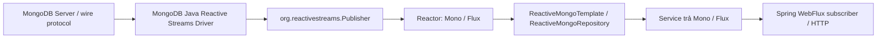
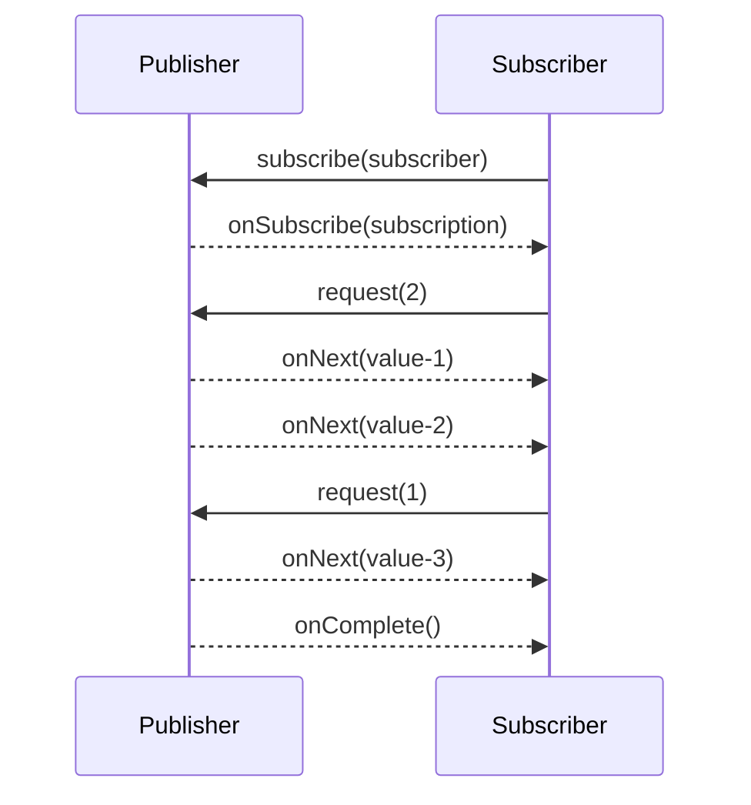

# MongoDB Reactive Streams Driver, Mono, Flux và subscription

Trong ứng dụng Java cần phục vụ nhiều yêu cầu I/O đồng thời, **Spring Data MongoDB reactive** cho phép mô tả các thao tác MongoDB bằng một chuỗi Publisher thay vì chặn thread chờ kết quả. MongoDB Java Reactive Streams Driver cung cấp các Publisher theo đặc tả **Reactive Streams**; Project Reactor đưa các Publisher ấy vào API giàu toán tử dưới dạng **`Mono<T>`** và **`Flux<T>`**; `ReactiveMongoTemplate` và `ReactiveMongoRepository` bổ sung ánh xạ entity, truy vấn và quản lý tài nguyên theo Spring Data.

Điểm quan trọng nhất: tạo một `Mono` hoặc `Flux` **không đồng nghĩa với đã gọi MongoDB thành công**. Với Publisher **cold** mà MongoDB Reactive Streams Driver cung cấp, lệnh cơ sở dữ liệu được kích hoạt bởi **subscription**. Nếu không có ai subscribe, thao tác chưa chạy. Nếu subscribe hai lần, thao tác có thể được thực thi hai lần, khiến một `insert` gây duplicate key hoặc một lệnh thay đổi số dư bị áp dụng lặp.

Bài thuộc chương **Truy cập reactive** của module `SPRING_DATA_MONGODB`, hướng dẫn kết nối, ánh xạ document và thao tác MongoDB qua template hoặc repository; đồng thời liên hệ truy vấn, aggregation, index, transaction, kiểm thử và chẩn đoán hiệu năng dữ liệu. Đây là bài nền tảng để phân biệt **Driver `Publisher`**, **Reactor `Mono`/`Flux`**, **subscription** và **backpressure** trước khi triển khai ứng dụng WebFlux hoặc service phản ứng thực tế.

> **Ghi nhớ:** Reactive không có nghĩa MongoDB xử lý query tức thì, miễn phí hay tự đảm bảo giao dịch. Reactive giúp **không giữ thread ứng dụng trong lúc đợi I/O** và hỗ trợ điều phối luồng bất đồng bộ. Vẫn cần query/index phù hợp, phân quyền tenant, xử lý lỗi ghi, transaction khi cần và bảo vệ trước subscription lặp.

## 1. Mục tiêu học tập

Sau bài này, bạn có thể:

1. Mô tả bốn khái niệm trong Reactive Streams: `Publisher`, `Subscriber`, `Subscription` và `Processor`.
2. Giải thích các tín hiệu `onSubscribe`, `onNext`, `onError`, `onComplete` và quy tắc không phát `null`.
3. Phân biệt `request(n)` với `cancel()` và vì sao `request(Long.MAX_VALUE)` là nhu cầu không giới hạn.
4. Phân biệt Publisher **cold** và **hot**, đặc biệt với lệnh MongoDB bị subscribe nhiều lần.
5. Dùng MongoDB Java Reactive Streams Driver với `com.mongodb.reactivestreams.client.MongoClients`, `MongoCollection` và `Publisher`.
6. Chuyển Publisher Driver thành `Flux.from(...)` hoặc `Mono.from(...)` mà không biến API reactive thành blocking.
7. Chọn đúng `Mono<T>`, `Mono<Void>`, `Mono<Boolean>` và `Flux<T>` theo số tín hiệu dự kiến.
8. Hiểu sự khác nhau giữa **assembly time**, **subscription time** và **signal time**.
9. Tạo entity với `@Document`/`@Field`, query bằng `ReactiveMongoTemplate` và `ReactiveMongoRepository`.
10. Dùng `map`, `flatMap`, `concatMap`, `filter`, `switchIfEmpty`, `collectList`, `then` theo đúng ý nghĩa.
11. Viết Spring WebFlux controller **trả Publisher** cho framework subscribe, không chủ động `subscribe()` trong service.
12. Hiểu backpressure tác động lên demand/cursor/batches nhưng **không** thay index hoặc giới hạn chi phí thực thi phía server.
13. Xử lý lỗi qua `onErrorResume`/`onErrorMap`/`retryWhen` mà không nhân đôi write không idempotent.
14. Giải thích cancellation, timeout, `doFinally` và lý do hủy subscription không hoàn tác write đã được chấp nhận.
15. Phân biệt reactive I/O với chuyển tác vụ blocking sang `boundedElastic`.
16. Sử dụng `StepVerifier` và MongoDB test riêng để kiểm tra cold subscription, lỗi, empty result và CRUD reactive.
17. Hiểu tổng quan reactive transaction/context, observability, hạn chế `Page<T>` và đánh giá lựa chọn reactive so với imperative.

## 2. Bức tranh ba lớp: MongoDB Driver → Reactor → Spring Data



Sơ đồ thể hiện **các tầng khái niệm**: trong implementation, Spring Data làm việc trực tiếp với Driver rồi dùng Reactor để công bố API `Mono`/`Flux`, không nhất thiết là mỗi một object được gói thành đúng một lớp độc lập.

| Tầng | API điển hình | Vai trò |
| --- | --- | --- |
| Driver Reactive Streams | `com.mongodb.reactivestreams.client.MongoCollection` | Gửi lệnh MongoDB theo Publisher, không chặn thread caller để chờ kết quả |
| Reactive Streams | `Publisher<T>`, `Subscriber<T>`, `Subscription` | Quy ước tương tác, signals và demand |
| Project Reactor | `Mono<T>`, `Flux<T>` | Toán tử composition, lifecycle, timeout/error/cancellation |
| Spring Data | `ReactiveMongoTemplate`, `ReactiveMongoRepository` | Mapping Java ↔ BSON, query DSL, converter, exception translation |
| WebFlux | `Mono<ResponseEntity<T>>`, `Flux<T>` | Tích hợp với HTTP, request lifecycle và subscription |
| MongoDB Server | `find`, `aggregate`, `update`, index, transaction | Thực thi truy vấn, lưu trữ và bảo đảm nhất quán theo server |

**Không nhầm với Driver synchronous:** `com.mongodb.client.MongoClients` trả synchronous `MongoClient`, còn `com.mongodb.reactivestreams.client.MongoClients` trả reactive `MongoClient`. Hai API khác nhau dù tên class gần giống. Dùng client reactive cho reactive Spring Data; không chỉ bọc synchronous driver trong một `Mono.just(...)` rồi gọi đó là non-blocking I/O.

## 3. Reactive Streams: hợp đồng Publisher, Subscriber, Subscription

Đặc tả Reactive Streams quy định cách nguồn và phía tiêu thụ trao đổi dữ liệu bất đồng bộ dưới **backpressure**.

```java
import org.reactivestreams.Publisher;
import org.reactivestreams.Subscriber;
import org.reactivestreams.Subscription;
```

Mối quan hệ:



Các tín hiệu chính:

| Tín hiệu | Chiều | Ý nghĩa |
| --- | --- | --- |
| `subscribe(Subscriber)` | Consumer → Publisher | Đăng ký người tiêu thụ |
| `onSubscribe(Subscription)` | Publisher → Subscriber | Cấp đối tượng để request/cancel |
| `Subscription.request(n)` | Subscriber → Subscription | Cho phép phát tối đa n phần tử mới theo demand |
| `onNext(item)` | Publisher → Subscriber | Một phần tử không `null` |
| `onError(Throwable)` | Publisher → Subscriber | Kết thúc thất bại |
| `onComplete()` | Publisher → Subscriber | Kết thúc thành công |
| `Subscription.cancel()` | Subscriber → Subscription | Yêu cầu dừng nhận thêm dữ liệu, hủy xử lý theo khả năng |

**Chỉ có một tín hiệu kết thúc:** `onComplete` **hoặc** `onError`. Sau terminal signal, không phát thêm `onNext`. `request(n)` phải dùng giá trị **dương**; `request(0)`/`request(-1)` là vi phạm protocol.

### 3.1. Backpressure khác tốc độ mạng

Backpressure cho phép bên tiêu thụ nói “tôi có thể nhận thêm n phần tử”. Nó không bảo đảm mỗi `request(1)` ứng với đúng **một round trip** MongoDB; Driver/server có **cursor batching**, prefetch và các cơ chế riêng. Tốc độ phát các signals không phải tốc độ hoàn tất của mọi stage trên server.

### 3.2. Không phát null

Reactive Streams cấm `onNext(null)`. Nếu MongoDB query không tìm thấy document:

- `Mono<Product>` thường **complete empty**.
- `Flux<Product>` thường **complete không có item**.
- `Mono<Boolean>` của `exists` có thể phát `false` — đây là **giá trị**, không phải empty.
- Không dùng `Mono.just(null)`; API Reactor sẽ từ chối null. Nếu một giá trị có thể null ở code imperative, dùng `Mono.justOrEmpty(value)` để biểu diễn empty.

## 4. Mono và Flux: số lượng tín hiệu khác nhau

Project Reactor cung cấp hai abstraction chính:

| Kiểu | Số `onNext` tối đa | Ví dụ |
| --- | ---: | --- |
| `Mono<Product>` | 0 hoặc 1 | `findById`, `findOne`, `insert` |
| `Mono<Long>` | 0 hoặc 1 | `count` |
| `Mono<Boolean>` | 0 hoặc 1 | `exists` |
| `Mono<Void>` | 0 | Thao tác chỉ báo complete/error |
| `Flux<Product>` | 0, 1 hoặc nhiều | `find`, `findAll`, `aggregate` |
| `Flux<ChangeStreamEvent<T>>` | Nhiều, có thể kéo dài | Change stream |

`Mono<Void>` **không** phát một `Void` instance; nó hoàn thành không có giá trị. Để biết thao tác thành công, quan sát terminal signal hoặc chuyển thành một outcome type ở tầng service.

### 4.1. Ví dụ Reactor không truy cập database

```java
import reactor.core.publisher.Flux;
import reactor.core.publisher.Mono;

Flux<String> skus = Flux.just("BOOK", "PEN", "NOTE")
    .filter(sku -> !sku.equals("PEN"));

Mono<String> first = skus.next();
Mono<Long> numberOfMatches = skus.count();
Mono<java.util.List<String>> all = skus.collectList();
```

Các operators trên **mô tả** pipeline. `first`, `numberOfMatches` và `all` là **ba Publisher riêng**; khi subscribe riêng từng cái, upstream `skus` có thể được chạy riêng.

### 4.2. Mono không phải Future

`Mono` khác `CompletableFuture`: Mono thường **lazy/cold** và hỗ trợ error/cancel/backpressure theo Reactive Streams. `CompletableFuture` có thể bắt đầu tính toán trước khi consumer đăng ký. Không biến mọi `Mono` thành `Future` rồi suy rằng chúng có cùng lifecycle.

## 5. Ba mốc: assembly, subscription và signals

```java
Mono<Product> findLater = repository.findById("P-100");
```

Giải thích:

1. **Assembly time:** Java tạo object Publisher và operator chain.
2. **Subscription time:** có consumer đăng ký; nguồn cold bắt đầu thực thi lệnh.
3. **Signal time:** Publisher phát `onNext`/`onComplete` hoặc `onError` khi có kết quả.

Với MongoDB Reactive Streams Driver, các Publisher trả về từ method Driver là **cold**; lệnh tương ứng chưa xảy ra nếu không subscribe. Spring Data reactive CRUD điển hình cũng có semantics lazy/cold theo publisher của nó. Tuy nhiên một operator có side effect xảy ra lúc assembly (ví dụ gọi một phương thức Java trước khi tạo Mono) vẫn thực thi **ngay tại thời điểm Java chạy** — vì vậy không nói chung chung rằng “mọi thứ trong dòng code chứa Mono đều lazy”.

Ví dụ:

```java
System.out.println("A: tạo publisher");

Mono<String> pipeline = Mono.defer(() -> {
    System.out.println("B: bắt đầu subscription");
    return Mono.just("MongoDB");
}).map(value -> {
    System.out.println("C: xử lý signal");
    return value.toUpperCase();
});

System.out.println("D: chưa subscribe");
// A và D đã xuất hiện; B/C chưa chạy.

pipeline.subscribe(System.out::println);
// Khi subscribe: B, C, rồi MONGODB.
```

`Mono.defer` tạo publisher bên trong **tại mỗi subscription**, rất quan trọng khi cần lấy timestamp, request state, ID ngẫu nhiên hoặc input mới ở thời điểm thực thi.

## 6. MongoDB Reactive Streams Driver: một ví dụ từ đầu

Không cần `ReactiveMongoTemplate` để sử dụng Driver trực tiếp. Driver trả các Reactive Streams `Publisher`.

```java
package dev.learning.reactive;

import com.mongodb.reactivestreams.client.MongoClient;
import com.mongodb.reactivestreams.client.MongoClients;
import com.mongodb.reactivestreams.client.MongoCollection;
import com.mongodb.client.model.Filters;
import org.bson.Document;
import reactor.core.publisher.Flux;
import reactor.core.publisher.Mono;

public class DriverReactiveExample {

    public static void main(String[] args) {
        String uri = System.getenv("MONGODB_URI");
        if (uri == null || uri.isBlank()) {
            throw new IllegalArgumentException(
                "MONGODB_URI chưa cấu hình");
        }

        try (MongoClient client = MongoClients.create(uri)) {
            MongoCollection<Document> collection = client
                .getDatabase("learning_reactive")
                .getCollection("training_products");

            Flux<Document> books = Flux.from(
                collection.find(Filters.eq("category", "BOOK"))
                    .limit(10)
            );

            // Trong ứng dụng reactive sản xuất, nên return/compose Publisher;
            // main() chỉ minh họa việc cần có subscription.
            books.doOnNext(System.out::println)
                .then()
                .block();
        }
    }
}
```

**Cảnh báo về `block()`:** chỉ dùng trong ví dụ **CLI/main hoặc test chạy trên thread thông thường** khi chủ động muốn chờ kết quả. **Không** copy `.block()` vào WebFlux controller, event-loop hoặc hàm xử lý reactive request. Việc block không làm Driver đổi thành synchronous driver nhưng nó làm thread caller phải chờ.

### 6.1. Tên package rất quan trọng

```java
// MongoDB Java Reactive Streams Driver:
com.mongodb.reactivestreams.client.MongoClient
com.mongodb.reactivestreams.client.MongoClients
com.mongodb.reactivestreams.client.MongoCollection

// MongoDB Java synchronous driver, API khác:
com.mongodb.client.MongoClient
com.mongodb.client.MongoClients
com.mongodb.client.MongoCollection
```

Khi tích hợp Spring Boot reactive starter, Spring Data quản lý ReactiveMongoDatabaseFactory/ReactiveMongoTemplate từ reactive driver. Không tạo một client trong **mỗi request**; client là tài nguyên có connection pool và cần được đóng ở vòng đời ứng dụng.

### 6.2. Driver Publisher → Reactor adapters

```java
import org.bson.Document;
import com.mongodb.client.model.Filters;
import reactor.core.publisher.Flux;
import reactor.core.publisher.Mono;
import com.mongodb.client.result.InsertOneResult;

Flux<Document> found = Flux.from(
    collection.find(Filters.eq("tenant_id", "tenant-a"))
);

Mono<InsertOneResult> written = Mono.from(
    collection.insertOne(new Document("_id", "P-101")
        .append("tenant_id", "tenant-a")
        .append("category", "BOOK"))
);
```

`collection` là MongoDB reactive `MongoCollection<Document>` từ mục 6. `Flux.from(...)` giữ nhiều phần tử, `Mono.from(...)` lấy một phần tử tối đa. Với `find`, nếu thực sự chỉ muốn một document, **giới hạn server-side** bằng `.first()` của Driver hoặc `.limit(1)` khi phù hợp; không dùng `Mono.from(collection.find(...))` rồi tưởng Driver đã tối ưu mọi truy vấn thành server-side limit.

### 6.3. Driver Publisher có thể được tái subscribe

MongoDB Driver documentation lưu ý các Publisher trả về là **cold**, và khuyến nghị không subscribe lặp trên một Publisher không có chủ đích. Đối với read, mỗi subscription có thể truy vấn lại data mới. Đối với write, có thể lặp write và gây lỗi hoặc thay đổi dữ liệu hai lần.

```java
Mono<InsertOneResult> write = Mono.from(
    collection.insertOne(new Document("_id", "P-102"))
);

// Mỗi subscription là một ý định thực thi command:
// write.subscribe();
// write.subscribe(); // Có thể duplicate _id ở lần thứ hai.
```

**Không dùng `cache()` như phương án chung để “đảm bảo exactly once” cho writes**: cache là chính sách chia sẻ tín hiệu trong **một process**, không bảo đảm idempotency khi process restart, retry network, nhiều pod hoặc client gửi lặp.

## 7. Subscription: ai là người gọi subscribe?

Một pipeline reactive chỉ thực sự hoạt động khi có **subscriber**:

```java
Mono<Product> pending = repository.findById("P-100");
// Chưa có subscriber: không có kết quả được tiêu thụ.
```

Ở ứng dụng WebFlux:

```java
@GetMapping("/products/{id}")
public Mono<Product> get(@PathVariable String id) {
    return repository.findById(id);
}
```

Controller **trả Publisher** cho Spring WebFlux; framework quyết định subscription khi phục vụ HTTP request. Service chỉ **compose/return** Publisher, không nên gọi `subscribe()` để “bật” nó.

### 7.1. Những cách subscribe trong Reactor

```java
// Mục đích minh họa vòng đời ở CLI hoặc test:
var disposable = pending.subscribe(
    product -> System.out.println("Found: " + product.id()),
    error -> System.err.println("Query failed: " + error),
    () -> System.out.println("Completed")
);

// Nếu còn chạy và muốn yêu cầu hủy:
disposable.dispose();
```

Các lambda subscribe mặc định trong Reactor thường yêu cầu **unbounded demand**. Ở ứng dụng thật, dùng framework-managed subscription để cancellation/error propagates và HTTP lifecycle đồng bộ. Trường hợp bắt buộc subscribe thủ công ở ranh giới imperative, phải quản lý `Disposable` và error consumer.

### 7.2. Fire-and-forget là anti-pattern phổ biến

```java
// KHÔNG khuyến nghị trong một reactive service:
public Mono<Void> saveBad(Product p) {
    repository.save(p).subscribe();
    return Mono.empty();
}
```

Lỗi: Publisher ghi ở nhánh con không còn liên hệ với caller. Handler có thể trả HTTP thành công **trước khi write hoàn thành**, không quản lý được lỗi/cancellation/transaction/retry.

Sửa:

```java
public Mono<Void> saveGood(Product p) {
    return repository.save(p).then();
}
```

`then()` tạo `Mono<Void>` complete **sau khi upstream complete thành công**; nếu upstream error, error vẫn truyền xuống caller. Nó không che lỗi và cũng không phát giá trị `Product`.

### 7.3. Một Publisher có nhiều người đăng ký

```java
Mono<Product> lookup = repository.findById("P-100");

// Ví dụ khái niệm:
// subscriber A -> find
// subscriber B -> find lần nữa
```

Với Publisher cold, hai subscription không chắc thấy cùng dữ liệu vì có ghi xen giữa. Nếu code dùng `.cache()` để tái sử dụng kết quả, nó có thể lưu cả **stale value hoặc terminal error**, tùy operator/options. Đánh giá TTL/cache invalidation rõ ràng trước khi cache database result.

## 8. Backpressure: request(n) và cancel()

```java
import org.reactivestreams.Subscription;
import reactor.core.publisher.BaseSubscriber;
import reactor.core.publisher.Flux;

Flux.range(1, 5).subscribe(new BaseSubscriber<Integer>() {

    @Override
    protected void hookOnSubscribe(Subscription subscription) {
        request(1);
    }

    @Override
    protected void hookOnNext(Integer value) {
        System.out.println("Nhận: " + value);
        request(1); // Chỉ yêu cầu phần tử tiếp theo sau khi xử lý.
    }

    @Override
    protected void hookOnError(Throwable throwable) {
        System.err.println("Lỗi: " + throwable);
    }

    @Override
    protected void hookOnComplete() {
        System.out.println("Hoàn tất");
    }
});
```

`BaseSubscriber` là helper của Reactor để kiểm soát demand. Mỗi instance nên được sử dụng cho **một subscription**. Trong ví dụ, subscription bắt đầu với request(1), sau mỗi onNext mới tăng demand một đơn vị.

### 8.1. Demand không phải “mỗi request = một network packet”

MongoDB có `batchSize`, network buffers, cursor fetch và operator prefetch. `request(1)` có thể dẫn đến nhiều dữ liệu đã được lấy trong một batch ở tầng dưới; demand giới hạn số signals được phát theo contract, không cam kết server chỉ đọc một document hay query chỉ tiêu tốn tài nguyên cho đúng một item.

```java
Flux<Document> stream = Flux.from(
    collection.find(Filters.eq("tenant_id", "tenant-a"))
        .batchSize(100)
);
```

`batchSize(100)` gợi ý kích thước batch server/cursor, không phải `Flux.limitRate(100)`, cũng không phải total query limit. Nếu chỉ cần 20 documents, dùng `.limit(20)` **trên find publisher** hoặc `Query.limit(20)` trong Spring Data, thay vì chỉ dựa vào cancellation.

### 8.2. Unbounded demand

```java
stream.subscribe(this::handleDocument);
```

Ở phần lớn subscribe overload dạng lambda, downstream yêu cầu `Long.MAX_VALUE`. Điều đó có thể làm downstream được cấp tín hiệu nhanh nếu producer/driver cung cấp được; đừng sử dụng trong batch processing nặng khi không kiểm soát concurrency/memory. Chọn `concatMap`/`flatMap(concurrency)` và pagination/limit theo workload.

### 8.3. Backpressure không thay MongoDB query plan

Ngay cả với `request(1)`:

- MongoDB vẫn có thể chạy `$sort` hoặc `$group` trên nhiều documents trước khi phát row đầu tiên.
- Filter không chọn lọc có thể scan lượng dữ liệu lớn.
- Missing index vẫn gây `COLLSCAN`.
- `collectList()` vẫn gom toàn bộ signals vào RAM nếu không giới hạn.
- Một số operators như `publishOn`/`flatMap` có prefetch queue cần đánh giá.

Muốn tối ưu phải dùng query phù hợp, limit server-side, index, projection, bounded concurrency và đo `explain`, không coi backpressure là phép tối ưu server tự động.

## 9. Cancellation: tín hiệu hủy không phải rollback dữ liệu

```java
Flux<Product> requestScoped = repository.findAll()
    .doOnCancel(() -> System.out.println("Cancelled"))
    .doFinally(signal -> System.out.println("Done: " + signal));
```

Khi HTTP client đóng kết nối hoặc phía tiêu thụ hủy subscription, cancellation có thể **lan lên driver** để kết thúc luồng/cursor theo khả năng. Nhưng:

- Nếu lệnh `insert` đã được MongoDB chấp nhận, cancel không tự undo.
- Nếu update đã được thực hiện nhưng response chưa tới, outcome có thể **không chắc chắn** đối với caller.
- `doOnCancel` chỉ chạy khi có cancel signal, không phải khi hoàn thành thông thường.
- `doFinally` chạy khi complete, error hoặc cancel với `SignalType` tương ứng.
- Không dùng cancel làm transaction rollback thay cho transaction manager; transaction behavior phụ thuộc ranh giới và chính sách quản lý session.

### 9.1. Timeout trên Publisher

```java
import java.time.Duration;

Mono<Product> guarded = repository.findById("P-100")
    .timeout(Duration.ofSeconds(2));
```

`timeout` đưa một giới hạn thời gian ở tầng Reactor và có thể gửi cancellation lên upstream khi vượt ngưỡng. **Nó không chứng minh lệnh DB đã bị hủy trên server**, đặc biệt với write. Với query server-side dài, cân nhắc `maxTimeMS`/query timeout options được hỗ trợ và đánh giá cả deadline lẫn resource cleanup.

## 10. Spring Data: entity, ReactiveMongoTemplate và repository

Từ đây dùng domain riêng cho ví dụ Spring Data:

```java
package dev.learning.reactive;

import org.springframework.data.annotation.Id;
import org.springframework.data.mongodb.core.mapping.Document;
import org.springframework.data.mongodb.core.mapping.Field;

@Document("training_products")
public record Product(
    @Id String id,
    @Field("tenant_id") String tenantId,
    String sku,
    String category,
    boolean active,
    int stock) {
}
```

`@Field("tenant_id")` đổi Java property `tenantId` thành BSON field `tenant_id`; `@Id` thường map `id` thành `_id`. Các ví dụ Spring Data sẽ truy vấn bằng **Java property names**, trừ khi đoạn code sử dụng raw BSON Driver.

### 10.1. ReactiveMongoTemplate

```java
import org.springframework.data.mongodb.core.ReactiveMongoTemplate;
import org.springframework.data.mongodb.core.query.Criteria;
import org.springframework.data.mongodb.core.query.Query;
import reactor.core.publisher.Flux;
import reactor.core.publisher.Mono;

Query query = Query.query(
    Criteria.where("tenantId").is("tenant-a")
        .and("category").is("BOOK")
);

Flux<Product> books =
    reactiveMongoTemplate.find(query, Product.class);

Mono<Product> one =
    reactiveMongoTemplate.findById("P-100", Product.class);

Mono<Boolean> exists =
    reactiveMongoTemplate.exists(query, Product.class);

Mono<Long> count =
    reactiveMongoTemplate.count(query, Product.class);
```

`reactiveMongoTemplate` là bean Spring Data được inject vào service; code ở đây minh họa use-site. `find` trả `Flux<Product>`, còn `findById` trả `Mono<Product>`. `count` là **MongoDB count query**, không giống `reactiveMongoTemplate.find(...).count()` vốn phải tiêu thụ các row của Publisher find.

### 10.2. ReactiveMongoRepository

```java
package dev.learning.reactive;

import org.springframework.data.domain.Sort;
import org.springframework.data.mongodb.repository.ReactiveMongoRepository;
import reactor.core.publisher.Flux;

public interface ProductRepository
        extends ReactiveMongoRepository<Product, String> {

    Flux<Product> findByTenantIdAndActiveTrue(
        String tenantId, Sort sort);

    Flux<Product> findByTenantIdAndCategory(
        String tenantId, String category);
}
```

`ReactiveMongoRepository` cung cấp `findById`, `findAll`, `insert`, `save`, `deleteById`, `count`, `existsById` và các derived queries phù hợp. Các method nhận `Sort`/`Pageable` tùy API có thể giới hạn kết quả, nhưng **Reactive repository không cung cấp kiểu `Page<T>` theo cùng cách repository imperative**, bởi count và nội dung trang là các Publisher cần điều phối riêng.

### 10.3. Dùng Mono/Flux phù hợp với ý nghĩa

```java
Mono<Product> idLookup = repository.findById("P-100");

Flux<Product> activeProducts = repository
    .findByTenantIdAndActiveTrue(
        "tenant-a",
        org.springframework.data.domain.Sort.by("sku", "id")
    );

Mono<Long> total = repository.count();
Mono<Boolean> present = repository.existsById("P-100");
```

`repository.count()` trong ví dụ cuối đếm **toàn bộ collection**, không tự scope theo tenant. Với API đa tenant, hãy khai báo `countByTenantId` hoặc dùng `ReactiveMongoTemplate.count(Query, Product.class)` có tenant filter. Tương tự, `findById(id)` không tự buộc tenant trong query.

### 10.4. Query với paging và field mapping

```java
import org.springframework.data.domain.Sort;
import org.springframework.data.mongodb.core.query.Query;

Query limited = Query.query(
    Criteria.where("tenantId").is("tenant-a")
        .and("active").is(true)
).with(Sort.by(Sort.Order.asc("sku"), Sort.Order.asc("id")))
 .limit(20);

Flux<Product> firstTwenty =
    reactiveMongoTemplate.find(limited, Product.class);
```

`limit(20)` giúp server không cần trả hơn 20 documents cho kết quả query. Sort `sku,id` tạo thứ tự ổn định hơn so với chỉ `sku`, nhưng vẫn cần index/query plan phù hợp và consistency strategy nếu dữ liệu đổi giữa các trang.

## 11. Composition: map, flatMap, concatMap và then

### 11.1. map: biến đổi đồng bộ một giá trị

```java
Mono<String> sku = repository.findById("P-100")
    .map(Product::sku);
```

`map` phù hợp khi hàm trả **giá trị thường**; nếu cần gọi DB/API reactive khác và trả `Mono`/`Flux`, dùng `flatMap`.

### 11.2. flatMap: chuỗi bất đồng bộ

```java
Mono<Product> savedAndReloaded =
    repository.insert(
        new Product("P-201", "tenant-a", "BK-201",
            "BOOK", true, 10))
    .flatMap(inserted ->
        repository.findById(inserted.id())
    );
```

Lệnh reload chỉ được subscribe sau khi insert phát ra `Product`. Nếu insert lỗi duplicate ID, `flatMap` không chạy. Nhưng publisher tổng thể vẫn **cold**: subscribe hai lần có thể chạy insert hai lần.

### 11.3. concatMap và flatMap trên nhiều items

```java
Flux<Product> stored = Flux.fromIterable(incomingProducts)
    .concatMap(repository::insert);
```

`concatMap` xử lý các Publisher con theo thứ tự và tránh chồng nhiều inserts trong ví dụ. `flatMap` có thể chạy nhiều Publisher con đồng thời và hoàn tất không theo input order:

```java
Flux<Product> concurrent = Flux.fromIterable(incomingProducts)
    .flatMap(repository::insert, 4); // Tối đa 4 inner subscriptions.
```

`incomingProducts` là tập input đã validate. **Không coi `concatMap` là transaction**: nếu insert thứ ba lỗi, hai insert đầu có thể đã commit; nếu muốn atomicity nhiều documents, phải có reactive transaction phù hợp.

### 11.4. then, thenReturn và collectList

```java
Mono<Void> done = repository.save(product).then();

Mono<String> successMessage =
    repository.save(product).thenReturn("Đã ghi");

Mono<java.util.List<Product>> list =
    repository.findByTenantIdAndCategory(
        "tenant-a", "BOOK").collectList();
```

- `then()` bỏ value của upstream, chỉ giữ completion/error.
- `thenReturn(...)` chỉ phát giá trị mới khi upstream thành công.
- `collectList()` gom **toàn bộ** phần tử vào bộ nhớ; chỉ dùng khi tập dữ liệu đã được giới hạn hoặc có giới hạn nghiệp vụ rõ ràng.
- Không thay `repository.count()` bằng `repository.findAll().collectList().map(List::size)` khi collection lớn.

## 12. Phân biệt empty, success và error

Một `Mono<Product>` khi truy vấn theo ID có thể kết thúc theo ba cách:

| Tình huống | Signals | Ý nghĩa |
| --- | --- | --- |
| Có document | `onNext(product) → onComplete` | Thành công, có kết quả |
| Không có document | `onComplete`, không `onNext` | Empty result, không phải lỗi DB |
| MongoDB báo lỗi | `onError(exception)` | Thất bại, không được trả thành empty một cách tùy tiện |

Dùng `switchIfEmpty` để đổi kết quả rỗng thành lỗi nghiệp vụ:

```java
import org.springframework.web.server.ResponseStatusException;
import org.springframework.http.HttpStatus;

Mono<Product> response = repository.findById("P-100")
    .switchIfEmpty(Mono.error(
        new ResponseStatusException(
            HttpStatus.NOT_FOUND, "Không tìm thấy sản phẩm")));
```

Nếu API đa tenant, ví dụ `findById` chỉ mang tính minh họa; cần bổ sung điều kiện tenant thuộc identity đã xác thực.

`Mono.just(null)` không hợp lệ vì Reactive Streams cấm phát null. Có thể dùng `Mono.justOrEmpty(nullableValue)` để biểu diễn kết quả tùy chọn, nhưng với MongoDB query thông thường framework đã phát empty khi không tìm thấy.

### 12.1. onErrorResume không phải xử lý empty

```java
Mono<Product> unsafe = repository.findById("P-100")
    .onErrorResume(error -> Mono.empty());
```

Đây là anti-pattern: lỗi mất kết nối hoặc thiếu quyền bị biến thành “không thấy document”, làm API dễ trả 404 giả. Nếu chỉ muốn xử lý empty, dùng `switchIfEmpty`; nếu recover lỗi, lọc **đúng exception có thể recover**. `doOnError` chỉ quan sát, `onErrorMap` đổi dạng lỗi, `onErrorResume` thay bằng Publisher khác.

### 12.2. defaultIfEmpty

```java
Mono<String> category = repository.findById("P-100")
    .map(Product::category)
    .defaultIfEmpty("UNKNOWN");
```

Chỉ dùng giá trị dự phòng khi nghiệp vụ cho phép, không dùng để che lỗi truy vấn.

## 13. Subscription lặp trên write Publisher

Đối với MongoDB Reactive Streams Driver, Publisher là **cold**. Mỗi lần subscribe có thể gửi một DB command mới.

```java
Product p = new Product(
    "P-UNIQUE", "tenant-a", "BK-UNIQUE", "BOOK", true, 10);

Mono<Product> write = repository.insert(p);

// Subscription đầu tiên: insert thành công.
// Subscription thứ hai: _id cũ bị insert lần nữa -> duplicate key.
```

Một insert có cùng ID ở lần hai thường phát `DuplicateKeyException` qua Spring Data exception translation. Lỗi xảy ra **trong Publisher signal**, không nhất thiết ném ngay khi gọi `repository.insert(p)`.

Với update có `$inc`, sự cố nghiêm trọng hơn:

```java
import org.springframework.data.mongodb.core.query.Update;

Mono<?> decrement = reactiveMongoTemplate.updateFirst(
    Query.query(Criteria.where("id").is("P-100")),
    new Update().inc("stock", -1),
    Product.class
);
```

Nếu có hai subscription hợp lệ và đủ điều kiện, số tồn có thể bị trừ **hai lần**. Không coi tên biến `decrement` hoặc `Mono` là đảm bảo exactly-once.

### 13.1. Không giải quyết exactly-once bằng cache()

`cache()` chia sẻ và ghi nhớ tín hiệu của một Publisher trong **phạm vi object/process** tùy operator. Nó không giải quyết retry từ client, restart, nhiều service instances hoặc trường hợp server đã ghi nhưng response bị mất. Với write, thiết kế **idempotency key**, unique constraint, CAS/version hoặc transaction theo nghiệp vụ.

## 14. Retry và timeout: resubscription có tác dụng gì?

`retryWhen` subscribe lại upstream theo điều kiện:

```java
import java.time.Duration;
import reactor.util.retry.Retry;

// isRetryableReadFailure là hàm phân loại lỗi của ứng dụng.
Mono<Product> readWithRetry = repository.findById("P-100")
    .retryWhen(
        Retry.backoff(2, Duration.ofMillis(100))
             .filter(this::isRetryableReadFailure)
    );
```

Đây là mẫu cho **read**, khi hoạt động retry có thể được phép. Không retry mọi exception: bad query, unauthorized, validation error hoặc duplicate key thường không tự hết khi retry.

### 14.1. Timeout không chứng minh write chưa thực hiện

```java
Mono<Product> limited = repository.findById("P-100")
    .timeout(Duration.ofSeconds(2));
```

Ở tầng Reactor, timeout sẽ kết thúc Publisher bằng lỗi và hủy upstream theo khả năng. Nhưng với **write**, MongoDB có thể đã apply thay đổi trước khi caller thấy timeout. Retry một `$inc` hoặc ghi thanh toán không idempotent có thể nhân đôi kết quả.

**Driver retryable writes** là một tính năng protocol/server riêng, không có nghĩa application được tùy tiện `retryWhen` toàn workflow. Thiết kế requestId và reconciliation cho những lệnh có hiệu ứng nghiệp vụ.

### 14.2. Retry một chain gồm side effects

```java
Mono<Void> process = repository.insert(order)
    .then(emailService.sendConfirmation(order))
    .then();
```

Đây là **minh họa**, `order` và `emailService` do ứng dụng định nghĩa. Nếu retry cả chain, email có thể gửi thêm lần hoặc insert có thể lỗi duplicate ID. Cân nhắc transactional outbox, consumer idempotent và xác định retry boundary rõ ràng.

## 15. flatMap concurrency, ordering và memory

| Operator | Ý nghĩa | Cảnh báo |
| --- | --- | --- |
| `map` | Biến đổi đồng bộ | Không gọi API blocking trong hàm map |
| `flatMap` | Merge các Publisher con, có thể chạy song song | Kết quả không bảo đảm thứ tự nguồn |
| `flatMap(fn, 4)` | Giới hạn 4 inner subscriptions đồng thời | Không giới hạn tổng tải từ nhiều requests |
| `concatMap` | Thực thi publishers con tuần tự | Chậm hơn nếu nhiệm vụ độc lập |
| `flatMapSequential` | Concurrency với output ordering | Có thể buffer để giữ thứ tự |
| `buffer(100)` | Gom tối đa 100 phần tử mỗi nhóm | Tăng memory theo kích cỡ batch |
| `collectList` | Gom tất cả items | Nguy hiểm với unbounded Flux |
| `take(20)` | Lấy 20 signals phía client | Không thay cho server-side limit |
| `limitRate(100)` | Điều tiết demand từ upstream | Không làm MongoDB query rẻ hơn |

```java
Flux<Product> inserted = Flux.fromIterable(incomingProducts)
    .flatMap(repository::insert, 4);
```

`incomingProducts` là danh sách đã validate. Với nghiệp vụ phụ thuộc thứ tự, dùng `concatMap` thay vì `flatMap`. Với transaction trên **cùng MongoDB ClientSession**, không khởi chạy nhiều thao tác song song tùy tiện; session/transaction có hạn chế concurrency riêng.

### 15.1. Flux không làm $group/$sort không tốn bộ nhớ

`$group`/`$sort` có thể phải xử lý rất nhiều documents **trên MongoDB Server** trước khi trả row đầu tiên. Backpressure ở client không thay thế `explain`, index, `$match`, projection, server-side limit và monitoring.

## 16. WebFlux: return Publisher để framework subscribe

Một interface nguồn tenant từ **principal đã xác thực**:

```java
package dev.learning.reactive;

import reactor.core.publisher.Mono;

public interface AuthorizedTenantProvider {
    Mono<String> currentTenant();
}
```

Bổ sung vào `ProductRepository` ở mục 10:

```java
import reactor.core.publisher.Mono;

Mono<Product> findByTenantIdAndId(String tenantId, String id);
```

Controller WebFlux:

```java
package dev.learning.reactive;

import org.springframework.data.domain.Sort;
import org.springframework.http.HttpStatus;
import org.springframework.web.bind.annotation.GetMapping;
import org.springframework.web.bind.annotation.PathVariable;
import org.springframework.web.bind.annotation.RequestMapping;
import org.springframework.web.bind.annotation.RestController;
import org.springframework.web.server.ResponseStatusException;
import reactor.core.publisher.Flux;
import reactor.core.publisher.Mono;

@RestController
@RequestMapping("/products")
public class ProductController {

    private final ProductRepository repository;
    private final AuthorizedTenantProvider tenants;

    public ProductController(
            ProductRepository repository,
            AuthorizedTenantProvider tenants) {
        this.repository = repository;
        this.tenants = tenants;
    }

    @GetMapping
    public Flux<Product> active() {
        return tenants.currentTenant()
            .flatMapMany(tenant ->
                repository.findByTenantIdAndActiveTrue(
                    tenant, Sort.by("sku", "id")));
    }

    @GetMapping("/{id}")
    public Mono<Product> one(@PathVariable String id) {
        return tenants.currentTenant()
            .flatMap(tenant ->
                repository.findByTenantIdAndId(tenant, id))
            .switchIfEmpty(Mono.error(
                new ResponseStatusException(
                    HttpStatus.NOT_FOUND,
                    "Không tìm thấy sản phẩm")));
    }
}
```

Spring WebFlux là **subscriber** ở ranh giới HTTP; controller/service trả Publisher, không gọi `subscribe()` bên trong. `AuthorizedTenantProvider` là abstraction minh họa do ứng dụng triển khai, không phải class mặc định của Spring.

### 16.1. JSON array và streaming

Một `Flux<Product>` trả với `application/json` không mặc nhiên giúp browser nhận từng document tức thì: encoder hoặc client có thể buffer để tạo array.

Khi cần stream từng record, dùng NDJSON/SSE với protocol tương ứng, ví dụ method trong cùng controller:

```java
@GetMapping(
    value = "/stream",
    produces = org.springframework.http
        .MediaType.APPLICATION_NDJSON_VALUE)
public Flux<Product> streamActive() {
    return tenants.currentTenant()
        .flatMapMany(tenant ->
            repository.findByTenantIdAndActiveTrue(
                tenant, Sort.by("sku", "id")));
}
```

Không public unbounded stream với collection dữ liệu nhạy cảm: phải giới hạn tài nguyên, kiểm soát tenant và cancellation. WebFlux client disconnect có thể cancel upstream, nhưng không rollback write đã được server chấp nhận.

## 17. Không block() trên event loop

Sai:

```java
@GetMapping("/blocking/{id}")
public Product blocking(@PathVariable String id) {
    return repository.findById(id).block();
}
```

`block()` đợi kết quả ở thread caller. Trong handler reactive, điều này phá non-blocking I/O và Reactor có thể từ chối blocking trên thread được đánh dấu non-blocking. Trả Publisher:

```java
@GetMapping("/nonblocking/{id}")
public Mono<Product> nonblocking(@PathVariable String id) {
    return repository.findById(id);
}
```

### 17.1. Khi bắt buộc có SDK blocking

```java
import reactor.core.scheduler.Schedulers;

Mono<String> legacy = Mono.fromCallable(
    () -> legacyClient.fetchValue())
    .subscribeOn(Schedulers.boundedElastic());
```

`legacyClient` là một SDK blocking do ứng dụng cung cấp. `boundedElastic` chỉ chuyển vùng blocking sang scheduler có tài nguyên giới hạn; nó **không biến SDK thành non-blocking**. Không bọc `reactiveMongoTemplate.find` bằng `boundedElastic` để “reactive hơn”: Driver đã cung cấp non-blocking I/O.

### 17.2. Scheduler và Context

`publishOn` thay execution scheduler của downstream, `subscribeOn` ảnh hưởng scheduling ở nguồn/upstream. Không sửa MongoDB query chậm bằng cách thêm scheduler tùy tiện; dùng `explain`/index.

Reactive request có thể chuyển thread, nên `ThreadLocal` tự viết không phải cơ chế chắc chắn để giữ tenant, tracing hoặc transaction. Sử dụng Reactor Context và integration của Spring Security/transaction manager phù hợp.

## 18. Bảo mật tenant và Reactive Context

Dù repository trả `Flux`, một method như:

```java
repository.findById(requestedId)
```

không tự thêm tenant authorization. Với dữ liệu đa tenant, dùng:

```java
repository.findByTenantIdAndId(
    authorizedTenant, requestedId)
```

và bảo đảm `authorizedTenant` đến từ identity phía server. Security context reactive cần được truyền/đọc trong chain phù hợp, không tin header hoặc query parameter do client tự chọn khi chưa xác thực.

**Reactor Context không tự tạo MongoDB ClientSession.** Để có transaction, cần `ReactiveMongoTransactionManager`, `ReactiveMongoTemplate.withSession` hoặc transaction boundary tương ứng.

## 19. Transaction reactive: compose trong cùng publisher chain

MongoDB hỗ trợ multi-document transactions trên topology phù hợp. Với Spring Data reactive:

```java
package dev.learning.reactive;

import org.springframework.context.annotation.Bean;
import org.springframework.context.annotation.Configuration;
import org.springframework.data.mongodb.ReactiveMongoDatabaseFactory;
import org.springframework.data.mongodb.ReactiveMongoTransactionManager;

@Configuration
class ReactiveTransactionConfiguration {

    @Bean
    ReactiveMongoTransactionManager mongoReactiveTx(
            ReactiveMongoDatabaseFactory factory) {
        return new ReactiveMongoTransactionManager(factory);
    }
}
```

Sử dụng `TransactionalOperator`:

```java
import org.springframework.transaction.reactive.TransactionalOperator;

TransactionalOperator tx =
    TransactionalOperator.create(mongoReactiveTxManager);

// AuditEvent và mongoReactiveTxManager là các đối tượng
// ứng dụng cần khai báo/cấu hình.
Mono<Void> operation = reactiveMongoTemplate
    .insert(new AuditEvent("EV-1", "STARTED"))
    .then(reactiveMongoTemplate
        .insert(new AuditEvent("EV-2", "FINISHED")))
    .then()
    .as(tx::transactional);
```

Ví dụ minh họa transaction concept, không phải code xử lý thanh toán production. `AuditEvent` là domain do ứng dụng định nghĩa; dùng ID ngẫu nhiên/idempotency trong hệ thống thực. `.as(tx::transactional)` bao cả hai thao tác, không `subscribe()` giữa chain. Publisher phải được subscribe thì transaction mới chạy.

### 19.1. Thao tác song song không tự là transaction

`Mono.when(insertA, insertB)` có thể subscribe đồng thời; bản thân `when` **không** tạo transaction. Khi đã có một ClientSession trong transaction, tránh thực hiện operations trên cùng session song song nếu driver/server không hỗ trợ; dùng `then`/`flatMap` tuần tự theo yêu cầu.

### 19.2. @Transactional và Reactor Context

Trong reactive application, transaction state được lưu/propagate qua **Reactor Context**, khác với imperative `ThreadLocal` thường thấy. Method reactive phải trả Publisher và được gọi qua mechanism Spring phù hợp; inner `subscribe` tự tạo có thể rời transaction của caller. Dùng cùng `ReactiveMongoDatabaseFactory` giữa template và transaction manager.

## 20. Reactive aggregation và count

`ReactiveMongoTemplate.aggregate` trả `Flux<T>`:

```java
import org.springframework.data.mongodb.core.aggregation.Aggregation;

Aggregation pipeline = Aggregation.newAggregation(
    Aggregation.match(
        Criteria.where("tenantId").is(authorizedTenant)),
    Aggregation.group("category")
        .count().as("productCount")
);

Flux<org.bson.Document> grouped =
    reactiveMongoTemplate.aggregate(
        pipeline, Product.class, org.bson.Document.class);
```

Dù là Flux, `$group` trên server vẫn có thể là blocking stage tiêu thụ nhiều memory. Không nhận định hiệu năng query chỉ từ kiểu Java trả về.

### 20.1. Đếm server-side khác Flux.count

```java
Mono<Long> efficient = reactiveMongoTemplate.count(
    Query.query(
        Criteria.where("tenantId").is(authorizedTenant)),
    Product.class
);

Mono<Long> streamingCount = reactiveMongoTemplate.find(
    Query.query(
        Criteria.where("tenantId").is(authorizedTenant)),
    Product.class
).count();
```

Cách đầu gửi count query tới MongoDB; cách thứ hai tiêu thụ từng document của `find` rồi đếm signals ở Reactor, thường tốn băng thông và mapping. Khi chỉ cần tổng số, chọn count server-side.

## 21. StepVerifier: subscriber dành cho kiểm thử

`reactor-test` cung cấp `StepVerifier` để khởi tạo subscription và assert từng signal.

```java
package dev.learning.reactive;

import org.junit.jupiter.api.Test;
import reactor.core.publisher.Flux;
import reactor.core.publisher.Mono;
import reactor.test.StepVerifier;

class ReactiveBasicsTest {

    @Test
    void oneValue() {
        StepVerifier.create(Mono.just("BOOK"))
            .expectNext("BOOK")
            .verifyComplete();
    }

    @Test
    void emptyValue() {
        StepVerifier.create(Mono.<String>empty())
            .verifyComplete();
    }

    @Test
    void errorSignal() {
        StepVerifier.create(
            Mono.error(new IllegalStateException("failure")))
            .expectError(IllegalStateException.class)
            .verify();
    }

    @Test
    void manyValues() {
        StepVerifier.create(Flux.just("BOOK", "PEN"))
            .expectNext("BOOK", "PEN")
            .verifyComplete();
    }
}
```

`StepVerifier.create` là subscriber thử nghiệm. Không test `assertThat(publisher).isNotNull()` rồi kết luận database query đã chạy; một Publisher có thể hợp lệ mà chưa được subscribe.

### 21.1. Kiểm thử demand

```java
@Test
void requestsOneByOne() {
    StepVerifier.create(Flux.just("BOOK", "PEN"), 0)
        .thenRequest(1)
        .expectNext("BOOK")
        .thenRequest(1)
        .expectNext("PEN")
        .verifyComplete();
}
```

Initial request = 0; hai lần `thenRequest(1)` cho phép nhận hai items. Đây là test protocol, **không** đo số network round trips của MongoDB.

### 21.2. Kiểm thử cancellation

```java
@Test
void cancels() {
    StepVerifier.create(Flux.range(1, 100), 0)
        .thenRequest(2)
        .expectNext(1, 2)
        .thenCancel()
        .verify();
}
```

Cancel không tương đương rollback đã ghi trên database.

## 22. Integration test với MongoDB thật

Dùng MongoDB **test riêng** (URI test hoặc Testcontainers phù hợp với dependency), và ID/tenant UUID. Không gọi `deleteAll` trên collection mà có thể thuộc environment khác.

```java
package dev.learning.reactive;

import static org.assertj.core.api.Assertions.assertThat;

import java.util.UUID;
import org.junit.jupiter.api.Test;
import org.springframework.beans.factory.annotation.Autowired;
import org.springframework.boot.test.context.SpringBootTest;
import org.springframework.dao.DuplicateKeyException;
import org.springframework.data.domain.Sort;
import reactor.core.publisher.Mono;
import reactor.test.StepVerifier;

@SpringBootTest
class ReactiveProductIntegrationTest {

    @Autowired ProductRepository repository;

    Product sample() {
        String suffix = UUID.randomUUID().toString();
        return new Product(
            "P-" + suffix, "tenant-test-" + suffix,
            "SKU-" + suffix, "BOOK", true, 10);
    }

    @Test
    void insertAndQueryAreLazyUntilSubscribed() {
        Product product = sample();
        Mono<Product> insert = repository.insert(product);

        StepVerifier.create(insert.flatMap(saved ->
            repository.findByTenantIdAndId(
                saved.tenantId(), saved.id())))
            .assertNext(found -> {
                assertThat(found.id()).isEqualTo(product.id());
                assertThat(found.sku()).isEqualTo(product.sku());
            })
            .verifyComplete();
    }

    @Test
    void secondSubscriptionToInsertHasDifferentOutcome() {
        Product product = sample();
        Mono<Product> insert = repository.insert(product);

        StepVerifier.create(insert)
            .expectNextMatches(p -> p.id().equals(product.id()))
            .verifyComplete();

        StepVerifier.create(insert)
            .expectError(DuplicateKeyException.class)
            .verify();
    }

    @Test
    void notFoundIsEmpty() {
        StepVerifier.create(
            repository.findById("missing-" + UUID.randomUUID()))
            .verifyComplete();
    }

    @Test
    void findManyPreservesRequestedSort() {
        String suffix = UUID.randomUUID().toString();
        String tenant = "tenant-test-" + suffix;

        Product a = new Product(
            "P-A-" + suffix, tenant, "A", "BOOK", true, 2);
        Product b = new Product(
            "P-B-" + suffix, tenant, "B", "BOOK", true, 4);

        var rows = repository.insert(a)
            .then(repository.insert(b))
            .thenMany(repository.findByTenantIdAndActiveTrue(
                tenant, Sort.by("sku", "id")));

        StepVerifier.create(rows)
            .assertNext(p -> assertThat(p.sku()).isEqualTo("A"))
            .assertNext(p -> assertThat(p.sku()).isEqualTo("B"))
            .verifyComplete();
    }
}
```

### 22.1. Vì sao hai subscription là một test cần thiết?

Với `_id` cố định theo UUID của test, insert lần đầu thành công, lần hai có thể phát duplicate key từ MongoDB. Qua `ReactiveMongoRepository`, Spring Data thường dịch thành `DuplicateKeyException`. Khi version cụ thể dùng subtype khác, cần kiểm tra exception hierarchy thực tế.

Đây là bài test để chứng minh **không có exactly-once chỉ vì biến là Mono**, không phải pattern production retry.

### 22.2. Test mapping và tenant scope

Test tìm theo tenant đảm bảo repository chỉ phát documents của tenant đó. Test riêng cần assert `@Field("tenant_id")` được map đúng xuống raw BSON qua `ReactiveMongoTemplate`/Driver monitor. Một bài test Reactor trên `Flux.just(...)` không chứng minh field mapping của MongoDB.

## 23. Test cancellation không dựa vào sleep

Có thể dùng `doFinally` và `StepVerifier` trên Flux đơn giản:

```java
import java.util.concurrent.atomic.AtomicReference;
import reactor.core.publisher.SignalType;

@Test
void cancellationIsObservable() {
    AtomicReference<SignalType> terminal =
        new AtomicReference<>();

    Flux<Integer> stream = Flux.range(1, 100)
        .doFinally(terminal::set);

    StepVerifier.create(stream, 0)
        .thenRequest(1)
        .expectNext(1)
        .thenCancel()
        .verify();

    assertThat(terminal.get()).isEqualTo(SignalType.CANCEL);
}
```

Đoạn method được đặt **trong class test có import `assertThat`/`StepVerifier` và `Test`**. Test không chứng minh MongoDB server hủy ngay lệnh write đã bắt đầu; nó chỉ kiểm tra lifecycle của Flux.

Tránh `Thread.sleep(100)` rồi assert DB đã hoàn tất: timing-based tests dễ flaky ở CI. Dùng `StepVerifier`, fixture deterministic, và command monitoring nếu cần biết command đã được gửi.

## 24. Quan sát và tối ưu hiệu năng

Các chỉ số đáng theo dõi:

- Subscription rate, completion/error/cancel rate.
- Độ trễ MongoDB `find`/`insert`/`aggregate`/`update` theo p50/p95/p99.
- Driver connection pool, số request chờ connection, server selection timeouts.
- Query plans `IXSCAN`/`COLLSCAN`, keys/docs examined, index hit rate.
- Server CPU, blocking `$group`/`$sort`, memory spill và replication lag.
- Reactor concurrency/prefetch queues, `collectList` allocations.
- Rate của retries, duplicate-key errors, uncertain writes và timeout.
- HTTP client disconnect, cancellation, response streaming payload.
- Tenant scope và tracing/correlation ID qua reactive context.

`CommandListener` có thể hỗ trợ kiểm tra khi nào command `find`/`insert` thực sự bắt đầu, nhưng không log raw BSON của production chứa dữ liệu cá nhân/mật khẩu. `StepVerifier` kiểm tra **signal contract**; `CommandListener` và `explain` kiểm tra **command/plan**.

### 24.1. Reactive không thay thế indexing

`Flux<Product>` không làm query thiếu index trở nên nhanh. Dùng `Query.limit`, sort/fields projections, compound indexes theo tenant/query và giải pháp pagination phù hợp. Khi dùng `$sort`/`$group`, backpressure không tự giảm công việc blocking phía server.

## 25. Chọn reactive hay imperative?

| Tiêu chí | Reactive | Imperative |
| --- | --- | --- |
| API kết quả | `Mono`/`Flux` | Object/`List`/`Optional` |
| Thời gian chờ I/O | Thread ứng dụng có thể được nhả ra | Caller thường chờ |
| Web stack thường dùng | WebFlux | Spring MVC |
| Cấu trúc code | Operator chain, context, subscribe | Control flow tuần tự |
| Cancellation/backpressure | Reactive Streams protocol | Cursor/iterator/timeout riêng |
| Transactions | Reactive manager/Context | MongoTransactionManager |
| Query work trên MongoDB | Vẫn là MongoDB server | Vẫn là MongoDB server |
| Index/schema/authorization | Vẫn cần | Vẫn cần |
| Test | StepVerifier + integration | JUnit + integration |
| Lợi ích | Nhiều I/O đồng thời, end-to-end non-blocking | Đơn giản hơn cho code blocking truyền thống |

Reactive không mặc định nhanh hơn cho **CPU-bound** tasks hoặc khi toàn bộ downstream vẫn là SDK blocking. Nếu hệ thống có sẵn synchronous repository và chỉ tạo `Mono.just(blockingRepository.find(...))`, cuộc gọi blocking đã diễn ra **trước khi tạo Mono**. Để tích hợp tạm thời, dùng `Mono.fromCallable(...).subscribeOn(boundedElastic())` có kiểm soát; khi kiến trúc cho phép, dùng Driver reactive thật.

## 26. Lỗi thường gặp và khắc phục

| Lỗi | Nguyên nhân | Khắc phục |
| --- | --- | --- |
| Tạo Publisher nhưng DB chưa thay đổi | Chưa có subscription | Return/compose cho framework |
| Subscribe hai lần gây duplicate key | Cold write publisher chạy lại | Thiết kế một execution path và idempotency |
| subscribe() bên trong service rồi return empty | Fire-and-forget, mất lỗi/cancel | Return publisher |
| block() trong WebFlux | Chặn event loop | Return Mono/Flux |
| Mono.just(syncDao.find()) vẫn block | Lệnh sync chạy ở assembly time | Reactive driver hoặc boundedElastic boundary |
| Mono.just(null) ném lỗi | Null signals không hợp lệ | justOrEmpty/Mono.empty |
| Empty Mono bị coi là DB error | Không phân biệt empty/error | switchIfEmpty |
| onErrorResume mọi lỗi thành empty | Nuốt lỗi hệ thống | Catch đúng loại |
| retryWhen trên $inc trừ hai lần | Write resubscription | Idempotency key |
| collectList trên unbounded Flux | Tràn bộ nhớ | Limit/paging/streaming |
| request(1) mà query vẫn chậm | Server scan/group, cursor batches | Explain/index/projection |
| take(20) coi là query limit | Client cancel sau 20 signals | Query.limit(20) |
| Không có tenant predicate | Repository không tự phân quyền | findByTenantIdAndId |
| Mono.when trong transaction nhiều writes | Inner operations chạy song song | Chain tuần tự |
| Subscribe riêng trong transaction | Mất Reactor Context | Compose vào một Publisher |
| JSON Flux bị buffer | Format/codec HTTP | NDJSON/SSE |
| Timeout coi là rollback | Ghi có thể đã apply | Transaction/idempotency |
| Mỗi request tạo MongoClient | Connection pool overhead/leak | Bean singleton, đóng khi shutdown |
| Test chỉ assert Publisher != null | Không có subscription | StepVerifier |
| Reactive query thiếu index | Non-blocking không tối ưu query | Index/explain |

### 26.1. Checklist debug

1. Có subscriber hay chưa, và ai subscribe?
2. Publisher được subscribe mấy lần?
3. Sử dụng Reactive Streams Driver đúng package hay sync driver?
4. Mono thành công, empty hay error?
5. Có `subscribe()` trong service, `block()` trong event loop không?
6. Tenant/field mapping có đúng BSON names không?
7. Query có limit/sort/index server-side không?
8. Retry hoặc timeout có lặp write không?
9. Reactive transaction/context có bao toàn operation không?
10. Đã kiểm chứng qua StepVerifier/CommandListener chưa?

## 27. Bài tập thực hành

**Bài 1.** Giải thích chuỗi `Publisher.subscribe → onSubscribe → request → onNext → onComplete`. Khi nào phát `onError`?

**Bài 2.** Tạo `Flux.just("BOOK","PEN")` và `Mono.just("BOOK")`; dùng StepVerifier assert số tín hiệu.

**Bài 3.** Tạo Mono Driver `insertOne` nhưng không subscribe. Có write nào được bảo đảm đã thực thi không?

**Bài 4.** Subscribe hai lần một cold insert Publisher có `_id` cố định; dự đoán kết quả ở lần hai.

**Bài 5.** Dùng `BaseSubscriber` request(1) rồi xử lý từng element. Vì sao nó không đồng nghĩa một network roundtrip một document?

**Bài 6.** Sửa `repository.save(p).subscribe(); return Mono.empty()` để completion/error được truyền đúng lên caller.

**Bài 7.** Phân biệt `switchIfEmpty` và `onErrorResume` khi GET trả 404 hoặc MongoDB timeout.

**Bài 8.** Tạo repository method tìm sản phẩm theo tenant/category, trả Flux và sort `sku,id`.

**Bài 9.** Với 100 inserts, so sánh `concatMap` và `flatMap(...,4)` về thứ tự và nguy cơ partial writes.

**Bài 10.** Thay `Mono.just(blockingDao.find())` bằng reactive driver, hoặc giới hạn blocking ở `boundedElastic`.

**Bài 11.** Cho `$inc` bị timeout, phân tích tại sao retry Publisher có thể giảm stock hai lần; đề xuất idempotency key.

**Bài 12.** Giải thích khác biệt trả `Flux` dưới `application/json` và NDJSON.

**Bài 13.** Compose hai reactive inserts vào một `TransactionalOperator` mà không gọi inner subscribe.

**Bài 14.** Viết StepVerifier test Mono success, empty, error; Flux có hai values, demand 0 rồi request(1).

**Bài 15.** Dùng MongoDB test riêng, ID UUID và Spring Data mapping để kiểm chứng `tenant_id`, insert, query.

**Bài 16.** Dùng `explain` so sánh query có/không index; vì sao Flux không tự tránh COLLSCAN?

## 28. Checklist và tài liệu chính thức

- [ ] Dùng `com.mongodb.reactivestreams.client` khi cần MongoDB Reactive Streams Driver.
- [ ] Hiểu Reactive Streams Publisher và Reactor Mono/Flux.
- [ ] Phân biệt 0..1 của Mono và 0..N của Flux, không phát null.
- [ ] Biết cold Publisher chỉ thực thi khi có subscription.
- [ ] Không subscribe write Publisher nhiều lần khi không có idempotency.
- [ ] Return Publisher trong WebFlux thay vì inner subscribe().
- [ ] Không block() trên event-loop.
- [ ] Dùng map cho mapping sync, flatMap cho async, concatMap khi cần thứ tự.
- [ ] Giới hạn concurrency, buffering và collectList.
- [ ] Dùng MongoDB query limit/sort/index; không chỉ take hoặc request(n).
- [ ] Nhớ request(n) là demand signals, không phải giới hạn roundtrips/server work.
- [ ] Phân biệt empty và error, không nuốt lỗi thành 404.
- [ ] RetryWhen có thể resubscribe; kiểm soát side effects/duplicate writes.
- [ ] Cancellation/timeout không tự hoàn tác write.
- [ ] Giữ tenant authorization trên mọi query.
- [ ] Reactive transaction dùng cùng factory, manager và Reactor Context.
- [ ] Test signals bằng StepVerifier, data/mapping bằng MongoDB test thật.
- [ ] Quan sát driver command, connection pool, latency và errors.
- [ ] Không coi trạng thái `WRITTEN` là đã QA hoặc publish.

### Tài liệu chính thức

1. [MongoDB Java Reactive Streams Driver — Overview](https://www.mongodb.com/docs/languages/java/reactive-streams-driver/current/): Driver và Publisher API.
2. [MongoDB Java Reactive Streams Driver — Connect](https://www.mongodb.com/docs/languages/java/reactive-streams-driver/current/connect/): `MongoClients` và Reactor.
3. [MongoDB Java Reactive Streams Driver — Indexes](https://www.mongodb.com/docs/languages/java/reactive-streams-driver/current/indexes/): cold publishers và MongoDB index.
4. [Reactive Streams Specification](https://www.reactive-streams.org/): `Publisher`/`Subscriber`/`Subscription` và backpressure.
5. [Project Reactor — Mono, Flux](https://projectreactor.io/docs/core/release/reference/coreFeatures/mono-flux.html): cardinality và signals.
6. [Project Reactor — Subscribe and Backpressure](https://projectreactor.io/docs/core/release/reference/coreFeatures/simple-ways-to-create-a-flux-or-mono-and-subscribe-to-it.html): subscribe, BaseSubscriber, demand.
7. [Project Reactor — Hot versus Cold](https://projectreactor.io/docs/core/release/reference/advancedFeatures/reactor-hotCold.html): subscription sharing.
8. [Project Reactor — Testing with StepVerifier](https://projectreactor.io/docs/core/release/reference/testing.html): kiểm thử Publisher.
9. [Spring Data MongoDB — Reactive Repositories](https://docs.spring.io/spring-data/mongodb/reference/mongodb/repositories/repositories.html): ReactiveCrudRepository/ReactiveMongoRepository.
10. [Spring Data MongoDB — Reactive Template](https://docs.spring.io/spring-data/mongodb/reference/mongodb/template-api.html): ReactiveMongoTemplate/ReactiveMongoOperations.
11. [Spring Data MongoDB — ReactiveMongoRepository API](https://docs.spring.io/spring-data/mongodb/docs/current/api/org/springframework/data/mongodb/repository/ReactiveMongoRepository.html): insert/find/save.
12. [Spring Data MongoDB — Sessions and Transactions](https://docs.spring.io/spring-data/mongodb/reference/mongodb/client-session-transactions.html): reactive transaction manager/TransactionalOperator.
13. [Spring WebFlux Reference](https://docs.spring.io/spring-framework/reference/web/webflux.html): reactive HTTP lifecycle.
14. [MongoDB Manual — Explain Results](https://www.mongodb.com/docs/manual/reference/explain-results/): query plan và index.

**Kết luận:** MongoDB Reactive Streams Driver cung cấp **cold Publisher** tuân theo quy tắc signals, subscription và backpressure. Project Reactor dùng `Mono` cho 0–1 kết quả, `Flux` cho nhiều kết quả; Spring Data MongoDB cung cấp `ReactiveMongoTemplate` và `ReactiveMongoRepository` để ánh xạ domain và compose truy vấn. **Subscription mới kích hoạt thao tác**, nên tái subscribe có thể thực thi lại query hoặc write. Trong WebFlux, hãy **trả Publisher thay vì tự subscribe**, không block event loop, giới hạn query/index/buffering, xử lý empty/error/cancellation đúng nghĩa và thiết kế retry/idempotency/transaction có chủ đích. Xác minh bằng StepVerifier cùng MongoDB integration test trước khi sử dụng ở tải thực tế.

