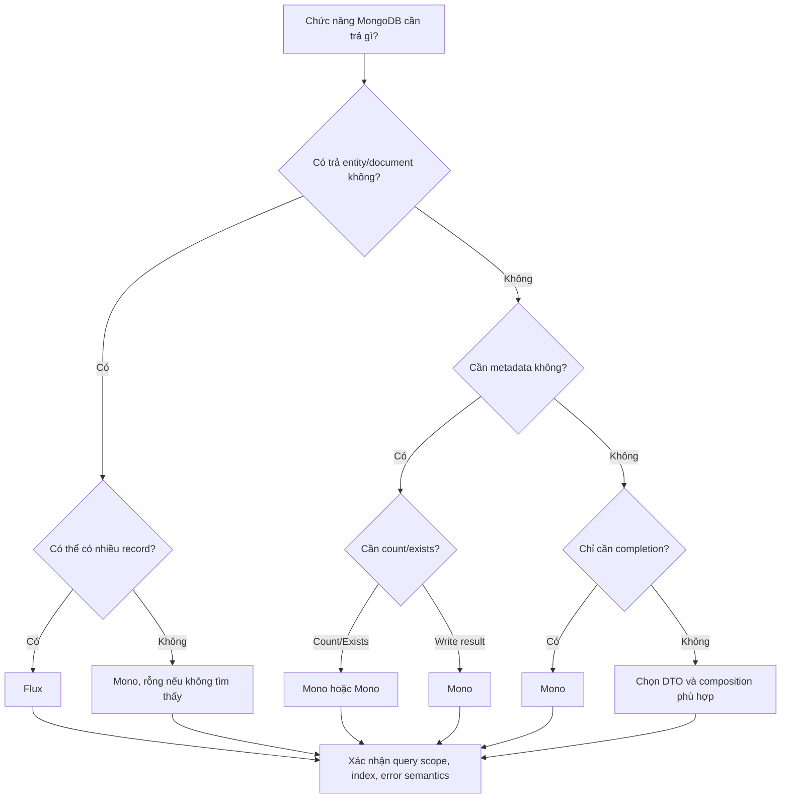

# ReactiveMongoRepository và kiểu kết quả phù hợp

Một API truy vấn MongoDB có thể cần **một document**, **nhiều document**, **một số đếm**, **kết quả kiểm tra tồn tại** hoặc chỉ cần biết **lệnh xóa đã hoàn tất**. Khi dùng **Spring Data MongoDB Reactive**, lựa chọn kiểu trả về không đơn thuần là thay `List<T>` bằng `Flux<T>`: kiểu reactive còn mô tả **số lượng phần tử có thể phát ra, thời điểm thực thi và cách báo lỗi/hoàn thành**.

Ví dụ:

```java
Mono<OrderDocument> findByTenantIdAndExternalId(
    String tenantId, String externalId);

Flux<OrderDocument> findByTenantIdAndStatus(
    String tenantId, String status);

Mono<Long> countByTenantIdAndStatus(
    String tenantId, String status);

Mono<Boolean> existsByTenantIdAndExternalId(
    String tenantId, String externalId);
```

Chỉ nhìn chữ ký, người đọc đã biết phương thức thứ nhất dự kiến **0–1 order**, phương thức thứ hai phát **0–N order**, phương thức thứ ba có **một giá trị đếm**, còn phương thức thứ tư trả **một kết quả boolean**. Chúng không thể bị thay thế tùy tiện cho nhau, ngay cả khi cuối cùng đều truy cập một collection.

Bài thuộc chương **Truy cập reactive** trong module **SPRING_DATA_MONGODB**, tập trung vào cách Spring Data MongoDB kết nối, ánh xạ document và truy vấn qua repository/`ReactiveMongoTemplate`, đồng thời thực hành thiết kế truy vấn, index, kiểm thử và xử lý lỗi. Trọng tâm trực tiếp là **`ReactiveMongoRepository` và lựa chọn kiểu kết quả phù hợp** với hợp đồng phương thức; kiến thức về transaction, performance và backpressure được nhắc tới ở mức cần thiết để dùng các kiểu này đúng.

Sau bài học, bạn có thể:

1. Phân biệt `ReactiveMongoRepository` với `MongoRepository` và khi nào dùng `Mono<T>`, `Flux<T>`.
2. Chọn chính xác `Mono<Boolean>`, `Mono<Long>`, `Mono<Void>`, `Mono<T>` và `Flux<T>` cho các thao tác.
3. Hiểu các signal **`onNext`, `onComplete`, `onError`**, đặc biệt là `Mono.empty()` so với `Mono.error(...)`.
4. Khai báo **derived query methods**, `@Query` và tham số `Sort`/`Pageable` trong repository reactive.
5. Phân trang đúng ngữ nghĩa khi repository trả `Flux<T>`: `Pageable` **không** tự tạo `Page<T>` và không tự chạy count.
6. Kết hợp luồng bằng Reactor `map`, `flatMap`, `flatMapMany`, `collectList`, `switchIfEmpty`, `then` mà không vô tình subscribe hai lần.
7. Dùng repository trong WebFlux controller/service nhưng vẫn đảm bảo **tenant scoping**, index, giới hạn dữ liệu và xử lý side effect.
8. Kiểm thử kết quả rỗng, một/nhiều phần tử, lỗi DB, dữ liệu nhiều tenant bằng `StepVerifier` và MongoDB test thực.

## 1. Reactive repository khác imperative repository ở điều gì?

### 1.1. Cùng mục tiêu dữ liệu, khác hợp đồng thực thi

Repository imperative có thể khai báo:

```java
public interface OrderRepository
        extends MongoRepository<OrderDocument, ObjectId> {

    Optional<OrderDocument> findByTenantIdAndExternalId(
        String tenantId, String externalId);

    List<OrderDocument> findByTenantIdAndStatus(
        String tenantId, String status);
}
```

Repository reactive:

```java
public interface ReactiveOrderRepository
        extends ReactiveMongoRepository<OrderDocument, ObjectId> {

    Mono<OrderDocument> findByTenantIdAndExternalId(
        String tenantId, String externalId);

    Flux<OrderDocument> findByTenantIdAndStatus(
        String tenantId, String status);
}
```

Trong mô hình imperative, `Optional`/`List` chứa kết quả đã được lấy tại thời điểm lời gọi trả về. Trong mô hình reactive, `Mono`/`Flux` là **Publisher** thể hiện luồng signal và công việc sẽ được thực hiện khi có subscription phù hợp; repository không bắt buộc đã hoàn tất truy vấn MongoDB chỉ vì phương thức vừa trả về một đối tượng `Mono`.

Một luồng điển hình:

```text
HTTP request
    │
    ▼
Reactive controller
    │ trả Mono/Flux
    ▼
Service tạo pipeline
    │
    ▼
ReactiveMongoRepository
    │ Publisher
    ▼
WebFlux/Reactor subscribe, yêu cầu dữ liệu
    │
    ▼
Reactive MongoDB Java Driver → MongoDB → signals
```

**Reactive không phải “mở thread riêng cho mỗi query”.** Driver reactive dùng cơ chế I/O không chặn trong phạm vi hoạt động được hỗ trợ; Reactor giúp hợp thành và quản lý signal. Một truy vấn nặng do thiếu index vẫn có thể gây tải cao ở MongoDB. Và một block trong service vẫn có thể phá lợi ích non-blocking.

### 1.2. Không trộn repository imperative và reactive bằng ép kiểu

Các kiểu sau **không thể thay bằng cast**:

```java
// KHÔNG HỢP LỆ về mặt mô hình:
Mono<OrderDocument> reactive =
    (Mono<OrderDocument>) imperativeRepository.findById(id);
```

`Optional<OrderDocument>` không phải một Publisher. Nếu một service WebFlux dùng repository imperative, việc gọi nó trực tiếp vẫn là **I/O blocking** mặc dù return của controller có thể được bọc trong `Mono.just(...)`.

Nếu phải tích hợp thư viện blocking, cần cân nhắc boundary riêng và cách ly scheduler thích hợp; cách này **không biến driver blocking thành reactive MongoDB driver**. Khi xây luồng đọc/ghi MongoDB reactive chính, sử dụng đúng `ReactiveMongoRepository` hoặc `ReactiveMongoTemplate` với driver/configuration reactive.

## 2. Hai kiểu nền tảng: `Mono<T>` và `Flux<T>`

### 2.1. `Mono<T>`: không hoặc một giá trị

`Mono<OrderDocument>` có những kết cục hợp lệ:

```text
onNext(order) → onComplete()      // có một order
onComplete()                      // không có order
onError(error)                    // truy vấn thất bại
```

Không có trường hợp `Mono<T>` phát **hai** order theo hợp đồng Reactor.

Ví dụ:

```java
Mono<OrderDocument> selected =
    repository.findByTenantIdAndExternalId(
        trustedTenantId, "EXT-100"
    );
```

Nếu order không tồn tại, repository có thể trả publisher hoàn thành **rỗng**. Rỗng không phải lỗi MongoDB; service quyết định có muốn chuyển thành **404 Not Found**, trả 204 hay một trạng thái khác theo API contract.

### 2.2. `Flux<T>`: không hoặc nhiều giá trị

`Flux<OrderDocument>` có thể:

```text
onComplete()                                      // 0 order
onNext(A) → onComplete()                          // 1 order
onNext(A) → onNext(B) → ... → onComplete()         // N order
onNext(A) → onError(error)                        // lỗi sau khi phát một phần
```

Tính chất **có thể phát một phần rồi mới lỗi** cần chú ý trong streaming HTTP hoặc xử lý batch. Một HTTP response streaming đã gửi vài item không thể luôn đổi lại thành một response 500 thông thường; client cần hợp đồng lỗi/đối soát rõ ràng.

### 2.3. Reactor không gửi Java `null` như giá trị `onNext`

Reactive Streams không dùng `null` làm phần tử được phát ra. Với trường hợp “không có document”, dùng một publisher **rỗng** (`Mono.empty()`), chứ không phải `Mono.just(null)`:

```java
Mono<OrderDocument> none = Mono.empty();

// Sai: sẽ ném NullPointerException.
Mono<OrderDocument> wrong = Mono.just(null);
```

Với dữ liệu có thể không có, `Mono.justOrEmpty(optional)` có thể chuyển `Optional` **đã có trong bộ nhớ** thành publisher phù hợp; không dùng nó để che một truy vấn blocking.

### 2.4. Error không giống empty

```java
Mono<OrderDocument> empty = Mono.empty();

Mono<OrderDocument> failed =
    Mono.error(new IllegalStateException("MongoDB unavailable"));
```

| Publisher | Ý nghĩa | Cách xử lý |
| --- | --- | --- |
| `Mono.just(order)` | Có một order | Ánh xạ DTO, trả kết quả |
| `Mono.empty()` | Không có order | Có thể chuyển 404 hoặc default |
| `Mono.error(error)` | Luồng lỗi | Error handling, retry phù hợp, monitoring |
| `Flux.empty()` | Query danh sách không có phần tử | Danh sách rỗng/stream hoàn thành |
| `Flux.error(error)` | Lỗi của luồng danh sách | Không coi thành danh sách rỗng một cách âm thầm |

**Không viết `onErrorResume(e -> Mono.empty())` cho mọi lỗi database** để biến outage thành “không có dữ liệu”; điều này làm API trả thông tin sai và che sự cố.

## 3. Chọn kiểu kết quả theo ngữ nghĩa thao tác

| Nhu cầu | Kiểu reactive thường dùng | Lý do |
| --- | --- | --- |
| Tìm theo `_id` hoặc unique business key | `Mono<OrderDocument>` | 0–1 document |
| Tìm nhiều order theo trạng thái | `Flux<OrderDocument>` | 0–N document |
| Tìm bản ghi đầu tiên có sort có chủ đích | `Mono<OrderDocument>` | Query giới hạn một kết quả |
| Tạo/sửa và trả entity đã lưu | `Mono<OrderDocument>` | Một entity hoặc error |
| Kiểm tra tồn tại | `Mono<Boolean>` | Phân biệt false với Mono empty |
| Đếm document | `Mono<Long>` | Một giá trị đếm, kể cả 0 |
| Xóa theo ID khi chỉ cần biết hoàn tất | `Mono<Void>` | Không phát entity/result |
| Xóa theo điều kiện và cần số lượng đã xóa | `Mono<Long>` hoặc `Mono<DeleteResult>` tùy API | Có metadata/count |
| Update có matched/modified count | `Mono<UpdateResult>` với `ReactiveMongoTemplate` | Không nhầm “hoàn tất” với “có record được sửa” |
| Lấy một trang **nội dung**, không cần tổng | `Flux<T>` với `Pageable`/limit, hoặc `Mono<List<T>>` ở boundary | Đường dữ liệu và hình dạng response khác nhau |
| API cần nội dung + tổng số trang | `Mono<PaginatedResponse<T>>` tự tổng hợp từ content/count | Hai truy vấn/hoặc pipeline thích hợp; không tự có `Page<T>` |

Trong bảng, `Mono<Void>` thường phát **chỉ completion/error**, không phát một đối tượng `Void`. `Mono<Boolean>` của `exists...` lại có thể phát `false` rõ ràng; dùng `Mono<Void>` ở đây sẽ mất thông tin quan trọng.

### 3.1. Không dùng `Mono<T>` cho truy vấn có nhiều kết quả

Phương thức:

```java
Mono<OrderDocument> findByTenantIdAndStatus(
    String tenantId, String status);
```

chứa một **mâu thuẫn thiết kế tiềm tàng**: một tenant có nhiều order cùng status. Tùy cách Spring Data xây truy vấn single-result và số document phù hợp, có thể có lỗi về số kết quả hoặc behavior không thể hiện đúng mong muốn. Không nên dựa vào “MongoDB sẽ chọn ngẫu nhiên một order”.

Nếu yêu cầu trả tất cả, khai báo `Flux<OrderDocument>`. Nếu yêu cầu “một order mới nhất”, mô tả điều đó:

```java
Mono<OrderDocument> findFirstByTenantIdAndStatusOrderByCreatedAtDescIdDesc(
    String tenantId, String status);
```

Đây là một derived query có **giới hạn một phần tử và thứ tự xác định** (với `_id` duy nhất làm tie-breaker). Nó **không thay unique constraint**: trong collection vẫn có thể tồn tại nhiều order cùng status, chỉ là API đã yêu cầu một kết quả đầu tiên.

### 3.2. Không dùng `Flux<T>` chỉ để biểu diễn “một record theo ID”

Bạn *có thể* biến `Mono<T>` thành `Flux<T>` khi composition thật sự cần, nhưng chữ ký:

```java
Flux<OrderDocument> findByIdAndTenantId(
    ObjectId id, String tenantId);
```

không nói rõ kết quả là **0–1** dù `_id` unique. Khi nghiệp vụ cần một record, `Mono<OrderDocument>` phản ánh cardinality tốt hơn.

### 3.3. `Mono<Long>` khác `Flux<Long>` khi đếm

`count()` của repository trả một số đếm như `Mono<Long>`. Không dùng:

```java
Flux<Long> counts = repository.findAll()
    .map(x -> 1L);
```

để giả vờ “count” vì publisher này phát **một số 1 cho mỗi order**, không phải tổng. `Flux.count()` có thể đếm số phần tử *đã phát*, nhưng nếu phải truy vấn toàn bộ collection chỉ để count thì thường tốn tài nguyên hơn một database count chuyên dụng.

### 3.4. `Mono<Boolean>` không phải `Mono.empty()` khi không tồn tại

```java
Mono<Boolean> exists =
    repository.existsByTenantIdAndExternalId(
        tenantId, externalId);
```

Thông thường luồng phát `false` nếu không tồn tại — **không phải** một `Mono.empty()`. Điều này quan trọng với:

```java
exists.defaultIfEmpty(true)
```

Đây là fallback **cho publisher không phát value**, không phải chuyển `false` thành `true`. Đừng dùng `defaultIfEmpty` để sửa một boolean false.

## 4. Thiết kế entity và `ReactiveMongoRepository` hoàn chỉnh

### 4.1. Mô hình order cho bài thực hành

Một hệ thống nhiều tenant có đơn hàng với khóa nghiệp vụ `externalId`. Để tra đúng một order theo tenant và externalId, ta muốn một **unique index** trên cặp khóa đó, không chỉ tin rằng phương thức repository trả `Mono<T>`.

```java
package com.example.reactivemongo;

import java.math.BigDecimal;
import java.time.Instant;
import org.bson.types.ObjectId;
import org.springframework.data.annotation.Id;
import org.springframework.data.mongodb.core.index.CompoundIndex;
import org.springframework.data.mongodb.core.mapping.Document;
import org.springframework.data.mongodb.core.mapping.Field;
import org.springframework.data.mongodb.core.mapping.FieldType;

@Document(collection = "orders_reactive_lab")
@CompoundIndex(
    name = "uniq_tenant_external",
    def = "{ 'tenantId': 1, 'externalId': 1 }",
    unique = true
)
public class OrderDocument {
    @Id
    private ObjectId id;

    private String tenantId;
    private String externalId;
    private String status;
    private Instant createdAt;

    @Field(targetType = FieldType.DECIMAL128)
    private BigDecimal totalAmount;

    protected OrderDocument() {
        // Spring Data có thể dùng constructor này khi materialize.
    }

    public OrderDocument(
            String tenantId,
            String externalId,
            String status,
            Instant createdAt,
            BigDecimal totalAmount) {
        this.tenantId = tenantId;
        this.externalId = externalId;
        this.status = status;
        this.createdAt = createdAt;
        this.totalAmount = totalAmount;
    }

    public ObjectId getId() { return id; }
    public String getTenantId() { return tenantId; }
    public String getExternalId() { return externalId; }
    public String getStatus() { return status; }
    public Instant getCreatedAt() { return createdAt; }
    public BigDecimal getTotalAmount() { return totalAmount; }
}
```

Chú ý:

- `@Id ObjectId id` ánh xạ thành BSON `_id`; trường `externalId` là khóa nghiệp vụ riêng.
- `@Field(targetType = FieldType.DECIMAL128)` định hướng lưu `BigDecimal` dưới BSON Decimal128 để so sánh tiền nhất quán.
- `@CompoundIndex` khai báo **mong muốn** về index. Tùy cấu hình/phiên bản, index có thể **chưa tự tạo**; phải bảo đảm migration/`indexOps` đã tạo và xác minh trên server.
- Class này là ví dụ gọn để học kiểu trả về. Production cần bổ sung validation, auditing, trạng thái nghiệp vụ, optimistic locking và chính sách quyền phù hợp.

### 4.2. Repository đa hình dạng kết quả

```java
package com.example.reactivemongo;

import org.bson.types.ObjectId;
import org.springframework.data.domain.Pageable;
import org.springframework.data.domain.Sort;
import org.springframework.data.mongodb.repository.ReactiveMongoRepository;
import reactor.core.publisher.Flux;
import reactor.core.publisher.Mono;

public interface ReactiveOrderRepository
        extends ReactiveMongoRepository<OrderDocument, ObjectId> {

    // Có unique index trên (tenantId, externalId).
    Mono<OrderDocument> findByTenantIdAndExternalId(
        String tenantId, String externalId);

    // Trả mọi order khớp khi được subscribe, theo Sort.
    Flux<OrderDocument> findByTenantIdAndStatus(
        String tenantId, String status, Sort sort);

    // Chỉ lấy tập kết quả theo limit/offset của Pageable.
    Flux<OrderDocument> findByTenantIdAndStatus(
        String tenantId, String status, Pageable pageable);

    // Truy vấn chỉ một order mới nhất.
    Mono<OrderDocument>
        findFirstByTenantIdAndStatusOrderByCreatedAtDescIdDesc(
            String tenantId, String status);

    // Kết quả scalar, không phải document.
    Mono<Long> countByTenantIdAndStatus(
        String tenantId, String status);

    Mono<Boolean> existsByTenantIdAndExternalId(
        String tenantId, String externalId);
}
```

Vì mọi method nhận `tenantId` **tường minh**, đường truy vấn dễ được review theo phạm vi dữ liệu. Nhưng việc khai báo tham số tenant **không tự thực hiện authorization**: service phải lấy tenant từ nguồn tin cậy và đảm bảo không có đường gọi bỏ qua điều kiện phạm vi.

### 4.3. Các thao tác CRUD kế thừa và kiểu kết quả

`ReactiveMongoRepository` cung cấp các thao tác reactive thông qua các giao diện hạ tầng tương ứng. Một số thao tác thường gặp:

```java
Mono<OrderDocument> byId = repository.findById(orderId);

Flux<OrderDocument> all = repository.findAll();

Mono<Long> count = repository.count();

Mono<Boolean> exists = repository.existsById(orderId);

Mono<OrderDocument> saved = repository.save(order);

Mono<OrderDocument> inserted = repository.insert(order);

Mono<Void> deleteCompleted = repository.deleteById(orderId);
```

**Không đưa `findAll()` vào API production không có phân trang/giới hạn** chỉ vì nó dễ viết. Và `findById`/`deleteById` không mang điều kiện tenant theo mặc định. Trong ứng dụng nhiều tenant, service không được truy cập hoặc xóa document của tenant khác chỉ dựa trên ID do client đưa vào.

Sự khác biệt đáng chú ý:

- `save` có thể insert hoặc thay thế/cập nhật entity theo trạng thái ID và mapping; cần hiểu version/optimistic locking để tránh ghi đè.
- `insert` hướng đến việc tạo mới; duplicate key có thể gây error, phù hợp khi phải bảo vệ create semantics.
- `deleteById` trả `Mono<Void>` chỉ cho biết publisher hoàn tất. Nó **không trả số lượng document đã xóa**; nếu phải phân biệt không tìm thấy và đã xóa, chọn query delete trả count qua `ReactiveMongoTemplate`.
- `existsById` trả `Mono<Boolean>` với `true/false`; nó không thay điều kiện authorization/uniqueness.
- `count` trả một số bằng `Mono<Long>`, không phát từng document để đếm ở client.

### 4.4. Vì sao index và cardinality phải đi cùng nhau?

```java
Mono<OrderDocument> found =
    repository.findByTenantIdAndExternalId(
        tenantId, externalId);
```

Kiểu `Mono` mô tả **hợp đồng của method**, không tạo unique constraint trên dữ liệu. Nếu application không có unique index và tồn tại hai document cùng `tenantId+externalId`, đây là lỗi mô hình dữ liệu. Query single-result có thể báo lỗi về nhiều kết quả hoặc không phản ánh uniqueness mà nghiệp vụ cần; đừng dùng `findFirst...` để che dữ liệu trùng.

Một unique compound index có thể tạo bằng `mongosh`:

```javascript
db.orders_reactive_lab.createIndex(
  { tenantId: 1, externalId: 1 },
  { unique: true, name: "uniq_tenant_external" }
);
```

**Lưu ý vận hành:** đây là tài nguyên cấp collection, cần quản lý bằng migration, kiểm tra dữ liệu trùng cũ và rà soát giới hạn index theo mô hình sharding/collation nếu có. Đừng tạo index chỉ bằng cách nhìn annotation rồi giả định nó đã xuất hiện trên server.

## 5. Luồng signal: subscription, lazy execution, cancellation

### 5.1. Tạo Publisher chưa phải đã ghi/xóa

```java
Mono<OrderDocument> publisher = repository.insert(order);

// Chưa có bằng chứng rằng write đã hoàn tất ở đây.
// Việc thực thi xảy ra khi Publisher được subscribe.
```

Một publisher thường có tính chất **cold**: mỗi subscription là một lần chạy logic nguồn. Với một operation có side effect như insert, hai subscription có thể gửi **hai lần thử ghi**. Vì vậy, không xem publisher như một `CompletableFuture` đã khởi động sẵn và dùng lại tùy tiện.

```java
Mono<OrderDocument> insertPublisher =
    repository.insert(new OrderDocument(
        tenantId, externalId, "NEW",
        Instant.now(), amount
    ));

// Không làm thế để "chắc ăn" khi dùng Publisher ghi:
insertPublisher.subscribe();
return insertPublisher;
```

Đoạn này tạo một subscription thủ công rồi trả publisher cho framework, có thể khiến Spring WebFlux subscribe lần thứ hai. Với insert, unique constraint có thể gây duplicate key; với update không idempotent, có thể tạo **tác dụng kép**.

**Nguyên tắc:** để WebFlux/Reactor consumer ở boundary cuối sở hữu subscription. Trong service và controller, **return publisher**, không gọi `subscribe()` để “khởi động” rồi trả một publisher khác.

### 5.2. Hoàn thành, lỗi và cancellation

Một subscription kết thúc bởi:

- `onComplete`: nguồn hoàn tất bình thường.
- `onError`: nguồn gặp lỗi và kết thúc bằng lỗi.
- `cancel`: subscriber chủ động ngừng nhận phần tử; đây không phải `onComplete`.

**Cancellation không phải rollback giao dịch MongoDB.** Khi subscriber HTTP disconnect/cancel, một write đã gửi đến server có thể đã thực hiện hoặc vẫn đang xử lý. Không dùng `doOnCancel` để mặc định ghi log “database đã hủy write”. Khi kết quả write quan trọng, phải có idempotency và reconciliation theo business command ID.

### 5.3. Sắp xếp log theo signal

```java
Flux<OrderDocument> orders = repository
    .findByTenantIdAndStatus(tenantId, "PAID", sort)
    .doOnSubscribe(s -> log.debug("query subscribed"))
    .doOnNext(o -> log.debug("received order id={}", o.getId()))
    .doOnError(e -> log.warn("query failed", e))
    .doOnComplete(() -> log.debug("query completed"));
```

Đây là ví dụ **bên trong một class có `log` đã được khởi tạo**. Những hook `doOn...` phục vụ observability và không tự kích hoạt subscription. Không log raw document có PII, số tiền chi tiết hoặc thông tin tenant nhạy cảm nếu không có chính sách masking và quyền phù hợp.

## 6. Các toán tử Reactor quan trọng khi gọi repository

### 6.1. `map` biến đổi một giá trị có sẵn

```java
Mono<OrderView> view = repository
    .findByTenantIdAndExternalId(tenantId, externalId)
    .map(OrderView::from);
```

`OrderView::from` là một **hàm đồng bộ** chuyển entity sang DTO. `map` không tự tạo thêm MongoDB query. Nếu không có order, hàm map không được gọi và `Mono` vẫn rỗng.

### 6.2. `flatMap` dùng khi bước tiếp theo trả `Mono`

```java
Mono<OrderView> view = repository
    .findByTenantIdAndExternalId(tenantId, externalId)
    .flatMap(order -> pricingService.enrich(order));
```

Ở đây `pricingService.enrich(order)` được giả định là một method **không blocking** trả `Mono<OrderView>`. Nếu dùng `map` thay thế:

```java
Mono<Mono<OrderView>> nested = repository
    .findByTenantIdAndExternalId(tenantId, externalId)
    .map(order -> pricingService.enrich(order));
```

bạn có một publisher **lồng publisher**, không phải một `Mono<OrderView>` đã flatten.

### 6.3. `flatMapMany` khi một order mở ra nhiều item

```java
Flux<OrderLine> lines = repository
    .findByTenantIdAndExternalId(tenantId, externalId)
    .flatMapMany(orderLineRepository::findByOrder);
```

`orderLineRepository.findByOrder(...)` ở đây là method minh họa trả `Flux<OrderLine>`. Trong production, cần truyền cả tenant/ID nếu collection con có ranh giới tenant; method trên chỉ minh họa kiểu toán tử, không phải authorization đầy đủ.

### 6.4. `collectList` thay `Flux<T>` thành `Mono<List<T>>`

```java
Mono<List<OrderDocument>> listMono = repository
    .findByTenantIdAndStatus(tenantId, "PAID", pageable)
    .collectList();
```

Phép này **tích lũy toàn bộ các phần tử được phát** vào một List trong memory. Nó hợp lý nếu repository đã giới hạn `Pageable`, ví dụ size 20. Nhưng gọi `collectList()` sau `findAll()` trên hàng triệu document có thể gây áp lực bộ nhớ rất lớn.

### 6.5. `then` bỏ qua giá trị, giữ completion/error

```java
Mono<Void> completed = repository
    .save(order)
    .then();
```

`then()` chuyển publisher có giá trị thành `Mono<Void>`, không trả entity. Dùng khi hợp đồng chỉ cần “hoàn tất”, **không** dùng nếu cần ID/metadata của kết quả save.

### 6.6. `switchIfEmpty` cho trường hợp không có document

```java
Mono<OrderDocument> required = repository
    .findByTenantIdAndExternalId(tenantId, externalId)
    .switchIfEmpty(Mono.error(
        new OrderNotFoundException(externalId)
    ));
```

Chỉ khi nguồn **hoàn thành rỗng**, fallback mới được subscribe. Exception trong ví dụ là class tùy biến của ứng dụng, không phải class có sẵn trong Spring Data. `switchIfEmpty` **không bắt lỗi MongoDB**; lỗi vẫn đi qua `onError`.

Nếu fallback có side effect hoặc dựng publisher phức tạp, có thể dùng `Mono.defer(...)` để trì hoãn **việc tạo** fallback đến lúc cần:

```java
.switchIfEmpty(Mono.defer(() ->
    auditService.recordMissingOrder(tenantId, externalId)
        .then(Mono.error(new OrderNotFoundException(externalId)))
))
```

Trong ví dụ, `auditService.recordMissingOrder(...)` phải trả `Mono<?>` không blocking. Nếu audit chỉ cần ghi log, cân nhắc observability thay vì tạo write bổ sung cho mỗi lần không tìm thấy.

### 6.7. `defaultIfEmpty` khác `switchIfEmpty`

`defaultIfEmpty(fallbackValue)` cần **giá trị T đã có**, trong khi `switchIfEmpty(otherPublisher)` nhận một publisher thay thế.

```java
Mono<Boolean> found =
    repository.findByTenantIdAndExternalId(tenantId, externalId)
        .hasElement();

Mono<Boolean> expected = found.defaultIfEmpty(false);
```

`hasElement()` phát `true/false` trong trường hợp hoàn tất bình thường, nên `defaultIfEmpty(false)` ở đây thường là **thừa**. Nó không xử lý `onError`, cũng không chuyển lỗi DB thành false.

## 7. Service reactive: giữ đúng số lượng kết quả và phạm vi tenant

### 7.1. Service truy vấn một, nhiều, đếm và tồn tại

```java
package com.example.reactivemongo;

import java.math.BigDecimal;
import java.time.Instant;
import org.springframework.data.domain.PageRequest;
import org.springframework.data.domain.Pageable;
import org.springframework.data.domain.Sort;
import org.springframework.stereotype.Service;
import reactor.core.publisher.Flux;
import reactor.core.publisher.Mono;

@Service
public class ReactiveOrderService {

    private final ReactiveOrderRepository repository;

    public ReactiveOrderService(ReactiveOrderRepository repository) {
        this.repository = repository;
    }

    public Mono<OrderDocument> findOne(
            String trustedTenantId, String externalId) {
        requireText(trustedTenantId, "tenantId");
        requireText(externalId, "externalId");

        return repository.findByTenantIdAndExternalId(
            trustedTenantId, externalId);
    }

    public Mono<OrderDocument> requireOne(
            String trustedTenantId, String externalId) {
        return findOne(trustedTenantId, externalId)
            .switchIfEmpty(Mono.error(
                new OrderNotFoundException(externalId)
            ));
    }

    public Flux<OrderDocument> listByStatus(
            String trustedTenantId, String status,
            int pageNumber, int pageSize) {
        requireText(trustedTenantId, "tenantId");
        requireText(status, "status");

        if (pageNumber < 0 || pageSize < 1 || pageSize > 100) {
            return Flux.error(new IllegalArgumentException(
                "Page number hoặc size không hợp lệ"
            ));
        }

        Pageable pageable = PageRequest.of(
            pageNumber, pageSize,
            Sort.by(
                Sort.Order.desc("createdAt"),
                Sort.Order.desc("id")
            )
        );

        return repository.findByTenantIdAndStatus(
            trustedTenantId, status, pageable);
    }

    public Mono<Long> countByStatus(
            String trustedTenantId, String status) {
        requireText(trustedTenantId, "tenantId");
        requireText(status, "status");
        return repository.countByTenantIdAndStatus(
            trustedTenantId, status);
    }

    public Mono<Boolean> exists(
            String trustedTenantId, String externalId) {
        requireText(trustedTenantId, "tenantId");
        requireText(externalId, "externalId");
        return repository.existsByTenantIdAndExternalId(
            trustedTenantId, externalId);
    }

    public Mono<OrderDocument> create(
            String trustedTenantId, String externalId,
            BigDecimal totalAmount) {
        requireText(trustedTenantId, "tenantId");
        requireText(externalId, "externalId");

        if (totalAmount == null || totalAmount.signum() < 0) {
            return Mono.error(new IllegalArgumentException(
                "Số tiền không hợp lệ"
            ));
        }

        return Mono.defer(() -> repository.insert(
            new OrderDocument(
                trustedTenantId,
                externalId,
                "NEW",
                Instant.now(),
                totalAmount
            )
        ));
    }

    private void requireText(String value, String field) {
        if (value == null || value.isBlank()) {
            throw new IllegalArgumentException(
                "Thiếu " + field
            );
        }
    }
}
```

`OrderNotFoundException` trong ví dụ là **class tùy biến** của ứng dụng, chẳng hạn:

```java
package com.example.reactivemongo;

public class OrderNotFoundException extends RuntimeException {
    public OrderNotFoundException(String externalId) {
        super("Không tìm thấy order theo externalId");
    }
}
```

**Những quyết định đáng chú ý:**

- `findOne` giữ `Mono.empty` cho trường hợp không tìm thấy, phù hợp nếu caller muốn tự chọn cách phản hồi.
- `requireOne` chuyển empty thành lỗi nghiệp vụ có chủ đích. Nó **không bắt lỗi DB rồi xem là not found**.
- `listByStatus` dùng `Pageable` để **giới hạn content**, nhưng trả `Flux`, không hứa có metadata tổng số trang.
- `countByStatus` gọi count chuyên dụng, không dùng `findAll().collectList().size()`.
- `create` dùng `Mono.defer` để tạo entity và thời gian tại subscription. Việc subscribe lại vẫn là một **attempt mới**, nên unique index trên tenant/externalId và idempotency policy vẫn quan trọng.
- `requireText` trong ví dụ có thể ném exception đồng bộ trước khi trả publisher; nếu API yêu cầu mọi validation error nằm trong reactive signal, chuyển những lỗi này thành `Mono.error`/`Flux.error` một cách nhất quán. Không thay đổi semantics nghiệp vụ.

Không tạo một `ReactiveOrderService` rồi gọi `.block()` trên `findOne` để biến nó thành imperative trong luồng WebFlux. Nếu caller là một tác vụ blocking thực sự, hãy thiết kế một boundary adapter rõ ràng, thay vì rải `block` giữa reactive chain.

### 7.2. Xóa theo tenant và cần phân biệt “không tìm thấy”

`repository.deleteById(orderId)` trả `Mono<Void>` nhưng không chứa điều kiện tenant. Nếu API phải vừa **kiểm tra tenant** vừa biết có record được xóa, dùng `ReactiveMongoTemplate`:

```java
import org.bson.types.ObjectId;
import org.springframework.data.mongodb.core.ReactiveMongoTemplate;
import org.springframework.data.mongodb.core.query.Criteria;
import org.springframework.data.mongodb.core.query.Query;
import reactor.core.publisher.Mono;

public Mono<Void> deleteScoped(
        ReactiveMongoTemplate template,
        String trustedTenantId,
        ObjectId orderId) {

    if (trustedTenantId == null || trustedTenantId.isBlank()
            || orderId == null) {
        return Mono.error(new IllegalArgumentException(
            "Thiếu tenant hoặc orderId"
        ));
    }

    Query query = Query.query(
        Criteria.where("_id").is(orderId)
            .and("tenantId").is(trustedTenantId)
    );

    return template.remove(query, OrderDocument.class)
        .flatMap(result -> {
            if (result.getDeletedCount() == 0) {
                return Mono.<Void>error(
                    new OrderNotFoundException(orderId.toHexString())
                );
            }
            return Mono.<Void>empty();
        });
}
```

Đoạn này là một method minh họa đặt trong class có tham số `template`; `remove` trả publisher chứa kết quả xóa để kiểm tra `deletedCount`. Với tenant sai, API có thể trả 404 thay vì tiết lộ document có tồn tại ở tenant khác. Đừng biến lỗi MongoDB thành count bằng 0.

### 7.3. Update có matched/modified metadata

```java
import com.mongodb.client.result.UpdateResult;
import org.springframework.data.mongodb.core.query.Update;

Query scope = Query.query(
    Criteria.where("_id").is(orderId)
        .and("tenantId").is(trustedTenantId)
        .and("status").is("NEW")
);

Mono<UpdateResult> result = template.updateFirst(
    scope,
    new Update().set("status", "PAID"),
    OrderDocument.class
);
```

Đây là **conditional update**: chỉ những order thuộc tenant và còn NEW mới được chuyển PAID. `Mono<UpdateResult>` hữu ích khi service cần phân biệt:

- `matchedCount = 1, modifiedCount = 1`: có record khớp và được sửa.
- `matchedCount = 1, modifiedCount = 0`: record khớp nhưng giá trị không thay đổi theo semantics update.
- `matchedCount = 0`: không record nào khớp; có thể sai tenant, sai ID hoặc status đã khác.
- `onError`: thao tác thất bại hoặc kết quả write chưa xác định theo loại lỗi cụ thể; không coi là matchedCount=0.

**Không lược bỏ metadata thành `Mono<Void>` nếu caller cần biết liệu transition thực sự xảy ra.** Chọn kiểu kết quả theo điều kiện mà business cần xác nhận.

## 8. Spring WebFlux: trả Publisher tới HTTP boundary

Một controller reactive không cần gọi `subscribe()`. Spring WebFlux sẽ đăng ký subscription và mã hóa giá trị phát ra theo HTTP response phù hợp.

### 8.1. DTO đọc không nên lộ entity toàn bộ

```java
package com.example.reactivemongo;

import java.math.BigDecimal;
import java.time.Instant;

public record OrderView(
    String id,
    String externalId,
    String status,
    BigDecimal totalAmount,
    Instant createdAt
) {
    public static OrderView from(OrderDocument source) {
        return new OrderView(
            source.getId().toHexString(),
            source.getExternalId(),
            source.getStatus(),
            source.getTotalAmount(),
            source.getCreatedAt()
        );
    }
}
```

Không xuất `tenantId` hay metadata nội bộ nếu response không cần. Các quy tắc redaction/authorization vẫn thuộc boundary/domain.

### 8.2. Controller minh họa với tenant đáng tin cậy

```java
package com.example.reactivemongo;

import java.security.Principal;
import org.springframework.http.ResponseEntity;
import org.springframework.web.bind.annotation.GetMapping;
import org.springframework.web.bind.annotation.PathVariable;
import org.springframework.web.bind.annotation.RequestMapping;
import org.springframework.web.bind.annotation.RequestParam;
import org.springframework.web.bind.annotation.RestController;
import reactor.core.publisher.Flux;
import reactor.core.publisher.Mono;

@RestController
@RequestMapping("/api/orders")
public class ReactiveOrderController {

    private final ReactiveOrderService service;
    private final TrustedTenantResolver tenantResolver;

    public ReactiveOrderController(
            ReactiveOrderService service,
            TrustedTenantResolver tenantResolver) {
        this.service = service;
        this.tenantResolver = tenantResolver;
    }

    @GetMapping("/{externalId}")
    public Mono<ResponseEntity<OrderView>> getOne(
            @PathVariable String externalId,
            Principal principal) {

        String trustedTenantId =
            tenantResolver.requireTenant(principal);

        return service.findOne(trustedTenantId, externalId)
            .map(OrderView::from)
            .map(ResponseEntity::ok)
            .defaultIfEmpty(ResponseEntity.notFound().build());
    }

    @GetMapping
    public Flux<OrderView> list(
            @RequestParam(defaultValue = "PAID") String status,
            @RequestParam(defaultValue = "0") int page,
            @RequestParam(defaultValue = "20") int size,
            Principal principal) {

        String trustedTenantId =
            tenantResolver.requireTenant(principal);

        return service
            .listByStatus(trustedTenantId, status, page, size)
            .map(OrderView::from);
    }
}
```

`TrustedTenantResolver` là **interface/service ứng dụng tự cung cấp**, không có sẵn trong Spring Data:

```java
package com.example.reactivemongo;

import java.security.Principal;

public interface TrustedTenantResolver {
    String requireTenant(Principal authenticatedPrincipal);
}
```

Nó phải lấy tenant từ **authentication/authorization context** và từ chối người dùng chưa được xác thực. Ví dụ giải định `requireTenant` chỉ đọc trạng thái trong bộ nhớ/Principal, không làm I/O blocking. Nếu cần truy vấn quyền bất đồng bộ, thiết kế resolver trả `Mono<String>` và composition bằng `flatMap/flatMapMany` thay vì gọi blocking lookup trong controller.

**Điểm quan trọng trong controller:**

1. `getOne` trả `Mono<ResponseEntity<OrderView>>`; có order → 200, Mono rỗng → 404.
2. `list` trả `Flux<OrderView>`; không có order → danh sách rỗng theo cách Spring WebFlux encode; lỗi DB vẫn là lỗi.
3. Không dùng `.block()`, `.toIterable()` hoặc `.subscribe()`.
4. `page`/`size` cần validation và giới hạn; service chặn size vượt 100.
5. `tenantId` không phải query parameter tùy ý để client đọc dữ liệu người khác.

### 8.3. Khi nào dùng `Mono<ResponseEntity<List<T>>>` thay vì `Flux<T>`?

Nếu API muốn **một JSON array hoàn chỉnh** kèm metadata và status được quyết định sau khi query kết thúc:

```java
Mono<ResponseEntity<List<OrderView>>> response = service
    .listByStatus(tenantId, "PAID", 0, 20)
    .map(OrderView::from)
    .collectList()
    .map(ResponseEntity::ok);
```

Với trang đã giới hạn, điều này hợp lý và giúp quyết định response sau khi có đủ dữ liệu. Nhưng nó dùng memory để chứa cả trang. Với SSE/NDJSON hoặc use case streaming dài, `Flux<T>` có thể phù hợp hơn, tùy media type và HTTP client.

**Không nói `Flux<T>` luôn đồng nghĩa server gửi từng document ngay lập tức qua mạng**: serialization, format JSON array, HTTP buffering, proxy và client đều ảnh hưởng. Muốn stream thực sự, phải chọn content type và điều kiện truyền tải hỗ trợ streaming, ví dụ NDJSON hoặc SSE theo hợp đồng API.

## 9. `Pageable` với reactive repository: trả nội dung, không tự có `Page<T>`

### 9.1. Vấn đề cardinality của `Page<T>`

Trong repository imperative, nhiều lập trình viên quen:

```java
Page<OrderDocument> findByTenantIdAndStatus(
    String tenantId, String status, Pageable pageable);
```

`Page<T>` chứa cả **content** và **total elements/pages**. Trong reactive repository, truy vấn kết quả nhiều phần tử được biểu diễn bằng `Flux<T>`. Không nên khai báo một derived method reactive trả `Mono<Page<OrderDocument>>` rồi giả định Spring Data MongoDB sẽ tự chạy content query, count query và tạo Page.

Chữ ký phù hợp:

```java
Flux<OrderDocument> findByTenantIdAndStatus(
    String tenantId, String status, Pageable pageable);
```

Tham số `Pageable` phục vụ **limit/offset/sort của truy vấn nội dung**. Nó không làm `Flux` phát một đối tượng `Page`, cũng không tự bảo đảm có `totalElements`.

### 9.2. API chỉ cần một danh sách giới hạn

```java
Pageable pageable = PageRequest.of(
    0,
    20,
    Sort.by(
        Sort.Order.desc("createdAt"),
        Sort.Order.desc("id")
    )
);

Flux<OrderDocument> firstTwenty = repository
    .findByTenantIdAndStatus("T1", "PAID", pageable);
```

Nếu không có order, publisher **hoàn thành không có phần tử**. Nếu có 7 order, nó phát tối đa 7 phần tử. Nếu có hơn 20, nó phát tối đa 20 theo sort, không phát object chứa `totalElements`.

### 9.3. Nếu client thật sự cần tổng số phần tử

Tạo DTO phản ánh hợp đồng response:

```java
package com.example.reactivemongo;

import java.util.List;

public record OrderPageResponse(
    List<OrderView> items,
    long totalElements,
    int pageNumber,
    int pageSize
) {}
```

Rồi kết hợp **hai publisher**:

```java
public Mono<OrderPageResponse> loadPage(
        ReactiveOrderService service,
        String tenantId,
        String status,
        int pageNumber,
        int pageSize) {

    Mono<List<OrderView>> content = service
        .listByStatus(tenantId, status, pageNumber, pageSize)
        .map(OrderView::from)
        .collectList();

    Mono<Long> total = service.countByStatus(tenantId, status);

    return Mono.zip(content, total)
        .map(tuple -> new OrderPageResponse(
            tuple.getT1(),
            tuple.getT2(),
            pageNumber,
            pageSize
        ));
}
```

**Đây là hai lần truy vấn độc lập**: content và count có thể quan sát dữ liệu khác nhau khi có write đồng thời. `Mono.zip` phối hợp kết quả, **không biến hai query thành một snapshot transaction**. Nếu yêu cầu thống kê và content nhất quán tại cùng một thời điểm, cần chính sách snapshot/read concern/transaction hoặc một aggregation pipeline phù hợp trên deployment hỗ trợ; không thể giải quyết bằng việc đổi return type.

`Mono.zip` chỉ phát kết quả khi cả hai nguồn phát đủ value. Trong ví dụ, `collectList` luôn phát một List (có thể rỗng) khi thành công và `count` phát một số, nên phù hợp. Nếu zip với một `Mono.empty()`, nó có thể hoàn thành rỗng thay vì chạy mapper.

### 9.4. Có thể bỏ `totalElements` nếu không cần

Nếu giao diện chỉ cần biết có trang tiếp theo hay không, phương án “**fetch size + 1**” có thể giảm chi phí đếm toàn collection. Sau khi truy vấn tối đa 21 record cho page size 20, trả 20 record và tính `hasNext = kết quả có phần tử thứ 21`.

**Lưu ý quan trọng:** không dùng `PageRequest.of(pageNumber, pageSize + 1)` để thực hiện việc này trên mọi trang, vì nó đặt offset bằng `pageNumber × (pageSize + 1)` thay vì `pageNumber × pageSize`. Để giữ bước nhảy đúng, cần tính offset theo page size gốc rồi giới hạn `size + 1` bằng `ReactiveMongoTemplate` như mục 9.5.

DTO đầu ra:

```java
public record OrderWindow(
    List<OrderView> items,
    boolean hasNext
) {}
```

**Chú ý về offset:** đoạn minh họa này dùng `PageRequest.of(pageNumber, pageSize + 1)`. Nó **không** giữ đúng bước nhảy của pageNumber nếu client dùng các số trang cố định (vì offset trở thành `pageNumber * (pageSize + 1)`). Do đó chỉ có thể dùng trực tiếp cho **pageNumber = 0**, hoặc phải **tự đặt skip = pageNumber * pageSize** rồi giới hạn `size + 1` bằng `ReactiveMongoTemplate`. Với API phân trang nhiều trang, dùng phiên bản đúng dưới đây.

### 9.5. Window đúng offset với `ReactiveMongoTemplate`

```java
import java.util.List;
import org.springframework.data.domain.Sort;
import org.springframework.data.mongodb.core.ReactiveMongoTemplate;
import org.springframework.data.mongodb.core.query.Criteria;
import org.springframework.data.mongodb.core.query.Query;
import reactor.core.publisher.Mono;

public Mono<OrderWindow> loadWindowWithCorrectOffset(
        ReactiveMongoTemplate template,
        String trustedTenantId,
        String status,
        int pageNumber,
        int pageSize) {

    if (trustedTenantId == null || trustedTenantId.isBlank()
            || status == null || status.isBlank()
            || pageNumber < 0 || pageSize < 1 || pageSize > 100) {
        return Mono.error(
            new IllegalArgumentException("Pagination không hợp lệ")
        );
    }

    long offset = (long) pageNumber * pageSize;

    Query query = Query.query(
        Criteria.where("tenantId").is(trustedTenantId)
            .and("status").is(status)
    );
    query.with(Sort.by(
        Sort.Order.desc("createdAt"),
        Sort.Order.desc("id")
    ));
    query.skip(offset);
    query.limit(pageSize + 1);

    return template.find(query, OrderDocument.class)
        .collectList()
        .map(items -> {
            boolean hasNext = items.size() > pageSize;
            List<OrderView> visible = items
                .subList(0, Math.min(pageSize, items.size()))
                .stream()
                .map(OrderView::from)
                .toList();
            return new OrderWindow(visible, hasNext);
        });
}
```

Đoạn này lấy đúng `offset = pageNumber × pageSize` và tối đa `pageSize + 1` record, từ đó tính `hasNext` mà không cần count. Tuy vậy, `skip` trang sâu có thể tốn tài nguyên dù query có index; nếu cần duyệt danh sách dài, hãy cân nhắc **keyset/cursor pagination**.

### 9.6. Phân trang bằng cursor và một thứ tự ổn định

Với sort giảm theo `(createdAt, _id)`, trang tiếp sau phần tử cuối có điều kiện:

```text
createdAt < lastCreatedAt
OR
(createdAt = lastCreatedAt AND _id < lastId)
```

Ví dụ với `ReactiveMongoTemplate`:

```java
import java.time.Instant;
import org.bson.types.ObjectId;
import org.springframework.data.domain.Sort;
import org.springframework.data.mongodb.core.ReactiveMongoTemplate;
import org.springframework.data.mongodb.core.query.Criteria;
import org.springframework.data.mongodb.core.query.Query;
import reactor.core.publisher.Flux;

public Flux<OrderDocument> afterCursor(
        ReactiveMongoTemplate template,
        String trustedTenantId,
        String status,
        Instant lastCreatedAt,
        ObjectId lastId,
        int size) {

    if (trustedTenantId == null || trustedTenantId.isBlank()
            || status == null || status.isBlank()
            || lastCreatedAt == null || lastId == null
            || size < 1 || size > 100) {
        return Flux.error(
            new IllegalArgumentException("Cursor không hợp lệ")
        );
    }

    Criteria after = new Criteria().orOperator(
        Criteria.where("createdAt").lt(lastCreatedAt),
        new Criteria().andOperator(
            Criteria.where("createdAt").is(lastCreatedAt),
            Criteria.where("_id").lt(lastId)
        )
    );

    Criteria scoped = new Criteria().andOperator(
        Criteria.where("tenantId").is(trustedTenantId),
        Criteria.where("status").is(status),
        after
    );

    Query query = Query.query(scoped)
        .with(Sort.by(
            Sort.Order.desc("createdAt"),
            Sort.Order.desc("id")
        ))
        .limit(size);

    return template.find(query, OrderDocument.class);
}
```

Tenant và status nằm **bên ngoài hai nhánh OR** để cả hai nhánh giữ cùng phạm vi. Index ứng viên:

```javascript
db.orders_reactive_lab.createIndex(
  { tenantId: 1, status: 1, createdAt: -1, _id: -1 },
  { name: "idx_tenant_status_created_id" }
);
```

Thêm `_id` giúp sort có tie-breaker duy nhất. Nhưng cursor không tự tạo snapshot bất biến: khi giá trị createdAt/status thay đổi hoặc document mới được chèn giữa hai HTTP requests, kết quả có thể thay đổi theo hợp đồng consistency. Chọn cursor encoding, tính toàn vẹn dữ liệu cursor và policy quyền tenant phù hợp.

## 10. Những toán tử dễ làm thay đổi ý nghĩa của kiểu kết quả

### 10.1. `next()` chuyển `Flux<T>` thành `Mono<T>` nhưng bỏ phần còn lại

```java
Mono<OrderDocument> first = repository
    .findByTenantIdAndStatus(tenantId, "PAID", sort)
    .next();
```

`next()` lấy phần tử đầu từ `Flux` và có thể hủy subscription tới phần còn lại. Nó chỉ đúng nếu **thực sự** muốn phần tử đầu theo thứ tự đã xác định. Đừng dùng `next()` để sửa một method có cardinality không phù hợp nếu nghiệp vụ yêu cầu kiểm tra uniqueness.

Nên biểu đạt ý nghĩa trực tiếp trong repository:

```java
Mono<OrderDocument>
    findFirstByTenantIdAndStatusOrderByCreatedAtDescIdDesc(
        String tenantId, String status);
```

### 10.2. `single()` khác `next()`

```java
Mono<OrderDocument> exactlyOne = repository
    .findByTenantIdAndStatus(tenantId, "PAID", sort)
    .single();
```

`single()` yêu cầu **đúng một phần tử**. Nó báo lỗi khi rỗng hoặc có nhiều phần tử. Trong khi đó:

| Toán tử | 0 phần tử | 1 phần tử | Hơn 1 phần tử |
| --- | --- | --- | --- |
| `next()` | Mono rỗng | Phát phần tử đầu | Lấy đầu, không kiểm tra số lượng tổng |
| `single()` | Error | Phát phần tử đó | Error |
| `singleOrEmpty()` | Mono rỗng | Phát phần tử đó | Error |
| `collectList()` | Mono phát `[]` | Mono phát list 1 phần tử | Mono phát list nhiều phần tử |
| `count()` | Mono phát `0L` | Mono phát `1L` | Mono phát số lượng |

Nếu `Flux` đang trả một danh sách lớn, `single()` không phải giải pháp tối ưu để xác minh một business key phải unique. Hãy đảm bảo unique index và dùng method repository single-result phù hợp.

### 10.3. `Mono<Void>` và bẫy `switchIfEmpty`

`Mono<Void>` khi hoàn thành thành công thường **không có `onNext`**. Vì vậy:

```java
Mono<Void> deleted = repository.deleteById(orderId);

Mono<Void> confusing = deleted.switchIfEmpty(
    auditService.recordNoMatch(orderId)
);
```

Fallback sẽ được xem xét sau khi `deleted` hoàn thành **mà không phát value**, kể cả khi delete thành công. Nó **không** có nghĩa “không xóa được document nào”.

Nếu cần biết có document được xóa, lấy `Mono<DeleteResult>` từ template rồi xét `deletedCount` như mục 7.2. Kiểu `Mono<Void>` chỉ truyền completion/error; không dùng empty để diễn giải “not found” cho một operation vốn không phát value.

### 10.4. `Mono.zip` không ghép được một nguồn `Mono<Void>` thành value

```java
Mono<Void> saveAudit = auditService.writeAudit(orderId);
Mono<OrderDocument> load = repository.findById(orderId);

// Không kỳ vọng zip có (Void, OrderDocument) như một cặp value.
Mono<?> wrong = Mono.zip(saveAudit, load);
```

Vì `saveAudit` không phát một giá trị, `zip` có thể hoàn thành rỗng và không chạy mapper dự kiến. Nếu cần **đợi audit hoàn tất rồi đọc order**:

```java
Mono<OrderDocument> combined =
    saveAudit.then(repository.findById(orderId));
```

Đây chỉ là ví dụ sequencing; nếu “audit + order read” cần tính nhất quán hay tính nguyên tử, `then` không tự tạo transaction. Với side effect audit, hãy cân nhắc thiết kế đúng semantics và lỗi.

### 10.5. `flatMap` có thể thay đổi thứ tự

Với:

```java
Flux<OrderView> enriched = repository
    .findByTenantIdAndStatus(tenantId, "PAID", sort)
    .flatMap(order -> otherService.enrich(order));
```

`flatMap` có thể chạy các inner publishers đồng thời, nên thứ tự emission của kết quả enriched **không được đảm bảo giữ nguyên thứ tự order đầu vào**.

Nếu thứ tự cần được bảo toàn:

```java
Flux<OrderView> ordered = repository
    .findByTenantIdAndStatus(tenantId, "PAID", sort)
    .concatMap(order -> otherService.enrich(order));
```

`concatMap` tuần tự hóa việc xử lý inner publishers, giữ thứ tự nhưng giảm song song. Một lựa chọn khác là `flatMapSequential` khi muốn kiểm soát concurrency mà vẫn phát kết quả theo thứ tự nguồn. Tất cả cách này có chi phí/giới hạn riêng.

### 10.6. N+1 queries không biến mất vì dùng `Flux`

```java
Flux<OrderWithLines> summaries = repository
    .findByTenantIdAndStatus(tenantId, "PAID", pageable)
    .flatMap(order -> linesRepository
        .findByTenantIdAndOrderId(tenantId, order.getId())
        .collectList()
        .map(lines -> new OrderWithLines(order, lines))
    );
```

Nếu trang có 100 order, pipeline có thể tạo 100 truy vấn line riêng. Đây vẫn là **N+1 query pattern**, chỉ khác ở phương thức triển khai bất đồng bộ.

Giải pháp tùy mô hình:

- Batch lấy lines bằng `orderId IN (...)` và ghép theo ID ở application, có giới hạn size.
- Dùng aggregation `$lookup` nếu điều kiện và fan-out phù hợp.
- Nhúng line trong order nếu aggregate boundary/hình dạng update cho phép.
- Với `flatMap`, giới hạn concurrency để không làm quá tải connection pool/server:

```java
.flatMap(order -> linesService.load(order), 8)
```

Không gọi `subscribe()` bên trong `flatMap` rồi bỏ qua kết quả: phải **return Publisher** để giữ liên kết lỗi/completion/cancellation.

## 11. Lỗi và retry trong `Mono`/`Flux`

### 11.1. Dùng `onErrorResume` cho fallback có chủ đích

```java
Mono<OrderView> response = repository
    .findByTenantIdAndExternalId(tenantId, externalId)
    .map(OrderView::from)
    .switchIfEmpty(Mono.error(
        new OrderNotFoundException(externalId)
    ));
```

Không tìm thấy được xử lý bằng `switchIfEmpty`. Lỗi MongoDB có thể được xử lý ở error handler của API với HTTP status phù hợp. Nếu thật sự có một **fallback an toàn** cho một loại lỗi cụ thể:

```java
.onErrorResume(SpecificTemporaryFailure.class, error ->
    cachedReadService.findPreviouslyVerified(tenantId, externalId)
)
```

`SpecificTemporaryFailure` và `cachedReadService` là **thành phần do ứng dụng cung cấp**. Chỉ dùng fallback nếu dữ liệu cache có hợp đồng consistency/staleness rõ ràng, có scoped tenant và không biến lỗi phân quyền thành thông tin từ cache.

### 11.2. `onErrorReturn` thường không phù hợp với thao tác ghi

```java
// NGUY HIỂM:
Mono<Boolean> created = repository.insert(order)
    .map(saved -> true)
    .onErrorReturn(false);
```

Đoạn này biến **mọi lỗi** (duplicate key, MongoDB outage, write concern unknown, timeout...) thành `false`, trong khi ít nhất một số lỗi có thể là **kết quả ghi chưa rõ**, không phải definite failure. Hợp đồng API phải phân biệt kết quả đã biết với chưa biết.

### 11.3. `retryWhen` không an toàn cho mọi write

```java
// Không áp dụng bừa cho mọi INSERT/UPDATE.
Mono<OrderDocument> dangerous = repository
    .insert(order)
    .retry(3);
```

Retry ở tầng Reactor có thể tạo **subscription mới**, khác với cơ chế **retryable writes của MongoDB driver** dành cho một số loại lệnh dưới session/transaction number phù hợp. Nếu lệnh lần đầu đã áp dụng nhưng ACK mất, retry với operation mới có thể gây tác dụng thứ hai hoặc duplicate key.

Đối với đọc **idempotent** và lỗi tạm thời đã xác định, retry có giới hạn có thể hợp lý:

```java
import java.time.Duration;
import reactor.util.retry.Retry;

Mono<OrderDocument> read = repository
    .findByTenantIdAndExternalId(tenantId, externalId)
    .retryWhen(
        Retry.backoff(2, Duration.ofMillis(150))
            .filter(errorClassifier::isTransientReadFailure)
    );
```

`errorClassifier` là component ứng dụng, phải phân loại lỗi dựa trên exception/context thật. Không retry lỗi xác thực, sai input, schema invalid hoặc business conflict. Với write, cần idempotency key, unique guard và reconciliation trước khi quyết định retry.

### 11.4. `timeout` trong Reactor không nói MongoDB đã rollback

```java
Mono<OrderDocument> bounded = repository
    .insert(order)
    .timeout(Duration.ofSeconds(3));
```

Nếu vượt 3 giây, Reactor có thể phát timeout và cancel subscription. Điều đó **không đảm bảo write chưa đến MongoDB hoặc bị rollback**. Nếu lệnh ghi có side effect quan trọng, không coi `TimeoutException` là bằng chứng “chưa ghi”.

Sử dụng command ID ổn định, chính sách đối soát và write concern phù hợp. Phân biệt deadline phía HTTP, deadline Reactor, timeout của driver và write concern timeout.

### 11.5. Reactor Context không phải biến toàn cục

Trong luồng reactive, thông tin như tracing hoặc transaction có thể được truyền qua **Reactor Context**. Không mặc định mọi giá trị trong `ThreadLocal` của mã imperative luôn đúng qua các asynchronous boundaries. Với Spring Security reactive, dùng security context được framework cung cấp thay vì đọc ThreadLocal theo thói quen.

Tuy nhiên, truyền tenant qua Context không tự bảo đảm authorization: mọi repository query cần scope phù hợp và service phải kiểm tra quyền, bất kể cách mang tenant tới service.

## 12. Backpressure, cursor và hiệu năng: `Flux<T>` không phải “miễn phí bộ nhớ”

### 12.1. Backpressure là gì?

Reactive Streams cho phép subscriber yêu cầu số lượng phần tử theo **demand** thay vì buộc Publisher phát mọi thứ ngay lập tức. Một subscriber có thể yêu cầu 10 item, xử lý chúng rồi mới yêu cầu thêm.

```text
Subscriber                    Publisher (Flux)
    │ ── request(3) ─────────────> │
    │ <──────── onNext(A) ──────── │
    │ <──────── onNext(B) ──────── │
    │ <──────── onNext(C) ──────── │
    │ ── request(2) ─────────────> │
    │ <──────── onNext(D) ──────── │
    │ <──────── onComplete ─────── │
```

Điều này có thể giúp giảm áp lực buffering dọc pipeline. Nhưng hiệu quả thực phụ thuộc cách MongoDB reactive driver lấy batch từ cursor, nguồn dữ liệu, các toán tử như `flatMap` và cách HTTP/serializer tiêu thụ. **Không coi một `Flux` là bằng chứng rằng MongoDB sẽ chỉ đọc đúng một document mỗi lần trên network**.

### 12.2. `collectList` phá streaming nếu không có giới hạn

```java
// Rủi ro nếu collection có hàng triệu document.
Mono<List<OrderDocument>> allInMemory =
    repository.findAll().collectList();
```

Toàn bộ element phải được tích lũy để `collectList` phát một List. Dù phần nguồn có backpressure, kết quả có thể sử dụng bộ nhớ rất lớn. Thay vào đó:

```java
Flux<OrderDocument> limited = repository
    .findByTenantIdAndStatus(
        tenantId, "PAID",
        PageRequest.of(
            0, 50,
            Sort.by(
                Sort.Order.desc("createdAt"),
                Sort.Order.desc("id")
            )
        )
    );
```

Và chỉ `collectList` khi 50 record là giới hạn được xác nhận trong hợp đồng. Nếu cần xuất dữ liệu lớn, thiết kế batch/chunking, streaming content type, cancellation và timeout phù hợp thay vì đưa một List khổng lồ qua HTTP.

### 12.3. `limitRate` không thay limit ở MongoDB

```java
Flux<OrderDocument> adjustedDemand = repository
    .findAll()
    .limitRate(32);
```

`limitRate` có thể thay cách request demand giữa các Reactor operators nhưng **không có nghĩa MongoDB query chỉ trả tối đa 32 document**. Nếu API cần đúng 32 record, hãy giới hạn ở **truy vấn MongoDB** bằng `Pageable`, `limit` hoặc query criteria.

Tương tự, `Flux.take(20)` có thể hủy subscription sau 20 phần tử, nhưng không phải lúc nào cũng là cách tối ưu bằng `limit(20)` phía database, nhất là khi còn sort/filter nặng. Ưu tiên giảm data set trên server.

### 12.4. `onBackpressureBuffer` không phải giải pháp chung

`onBackpressureBuffer` có thể tích lũy thêm dữ liệu khi upstream nhanh hơn downstream. Nếu cấu hình buffer không có giới hạn phù hợp, nó có thể làm memory tăng. Đặc biệt, một tác vụ MongoDB query dài + slow HTTP client có thể gây backlog. Cần đánh giá:

- Giới hạn page size/batch size.
- Nguồn và consumer có thực sự backpressure-aware không?
- Scheduler và concurrency.
- Timeout/cancellation và giải phóng cursor.
- Buffer capacity/drop/error semantics nếu có.

Không cố “sửa” mọi lỗi backpressure bằng buffer vô hạn.

### 12.5. Cursor và cancellation

MongoDB thường thực thi những truy vấn nhiều kết quả qua cursor/batch. Khi subscriber cancel, driver cần xử lý hủy tài nguyên trong phạm vi hỗ trợ; tuy vậy không nên giả định:

1. MongoDB chắc chắn đã ngừng mọi công việc đúng thời điểm HTTP disconnect.
2. Một write đã gửi chắc chắn bị rollback.
3. Các side effect bên ngoài MongoDB cũng dừng theo.

Nếu dùng `ReactiveMongoTemplate` cho aggregation/streaming, hãy quan sát thời gian query, các cursor dài, batch size và giới hạn tài nguyên trên server; xử lý cleanup đúng API và test cancellation khi workload có stream dài.

### 12.6. Reactive không thay index/query design

Một query:

```javascript
db.orders_reactive_lab.find({
  tenantId: "T1",
  status: "PAID"
})
.sort({ createdAt: -1, _id: -1 })
.limit(50);
```

có thể được hưởng lợi từ compound index:

```javascript
{
  tenantId: 1,
  status: 1,
  createdAt: -1,
  _id: -1
}
```

`ReactiveMongoRepository` không tự tạo index tối ưu theo derived query. Hãy dùng `explain("executionStats")` để kiểm tra index, số keys/docs examined và stage sort trên dữ liệu đại diện. Đối với API có trang sâu bằng offset, cân nhắc keyset; không kỳ vọng non-blocking Java làm `skip(100000)` rẻ đi ở MongoDB server.

## 13. Khi nào chuyển từ repository sang `ReactiveMongoTemplate`?

Repository method rất phù hợp với CRUD và derived queries rõ nghĩa:

```java
Flux<OrderDocument> findByTenantIdAndStatus(
    String tenantId, String status, Pageable pageable);
```

Nhưng nếu cần pipeline aggregation, conditional update trả metadata, dynamic query phức tạp, keyset cursor hoặc update operator, `ReactiveMongoTemplate` thường rõ hơn.

### 13.1. Một truy vấn template vẫn trả kiểu Reactor tương ứng

```java
import org.springframework.data.mongodb.core.ReactiveMongoTemplate;
import org.springframework.data.mongodb.core.query.Criteria;
import org.springframework.data.mongodb.core.query.Query;
import reactor.core.publisher.Flux;
import reactor.core.publisher.Mono;

public Flux<OrderDocument> listForTenant(
        ReactiveMongoTemplate template, String tenantId) {

    Query query = Query.query(
        Criteria.where("tenantId").is(tenantId)
    );
    return template.find(query, OrderDocument.class);
}

public Mono<OrderDocument> oneByExternalId(
        ReactiveMongoTemplate template,
        String tenantId, String externalId) {

    Query query = Query.query(
        Criteria.where("tenantId").is(tenantId)
            .and("externalId").is(externalId)
    );
    return template.findOne(query, OrderDocument.class);
}

public Mono<Boolean> existsByExternalId(
        ReactiveMongoTemplate template,
        String tenantId, String externalId) {

    Query query = Query.query(
        Criteria.where("tenantId").is(tenantId)
            .and("externalId").is(externalId)
    );
    return template.exists(query, OrderDocument.class);
}

public Mono<Long> countPaid(
        ReactiveMongoTemplate template, String tenantId) {

    Query query = Query.query(
        Criteria.where("tenantId").is(tenantId)
            .and("status").is("PAID")
    );
    return template.count(query, OrderDocument.class);
}
```

Các method trên **minh họa API signature**, giả định caller đã validate `tenantId/externalId` và xác thực quyền. Kết quả của template tương ứng:

| API | Reactive result |
| --- | --- |
| `find(Query, Class)` | `Flux<T>` |
| `findOne(Query, Class)` | `Mono<T>` |
| `findById(ID, Class)` | `Mono<T>` |
| `count(Query, Class)` | `Mono<Long>` |
| `exists(Query, Class)` | `Mono<Boolean>` |
| `insert(entity)` | `Mono<T>` |
| `save(entity)` | `Mono<T>` |
| `remove(Query, Class)` | `Mono<DeleteResult>` |
| `updateFirst(Query, Update, Class)` | `Mono<UpdateResult>` |
| `aggregate(Aggregation, Class, Class)` | `Flux<OutputType>` |

### 13.2. Aggregation với kết quả nhiều và một thống kê

Ví dụ truy vấn aggregation nhóm tổng amount theo status:

```java
import java.math.BigDecimal;
import org.springframework.data.mongodb.core.aggregation.Aggregation;
import reactor.core.publisher.Flux;

public record StatusTotal(
    String status,
    BigDecimal totalAmount
) {}

Aggregation pipeline = Aggregation.newAggregation(
    Aggregation.match(
        Criteria.where("tenantId").is(trustedTenantId)
    ),
    Aggregation.group("status")
        .sum("totalAmount").as("totalAmount"),
    Aggregation.project("totalAmount")
        .and("_id").as("status")
);

Flux<StatusTotal> totals = template.aggregate(
    pipeline,
    OrderDocument.class,
    StatusTotal.class
);
```

Đây là một pipeline có thể tạo **nhiều nhóm status**, nên result là `Flux<StatusTotal>`. Khi muốn tổng hợp thành một DTO dashboard duy nhất, có thể dùng `collectList` trên số nhóm đã được giới hạn/kiểm soát rồi ánh xạ sang `Mono<Dashboard>`. Với MongoDB aggregate reactive, không dùng kiểu `AggregationResults<T>` của mô hình imperative làm return thay cho `Flux<T>`.

Trong Java, các record/class `StatusTotal` thường phải được đặt ở vị trí phù hợp (file riêng hoặc nested type) trong project; đoạn code minh họa cấu trúc pipeline và kiểu kết quả.

### 13.3. Index không đi kèm tự động với `@Query`

`@Query` cho phép chỉ định JSON query trong interface repository:

```java
import org.springframework.data.mongodb.repository.Query;

@Query("{ 'tenantId': ?0, 'status': ?1 }")
Flux<OrderDocument> queryByTenantAndStatus(
    String tenantId, String status);
```

Đây là phương thức đặt **bên trong `ReactiveOrderRepository`**, không phải method tự do ngoài interface. Tham số được bind theo Spring Data query binding; không nối JSON thủ công từ input:

```java
// NGUY HIỂM: input điều khiển trực tiếp cấu trúc query.
String query = "{ 'tenantId': '" + userProvided + "' }";
```

Kể cả khi dùng `@Query`, vẫn phải thiết kế index cho `tenantId/status/sort` và đo explain. `@Query` không tự tạo index và không tự áp dụng tenant nếu bạn quên predicate đó.

## 14. Transaction, side effect và reactive context

### 14.1. Reactive transaction cần hạ tầng reactive

Các thao tác reactive không thể được bao trong transaction chỉ vì một method Java có tên `saveAll`. Khi nghiệp vụ cần commit/rollback nhiều write MongoDB, phải dùng transaction manager reactive và MongoDB deployment hỗ trợ transaction (thường replica set/sharded cluster với cấu hình phù hợp).

Ví dụ về cách cấu trúc với `TransactionalOperator`:

```java
import org.springframework.transaction.reactive.TransactionalOperator;
import reactor.core.publisher.Mono;

public Mono<OrderDocument> createWithAudit(
        ReactiveOrderRepository repository,
        ReactiveAuditRepository auditRepository,
        TransactionalOperator tx,
        OrderDocument order) {

    Mono<OrderDocument> work = repository.insert(order)
        .flatMap(saved -> auditRepository
            .insert(new AuditDocument(
                saved.getTenantId(),
                saved.getId(),
                "ORDER_CREATED"
            ))
            .thenReturn(saved)
        );

    return work.as(tx::transactional);
}
```

`ReactiveAuditRepository` và `AuditDocument` ở đây là **thành phần minh họa** cần tự định nghĩa trong ứng dụng; mã mô tả cách composition, chưa phải ví dụ production tự chạy. `TransactionalOperator` chỉ thực sự bao transaction khi được cấu hình với `ReactiveMongoTransactionManager` tương thích, cùng reactive MongoDB infrastructure, và subscription tham gia đúng context.

**Không biến `Mono.when(insertOrder, insertAudit)` thành transaction chỉ bằng cách chạy song song**. Một Publisher có thể hoàn thành và ghi DB trước khi Publisher khác lỗi; muốn all-or-nothing, cần transaction hợp lệ hoặc workflow phù hợp.

### 14.2. `@Transactional` và luồng publisher

Trong các phiên bản Spring hỗ trợ transaction reactive, `@Transactional` có thể áp dụng cho method trả `Mono`/`Flux` khi có **ReactiveTransactionManager** và cấu hình phù hợp. Transaction context được truyền qua Reactor Context, **không giống** giả định thread-bound transaction của lập trình imperative.

Không gọi `block()` hoặc tự `subscribe()` bên trong transaction reactive: điều đó có thể tạo subscription tách context, làm mất tính nhất quán hoặc gây deadlock/performance issue.

### 14.3. Callback retry và side effect ngoài database

Một transaction hoặc request reactive có thể được retry theo policy. Vì vậy:

```java
// KHÔNG NÊN đặt tác dụng ngoài DB không idempotent
// trong một reactive chain có thể được subscribe/retry lại.
return repository.insert(order)
    .flatMap(saved -> externalPaymentProvider.charge(saved));
```

MongoDB transaction không rollback charge ở cổng thanh toán. Sử dụng idempotency key, outbox và trạng thái xử lý có thể đối soát. Cũng không kết luận cancellation hoặc timeout Reactor đồng nghĩa transaction/command đã rollback trên server.

### 14.4. Ngữ nghĩa kết quả và transaction

Nếu transaction reactive trả `Mono<Void>`, subscriber chỉ nhận completion/error; muốn biết ID/metadata commit, nên trả một DTO/result phù hợp sau những bước ghi đã được xác nhận. Với một transaction mà callback có thể retry, phải đảm bảo output tương ứng **cùng business command**, không tự sinh một command mới sau mỗi retry làm nhân đôi tác dụng.

## 15. Thực hành `mongosh`: dữ liệu để kiểm chứng Mono và Flux

`mongosh` không tạo `Mono` hay `Flux`; đây là công cụ **kiểm tra BSON và kết quả MongoDB** dùng làm dữ liệu tham chiếu khi thực hành repository reactive trong Java. Mỗi lần chạy tạo một **collection riêng có tên ngẫu nhiên**, tránh va chạm với dữ liệu ứng dụng hoặc bài thực hành khác.

**Chỉ chạy trên database dành cho học tập**, không chạy trên production. Cần quyền tạo/drop collection trong phạm vi môi trường thử nghiệm.

### 15.1. Tạo dữ liệu với nhiều trường hợp cardinality

```javascript
use spring_data_training

const labCollectionName = "orders_reactive_lab_" +
  new ObjectId().toHexString();
const orders = db.getCollection(labCollectionName);
const tenant1 = "T1-" + new ObjectId().toHexString();
const tenant2 = "T2-" + new ObjectId().toHexString();

db.createCollection(labCollectionName);

orders.createIndex(
  { tenantId: 1, externalId: 1 },
  { unique: true, name: "uniq_tenant_external" }
);

orders.createIndex(
  { tenantId: 1, status: 1, createdAt: -1, _id: -1 },
  { name: "idx_tenant_status_time" }
);

function makeOrder(
    externalId, tenantId, status, createdAt, totalAmount) {
  return {
    _id: new ObjectId(),
    tenantId: tenantId,
    externalId: externalId,
    status: status,
    createdAt: ISODate(createdAt),
    totalAmount: NumberDecimal(totalAmount)
  };
}

orders.insertMany([
  makeOrder("A", tenant1, "NEW",
            "2026-11-20T09:00:00Z", "40.00"),
  makeOrder("B", tenant1, "PAID",
            "2026-11-20T10:00:00Z", "120.00"),
  makeOrder("C", tenant1, "PAID",
            "2026-11-20T11:00:00Z", "250.00"),
  makeOrder("D", tenant1, "PAID",
            "2026-11-20T12:00:00Z", "90.00"),
  makeOrder("E", tenant1, "PAID",
            "2026-11-20T12:00:00Z", "180.00"),
  makeOrder("F", tenant1, "CANCELLED",
            "2026-11-20T13:00:00Z", "70.00"),
  makeOrder("G", tenant1, "PAID",
            "2026-11-20T08:00:00Z", "110.00"),
  makeOrder("H", tenant2, "PAID",
            "2026-11-20T14:00:00Z", "500.00"),
  makeOrder("I", tenant2, "NEW",
            "2026-11-20T07:00:00Z", "50.00"),
  makeOrder("J", tenant1, "PAID",
            "2026-11-20T06:00:00Z", "130.00")
]);

printjson({
  labCollectionName: labCollectionName,
  tenant1: tenant1,
  tenant2: tenant2,
  count: orders.countDocuments({})
});
// Dự kiến count = 10.
```

Giữ các biến này trong cùng phiên `mongosh` cho các bước sau.

### 15.2. Một document → `Mono<T>`

```javascript
printjson(orders.findOne({
  tenantId: tenant1,
  externalId: "B"
}));
// Đúng một document, externalId B.
```

Đối chiếu Java:

```java
Mono<OrderDocument> b =
    repository.findByTenantIdAndExternalId(tenant1, "B");
```

Nếu không có document:

```javascript
printjson(orders.findOne({
  tenantId: tenant1,
  externalId: "NOT-FOUND"
}));
// null trong mongosh.
```

Trong Reactor, query tương ứng hoàn thành **Mono rỗng**, không phát Java null. Cách biểu diễn rỗng của `mongosh` và của Publisher khác nhau nhưng cùng ngụ ý không có document.

### 15.3. Nhiều document → `Flux<T>`

```javascript
const paidT1 = orders.find({
  tenantId: tenant1,
  status: "PAID"
})
.sort({ createdAt: -1, _id: -1 })
.toArray();

printjson(paidT1.map(o => o.externalId));
// Dự kiến là 6 nhãn: B, C, D, E, G, J.
// D và E cùng createdAt, vị trí giữa chúng do _id quyết định.
```

Đối chiếu reactive:

```java
Flux<OrderDocument> paid = repository
    .findByTenantIdAndStatus(
        tenant1, "PAID",
        Sort.by(
            Sort.Order.desc("createdAt"),
            Sort.Order.desc("id")
        )
    );
```

Publisher sẽ phát **6 giá trị** nếu không bị hủy/giới hạn và query hoàn tất thành công. Các điều kiện tenant và status đảm bảo record H của T2 không lọt vào.

### 15.4. Count và exists không cần trả document

```javascript
print(orders.countDocuments({
  tenantId: tenant1,
  status: "PAID"
}));
// 6.

print(orders.countDocuments({
  tenantId: tenant1,
  externalId: "B"
}) > 0);
// true.

print(orders.countDocuments({
  tenantId: tenant1,
  externalId: "NO-SUCH-ORDER"
}) > 0);
// false.
```

Trong Java, `countByTenantIdAndStatus` trả `Mono<Long>` phát `6L`, còn `existsByTenantIdAndExternalId` trả `Mono<Boolean>` phát true/false. **Không trả Mono.empty chỉ vì exists false**.

### 15.5. Một trang content không phải một `Page<T>`

```javascript
const firstPage = orders.find({
  tenantId: tenant1,
  status: "PAID"
})
.sort({ createdAt: -1, _id: -1 })
.skip(0)
.limit(2)
.toArray();

printjson(firstPage.map(o => o.externalId));
// Dự kiến 2 order: D/E theo _id.
```

Query này chỉ trả **2 documents**, không chứa tổng số order là 6. Để đưa `totalElements=6` vào HTTP response cần một count query hoặc chiến lược aggregation riêng:

```javascript
print(orders.countDocuments({
  tenantId: tenant1,
  status: "PAID"
})); // 6
```

Đừng nhầm số item trong trang (`2`) với tổng số item phù hợp (`6`).

### 15.6. Thử duplicate business key

```javascript
try {
  orders.insertOne(makeOrder(
    "B", tenant1, "NEW",
    "2026-11-20T16:00:00Z", "100.00"
  ));
  print("UNEXPECTED: duplicate accepted");
} catch (error) {
  printjson({
    duplicateErrorCode: error.code,
    message: String(error.message).slice(0, 200)
  });
  // Thường code 11000 nếu unique index được tạo.
}
```

Mặc dù `ReactiveMongoRepository` có method `Mono<OrderDocument> findByTenantIdAndExternalId(...)`, **chính unique index của MongoDB** mới bảo vệ uniqueness trước các request đồng thời. Kiểu Mono không phải ràng buộc database.

### 15.7. Thử dữ liệu rỗng và phân biệt thông báo

```javascript
print(orders.countDocuments({
  tenantId: tenant1,
  status: "ARCHIVED"
}));
// 0.
```

Method `Flux<OrderDocument> findByTenantIdAndStatus(...,"ARCHIVED",...)` sẽ hoàn tất không phát item. Đây là **kết quả hợp lệ**. Nó khác với lỗi kết nối MongoDB khiến Publisher phát `onError`.

### 15.8. Cleanup chỉ collection do phiên tạo

```javascript
printjson({
  labCollectionName: labCollectionName,
  beforeCleanup: orders.countDocuments({})
});

// Chỉ chạy sau khi xác nhận collection này có tên
// ngẫu nhiên do chính phiên hiện tại vừa tạo.
orders.drop();
```

`drop()` xóa cả collection và index; nó chỉ phù hợp trong bài vì collection được tạo riêng cho phiên. **Không** gọi `drop()` hoặc `deleteMany({})` trên collection production/chia sẻ.

## 16. Kiểm thử với `StepVerifier` và MongoDB thật

Kiểu trả về reactive không nên chỉ được kiểm tra bằng việc code **compile**. Các assertion cần chứng minh **số lượng phần tử, thứ tự, completion, error, tenant scoping** và unique index thực sự hoạt động.

### 16.1. Ma trận test tối thiểu

| Use case | Publisher | Assertion |
| --- | --- | --- |
| Tìm khóa nghiệp vụ hợp lệ | `Mono<OrderDocument>` | Phát đúng một entity, sau đó complete |
| Không có khóa | `Mono<OrderDocument>` | Complete không phát giá trị |
| Danh sách 3 order | `Flux<OrderDocument>` | Phát đúng ba phần tử, đúng thứ tự |
| Không có order phù hợp | `Flux<OrderDocument>` | Complete không phát giá trị |
| Có/không tồn tại | `Mono<Boolean>` | Phát true/false, rồi complete |
| Đếm | `Mono<Long>` | Phát chính xác 0L, 1L, 3L... |
| Trang content giới hạn | `Flux<OrderDocument>` với `Pageable` | Số phần tử đúng size, không có metadata Page tự động |
| Tìm ở tenant khác | `Mono.empty` hoặc `Flux.empty` | Không rò rỉ document |
| Insert trùng business key | `Mono<OrderDocument>` kết thúc bằng error | Unique constraint hoạt động |
| Xóa trả completion | `Mono<Void>` | Complete không emit value |
| MongoDB unreachable | `Mono/Flux.error` | Không được biến thành empty/false |
| Client cancel | Publisher bị cancel | Không suy ra DB write rollback |

### 16.2. Integration test `@DataMongoTest`

Đoạn test giả định project Spring Boot/Spring Data MongoDB đã cấu hình **reactive MongoDB connection** tới database test riêng và có Reactor Test. Với những phiên bản Spring Boot khác nhau, cách auto-configure test slice/import có thể thay đổi; xác minh theo dependency thực của project.

```java
package com.example.reactivemongo;

import static org.junit.jupiter.api.Assertions.*;

import java.math.BigDecimal;
import java.time.Instant;
import java.util.List;
import java.util.UUID;
import org.bson.types.ObjectId;
import org.junit.jupiter.api.AfterEach;
import org.junit.jupiter.api.BeforeEach;
import org.junit.jupiter.api.Test;
import org.springframework.beans.factory.annotation.Autowired;
import org.springframework.boot.test.autoconfigure.data.mongo.DataMongoTest;
import org.springframework.data.domain.PageRequest;
import org.springframework.data.domain.Sort;
import org.springframework.data.mongodb.core.ReactiveMongoTemplate;
import org.springframework.data.mongodb.core.index.Index;
import org.springframework.data.mongodb.core.query.Criteria;
import org.springframework.data.mongodb.core.query.Query;
import reactor.core.publisher.Flux;
import reactor.test.StepVerifier;

@DataMongoTest
class ReactiveOrderRepositoryIntegrationTest {

    @Autowired
    ReactiveOrderRepository repository;

    @Autowired
    ReactiveMongoTemplate template;

    private String tenant1;
    private String tenant2;

    private OrderDocument order(
            String tenant, String externalId, String status,
            String timestamp, String amount) {
        return new OrderDocument(
            tenant, externalId, status,
            Instant.parse(timestamp),
            new BigDecimal(amount)
        );
    }

    @BeforeEach
    void setup() {
        tenant1 = "reactive-004-" + UUID.randomUUID();
        tenant2 = tenant1 + "-T2";

        // Index phải thực sự có trên MongoDB test.
        StepVerifier.create(
            template.indexOps(OrderDocument.class).ensureIndex(
                new Index()
                    .on("tenantId", Sort.Direction.ASC)
                    .on("externalId", Sort.Direction.ASC)
                    .unique()
                    .named("uniq_tenant_external")
            )
        )
        .expectNextCount(1)
        .verifyComplete();
    }

    @AfterEach
    void cleanup() {
        Query scope = Query.query(
            Criteria.where("tenantId")
                .in(List.of(tenant1, tenant2))
        );
        StepVerifier.create(
            template.remove(scope, OrderDocument.class)
        )
        .assertNext(result ->
            assertTrue(result.wasAcknowledged())
        )
        .verifyComplete();
    }

    @Test
    void monoIsOneOrEmptyAndExistenceIsBoolean() {
        OrderDocument created = order(
            tenant1, "EXT-A", "PAID",
            "2026-11-20T10:00:00Z", "100.00"
        );

        StepVerifier.create(repository.insert(created))
            .assertNext(saved -> assertNotNull(saved.getId()))
            .verifyComplete();

        StepVerifier.create(
            repository.findByTenantIdAndExternalId(
                tenant1, "EXT-A"
            )
        )
        .assertNext(found ->
            assertEquals("EXT-A", found.getExternalId())
        )
        .verifyComplete();

        StepVerifier.create(
            repository.findByTenantIdAndExternalId(
                tenant2, "EXT-A"
            )
        )
        .verifyComplete(); // Mono rỗng.

        StepVerifier.create(
            repository.existsByTenantIdAndExternalId(
                tenant1, "EXT-A"
            )
        )
        .expectNext(true)
        .verifyComplete();

        StepVerifier.create(
            repository.existsByTenantIdAndExternalId(
                tenant2, "EXT-A"
            )
        )
        .expectNext(false)
        .verifyComplete();

        StepVerifier.create(
            repository.countByTenantIdAndStatus(
                tenant1, "PAID"
            )
        )
        .expectNext(1L)
        .verifyComplete();
    }

    @Test
    void fluxPageRespectsTenantAndStableSort() {
        Flux<OrderDocument> seed = Flux.concat(
            repository.insert(order(
                tenant1, "OLDER", "PAID",
                "2026-11-20T09:00:00Z", "50.00"
            )),
            repository.insert(order(
                tenant1, "MIDDLE", "PAID",
                "2026-11-20T10:00:00Z", "100.00"
            )),
            repository.insert(order(
                tenant1, "NEWEST", "PAID",
                "2026-11-20T11:00:00Z", "150.00"
            )),
            repository.insert(order(
                tenant2, "OTHER-TENANT", "PAID",
                "2026-11-20T12:00:00Z", "1000.00"
            ))
        );

        StepVerifier.create(seed)
            .expectNextCount(4)
            .verifyComplete();

        PageRequest firstTwo = PageRequest.of(
            0, 2,
            Sort.by(
                Sort.Order.desc("createdAt"),
                Sort.Order.desc("id")
            )
        );

        StepVerifier.create(
            repository.findByTenantIdAndStatus(
                tenant1, "PAID", firstTwo
            ).collectList()
        )
        .assertNext(items -> {
            assertEquals(2, items.size());
            assertEquals("NEWEST", items.get(0).getExternalId());
            assertEquals("MIDDLE", items.get(1).getExternalId());
            assertTrue(items.stream().allMatch(
                item -> tenant1.equals(item.getTenantId())
            ));
        })
        .verifyComplete();

        StepVerifier.create(
            repository.countByTenantIdAndStatus(
                tenant1, "PAID"
            )
        )
        .expectNext(3L)
        .verifyComplete();

        StepVerifier.create(
            repository.findByTenantIdAndStatus(
                tenant1, "CANCELLED", firstTwo
            )
        )
        .verifyComplete(); // Flux rỗng.
    }

    @Test
    void uniqueBusinessKeyIsEnforcedByMongoDB() {
        StepVerifier.create(
            repository.insert(order(
                tenant1, "SAME", "NEW",
                "2026-11-20T09:00:00Z", "10.00"
            ))
        )
        .expectNextCount(1)
        .verifyComplete();

        StepVerifier.create(
            repository.insert(order(
                tenant1, "SAME", "PAID",
                "2026-11-20T10:00:00Z", "50.00"
            ))
        )
        .expectError(
            org.springframework.dao.DuplicateKeyException.class
        )
        .verify();

        StepVerifier.create(
            repository.countByTenantIdAndStatus(tenant1, "NEW")
        )
        .expectNext(1L)
        .verifyComplete();
    }

    @Test
    void deleteByIdCompletesWithoutReturningCount() {
        OrderDocument doc = order(
            tenant1, "DELETE-ME", "NEW",
            "2026-11-20T09:00:00Z", "10.00"
        );

        StepVerifier.create(
            repository.insert(doc)
                .flatMap(saved ->
                    repository.deleteById(saved.getId())
                )
        )
        .verifyComplete(); // Mono<Void> không phát value.

        StepVerifier.create(
            repository.findByTenantIdAndExternalId(
                tenant1, "DELETE-ME"
            )
        )
        .verifyComplete();
    }
}
```

**Giới hạn của test:** vì đây là database test riêng, ví dụ dùng `repository.deleteById` cho record được test sở hữu. Trong một API nhiều tenant, **không dùng `deleteById` không-scoped trực tiếp từ user input**. Và `@DataMongoTest` ở đây được viết để học tập, **chưa chạy khi soạn bài**; cần kiểm tra imports, MongoDB version/replica set, auto-configuration và các test dependencies của project.

### 16.3. Unit test Reactor signal không cần MongoDB

`StepVerifier` còn cho phép kiểm tra semantics trừu tượng của `Mono`/`Flux`:

```java
import static org.junit.jupiter.api.Assertions.*;

import java.util.List;
import java.util.concurrent.atomic.AtomicInteger;
import org.junit.jupiter.api.Test;
import reactor.core.publisher.Flux;
import reactor.core.publisher.Mono;
import reactor.test.StepVerifier;

class ReactiveResultContractTest {

    @Test
    void emptyMonoDiffersFromFalseBoolean() {
        StepVerifier.create(Mono.<String>empty())
            .verifyComplete();

        StepVerifier.create(Mono.just(false))
            .expectNext(false)
            .verifyComplete();
    }

    @Test
    void emptyFluxCollectsToAnEmptyListValue() {
        StepVerifier.create(
            Flux.<String>empty().collectList()
        )
        .expectNext(List.of())
        .verifyComplete();
    }

    @Test
    void monoVoidCompletesWithoutOnNext() {
        AtomicInteger fallbackCount = new AtomicInteger();

        Mono<Void> completed = Mono.empty();
        Mono<Void> withFallback = completed.switchIfEmpty(
            Mono.defer(() -> {
                fallbackCount.incrementAndGet();
                return Mono.empty();
            })
        );

        StepVerifier.create(withFallback).verifyComplete();
        assertEquals(1, fallbackCount.get());
        // switchIfEmpty không thể đo deleteCount trên Mono<Void>.
    }

    @Test
    void errorIsNotTheSameAsEmpty() {
        StepVerifier.create(
            Mono.<String>error(
                new IllegalStateException("DB error")
            )
        )
        .expectError(IllegalStateException.class)
        .verify();
    }
}
```

### 16.4. Không dùng `Thread.sleep` để chờ Publisher hoàn tất

Đoạn code sai:

```java
repository.insert(order).subscribe();
Thread.sleep(1000);
assertEquals(1, repository.count().block());
```

Nó phụ thuộc timing, tạo hai subscription tách rời và dùng block không kiểm soát. Trong test, dùng `StepVerifier` để **subscribe và chờ đúng signal hoàn thành**. `block()` đôi khi có chỗ trong mã test/adapter imperative được cách ly, nhưng không được chuyển thói quen đó vào WebFlux service.

### 16.5. Test timeout và cancellation

Một test publisher giả lập:

```java
import java.time.Duration;

StepVerifier.create(
    Mono.<String>never().timeout(
        Duration.ofMillis(50)
    )
)
.expectError(java.util.concurrent.TimeoutException.class)
.verify();
```

Đoạn này chỉ test **Reactor timeout signal**, không chứng minh MongoDB có rollback một lệnh ghi. Muốn kiểm thử ambiguous write thật cần MongoDB test topology riêng, fault injection được phép, command ID cố định và đối soát kết quả.

## 17. Các lỗi thường gặp khi chọn kiểu kết quả reactive

| Triệu chứng | Nguyên nhân thường gặp | Hướng xử lý |
| --- | --- | --- |
| Query trả `Mono.empty` nhưng controller hiểu là MongoDB lỗi | Không có document phù hợp | Phân biệt empty và `onError`; chỉ chuyển 404 theo hợp đồng |
| `exists(...)` trả false nhưng code chạy fallback `defaultIfEmpty` không đúng kỳ vọng | false là **value**, không phải publisher empty | Dùng `map`/`filter` để xử lý boolean |
| `Mono<Void>` delete complete lại kích hoạt `switchIfEmpty` | `Mono<Void>` hoàn thành không emit value | Dùng `DeleteResult` nếu cần biết có record đã xóa |
| `Mono.zip` không phát kết quả | Một nguồn là `Mono.empty/Mono<Void>` | Dùng `then` để sequencing, hoặc đổi nguồn thành value đúng |
| Repository method khai báo `Mono<T>` nhưng query match nhiều record | Sai cardinality trong chữ ký, thiếu unique constraint | Dùng `Flux<T>` hoặc query giới hạn hợp lệ; tạo unique index nếu cần |
| `findFirst...` che dữ liệu trùng | Lấy một record đầu mà không kiểm tra uniqueness | Dùng unique index cho business key |
| Gọi `.block()` trong WebFlux service gây treo/chậm | Chuyển reactive chain thành blocking trên event-loop | Return `Mono/Flux`, composition bằng toán tử |
| Code gọi `.subscribe()` rồi return publisher | Có thể tạo **hai subscription** | Để boundary consumer subscribe, không subscribe thủ công ở service |
| Dùng `Mono.just(blockingRepository.findById(...))` | I/O blocking chạy trước khi tạo publisher | Dùng repository/driver reactive hoặc adapter blocking được cách ly |
| `Pageable` nhưng muốn `Page<T>` tự động | Reactive repository hỗ trợ content qua `Flux`, không tự tạo Page metadata | Count riêng và tổng hợp DTO khi cần |
| Gộp `collectList` sau `findAll` bị OOM | Tích lũy toàn bộ collection vào memory | Query limit/page/batch, streaming có kiểm soát |
| `Flux.take(20)` bị hiểu là MongoDB limit 20 | Toán tử Reactor không nhất thiết push down thành DB limit | Giới hạn ở query |
| `limitRate(32)` mà MongoDB vẫn xử lý nhiều record | Nó điều tiết demand, không giới hạn tập kết quả | Dùng criteria/limit/aggregation ở server |
| Sort theo `createdAt` trả record trùng giữa trang | Nhiều document cùng timestamp, không có tie-breaker | Thêm `_id`, cân nhắc cursor |
| Page size + 1 làm lệch offset | Dùng `PageRequest.of(page, size+1)` cho các trang sau | Offset = `page × size` gốc; query limit = `size+1` |
| `flatMap` trả kết quả sai thứ tự | Nhiều inner publishers chạy đồng thời | `concatMap` hoặc `flatMapSequential` khi thứ tự quan trọng |
| Mỗi order tạo một query line | N+1 query trong reactive chain | Batch/aggregation/embedded model, giới hạn concurrency |
| `retry(3)` lặp insert/`$inc` | Retry subscription mới không cùng business identity | Unique guard/idempotency/reconciliation |
| Reactor timeout được ghi là rollback MongoDB | Cancellation không bảo đảm hủy write đã gửi | Giữ trạng thái chưa biết nếu cần, đối soát |
| `onErrorReturn(false)` che outage | DB lỗi bị biến thành “không tồn tại/không tạo được” | Phân loại lỗi, không nuốt lỗi không rõ |
| Context transaction mất qua `subscribe()` riêng | Subscription không còn trong cùng reactive context | Một chuỗi publisher thuộc reactive transaction operator |
| Query khác tenant trả document | Dùng `findById` không scoped từ input client | Áp tenant trong repository/template query và xác thực caller |
| `@CompoundIndex` nhưng duplicate vẫn lọt | Auto-index creation tắt, index chưa triển khai | Kiểm tra `getIndexes`, migration/ensureIndex |
| Test không bao giờ chạy DB query | Chỉ tạo `Mono/Flux`, không subscribe bằng verifier/consumer | Dùng `StepVerifier` và verify completion |
| Test có pass sai do `Thread.sleep` | Race với tác vụ asynchronous | `StepVerifier`, virtual time đúng nơi, database test riêng |
| Đọc raw BSON khác Java entity | Converter/BSON type không nhất quán | Kiểm tra `ObjectId`, Decimal128, Date, `@Field` |

### 17.1. Quy trình debug kết quả rỗng

Khi method `Mono<OrderDocument>` hoàn thành rỗng:

1. Xác minh **tenantId** đáng tin cậy và ID/filter từ service.
2. Xác minh query thực tế của repository (derived field name/`@Query`/`@Field` mapping).
3. Kiểm tra BSON type của ID/foreign key, status và ngày/tiền.
4. Chạy truy vấn tương ứng trong `mongosh` với **giá trị thực đã được kiểm soát**.
5. Xem liệu document có bị loại bởi status, soft delete, permission filter hay page limit không.
6. Nếu query đúng nhưng chưa có record, quyết định API trả 404 hay empty theo hợp đồng.
7. Nếu truy vấn phát `onError`, xử lý lỗi riêng; **đừng trả fallback empty** chỉ để tránh HTTP 500.

### 17.2. Quy trình debug luồng chậm hoặc thiếu dữ liệu

Khi `Flux` trả ít hơn mong đợi:

- Kiểm tra có `take`, `next`, `limit`, `Pageable` hoặc `$match` nào giới hạn tập không.
- Kiểm tra query `status/tenant` và `Sort` đã được bind đúng.
- Kiểm tra subscriber có cancel/timeout giữa chừng không.
- Kiểm tra `flatMap` inner errors hoặc `onErrorResume` có bị nuốt lỗi không.
- Kiểm tra giới hạn batch size, server query plan và tải MongoDB.
- Nếu `Flux` đã phát vài phần tử rồi error, đừng coi đó là một danh sách hoàn chỉnh.

Khi `Flux` chậm:

- Xem MongoDB `explain`, compound index và pagination.
- Xem `flatMap` concurrency/N+1, blocking functions và scheduler.
- Xem downstream HTTP client có đọc chậm, proxy buffering hoặc backpressure không.
- Xem `collectList`, `sort` Reactor hoặc `onBackpressureBuffer` có tích lũy quá nhiều memory không.
- Quan sát timeout/connection pool/cursor metrics phù hợp, không chẩn đoán chỉ từ tên API reactive.

## 18. Hướng dẫn chọn return type trong vài câu hỏi



### 18.1. Bảng đối chiếu nhanh imperative và reactive

| Nhu cầu | Imperative thường gặp | Reactive thường gặp |
| --- | --- | --- |
| Một document có thể thiếu | `Optional<T>` hoặc `T/null` tùy API | `Mono<T>` |
| Nhiều document | `List<T>`, `Iterable<T>` | `Flux<T>` |
| Kiểm tra tồn tại | `boolean` | `Mono<Boolean>` |
| Đếm | `long` | `Mono<Long>` |
| Xóa, chỉ completion | `void` | `Mono<Void>` |
| Update có result | `UpdateResult` | `Mono<UpdateResult>` |
| Count và content page | `Page<T>` trong API hỗ trợ | `Flux<T>` cho content + `Mono<Long>` count, tự tổng hợp |
| Thao tác nhiều kết quả lớn | Cursor/stream được quản lý | `Flux<T>` có backpressure, cần quản lý giới hạn/cursor |

### 18.2. Checklist review một reactive repository method

1. **Cardinality:** có thể có 0, 1 hay nhiều document? Kiểu `Mono/Flux` có đúng?
2. **Uniqueness:** nếu 0–1 theo business key, unique index tồn tại thật không?
3. **Tenant:** mọi query đều áp dụng quyền/tenant, kể cả delete/update không?
4. **Sort:** query nhiều record có cần thứ tự không? Có tie-breaker không?
5. **Pageable:** có giới hạn page size? Có nhầm Flux content với Page metadata không?
6. **Empty:** client/service phải làm gì khi không có item?
7. **Error:** có giữ `onError` riêng khỏi empty/false không?
8. **Subscription:** method có bị `subscribe`/`block` ngoài boundary không?
9. **Repeat:** nếu Publisher được subscribe lại, write có bị nhân đôi tác dụng không?
10. **Operator:** `map`/`flatMap`/`concatMap` có phù hợp kết quả/ordering?
11. **Memory:** `collectList`/buffer/sort local có giới hạn không?
12. **Concurrency:** có N+1 hoặc flatMap không giới hạn không?
13. **Transaction:** mọi Publisher có thuộc đúng reactive transaction context không?
14. **Index:** đã kiểm tra query plan và BSON mapping chưa?
15. **Testing:** có StepVerifier test 0/1/N, error, count, completion, tenant và duplicate không?
16. **API:** response 404/200/202/status có phản ánh đúng business evidence không?

## 19. Bài tập tự luyện

**Bài 1 — Chọn `Mono` hay `Flux`.** Với các yêu cầu tìm một order theo unique externalId, lấy tất cả order PAID của T1, đếm order và kiểm tra externalId tồn tại, hãy chọn kiểu trả về phù hợp. Giải thích cardinality và kiểu signal khi không có kết quả.

**Bài 2 — Phân biệt empty/error/false.** Cho ba publisher `Mono.empty()`, `Mono.just(false)` và `Mono.error(new IllegalStateException())`. Viết `StepVerifier` thể hiện khác biệt. Vì sao `defaultIfEmpty(true)` không làm boolean false thành true?

**Bài 3 — Derived query.** Viết `ReactiveMongoRepository<OrderDocument,ObjectId>` và các method `findByTenantIdAndExternalId`, `findByTenantIdAndStatus`, `countByTenantIdAndStatus`, `existsByTenantIdAndExternalId`. Khi nào cần unique index để Mono phản ánh đúng ràng buộc dữ liệu?

**Bài 4 — Tìm “một order mới nhất”.** Ban đầu có method `Flux<OrderDocument> findByTenantIdAndStatus(...)`. Viết một derived query giới hạn một order mới nhất theo `createdAt DESC,_id DESC`. So sánh với `Flux.next()` và chỉ ra vì sao cả hai không enforce uniqueness.

**Bài 5 — Lỗi phát sinh từ `Mono<Void>`.** Xóa một order bằng `repository.deleteById` rồi dùng `switchIfEmpty` để thông báo “không tìm thấy”. Giải thích vì sao logic sai ngay cả khi xóa thành công. Sửa bằng `ReactiveMongoTemplate.remove` và `DeleteResult.deletedCount`.

**Bài 6 — Nested Mono.** Một method `enrich(order)` trả `Mono<OrderView>`. So sánh `map(order -> enrich(order))` với `flatMap(order -> enrich(order))`. Chữ ký kiểu của kết quả hai cách là gì?

**Bài 7 — Một order nhiều line.** `findOrder` trả `Mono<OrderDocument>`, `findLinesByOrder` trả `Flux<OrderLine>`. Sử dụng `flatMapMany` để lấy lines. Thêm tenant scoping và giải thích N+1 nếu lặp thao tác với 100 order.

**Bài 8 — Thứ tự bị thay đổi.** `Flux<OrderDocument>` được sort trên MongoDB theo createdAt, nhưng sau đó `flatMap(order -> enrich(order))` trả không đúng thứ tự. Viết hai cách giữ thứ tự và phân tích throughput/concurrency.

**Bài 9 — Không block.** Sửa code `OrderDocument o = repository.findById(id).block();` trong một WebFlux controller. Viết lại controller trả `Mono<ResponseEntity<OrderView>>` với 200 nếu có và 404 khi rỗng.

**Bài 10 — `subscribe()` hai lần.** Một service gọi `repository.insert(order).subscribe()` rồi trả lại chính Mono cho WebFlux. Điều gì có thể xảy ra? Sửa service để chỉ return publisher và đặt idempotency/unique index phù hợp.

**Bài 11 — `Pageable`.** Repo method trả `Flux<OrderDocument>` với `PageRequest.of(2,20)`. Nó có tự trả `Page<T>` và totalElements không? Nếu cần totalElements, đề xuất cách kết hợp `count` và content; nêu rủi ro snapshot khác nhau.

**Bài 12 — Window size+1.** API muốn pageNumber=3, pageSize=20 và `hasNext`. Tính đúng offset/limit để lấy 21 record. Vì sao `PageRequest.of(3,21)` không đúng offset của trang 3 theo page size 20?

**Bài 13 — Keyset.** Với sort `createdAt DESC,_id DESC`, viết điều kiện lấy record sau cursor `(lastCreatedAt,lastId)`. Đặt tenant và status sao cho không nhánh `$or` nào có thể trả dữ liệu ngoài scope.

**Bài 14 — Boolean và count.** Viết `StepVerifier` assert `existsBy...` trả false khi không có dữ liệu, `countBy...` trả `0L`, còn `findBy...` trả Mono rỗng. Giải thích vì sao ba response không thay thế nhau.

**Bài 15 — MongoTemplate update.** Viết conditional update NEW → PAID có tenant/ID và kiểu trả về `Mono<UpdateResult>`. Chứng minh vì sao `matchedCount=0` phải xử lý khác `onError` và khác `Mono<Void>` completion.

**Bài 16 — `Mono.zip` với empty.** Cho `Mono<Void> writeAudit` và `Mono<OrderDocument> readOrder`. Viết pipeline `Mono.zip(writeAudit,readOrder)` và dự đoán signal. Sửa bằng `writeAudit.then(readOrder)` nếu cần sequencing.

**Bài 17 — Backpressure.** Với 1 triệu order, vì sao `findAll().collectList()` rủi ro? So sánh `limitRate(32)`, `take(32)` và MongoDB query `limit(32)` về khả năng giảm dữ liệu server phải xử lý.

**Bài 18 — Error handling.** Cho code `repository.insert(order).onErrorReturn(null)` hoặc `onErrorResume(ex -> Mono.empty())`. Phân tích lỗi cú pháp/semantics và vì sao có thể che ambiguous write. Thiết kế xử lý lỗi với idempotency key và trạng thái UNKNOWN.

**Bài 19 — Timeout/cancel.** Một `repository.insert(order).timeout(Duration.ofSeconds(1))` phát `TimeoutException`. Có thể kết luận server chưa ghi không? Hãy lập kế hoạch reconciliation theo `(tenantId, externalId)`/command ID.

**Bài 20 — Tạo index.** Thiết kế index cho query `tenantId=T1,status=PAID`, sort `createdAt DESC,_id DESC`. Thêm unique index cho tenantId+externalId. Kiểm tra `getIndexes` trên MongoDB test trước khi chạy test duplicate.

**Bài 21 — Kiểm thử repository.** Dùng `@DataMongoTest` và `StepVerifier` tạo ba order PAID thuộc T1, một order PAID thuộc T2. Assert `Flux` chỉ trả T1, `Mono<Long>` count=3, `Mono<Boolean>` đúng và `Pageable size=2` chỉ trả hai order.

**Bài 22 — Legacy imperative.** Dự án đang dùng `MongoRepository` trong controller WebFlux và chỉ bọc `Mono.just(...)` quanh kết quả. Giải thích chỗ I/O vẫn blocking, đề xuất migration sang `ReactiveMongoRepository`/`ReactiveMongoTemplate` và cách xử lý các thư viện blocking còn lại.

**Bài 23 — Transaction.** Một workflow tạo order và ghi audit trong hai collection. Thiết kế `TransactionalOperator` với hạ tầng reactive MongoDB, giải thích transaction context qua Reactor và vì sao `Mono.when` không tự tạo transaction.

**Bài 24 — Đánh giá API.** Có ba endpoint: GET một order, GET danh sách tối đa 20 order, POST tạo order. Đề xuất return type ở repository, service và controller; nêu cách xử lý empty, error, duplicate key, tenant và response DTO.

### Gợi ý kiểm tra lời giải

- **Bài 1:** một record → `Mono<T>`, nhiều record → `Flux<T>`, đếm → `Mono<Long>`, tồn tại → `Mono<Boolean>`.
- **Bài 2:** false là một `onNext(false)`, không phải empty; error có `onError`.
- **Bài 5:** `Mono<Void>` thành công cũng không phát giá trị, vì vậy không được dùng `switchIfEmpty` để suy ra deleteCount.
- **Bài 8:** `concatMap` bảo toàn thứ tự inner results; `flatMap` có thể phát không theo thứ tự, `flatMapSequential` là lựa chọn khác có trade-off.
- **Bài 11:** `Pageable` giới hạn content, không tự tạo `Page<T>`; count cần query/composition riêng.
- **Bài 12:** offset = `3 × 20 = 60`, limit lấy trước khi cắt trang = `21`, không phải offset 63.
- **Bài 16:** zip với `Mono<Void>` không tạo tuple có value `Void`; `then` phù hợp khi chỉ cần sequencing.
- **Bài 19:** timeout không chứng minh write rollback, cần cùng business identity và đối soát.
- **Bài 23:** transaction reactive đòi hỏi manager/hạ tầng hỗ trợ và cùng subscription context.

## 20. Tổng kết

**`ReactiveMongoRepository` sử dụng Publisher để mô tả cả dữ liệu và vòng đời thực thi.** Khi một method tìm **0–1 document**, trả `Mono<T>`; khi có thể phát **0–N document**, trả `Flux<T>`. Khi kết quả là **count**, **exists** hay **completion**, chọn `Mono<Long>`, `Mono<Boolean>` hoặc `Mono<Void>` tương ứng — không dùng các kiểu này thay thế nhau vì chúng mang ý nghĩa khác.

Những quy tắc quan trọng nhất:

1. **Empty khác error:** `Mono.empty()`/`Flux.empty()` là không có giá trị, không đồng nghĩa MongoDB lỗi; `Mono<Boolean>` có thể phát `false` một cách hợp lệ.
2. **Completion khác số lượng:** `Mono<Void>` không cho biết delete/update có sửa document không; dùng `DeleteResult`/`UpdateResult` nếu nghiệp vụ cần metadata.
3. **Cardinality khác uniqueness:** chữ ký `Mono<T>` không tạo unique constraint, cần index và kiểm soát dữ liệu.
4. **Lazy Publisher khác kết quả đã chạy:** không gọi `subscribe` rồi return cùng publisher; không dùng `block` giữa WebFlux service.
5. **`Pageable` khác `Page<T>`:** trong reactive repository, `Flux<T>` mang content; total count phải được truy vấn/tổng hợp khi thật sự cần, và hai query không tự có snapshot thống nhất.
6. **Reactive không xóa chi phí MongoDB:** index, giới hạn query, sort ổn định, cursor, BSON mapping, tenant scoping và tránh N+1 vẫn quyết định tính đúng đắn/hiệu năng.
7. **Retry/cancellation không tự bảo vệ side effect:** giữ business command identity, xử lý lỗi/cancellation đúng semantics và dùng transaction/outbox/idempotency khi cần.

Khi thiết kế method, hãy tự hỏi: **“Đường xử lý này có thể trả bao nhiêu giá trị, và caller cần biết gì về sự hoàn tất?”** Trả lời chính xác câu hỏi đó trước khi chọn `Mono<T>`, `Flux<T>` hay publisher scalar/completion sẽ giúp API reactive rõ ràng, dễ kiểm thử và tránh những lỗi logic khó phát hiện trong môi trường nhiều request đồng thời.


