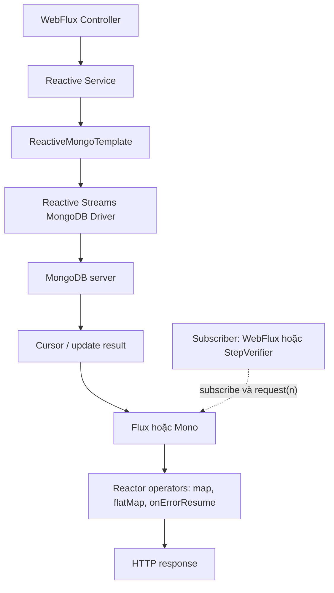

# ReactiveMongoTemplate cho truy vấn, update và aggregation

## 1. Vì sao cần `ReactiveMongoTemplate`?

Trong một dịch vụ bán hàng viết bằng Spring WebFlux, một request có thể cần đọc đơn hàng, thay đổi trạng thái, hoặc tổng hợp doanh thu từ MongoDB. Nếu sử dụng API blocking của `MongoTemplate` ngay trong event loop, thread đang xử lý nhiều kết nối có thể bị giữ lại cho đến khi thao tác I/O hoàn tất.

**`ReactiveMongoTemplate`** là API truy cập MongoDB theo mô hình reactive của **Spring Data MongoDB**. Nó phối hợp với MongoDB Reactive Streams Driver và Reactor, trả về các publisher như:

- `Mono<OrderDocument>`: không quá một document, hoặc completion rỗng.
- `Flux<OrderDocument>`: từ không đến nhiều document.
- `Mono<UpdateResult>`: kết quả một thao tác cập nhật.
- `Flux<RevenueByStatus>`: kết quả nhiều document từ aggregation.
- `Mono<Boolean>`, `Mono<Long>`: kết quả `exists`, `count` hoặc điều kiện đơn trị.

Điểm cốt lõi không phải “bọc kết quả MongoDB bằng `Mono.just(...)`”, mà là dùng **driver không blocking** để thực hiện database I/O theo subscription và tín hiệu `onNext` / `onError` / `onComplete`.

Đây là bài thuộc chương **Truy cập reactive** của module **SPRING_DATA_MONGODB**. Bài gắn truy vấn và ánh xạ document với `ReactiveMongoTemplate`, cập nhật có điều kiện, aggregation, index, transaction, kiểm thử và phân tích hiệu năng. Ta cũng so sánh khi nào repository reactive phù hợp và khi nào dùng template để điều khiển truy vấn linh hoạt hơn.

**Mục tiêu:** viết được một luồng reactive hoàn chỉnh, không tự `subscribe()` trong service, không `block()` trên event loop, biết kết hợp `Query`/`Criteria`/`Update`/`Aggregation` và hiểu ranh giới giữa backpressure của client với chi phí xử lý phía MongoDB.

## 2. Sơ đồ từ request đến MongoDB



Một publisher thường là **mô tả công việc sẽ thực hiện**, chưa phải kết quả đã được tải ngay khi tạo biến.

```java
Flux<OrderDocument> pipeline =
    template.find(query, OrderDocument.class);

// Chưa tự tiêu thụ result tại thời điểm gán pipeline.
// WebFlux, StepVerifier hoặc subscriber hợp lệ sẽ subscribe.
```

Đối với đa số publisher được `ReactiveMongoTemplate` trả về, thao tác database xảy ra khi có subscription. Nhưng **không** suy rằng mọi publisher là một giá trị được cache: subscribe lại có thể kích hoạt lệnh database mới.

### 2.1. Ba hiểu lầm cần bỏ ngay

| Phát biểu | Thực tế |
| --- | --- |
| “`Mono` luôn đã chứa dữ liệu” | Nó mô tả một nguồn phát; có thể rỗng, lỗi hoặc chưa chạy |
| “`Flux` nghĩa là MongoDB đã xử lý xong query trước khi Java nhận” | Driver có thể nhận cursor/batch tăng dần; các stage blocking như `$sort`/`$group` vẫn có thể cần xử lý nhiều input trước |
| “Reactive làm mọi truy vấn nhanh hơn” | Reactive giúp quản lý I/O và số thread khi concurrent; index, scan, sort và tài nguyên server vẫn quyết định nhiều chi phí |

## 3. Điều kiện thiết lập dự án Spring Boot

Với Spring Boot, dùng starter hỗ trợ reactive MongoDB và Reactor từ BOM tương thích. Ví dụ Maven:

```xml
<dependency>
  <groupId>org.springframework.boot</groupId>
  <artifactId>spring-boot-starter-data-mongodb-reactive</artifactId>
</dependency>

<dependency>
  <groupId>org.springframework.boot</groupId>
  <artifactId>spring-boot-starter-webflux</artifactId>
</dependency>
```

Nếu ứng dụng chỉ là worker reactive không phục vụ HTTP, không bắt buộc thêm WebFlux web server; ReactiveMongoTemplate chỉ cần các dependency MongoDB reactive tương ứng.

Cấu hình ví dụ cho môi trường phát triển:

```properties
spring.data.mongodb.uri=mongodb://localhost:27017/orderlab
```

Dùng cấu hình bí mật/TLS/auth phù hợp ở production. Một connection URI đúng không chứng minh server có index, có replica set cho transaction hoặc có schema validation; các yêu cầu đó cần kiểm tra riêng.

### 3.1. Auto-configuration và bean

Trong cấu hình Spring Boot tương thích, auto-configuration tạo `ReactiveMongoTemplate` khi có reactive driver và MongoDB properties phù hợp.

```java
import org.springframework.stereotype.Service;
import org.springframework.data.mongodb.core.ReactiveMongoTemplate;

@Service
public class ReactiveOrderService {
    private final ReactiveMongoTemplate template;

    public ReactiveOrderService(ReactiveMongoTemplate template) {
        this.template = template;
    }
}
```

Nếu có nhiều MongoDB clients/databases hoặc custom converters, hãy xác minh bean được inject dùng đúng `ReactiveMongoDatabaseFactory`, mapping và connection. Không tạo `MongoClient` mới trên mỗi request.

### 3.2. Không trộn imperative driver để “chữa” thiếu method

Một đoạn sai cho WebFlux event loop:

```java
// Sai về mô hình: thao tác blocking xảy ra trước Mono.just.
Mono<OrderDocument> result = Mono.just(
    imperativeMongoTemplate.findById(
        id, OrderDocument.class
    )
);
```

`Mono.just(...)` không biến lời gọi blocking phía trong thành non-blocking. Nếu bắt buộc tích hợp một thư viện blocking không có reactive API, cần cô lập nó trên scheduler dành cho blocking work và kiểm soát tải; đó là workaround, không phải thay thế `ReactiveMongoTemplate`.

## 4. Dataset và entity dùng xuyên suốt

Ta chọn collection `orders`. Dữ liệu lưu:

| Java property | BSON field | Kiểu BSON mong muốn |
| --- | --- | --- |
| `id` | `_id` | string |
| `tenantId` | `tenant_id` | string |
| `status` | `status` | string |
| `amountCents` | `amount_cents` | long |
| `placedAt` | `placed_at` | date |
| `version` | `version` | long, do Spring Data quản lý |

### 4.1. Entity

```java
import java.time.Instant;

import org.springframework.data.annotation.Version;
import org.springframework.data.mongodb.core.mapping.Document;
import org.springframework.data.mongodb.core.mapping.Field;
import org.springframework.data.mongodb.core.mapping.FieldType;
import org.springframework.data.mongodb.core.mapping.MongoId;

@Document(collection = "orders")
public record OrderDocument(
    @MongoId(FieldType.STRING)
    String id,

    @Field("tenant_id")
    String tenantId,

    String status,

    @Field("amount_cents")
    long amountCents,

    @Field("placed_at")
    Instant placedAt,

    @Version
    Long version
) {}
```

`@MongoId(FieldType.STRING)` làm rõ ý đồ lưu `_id` dưới dạng string, không vô tình dựa vào quy tắc chuyển String ID sang ObjectId. `@Field` ánh xạ property Java sang tên BSON có gạch dưới.

`@Version` phục vụ optimistic locking. Khi đi qua `save(...)` phù hợp, Spring Data có cơ chế kiểm tra version; khi cập nhật trực tiếp bằng `Update`, ta sẽ **đặt điều kiện expectedVersion tường minh** để bảo vệ stale writes.

### 4.2. Dữ liệu mẫu `mongosh`

Chỉ chạy trên database test:

```javascript
db.orders.insertMany([
  {
    _id: "ord-1",
    tenant_id: "tenant-A",
    status: "PAID",
    amount_cents: NumberLong("120000"),
    placed_at: ISODate("2026-11-18T08:00:00Z"),
    version: NumberLong("1")
  },
  {
    _id: "ord-2",
    tenant_id: "tenant-A",
    status: "PAID",
    amount_cents: NumberLong("80000"),
    placed_at: ISODate("2026-11-18T09:00:00Z"),
    version: NumberLong("2")
  },
  {
    _id: "ord-3",
    tenant_id: "tenant-A",
    status: "PENDING",
    amount_cents: NumberLong("50000"),
    placed_at: ISODate("2026-11-18T10:00:00Z"),
    version: NumberLong("1")
  },
  {
    _id: "ord-4",
    tenant_id: "tenant-A",
    status: "PAID",
    amount_cents: NumberLong("250000"),
    placed_at: ISODate("2026-11-18T11:00:00Z"),
    version: NumberLong("1")
  },
  {
    _id: "ord-5",
    tenant_id: "tenant-B",
    status: "PAID",
    amount_cents: NumberLong("900000"),
    placed_at: ISODate("2026-11-18T12:00:00Z"),
    version: NumberLong("1")
  }
]);
```

Khi lọc `tenant_id="tenant-A"` và `status="PAID"`, có **3 đơn**: `ord-1`, `ord-2`, `ord-4`; tổng tiền là **450000 cents**. `ord-3` chưa thanh toán, `ord-5` thuộc tenant khác.

### 4.3. Tenant là điều kiện bắt buộc

Trong các ví dụ, tham số `trustedTenantId` phải được lấy từ authentication/authorization context đáng tin cậy. Không coi một query parameter do client tự chọn là quyền truy cập tenant.

Bỏ filter tenant ở service, dù sau đó controller tự lọc response, có thể làm lộ dữ liệu trong query, log, metric hoặc aggregation.

## 5. Query cơ bản: `find`, `findOne`, `findById`, `exists`, `count`

Một service đọc:

```java
import org.springframework.data.mongodb.core.ReactiveMongoTemplate;
import org.springframework.data.mongodb.core.query.Criteria;
import org.springframework.data.mongodb.core.query.Query;
import reactor.core.publisher.Flux;
import reactor.core.publisher.Mono;

public final class OrderQueryReader {

    private final ReactiveMongoTemplate template;

    public OrderQueryReader(ReactiveMongoTemplate template) {
        this.template = template;
    }

    public Flux<OrderDocument> allPaid(
        String trustedTenantId
    ) {
        Query query = Query.query(
            Criteria.where("tenantId").is(trustedTenantId)
                .and("status").is("PAID")
        );
        return template.find(query, OrderDocument.class);
    }

    public Mono<OrderDocument> oneForTenant(
        String trustedTenantId,
        String id
    ) {
        Query query = Query.query(
            Criteria.where("tenantId").is(trustedTenantId)
                .and("id").is(id)
        );
        return template.findOne(query, OrderDocument.class);
    }

    public Mono<Boolean> anyPending(
        String trustedTenantId
    ) {
        Query query = Query.query(
            Criteria.where("tenantId").is(trustedTenantId)
                .and("status").is("PENDING")
        );
        return template.exists(query, OrderDocument.class);
    }

    public Mono<Long> paidCount(
        String trustedTenantId
    ) {
        Query query = Query.query(
            Criteria.where("tenantId").is(trustedTenantId)
                .and("status").is("PAID")
        );
        return template.count(query, OrderDocument.class);
    }
}
```

Kỳ vọng:

- `allPaid("tenant-A")` phát 3 entity, nhưng **không nên mặc định thứ tự** nếu chưa có `sort`.
- `oneForTenant(...)` phát không quá một entity; không có kết quả thì completion rỗng, không phải `null`.
- `anyPending(...)` phát `true` khi có đơn pending.
- `paidCount(...)` phát `3L` từ server trong ví dụ.

### 5.1. `findById` không thay thế filter tenant

`template.findById("ord-5", OrderDocument.class)` chỉ tìm theo ID. Với API đa tenant, nên dùng `findOne` có cả `id` lẫn `tenantId` như trên, hoặc cơ chế authorization tương đương được thực thi tại database query.

### 5.2. Khi nào dùng `switchIfEmpty`?

```java
public Mono<OrderDocument> requireOrder(
    ReactiveMongoTemplate template,
    String trustedTenantId,
    String orderId
) {
    Query q = Query.query(
        Criteria.where("tenantId").is(trustedTenantId)
            .and("id").is(orderId)
    );

    return template.findOne(q, OrderDocument.class)
        .switchIfEmpty(Mono.error(
            new OrderNotFoundException("Không tìm thấy đơn hàng")
        ));
}
```

Với mục đích minh họa, `OrderNotFoundException` là exception domain tự định nghĩa:

```java
public final class OrderNotFoundException
        extends RuntimeException {
    public OrderNotFoundException(String message) {
        super(message);
    }
}
```

Không dùng `defaultIfEmpty(null)`: Reactive Streams **không cho phép phát `null`**. Hãy chọn completion rỗng, lỗi domain hoặc một DTO kết quả tường minh.

## 6. `Criteria` cho các điều kiện linh hoạt

`Criteria` dùng được với cả `MongoTemplate` và `ReactiveMongoTemplate`; điểm khác nhau là **kết quả thực thi**.

```java
import org.springframework.data.mongodb.core.query.Criteria;
import org.springframework.data.mongodb.core.query.Query;

Criteria filter = Criteria.where("tenantId").is("tenant-A")
    .and("status").in("PAID", "SHIPPED")
    .and("amountCents").gte(100000L);

Query query = Query.query(filter);
```

Khi có nhiều điều kiện OR:

```java
Criteria priority = new Criteria().orOperator(
    Criteria.where("amountCents").gte(200000L),
    Criteria.where("status").is("PENDING")
);

Criteria all = new Criteria().andOperator(
    Criteria.where("tenantId").is("tenant-A"),
    priority
);

Query q = Query.query(all);
```

Luôn bao điều kiện tenant/ACL bên ngoài logic OR do người dùng chọn. Nếu đặt tenant vào **một nhánh OR** nhưng nhánh còn lại không có tenant, query có thể trả dữ liệu cross-tenant.

### 6.1. Với array

```java
Criteria sameLine = Criteria.where("items").elemMatch(
    Criteria.where("sku").is("KB-1")
        .and("quantity").gte(2)
);
```

`$elemMatch` giúp đảm bảo các ràng buộc cùng áp vào **một phần tử array**. Reactive không làm thay đổi semantics này. Việc map tên field Java/BSON vẫn phụ thuộc input domain type.

### 6.2. Không ghép raw query JSON từ client

Không cho client tự gửi `{"$where": ...}` hoặc một pipeline BSON tùy ý để service áp dụng trực tiếp. Xây query từ field và operator đã cho phép, giới hạn kích thước input và validate các giá trị trước khi gọi database.

## 7. Sort và phân trang: giới hạn ở MongoDB, không chỉ trên `Flux`

`Flux.take(20)` có thể khiến subscriber dừng sau 20 phần tử, nhưng MongoDB/driver có thể đã đọc nhiều document hoặc thực hiện sort/tập hợp trước đó. Nếu chỉ cần một trang, đặt `sort`, `skip`, `limit` **trong MongoDB query**.

```java
import org.springframework.data.domain.Sort;
import org.springframework.data.mongodb.core.query.Query;
import org.springframework.data.mongodb.core.query.Criteria;

public Flux<OrderDocument> paidPage(
    ReactiveMongoTemplate template,
    String trustedTenantId,
    int page,
    int size
) {
    if (page < 0 || size < 1 || size > 100) {
        return Flux.error(
            new IllegalArgumentException("Page/size invalid")
        );
    }

    long offset = Math.multiplyExact(
        (long) page, (long) size
    );

    Query q = Query.query(
        Criteria.where("tenantId").is(trustedTenantId)
            .and("status").is("PAID")
    );

    q.with(Sort.by(
        Sort.Order.desc("placedAt"),
        Sort.Order.asc("id")
    ));
    q.skip(offset);
    q.limit(size);

    return template.find(q, OrderDocument.class);
}
```

Chọn `id` làm tie-breaker giúp thứ tự ổn định nếu các đơn có cùng thời gian.

### 7.1. Offset pagination vẫn có giới hạn

`$skip` lớn có thể tốn chi phí vì MongoDB phải đi qua nhiều phần tử phù hợp trước khi trả trang tiếp. Khi collection thay đổi giữa những request, offset pagination có thể bị trùng/bỏ sót document.

Với danh sách rất sâu, cân nhắc keyset/scrolling theo sort key duy nhất và index phù hợp, không mặc định `Flux` làm offset pagination rẻ hơn.

### 7.2. Count và items là hai operation

`template.count(q, OrderDocument.class)` và `template.find(q, OrderDocument.class)` là hai lệnh database độc lập nếu được gọi riêng. Giữa hai lệnh, dữ liệu có thể thay đổi.

Khi cần items + count trong **một aggregation**, có thể dùng `$facet`, nhưng phải tính chi phí và giới hạn kết quả. Một `$facet` không tự cho snapshot xuyên nhiều HTTP request; consistency vẫn phụ thuộc read concern/session/transaction theo yêu cầu.

## 8. Projection: không phải truy vấn nào cũng cần cả entity

Một document order thực tế có thể có nhiều line items, ghi chú nội bộ hoặc dữ liệu khách hàng. Trang danh sách chỉ cần ID, status, amount và timestamp.

Có thể dùng projection trường:

```java
Query q = Query.query(
    Criteria.where("tenantId").is(trustedTenantId)
        .and("status").is("PAID")
);

q.fields()
    .include("id")
    .include("status")
    .include("amountCents")
    .include("placedAt");
q.limit(20);

Flux<OrderDocument> partial =
    template.find(q, OrderDocument.class);
```

Đoạn trên **chỉ minh họa field projection**. Một `OrderDocument` trả về lúc này có thể bị thiếu `tenantId`, `version` và các property khác. **Không dùng `save(...)` để ghi đè chính đối tượng partial này**, vì có thể làm mất field/đặt giá trị mặc định.

### 8.1. Dùng DTO cho kết quả đọc

```java
public record OrderListItem(
    String id,
    String status,
    long amountCents,
    java.time.Instant placedAt
) {}
```

Một cách an toàn về semantics là đọc entity có đủ field rồi map, dù không giảm network payload nếu chưa projection:

```java
Flux<OrderListItem> cards =
    template.find(qWithoutPartialProjection, OrderDocument.class)
        .map(o -> new OrderListItem(
            o.id(), o.status(),
            o.amountCents(), o.placedAt()
        ));
```

`qWithoutPartialProjection` ở đây là một `Query` có filter/sort/limit đã xây nhưng **không** có `fields().include(...)`. Nếu mục tiêu là giảm payload, dùng **fluent projection** của `ReactiveMongoTemplate` (ở dòng Spring Data hỗ trợ), ví dụ:

```java
Flux<OrderListItem> cards =
    template.query(OrderDocument.class)
        .as(OrderListItem.class)
        .matching(q)
        .all();
```

Với `.as(...)`, Spring Data dựa trên **mapping của source domain type và target projection**. Kiểm tra phiên bản thư viện, constructor record, `@Field` và tên BSON thực tế. Projection tự động không luôn đạt tối ưu như projection tay với mọi biểu thức/custom converter. Test response và command/`explain` nếu network payload là bottleneck.

### 8.2. DTO đọc khác entity lưu

Nếu `OrderListItem` không có `tenantId` và `version`, đó là **view model**, không phải object dùng để thay thế nguyên document. Với yêu cầu đổi status, hãy dùng `Update.set(...)` có điều kiện; không dựng một entity nửa vời rồi `save`.

## 9. Cập nhật trực tiếp với `ReactiveMongoTemplate.updateFirst`

Một cập nhật trực tiếp trả kết quả **`Mono<UpdateResult>`**.

```java
import com.mongodb.client.result.UpdateResult;

import org.springframework.data.mongodb.core.ReactiveMongoTemplate;
import org.springframework.data.mongodb.core.query.Criteria;
import org.springframework.data.mongodb.core.query.Query;
import org.springframework.data.mongodb.core.query.Update;
import reactor.core.publisher.Mono;

public Mono<Boolean> markPaid(
    ReactiveMongoTemplate template,
    String trustedTenantId,
    String orderId
) {
    Query filter = Query.query(
        Criteria.where("id").is(orderId)
            .and("tenantId").is(trustedTenantId)
            .and("status").is("PENDING")
    );

    Update update = new Update()
        .set("status", "PAID");

    return template.updateFirst(
        filter, update, OrderDocument.class
    ).map(result -> {
        if (!result.wasAcknowledged()) {
            throw new IllegalStateException(
                "Không có xác nhận ghi MongoDB"
            );
        }
        return result.getMatchedCount() == 1L;
    });
}
```

Lệnh này có precondition `status=PENDING` nhưng **chưa** kiểm tra `version` mà caller đọc trước đó. Đối với các nghiệp vụ cần optimistic concurrency giữa nhiều writer, xem CAS ở mục tiếp theo.

### 9.1. `matchedCount` và `modifiedCount`

- `matchedCount=1`: document khớp mọi điều kiện query.
- `matchedCount=0`: không khớp; có thể do ID, tenant, status hoặc version, không suy riêng một nguyên nhân.
- `modifiedCount=0` không nhất thiết là conflict: có thể filter khớp nhưng update không đổi gì.
- Không dùng unacknowledged write concern nếu logic phải dựa vào counters.

### 9.2. `updateMulti` và `remove`

```java
Mono<UpdateResult> updated = template.updateMulti(
    Query.query(Criteria.where("tenantId").is(tenantId)
        .and("status").is("PENDING")),
    new Update().set("status", "EXPIRED"),
    OrderDocument.class
);

Mono<com.mongodb.client.result.DeleteResult> deleted =
    template.remove(
        Query.query(Criteria.where("tenantId").is(tenantId)
            .and("id").is(orderId)),
        OrderDocument.class
    );
```

Đây là hai publisher **khác nhau**. Nếu chỉ khai báo chúng rồi return `updated`, lệnh `deleted` chưa được subscribe sẽ không thực thi. Nếu muốn chạy tuần tự, nối bằng `then(...)` trong cùng chain, nhưng cần xem lại tính đúng khi hai thao tác có liên quan.

`updateMulti` trên nhiều document không đồng nghĩa một **transaction all-or-nothing**. Mỗi thao tác update đơn document có atomicity riêng; nếu cần bất biến đa document, dùng transaction trên replica set/sharded cluster thích hợp.

## 10. CAS bằng `expectedVersion`: cập nhật nguyên tử khi có cạnh tranh

Một lỗi dễ gặp là chỉ dựa vào `@Version` và nghĩ mọi direct update tự ngăn lost updates. Với `save(entity)`, Spring Data có optimistic locking; với `Update` trực tiếp, **hãy đưa version kỳ vọng vào filter** nếu nghiệp vụ cần chống stale writes.

```java
public record ConfirmCommand(
    String orderId,
    long expectedVersion
) {}
```

Service:

```java
public Mono<Boolean> confirmOrder(
    ReactiveMongoTemplate template,
    String trustedTenantId,
    ConfirmCommand c
) {
    if (c.expectedVersion() < 0) {
        return Mono.error(
            new IllegalArgumentException("Version âm")
        );
    }

    Query filter = Query.query(
        Criteria.where("id").is(c.orderId())
            .and("tenantId").is(trustedTenantId)
            .and("version").is(c.expectedVersion())
            .and("status").is("PENDING")
    );

    Update update = new Update()
        .set("status", "CONFIRMED")
        .inc("version", 1L);

    return template.updateFirst(
        filter, update, OrderDocument.class
    ).map(r -> {
        if (!r.wasAcknowledged()) {
            throw new IllegalStateException(
                "Unacknowledged CAS write"
            );
        }
        return r.getMatchedCount() == 1L;
    });
}
```

Đây là **compare-and-set**: nếu MongoDB tìm thấy ID, tenant, version và status phù hợp, lệnh đồng thời đổi status và tăng version. Worker khác đã tăng version thì query version cũ không còn khớp.

**Cảnh báo về `@Version`:** ở những dòng Spring Data MongoDB hiện đại, một số update operation có thể tự tăng property version nếu nó **chưa được nêu trong `Update`**. Điều đó **không tự thêm expectedVersion vào filter**. Ví dụ trên đã thêm `Update.inc("version",1L)` tường minh; không tự tăng version lần thứ hai trong application.

### 10.1. `matchedCount=0` có thể là nhiều trạng thái

Không tự trả “version conflict” khi result bằng 0: có thể order không tồn tại, thuộc tenant khác, đã confirmed/cancelled hoặc request trước đã được áp dụng nhưng phản hồi bị mất.

Với yêu cầu idempotency nghiêm ngặt, cần `operationId` hoặc ledger để đối soát, không tự retry với version mới.

## 11. `findAndModify`: nhận document sau khi update

Khi cần trả updated entity ngay sau khi CAS thành công, dùng `findAndModify`:

```java
import org.springframework.data.mongodb.core.FindAndModifyOptions;

public Mono<OrderDocument> confirmAndReturn(
    ReactiveMongoTemplate template,
    String tenantId,
    String orderId,
    long expectedVersion
) {
    Query filter = Query.query(
        Criteria.where("id").is(orderId)
            .and("tenantId").is(tenantId)
            .and("version").is(expectedVersion)
            .and("status").is("PENDING")
    );

    Update update = new Update()
        .set("status", "CONFIRMED")
        .inc("version", 1L);

    return template.findAndModify(
        filter,
        update,
        FindAndModifyOptions.options().returnNew(true),
        OrderDocument.class
    ).switchIfEmpty(
        Mono.error(new OrderNotFoundException(
            "Không có đơn thỏa điều kiện cập nhật"
        ))
    );
}
```

Trong ví dụ này, exception domain có thể cần tên khác như `OrderPreconditionFailedException` vì empty có thể do version/status mismatch chứ không chỉ thiếu ID. Tùy hợp đồng API, có thể trả `Mono.empty()` và để caller phân loại sau readback.

**Không thêm `upsert(true)` vào CAS chỉ để “tránh empty”**: khi version không khớp, upsert có thể thử insert document mới và gặp duplicate key hoặc tạo dữ liệu sai.

### 11.1. Khi nào dùng `findAndModify` thay `updateFirst`?

| Nhu cầu | Lựa chọn thường phù hợp |
| --- | --- |
| Chỉ cần biết có update khớp hay không | `updateFirst(...) → Mono<UpdateResult>` |
| Cần entity mới / version mới trong một operation | `findAndModify(...returnNew(true))` |
| Cần kết quả nhiều document | `find(...) → Flux<T>` |
| Cần update nhiều document cùng điều kiện | `updateMulti`, nhưng không phải transaction |
| Cần lưu cả entity với optimistic locking | Reactive repository `save(entity)` / API tương ứng, bảo đảm version theo contract |

`findAndModify` không tự ngăn stale writes nếu filter không chứa expectedVersion.

## 12. Chèn dữ liệu và luồng ghi có thứ tự

`ReactiveMongoTemplate.insert(...)` trả publisher cho entity đã được lưu. Có thể tổ chức chuỗi:

```java
public Mono<OrderDocument> createOrder(
    ReactiveMongoTemplate template,
    OrderDocument input
) {
    if (input.amountCents() <= 0) {
        return Mono.error(
            new IllegalArgumentException("Số tiền không hợp lệ")
        );
    }
    return template.insert(input);
}
```

Với `@Version Long` còn null, Spring Data có thể khởi tạo version trong quá trình insert theo quy tắc mapping; phải đọc lại kết quả và kiểm thử phiên bản đang dùng.

### 12.1. Chạy nhiều insert, kiểm soát thứ tự và concurrency

```java
Flux<OrderDocument> input = Flux.fromIterable(commands)
    .map(this::toOrderDocument);

// Khi cần bảo toàn thứ tự phát và xử lý tuần tự:
Flux<OrderDocument> persisted =
    input.concatMap(template::insert);

// Khi các order độc lập và chấp nhận xử lý đồng thời:
Flux<OrderDocument> concurrent =
    input.flatMap(template::insert, 8);
```

`commands` là nguồn dữ liệu giả định và `toOrderDocument` là hàm chuyển DTO thành entity; ví dụ chỉ nhấn mạnh lựa chọn Reactor operator.

- `concatMap` chờ một thao tác hoàn thành mới thực hiện thao tác tiếp theo theo thứ tự.
- `flatMap(..., 8)` cho phép tối đa số luồng publisher active tương ứng theo operator, nhưng **không** đảm bảo thứ tự kết quả.
- Đây là **nhiều insert riêng lẻ**, không tự thành transaction, không tự bảo đảm all-or-nothing.
- Giới hạn concurrency là biện pháp kiểm soát tải, không phải giới hạn số kết nối driver tuyệt đối.

**Đừng dùng `subscribe()` thủ công bên trong service để “bắt đầu job” rồi return success ngay.** Khi đó lỗi ghi không được truyền về caller, request có thể hoàn thành trước database và transaction context có thể không theo cùng chain.

## 13. Aggregation với `ReactiveMongoTemplate.aggregate(...)`

Aggregation kết hợp filter, group, sort, projection để biến dữ liệu thành những document báo cáo. Với entity ở mục 4, ta muốn tổng tiền theo trạng thái trong tenant A.

### 13.1. Lệnh MongoDB tương đương

```javascript
db.orders.aggregate([
  { $match: { tenant_id: "tenant-A" } },
  {
    $group: {
      _id: "$status",
      orders: { $sum: 1 },
      grossCents: { $sum: "$amount_cents" }
    }
  },
  {
    $project: {
      _id: 0,
      status: "$_id",
      orders: 1,
      grossCents: 1
    }
  },
  { $sort: { status: 1 } }
]);
```

Dựa trên dataset:

| status | orders | grossCents |
| --- | ---: | ---: |
| PAID | 3 | 450000 |
| PENDING | 1 | 50000 |

Document `ord-5` của tenant B không được tính. Đây là báo cáo theo status, không phải danh sách order.

### 13.2. DTO đích

```java
public record RevenueByStatus(
    String status,
    long orders,
    long grossCents
) {}
```

### 13.3. Aggregation Spring Data typed

```java
import org.springframework.data.domain.Sort;
import org.springframework.data.mongodb.core.ReactiveMongoTemplate;
import org.springframework.data.mongodb.core.aggregation.Aggregation;
import org.springframework.data.mongodb.core.aggregation.AggregationOptions;
import org.springframework.data.mongodb.core.query.Criteria;
import reactor.core.publisher.Flux;

import java.time.Duration;

public Flux<RevenueByStatus> revenueByStatus(
    ReactiveMongoTemplate template,
    String trustedTenantId
) {
    Aggregation agg = Aggregation.newAggregation(
        Aggregation.match(
            Criteria.where("tenantId").is(trustedTenantId)
        ),
        Aggregation.group("status")
            .count().as("orders")
            .sum("amountCents").as("grossCents"),
        Aggregation.project("orders", "grossCents")
            .and("_id").as("status")
            .andExclude("_id"),
        Aggregation.sort(Sort.by("status"))
    ).withOptions(
        AggregationOptions.builder()
            .cursorBatchSize(100)
            .maxTime(Duration.ofSeconds(5))
            .build()
    );

    return template.aggregate(
        agg,
        OrderDocument.class,
        RevenueByStatus.class
    );
}
```

**Quan trọng:** `OrderDocument.class` là **input domain type**: trong các stage typed, Spring Data dựa trên mapping để biến `tenantId` thành BSON `tenant_id` và `amountCents` thành `amount_cents`. Kết quả là `Flux<RevenueByStatus>` vì sau group/projection, output **không còn là entity nguồn**.

`Aggregation.project(...).and("_id").as("status")` đặt tên field để khớp DTO. Không giả định `_id` của kết quả `$group` sẽ tự map đúng thành mọi tên tùy chọn của record.

### 13.4. `allowDiskUse` và batch size không thay logic aggregation

`AggregationOptions.cursorBatchSize(100)` điều chỉnh số document trên cursor result theo khả năng server/driver; nó **không giới hạn** số lượng group hoặc input document được đọc. `allowDiskUse(true)` nếu được đặt chỉ cho phép những stage hỗ trợ spill sử dụng đĩa tạm khi cần; nó không khắc phục index thiếu, không mở rộng giới hạn BSON 16 MiB và không cho `$facet` vượt giới hạn nội bộ riêng.

**Reactive vẫn có blocking stages ở MongoDB**: `$sort`/`$group` có thể phải xử lý số lượng lớn input trước khi tạo ra result. `Flux` không tự làm workload server rẻ hơn.

## 14. `$facet`, tổng số và phân trang trong một aggregation

Một endpoint có thể cần:

- Trang đầu tiên của các order đang PAID.
- Tổng số order PAID.
- Tổng tiền PAID.

Ví dụ `mongosh`:

```javascript
db.orders.aggregate([
  {
    $match: {
      tenant_id: "tenant-A",
      status: "PAID"
    }
  },
  {
    $facet: {
      items: [
        { $sort: { placed_at: -1, _id: 1 } },
        { $limit: 20 },
        {
          $project: {
            _id: 1,
            status: 1,
            amount_cents: 1,
            placed_at: 1
          }
        }
      ],
      totals: [
        {
          $group: {
            _id: null,
            total: { $sum: 1 },
            grossCents: { $sum: "$amount_cents" }
          }
        }
      ]
    }
  }
]);
```

Hình dạng output:

```json
{
  "items": [
    { "_id": "ord-4", "status": "PAID", "amount_cents": 250000 },
    { "_id": "ord-2", "status": "PAID", "amount_cents": 80000 },
    { "_id": "ord-1", "status": "PAID", "amount_cents": 120000 }
  ],
  "totals": [
    { "_id": null, "total": 3, "grossCents": 450000 }
  ]
}
```

JSON rút gọn không in `placed_at` dù pipeline có field đó. Trên server, output là **một document chứa các array**; không phải ba phần tử `Flux` riêng cho ba items.

### 14.1. Reactively đọc kết quả facet

```java
import org.bson.Document;

Aggregation aggregation = Aggregation.newAggregation(
    Aggregation.match(
        Criteria.where("tenantId").is(tenantId)
            .and("status").is("PAID")
    ),
    Aggregation.facet(
        Aggregation.sort(Sort.by(
            Sort.Order.desc("placedAt"),
            Sort.Order.asc("id")
        )),
        Aggregation.limit(20)
    ).as("items")
     .and(
         Aggregation.group()
             .count().as("total")
             .sum("amountCents").as("grossCents")
     ).as("totals")
);

Mono<Document> oneFacetDocument =
    template.aggregate(
        aggregation, OrderDocument.class, Document.class
    ).next();
```

Với `$facet` là stage cuối, output thông thường có một document với hai arrays `items`/`totals`. `next()` hợp lý khi hợp đồng là một document; nếu thêm `$unwind` sau facet, output có thể đổi và không nên dùng `next()` máy móc.

**Cảnh báo:** `totals` có thể là mảng rỗng nếu không có order nào khớp; `totals.get(0)` không an toàn. Khi dựng API DTO, chuẩn hóa `total=0`/`grossCents=0`.

### 14.2. Giới hạn memory và output

`$facet` có giới hạn khoảng **100 MB** cho document nội bộ của stage và không được spill bằng `allowDiskUse`; kết quả BSON cuối vẫn chịu giới hạn **16 MiB**. Nhánh `items` phải có `$limit` đúng vị trí. Đừng đưa `limit` ra trước facet nếu `totals` phải tính trên toàn bộ tập phù hợp.

Đối với danh sách lớn, nhiều nhánh hoặc nhu cầu streaming từng document, một query riêng có cursor thường phù hợp hơn việc gom cả danh sách vào một facet document khổng lồ.

## 15. Khi nào dùng `Mono`, khi nào dùng `Flux`?

| Thao tác | Kiểu trả về điển hình | Lưu ý |
| --- | --- | --- |
| `findOne`, `findById` | `Mono<T>` | 0 hoặc 1 item |
| `find` | `Flux<T>` | 0 đến nhiều item |
| `exists` | `Mono<Boolean>` | Phát true/false |
| `count` | `Mono<Long>` | Một số đếm |
| `insert(entity)` | `Mono<T>` | Entity đã được lưu |
| `updateFirst` / `updateMulti` | `Mono<UpdateResult>` | Tổng matched/modified |
| `remove` | `Mono<DeleteResult>` | Tổng deleted |
| `findAndModify` | `Mono<T>` | Có thể rỗng nếu không match |
| `aggregate` | `Flux<O>` | Output documents của pipeline |
| Aggregation `$facet` cuối | Thường đọc `Flux<Document>.next()` | Một document chứa nhiều arrays |
| `indexOps(...).ensureIndex` | `Mono<String>` ở API hỗ trợ | Tạo index không nên gọi mỗi HTTP request |

Một `Mono<T>` **không có item** có thể là hoàn thành rỗng, không phải lỗi. Phân biệt `switchIfEmpty` với `onErrorResume`: một cái xử lý không có kết quả, một cái xử lý exception.

## 16. Reactor operators: những lựa chọn ảnh hưởng nghiệp vụ

### 16.1. `map`: biến đổi đồng bộ, không gọi DB lần hai

```java
Flux<OrderListItem> rows =
    template.find(query, OrderDocument.class)
        .map(o -> new OrderListItem(
            o.id(), o.status(),
            o.amountCents(), o.placedAt()
        ));
```

`map` biến đổi một item thành một item khác bằng code đồng bộ. Không trả `Mono` từ `map` nếu bạn muốn thực hiện một truy vấn reactive tiếp theo; khi đó sẽ có nested publisher.

### 16.2. `flatMap`: compose thêm I/O reactive

```java
Mono<OrderDocument> requested =
    template.findOne(query, OrderDocument.class)
        .flatMap(order ->
            otherReactiveService.enrich(order)
        );
```

`otherReactiveService.enrich(...)` là method giả định trả `Mono<OrderDocument>`. `flatMap` giúp nối I/O mà không gọi `block()`.

### 16.3. `concatMap` với sequence phải giữ thứ tự

Khi order trong danh sách phụ thuộc nhau, dùng `concatMap` hoặc thiết kế queue theo key:

```java
Flux<WriteReceipt> receipts =
    Flux.fromIterable(commands)
        .concatMap(command ->
            writeCommand(command)
        );
```

`WriteReceipt`/`writeCommand` là kiểu và method minh họa. `concatMap` giữ thứ tự phát kết quả và chờ thao tác trước hoàn thành; nó không tạo transaction cho nhiều command.

### 16.4. `flatMap` có concurrency giới hạn

```java
Flux<WriteReceipt> receipts =
    Flux.fromIterable(commands)
        .flatMap(
            command -> writeCommand(command),
            8
        );
```

Có thể tăng throughput với operations độc lập, nhưng thứ tự kết quả không được bảo đảm. Khi nhiều command cùng sửa một order, cần version guard/transaction/serialize theo aggregate ID; concurrency của Reactor không bảo vệ lost updates.

### 16.5. `zip` và `when` không tự thành transaction

```java
Mono<Dashboard> dashboard = Mono.zip(
    reader.paidCount(tenantId),
    reader.revenueTotal(tenantId)
).map(tuple -> new Dashboard(
    tuple.getT1(), tuple.getT2()
));
```

Đây là ví dụ với `reader.revenueTotal` và `Dashboard` do ứng dụng định nghĩa. `zip` kết hợp hai publisher; chúng có thể chạy gần nhau về thời gian, nhưng **không** tự có snapshot hay all-or-nothing. Nếu một nhánh là write, phải xem lại transaction và idempotency.

## 17. Cold publisher, subscribe lại và rủi ro ghi hai lần

Một service tạo publisher:

```java
Mono<OrderDocument> created =
    template.insert(order);
```

Nếu hai subscriber độc lập subscribe publisher này, thao tác insert có thể bị **thực hiện hai lần**. Vì vậy, không coi một `Mono` như future đã có kết quả dùng tùy ý vô hạn.

Ví dụ sai:

```java
Mono<OrderDocument> created = template.insert(order);

created.subscribe();  // Lệnh ghi thứ nhất, lỗi có thể thất lạc.
return created;        // WebFlux subscribe lần nữa.
```

Kết quả có thể là duplicate key hoặc dữ liệu ghi hai lần nếu mỗi lần dùng ID khác. **Không gọi `subscribe()` trong service** khi caller chịu trách nhiệm subscribe.

### 17.1. `retryWhen` phải phân biệt read với write

Cho query đọc thuần, bounded retry cho lỗi tạm thời có thể hữu ích:

```java
Mono<OrderDocument> one =
    template.findOne(query, OrderDocument.class)
        .retryWhen(
            reactor.util.retry.Retry.backoff(
                2, java.time.Duration.ofMillis(100)
            ).filter(this::isTransientMongoFailure)
        );
```

`isTransientMongoFailure` là hàm phân loại lỗi do ứng dụng viết; không nên retry mọi exception, đặc biệt không retry validation/authorization errors.

Với `insert`, `updateFirst` hoặc `$inc`, request có thể đã được server thực hiện trước khi client mất phản hồi. Một `retryWhen` mù có thể lặp business effect. Dùng operation ID, expectedVersion, ledger/idempotency và readback khi có ambiguous outcome.

### 17.2. `cache()` không phải database idempotency

`mono.cache()` có thể chia sẻ kết quả/terminal signals cho subscribers trong vòng đời một publisher instance, nhưng nó **không** bảo đảm exactly-once toàn hệ thống qua process restart, multiple JVM, timeout hoặc redeploy.

Idempotency dữ liệu phải dựa trên ràng buộc MongoDB và quy tắc business.

## 18. Backpressure, cursor batch và server-side blocking stages

Reactive Streams cho subscriber yêu cầu dữ liệu theo demand, thường biểu diễn `request(n)`. MongoDB Reactive Streams Driver xử lý cursor/batches tương ứng, nhưng không có nghĩa mọi requested item tương ứng **đúng một network call**.

### 18.1. Batch size

```java
Query query = Query.query(
    Criteria.where("tenantId").is(tenantId)
);

query.cursorBatchSize(100);

Flux<OrderDocument> rows =
    template.find(query, OrderDocument.class);
```

`cursorBatchSize(100)` là yêu cầu về kích thước batch cursor, **không phải giới hạn tổng số result**. Một query trả 50.000 documents vẫn có thể phát 50.000 item qua nhiều batch. Với collection lớn, đặt `limit`, projection, timeouts và các điều kiện kiểm soát dữ liệu.

Các API batch/cursor option có thể khác theo dòng Spring Data; dùng method của phiên bản dependency thực tế và kiểm tra command monitoring.

### 18.2. `limitRate` không đồng nghĩa query limit

```java
Flux<OrderDocument> rows =
    template.find(query, OrderDocument.class)
        .limitRate(50);
```

`limitRate` điều chỉnh cách Reactor yêu cầu dữ liệu upstream, không sửa MongoDB filter/sort/limit. Driver/server có thể đã fetch một batch lớn; không dùng `limitRate` thay `Query.limit(...)` để thực thi quy tắc phân trang hoặc quota.

### 18.3. Các stage cần gom dữ liệu

Một `$sort` không dùng index hoặc `$group` nhiều key có thể dùng nhiều RAM server; một `$facet` có thể gom arrays rất lớn. Dù consumer chỉ request 1 item, server vẫn cần làm đủ công việc để tạo item đó.

Đừng quảng cáo backpressure như cách tránh giới hạn BSON **16 MiB/document** hoặc giới hạn bộ nhớ của `$facet`.

### 18.4. `collectList()` và memory Java

```java
Mono<java.util.List<OrderDocument>> all =
    template.find(query, OrderDocument.class)
        .collectList();
```

`collectList()` materialize **tất cả** result phát vào một `List`. Trên output lớn nó có thể làm ứng dụng hết RAM, dù driver đã lấy theo batch. Chỉ dùng khi danh sách đã được giới hạn hoặc kích thước được kiểm soát.

## 19. Index và chẩn đoán truy vấn reactive

Cùng một query điều kiện tenant, status, placedAt sẽ có cùng nhu cầu index như imperative MongoDB:

```javascript
db.orders.createIndex(
  {
    tenant_id: 1,
    status: 1,
    placed_at: -1,
    _id: 1
  },
  {
    name: "idx_orders_tenant_status_time_id"
  }
);
```

Với filter `tenant_id + status` và sort `placed_at desc, _id asc`, index trên có thể là một ứng viên; planner vẫn cần được kiểm tra trên dữ liệu thực tế, đặc biệt khi projection/limit/partition khác nhau.

### 19.1. `explain` bên MongoDB

```javascript
db.orders.find({
  tenant_id: "tenant-A",
  status: "PAID"
}).sort({
  placed_at: -1,
  _id: 1
}).limit(20).explain("executionStats");
```

Quan sát:

| Trường | Câu hỏi |
| --- | --- |
| `IXSCAN`, `COLLSCAN` | MongoDB có dùng index? |
| `totalKeysExamined` | Bao nhiêu index entries được duyệt? |
| `totalDocsExamined` | Bao nhiêu document gốc được đọc? |
| `SORT` / sort stage | Có sort trong bộ nhớ không? |
| `nReturned` | Đúng số result? |
| `executionTimeMillis` | Chi phí query trên server? |
| Command/getMore metrics | Cursor có nhiều batch/round trips không? |
| p95/p99 | Latency thực tế khi concurrency cao? |

Không nhầm thời gian server trong `explain` với **end-to-end HTTP latency**: còn network, mapping, application logic, downstream consumer và backpressure.

### 19.2. Index creation là một publisher

Ở phiên bản ReactiveMongoTemplate hỗ trợ:

```java
import org.springframework.data.domain.Sort;
import org.springframework.data.mongodb.core.index.Index;

Mono<String> indexName = template
    .indexOps(OrderDocument.class)
    .ensureIndex(
        new Index()
            .on("tenantId", Sort.Direction.ASC)
            .on("status", Sort.Direction.ASC)
            .on("placedAt", Sort.Direction.DESC)
            .on("id", Sort.Direction.ASC)
            .named("idx_orders_tenant_status_time_id")
    );
```

Việc khai báo `indexName` mà không subscribe không tạo index. **Đừng chạy ensureIndex trong từng HTTP request**; quản lý index ở migration/bootstrap có quyền phù hợp và xác minh key BSON sau `@Field`.

`@Indexed` hoặc `@CompoundIndex` là metadata; cấu hình auto-index creation có thể **tắt mặc định** ở các phiên bản Spring Data MongoDB hiện đại. Hãy có quy trình provision rõ thay vì mặc định annotation đảm bảo index đã tồn tại.

## 20. Reactive transaction: phải giữ cùng subscriber context

MongoDB hỗ trợ multi-document transaction trên replica set hoặc sharded cluster đáp ứng yêu cầu phiên bản; một standalone `mongod` không hỗ trợ multi-document transaction.

Spring Data có `ReactiveMongoTransactionManager`:

```java
import org.springframework.context.annotation.Bean;
import org.springframework.context.annotation.Configuration;
import org.springframework.data.mongodb.ReactiveMongoDatabaseFactory;
import org.springframework.data.mongodb.ReactiveMongoTransactionManager;
import org.springframework.transaction.reactive.TransactionalOperator;

@Configuration
public class ReactiveTransactionConfig {

    @Bean
    public ReactiveMongoTransactionManager txManager(
        ReactiveMongoDatabaseFactory factory
    ) {
        return new ReactiveMongoTransactionManager(factory);
    }

    @Bean
    public TransactionalOperator txOperator(
        ReactiveMongoTransactionManager manager
    ) {
        return TransactionalOperator.create(manager);
    }
}
```

### 20.1. Hai update trong một transaction

```java
import org.springframework.transaction.reactive.TransactionalOperator;

public Mono<Void> transferUnits(
    ReactiveMongoTemplate template,
    TransactionalOperator tx,
    String trustedTenant,
    String sourceId,
    String targetId,
    long units
) {
    if (units <= 0 || sourceId.equals(targetId)) {
        return Mono.error(
            new IllegalArgumentException("Transfer invalid")
        );
    }

    Query from = Query.query(
        Criteria.where("id").is(sourceId)
            .and("tenantId").is(trustedTenant)
            .and("availableUnits").gte(units)
    );

    Query to = Query.query(
        Criteria.where("id").is(targetId)
            .and("tenantId").is(trustedTenant)
    );

    Mono<Void> changes = template.updateFirst(
        from,
        new Update().inc("availableUnits", -units),
        InventoryAccount.class
    ).flatMap(debit -> {
        if (debit.getMatchedCount() != 1) {
            return Mono.error(
                new IllegalStateException(
                    "Không đủ đơn vị ở nguồn"
                )
            );
        }

        return template.updateFirst(
            to,
            new Update().inc("availableUnits", units),
            InventoryAccount.class
        );
    }).flatMap(credit -> {
        if (credit.getMatchedCount() != 1) {
            return Mono.error(
                new IllegalStateException(
                    "Đích không tồn tại"
                )
            );
        }
        return Mono.<Void>empty();
    });

    return tx.transactional(changes);
}
```

`InventoryAccount` là entity giả định có `id`, `tenantId` và `availableUnits` với mapping phù hợp. Ví dụ nhấn mạnh **transaction boundary**: hai update nối nhau trong một publisher được `TransactionalOperator` quản lý. Nó chưa là workflow production hoàn chỉnh vì thiếu operation ID, audit ledger, check overflow và cách đối soát commit chưa rõ kết quả.

### 20.2. Tại sao không tự `subscribe()` ở giữa?

Sai:

```java
template.updateFirst(from, debit, InventoryAccount.class)
    .subscribe();  // Tách khỏi transaction chain!

return tx.transactional(
    template.updateFirst(to, credit, InventoryAccount.class)
);
```

Lệnh thứ nhất bị subscribe độc lập, không tham gia cùng subscriber/transaction context. Nếu lệnh thứ hai lỗi, không có bảo đảm rollback lệnh thứ nhất.

Đúng là trả về một chain duy nhất để `tx.transactional(...)` điều khiển và caller subscribe.

### 20.3. Transaction không giải quyết retry một business effect

Nếu response commit mất, transaction có thể đã commit. Retry bằng operation ID mới có thể áp dụng lại effect. Cần idempotency token/ledger, xử lý error labels như `TransientTransactionError` và `UnknownTransactionCommitResult` theo contract driver/framework.

Không dùng `retryWhen` không giới hạn cho cả transaction khi chưa hiểu các effect bên ngoài MongoDB.

## 21. Error handling: tách empty, validation, timeout và lỗi mạng

Một API reactive đúng phải phân biệt:

- **Không tìm thấy document**: `Mono.empty()` hoặc result rỗng.
- **CAS precondition không khớp**: acknowledged `UpdateResult.matchedCount=0`.
- **Duplicate key**: thao tác ghi bị từ chối vì unique index.
- **Schema validation**: MongoDB từ chối document không hợp lệ.
- **Timeout/server selection**: MongoDB chưa trả kết quả trong giới hạn phù hợp.
- **Network error sau write**: outcome có thể chưa rõ.
- **Cancel subscription**: consumer không cần dữ liệu nữa; không giả định write đã rollback.

### 21.1. Xử lý lỗi có chọn lọc

```java
Mono<OrderDocument> found = template.findOne(
    query, OrderDocument.class
)
    .switchIfEmpty(Mono.error(
        new OrderNotFoundException("Order not found")
    ));

Mono<OrderDocument> created = template.insert(order)
    .onErrorMap(
        org.springframework.dao.DuplicateKeyException.class,
        e -> new OrderConflictException(
            "Duplicate business key", e
        )
    );
```

`OrderConflictException` là class domain do ứng dụng tự định nghĩa, còn `order` là entity cần ghi. Ví dụ tách **đường đọc** (`found` xử lý empty bằng `switchIfEmpty`) khỏi **đường ghi** (`created` chuyển lỗi unique index bằng `onErrorMap`). Không dùng mapper duplicate key cho `findOne` đọc thuần hoặc xử lý empty như một exception mạng.

### 21.2. Timeout có nhiều tầng

```java
return template.find(query, OrderDocument.class)
    .timeout(java.time.Duration.ofSeconds(3));
```

`timeout` của Reactor là giới hạn quan sát tín hiệu ở client, không tương đương `maxTimeMS` của MongoDB Server. Với aggregation, có thể dùng `AggregationOptions.maxTime(...)` ở nơi API hỗ trợ, kèm driver timeout và HTTP timeout được điều phối.

Client timeout sau một write không chứng minh server chưa ghi. Không tự phát lại cùng update không idempotent.

### 21.3. Không nuốt lỗi

Sai:

```java
return template.insert(order)
    .onErrorResume(error -> Mono.empty());
```

Nếu controller coi completion rỗng là success, lỗi duplicate key hoặc validation bị che đi. Phải phân loại đúng lỗi có thể fallback và giữ nguyên các lỗi nghiệp vụ/hệ thống cần thông báo.

## 22. WebFlux Controller: trả publisher, không block

Một controller tối giản:

```java
import org.springframework.http.ResponseEntity;
import org.springframework.web.bind.annotation.GetMapping;
import org.springframework.web.bind.annotation.PathVariable;
import org.springframework.web.bind.annotation.RequestMapping;
import org.springframework.web.bind.annotation.RestController;
import reactor.core.publisher.Mono;

@RestController
@RequestMapping("/api/orders")
public class OrderController {

    private final OrderQueryReader reader;

    public OrderController(OrderQueryReader reader) {
        this.reader = reader;
    }

    @GetMapping("/{id}")
    public Mono<ResponseEntity<OrderDocument>> one(
        @PathVariable String id
    ) {
        // Ví dụ: trong production phải lấy từ security context
        // đã xác thực, KHÔNG hard-code hoặc tin tenant từ path.
        String trustedTenantId = "tenant-A";

        return reader.oneForTenant(trustedTenantId, id)
            .map(ResponseEntity::ok)
            .defaultIfEmpty(
                ResponseEntity.notFound().build()
            );
    }
}
```

Ở đây `OrderQueryReader` cần được đăng ký thành Spring bean (`@Service` hoặc `@Bean`), không chỉ tạo bằng `new` tùy tiện trong controller.

**Không đưa hard-coded tenant vào production.** Ứng dụng thực tế nên lấy tenant từ authentication principal/reactive security context và kiểm tra ACL trước khi gửi query. DTO response nên tránh lộ field nội bộ như version, audit hoặc ghi chú nếu API không cần.

### 22.1. Vì sao return publisher?

WebFlux quản lý subscription, demand, serialization, hủy request và lỗi. Nếu controller tự `subscribe()`, caller sẽ nhận response trước khi công việc hoàn tất, mất error propagation và dễ tách database work khỏi transaction context.

## 23. Kiểm thử với `StepVerifier` và MongoDB thật

Unit test `Flux.just(...)` chỉ kiểm tra Reactor operator, không kiểm chứng MongoDB server filtering, mapping `@Field`, index, aggregation hoặc atomic update. Nên có integration test với MongoDB thật.

### 23.1. Test kết quả query và aggregation

Ví dụ Spring Boot 3.x, JUnit 5, AssertJ, Reactor Test, Spring Data MongoDB và MongoDB test instance. `@DataMongoTest` và cấu hình reactive driver cần phù hợp phiên bản Boot trong dự án.

```java
import static org.assertj.core.api.Assertions.assertThat;

import java.time.Instant;
import java.util.UUID;

import org.junit.jupiter.api.Test;
import org.springframework.beans.factory.annotation.Autowired;
import org.springframework.boot.test.autoconfigure.data.mongo.DataMongoTest;
import org.springframework.context.annotation.Import;
import org.springframework.data.mongodb.core.ReactiveMongoTemplate;
import reactor.test.StepVerifier;

@DataMongoTest
@Import(OrderQueryReader.class)
class ReactiveOrderTemplateIntegrationTest {

    @Autowired ReactiveMongoTemplate template;
    @Autowired OrderQueryReader reader;

    @Test
    void findPaidFiltersTenantAndUsesReactivePublisher() {
        String tenant = "rx-" + UUID.randomUUID();

        OrderDocument paid = new OrderDocument(
            "rx-paid-" + UUID.randomUUID(),
            tenant,
            "PAID",
            120000L,
            Instant.parse("2026-11-18T08:00:00Z"),
            null
        );
        OrderDocument pending = new OrderDocument(
            "rx-pending-" + UUID.randomUUID(),
            tenant,
            "PENDING",
            30000L,
            Instant.parse("2026-11-18T09:00:00Z"),
            null
        );

        StepVerifier.create(
            template.insert(paid)
                .then(template.insert(pending))
                .thenMany(reader.allPaid(tenant))
        )
            .assertNext(found -> {
                assertThat(found.id()).isEqualTo(paid.id());
                assertThat(found.amountCents())
                    .isEqualTo(120000L);
            })
            .verifyComplete();
    }
}
```

`@Import(OrderQueryReader.class)` đăng ký chính lớp đọc ở mục 5 thành bean cho test, mặc dù lớp đó không gắn `@Service`. Phần thiết lập Testcontainers/connection URI không nằm trong snippet; dự án cần cung cấp MongoDB test database độc lập.

### 23.2. Test reactive CAS

```java
@Test
void versionGuardRejectsSecondWriter() {
    String tenant = "rx-cas-" + UUID.randomUUID();

    OrderDocument input = new OrderDocument(
        "rx-cas-order-" + UUID.randomUUID(),
        tenant,
        "PENDING",
        99000L,
        Instant.parse("2026-11-18T08:00:00Z"),
        null
    );

    Mono<Boolean> scenario = template.insert(input)
        .flatMap(saved ->
            confirmOrder(
                template,
                tenant,
                new ConfirmCommand(saved.id(), saved.version())
            ).flatMap(first ->
                confirmOrder(
                    template,
                    tenant,
                    new ConfirmCommand(saved.id(), saved.version())
                ).map(second -> first && !second)
            )
        );

    StepVerifier.create(scenario)
        .expectNext(true)
        .verifyComplete();
}
```

Đây là method minh họa đặt trong test class có sẵn `template`/imports và gọi method `confirmOrder` ở mục 10 (cần đặt trong class/service hoặc gọi qua bean tương ứng). Nó xác minh stale version không thể được sử dụng lần thứ hai, **không** phải stress test hai thread chạy thật sự đồng thời.

### 23.3. Test aggregation

```java
@Test
void aggregationGroupsAmountsByStatus() {
    String tenant = "rx-report-" + UUID.randomUUID();

    OrderDocument a = new OrderDocument(
        "rx-ag-1-" + UUID.randomUUID(),
        tenant, "PAID", 100L, Instant.EPOCH, null
    );

    OrderDocument b = new OrderDocument(
        "rx-ag-2-" + UUID.randomUUID(),
        tenant, "PAID", 200L, Instant.EPOCH, null
    );

    StepVerifier.create(
        template.insert(a)
            .then(template.insert(b))
            .thenMany(revenueByStatus(template, tenant))
    )
        .assertNext(result -> {
            assertThat(result.status()).isEqualTo("PAID");
            assertThat(result.orders()).isEqualTo(2L);
            assertThat(result.grossCents()).isEqualTo(300L);
        })
        .verifyComplete();
}
```

Method `revenueByStatus` ở mục 13 được giả định được đặt trong cùng test helper/service, có thể gọi từ test. Dùng tenant ngẫu nhiên để tránh ảnh hưởng fixture khác; trong CI vẫn nên dùng database riêng và cleanup đúng các bản ghi test.

### 23.4. StepVerifier khác `block()` trong runtime

`StepVerifier` subscribe publisher, kiểm tra thứ tự item/completion/error và có thể đặt giới hạn thời gian test. Nó dành cho kiểm thử. Không copy `block()` từ test vào WebFlux controller/service.

## 24. Các tình huống test thêm

| Case | Kỳ vọng |
| --- | --- |
| `Mono.empty()` khi findOne không khớp | API trả 404 hoặc trạng thái tường minh |
| Hai tenant có cùng status | Không rò rỉ document tenant khác |
| `sort`/`skip`/`limit` | Trang đúng thứ tự và giới hạn |
| Projection DTO | Không trả field nhạy cảm, mapping BSON chính xác |
| `updateFirst` CAS | Chỉ request dùng version hiện tại được ghi |
| `findAndModify` | Trả updated entity với version mới |
| `updateMulti` | Tổng matched đúng; không nhầm multi-document transaction |
| `insert` trùng `_id` | Có lỗi duplicate key; không bị che |
| Transaction reactive | Rollback khi một thao tác trong chain lỗi trên replica set |
| Publisher subscribe hai lần | Hiểu rủi ro chạy lại insert/update |
| Bounded `flatMap` | Tải driver/DB ổn định, không cần tạo thread per query |
| `take(n)` vs MongoDB `limit` | Đảm bảo server query có giới hạn |
| Aggregation typed | `@Field("amount_cents")` map đúng |
| `$facet` kết quả rỗng | Metadata không được lấy `get(0)` vô điều kiện |
| Cursor cancellation | Không giả định chắc chắn rollback writes |
| `maxTime` vs Reactor timeout | Phân biệt server/client errors |
| Index và explain | Query tenant + status + sort dùng plan phù hợp |
| Retry write ambiguity | Có idempotency, không tăng tiền/giữ hàng hai lần |

### 24.1. Dữ liệu lớn và hiệu năng

Một test 5 document không chứng minh index tốt hay backpressure đủ cho 1 triệu document. Cần môi trường benchmark riêng đo:

- Tốc độ đọc document và số `getMore`.
- Thời gian query trên server so với HTTP end-to-end.
- Heap và GC khi dùng `collectList()`.
- Throughput khi `flatMap` concurrency thay đổi.
- Số query chờ pool connection.
- CPU/memory server, sort/group spill và số tài liệu quét.
- Tỷ lệ timeout/cancellation và các lệnh retry.

Đặt ngưỡng đồng thời/khối lượng thực tế, không tăng concurrency vô hạn chỉ vì service dùng reactive.

## 25. Chẩn đoán lỗi và anti-pattern phổ biến

**Lỗi 1 — “Có `Mono.just(template.find...)` là non-blocking.”** Nếu `find` là imperative, nó đã blocking khi gọi.

**Lỗi 2 — “Có `Flux` thì không cần index.”** Reactive không loại bỏ `COLLSCAN`, sort trong RAM hay index design.

**Lỗi 3 — “Dùng `Flux.take(20)` bằng với `Query.limit(20)`.”** Không; query limit bảo đảm ranh giới dữ liệu ở MongoDB, còn `take` là operator downstream.

**Lỗi 4 — “`query.cursorBatchSize(100)` giới hạn tổng 100 document.”** Không, chỉ là batch cursor.

**Lỗi 5 — “`collectList()` luôn tiết kiệm RAM nhờ backpressure.”** Không; nó gom tất cả item thành list.

**Lỗi 6 — “Service nên `subscribe()` để chạy nhanh hơn.”** Không; nó làm mất composition, error handling và transaction context.

**Lỗi 7 — “`switchIfEmpty` dùng xử lý lỗi mạng.”** Không; đó là xử lý nguồn hoàn thành không có item. Dùng `onError...` để phân loại exception.

**Lỗi 8 — “`Mono.empty()` phát một giá trị null.”** Không; Reactive Streams không cho `null` và empty không có `onNext`.

**Lỗi 9 — “`@Version` trên entity tự chặn mọi direct update.”** Không nếu query thiếu expectedVersion. Tăng version và kiểm tra version là hai việc khác.

**Lỗi 10 — “`flatMap` bảo đảm update theo thứ tự input.”** Không. Dùng `concatMap` khi thứ tự có ý nghĩa.

**Lỗi 11 — “Hai publisher nằm trong `Mono.zip` thì thuộc cùng transaction.”** Không. Cần `TransactionalOperator`/reactive transaction manager nếu cần bất biến đa document.

**Lỗi 12 — “Gọi `subscribe()` riêng rồi return chain transaction là vẫn rollback chung.”** Không. Đó là hai subscription/context độc lập.

**Lỗi 13 — “`retryWhen` an toàn cho mọi `$inc`.”** Không. Lỗi mạng sau write có thể gây outcome mơ hồ.

**Lỗi 14 — “`Flux<DTO>` từ `$facet` phát từng phần tử mảng nhánh.”** Không. `$facet` tạo một document chứa nhiều array.

**Lỗi 15 — “Reactive tự làm aggregation streaming cả khi server cần `$group` toàn bộ.”** Không. Chi phí stage server không biến mất.

**Lỗi 16 — “Có `@DataMongoTest` là đã chứng minh transaction.”** Không nếu DB test là standalone. Test transaction cần replica set/sharded topology phù hợp.

**Lỗi 17 — “Project thiếu field rồi `save` partial entity cũng an toàn.”** Không. Cần update trực tiếp hoặc đọc đầy đủ entity với optimistic concurrency.

## 26. Bài thực hành tổng hợp

1. Tạo collection `orders` và năm document mẫu trên MongoDB test.
2. Xây entity `OrderDocument` với `@MongoId`, `@Field` và `@Version`.
3. Cấu hình `spring-boot-starter-data-mongodb-reactive` và `ReactiveMongoTemplate`.
4. Viết `allPaid` và `oneForTenant` bằng `Query`/`Criteria`.
5. Dùng `StepVerifier` chứng minh query PAID của tenant A trả ba document và không rò tenant B.
6. Thêm sort theo `placedAt desc, id asc`, giới hạn size; so sánh `limit` với `take`.
7. Xây DTO `OrderListItem` và kiểm tra projection/field mapping.
8. Viết `updateFirst` đổi status từ PENDING sang PAID theo điều kiện.
9. Viết `confirmOrder` CAS theo `id+tenant+version+status` và tăng version.
10. Thử hai request cùng expectedVersion; lệnh thứ hai không khớp.
11. Dùng `findAndModify(...returnNew(true))` để nhận newVersion.
12. Chạy aggregation doanh thu theo status, đối chiếu PAID=450000, PENDING=50000.
13. Thử `$facet` cho items + totals; kiểm tra output là một document chứa array.
14. Đặt `cursorBatchSize` và quan sát `getMore` bằng driver monitoring trên nhiều result.
15. So sánh `concatMap` và `flatMap(..., 8)` với nhiều insert độc lập.
16. Tạo index `tenant_id+status+placed_at+_id` và dùng `explain("executionStats")`.
17. Thử `retryWhen` chỉ cho một nguồn đọc thuần với bộ lọc lỗi tạm thời.
18. Thiết lập replica set test và thử `ReactiveMongoTransactionManager`/`TransactionalOperator`.
19. Mô phỏng lỗi update thứ hai trong transaction, xác minh rollback update đầu.
20. Đo latency, heap và số batch trên dataset đủ lớn; không kết luận hiệu năng từ năm document.

## 27. Checklist trước khi triển khai

| Kiểm tra | Câu hỏi |
| --- | --- |
| Dùng đúng driver? | `ReactiveMongoTemplate`/Reactive Streams driver, không bọc I/O blocking? |
| Subscription | Service return publisher, không tự `subscribe()`? |
| Empty/errors | Phân biệt `Mono.empty` với exception? |
| Tenant và ACL | Filter từ nguồn đáng tin, được áp ngay trong query? |
| Mapping | `@Field`/`@MongoId` và DTO khớp BSON thật? |
| Query size | Có sort, `limit`/keyset và projection hợp lý? |
| Batch | Không nhầm `cursorBatchSize` với tổng số result? |
| Heap | `collectList` chỉ dùng trên output có giới hạn? |
| Update | Có preconditions trong query, kiểm tra `UpdateResult`? |
| CAS | Khi cần có expectedVersion và version increment nguyên tử? |
| FindAndModify | Empty được xử lý đúng, không upsert nhầm? |
| Concurrency | `flatMap` bounded, dùng `concatMap` khi cần thứ tự? |
| Aggregation | Input domain type/field aliases và output DTO đúng? |
| `$facet` | Items có limit, totals xử lý empty, BSON output nhỏ? |
| Index | `explain`/p95/p99 xác minh hiệu năng? |
| Transaction | Replica set/sharded cluster, reactive manager/context đúng? |
| Retry | Có phân biệt read và ambiguous write, idempotency? |
| Monitoring | Có errors/timeouts, cancellation, pool, batch và heap? |
| Integration test | StepVerifier + MongoDB thật cho query/update/agg? |
| Security | Không log raw BSON nhạy cảm, không mở raw query từ client? |

## 28. Tài liệu chính thức và lưu ý phiên bản

Các ví dụ tập trung vào dòng Spring Data MongoDB hiện đại, Reactor và Spring Boot dùng Java 17+. Chữ ký API, cấu hình auto-configuration, annotation test và hỗ trợ từng operation có thể thay đổi giữa Spring Data MongoDB/Boot versions. Khi ứng dụng đã có BOM, nên ưu tiên Javadoc và reference **đúng phiên bản đang chạy**.

- [Spring Data MongoDB — Reactive MongoDB support](https://docs.spring.io/spring-data/mongodb/reference/mongodb/reactive-mongodb.html)
- [Spring Data MongoDB — ReactiveMongoTemplate Javadoc](https://docs.spring.io/spring-data/mongodb/reference/api/java/org/springframework/data/mongodb/core/ReactiveMongoTemplate.html)
- [Spring Data MongoDB — Template CRUD operations](https://docs.spring.io/spring-data/mongodb/reference/mongodb/template-crud-operations.html)
- [Spring Data MongoDB — Aggregation Framework](https://docs.spring.io/spring-data/mongodb/reference/mongodb/aggregation-framework.html)
- [Spring Data MongoDB — Client Sessions and Transactions](https://docs.spring.io/spring-data/mongodb/reference/mongodb/client-session-transactions.html)
- [Spring Data MongoDB — Index Management](https://docs.spring.io/spring-data/mongodb/reference/mongodb/mapping/mapping-index-management.html)
- [Project Reactor — Reactor Reference](https://projectreactor.io/docs/core/release/reference/)
- [Project Reactor — StepVerifier](https://projectreactor.io/docs/test/release/api/reactor/test/StepVerifier.html)
- [MongoDB Manual — Query Optimization](https://www.mongodb.com/docs/manual/core/query-optimization/)
- [MongoDB Manual — Aggregation Pipeline Limits](https://www.mongodb.com/docs/manual/core/aggregation-pipeline-limits/)

**Kết luận:** `ReactiveMongoTemplate` là API truy cập MongoDB theo Reactive Streams, cho phép kết hợp **`Mono`/`Flux`**, `Query`/`Criteria`, cập nhật bằng `Update`, `findAndModify` và `Aggregation` trong một chain không blocking. Reactive giúp phối hợp I/O và kiểm soát nhu cầu tiêu thụ, **không tự tối ưu MongoDB query**, không loại bỏ index/server memory limits và không thay thế giới hạn kết quả. Dùng filter tenant/ACL ngay trong query, `limit`/projection đúng chỗ, kiểm tra `UpdateResult` và expectedVersion khi có cạnh tranh; với giao dịch đa document, giữ toàn bộ thao tác trong **cùng reactive transaction context** trên replica set/sharded cluster hỗ trợ. Kiểm chứng các hợp đồng đó bằng `StepVerifier`, integration test trên MongoDB thật, `explain` và metrics vận hành.

