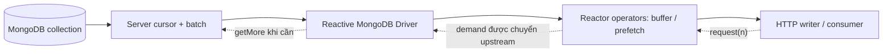
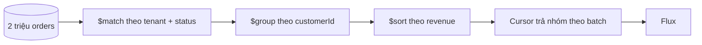

# Backpressure, batch size và tiêu thụ cursor

> **Chương:** Truy cập reactive  
> **Module:** `SPRING_DATA_MONGODB` — kết nối, ánh xạ document và thao tác MongoDB qua `MongoTemplate` hoặc repository; thực hành thiết kế truy vấn, aggregation, index, transaction, reactive access, kiểm thử và chẩn đoán hiệu năng dữ liệu. Bài học tập trung vào **backpressure của Reactive Streams**, **`batchSize` của MongoDB cursor** và cách **tiêu thụ `Flux`** mà không vô tình tải toàn bộ tập dữ liệu vào bộ nhớ.

## 1. Bài toán: xuất nhiều đơn hàng nhưng RAM phải có giới hạn

Giả sử một dịch vụ xuất báo cáo cho tenant A. Collection `orders` có **2 triệu document**, mỗi document từ vài trăm byte đến hàng chục KB. HTTP client yêu cầu danh sách các đơn đã thanh toán và tải xuống dần dưới dạng NDJSON. Một số client đọc rất chậm; đôi lúc mạng bị ngắt giữa chừng.

Giải pháp rủi ro:

```java
List<Order> all = reactiveMongoTemplate
    .find(query, Order.class)
    .collectList()
    .block();
// Tất cả phần tử được gom vào List trong JVM.
```

`collectList()` giữ toàn bộ các item phát ra trước khi trả danh sách; `block()` còn biến quá trình thành chờ đồng bộ và không phù hợp trên event-loop. Dù driver đọc từ MongoDB theo cursor batches, **memory ứng dụng vẫn có thể phình theo số kết quả**.

Thiết kế đúng hướng:

```java
Flux<Order> orders = reactiveMongoTemplate
    .find(query, Order.class);

// Trả Flux cho HTTP/reactive subscriber; không collectList().
```

Driver có thể đọc từng **batch** từ cursor khi cần, publisher phát dần phần tử, còn subscriber sử dụng **demand signal** (`request(n)`) để điều tiết việc tiêu thụ. Nhưng cần hiểu rõ: **Reactive Streams backpressure không đồng nghĩa MongoDB chỉ trả chính xác n document từ network mỗi lần downstream request(n)**.



**Mục tiêu bài học:** phân biệt `request(n)` với `batchSize`, `limit` và `prefetch`; xây truy vấn có index và projection; quản lý cursor khi complete/error/cancel; tránh buffer không giới hạn; kiểm thử demand và quan sát `getMore`/memory trong môi trường thực.

## 2. Từ Publisher đến MongoDB cursor: các tầng khác nhau

Một luồng Reactive MongoDB có ít nhất bốn nơi có thể giữ dữ liệu:

| Tầng | Vai trò | Có thể giữ dữ liệu gì? |
| --- | --- | --- |
| **MongoDB server** | Thực thi query/aggregation, tạo cursor và trả batch | Query state, batch kết quả, và state của các stage như `$sort`/`$group` |
| **Java reactive driver** | Điều khiển cursor và chuyển BSON thành phần tử phát ra | Byte buffers, decoded documents, batch đã nhận nhưng chưa tiêu thụ |
| **Reactor operators** | `map`, `flatMap`, `publishOn`, `buffer`... | Queue/prefetch/buffers tùy operator |
| **Subscriber / HTTP layer** | Tiêu thụ dữ liệu và gửi xuống client | Queue/network buffers, kết quả đang xử lý, serialization state |

Kết quả quan trọng: **một pipeline không gọi `collectList()` vẫn có thể dùng nhiều RAM** nếu chứa `buffer()` không giới hạn, `flatMap` concurrency lớn, serialization queue lớn hoặc bản thân mỗi document quá lớn.

### 2.1. Backpressure là tín hiệu ở mức phần tử

Reactive Streams mô tả:

- `Publisher<T>` là nguồn sự kiện.
- `Subscriber<T>` đăng ký nhận tín hiệu.
- `Subscription` kết nối subscriber với publisher, cung cấp `request(long n)` và `cancel()`.
- `onNext(T)` chỉ được phát theo demand dương; `onError`/`onComplete` kết thúc stream.

Một subscriber gọi `request(10)` nghĩa là **được phép nhận tối đa 10 phần tử tiếp theo trước khi yêu cầu thêm** tại ranh giới subscription đó. Đây **không** phải lệnh `find().limit(10)` lên MongoDB và **không** cam kết một network packet chứa đúng 10 BSON document.

### 2.2. MongoDB cursor là cơ chế phân lô ở mức dữ liệu

Query MongoDB có thể trả một batch ban đầu và dùng `getMore` để lấy các batch tiếp theo khi cursor còn dữ liệu. Số phần tử một batch phụ thuộc `batchSize`, kích thước document, giới hạn BSON message/batch, tình trạng thực thi và phản hồi server.

Ví dụ:

```javascript
db.orders.find({
  tenantId: "TENANT-A",
  status: "PAID"
}).batchSize(128);
```

`batchSize(128)` là **yêu cầu số document cho mỗi batch** theo khả năng server, không phải giới hạn tổng kết quả ở 128. Server có thể trả **ít hơn 128**, và cursor vẫn còn mở để đọc các batch sau.

### 2.3. Reactor operator có thể thay đổi pattern demand

Giữa driver và subscriber, `publishOn` hoặc `flatMap` có thể **prefetch** phần tử. Vì thế downstream chỉ yêu cầu vài phần tử nhưng upstream đã nhận một request lớn hơn để đổ đầy queue. `limitRate` có thể điều chỉnh cách request được chia đợt, nhưng không phải giới hạn tổng số record và không phải giới hạn byte network.

### 2.4. Ba đại lượng khác nhau

| Đại lượng | Đơn vị | Ý nghĩa | Thao tác liên quan |
| --- | --- | --- | --- |
| **Demand** | `n` phần tử tại Subscription | Downstream muốn nhận bao nhiêu item | `request(n)`, `limitRate` |
| **Cursor batch size** | Số document/batch được yêu cầu | Điều chỉnh cỡ các lần lấy dữ liệu qua cursor | `Query.cursorBatchSize`, driver `batchSize` |
| **Total result limit** | Tổng document của kết quả query | Cắt bớt tập kết quả ở database | `Query.limit` / MongoDB `limit` |
| **Operator prefetch** | Số item mỗi operator có thể yêu cầu trước | Giảm overhead giữa các operator, nhưng dùng bộ đệm | `publishOn`, `flatMap`, `concatMap` tùy operator |
| **Concurrency** | Số công việc đang chạy | Độ song song downstream, ảnh hưởng I/O và queues | `flatMap(..., concurrency, prefetch)` |
| **Application buffer** | Số phần tử hoặc bytes | Phần tử giữ để xử lý theo nhóm | `buffer(n)`, `collectList()` |

Đừng dùng một thông số để giải quyết mọi vấn đề. Nếu heap tăng do `collectList()`, giảm `batchSize` không sửa tận gốc: danh sách vẫn tăng đến khi hết cursor.

## 3. Flux và tín hiệu request(n): cách suy nghĩ đúng

### 3.1. Một Flux thường là lazy

```java
Flux<Order> source = reactiveMongoTemplate
    .find(query, Order.class);

// Chưa subscribe, không nên coi find đã trả xong toàn bộ dữ liệu.
```

Khi subscriber đăng ký, publisher/driver thực hiện những operation cần thiết. Trong đa số cách dùng `ReactiveMongoTemplate.find`, mỗi subscription có thể kích hoạt **một query/cursor riêng**. Không dùng một biến `Flux` như cache kết quả mặc định.

**Không nhầm cold Flux với kết quả đã materialize.** Nếu controller, metric collector và worker cùng subscribe độc lập vào một cold Flux, có thể tạo **nhiều truy vấn**; cần thiết kế sharing/caching có chủ đích và hiểu rủi ro memory.

### 3.2. Request theo từng đợt bằng BaseSubscriber

Đoạn ví dụ học tập dưới đây yêu cầu mỗi lần một phần tử:

```java
import org.reactivestreams.Subscription;
import reactor.core.publisher.BaseSubscriber;

BaseSubscriber<Order> subscriber = new BaseSubscriber<>() {
    @Override
    protected void hookOnSubscribe(Subscription subscription) {
        request(1);
    }

    @Override
    protected void hookOnNext(Order value) {
        System.out.println(value.getId());
        request(1);
    }

    @Override
    protected void hookOnError(Throwable throwable) {
        System.err.println("Streaming failed: " + throwable);
    }

    @Override
    protected void hookFinally(
        reactor.core.publisher.SignalType type
    ) {
        System.out.println("Stream ended: " + type);
    }
};

source.subscribe(subscriber);
```

Đây là **mẫu minh họa demand**, không phải cách khuyến nghị để viết HTTP controller. `System.out.println` có thể chặn thread và làm mất lợi ích reactive. Trong ứng dụng WebFlux, **trả `Flux` cho framework** để HTTP server quản lý subscription/cancellation, không tự `subscribe()` rồi gửi response bằng cơ chế riêng.

### 3.3. Đọc một item không nhất thiết phát một getMore

Khi downstream gọi `request(1)`, item có thể đã nằm trong **batch nhận trước đó**; driver phát item mà không cần roundtrip mới. Khi batch nội bộ cạn và cursor còn dữ liệu, driver có thể thực hiện `getMore`. Pattern chính xác phụ thuộc driver/server/operator chain.

Không đo “một request(1) = một getMore” bằng suy luận; cần quan sát MongoDB driver command monitoring nếu yêu cầu tối ưu network chính xác.

### 3.4. request(0) không phải cách tạm dừng cursor

Theo Reactive Streams, `request(n)` phải nhận số **dương**; `request(0)` hoặc số âm là vi phạm giao thức và có thể dẫn tới lỗi terminal. Để tạm dừng, subscriber đơn giản **chưa yêu cầu thêm**. Để dừng hoàn toàn, dùng `cancel()`.

## 4. Domain model và dataset thử nghiệm

Ví dụ Java 17+, `Spring Data MongoDB` và bộ dữ liệu đã chuẩn hóa cho báo cáo:

```java
package demo.orders;

import java.time.Instant;
import org.springframework.data.annotation.Id;
import org.springframework.data.mongodb.core.mapping.Document;

@Document(collection = "orders")
public class Order {
    @Id
    private String id;
    private String tenantId;
    private String status;
    private long amountCents;
    private Instant createdAt;

    protected Order() {}

    public Order(
        String id, String tenantId, String status,
        long amountCents, Instant createdAt
    ) {
        this.id = id;
        this.tenantId = tenantId;
        this.status = status;
        this.amountCents = amountCents;
        this.createdAt = createdAt;
    }

    public String getId() { return id; }
    public String getTenantId() { return tenantId; }
    public String getStatus() { return status; }
    public long getAmountCents() { return amountCents; }
    public Instant getCreatedAt() { return createdAt; }
}
```

Lệnh mongosh **chỉ cho database thử nghiệm cô lập**:

```javascript
db.orders.drop();

db.orders.insertMany([
  { _id: "O-001", tenantId: "TENANT-A", status: "PAID",
    amountCents: NumberLong(12000),
    createdAt: ISODate("2026-11-01T01:00:00Z") },
  { _id: "O-002", tenantId: "TENANT-A", status: "PAID",
    amountCents: NumberLong(8000),
    createdAt: ISODate("2026-11-02T02:00:00Z") },
  { _id: "O-003", tenantId: "TENANT-A", status: "PAID",
    amountCents: NumberLong(20000),
    createdAt: ISODate("2026-11-03T03:00:00Z") },
  { _id: "O-004", tenantId: "TENANT-A", status: "PENDING",
    amountCents: NumberLong(7000),
    createdAt: ISODate("2026-11-04T04:00:00Z") },
  { _id: "O-005", tenantId: "TENANT-B", status: "PAID",
    amountCents: NumberLong(999000),
    createdAt: ISODate("2026-11-05T05:00:00Z") }
]);

db.orders.createIndex(
  { tenantId: 1, status: 1, createdAt: 1, _id: 1 },
  { name: "ix_export_tenant_status_created_id" }
);
```

Kết quả truy vấn đúng với điều kiện `tenantId:"TENANT-A"` và `status:"PAID"` là ba document `O-001`, `O-002`, `O-003` theo thời gian tăng dần. Document PENDING hoặc của tenant B **không** được xuất ra.

**Index ứng viên:** key pattern hỗ trợ bộ lọc equality `tenantId/status` và thứ tự `createdAt/_id` trong nhiều workload. Nó chưa chắc là index tối ưu ở mọi hệ thống; phải đo `explain`, chi phí ghi, kích thước index và planner trên dữ liệu thực. Index này không làm cho cursor biến mất hoặc loại bỏ rủi ro buffer ở JVM.

## 5. Truy vấn với ReactiveMongoTemplate và cursorBatchSize

### 5.1. Xây Query một cách tường minh

```java
package demo.orders;

import org.springframework.data.domain.Sort;
import org.springframework.data.mongodb.core.ReactiveMongoTemplate;
import org.springframework.data.mongodb.core.query.Criteria;
import org.springframework.data.mongodb.core.query.Query;
import org.springframework.stereotype.Service;
import reactor.core.publisher.Flux;

@Service
public class OrderStreamingService {
    private final ReactiveMongoTemplate template;

    public OrderStreamingService(ReactiveMongoTemplate template) {
        this.template = template;
    }

    public Flux<Order> streamPaidOrders(String tenantId) {
        if (tenantId == null || tenantId.isBlank()) {
            return Flux.error(new IllegalArgumentException(
                "Tenant ID is required"
            ));
        }

        Query query = Query.query(
            Criteria.where("tenantId").is(tenantId)
                .and("status").is("PAID")
        );
        query.with(Sort.by(
            Sort.Order.asc("createdAt"),
            Sort.Order.asc("id")
        ));
        query.cursorBatchSize(128);

        return template.find(query, Order.class);
    }
}
```

`ReactiveMongoTemplate` trả `Flux<Order>`. `@Service` đăng ký service để Spring có thể inject vào controller và integration test. Trong mã này:

1. `Query` lọc tenant/status tại server.
2. `Sort` sắp xếp ổn định theo thời điểm rồi ID; `id` là property `@Id`, Spring Data ánh xạ tới BSON `_id`.
3. `cursorBatchSize(128)` yêu cầu số document/batch từ cursor.
4. Không gọi `collectList()` hoặc `block()` nên kết quả được phát theo quá trình tiêu thụ.

**Lưu ý phiên bản:** `Query.cursorBatchSize(int)` là API của Spring Data MongoDB ở những dòng hiện hành; đối chiếu version dự án trước khi copy code. Các chi tiết driver translation và số document trong mỗi batch phải quan sát bằng integration test/command monitoring nếu SLA phụ thuộc chính xác.

### 5.2. batchSize là hint cho batch, không phải hạn mức bộ nhớ

`cursorBatchSize(128)` không cam kết:

- Chỉ có 128 document được trả **trong cả query**.
- Không có quá 128 document đang chờ trong **tất cả** Reactor operator queues.
- Mỗi batch luôn có **đúng** 128 document.
- Tổng byte của một batch là `128 × kích thước document trung bình` cố định.
- Một `request(1)` từ subscriber tương ứng một document được fetch ở server.

MongoDB có các giới hạn kích thước batch/message; document lớn có thể khiến batch thực tế **ít item hơn yêu cầu**. `batchSize` quá lớn có thể tăng burst memory và network payload, nhưng batch quá nhỏ có thể tăng số roundtrips.

### 5.3. Projection giảm dữ liệu tải qua network

Nếu export chỉ cần ID, trạng thái, số tiền, thời gian:

```java
Query query = Query.query(
    Criteria.where("tenantId").is("TENANT-A")
        .and("status").is("PAID")
);
query.fields()
    .include("id")
    .include("status")
    .include("amountCents")
    .include("createdAt");
query.with(Sort.by("createdAt", "id").ascending());
query.cursorBatchSize(128);

Flux<Order> projected = template.find(query, Order.class);
```

Entity được ánh xạ **thiếu một số field** (ví dụ `tenantId`) sẽ không phải bản đầy đủ. Dùng **read-only projection DTO** nếu không muốn vô tình `save` entity thiếu field trở lại collection. `Query.fields().include("id")` được Spring mapping tới BSON `_id` khi dùng typed query phù hợp; kiểm raw query/driver behavior trên phiên bản ứng dụng khi cần.

### 5.4. Server-side limit khác hoàn toàn batch size

```java
Query first100 = Query.query(
    Criteria.where("tenantId").is("TENANT-A")
        .and("status").is("PAID")
);
first100.with(Sort.by("createdAt", "id").ascending());
first100.limit(100);        // Tổng kết quả query tối đa 100 document.
first100.cursorBatchSize(32); // Mỗi batch yêu cầu tối đa khoảng 32 document.
```

`limit(100)` thay đổi **tập kết quả hợp lệ** ở server. `cursorBatchSize(32)` chỉ điều chỉnh **cách vận chuyển** tập kết quả đó. Không dùng `limit` để sửa memory nếu nghiệp vụ thực sự cần xuất toàn bộ 2 triệu document.

## 6. ReactiveMongoRepository, method result và phạm vi batch

### 6.1. Repository trả Flux

```java
package demo.orders;

import org.springframework.data.mongodb.repository.ReactiveMongoRepository;
import reactor.core.publisher.Flux;

public interface OrderRepository
        extends ReactiveMongoRepository<Order, String> {

    Flux<Order> findByTenantIdAndStatusOrderByCreatedAtAscIdAsc(
        String tenantId, String status
    );
}
```

Repository derived query cho phép streaming/reactive result:

```java
Flux<Order> paid = repository
    .findByTenantIdAndStatusOrderByCreatedAtAscIdAsc(
        "TENANT-A", "PAID"
    );
```

Nhưng method name **không tự thể hiện cấu hình cursor batch size tùy chỉnh**. Nếu bài toán cần kiểm soát batch size/projection/option chuyên sâu theo từng request, `ReactiveMongoTemplate` cung cấp API tường minh hơn. Không nhầm một `Pageable`/`Limit` ở repository với `batchSize` của driver.

### 6.2. Pageable chưa chắc giúp tiết kiệm như streaming cursor

Nếu repository nhận `Pageable`, nó thường áp dụng `skip/limit/sort` cho từng query. Phân trang nhiều lần có thể **chạy lại query nhiều lần**, và offset sâu tốn chi phí. Streaming từ một cursor dùng một query và đọc tuần tự qua batches, nhưng có lifecycle, timeout và tính nhất quán theo thời gian riêng.

Không mặc định mọi ứng dụng nên chọn streaming: UI chỉ cần 20 document mỗi trang có thể phù hợp `Page/Slice` hơn một cursor giữ lâu. Export lớn, đồng bộ dữ liệu hoặc ETL có thể phù hợp streaming hoặc **keyset pagination có checkpoint**, tùy khả năng khôi phục sau sự cố.

## 7. limitRate, prefetch và cách truyền demand qua Reactor

### 7.1. limitRate không phải Query.limit

Ví dụ:

```java
Flux<Order> source = template.find(query, Order.class);

Flux<Order> shaped = source.limitRate(32);
```

`limitRate(32)` điều chỉnh cách downstream request được truyền **thành các nhóm nhỏ hơn lên upstream**. Mục đích là tránh yêu cầu một lượng rất lớn item cùng lúc ở một ranh giới operator, đồng thời cho phép tối ưu replenishment.

**`limitRate(32)` không có nghĩa kết quả chỉ chứa 32 document**: toàn bộ stream vẫn có thể phát 2 triệu document theo thời gian. Nó cũng **không giới hạn cứng số document mà driver đã fetch thành một cursor batch**, vì network batching là tầng khác.

Ngược lại:

```java
query.limit(32); // Query server chỉ cho tối đa 32 document.
```

Hai lệnh dùng những cơ chế khác nhau, không thay thế được nhau.

### 7.2. publishOn có queue và prefetch

```java
import reactor.core.scheduler.Schedulers;

Flux<Order> shifted = template.find(query, Order.class)
    .publishOn(Schedulers.boundedElastic(), 16);
```

`publishOn(scheduler, 16)` đưa các `onNext` ở phía downstream qua scheduler và sử dụng **prefetch 16** theo semantics Reactor. Nó có thể giữ một số item trong queue. Cỡ queue thực tế còn phụ thuộc scheduling, replenishment và operator chain.

**Không đặt `publishOn(boundedElastic())` vào mọi pipeline theo thói quen.** MongoDB Reactive Streams Driver vốn dùng nonblocking I/O. Chỉ cần chuyển scheduler khi downstream có công việc phù hợp, ví dụ xử lý blocking library cũ; tốt hơn vẫn là tránh blocking operation khi có API reactive.

### 7.3. flatMap có concurrency và prefetch độc lập

```java
import reactor.core.publisher.Mono;

Mono<ExportRow> enrich(Order order) {
    // Minh họa một hàm xử lý nonblocking.
    return Mono.just(new ExportRow(
        order.getId(),
        order.getStatus(),
        order.getAmountCents(),
        order.getCreatedAt()
    ));
}

Flux<ExportRow> enriched = template.find(query, Order.class)
    .flatMap(this::enrich, 8, 1);
```

Với `flatMap(mapper, 8, 1)`:

- `8` là giới hạn **số inner publishers có thể active cùng lúc**.
- `1` là **prefetch trên từng inner publisher** theo semantics Reactor.
- Output của `flatMap` có thể **không giữ đúng thứ tự** đầu vào.

Vì vậy concurrency=8 **không** có nghĩa batchSize=8 hoặc chỉ có 8 document được giữ trong toàn bộ ứng dụng. Nếu `enrich` có I/O phức tạp, còn có queues và state của từng inner publisher.

Nếu việc xuất dữ liệu yêu cầu **giữ thứ tự tạo đơn**, dùng `concatMap` hoặc `flatMapSequential` theo yêu cầu concurrency/latency, và kiểm thử thứ tự. Một ví dụ thuần mapping đồng bộ không cần `flatMap`:

```java
Flux<ExportRow> rows = template.find(query, Order.class)
    .map(order -> new ExportRow(
        order.getId(),
        order.getStatus(),
        order.getAmountCents(),
        order.getCreatedAt()
    ));
```

### 7.4. Không tự suy ra memory từ một số prefetch

Với các operator khác nhau, upstream requests, hàng đợi nội bộ, số inner publisher, batch dữ liệu và kích thước từng object ảnh hưởng memory. Một phép tính `prefetch * concurrency` chỉ là **ước lượng cho một tầng**, không phải upper bound chính xác của heap.

Nếu cần giới hạn bộ nhớ thật, phải kết hợp **projection, cỡ document, operator concurrency, buffer bounds, cursor batch size, network/serialization buffers và memory profiling**.

## 8. Các operator có thể phá lợi ích streaming

### 8.1. collectList: gom toàn bộ

```java
Mono<List<Order>> all = template.find(query, Order.class)
    .collectList();
```

Lệnh này không tự lỗi; nó phù hợp khi **biết chắc số kết quả nhỏ và có giới hạn**. Nhưng nếu query có 2 triệu document, danh sách vẫn lớn theo 2 triệu phần tử bất kể cursorBatchSize=16 hay 1024.

Không dùng `collectList()` chỉ để trả JSON array cho export lớn. Cân nhắc NDJSON, CSV streaming có cơ chế backpressure phù hợp, hoặc background export job có object storage và checkpoint.

### 8.2. buffer() không giới hạn

```java
// PHẢN VÍ DỤ: buffer() không tham số có thể thu thập
// toàn bộ stream vào một List trước khi emit.
Flux<List<Order>> oneHugeBatch = template
    .find(query, Order.class)
    .buffer();
```

`buffer()` không tham số có thể gom mọi item cho tới khi upstream hoàn tất. Nó không giúp giảm heap, dù tên nghe giống “đọc theo batch”.

Thay bằng buffer giới hạn theo **số phần tử**:

```java
Flux<List<Order>> batches = template
    .find(query, Order.class)
    .buffer(100);
```

Mỗi List được phát ra khi đủ 100 item hoặc stream kết thúc. Nhưng `buffer(100)` ở tầng Reactor **không đồng nghĩa** cursor batchSize=100 ở MongoDB; mỗi list có thể được tạo từ nhiều server batches hoặc từ một batch lớn.

**Cảnh báo:** nếu một document đã lớn vài MB, buffer 100 document vẫn có thể rất lớn. Cần biết kích thước BSON và object đã deserialize.

### 8.3. sort() của Reactor phải giữ toàn bộ dữ liệu

```java
// RẤT RỦI RO với tập kết quả lớn:
Flux<Order> sorted = template.find(query, Order.class)
    .sort(java.util.Comparator.comparing(Order::getCreatedAt));
```

`Flux.sort()` cần đủ phần tử để sắp xếp toàn bộ theo comparator; làm mất đặc tính xuất dần trên dataset lớn. Đặt sort ở **MongoDB query** nếu muốn server thực thi/áp index phù hợp:

```java
query.with(Sort.by("createdAt", "id").ascending());
Flux<Order> ordered = template.find(query, Order.class);
```

Sort tại server vẫn có thể cần memory/disk nếu không có index; nó không phải phép tối ưu miễn phí. Dùng `explain` để biết kế hoạch.

### 8.4. groupBy() có vấn đề khi giữ nhiều group

`Flux.groupBy` có thể tạo nhiều `GroupedFlux`, giữ state/queues theo khóa và yêu cầu downstream tiêu thụ đúng các group. Nếu cardinality khóa cao mà consumer không tiêu thụ đủ các group, pipeline có thể gây memory pressure hoặc không tiến triển như mong đợi.

Nếu muốn báo cáo doanh thu theo customer/status, cân nhắc MongoDB `$group` (để server tổng hợp) hoặc job tổng hợp có ràng buộc, **không** groupBy hàng triệu document trong JVM một cách mặc định.

### 8.5. onBackpressureBuffer không phải thuốc chữa mọi thứ

```java
// Không khuyến nghị như default:
Flux<Order> risky = source.onBackpressureBuffer();
```

Một buffer không giới hạn có thể tích tụ item khi producer nhanh hơn consumer. Với nguồn MongoDB reactive **đã tuân thủ backpressure**, thường không cần bọc `onBackpressureBuffer()` một cách máy móc.

Nếu tích hợp với một **nguồn hot không tuân thủ demand**, có thể phải chọn bounded overflow policy, nhưng:

- `onBackpressureDrop` có thể làm **mất đơn**.
- `onBackpressureLatest` bỏ các item cũ, không phù hợp export/audit.
- Bounded buffer overflow có thể phát lỗi và cần cơ chế xử lý.
- Không thể biến nguồn dữ liệu vô hạn thành an toàn chỉ bằng một queue lớn.

Với báo cáo tài chính, **không drop âm thầm**. Cần giới hạn ingress, cơ chế durable queue, checkpoint hoặc backpressure xuyên các tầng thực sự hỗ trợ.

## 9. Đọc từng document hay xử lý theo lô: chọn cách tiêu thụ

### 9.1. Không chặn event loop

```java
// PHẢN VÍ DỤ:
template.find(query, Order.class)
    .map(order -> {
        Thread.sleep(100); // Blocking trong pipeline nonblocking.
        return order;
    });
```

Trong Java ví dụ này `Thread.sleep` còn cần xử lý `InterruptedException` nếu viết code thực, nhưng chính ý tưởng đặt blocking sleep trong `map` là sai với reactive event loop.

Để xử lý dữ liệu không blocking, dùng Reactor operators và reactive APIs. Nếu buộc gọi một API blocking legacy, cô lập nó vào scheduler thích hợp, đặt giới hạn concurrency và đo thread pool saturation.

### 9.2. Xử lý từng order với nonblocking I/O

```java
Flux<ExportRow> exported = template
    .find(query, Order.class)
    .flatMap(order -> externalReactiveService.lookup(order.getId())
        .map(extra -> new ExportRow(
            order.getId(),
            order.getStatus(),
            order.getAmountCents(),
            order.getCreatedAt()
        )), 8, 1);
```

`externalReactiveService` là một reactive dependency của ứng dụng, không phải API Spring Data MongoDB. Ví dụ này nhấn mạnh **concurrency=8** thay vì bắn hàng chục nghìn request I/O cùng lúc. Nếu dữ liệu enrichment phải có mặt trong output, hãy thêm field vào DTO thay vì bỏ qua `extra` như minh họa rút gọn.

Nếu thứ tự kết quả là hợp đồng API, `flatMap` có thể sắp xếp lại; dùng `concatMap` hoặc `flatMapSequential` với giới hạn phù hợp.

### 9.3. Xử lý theo batch ở tầng ứng dụng

```java
Flux<List<Order>> chunks = template
    .find(query, Order.class)
    .buffer(200);

Mono<Void> completed = chunks
    .concatMap(batch -> writeBatchAsync(batch))
    .then();
```

`writeBatchAsync(List<Order>)` do ứng dụng định nghĩa, trả về `Mono<Void>`, phải thực sự nonblocking hoặc được cô lập khỏi event-loop. `concatMap` giúp xử lý lần lượt các batch, giảm race khi ghi ra một đích yêu cầu thứ tự.

**Ba mức 200/128/8 không phải một thông số chung:** bạn có thể chọn cursor batchSize=128, buffer ứng dụng 200 item và downstream concurrency=8 ở những vị trí khác. Chỉ đo mới cho biết kết hợp nào phù hợp throughput/memory.

### 9.4. Nếu downstream là HTTP client chậm

Đừng viết:

```java
source.subscribe(order -> outputStream.write(toBytes(order)));
```

Ví dụ trên còn chưa xử lý `IOException`/serialization; quan trọng hơn, bạn đã tự subscribe và có nguy cơ phá lifecycle của HTTP reactive response, ghi blocking trên event-loop hoặc không quản lý cancellation. Dùng framework streaming response để duy trì backpressure phù hợp ở tầng server và không quản lý cursor thủ công khi không cần.

## 10. Cursor lifecycle: complete, error, cancel

Một cursor có thể kết thúc vì ba lý do chính:

| Tình huống | Reactive signal | Điều cần làm |
| --- | --- | --- |
| Đã đọc hết document | `onComplete` | Subscriber kết thúc, driver giải phóng cursor khi phù hợp |
| Query/network/decode lỗi | `onError` | Ghi metric, dọn tài nguyên, xử lý lỗi theo contract |
| Client dừng / `take(n)` / cancel | `cancel()` | Hủy subscription; driver phải xử lý cleanup cursor theo lifecycle |

### 10.1. take(n) chỉ cắt downstream

```java
Flux<Order> first10 = template.find(query, Order.class)
    .take(10);
```

Sau khi phát 10 item, `take(10)` kết thúc stream downstream và **cancel upstream**. Driver thường thực hiện cleanup cursor khi cần; nhưng trước khi bị cancel, query có thể đã fetch một batch lớn hơn 10. Nếu nghiệp vụ thực sự chỉ cần tối đa 10 document, **đặt `query.limit(10)` ở server** để tránh đọc/thực thi không cần thiết.

### 10.2. doFinally để quan sát mọi đường kết thúc

```java
import reactor.core.publisher.SignalType;

Flux<Order> monitored = template.find(query, Order.class)
    .doOnSubscribe(s -> metrics.queryStarted())
    .doOnNext(o -> metrics.documentEmitted())
    .doOnError(e -> metrics.queryFailed(e))
    .doFinally(signal -> {
        if (signal == SignalType.CANCEL) {
            metrics.queryCancelled();
        }
        metrics.queryTerminated();
    });
```

`metrics` là abstraction do ứng dụng định nghĩa. `doFinally` chạy cả khi complete/error/cancel, phù hợp thu thập lifecycle metrics. **Đừng viết code đóng trực tiếp một cursor không do bạn sở hữu**: với `ReactiveMongoTemplate.find`, driver/framework quản lý cursor nội bộ. Nếu bạn chủ động tạo explicit session/cursor thì cần cleanup theo API của mình.

### 10.3. HTTP disconnect cần gây cancellation

Với WebFlux, khi connection đóng giữa chừng, HTTP response subscriber có thể hủy upstream subscription. Lúc đó pipeline không nên tiếp tục chạy detached ở một `subscribe()` riêng. Phải đo trong test thực vì proxies/serialization/network buffers có thể khiến thời điểm cancel quan sát được khác kỳ vọng.

### 10.4. Cursor timeout và session lifetime

Server có chính sách timeout đối với cursor không hoạt động, và logical sessions có timeout/lifecycle riêng. Đừng coi `noCursorTimeout` (nếu có ở driver/query API phù hợp) là giải pháp mặc định cho client đọc chậm:

- Cursor giữ lâu tiêu tốn server resources.
- Logical session timeout có thể ảnh hưởng cursor.
- Transactional cursor có giới hạn transaction riêng.
- Connection/network timeout và proxy timeout cũng có thể xảy ra.

Export chạy lâu nên xem xét **job tách rời HTTP + checkpoint/keyset** thay vì giữ một cursor tương tác suốt nhiều giờ.

## 11. Streaming qua Spring WebFlux: NDJSON thay vì JSON array khổng lồ

### 11.1. DTO xuất dữ liệu

```java
package demo.orders;

import java.time.Instant;

public record ExportRow(
    String id,
    String status,
    long amountCents,
    Instant createdAt
) {}
```

### 11.2. Controller trả Flux

```java
package demo.orders;

import org.springframework.http.MediaType;
import org.springframework.security.core.Authentication;
import org.springframework.web.bind.annotation.GetMapping;
import org.springframework.web.bind.annotation.RequestMapping;
import org.springframework.web.bind.annotation.RestController;
import reactor.core.publisher.Flux;

@RestController
@RequestMapping("/api/reports")
public class OrderExportController {
    private final OrderStreamingService service;
    private final TenantAccess tenantAccess;

    public OrderExportController(
        OrderStreamingService service,
        TenantAccess tenantAccess
    ) {
        this.service = service;
        this.tenantAccess = tenantAccess;
    }

    @GetMapping(
        value = "/paid-orders",
        produces = MediaType.APPLICATION_NDJSON_VALUE
    )
    public Flux<ExportRow> export(Authentication auth) {
        String tenantId = tenantAccess.tenantIdFor(auth);

        return service.streamPaidOrders(tenantId)
            .map(order -> new ExportRow(
                order.getId(),
                order.getStatus(),
                order.getAmountCents(),
                order.getCreatedAt()
            ));
    }
}
```

`TenantAccess` là service do ứng dụng định nghĩa để đọc tenant từ principal đã xác thực và kiểm quyền truy cập. Nó **không phải class sẵn có của Spring Security**; ứng dụng cần triển khai interface/service này.

**Tại sao NDJSON?** Mỗi record có thể được serialized riêng thành một dòng JSON và được đẩy dần cho client, thay vì cần materialize một JSON array lớn trước khi gửi. Điều này chỉ phát huy khi **web server, HTTP client và proxies thật sự hỗ trợ streaming**, không buffer toàn bộ response.

### 11.3. Những giới hạn thực tế của HTTP streaming

- Framework/reactive server có thể prefetch/buffer tại network boundaries; không mặc định mỗi MongoDB item tương ứng đúng một TCP packet.
- Một số reverse proxy, load balancer hoặc client library **buffer response**. Phải test toàn đường end-to-end.
- Nếu lỗi xảy ra sau khi response headers/body đã gửi, server không thể đổi HTTP status code như trước khi bắt đầu response; cần protocol lỗi/phục hồi phù hợp.
- Nếu client disconnect, upstream cancellation và cursor cleanup cần được quan sát.
- Mặc dù body được streaming, `Query` không có index/projection tốt vẫn có thể tạo server load lớn.

Nếu API phải hỗ trợ **download resume** tại byte offset hoặc sau lỗi mạng, NDJSON streaming đơn giản chưa đủ. Cân nhắc export job tạo file immutable với ID/checksum, hoặc keyset cursor có checkpoint nghiệp vụ.

### 11.4. WebFlux không bắt buộc toàn ứng dụng đều reactive

Một Spring MVC controller trả `Flux` có behavior và cơ chế streaming khác một WebFlux controller thuần Reactor Netty. Không suy rằng chỉ cần đổi return type sang `Flux` là toàn stack trở thành nonblocking. Khi thiết kế hiệu năng, xác định thật sự đang dùng **WebFlux**, MongoDB reactive driver và các downstream I/O reactive.

## 12. Aggregation: reactive output không làm $group/$sort trở thành streaming

### 12.1. Blocking stages ở server

`ReactiveMongoTemplate.aggregate` trả `Flux<DTO>`, nhưng có những MongoDB aggregation stages phải **xử lý nhiều document trước khi có thể tạo kết quả**:

- `$sort` không được index hỗ trợ có thể phải sắp xếp lượng lớn input.
- `$group` duy trì state theo các khóa nhóm.
- `$bucket`, `$facet`, `$lookup` và các stage khác có chi phí bộ nhớ/đầu vào tùy cấu hình.



Dù subscriber chỉ gọi `request(1)` ở cuối, server vẫn có thể cần đi qua gần như toàn bộ document phù hợp để tính `$group`/`$sort`. **Backpressure giới hạn tốc độ tiêu thụ output**, không tự triệt tiêu resource cost của stage upstream trên server.

### 12.2. Spring Data Aggregation options và batch size

Ví dụ nhóm theo trạng thái:

```java
import static org.springframework.data.mongodb.core.aggregation.Aggregation.*;

import org.springframework.data.mongodb.core.aggregation.Aggregation;
import org.springframework.data.mongodb.core.aggregation.AggregationOptions;
import org.springframework.data.mongodb.core.query.Criteria;
import reactor.core.publisher.Flux;
import org.bson.Document;

Aggregation aggregation = newAggregation(
    match(Criteria.where("tenantId").is("TENANT-A")),
    group("status")
        .count().as("orderCount")
        .sum("amountCents").as("grossCents"),
    sort(org.springframework.data.domain.Sort.Direction.ASC, "_id")
).withOptions(
    AggregationOptions.builder()
        .cursorBatchSize(64)
        .allowDiskUse(true)
        .build()
);

Flux<Document> grouped = reactiveMongoTemplate.aggregate(
    aggregation, Order.class, Document.class
);
```

Trong dòng Spring Data MongoDB hiện hành, `AggregationOptions` có cơ chế cấu hình `cursorBatchSize`. Kiểm tra chữ ký API trên version thực tế; nếu dùng bản cũ, có thể cần cấu hình qua driver hoặc lựa chọn hỗ trợ khác.

`allowDiskUse(true)` chỉ cho phép một số stage được hỗ trợ spill ra disk khi cần và server có cấu hình cho phép; nó **không làm query nhẹ hơn**, không tránh giới hạn output document 16 MiB và không biến `Flux` thành một cách tổng hợp không tốn RAM.

### 12.3. $limit ở đâu ảnh hưởng ý nghĩa KPI

```javascript
// ĐÚNG nếu yêu cầu là “top 20 nhóm sau khi tính đủ dữ liệu”.
[
  { $match: { tenantId: "TENANT-A" } },
  { $group: { _id: "$status", revenue: { $sum: "$amountCents" } } },
  { $sort: { revenue: -1, _id: 1 } },
  { $limit: 20 }
]
```

Ngược lại, đặt `$limit:20` **trước `$group`** sẽ chỉ tổng hợp 20 đơn đầu tiên của nguồn, có thể cho KPI sai. Không đẩy limit lên sớm chỉ để tránh xử lý nặng nếu nó làm đổi câu hỏi nghiệp vụ.

### 12.4. Project và filter sớm khi đúng semantics

`$match` theo tenant/status trước `$group` thường giảm input, và index phù hợp có thể tiết kiệm I/O. `$project` loại field không dùng có thể giảm dữ liệu giữa stages/kết quả, tùy optimizer và pipeline. Hãy đo bằng `explain("executionStats")`; không thể đảm bảo một stage giảm chi phí chỉ từ vị trí trong code.

## 13. Query dài, deadline, cancellation và retry

### 13.1. Deadline ở server và client là hai tầng

```java
import java.time.Duration;

Query query = Query.query(
    Criteria.where("tenantId").is("TENANT-A")
);
query.maxTime(Duration.ofSeconds(20));
query.cursorBatchSize(128);

Flux<Order> stream = template.find(query, Order.class)
    .timeout(Duration.ofSeconds(30));
```

`Query.maxTime(...)` gửi giới hạn thời gian operation tới MongoDB trong phạm vi API/server hỗ trợ. `Flux.timeout(Duration)` là timeout **tại Reactor**, thường tính từ subscription và giữa các item; nó có thể fail/cancel source khi không có tín hiệu phù hợp trong khoảng cấu hình. Hai timeout không thay thế nhau.

Quan trọng: một stream đọc được một item mỗi giây có thể **không** bị `timeout(30s)` cắt dù chạy nhiều giờ, vì nó liên tục có item. Nếu cần **tổng thời hạn export**, dùng deadline/request-level policy riêng và điều phối hủy/cleanup. Không mặc định `Flux.timeout` là hard cap tổng thời gian của mọi export.

### 13.2. Retry khi cursor đã phát một phần dữ liệu

Giả sử client đã nhận các ID `O-001` và `O-002` rồi có network error trước `O-003`. Nếu dùng:

```java
Flux<Order> risky = template.find(query, Order.class)
    .retry(3);
```

`retry` có thể subscribe lại **từ đầu query**. Downstream có thể nhận lại `O-001/O-002`, dẫn tới **trùng dữ liệu**. Nếu dùng để gửi email, tạo invoice, thanh toán hoặc ghi file append-only, retry vô điều kiện là nguy hiểm.

Cần xác định:

- Dữ liệu đã emit trước lỗi có thể được xử lý lại không?
- Có idempotency key cho mỗi item không?
- Có khóa sort/tie-breaker ổn định không?
- Có checkpoint để tiếp tục từ phần tử **cuối đã xác nhận xử lý** không?
- Dữ liệu nguồn có thay đổi trong lúc resume không?

Với export cần độ chính xác cao, một **job có checkpoint + keyset pagination** hoặc nguồn snapshot/materialized report có thể đáng tin cậy hơn retry toàn bộ cursor.

### 13.3. Đừng retry mọi lỗi

`DuplicateKeyException` do duplicate business key, invalid query, thiếu quyền, BSON mapping lỗi và dữ liệu sai schema thường không tự biến mất khi retry ngay. Phân loại lỗi transient và đặt giới hạn retries/backoff nếu phù hợp. Đừng để một export lỗi tạo cơn bão truy vấn vào MongoDB.

### 13.4. Client ngắt kết nối

`Flux` được WebFlux subscribe để serialize response. Khi client disconnect, cancellation thường truyền upstream, nhưng thời điểm dọn resource có thể bị ảnh hưởng bởi buffering và driver. Quan sát `doFinally(SignalType.CANCEL)`, driver command events, cursor metrics và integration tests — không chỉ dựa vào một log do controller ghi trước lúc trả `Flux`.

## 14. Phân trang keyset khi muốn resume thay vì giữ cursor lâu

Một cursor dài phù hợp cho việc tiêu thụ liên tục **trong một phiên kết nối**. Nếu job phải sống qua restart, mất mạng hoặc client cancel, cursor đó không phải một checkpoint nghiệp vụ bền vững.

### 14.1. Keyset theo createdAt và _id

Với sort ổn định `{createdAt:1,_id:1}`, muốn lấy các đơn **sau** document cuối `(lastCreatedAt,lastId)`:

```javascript
db.orders.find({
  tenantId: "TENANT-A",
  status: "PAID",
  $or: [
    { createdAt: { $gt: ISODate("2026-11-02T02:00:00Z") } },
    {
      createdAt: ISODate("2026-11-02T02:00:00Z"),
      _id: { $gt: "O-002" }
    }
  ]
}).sort({ createdAt: 1, _id: 1 }).limit(100);
```

Kết quả kế tiếp trong dataset mẫu là `O-003`. Tác dụng của `_id` ở điều kiện thứ hai là giải quyết **nhiều đơn có cùng createdAt**; nếu sort không có tie-breaker, resume có thể bỏ sót/trùng item.

### 14.2. Dùng Spring Data Query

```java
import java.time.Instant;
import org.springframework.data.mongodb.core.query.Criteria;
import org.springframework.data.mongodb.core.query.Query;
import org.springframework.data.domain.Sort;

Instant lastCreatedAt = Instant.parse("2026-11-02T02:00:00Z");
String lastId = "O-002";

Criteria after = new Criteria().orOperator(
    Criteria.where("createdAt").gt(lastCreatedAt),
    new Criteria().andOperator(
        Criteria.where("createdAt").is(lastCreatedAt),
        Criteria.where("id").gt(lastId)
    )
);

Query nextPage = Query.query(
    new Criteria().andOperator(
        Criteria.where("tenantId").is("TENANT-A"),
        Criteria.where("status").is("PAID"),
        after
    )
);
nextPage.with(Sort.by("createdAt", "id").ascending());
nextPage.limit(100);
nextPage.cursorBatchSize(64);

Flux<Order> page = template.find(nextPage, Order.class);
```

Với typed query, Spring Data ánh xạ `id` thành BSON `_id`. Với raw BSON/driver phải dùng `_id`. Code ở trên là minh họa một lần lấy trang; production cần lưu **checkpoint chỉ sau khi downstream xác nhận đã xử lý/ghi thành công**, không chỉ sau khi MongoDB đã emit item.

### 14.3. Keyset không tự tạo snapshot

Nếu một document được cập nhật `createdAt`, xóa, thêm mới hoặc chuyển status trong quá trình quét, một chuỗi query keyset có thể nhìn thấy dữ liệu ở các thời điểm khác nhau. Để export snapshot chính xác, cần thiết kế cutoff timestamp, trường sort bất biến, versioning/materialized view hoặc snapshot-consistency strategy thích hợp.

Không coi keyset pagination là giải pháp tổng quát thay cho transaction hay read concern. Nó giải quyết **điểm bắt đầu tiếp theo và chi phí offset**, không tự bảo đảm nguồn dữ liệu không thay đổi.

## 15. Tailable cursor và change stream: nguồn dài hạn không có “kết thúc”

### 15.1. Query cursor hữu hạn khác stream sự kiện

Một `find` thông thường trên tập kết quả hữu hạn sẽ phát `onComplete` khi đọc hết. Tailable cursor trên **capped collection** hoặc MongoDB **change stream** thường đại diện cho nguồn có thể tiếp tục chờ dữ liệu mới.

| Nguồn | Khi tạm hết dữ liệu hiện tại | Cách dừng |
| --- | --- | --- |
| `find` thông thường | Hoàn tất khi cursor hết kết quả | `onComplete` hoặc cancel |
| Tailable cursor | Có thể tiếp tục chờ document mới trên capped collection | Cancel hoặc nguồn/connection kết thúc |
| Change stream | Có thể chờ sự kiện mới từ change stream | Cancel; lưu resume token nếu cần resume bền vững |

Đừng gọi `collectList()` trên một stream dự định chạy vô hạn: nó có thể không bao giờ hoàn tất, và list không ngừng lớn lên.

### 15.2. batch size không có nghĩa polling interval

Ở change stream/tailable cursor, `batchSize` chỉ điều chỉnh số event/document yêu cầu mỗi batch. Tần suất server trả kết quả còn liên quan `maxAwaitTime`/cơ chế chờ của stream, replica set/sharded configuration và driver. Không dùng `batchSize=1` để tuyên bố “mỗi event được gửi ngay tức khắc”.

Change streams yêu cầu topology MongoDB hỗ trợ và có thể cần quyền cụ thể; tailable cursor yêu cầu capped collection. Không nhầm stream event với `Flux<Order>` từ `find` thông thường.

### 15.3. Backpressure và mất sự kiện

Backpressure điều tiết subscriber/driver, **không phải hệ thống bảo đảm giao sự kiện đúng-một-lần xuyên process restart**. Với change streams, phải lưu resume token đúng cách, xử lý invalidation/restart/oplog history, idempotent event consumption và chính sách lag. Không dùng `onBackpressureDrop` để “giảm tải” cho audit/change events mà không có cơ chế phát lại.

## 16. Reactive transaction và cursor: không song song tùy tiện

Trong một `ReactiveMongoTransactionManager` transaction, các MongoDB operations tham gia cùng session do Spring quản lý qua Reactor Context.

### 16.1. Không dùng flatMap concurrency lớn trong transaction

```java
// PHẢN VÍ DỤ: nhiều writes chạy đồng thời trong cùng transaction.
return orders.flatMap(
    order -> reactiveMongoTemplate.save(order),
    32
);
```

MongoDB Java reactive driver không hỗ trợ thực thi song song operations trên cùng session trong một transaction như một cách tăng tốc. Dùng một chuỗi thao tác tuần tự nếu transaction yêu cầu shared session:

```java
return orders
    .concatMap(order -> reactiveMongoTemplate.save(order))
    .then();
```

**Cẩn trọng:** ngay cả khi xử lý tuần tự, transaction dài qua hàng triệu item vẫn là thiết kế xấu: transaction có giới hạn lifetime/cache, giữ locks/snapshot resources và dễ write conflicts. Tách thành những đơn vị transaction nhỏ với checkpoint/idempotency hoặc thiết kế bulk write riêng khi domain cho phép.

### 16.2. Không mở một transaction cho toàn bộ HTTP export

Export NDJSON có client đọc chậm có thể kéo dài phút hoặc giờ. Không bọc toàn bộ quá trình bằng `@Transactional` chỉ để “đảm bảo nhất quán” vì transaction sẽ giữ tài nguyên theo lifetime của stream. Nếu cần export cùng một snapshot, cân nhắc cơ chế snapshot/materialization hoặc batch job có quy tắc cutoff/version, thay vì transaction kéo dài qua tốc độ mạng của khách.

### 16.3. Causal consistency không tự làm cursor an toàn khi resume

Một session causally consistent có thể giúp thứ tự các thao tác liên quan nhân quả; nó không cung cấp **resume checkpoint bền vững qua restart** hay bảo đảm mỗi document được giao đúng-một-lần cho một consumer ngoài MongoDB. Backpressure, causal consistency, transaction và idempotency là những vấn đề riêng.

## 17. Kiểm thử backpressure bằng Reactor StepVerifier

### 17.1. Vì sao test request(n) mà không dựa vào thời gian?

Đo thời gian với `Thread.sleep(100)` dễ dẫn tới test flaky: máy CI, driver scheduling và MongoDB network khác nhau. `StepVerifier` cho phép kiểm chứng **tín hiệu demand** một cách xác định hơn:

```java
import reactor.core.publisher.Flux;
import reactor.test.StepVerifier;

Flux<Integer> numbers = Flux.range(1, 5);

StepVerifier.create(numbers, 0)
    .expectSubscription()
    .thenRequest(2)
    .expectNext(1, 2)
    .thenRequest(2)
    .expectNext(3, 4)
    .thenRequest(1)
    .expectNext(5)
    .verifyComplete();
```

Tham số `0` trong `StepVerifier.create(publisher, 0)` chỉ định **initial request bằng 0** tại subscription của test harness; nó **khác hoàn toàn** với việc gửi `Subscription.request(0)` là sai giao thức.

Test này khẳng định publisher chỉ phát theo demand được cấp cho subscriber. Nó chưa nói gì về số network `getMore` hay số document mà driver đã prefetch từ MongoDB.

### 17.2. Quan sát request do operator chuyển upstream

```java
import java.util.List;
import java.util.concurrent.CopyOnWriteArrayList;

List<Long> observedRequests = new CopyOnWriteArrayList<>();
Flux<Integer> source = Flux.range(1, 20)
    .doOnRequest(observedRequests::add);

StepVerifier.create(source.limitRate(4), 0)
    .expectSubscription()
    .thenRequest(2)
    .expectNext(1, 2)
    .thenRequest(2)
    .expectNext(3, 4)
    .thenCancel()
    .verify();

System.out.println(observedRequests);
```

`doOnRequest` được đặt **upstream của `limitRate`**, nên có thể quan sát demand do operator chuyển lên upstream. **Không hardcode chính xác một dãy request values** theo giả định khi đổi Reactor version hoặc thay operator chain; nên dùng test để phân tích, rồi đưa ra assertion dựa trên hợp đồng thực tế cần bảo vệ.

### 17.3. Test cancellation

```java
import java.util.concurrent.atomic.AtomicBoolean;
import reactor.core.publisher.Flux;
import reactor.test.StepVerifier;

AtomicBoolean cancelled = new AtomicBoolean();

Flux<Integer> source = Flux.range(1, 1000)
    .doOnCancel(() -> cancelled.set(true));

StepVerifier.create(source, 0)
    .expectSubscription()
    .thenRequest(1)
    .expectNext(1)
    .thenCancel()
    .verify();

assert cancelled.get();
```

Đây là **test ở tầng Reactor**, xác nhận có tín hiệu cancel upstream. Nó **không chứng minh MongoDB driver đã gửi `killCursors`** cho mọi trường hợp. Cursor có thể chưa được mở, đã tự hết hoặc được cleanup theo đường khác; test cursor lifecycle thật cần instrument driver/server.

## 18. Integration test với ReactiveMongoTemplate và MongoDB test

### 18.1. Tạo dữ liệu trên MongoDB cô lập

`SpringBootTest` với `ReactiveMongoTemplate` có thể kiểm tra kết quả streaming thực và mapping BSON. **Phải có MongoDB test server/URI riêng** (chẳng hạn Testcontainers); annotation không tự bảo đảm server được khởi tạo.

Ví dụ JUnit 5:

```java
package demo.orders;

import static org.assertj.core.api.Assertions.assertThat;

import java.time.Duration;
import java.time.Instant;
import java.util.List;
import java.util.concurrent.atomic.AtomicBoolean;
import org.junit.jupiter.api.BeforeEach;
import org.junit.jupiter.api.Test;
import org.springframework.beans.factory.annotation.Autowired;
import org.springframework.boot.test.context.SpringBootTest;
import org.springframework.data.mongodb.core.ReactiveMongoTemplate;
import reactor.core.publisher.Flux;
import reactor.test.StepVerifier;

@SpringBootTest
class OrderStreamingIntegrationTest {

    @Autowired ReactiveMongoTemplate template;
    @Autowired OrderStreamingService service;

    @BeforeEach
    void seed() {
        // CHỈ dùng database TEST riêng; dropCollection xóa dữ liệu.
        List<Order> orders = List.of(
            new Order("O-001", "TENANT-A", "PAID", 12000,
                Instant.parse("2026-11-01T01:00:00Z")),
            new Order("O-002", "TENANT-A", "PAID", 8000,
                Instant.parse("2026-11-02T02:00:00Z")),
            new Order("O-003", "TENANT-A", "PAID", 20000,
                Instant.parse("2026-11-03T03:00:00Z")),
            new Order("O-004", "TENANT-A", "PENDING", 7000,
                Instant.parse("2026-11-04T04:00:00Z")),
            new Order("O-005", "TENANT-B", "PAID", 999000,
                Instant.parse("2026-11-05T05:00:00Z"))
        );

        template.dropCollection(Order.class)
            .thenMany(template.insertAll(orders))
            .then()
            .block(Duration.ofSeconds(20));
    }

    @Test
    void honorsSubscriberDemandAndKeepsOrdering() {
        Flux<Order> stream = service.streamPaidOrders("TENANT-A");

        StepVerifier.create(stream, 0)
            .expectSubscription()
            .thenRequest(2)
            .assertNext(o -> assertThat(o.getId())
                .isEqualTo("O-001"))
            .assertNext(o -> assertThat(o.getId())
                .isEqualTo("O-002"))
            .thenRequest(1)
            .assertNext(o -> assertThat(o.getId())
                .isEqualTo("O-003"))
            .verifyComplete();
    }

    @Test
    void excludesOtherTenantsAndOtherStatuses() {
        StepVerifier.create(
                service.streamPaidOrders("TENANT-A")
                    .map(Order::getId)
            )
            .expectNext("O-001", "O-002", "O-003")
            .verifyComplete();
    }

    @Test
    void propagatesCancel() {
        AtomicBoolean cancelled = new AtomicBoolean(false);

        Flux<Order> source = service.streamPaidOrders("TENANT-A")
            .doOnCancel(() -> cancelled.set(true));

        StepVerifier.create(source, 0)
            .expectSubscription()
            .thenRequest(1)
            .expectNextMatches(o -> "O-001".equals(o.getId()))
            .thenCancel()
            .verify();

        assertThat(cancelled).isTrue();
    }
}
```

**Giới hạn của bộ test:** `block` xuất hiện **chỉ trong bước seed đồng bộ của test**, không phải code WebFlux production. Dữ liệu test có năm document là đủ để xác nhận filtering/order/demand, **không đủ** để đo throughput, memory hoặc số `getMore` một cách đáng tin cậy.

`OrderStreamingService` ở mục 5 đã có `@Service` để Spring inject vào test/controller. Khi chuyển code sang dự án khác, vẫn phải bảo đảm package scan và bean `ReactiveMongoTemplate` được cấu hình đúng. Không chạy test trên production/shared database vì `dropCollection` phá hủy dữ liệu.

### 18.2. Kiểm tra cursor batch size bằng database có nhiều documents

Để kiểm liệu `cursorBatchSize(2)` có tác động đến lệnh driver:

1. Seed vài trăm hoặc vài nghìn document nhỏ trong MongoDB **test**.
2. Query có `cursorBatchSize(2)` và sort ổn định.
3. Gắn `CommandListener` vào MongoDB Java Driver trước khi tạo client, quan sát command `find` và `getMore`.
4. So sánh với `cursorBatchSize(100)` trong cùng điều kiện.
5. Ghi số command, byte network, latency và memory; lặp vài lần với dataset đủ lớn.

Không khẳng định phải có `N/2` lệnh `getMore` chính xác: server có thể trả batch ngắn do kích thước dữ liệu, cursor hoàn tất, driver có tối ưu và mỗi version/topology có chi tiết thực thi riêng.

### 18.3. Kiểm tra cleanup không chỉ bằng doFinally

Một test cancellation ở Reactor có thể pass trong khi cơ chế server cleanup còn cần thời gian. Để kiểm end-to-end:

- Quan sát driver `killCursors` khi có cursor server-side chưa hết, **nếu** driver/server dùng command này.
- Đọc metrics active cursors ở MongoDB trước/sau workload, tránh kết luận từ một thời điểm tức thì.
- Tạo nhiều HTTP disconnect có kiểm soát và theo dõi cursor/leak trend.
- Kiểm connection pool utilization và số active subscriptions.

Không đặt một assertion bắt buộc `killCursors` phải xuất hiện **trong mọi test**: nếu query đã hết kết quả hoặc chưa mở cursor, không có cursor sống nào cần kill.

### 18.4. Test aggregation blocking stages

Với pipeline `$match → $group → $sort` trên dataset lớn, dùng `explain("executionStats")` để đo các stage server-side. So sánh với `find + projection + indexed sort` trên cùng workload để thấy rằng một `Flux` từ aggregation vẫn có thể chậm ở **lần emit đầu tiên**.

Không dùng thời gian đầu ra một vài sample rows để suy toàn bộ memory của server; quan sát profiler, metrics, spill và execution plan theo phiên bản MongoDB.

## 19. Quan sát hiệu năng: từ explain đến backpressure metrics

### 19.1. Dùng explain cho query nguồn

```javascript
db.orders.find({
  tenantId: "TENANT-A",
  status: "PAID"
}).sort({
  createdAt: 1,
  _id: 1
}).explain("executionStats");
```

Kiểm:

- `winningPlan`, `IXSCAN`/`COLLSCAN`.
- `totalKeysExamined` và `totalDocsExamined`.
- Server-side sort có dùng index không, có memory/spill đáng kể không.
- `nReturned` và điều kiện tenant/status có đúng không.

`explain` nói về **plan và execution** của truy vấn; nó **không đo trực tiếp** demand mà HTTP client gửi cho `Flux` hoặc heap của Reactor operators.

### 19.2. Command monitoring của MongoDB Java Driver

Driver có cơ chế `CommandListener` để nhận sự kiện khi command bắt đầu/thành công/thất bại. Có thể quan sát tên command:

```text
find
getMore
killCursors  (khi cần, không phải mọi stream đều phát)
aggregate
```

Gắn listener lúc khởi tạo `MongoClientSettings`/reactive client, có lọc dữ liệu nhạy cảm và không log toàn bộ query payload/credential. Ghi latency/count và correlation IDs phù hợp. **Số `getMore` không phải số lần downstream gọi `request(n)`**.

### 19.3. Metric ở ứng dụng

Các chỉ số hữu ích:

| Chỉ số | Dấu hiệu cần quan sát |
| --- | --- |
| `documentsEmitted`/giây | Throughput downstream thực |
| `bytesSerialized`/giây | Tải HTTP và kích thước payload |
| `timeToFirstItem` | Trễ do query/index/aggregation hoặc downstream |
| `totalStreamDuration` | Thời gian sống của stream/cursor |
| `subscriptionCancelled` | Khách hàng bỏ tải hoặc timeout |
| `activeStreams` | Số concurrent exports đang dùng tài nguyên |
| `process heap / GC pauses` | Tác động của operator queues/buffering |
| `driver getMore count/latency` | Roundtrips ở cursor |
| `server cursor metrics` | Xu hướng cursor đang mở/timeout |
| `MongoDB docsExamined/keysExamined` | Hiệu quả index/source query |
| `event loop latency` | Blocking trong reactive pipeline |

Chỉ nhìn CPU hoặc RAM của Java mà bỏ qua MongoDB server memory, network và cursor metrics sẽ không thấy toàn bộ nguyên nhân.

### 19.4. Cách chọn batch size có cơ sở

Một thử nghiệm hiệu năng nên thay **một biến mỗi lượt**:

| batchSize yêu cầu | Khả năng tác động | Rủi ro cần quan sát |
| ---: | --- | --- |
| 16 | Batch nhỏ, giảm lượng item trong mỗi lần fetch | Nhiều roundtrips/getMore, throughput thấp |
| 128 | Điểm xuất phát thực nghiệm vừa phải | Cần đo theo kích thước document và concurrency |
| 512 | Ít roundtrips hơn khi document nhỏ | Burst network/driver buffers lớn hơn |
| 2.048 | Có thể phù hợp với document rất nhỏ và mạng phù hợp | Memory/latency/burst cao, server batch-size byte limits |

**Bảng không phải benchmark và không hàm ý 128 là giá trị tối ưu.** Một batch 512 document vài trăm byte khác hoàn toàn 512 document vài MB. Hãy đo memory và latency trên workload đại diện, nhiều clients đồng thời và cấu hình pool thực tế.

### 19.5. Công thức ước tính memory mang tính cảnh báo

Nếu một queue giữ `q` documents với trung bình `b` bytes mỗi object đã deserialize, memory dữ liệu tối thiểu xấp xỉ:

\[
M_{\text{queue}} \approx q \times b
\]

Tổng heap có thể cao hơn nhiều bởi object overhead, BSON buffers, queues của nhiều operators, serialization buffers và việc có nhiều streams đồng thời. Đừng lấy `batchSize × avgBSONSize` làm giới hạn RAM chính xác.

## 20. Những lỗi thường gặp và cách sửa

| Triệu chứng | Nguyên nhân thường gặp | Hướng xử lý |
| --- | --- | --- |
| Heap tăng tuyến tính theo số document | `collectList()`, `buffer()` không giới hạn hoặc cache toàn bộ | Tiêu thụ từng item/buffer có giới hạn; kiểm memory profile |
| Đã đặt batchSize=16 nhưng heap vẫn đầy | Batch size không giới hạn `collectList`/các operator queues | Bỏ collect, giới hạn queues/concurrency, giảm payload |
| Đặt `limitRate(32)` nhưng query vẫn trả 2 triệu items | `limitRate` điều tiết demand, không thay đổi tập kết quả | Dùng `query.limit` nếu nghiệp vụ chỉ cần 32 items |
| `request(1)` mà thấy nhiều documents được network fetch | Driver/cursor hoạt động theo batch và có prefetch | Tách metrics demand khỏi command monitoring |
| `getMore` quá nhiều | batchSize quá nhỏ so với document/network | Thử batchSize lớn hơn có đo latency/RAM |
| Lần emit đầu rất chậm dù Flux nonblocking | MongoDB cần scan/sort/group trước khi trả | Index, `$match` sớm, phân tích explain/stage cost |
| Mỗi client streaming tạo nhiều query | Cold Flux được subscribe nhiều lần | Xác định số subscribers; chia sẻ/caching có chủ đích |
| `flatMap` làm thứ tự đơn bị đảo | Inner publishers hoàn tất không theo thứ tự nguồn | `concatMap` / `flatMapSequential` tùy throughput |
| Rất nhiều HTTP requests đồng thời | Thiếu concurrency/admission control | Giới hạn active exports, timeout và quotas |
| Event loop bị treo | Gọi blocking API trong `map`/`doOnNext` | Dùng reactive I/O hoặc cô lập blocking trên scheduler phù hợp |
| Có cursor còn mở sau client disconnect | Detached subscribe, cancellation không lan truyền hoặc cleanup chậm | Trả Flux trực tiếp; kiểm `doFinally` + driver/server metrics |
| Gọi `take(10)` nhưng server đọc hơn 10 | Upstream batch/prefetch đã fetch trước cancel | Dùng `query.limit(10)` khi chỉ cần 10 |
| `timeout(30s)` không dừng stream sau 30s tổng cộng | Timeout Reactor theo gap giữa signals | Thiết kế total deadline/request policy riêng |
| `retry(3)` làm trùng đơn trong file xuất | Retry resubscribe từ đầu query | Checkpoint/idempotency/keyset hoặc report snapshot |
| Buffer(100) vẫn nặng | Document lớn; 100 item vẫn nhiều MB | Projection, giới hạn kích thước file, byte-aware buffer |
| NDJSON không được gửi dần | Proxy/client/framework buffer response | Test end-to-end, cấu hình streaming ở mọi hop |
| Change stream không hoàn tất | Stream sự kiện dài hạn theo thiết kế | Dùng cancel/timeout theo contract; không `collectList` |
| Client nhìn thấy dữ liệu tenant khác | Tenant filter lấy từ input không xác thực | Lấy tenant từ principal; xác thực quyền, test cả server-side query |
| Offset page sâu chậm | `skip` bỏ qua lượng lớn kết quả ở server | Keyset pagination/index khi cần resume |
| Test demand pass nhưng server cursor vẫn có vấn đề | StepVerifier chỉ kiểm ở tầng Reactor | Integration test + `getMore/killCursors`/cursor metrics |
| Reactive transaction lỗi khi parallel write | Nhiều operations cùng session trong transaction | Compose tuần tự, transaction ngắn, retry đúng |

### Checklist chẩn đoán theo thứ tự

1. Xác định mục tiêu: **tải tất cả** hay **tải một trang**? Số item, số bytes, thời gian tối đa?
2. Xác minh query có `tenantId`/status/filter đúng, sort ổn định, projection hợp lý.
3. Kiểm `explain("executionStats")`: scan, sort, aggregation memory, index.
4. Đánh dấu các operator gom dữ liệu: `collectList`, `buffer`, `sort`, `groupBy`, `cache`.
5. Kiểm `flatMap` concurrency/prefetch, `publishOn` queue và serialization buffering.
6. Ghi `doOnRequest/doOnNext/doFinally` để hiểu demand và cancellation.
7. Gắn driver `CommandListener` xem `find/getMore/killCursors` và cỡ batch thực.
8. Đo heap/GC, active streams, response throughput, database CPU/network.
9. Kiểm ngoại lệ/timeout, retry policy, checkpoint và idempotency.
10. Chạy test thật với client chậm hoặc disconnect trên MongoDB test, không suy từ unit test nhỏ.

## 21. Bài thực hành: xuất đơn hàng an toàn với cursor batchSize

**Yêu cầu:** xây endpoint WebFlux trả đơn PAID của một tenant dưới dạng NDJSON. Database có nhiều document; ứng dụng phải tránh tải toàn bộ kết quả trước khi gửi, xử lý client chậm và hỗ trợ quan sát cursor.

1. Tạo entity `Order` với ID, tenantId, status, amountCents, createdAt; seed dataset mục 4 trong MongoDB test.
2. Tạo `OrderStreamingService` dùng `ReactiveMongoTemplate` và `Query.cursorBatchSize(128)`; sort `createdAt ASC, id ASC`.
3. Kiểm rằng truy vấn chỉ phát `O-001, O-002, O-003` của TENANT-A/PAID, không phát O-004 hoặc O-005.
4. Dùng `StepVerifier.create(flux, 0)` và `thenRequest(2)`, tiếp tục `thenRequest(1)` để xác nhận cả ba record theo thứ tự.
5. Thêm `doOnRequest` và `doFinally` vào pipeline, so sánh demand của subscriber với request upstream.
6. Thử `cursorBatchSize` lần lượt 2, 16, 128, 512 với vài trăm/vài nghìn document test; đo command `find/getMore` và latency.
7. So sánh `query.limit(10)` với `flux.take(10)` và `flux.limitRate(10)`, giải thích tại sao ba thứ khác nhau.
8. Thêm projection chỉ trả ID/status/amount/time; đo payload bytes/GC so với toàn entity.
9. Viết controller trả `Flux<ExportRow>` với `MediaType.APPLICATION_NDJSON_VALUE` và tenant ID lấy từ principal đáng tin cậy.
10. Dùng một HTTP client nhận từng dòng, kiểm kết quả không bị buffer đến cuối response trong môi trường web/proxy thực.
11. Giới hạn request concurrency và thử client đọc chậm; xem active subscriptions, heap và driver command metrics.
12. Thử `collectList()` và `buffer()` **chỉ trên dataset nhỏ trong test**, quan sát behavior; không đem anti-pattern vào production.
13. Đổi sang `buffer(100)` kết hợp writer nonblocking, giải thích đây là **application buffer**, không phải MongoDB cursor batch.
14. Thử `flatMap` với concurrency=8, kiểm thứ tự output; chuyển sang `concatMap` khi cần giữ thứ tự.
15. Thử `take(1)` và `thenCancel()`; quan sát `SignalType.CANCEL` và cursor cleanup qua command/server metrics.
16. Đặt `query.maxTime` và `Flux.timeout`, mô phỏng query chậm; phân biệt operation deadline với inactivity timeout.
17. Giả lập lỗi giữa chừng và thử `retry(1)` trên sink giả; giải thích vì sao có thể xuất lại những ID đã phát.
18. Thiết kế cursor resume dựa trên cặp `createdAt + _id`, lưu checkpoint chỉ sau khi sink xác nhận xử lý.
19. Viết aggregation `$match → $group → $sort`, quan sát time-to-first-item và explain; giải thích vì sao Flux backpressure không giảm mọi memory ở MongoDB server.
20. Thử một change stream/tailable cursor trên topology phù hợp, nêu vì sao `collectList()` không thể dùng cho nguồn không kết thúc.
21. Rà lại tenant, dữ liệu cá nhân được xuất, quyền truy cập và giới hạn kích thước/chạy song song của mỗi client.
22. Lập báo cáo: throughput, p95 latency, heap peak, số `getMore`, tỉ lệ cancellation; chọn batchSize dựa trên số liệu chứ không chỉ trực giác.

### Câu hỏi tự kiểm tra

- `request(n)` khác `cursorBatchSize(n)` và `Query.limit(n)` như thế nào?
- Vì sao `StepVerifier.create(source, 0)` hợp lệ nhưng `Subscription.request(0)` không hợp lệ?
- Một MongoDB cursor batch có luôn trả đúng batchSize documents không?
- Vì sao `request(1)` không tương ứng đúng một network `getMore`?
- Khi nào `ReactiveMongoTemplate.find` bắt đầu thực hiện query?
- Nếu hai subscribers cùng subscribe một cold Flux từ `find`, điều gì có thể xảy ra?
- `limitRate` điều tiết tổng số kết quả hay cách request được chuyển upstream?
- `flatMap` có thể làm mất thứ tự output không? Khi nào dùng `concatMap`?
- Vì sao `buffer(100)` và `cursorBatchSize(100)` không giống nhau?
- Những operator nào có thể gom cả stream vào heap?
- Vì sao `Flux.sort()` trên hàng triệu document là một anti-pattern thường gặp?
- `take(10)` có bảo đảm database chỉ fetch 10 document không?
- Cancellation đi qua những tầng nào từ HTTP client tới MongoDB cursor?
- Vì sao `doFinally(CANCEL)` không đủ chứng minh driver đã gửi `killCursors`?
- Lý do gì khiến lần `onNext` đầu tiên chậm dù dùng Reactor?
- Với aggregation chứa `$group`, backpressure có loại bỏ server memory pressure không?
- Khi cursor lỗi sau khi đã xuất 10.000 records, `retry()` có thể làm gì?
- Keyset resume dựa trên `createdAt` cần thêm `_id` để giải quyết vấn đề gì?
- Tailable cursor/change stream có giống finite `find` khi hết dữ liệu hiện tại không?
- Vì sao không chạy song song nhiều operations trên cùng reactive transaction session?
- API NDJSON có chắc chắn streaming nếu một proxy buffer toàn response không?

## 22. Ghi nhớ và tài liệu đối chiếu

### Những nguyên tắc quan trọng

- **Backpressure của Reactive Streams dùng `request(n)`/`cancel()`** để điều tiết phát phần tử; không phải cơ chế truyền đúng `n` BSON documents mỗi network roundtrip.
- **MongoDB `batchSize` là mức yêu cầu document/batch**, không phải `limit` tổng kết quả; batch thực tế có thể ít hơn yêu cầu.
- **`ReactiveMongoTemplate.find` trả `Flux`**, nhưng vẫn cần query hợp lệ, index, projection, sort ổn định, authorization và lifecycle management.
- **`limitRate`/prefetch/concurrency/buffer là tầng Reactor**, khác cursor batchSize và có thể khiến số item đã fetch khác demand downstream tại một thời điểm.
- **`collectList()`, `buffer()` vô hạn, `Flux.sort()` có thể giữ toàn bộ stream**, làm mất lợi thế streaming.
- **`take`/cancel/HTTP disconnect** có thể hủy upstream; dùng `doFinally` để quan sát nhưng cần integration test/command monitoring cho việc cleanup cursor.
- **Backpressure không làm `$group`/`$sort` server-side trở thành nhẹ**, không thay thế query optimization hay `explain`.
- **Reactive transaction phải compose tuần tự trên một session**, không dùng parallel writes tùy ý hoặc transaction kéo dài qua cả HTTP export.
- **Cursor dài không phải checkpoint bền vững**; cần keyset, idempotency, cutoff/snapshot hoặc job export khi phải resume sau lỗi.
- **Dùng `StepVerifier` để kiểm tín hiệu và MongoDB thực để kiểm batch/getMore/cancellation**, tránh suy network semantics từ unit test Reactor.
- **Batch size tối ưu phụ thuộc kích thước BSON, số streams, network latency, downstream throughput và memory**, phải đo trên workload đại diện.

### Tài liệu chính thức

Các API và hành vi chi tiết nên đối chiếu với phiên bản Reactor, Spring Data MongoDB, MongoDB Java Driver và MongoDB server đang chạy:

- [Reactive Streams Specification](https://www.reactive-streams.org/)
- [Project Reactor — Reference Guide (demand, backpressure, prefetch, threading)](https://projectreactor.io/docs/core/release/reference/)
- [Project Reactor — Testing with StepVerifier](https://projectreactor.io/docs/core/release/reference/testing.html)
- [Spring Data MongoDB — Reactive MongoDB Support](https://docs.spring.io/spring-data/mongodb/reference/mongodb/reactive-mongodb.html)
- [Spring Data MongoDB — ReactiveMongoTemplate API](https://docs.spring.io/spring-data/mongodb/docs/current/api/org/springframework/data/mongodb/core/ReactiveMongoTemplate.html)
- [Spring Data MongoDB — Query API](https://docs.spring.io/spring-data/mongodb/docs/current/api/org/springframework/data/mongodb/core/query/Query.html)
- [Spring Data MongoDB — Aggregation Framework](https://docs.spring.io/spring-data/mongodb/reference/mongodb/aggregation-framework.html)
- [MongoDB — Cursor Handling](https://www.mongodb.com/docs/manual/tutorial/iterate-a-cursor/)
- [MongoDB — Cursor batchSize](https://www.mongodb.com/docs/manual/reference/method/cursor.batchSize/)
- [MongoDB — Aggregation Pipeline Limits](https://www.mongodb.com/docs/manual/core/aggregation-pipeline-limits/)
- [MongoDB — Explain Results](https://www.mongodb.com/docs/manual/reference/explain-results/)
- [MongoDB — Change Streams](https://www.mongodb.com/docs/manual/changeStreams/)
- [MongoDB — Causal Consistency and Transactions](https://www.mongodb.com/docs/manual/core/transactions/)
