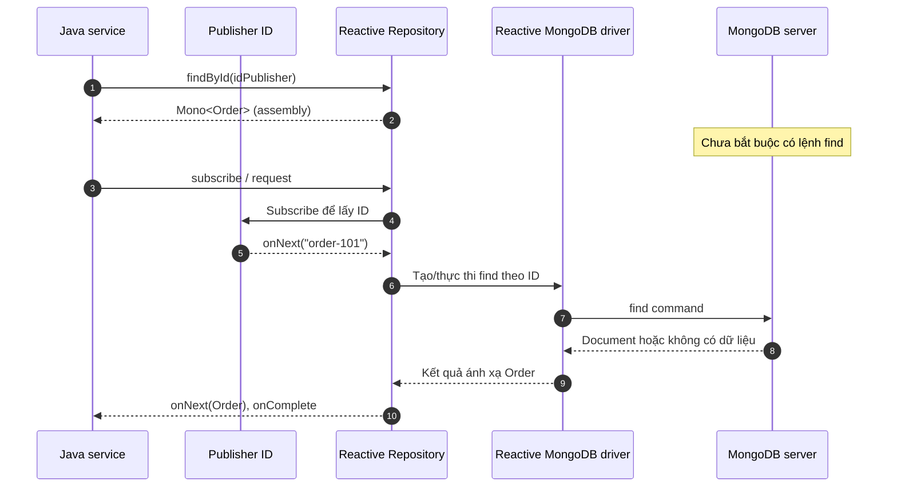

# Publisher tham số và thời điểm truy vấn được thực hiện

## 1. Một repository method được gọi không đồng nghĩa truy vấn đã chạy

Khi lập trình **Spring Data MongoDB** theo kiểu reactive, một method repository có thể trả về `Mono<T>` hoặc `Flux<T>` mà chưa gửi truy vấn tới MongoDB ngay tại dòng Java gọi method. Thao tác thường được **mô tả dưới dạng Publisher**; khi một subscriber đăng ký và có nhu cầu dữ liệu, pipeline mới được kích hoạt.

Ví dụ:

```java
Mono<Order> lookup = repository.findById("order-101");

// Ở đây mới tạo một Mono, chưa nên suy ra MongoDB đã chạy find.

lookup.subscribe(order -> {
    System.out.println(order.state());
});
```

Trong WebFlux, đa số trường hợp **không tự gọi `subscribe()` trong service/controller**. Framework subscribe vào Publisher khi cần xây HTTP response. Nếu gọi `subscribe()` thủ công, code rất dễ trả response trước khi truy vấn hoàn tất, làm mất xử lý lỗi hoặc tách operation khỏi transaction/request scope.

Đề bài của chương **Truy cập reactive** còn có một khía cạnh ít được chú ý: ngoài **Publisher kết quả**, một số API Spring Data reactive cho phép **Publisher làm tham số đầu vào**. Chẳng hạn, `ReactiveCrudRepository` có overload:

```java
Mono<Order> findById(Publisher<String> id);
```

Khi tham số `id` được cung cấp bất đồng bộ, repository phải nhận giá trị từ Publisher đó **trước khi thực thi truy vấn phụ thuộc ID**. Nếu tham số chỉ sẵn sàng sau một tác vụ reactive khác, truy vấn không nên được xây như thể ID đã có ở thời điểm gọi method.

Bài này thuộc module **SPRING_DATA_MONGODB**: sử dụng Spring Data MongoDB kết nối và ánh xạ document qua `ReactiveMongoTemplate` hoặc repository, viết truy vấn, transaction, reactive access, kiểm thử và chẩn đoán hiệu năng. Mục tiêu cụ thể là:

1. Hiểu `Publisher` làm **đầu vào** khác `Publisher` làm **kết quả**.
2. Phân biệt **assembly → subscription → demand → parameter resolution → MongoDB command → result**.
3. Hiểu cold/hot sources, `Mono.just`, `Mono.defer`, `Mono.fromSupplier`, nhiều subscribers, `cache`, `retry`.
4. Biết viết repository, template và WebFlux **không block, không subscribe sớm**.
5. Biết kiểm thử thời điểm resolve tham số, trường hợp rỗng/lỗi/cancel, tính đúng theo tenant và đo số MongoDB commands thực tế.

## 2. Các từ khóa cơ bản của Reactive Streams

Một **Publisher** là nguồn phát tín hiệu theo hợp đồng Reactive Streams. Nó không có nghĩa luôn phát dữ liệu lập tức hoặc luôn có đúng một giá trị.

| Khái niệm | Ý nghĩa | Ví dụ |
| --- | --- | --- |
| `Publisher<T>` | Giao diện nguồn phát các giá trị kiểu `T` | `Mono<String>`, `Flux<String>` |
| `Subscriber<T>` | Thành phần nhận `onSubscribe`, `onNext`, `onError`, `onComplete` | WebFlux, `StepVerifier` |
| `Subscription` | Liên hệ giữa source và subscriber, điều khiển `request(n)` và `cancel()` | Backpressure |
| `Mono<T>` | Reactor Publisher phát **0 hoặc 1 giá trị** rồi kết thúc hoặc lỗi | Một order theo ID |
| `Flux<T>` | Reactor Publisher phát **0..N giá trị**, lỗi hoặc hoàn tất | Danh sách orders |
| **Assembly** | Tạo object/lắp các operators của pipeline | Gọi `findById(...)`, `map`, `flatMap` |
| **Subscription** | Đăng ký tiêu thụ pipeline | WebFlux, `StepVerifier.create(...)` |
| **Demand** | Subscriber yêu cầu giá trị theo cơ chế `request` | `request(1)`, `request(Long.MAX_VALUE)` |
| **Termination** | Publisher hoàn tất hoặc báo lỗi | `onComplete`, `onError` |
| **Cancellation** | Subscriber không muốn tiếp tục nhận | Đóng request, `take(1)` |

Không phải mọi Publisher đều **cold** hoặc lười hoàn toàn. Một Publisher có thể hot, có thể bắt đầu tạo dữ liệu bởi bên ngoài trước khi bạn subscribe. Khi học thời điểm chạy query, luôn hỏi **Publisher này được tạo bởi API nào và nguồn tham số thuộc loại gì?**

### 2.1. Minh họa hai Publisher khác nhau

```java
Mono<String> idPublisher = Mono.just("order-101");
Mono<Order> resultPublisher =
    repository.findById(idPublisher);
```

`idPublisher` cung cấp **tham số truy vấn**. `resultPublisher` cung cấp **document kết quả**. Cả hai có thể là Publisher và đều tham gia vào cùng một chuỗi, nhưng có vai trò khác nhau.

### 2.2. Timeline thực thi



Sơ đồ biểu diễn **thứ tự logic**. Chính xác thời điểm command được gửi còn tùy driver, subscription, demand và tối ưu triển khai. Đừng diễn đạt “`subscribe()` luôn gửi ngay một TCP packet” — subscriber có thể chưa request, upstream có thể chờ tham số hoặc delay.

## 3. Ví dụ dữ liệu và ReactiveMongoRepository

### 3.1. Document MongoDB

Giả sử collection `shop_orders`:

```javascript
db.shop_orders.insertMany([
  {
    _id: "order-101",
    tenantId: "shop-a",
    state: "PAID",
    totalCents: NumberLong("25000")
  },
  {
    _id: "order-102",
    tenantId: "shop-a",
    state: "PENDING",
    totalCents: NumberLong("8000")
  },
  {
    _id: "order-201",
    tenantId: "shop-b",
    state: "PAID",
    totalCents: NumberLong("50000")
  }
]);
```

### 3.2. Entity

```java
package example.orders;

import org.springframework.data.mongodb.core.mapping.Document;
import org.springframework.data.mongodb.core.mapping.FieldType;
import org.springframework.data.mongodb.core.mapping.MongoId;

@Document(collection = "shop_orders")
public record ShopOrder(
    @MongoId(FieldType.STRING) String id,
    String tenantId,
    String state,
    long totalCents
) {}
```

`@MongoId(FieldType.STRING)` thể hiện ID lưu BSON String. Reactive repository sử dụng mapping metadata tương ứng khi đọc document.

### 3.3. Repository

```java
package example.orders;

import org.springframework.data.mongodb.repository.ReactiveMongoRepository;
import reactor.core.publisher.Mono;

public interface ShopOrderRepository
        extends ReactiveMongoRepository<ShopOrder, String> {

    Mono<ShopOrder> findByIdAndTenantId(
        String id, String tenantId
    );
}
```

`ReactiveMongoRepository` kế thừa các thao tác reactive CRUD, trong đó có dạng `findById(String)` và `findById(Publisher<String>)` từ các interface liên quan. Chúng khác **cách cung cấp ID**, không phải “một bên synchronous, một bên reactive”: **cả hai trả về `Mono<ShopOrder>`**.

Trong Java:

```java
import org.reactivestreams.Publisher;
import reactor.core.publisher.Mono;

Publisher<String> id = Mono.just("order-101");

Mono<ShopOrder> byValue =
    repository.findById("order-101");

Mono<ShopOrder> byPublisher =
    repository.findById(id);
```

Hai lời gọi có thể cùng trả order-101 khi được subscribe. Khác biệt: với `byPublisher`, việc xác định ID phụ thuộc Publisher đầu vào. **Tham số `Publisher` không tự khiến một truy vấn MongoDB chạy sớm hơn.**

## 4. Hai giai đoạn lazy: tạo Publisher đầu vào và tạo Publisher kết quả

### 4.1. `Mono.just` chứa giá trị đã có

```java
String id = "order-101";
Mono<String> idMono = Mono.just(id);
Mono<ShopOrder> query = repository.findById(idMono);
```

Giá trị `id` đã tồn tại khi gọi `Mono.just`. Publisher có thể phát giá trị đó khi được subscribe, nhưng việc **tính ra String id** không được trì hoãn bởi `Mono.just`.

So sánh:

```java
Mono<String> eager =
    Mono.just(loadIdFromLocalComputation());
```

Ở đây `loadIdFromLocalComputation()` được gọi **ngay tại assembly**, trước khi có ai subscribe vào `eager`. Không nên dùng `Mono.just(blockingDatabaseOrHttpCall())` để cố làm một thao tác blocking trở thành reactive.

### 4.2. `Mono.fromSupplier` trì hoãn tính giá trị

```java
Mono<String> lazyId = Mono.fromSupplier(
    () -> deriveIdFromImmutableInput()
);

Mono<ShopOrder> query =
    repository.findById(lazyId);
```

Supplier chạy **khi có subscription** tới nguồn này, không chạy lúc lắp ráp pipeline. Điều đó giúp xây dựng giá trị một cách lazy và có thể lặp lại mỗi lần subscribe.

**Không đưa tác vụ blocking chậm** vào Supplier chỉ vì nó được gọi muộn. Đối với I/O HTTP/DB, ưu tiên API reactive thật sự hoặc cách ly blocking task một cách có chủ đích ở tầng được phép.

### 4.3. `Mono.defer` trì hoãn cả việc dựng pipeline

```java
Mono<ShopOrder> query = Mono.defer(() -> {
    String id = deriveIdFromImmutableInput();
    return repository.findById(id);
});
```

`Mono.defer` gọi Supplier tạo **một Publisher mới trên mỗi subscription**. Khác biệt với:

```java
Mono<ShopOrder> query =
    repository.findById(deriveIdFromImmutableInput());
```

Ở dòng thứ hai, `deriveIdFromImmutableInput()` chạy ngay khi tạo `query`, mặc dù MongoDB query thường chưa chạy.

### 4.4. Tóm tắt chính xác điều gì xảy ra khi nào

| Cách viết | Thời điểm tính ID | Thời điểm thực thi query MongoDB |
| --- | --- | --- |
| `findById("order-101")` | ID đã có tại assembly | Khi result Publisher được subscribe/được yêu cầu |
| `findById(Mono.just(id))` | Giá trị `id` đã có; Mono phát khi subscribe | Sau khi ID Publisher được tiêu thụ trong result subscription |
| `findById(Mono.fromSupplier(...))` | Supplier chạy tại subscription | Sau khi ID được resolve |
| `Mono.defer(() -> findById(makeId()))` | `makeId()` chạy tại subscription | Khi query Publisher bên trong được subscribe |
| `Mono.just(findIdBlocking())` | Lệnh blocking chạy ngay | Không phải một mẫu reactive hợp lệ để trì hoãn blocking |

**Không đánh đồng “repository trả về Mono” với “toàn bộ các expression Java tại dòng gọi đều lazy”.** Reactor chỉ kiểm soát phần tính toán được đặt *trong* Publisher/operator.

## 5. Publisher tham số: một giá trị khác nhiều giá trị

### 5.1. Một ID: dùng Mono

`findById(Publisher<ID>)` mang ý nghĩa tìm **một entity theo ID**. Dù kiểu tham số tổng quát là `Publisher<ID>`, cách rõ ràng nhất khi nghiệp vụ có một ID là truyền `Mono<ID>`.

```java
Mono<String> id = getOrderIdAsynchronously();

Mono<ShopOrder> order = repository.findById(id);
```

Hàm `getOrderIdAsynchronously()` ở đây đại diện cho Publisher do ứng dụng cung cấp; khi triển khai phải định nghĩa nó bằng nguồn thực tế, ví dụ đọc một giá trị từ một service khác hoặc Reactor Context.

Không truyền `Flux` vô hạn hoặc nguồn có nhiều ID vào API được thiết kế để trả **một entity**, rồi dựa vào chi tiết implementation về chọn phần tử nào. Hãy chuyển nó thành một `Mono` có ngữ nghĩa rõ ràng, ví dụ:

```java
Mono<String> exactlyOneId =
    candidateIds.single();
```

`single()` yêu cầu đúng một phần tử; nếu rỗng hoặc có nhiều phần tử, nó báo lỗi. Đây là lựa chọn tốt khi input sai cardinality là **lỗi hợp đồng**.

### 5.2. Nhiều ID: `findAllById(Publisher<ID>)`

`ReactiveCrudRepository` cũng hỗ trợ tìm nhiều bản ghi theo một Publisher ID:

```java
Flux<String> ids = Flux.just(
    "order-101", "order-102", "order-201"
);

Flux<ShopOrder> orders =
    repository.findAllById(ids);
```

`findAllById(Publisher<ID>)` không biến một `Flux<ID>` thành “một kết quả cho mọi ID” trong mọi trường hợp: ID có thể không tồn tại, danh sách có thể có trùng ID, thứ tự kết quả **không nên mặc định** trùng thứ tự input. Hãy kiểm tra contract của phiên bản Spring Data và sort/đối chiếu kết quả theo ID nếu API yêu cầu thứ tự cố định.

Không suy ra từ chữ `Publisher` rằng repository sẽ luôn chạy **một MongoDB command riêng cho mỗi ID**, hoặc luôn gộp thành **một command duy nhất**. Chi tiết truy vấn phụ thuộc implementation và version; cần đo nếu workload lớn.

### 5.3. Khi có hàng nghìn ID

```java
Flux<String> ids = incomingIds
    .distinct()
    .take(1000);

Flux<ShopOrder> orders =
    repository.findAllById(ids);
```

Ví dụ chủ động giới hạn số ID, nhưng `take(1000)` là **cơ chế giới hạn input**, không phải bảo vệ hoàn chỉnh trước một nguồn vô hạn có nhiều lỗi/giá trị rất lớn. Nếu API công khai nhận danh sách ID, cần giới hạn kích thước request, xác thực quyền tenant, phân trang/chunk có kiểm soát và đánh giá index.

### 5.4. Publisher rỗng và Publisher lỗi

Ví dụ:

```java
Mono<String> emptyId = Mono.empty();
Mono<String> brokenId = Mono.error(
    new IllegalArgumentException("Không xác định được ID")
);

Mono<ShopOrder> fromEmpty =
    repository.findById(emptyId);

Mono<ShopOrder> fromError =
    repository.findById(brokenId);
```

Một upstream không phát ID sẽ không cung cấp được tham số cho `findById`; upstream phát lỗi sẽ khiến chuỗi lỗi. **Chi tiết tín hiệu khi Publisher ID rỗng phụ thuộc hợp đồng API/phiên bản**, nên cần test rõ, không suy đoán có một MongoDB query với `_id=null`.

Nếu nghiệp vụ yêu cầu ID bắt buộc, nên chuẩn hóa ở ranh giới ứng dụng:

```java
Mono<String> requiredId =
    idPublisher.switchIfEmpty(Mono.error(
        new IllegalArgumentException("Thiếu orderId")
    ));

Mono<ShopOrder> lookup =
    repository.findById(requiredId);
```

Khi đó, **đường lỗi** cho input rỗng được định nghĩa ở code ứng dụng thay vì trông chờ chi tiết repository.

## 6. Subscription: truy vấn có thể chạy lại nhiều lần

### 6.1. Cold query Publisher và hai subscriber

```java
Mono<ShopOrder> lookup =
    repository.findById("order-101");

lookup.subscribe(order ->
    log.info("Subscriber A: {}", order.state())
);
lookup.subscribe(order ->
    log.info("Subscriber B: {}", order.state())
);
```

Một cold reactive query Publisher thông thường **thực hiện lại đường truy vấn cho mỗi subscription**. Vì vậy có thể có hai MongoDB command, không phải một query được phát “mãi mãi” cho mọi subscriber.

Đoạn `subscribe` thủ công này **chỉ để minh họa cơ chế**, không phải cách triển khai endpoint WebFlux. Cũng đừng giả định hai subscriber cùng thấy một snapshot; giữa hai subscription, document có thể đã đổi.

### 6.2. ID được tạo lại mỗi lần subscribe

```java
AtomicInteger calls = new AtomicInteger();

Mono<String> idPublisher = Mono.fromSupplier(() -> {
    calls.incrementAndGet();
    return "order-101";
});

Mono<ShopOrder> lookup =
    repository.findById(idPublisher);

// calls.get() == 0 trước subscription.

lookup.block();  // Chỉ dùng trong chương trình thử / main cô lập.
// calls.get() == 1.

lookup.block();  // Subscribe lần thứ hai.
// calls.get() == 2.
```

Đoạn này minh họa tính **cold/re-subscription** của nguồn `fromSupplier`. `block()` là terminal operation **blocking**, không dùng trên request thread của WebFlux. Trong kiểm thử thực tế, ưu tiên `StepVerifier` thay vì `block()`.

### 6.3. Một Publisher kết quả không phải “future đã hoàn thành”

`Mono<ShopOrder>` không có nghĩa “MongoDB đã đọc document rồi và kết quả đang nằm trong Mono”. Nếu chưa subscribe, thường chưa có lệnh truy vấn. Nếu subscribe nhiều lần, có thể kích hoạt các lần đọc độc lập.

Một thao tác như:

```java
Mono<ShopOrder> result =
    repository.findById("order-101")
        .doOnNext(order -> metrics.recordRead());
```

không ghi metrics tại assembly. `doOnNext` chạy khi Publisher thực sự phát một order; nếu query trả rỗng, callback này không được gọi.

## 7. Hot, cold, cache và thời điểm quan sát

### 7.1. Cold source

```java
Mono<String> id = Mono.fromSupplier(() -> {
    System.out.println("ID evaluated");
    return "order-101";
});
```

Mỗi lần subscribe mới thường khiến Supplier chạy lại. Nếu kết hợp với cold repository Publisher, mỗi subscription có thể resolve tham số và truy vấn lại.

### 7.2. Hot/shared source

Một `Sinks.Many`, một event stream đã được subscribe từ bên ngoài hoặc một Publisher đã `cache`/`share` có thể **không phát lại dữ liệu theo ý muốn của subscriber mới**. Nếu nguồn tham số phát ID **trước khi repository subscribe**, một subscriber đến muộn có thể không nhận ID.

Vì vậy không dùng một hot event stream làm tham số `findById` mà không có giao thức xác định **mỗi request lấy đúng một ID**.

### 7.3. Cache kết quả truy vấn

```java
Mono<ShopOrder> cached =
    repository.findById("order-101")
        .cache();
```

Với `Mono.cache()`, subscriber đầu thường kích hoạt truy vấn; các subscriber tiếp theo có thể nhận lại tín hiệu đã được cache thay vì gửi query mới. **Đây là cache ở Reactor Publisher**, không phải cache MongoDB.

Rủi ro:

- Document có thể thay đổi nhưng `cached` vẫn trả dữ liệu cũ.
- Nếu Publisher được giữ lâu trong singleton, dữ liệu cũ tồn tại lâu không theo thời gian của request.
- Một lỗi hoặc kết quả empty cũng có thể được cache theo semantics của operator.
- Cached result chứa thông tin tenant/user có thể gây lộ dữ liệu nếu dùng lại sai scope.

Không dùng `cache()` bừa để “tối ưu mọi query”. Hãy định nghĩa thời gian sống, key, quyền truy cập, chiến lược invalidation và yêu cầu consistency.

### 7.4. Cache ID khác cache kết quả

```java
Mono<String> cachedId = fetchCurrentId().cache();
Mono<ShopOrder> lookup = repository.findById(cachedId);
```

Ở đây có thể cache **giá trị ID**, nhưng `lookup` vẫn có thể thực hiện lại query khi subscribe nhiều lần. **Cache tham số** không đồng nghĩa **cache document**. Để tránh hiểu nhầm về request lifecycle, hãy chọn phạm vi cache rõ.

## 8. Thực thi tại subscription: assembly-time side effects là bẫy

### 8.1. Side effect trước Publisher

```java
public Mono<ShopOrder> loadOrder(String id) {
    auditAttempt(id); // Gọi NGAY lúc method được gọi.
    return repository.findById(id);
}
```

Nếu controller gọi `loadOrder` để lấy Mono nhưng không ai subscribe, `auditAttempt` vẫn chạy. Còn MongoDB query có thể chưa chạy. Điều này tạo log “đã đọc order” dù thực tế chưa có truy vấn.

Nếu cần metric theo **mỗi subscription**:

```java
public Mono<ShopOrder> loadOrder(String id) {
    return Mono.defer(() -> {
        auditAttempt(id); // Gọi khi subscribe.
        return repository.findById(id);
    });
}
```

Không đặt business side effect có tác động tài chính vào `defer` mà không tính tới **re-subscription/retry**: nó có thể xảy ra nhiều lần.

### 8.2. `doOnSubscribe` và `doOnNext` khác nhau

```java
Mono<ShopOrder> lookup = repository.findById(id)
    .doOnSubscribe(s -> log.debug("Subscribed"))
    .doOnNext(order -> log.debug("Found {}", order.id()))
    .doOnSuccess(order -> log.debug("Completed lookup"))
    .doOnError(error -> log.warn("Lookup failed", error))
    .doFinally(signal -> log.debug("Terminated: {}", signal));
```

| Hook | Khi nào được gọi? | Điểm cần nhớ |
| --- | --- | --- |
| `doOnSubscribe` | Khi subscription được thiết lập | **Không** nhất thiết command đã tới server |
| `doOnNext` | Khi có một document được phát | Không chạy khi Mono empty |
| `doOnSuccess` | Khi Mono thành công, kể cả empty với giá trị null | Không nên giả định luôn có document |
| `doOnError` | Khi Publisher báo lỗi | Lỗi không biến thành kết quả trống trừ khi xử lý riêng |
| `doFinally` | Sau complete/error/cancel | Hữu ích cho cleanup/metric tổng kết |

Nếu cần biết **MongoDB đã nhận command chưa**, dùng driver command monitoring trong môi trường test, không dùng mỗi `doOnSubscribe` làm bằng chứng.

## 9. Đưa Publisher tham số vào ReactiveMongoTemplate

`ReactiveMongoTemplate` hỗ trợ reactive operations, nhưng không phải mọi method template có overload nhận `Publisher<ID>`. Đừng suy rằng có thể truyền `Mono<String>` vào mọi method có tham số `String` hoặc `Query`.

Với `ReactiveMongoTemplate.findById(id, ShopOrder.class)`, khi ID được phát từ Publisher, ta **compose** bằng `flatMap`:

```java
package example.orders;

import org.springframework.data.mongodb.core.ReactiveMongoTemplate;
import org.springframework.stereotype.Service;
import reactor.core.publisher.Mono;

@Service
public class OrderLookupTemplateService {

    private final ReactiveMongoTemplate template;

    public OrderLookupTemplateService(
            ReactiveMongoTemplate template) {
        this.template = template;
    }

    public Mono<ShopOrder> load(Mono<String> orderId) {
        return orderId
            .switchIfEmpty(Mono.error(
                new IllegalArgumentException("Thiếu orderId")
            ))
            .flatMap(id ->
                template.findById(id, ShopOrder.class)
            );
    }
}
```

Giải thích:

1. Method `load` nhận một `Mono<String>`, không cần `block()` để lấy ID.
2. `switchIfEmpty` xử lý tham số bị thiếu với contract rõ.
3. `flatMap` chờ giá trị ID rồi gọi reactive template query.
4. Subscriber của kết quả cuối sẽ kích hoạt upstream ID và downstream MongoDB query.
5. Nếu upstream phát lỗi, hàm `flatMap` không gọi database.

`flatMap` là cách compose các Publisher phụ thuộc nhau; dùng `map` chỉ phù hợp khi lambda trả về **giá trị thường**, không phải `Mono<ShopOrder>`:

```java
Mono<Mono<ShopOrder>> nested = orderId.map(
    id -> template.findById(id, ShopOrder.class)
);
```

`nested` ở trên là **Mono lồng Mono**. Nếu ứng dụng không flatten, truy vấn bên trong có thể chưa được subscribe, và người đọc có thể nhận **Publisher object** thay vì document.

## 10. Query động: tham số không được làm thiếu tenant filter

`repository.findById(idPublisher)` rất tiện để học Publisher parameter. Nhưng trong hệ thống đa tenant, ID do client cung cấp **không đủ** để cho phép đọc mọi document.

### 10.1. Repository method có tenant trong điều kiện

```java
public interface ShopOrderRepository
        extends ReactiveMongoRepository<ShopOrder, String> {

    Mono<ShopOrder> findByIdAndTenantId(
        String id, String tenantId
    );
}
```

Nếu ID được cung cấp từ Publisher, compose trước rồi gọi method tenant-scoped:

```java
public Mono<ShopOrder> loadForTenant(
        Mono<String> orderId,
        String authorizedTenantId) {

    if (authorizedTenantId == null
            || authorizedTenantId.isBlank()) {
        return Mono.error(new IllegalArgumentException(
            "Tenant không hợp lệ"
        ));
    }

    return orderId
        .switchIfEmpty(Mono.error(
            new IllegalArgumentException("Thiếu ID")
        ))
        .flatMap(id ->
            repository.findByIdAndTenantId(
                id, authorizedTenantId
            )
        );
}
```

`authorizedTenantId` phải đến từ server-side authentication/authorization context. Không để client nhập tenant tùy ý rồi coi đó là kiểm tra quyền. Query tenant-scoped giúp MongoDB **lọc đúng dữ liệu** thay vì đọc document ngoài quyền rồi lọc ở Java.

### 10.2. ReactiveMongoTemplate với Criteria

```java
public Mono<ShopOrder> loadForTenant(
        Mono<String> orderId,
        String authorizedTenantId) {

    return orderId.flatMap(id -> {
        Query query = Query.query(
            Criteria.where("id").is(id)
                .and("tenantId").is(authorizedTenantId)
        );
        return template.findOne(query, ShopOrder.class);
    });
}
```

Trong typed query theo `ShopOrder.class`, Spring Data sử dụng metadata để ánh xạ Java property `id` với BSON `_id`. Với raw BSON `Document` không typed, phải dùng tên field lưu thật.

### 10.3. Reactive security context

Nếu tenant được cung cấp qua **Reactor Context** thay vì method parameter, cần đọc context trong subscription:

```java
Mono<ShopOrder> loadWithContext(Mono<String> orderId) {
    return Mono.deferContextual(ctx -> {
        String tenant = ctx.get("authorizedTenantId");
        return orderId.flatMap(id ->
            repository.findByIdAndTenantId(id, tenant)
        );
    });
}
```

Đây là ví dụ về **key nội bộ do hệ thống xác thực đưa vào**. Trong ứng dụng Spring Security WebFlux, nên dùng API lấy principal/authorization context phù hợp, không tin một context key do client tùy ý điều khiển. `deferContextual` đọc context **tại subscription**, tránh chụp nhầm context của request khác ở assembly.

## 11. Cách xử lý không có document khác không có ID

Cần phân biệt ba tình huống:

1. Publisher ID **không phát giá trị**.
2. Publisher ID **phát một ID hợp lệ**, nhưng MongoDB không tìm thấy document.
3. Publisher ID **báo lỗi** trước khi truy vấn.

Ở cả (1) và (2), một chain cuối có thể dẫn tới empty nếu bạn không quy định contract riêng; nhưng chúng **không cùng ý nghĩa nghiệp vụ**.

### 11.1. Chuẩn hóa input trước query

```java
Mono<String> requiredId = sourceId
    .switchIfEmpty(Mono.error(
        new IllegalArgumentException("Thiếu orderId")
    ))
    .filter(id -> !id.isBlank())
    .switchIfEmpty(Mono.error(
        new IllegalArgumentException("orderId rỗng")
    ));
```

Ở đây input thiếu hoặc blank được phân loại là **bad input**.

### 11.2. Xử lý document không tồn tại sau query

```java
Mono<ShopOrder> requiredOrder =
    requiredId.flatMap(repository::findById)
        .switchIfEmpty(Mono.error(
            new OrderNotFoundException("Không tìm thấy order")
        ));
```

`OrderNotFoundException` là **class nghiệp vụ do ứng dụng định nghĩa**, không phải class chuẩn của Spring Data MongoDB. Đoạn code cần đặt trong ứng dụng có exception tương ứng.

**Không biến mọi exception thành HTTP 404.** Lỗi mạng, access denied, mapping lỗi hoặc timeout phải được phân loại riêng. Nếu trong ứng dụng đa tenant, dùng query tenant-scoped và chọn HTTP error contract không làm lộ sự tồn tại của document ngoài quyền.

### 11.3. Không dùng defaultIfEmpty với entity giả

```java
// Không dùng trong nghiệp vụ cần phân biệt "không tìm thấy":
Mono<ShopOrder> result = repository.findById(id)
    .defaultIfEmpty(
        new ShopOrder("fake", "shop-a", "PAID", 0L)
    );
```

Một entity giả có thể bị ghi lại hoặc được coi là dữ liệu thật ở tầng khác. Nếu muốn trả response mặc định, hãy dùng DTO/error contract rõ ràng, không “hóa trang” một document không tồn tại thành entity hợp lệ.

## 12. WebFlux controller: trả Publisher, không tự subscribe

### 12.1. Service

```java
package example.orders;

import org.springframework.stereotype.Service;
import reactor.core.publisher.Mono;

@Service
public class OrderQueryService {

    private final ShopOrderRepository repository;

    public OrderQueryService(
            ShopOrderRepository repository) {
        this.repository = repository;
    }

    public Mono<OrderView> getOrder(
            String authorizedTenantId,
            Mono<String> orderId) {

        if (authorizedTenantId == null
                || authorizedTenantId.isBlank()) {
            return Mono.error(new IllegalArgumentException(
                "Tenant không hợp lệ"
            ));
        }

        return orderId
            .switchIfEmpty(Mono.error(
                new IllegalArgumentException("Thiếu orderId")
            ))
            .flatMap(id ->
                repository.findByIdAndTenantId(
                    id, authorizedTenantId
                )
            )
            .map(order -> new OrderView(
                order.id(), order.state(), order.totalCents()
            ));
    }
}
```

DTO:

```java
package example.orders;

public record OrderView(
    String id,
    String state,
    long totalCents
) {}
```

### 12.2. Controller được WebFlux subscribe

```java
package example.orders;

import org.springframework.http.ResponseEntity;
import org.springframework.web.bind.annotation.GetMapping;
import org.springframework.web.bind.annotation.PathVariable;
import org.springframework.web.bind.annotation.RestController;
import reactor.core.publisher.Mono;

@RestController
public class OrderController {

    private final OrderQueryService service;
    private final AuthorizedTenantProvider tenants;

    public OrderController(
            OrderQueryService service,
            AuthorizedTenantProvider tenants) {
        this.service = service;
        this.tenants = tenants;
    }

    @GetMapping("/orders/{id}")
    public Mono<ResponseEntity<OrderView>> byId(
            @PathVariable String id) {

        return tenants.currentAuthorizedTenant()
            .flatMap(tenant ->
                service.getOrder(tenant, Mono.just(id))
            )
            .map(ResponseEntity::ok)
            .defaultIfEmpty(
                ResponseEntity.notFound().build()
            );
    }
}
```

`AuthorizedTenantProvider` là **abstraction ứng dụng phải triển khai** dựa trên Spring Security principal/context; nó không phải API mặc định của Spring Data MongoDB. Ví dụ cố ý không nhận tenant từ request query parameter. Phần `defaultIfEmpty` trả 404 khi đã xác định tenant nhưng không thấy order; trong ứng dụng thật, cần phân biệt trường hợp context xác thực bị thiếu để tránh biến lỗi authorization thành 404 ngoài ý muốn.

Điểm cốt lõi: controller **trả `Mono<ResponseEntity<...>>`**. Framework subscribe, yêu cầu dữ liệu và xử lý complete/error theo HTTP lifecycle. Không gọi:

```java
// Không dùng:
service.getOrder(tenant, Mono.just(id)).subscribe();
return Mono.just(ResponseEntity.accepted().build());
```

Vì cách này làm truy vấn tách khỏi response/exception pipeline; response có thể trả trước khi query hoàn tất.

## 13. Backpressure và thời điểm MongoDB được yêu cầu dữ liệu

### 13.1. Mono khác Flux về số kết quả

`Mono<Order>` chỉ phát tối đa một Order. Với `Flux<Order>` từ repository `findAll()`, subscriber có thể điều khiển **nhu cầu** theo Reactive Streams. Driver thường cung cấp kết quả qua cursor và các batch, nhưng `request(n)` ở Reactor **không nhất thiết là một lệnh MongoDB cho đúng n document**.

```java
Flux<ShopOrder> orders =
    repository.findAll();

Flux<ShopOrder> firstTen =
    orders.take(10);
```

`take(10)` dừng tiêu thụ sau tối đa 10 kết quả, có thể hủy upstream; tuy nhiên không đồng nghĩa server chỉ thực hiện đúng 10 phép đọc hoặc chưa bao giờ prefetch batch lớn hơn. Nếu muốn giới hạn tổng kết quả ngay từ MongoDB, dùng query có `limit(10)` hoặc repository API phù hợp.

### 13.2. Kiểm tra demand bằng StepVerifier

```java
StepVerifier.create(orders, 0)
    .thenRequest(1)
    .expectNextCount(1)
    .thenCancel()
    .verify();
```

Code test trên đòi hỏi `orders` chứa ít nhất một document; nó biểu diễn subscriber ban đầu có **request=0**, sau đó yêu cầu 1 và hủy. Việc upstream bắt đầu chuẩn bị command trước khi `thenRequest(1)` hay không phụ thuộc operator/driver; **không dùng test demand này làm bằng chứng lệnh database chưa được gửi** nếu không có command monitoring.

### 13.3. Không dùng collectList cho tập dữ liệu không giới hạn

```java
Mono<List<ShopOrder>> all =
    repository.findAll().collectList();
```

`collectList` gom mọi document phát ra vào RAM ứng dụng. Reactive I/O không làm danh sách trở nên vô hạn an toàn. Với báo cáo lớn, đặt `limit`/phân trang/cursor chiến lược và dùng DTO projection phù hợp.

## 14. Retry: mỗi lần subscribe lại có thể tạo query mới

`retry(n)` khi được áp dụng vào cold query Publisher có thể khiến **resubscribe** vào upstream khi lỗi:

```java
Mono<ShopOrder> lookup =
    repository.findById(idPublisher)
        .retry(2);
```

Nếu có lỗi trong lần đọc, Reactor có thể subscribe lại tối đa số lần retry cấu hình. Điều đó có thể khiến **idPublisher** tính lại ID và truy vấn MongoDB được gửi lại.

### 14.1. Retry chỉ nên dùng cho lỗi phù hợp

```java
Mono<ShopOrder> lookup =
    repository.findById(idPublisher)
        .retryWhen(
            Retry.backoff(2, Duration.ofMillis(100))
                .filter(this::isTransientReadFailure)
        );
```

`isTransientReadFailure` là policy do ứng dụng phải định nghĩa theo exception/driver labels và tác động nghiệp vụ; đoạn code giả định helper đó tồn tại. Đừng retry vô hạn mọi lỗi, đặc biệt lỗi validation, unauthorized hoặc ID không hợp lệ.

### 14.2. Query đọc và ghi có rủi ro khác nhau

Đọc lại có thể lấy document ở thời điểm **khác** sau retry. Với thao tác ghi:

```java
Mono<ShopOrder> save =
    repository.save(newOrder).retry(3);
```

việc retry có thể không an toàn nếu logic xung quanh còn phát event hoặc cập nhật nhiều document; cần **idempotency**, retryable writes và transaction policy phù hợp. Không coi `Mono.retry` là tính năng bảo đảm exactly-once.

### 14.3. Retry sau cache

`cache()` có thể ghi nhớ error; nếu bạn đặt cache trước `retry`, việc retry có thể nhận **lại cùng error được cache** thay vì tạo command mới. Thứ tự operator ảnh hưởng semantics:

```java
Mono<ShopOrder> a =
    repository.findById(id).retry(2).cache();

Mono<ShopOrder> b =
    repository.findById(id).cache().retry(2);
```

Không dùng hai cách như nhau. Chọn policy có chủ đích và kiểm thử số lần subscribe/source evaluations.

## 15. Cancellation: mất subscriber không đồng nghĩa transaction rollback

Nếu client HTTP ngắt kết nối hoặc downstream gọi `cancel`, reactive pipeline có thể bị hủy:

```java
Flux<ShopOrder> limited =
    repository.findAll()
        .take(5)
        .doFinally(signal ->
            log.debug("Completed with {}", signal)
        );
```

Cancellation có thể kích hoạt cleanup ở Reactor/driver, nhưng **không nên giả định lệnh MongoDB đang chạy lập tức dừng trên mọi topology**. Đồng thời, nếu thao tác **ghi đã được server xác nhận**, việc cancel subscription ở client không tự rollback ghi đó.

### 15.1. Tham số Publisher có thể bị hủy trước khi có ID

```java
Mono<String> delayedId =
    Mono.delay(Duration.ofSeconds(5))
        .map(ignored -> "order-101");

Mono<ShopOrder> lookup =
    repository.findById(delayedId);
```

Nếu subscriber hủy sau một giây, nguồn ID có thể chưa phát, vì vậy repository chưa có giá trị để tạo truy vấn phụ thuộc ID. Đừng viết logic cleanup giả định một lệnh find chắc chắn đã xảy ra.

### 15.2. Timeout của Reactor khác maxTimeMS

```java
Mono<ShopOrder> bounded =
    lookup.timeout(Duration.ofSeconds(2));
```

`timeout` của Reactor là giới hạn thời gian theo Publisher ở phía ứng dụng. Nó không mặc nhiên cấu hình **MongoDB server maxTimeMS**. Nếu cần kiểm soát cả hai, cấu hình timeout phía server qua API Spring Data/driver phù hợp và cân nhắc deadline end-to-end.

## 16. Scheduling: non-blocking I/O không cần boundedElastic mặc định

Một hiểu nhầm phổ biến là mọi method reactive đều phải:

```java
repository.findById(id)
    .subscribeOn(Schedulers.boundedElastic());
```

Reactive MongoDB driver đã dùng cơ chế **non-blocking I/O**; ép toàn bộ query qua `boundedElastic` thường không phải cách tăng tốc database. `subscribeOn`/`publishOn` điều khiển execution context của phần pipeline Reactor, không đổi index, query plan hoặc CPU server.

Nếu có một thư viện **blocking** không có reactive API, nên cách ly phần blocking:

```java
Mono<String> id = Mono.fromCallable(
        () -> legacyBlockingIdResolver.resolve()
    )
    .subscribeOn(Schedulers.boundedElastic());

Mono<ShopOrder> lookup =
    id.flatMap(repository::findById);
```

`legacyBlockingIdResolver` là dependency bên ngoài phải được định nghĩa; ví dụ chỉ minh họa **cô lập phần blocking**, không khuyến khích chuyển truy vấn MongoDB về blocking. Với mỗi service, cần đo thread pool, queue và timeout thực tế.

**Không dùng `block()` trên event-loop WebFlux** để lấy ID rồi mới gọi repository:

```java
// Anti-pattern:
String id = idMono.block();
Mono<ShopOrder> order = repository.findById(id);
```

Vừa chặn thread, vừa làm mất ý nghĩa chain reactive và có nguy cơ deadlock/exception tùy runtime.

## 17. Transaction và Reactor Context

Spring Data reactive MongoDB hỗ trợ transaction qua `ReactiveMongoTransactionManager` và Reactor Context/transaction context theo framework. Các thao tác cần thuộc cùng transaction phải được subscribe **trong transaction scope**, không chỉ được tạo bằng những method có tên giống nhau.

### 17.1. TransactionalOperator

```java
import org.springframework.data.mongodb.ReactiveMongoTransactionManager;
import org.springframework.transaction.reactive.TransactionalOperator;

TransactionalOperator tx =
    TransactionalOperator.create(
        reactiveMongoTransactionManager
    );

Mono<ShopOrder> work = repository.findById(id)
    .flatMap(order ->
        repository.save(new ShopOrder(
            order.id(),
            order.tenantId(),
            "PAID",
            order.totalCents()
        ))
    );

Mono<ShopOrder> transactional =
    work.as(tx::transactional);
```

`reactiveMongoTransactionManager` là instance được cấu hình/inject trong Spring context; ở đây chỉ minh họa một transaction với một lần tìm và save. Với nghiệp vụ thật, dùng conditional updates/version hoặc transaction phù hợp để tránh lost update.

**Transaction reactive phải dùng deployment MongoDB hỗ trợ (replica set/sharded topology thích hợp)**. Không tự tạo `ClientSession` sync rồi truyền vào reactive code; Spring transaction manager phải sở hữu session đúng lifecycle.

### 17.2. Reactive Context không phải ThreadLocal đơn giản

Trong reactive pipeline, execution có thể chuyển thread, nên một `ThreadLocal` thường không biểu diễn chính xác security/transaction context suốt pipeline. Nếu cần các giá trị theo request, dùng Reactor Context và API Spring Security/Spring transaction phù hợp.

Không tạo một transaction rồi gọi `subscribe()` trên một Publisher khác ở bên trong:

```java
return tx.transactional(
    repository.findById(id)
        .doOnNext(order ->
            repository.save(order).subscribe() // Sai.
        )
);
```

Việc subscribe thủ công tạo **một subscription độc lập**, có thể tách khỏi transaction và xử lý lỗi của chain ngoài. Dùng `flatMap` để compose:

```java
return tx.transactional(
    repository.findById(id)
        .flatMap(order -> repository.save(order))
);
```

### 17.3. Publisher tham số không tự tạo transaction

`repository.findById(idMono)` có thể resolve ID theo một nguồn reactive, nhưng việc truyền Publisher làm argument **không tự tạo session/transaction** cho nguồn đó. Nếu cần atomicity của nhiều thao tác MongoDB, xây transaction scope bao tất cả các thao tác DB liên quan.

## 18. Quan sát thời điểm MongoDB query được gửi

Reactor operators giúp theo dõi signals, nhưng để phân biệt **source ID được subscribe** với **MongoDB command thực sự bắt đầu**, cần quan sát hai lớp.

### 18.1. Reactor-side instrumentation

```java
AtomicInteger idEvaluations = new AtomicInteger();

Mono<String> id = Mono.fromSupplier(() -> {
    idEvaluations.incrementAndGet();
    return "order-101";
});

Mono<ShopOrder> lookup =
    repository.findById(id)
        .doOnSubscribe(subscription ->
            log.debug("Result subscribed")
        )
        .doOnNext(order ->
            log.debug("Document emitted: {}", order.id())
        );
```

`idEvaluations` cho biết nguồn ID chạy mấy lần. Nó **không** trực tiếp là số MongoDB commands.

### 18.2. MongoDB command monitoring

MongoDB Java driver hỗ trợ `CommandListener`. Khi driver/reactive client được cấu hình đúng, có thể quan sát `CommandStartedEvent` cho lệnh `find`:

```java
import com.mongodb.event.CommandListener;
import com.mongodb.event.CommandStartedEvent;
import java.util.concurrent.atomic.AtomicInteger;

public final class FindCommandCounter
        implements CommandListener {

    private final AtomicInteger count =
        new AtomicInteger();

    @Override
    public void commandStarted(CommandStartedEvent event) {
        if ("find".equals(event.getCommandName())) {
            count.incrementAndGet();
        }
    }

    public int count() {
        return count.get();
    }
}
```

Class này **chưa tự được đăng ký vào MongoClientSettings**; phải cấu hình listener trước khi tạo client dùng trong test/app. Trong Spring Boot, cách đăng ký tùy phiên bản auto-configuration/driver. Không bật logging command chứa toàn bộ user data trên production mà thiếu redaction.

### 18.3. Ba mốc kiểm tra

| Mốc | Kiểm tra gì? |
| --- | --- |
| Sau assembly, trước subscribe | Supplier tạo ID chưa chạy; chưa nên có find command của chain |
| Khi subscribe, trước khi ID được phát | Chain có thể chờ Publisher tham số |
| Sau ID phát và downstream yêu cầu | MongoDB find có thể được gửi; verify kết quả hoặc command count |

Để đo **đúng command**, chạy test trong môi trường cô lập, lọc command theo collection/query và tránh tính command của các thao tác seed dữ liệu. Một `doOnSubscribe` log không đủ để kết luận MongoDB đã thực thi truy vấn.

## 19. Kiểm thử tích hợp repository với StepVerifier

### 19.1. Cấu hình kiểm thử

Ví dụ sử dụng JUnit 5, Reactor Test và Spring Boot `@DataMongoTest`:

```java
package example.orders;

import static org.junit.jupiter.api.Assertions.*;

import java.util.UUID;
import java.util.concurrent.atomic.AtomicInteger;
import org.junit.jupiter.api.Test;
import org.springframework.beans.factory.annotation.Autowired;
import org.springframework.boot.test.autoconfigure.data.mongo.DataMongoTest;
import reactor.core.publisher.Flux;
import reactor.core.publisher.Mono;
import reactor.test.StepVerifier;

@DataMongoTest
class PublisherArgumentRepositoryTest {

    @Autowired
    ShopOrderRepository repository;

    @Test
    void resolvesPublisherIdAtSubscriptionTime() {
        String id = "order-" + UUID.randomUUID();

        StepVerifier.create(
            repository.save(new ShopOrder(
                id, "shop-a", "PAID", 12500L
            ))
        )
            .assertNext(saved -> assertEquals(id, saved.id()))
            .verifyComplete();

        AtomicInteger evaluations =
            new AtomicInteger();

        Mono<String> idPublisher = Mono.fromSupplier(() -> {
            evaluations.incrementAndGet();
            return id;
        });

        Mono<ShopOrder> lookup =
            repository.findById(idPublisher);

        // Assembly chưa subscribe nguồn ID:
        assertEquals(0, evaluations.get());

        StepVerifier.create(lookup)
            .assertNext(order -> {
                assertEquals(id, order.id());
                assertEquals("PAID", order.state());
            })
            .verifyComplete();

        assertEquals(1, evaluations.get());

        // Subscribe lại cold source:
        StepVerifier.create(lookup)
            .assertNext(order ->
                assertEquals(id, order.id())
            )
            .verifyComplete();

        assertEquals(2, evaluations.get());
    }

    @Test
    void findAllByIdAcceptsPublisherOfIds() {
        String prefix = UUID.randomUUID().toString();
        String firstId = "a-" + prefix;
        String secondId = "b-" + prefix;

        StepVerifier.create(
            repository.saveAll(Flux.just(
                new ShopOrder(
                    firstId, "shop-a", "PAID", 1000L
                ),
                new ShopOrder(
                    secondId, "shop-a", "PENDING", 2000L
                )
            ))
        )
            .expectNextCount(2)
            .verifyComplete();

        StepVerifier.create(
            repository.findAllById(
                Flux.just(firstId, secondId)
            ).map(ShopOrder::id).collectList()
        )
            .assertNext(ids -> {
                assertEquals(2, ids.size());
                assertTrue(ids.contains(firstId));
                assertTrue(ids.contains(secondId));
            })
            .verifyComplete();
    }
}
```

Giải thích:

- `repository.save(...)` chỉ được thực hiện khi được **StepVerifier subscribe**.
- `AtomicInteger` đo **thời điểm Supplier tạo ID**, không đo số MongoDB find commands.
- Dùng hai `StepVerifier` trên cùng `lookup` cho thấy `idPublisher` cold có thể được subscribe lại.
- Test `findAllById` không giả định thứ tự kết quả trùng thứ tự ID, vì contract cần được kiểm tra riêng.

**Điều kiện chạy:** `@DataMongoTest` không tự bảo đảm MongoDB server đã tồn tại; cần MongoDB instance test hoặc Testcontainers phù hợp với version Spring Boot. Không chạy integration test trên database production. Bài này là tài liệu, không thực thi Gradle/Testcontainers trong giai đoạn soạn.

### 19.2. Kiểm thử Publisher ID lỗi

```java
@Test
void missingPublisherIdBecomesExplicitInputError() {
    Mono<String> idPublisher = Mono.empty();

    Mono<ShopOrder> lookup =
        repository.findById(
            idPublisher.switchIfEmpty(Mono.error(
                new IllegalArgumentException("Thiếu ID")
            ))
        );

    StepVerifier.create(lookup)
        .expectErrorMatches(error ->
            error instanceof IllegalArgumentException
                && error.getMessage().equals("Thiếu ID")
        )
        .verify();
}
```

Đặt test vào class test ở phần 19.1 và thêm imports nếu cần. Test này xác minh **lỗi contract mà ứng dụng tự định nghĩa**; nó không phụ thuộc vào hành vi chi tiết của repository đối với tham số Publisher empty nguyên bản.

### 19.3. Kiểm thử không subscribe thì source chưa chạy

```java
@Test
void composingPipelineDoesNotEvaluateDeferredParameter() {
    AtomicInteger count = new AtomicInteger();

    Mono<String> id = Mono.fromSupplier(() -> {
        count.incrementAndGet();
        return "order-101";
    });

    Mono<ShopOrder> lookup = repository.findById(id);

    assertNotNull(lookup);
    assertEquals(0, count.get());
    // Không cần subscribe. Chưa có việc tính ID.
}
```

Không mở MongoDB connection chỉ để kiểm tra semantics của `Mono.fromSupplier`; unit test Reactor thuần có thể kiểm tra phần source tương tự. Test repository ở đây cung cấp context trực quan cho bài học.

### 19.4. Test cancellation và delayed ID

```java
@Test
void cancellingBeforeIdArrivesStopsTheChain() {
    AtomicInteger produced = new AtomicInteger();

    Mono<String> delayedId =
        Mono.delay(Duration.ofSeconds(30))
            .map(ignored -> {
                produced.incrementAndGet();
                return "order-101";
            });

    Mono<ShopOrder> lookup =
        repository.findById(delayedId);

    StepVerifier.create(lookup)
        .thenCancel()
        .verify();

    assertEquals(0, produced.get());
}
```

Đoạn này cần import `java.time.Duration` và đặt trong test class. Nó chứng minh **ID chưa được phát trước khi hủy** trong cách dựng test này, **không tự chứng minh MongoDB không có command** trong mọi implementation. Muốn xác nhận command count, gắn driver listener như phần 18.

Để test việc chờ trong một khoảng thời gian mà không cần đợi 30 giây thật, cân nhắc `StepVerifier.withVirtualTime` với Publisher/lazy construction được tạo **sau khi** scheduler ảo được cài đặt, và chỉ áp dụng cho những operator Reactor thực sự hỗ trợ virtual time. Virtual time không thay MongoDB server clock.

## 20. Lỗi phổ biến và cách chẩn đoán

| Triệu chứng / anti-pattern | Nguyên nhân có thể | Hướng xử lý |
| --- | --- | --- |
| Gọi repository method nhưng không thấy DB query | Chưa subscribe/result chưa có demand | Trả Publisher cho WebFlux hoặc subscribe qua StepVerifier |
| Log “đã chạy query” dù chưa subscribe | Side effect nằm ngoài `Mono.defer` | Phân biệt assembly-time với subscription-time |
| Query dùng ID cũ | `Mono.just` giữ giá trị đã tính tại assembly | Dùng `fromSupplier`/`defer` nếu thật sự cần ID mới mỗi subscription |
| Hai subscribers làm hai MongoDB reads | Cold query được subscribe hai lần | Chọn rõ scope, cân nhắc cache khi hợp lệ |
| Source ID hot phát trước khi query subscribe | Subscriber mới có thể bỏ lỡ giá trị | Dùng Mono có contract one-shot/replay phù hợp |
| `findById(idMono)` không trả dữ liệu | ID empty, document không tồn tại hoặc source lỗi | Tách input error, 404 và failure |
| Truy vấn MongoDB báo lỗi nhưng HTTP vẫn 200 | Tự `subscribe()` và trả response sớm | Compose/trả Publisher cho framework |
| Code trả `Mono<Mono<Order>>` | Dùng `map` thay vì `flatMap` | Flatten Publisher phụ thuộc |
| `findAllById` trả thứ tự khác input | Không có sort contract được đảm bảo | Đối chiếu theo ID hoặc áp ordering rõ |
| Gọi `block()` trong WebFlux | Blocking event-loop | Dùng `flatMap`/`then`/API async |
| `retry` tạo nhiều lần xử lý | Re-subscription upstream | Lọc lỗi transient, kiểm soát retry/idempotency |
| `cache` trả dữ liệu cũ | Kết quả Publisher được lưu lại | Xác định TTL/invalidation/security scope |
| `doOnSubscribe` xuất hiện nhưng không thấy find command | Chưa có ID, demand hoặc driver chưa gửi command | Command monitoring, không chỉ Reactor logging |
| `take(10)` vẫn thấy batch lớn | Driver prefetch/cursor semantics | Query-side limit và đo server |
| `collectList` tăng RAM | Gom mọi phần tử vào List | Limit/paging/stream có kiểm soát |
| Một document ngoài tenant vẫn có thể được đọc | Dùng `findById` mà không filter tenant | Query theo `id + tenantId` từ server |
| Reactive transaction không bao gồm lệnh save | Nested `subscribe()` tạo chain độc lập | Compose `flatMap` trong transaction scope |
| Scheduler nhiều nhưng query không nhanh | Bottleneck là server/index/driver | `explain`, index, cardinality, pool metrics |
| Cancel rồi vẫn thấy write được áp dụng | Server đã xử lý lệnh ghi | Thiết kế idempotency/reconciliation |

### Checklist điều tra theo thứ tự

1. Publisher cuối có subscriber không? Subscriber request bao nhiêu?
2. Tham số ID đến từ `Mono.just`, `fromSupplier`, `defer` hay hot source?
3. Có phần tính ID/side effect nào chạy **ngoài** Publisher không?
4. Source ID phát **một**, **không**, hay **nhiều** giá trị? Có lỗi/cancel không?
5. Kết quả có bị `cache` hoặc `retry` làm thay đổi số subscription không?
6. Query có filter tenant và index phù hợp không?
7. Driver command listener có thấy `find`/`getMore`? Có bao nhiêu command?
8. Có nested Publisher vì `map` thay vì `flatMap` không?
9. Có `subscribe()` hoặc `block()` thủ công trong WebFlux service/controller không?
10. Nếu transaction/session, có cùng Reactor context và subscription scope không?
11. Lỗi là input, not-found, mapping, timeout hay authorization?
12. Với nhiều ID/dữ liệu lớn, có giới hạn đầu vào, query-side limit và kiểm soát bộ nhớ không?

## 21. Bài tập thực hành

### Bài 1 — ID eager và lazy

So sánh ba cách tạo ID: `Mono.just(makeId())`, `Mono.fromSupplier(this::makeId)` và `Mono.defer(() -> Mono.just(makeId()))`. Dùng `AtomicInteger` để xác định khi nào `makeId` chạy và bao nhiêu lần nếu subscribe hai lần.

### Bài 2 — Publisher làm tham số

Tạo `ReactiveMongoRepository<ShopOrder,String>`. Gọi `findById("order-101")` và `findById(Mono.just("order-101"))` bằng `StepVerifier`. Nêu điểm giống/khác về kiểu kết quả, thời điểm nhận tham số và thời điểm MongoDB thực thi.

### Bài 3 — findAllById

Truyền `Flux.just("order-101","missing","order-102")` vào `findAllById`. Kiểm tra số document trả về. Không giả định output có một hàng cho ID không tồn tại hoặc đúng thứ tự input; nếu UI cần thứ tự, hãy viết logic sắp xếp rõ.

### Bài 4 — Empty và error

Đưa `Mono.empty()` và `Mono.error(...)` vào luồng resolve ID. Thiết kế ranh giới ứng dụng để phân biệt “thiếu ID” và “đã có ID nhưng không tìm thấy order”.

### Bài 5 — WebFlux không subscribe thủ công

Viết controller trả `Mono<ResponseEntity<OrderView>>`. Tạo tenant ID từ Spring Security context, query theo `id + tenantId` và trả 404 khi không có bản ghi được phép truy cập. Giải thích vì sao không gọi `subscribe()` bên trong controller.

### Bài 6 — Command monitoring

Đăng ký `CommandListener` trong test. So sánh command count trước subscription, sau một subscription và sau hai subscription vào cold `findById`. Thử `cache()` và xác định khác biệt. Không sử dụng `doOnSubscribe` thay command listener.

### Bài 7 — Cancellation trước ID

Dùng `Mono.delay` để tạo ID sau một khoảng thời gian và hủy subscription trước khi ID được phát. Dùng `StepVerifier` và command monitoring để hiểu chuỗi có bị dừng trước MongoDB query không. Không viết test phụ thuộc vào replication lag hoặc timing production.

### Bài 8 — Retry và idempotency

Mô phỏng một lần đọc lỗi tạm thời rồi thành công. Dùng `retryWhen` có bộ lọc lỗi. Sau đó thử với thao tác ghi và giải thích vì sao retry không biến mọi side effect thành exactly-once.

### Bài 9 — Reactor Context và transaction

Viết luồng đọc tenant từ Reactor Context và query theo `id + tenantId`. Mở một reactive transaction bằng `TransactionalOperator`, đảm bảo các thao tác DB liên quan được compose qua `flatMap` và không có nested `subscribe()`.

### Bài 10 — Throughput và batch

Với collection lớn, so sánh `repository.findAll().collectList()` với query có `limit`/pagination. Đo memory, tổng document và số lượt `getMore`. Giải thích vì sao Publisher/backpressure không thay thế index hoặc giới hạn dữ liệu ở server.

### Câu hỏi tự kiểm tra

- `Publisher` làm tham số khác `Publisher` làm kết quả ở đâu?
- Khi gọi `repository.findById(Mono.just(id))`, MongoDB có bắt buộc đã chạy ngay tại dòng Java này không?
- `Mono.just(expensiveFunction())` gọi hàm lúc assembly hay subscription?
- `Mono.fromSupplier` khác `Mono.defer` ở điểm nào?
- Vì sao truyền `Mono<String>` có ý nghĩa rõ hơn `Flux<String>` vào `findById(Publisher<ID>)`?
- `findAllById(Publisher<ID>)` có tự đảm bảo thứ tự kết quả đúng như input không?
- Hai subscription của cold query có thể gửi mấy lần truy vấn?
- Vì sao `cache()` có thể làm lỗi tính mới hoặc lộ dữ liệu qua phạm vi tenant?
- Vì sao `doOnSubscribe` không phải bằng chứng MongoDB command đã được gửi?
- `map(id -> template.findById(...))` khác `flatMap(...)` ra sao?
- Publisher ID empty và query ID hợp lệ nhưng không tìm thấy có cùng ý nghĩa nghiệp vụ không?
- `Mono.zip(write, read)` có bảo đảm read chạy sau write không?
- WebFlux controller có nên tự gọi `subscribe()` không?
- Vì sao `block()` là anti-pattern trên event-loop?
- Nếu client cancel sau khi write được xác nhận, MongoDB có tự rollback không?
- `retry` và `cache` có thể thay đổi số lần query như thế nào?
- Vì sao `subscribeOn(boundedElastic)` không phải cách tối ưu non-blocking MongoDB I/O mặc định?
- Reactive transaction dựa vào phạm vi subscription/context hay ThreadLocal đơn giản?

## Ghi nhớ

Trong **Spring Data MongoDB reactive**, việc gọi repository hoặc `ReactiveMongoTemplate` để nhận `Mono`/`Flux` thường chỉ tạo **mô tả công việc**, không bảo đảm MongoDB đã thực thi lệnh. Với **Publisher làm tham số** như `findById(Publisher<ID>)`, truy vấn còn phải đợi Publisher đầu vào phát ID phù hợp. Phân biệt **assembly và subscription**, `Mono.just` với `fromSupplier/defer`, **cold và hot Publisher**, cũng như **query mới khi subscribe lại** hoặc **kết quả cũ khi cache**. Dùng `flatMap` để compose tham số bất đồng bộ với query, trả Publisher cho WebFlux, không tự `subscribe()` hoặc `block()` trên event-loop. Kiểm soát input rỗng/lỗi, tenant filter, retry, timeout, cancellation và resource scope; dùng **StepVerifier** cùng **MongoDB command monitoring** để xác minh thời điểm và số lần truy vấn thực tế. Reactive không tự sửa index kém, transaction sai hay logic nghiệp vụ không idempotent.

## Tài liệu tham khảo

- [Spring Data Commons Reference — Reactive Repositories](https://docs.spring.io/spring-data/commons/reference/repositories/core-concepts.html)
- [Spring Data Commons API — ReactiveCrudRepository](https://docs.spring.io/spring-data/commons/docs/current/api/org/springframework/data/repository/reactive/ReactiveCrudRepository.html)
- [Spring Data MongoDB Reference — Reactive MongoDB Support](https://docs.spring.io/spring-data/mongodb/reference/mongodb/template-api.html)
- [Spring Data MongoDB Reference — MongoDB Repositories](https://docs.spring.io/spring-data/mongodb/reference/mongodb/repositories/query-methods.html)
- [Spring Data MongoDB Reference — Reactive Transactions](https://docs.spring.io/spring-data/mongodb/reference/mongodb/client-session-transactions.html)
- [Project Reactor Reference — Mono and Flux](https://projectreactor.io/docs/core/release/reference/coreFeatures/simple-ways-to-create-a-flux-or-mono-and-subscribe-to-it.html)
- [Project Reactor Reference — Hot Versus Cold](https://projectreactor.io/docs/core/release/reference/advancedFeatures/reactor-hotCold.html)
- [Project Reactor Reference — Testing with StepVerifier](https://projectreactor.io/docs/core/release/reference/testing.html)
- [Reactive Streams Specification](https://www.reactive-streams.org/)
- [MongoDB Reactive Streams Driver Documentation](https://www.mongodb.com/docs/languages/java/reactive-streams-driver/current/)
