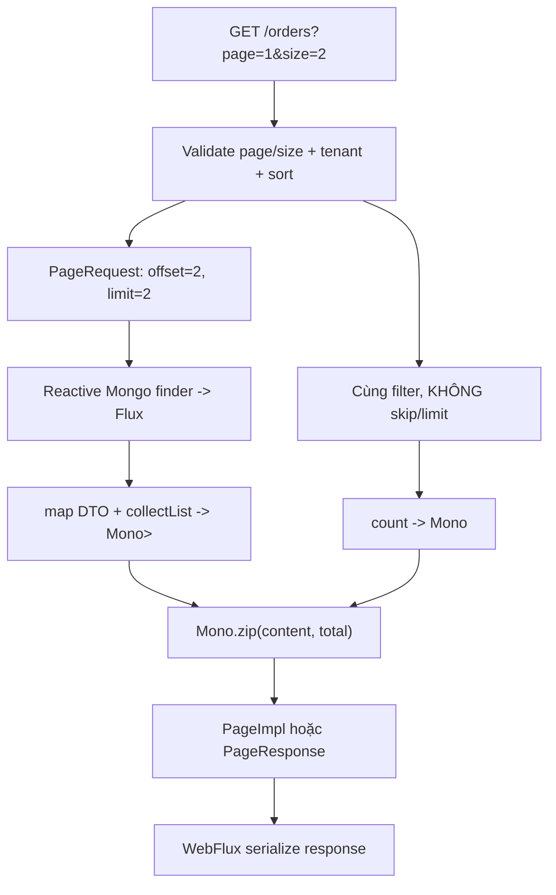

# Phân trang bằng Flux, Pageable và phép đếm riêng

## 1. Vì sao phân trang reactive cần cách nghĩ khác?

Trong **Spring Data MongoDB**, ứng dụng đồng bộ thường gọi `MongoRepository.findAll(Pageable)` và nhận `Page<Order>` với danh sách phần tử, tổng số phần tử, số trang và thông tin điều hướng. Với **reactive MongoDB**, truy vấn có thể trả `Flux<Order>`: mỗi phần tử được phát tới subscriber khi dữ liệu sẵn sàng, còn phép đếm tổng là một operation riêng.

Một màn hình Mini Commerce cần hiển thị **những Order đã thanh toán của một Customer, thuộc đúng một tenant**, được sắp xếp mới nhất trước, 20 Order mỗi trang. Backend phải:

- Chỉ tải tối đa **20 Order của trang được chọn**, thay vì `findAll()` rồi cắt List trong JVM.
- Áp dụng cùng **tenant, customer, status** cho truy vấn nội dung và truy vấn đếm.
- Sắp xếp ổn định, ngay cả khi nhiều Order có cùng `placedAt`.
- Cho phép API trả tổng số Order/số trang khi UI cần; tránh đếm tốn kém nếu chỉ cần “còn trang tiếp theo hay không”.
- Không gọi `block()` trong luồng xử lý WebFlux, không gắn `Pageable` vào phép đếm tổng, không nhầm backpressure với phân trang tại database.

Bài **Phân trang bằng Flux, Pageable và phép đếm riêng** thuộc chương **Truy cập reactive** của `SPRING_DATA_MONGODB`. Nội dung kết hợp kỹ năng kết nối/ánh xạ document, `ReactiveMongoRepository`, `ReactiveMongoTemplate`, query, index, transactions, kiểm thử và chẩn đoán hiệu năng MongoDB.

### Mục tiêu học tập

Sau bài này, bạn có thể:

1. Giải thích `Flux<T>`, `Mono<List<T>>`, `Mono<Page<T>>` và `Mono<Slice<T>>` khác nhau ở đâu.
2. Biết rằng reactive repository hỗ trợ **tham số `Pageable` nhưng không trả trực tiếp `Mono<Page<T>>`** theo cơ chế repository Page.
3. Tạo `PageRequest.of(page,size,sort)` và giới hạn đầu vào để tránh truy vấn bất hợp lý.
4. Định nghĩa finder trả `Flux<Order>` và counter trả `Mono<Long>` trong `ReactiveMongoRepository`.
5. Dùng `Mono.zip(content.collectList(), countMono)` để tạo `PageImpl` ở tầng service.
6. Tạo **hai Query khác nhau** trong `ReactiveMongoTemplate`: một có skip/limit/sort để tải nội dung, một chỉ chứa filter để count.
7. Xây `SliceImpl` bằng cách **tải tối đa size + 1** phần tử để xác định `hasNext` mà không phải count.
8. Hiểu các hạn chế của offset sâu, dùng cursor/keyset khi cần, và xử lý sort theo `(placedAt,_id)`.
9. Nhận biết dữ liệu thay đổi giữa query content và count, cũng như điều kiện sử dụng reactive transaction.
10. Viết API WebFlux, test bằng `StepVerifier` và phân tích index/`explain("executionStats")`.

**Điều kiện:** Java 17+, Spring Boot + `spring-boot-starter-data-mongodb-reactive`, MongoDB đang chạy, hiểu `@Document`, `@Field`, `Flux`/`Mono` và các khái niệm offset, sort, total count. Ví dụ dùng `Reactor` và Spring Data MongoDB hiện đại; API có thể khác theo phiên bản.

## 2. Ba câu hỏi của một API phân trang

Một endpoint thường phải trả lời ba câu hỏi riêng:

| Câu hỏi | Dữ liệu cần | Cách thực thi |
| --- | --- | --- |
| “Trang này có những Order nào?” | `content` | `Flux<Order>` với filter, sort, skip, limit |
| “Có tất cả bao nhiêu Order khớp filter?” | `totalElements` | `Mono<Long>` từ **count query riêng** |
| “Có còn trang sau không?” | `hasNext` | Từ total count **hoặc** tải `pageSize + 1` phần tử |

`Page<T>` biểu thị danh sách trang **kèm tổng số phần tử và trang**. `Slice<T>` chỉ cần biết nội dung và có trang sau hay không. `Flux<T>` tự nó là một chuỗi phát phần tử; nó **không chứa** metadata `totalElements` hay `totalPages`.



**Cảnh báo quan trọng:** `Flux<T>` không có nghĩa dữ liệu được phân trang tự động. Nếu bạn gọi finder không giới hạn và sau đó dùng `collectList()`, ứng dụng có thể nạp toàn bộ collection vào bộ nhớ. Chỉ tập hợp một `Flux` thành List sau khi đã giới hạn **ở MongoDB**.

### 2.1. Tại sao reactive repository không tự trả Page?

Tài liệu Spring Data MongoDB nêu rõ reactive repository **không hỗ trợ kiểu trả về `Page` như `Mono<Page<T>>`**. Một repository finder với `Pageable` chỉ áp dụng offset, limit và sort tại database rồi trả về **`Flux<T>` của phần tử thuộc trang đó**.

```java
// Đúng: có Pageable, nhận Flux<Order> đã được giới hạn.
Flux<Order> findByTenantId(
    String tenantId, Pageable pageable);

// Không định nghĩa method này cho reactive repository:
// Mono<Page<Order>> findByTenantId(
//     String tenantId, Pageable pageable);
```

Đây là hai method minh họa; method thứ hai là **phản ví dụ**, không khai báo trong interface thực. Nếu cần `Page`, service tự lấy content và total count để dựng `PageImpl` hoặc một DTO trang.

### 2.2. Khi nào dùng Flux trực tiếp?

Nếu endpoint chỉ cần trả các Order của trang (không cần total), có thể trả `Flux<OrderSummary>` được giới hạn server-side. Với WebFlux, việc chuyển thành `Mono<List<...>>` thường phù hợp hơn khi cần **một JSON object** chứa thông tin trang. Không đưa `totalElements` giả hoặc `PageRequest` trực tiếp vào mỗi document.

## 3. PageRequest, offset và sort ổn định

Spring Data dùng **zero-based page index**: trang đầu là `0`, không phải `1`.

```java
import org.springframework.data.domain.PageRequest;
import org.springframework.data.domain.Pageable;
import org.springframework.data.domain.Sort;

Sort sort = Sort.by(
    Sort.Order.desc("placedAt"),
    Sort.Order.desc("id"));

Pageable firstPage = PageRequest.of(0, 20, sort);
Pageable secondPage = PageRequest.of(1, 20, sort);

long firstOffset = firstPage.getOffset();  // 0
long secondOffset = secondPage.getOffset(); // 20
```

| `page` | `size` | Offset = page × size | Số document tối đa |
| ---: | ---: | ---: | ---: |
| 0 | 2 | 0 | 2 |
| 1 | 2 | 2 | 2 |
| 2 | 2 | 4 | 2 |
| 3 | 20 | 60 | 20 |
| 10 | 50 | 500 | 50 |

MongoDB áp dụng skip/limit trên tập kết quả đã lọc và được sắp xếp. `Pageable` chỉ tạo ra chính sách cho một request; nó **không tự mở cursor phân trang qua mọi lần gọi**.

### 3.1. Vì sao phải có tie-breaker `id`?

Nếu hai Order cùng `placedAt`, sort chỉ theo thời gian không tạo thứ tự toàn phần. Nhiều trang có thể bị trùng hoặc bỏ sót khi query engine chọn thứ tự khác nhau giữa các record trùng timestamp.

Sử dụng:

```java
Sort stableSort = Sort.by(
    Sort.Order.desc("placedAt"),
    Sort.Order.desc("id"));
```

Khi thực thi với `Order.class`, property Java `id` được map thành BSON `_id`, nên MongoDB nhận sort tương ứng `{placed_at: -1, _id: -1}` nếu `placedAt` được ánh xạ thành `placed_at`.

**Lưu ý:** sort ổn định chỉ bảo đảm thứ tự xác định trên **một tập dữ liệu không đổi**. Nó không ngăn trang bị dịch khi có Order mới được thêm/xóa giữa hai request; phần 14 trình bày keyset/cursor.

### 3.2. Không chấp nhận page/size tùy ý

```java
public static Pageable safePage(int page, int size) {
    if (page < 0) {
        throw new IllegalArgumentException(
            "page must be >= 0");
    }
    if (size < 1 || size > 100) {
        throw new IllegalArgumentException(
            "size must be between 1 and 100");
    }

    long offset = (long) page * size;
    if (offset > 100_000L) {
        throw new IllegalArgumentException(
            "Deep offset is not supported; use cursor");
    }

    return PageRequest.of(
        page, size,
        Sort.by(
            Sort.Order.desc("placedAt"),
            Sort.Order.desc("id")));
}
```

Giới hạn 100 document/trang và 100.000 document bị skip là **chính sách minh họa**, không phải giới hạn MongoDB bắt buộc. Tùy workload có thể thấp hơn. Dùng phép nhân `long` tránh overflow khi tính `page × size`.

Để các service ở các phần sau có thể gọi helper này, đặt code vào một class utility riêng:

```java
package com.example.minicommerce.service;

import org.springframework.data.domain.PageRequest;
import org.springframework.data.domain.Pageable;
import org.springframework.data.domain.Sort;

public final class PagingPolicy {
    private PagingPolicy() {}

    public static Pageable safePage(int page, int size) {
        if (page < 0 || size < 1 || size > 100) {
            throw new IllegalArgumentException(
                "Invalid page or size");
        }
        if ((long) page * size > 100_000L) {
            throw new IllegalArgumentException(
                "Use cursor for deep pagination");
        }
        return PageRequest.of(page, size,
            Sort.by(Sort.Order.desc("placedAt"),
                    Sort.Order.desc("id")));
    }
}
```

Đoạn method ở trên và class `PagingPolicy` là **hai cách minh họa cùng chính sách**. Khi chép vào dự án, chỉ cần dùng class utility hoặc tích hợp validation vào service, không khai báo trùng hai phương thức trong cùng class.

## 4. Mini Commerce: entity, BSON mapping và fixture

### 4.1. Order entity

```java
package com.example.minicommerce.domain;

import java.math.BigDecimal;
import java.time.Instant;

import org.springframework.data.annotation.Id;
import org.springframework.data.mongodb.core.mapping.Document;
import org.springframework.data.mongodb.core.mapping.Field;
import org.springframework.data.mongodb.core.mapping.FieldType;

@Document(collection = "orders")
public class Order {

    @Id
    private String id;

    @Field("tenant_id")
    private String tenantId;

    @Field("customer_id")
    private String customerId;

    private String status;

    @Field("placed_at")
    private Instant placedAt;

    @Field(name = "total_amount", targetType = FieldType.DECIMAL128)
    private BigDecimal totalAmount;

    public Order() {}

    public Order(String id, String tenantId,
                 String customerId, String status,
                 Instant placedAt, BigDecimal totalAmount) {
        this.id = id;
        this.tenantId = tenantId;
        this.customerId = customerId;
        this.status = status;
        this.placedAt = placedAt;
        this.totalAmount = totalAmount;
    }

    public String getId() { return id; }
    public String getTenantId() { return tenantId; }
    public String getCustomerId() { return customerId; }
    public String getStatus() { return status; }
    public Instant getPlacedAt() { return placedAt; }
    public BigDecimal getTotalAmount() { return totalAmount; }
}
```

| Java property | BSON key | Kiểu / ý nghĩa |
| --- | --- | --- |
| `id` | `_id` | Khóa Order, trong fixture là BSON String |
| `tenantId` | `tenant_id` | Phạm vi bảo mật |
| `customerId` | `customer_id` | Khách hàng sở hữu Order |
| `status` | `status` | `PAID` hoặc `PLACED` |
| `placedAt` | `placed_at` | BSON Date |
| `totalAmount` | `total_amount` | BSON Decimal128 |

Trong ví dụ sử dụng ID như `"order-a-101"` để tránh vấn đề Spring Data có thể chuyển String giống 24 ký tự hex thành BSON ObjectId. Với hệ thống dùng `ObjectId` thực, cần giữ kiểu nhất quán cho `_id` và cursor keyset.

### 4.2. Dữ liệu thử nghiệm trong mongosh

Chỉ chạy trên **database test riêng**:

```javascript
use mini_commerce

db.orders.insertMany([
  {
    _id: "order-a-101",
    tenant_id: "shop-a",
    customer_id: "customer-001",
    status: "PAID",
    placed_at: ISODate("2026-11-18T09:00:00Z"),
    total_amount: NumberDecimal("100.00")
  },
  {
    _id: "order-a-102",
    tenant_id: "shop-a",
    customer_id: "customer-001",
    status: "PAID",
    placed_at: ISODate("2026-11-19T10:00:00Z"),
    total_amount: NumberDecimal("200.00")
  },
  {
    _id: "order-a-103",
    tenant_id: "shop-a",
    customer_id: "customer-001",
    status: "PAID",
    placed_at: ISODate("2026-11-19T10:00:00Z"),
    total_amount: NumberDecimal("300.00")
  },
  {
    _id: "order-a-104",
    tenant_id: "shop-a",
    customer_id: "customer-001",
    status: "PAID",
    placed_at: ISODate("2026-11-20T11:00:00Z"),
    total_amount: NumberDecimal("400.00")
  },
  {
    _id: "order-a-105",
    tenant_id: "shop-a",
    customer_id: "customer-001",
    status: "PLACED",
    placed_at: ISODate("2026-11-20T12:00:00Z"),
    total_amount: NumberDecimal("500.00")
  },
  {
    _id: "order-b-201",
    tenant_id: "shop-b",
    customer_id: "customer-001",
    status: "PAID",
    placed_at: ISODate("2026-11-20T13:00:00Z"),
    total_amount: NumberDecimal("600.00")
  }
]);
```

`insertMany` không phải lệnh idempotent nếu chạy lại cùng `_id`; hãy dùng fixture riêng cho mỗi test và cleanup đúng phạm vi, không chạy trên production.

Với filter `tenantId = shop-a`, `customerId = customer-001`, `status = PAID`, có **4 Order**. Sort `placedAt DESC, id DESC` cho thứ tự:

| Vị trí | Order ID | Thời điểm |
| ---: | --- | --- |
| 0 | `order-a-104` | 20/11 11:00Z |
| 1 | `order-a-103` | 19/11 10:00Z |
| 2 | `order-a-102` | 19/11 10:00Z |
| 3 | `order-a-101` | 18/11 09:00Z |

Với `size=2`, trang `0` chứa `order-a-104` và `order-a-103`; trang `1` chứa `order-a-102` và `order-a-101`; trang `2` rỗng. Tổng luôn là **4** nếu dữ liệu không đổi.

## 5. Spring Data: ReactiveMongoRepository trả Flux với Pageable

### 5.1. Khai báo repository

```java
package com.example.minicommerce.repository;

import org.springframework.data.domain.Pageable;
import org.springframework.data.mongodb.repository.ReactiveMongoRepository;
import reactor.core.publisher.Flux;
import reactor.core.publisher.Mono;

import com.example.minicommerce.domain.Order;

public interface OrderRepository
        extends ReactiveMongoRepository<Order, String> {

    Flux<Order> findByTenantIdAndCustomerIdAndStatus(
        String tenantId,
        String customerId,
        String status,
        Pageable pageable);

    Mono<Long> countByTenantIdAndCustomerIdAndStatus(
        String tenantId,
        String customerId,
        String status);
}
```

Hai method có **cùng ba điều kiện**; finder nhận `Pageable` để giới hạn content, counter **không nhận Pageable** để đếm toàn bộ document khớp.

Spring Data derived query dựa trên Java property `tenantId`, `customerId` và `status`; metadata `@Field` chuyển tên `tenantId`/`customerId` thành BSON `tenant_id`/`customer_id`. Sort trong `Pageable` cũng dùng **Java property names**.

### 5.2. Gọi repository đúng kiểu

```java
Pageable pageable = PageRequest.of(
    0, 2,
    Sort.by(
        Sort.Order.desc("placedAt"),
        Sort.Order.desc("id")));

Flux<Order> content = repository
    .findByTenantIdAndCustomerIdAndStatus(
        "shop-a", "customer-001", "PAID", pageable);

Mono<Long> total = repository
    .countByTenantIdAndCustomerIdAndStatus(
        "shop-a", "customer-001", "PAID");
```

**Không cộng `Pageable` vào signature counter** chỉ để “dùng lại”: tổng số phần tử cần đếm **mọi Order khớp filter**, không phải chỉ các Order của trang hiện tại.

### 5.3. Không khai báo Mono<Page<Order>> ở reactive repository

```java
// Không dùng kiểu này ở repository reactive:
// Mono<Page<Order>> findByTenantId(
//     String tenantId, Pageable pageable);

// Đúng: repository trả Flux<Order> và count Mono<Long>.
```

Tầng service có thể dựng `Mono<Page<OrderSummary>>` bằng cách kết hợp hai publisher, nhưng đó là **logic tự triển khai**, không phải Spring Data tự chạy count như repository đồng bộ trả `Page`.

## 6. Service: kết hợp Flux content và Mono count thành Page

### 6.1. DTO không trả toàn bộ entity

```java
package com.example.minicommerce.service;

import java.math.BigDecimal;
import java.time.Instant;
import com.example.minicommerce.domain.Order;

public record OrderSummary(
    String id,
    String status,
    Instant placedAt,
    BigDecimal totalAmount
) {
    public static OrderSummary from(Order order) {
        return new OrderSummary(
            order.getId(),
            order.getStatus(),
            order.getPlacedAt(),
            order.getTotalAmount());
    }
}
```

Không tự trả thông tin nhạy cảm `Customer`, địa chỉ giao hàng hoặc metadata nội bộ nếu API không cần. Đọc entity rồi map DTO thuận tiện nhưng có thể tốn network vì toàn bộ fields được lấy; ở phần `ReactiveMongoTemplate` sẽ xét projection server-side khi thích hợp.

### 6.2. Mono.zip + PageImpl

```java
package com.example.minicommerce.service;

import java.util.List;

import org.springframework.data.domain.Page;
import org.springframework.data.domain.PageImpl;
import org.springframework.data.domain.Pageable;
import org.springframework.stereotype.Service;

import reactor.core.publisher.Flux;
import reactor.core.publisher.Mono;

import com.example.minicommerce.domain.Order;
import com.example.minicommerce.repository.OrderRepository;

@Service
public class ReactiveOrderPagingService {

    private final OrderRepository repository;

    public ReactiveOrderPagingService(OrderRepository repository) {
        this.repository = repository;
    }

    public Mono<Page<OrderSummary>> pageForCustomer(
            String verifiedTenantId,
            String customerId,
            String status,
            int page,
            int size) {

        if (verifiedTenantId == null ||
                verifiedTenantId.isBlank() ||
                customerId == null || customerId.isBlank()) {
            return Mono.error(new IllegalArgumentException(
                "Tenant and customer are required"));
        }
        if (!"PAID".equals(status) &&
                !"PLACED".equals(status)) {
            return Mono.error(new IllegalArgumentException(
                "Unsupported order status"));
        }

        final Pageable pageable;
        try {
            pageable = PagingPolicy.safePage(page, size);
        } catch (IllegalArgumentException ex) {
            return Mono.error(ex);
        }

        Flux<OrderSummary> content = repository
            .findByTenantIdAndCustomerIdAndStatus(
                verifiedTenantId, customerId, status, pageable)
            .map(OrderSummary::from);

        Mono<List<OrderSummary>> items = content.collectList();

        Mono<Long> count = repository
            .countByTenantIdAndCustomerIdAndStatus(
                verifiedTenantId, customerId, status);

        return Mono.zip(items, count)
            .map(tuple -> new PageImpl<OrderSummary>(
                tuple.getT1(), pageable, tuple.getT2()));
    }
}
```

`PagingPolicy` là helper chứa method `safePage(...)` như phần 3.2. Trong dự án thật hãy đặt nó ở file Java riêng; các code block trong bài biểu thị **các file/class độc lập**, không phải một file Java duy nhất.

### 6.3. Điều gì xảy ra khi subscribe?

`Mono.zip(items, count)` subscribe vào **hai publisher nguồn**: một publisher thực thi finder có `Pageable` và gom tối đa `size` phần tử, publisher còn lại thực thi count filter.

```text
repository.findBy...(Pageable) -> Flux<Order>
                              -> map(OrderSummary)
                              -> collectList()
                              -> Mono<List<OrderSummary>>

repository.countBy...()      -> Mono<Long>

Mono.zip(listMono, countMono) -> PageImpl<OrderSummary>
```

`collectList()` ở đây an toàn về giới hạn trang **vì finder đã áp dụng limit trên MongoDB**, với pageSize bị chặn trong khoảng 1–100. Không gọi `collectList()` trên finder không giới hạn rồi cắt List bằng `subList()`.

### 6.4. PageImpl đem lại metadata gì?

Sau khi `Mono<Page<OrderSummary>>` phát kết quả, ta có thể gọi:

```java
Page<OrderSummary> result = page;

int pageNumber = result.getNumber();
int pageSize = result.getSize();
int currentElements = result.getNumberOfElements();
long totalElements = result.getTotalElements();
int totalPages = result.getTotalPages();
boolean hasNext = result.hasNext();
boolean first = result.isFirst();
boolean last = result.isLast();
```

`page` ở đây là Page đã nhận trong một callback/test; không `block()` để lấy nó trên event loop. `PageImpl` có thể hiệu chỉnh total trong một số tình huống trang cuối để xử lý thông tin không nhất quán; **không dựa vào nó để đạt snapshot consistency**.

**Lưu ý:** `Mono.zip` thường kích hoạt hai truy vấn độc lập, không tạo transaction hoặc snapshot chung. Nếu có insert/delete/update giữa lúc content và count được đọc, metadata có thể tạm lệch. Xem phần 15.

## 7. API response ổn định thay vì serialize thẳng PageImpl

Khi WebFlux trả JSON cho frontend, một DTO rõ ràng giúp tránh phụ thuộc vào chi tiết serialization của `PageImpl` giữa các phiên bản Spring Data/Jackson.

```java
package com.example.minicommerce.api;

import java.util.List;
import org.springframework.data.domain.Page;
import com.example.minicommerce.service.OrderSummary;

public record OrderPageResponse(
    List<OrderSummary> items,
    int page,
    int size,
    long totalElements,
    int totalPages,
    boolean hasNext
) {
    public static OrderPageResponse from(
            Page<OrderSummary> result) {
        return new OrderPageResponse(
            result.getContent(),
            result.getNumber(),
            result.getSize(),
            result.getTotalElements(),
            result.getTotalPages(),
            result.hasNext());
    }
}
```

Service API:

```java
Mono<OrderPageResponse> response =
    pagingService.pageForCustomer(
        verifiedTenantId, "customer-001", "PAID", 0, 2)
    .map(OrderPageResponse::from);
```

`verifiedTenantId` phải do security/authentication service xác định từ identity đáng tin cậy. Không tin `tenantId` tùy ý do client gửi để đọc dữ liệu tenant khác.

Ví dụ JSON trang đầu với fixture:

```json
{
  "items": [
    {
      "id": "order-a-104",
      "status": "PAID",
      "placedAt": "2026-11-20T11:00:00Z",
      "totalAmount": 400.00
    },
    {
      "id": "order-a-103",
      "status": "PAID",
      "placedAt": "2026-11-19T10:00:00Z",
      "totalAmount": 300.00
    }
  ],
  "page": 0,
  "size": 2,
  "totalElements": 4,
  "totalPages": 2,
  "hasNext": true
}
```

JSON trên minh họa response sau khi DTO được serialize; định dạng `BigDecimal` và `Instant` phụ thuộc cấu hình serializer ở ứng dụng.

## 8. WebFlux controller: giới hạn input và bảo vệ tenant

Một endpoint minh họa khi ứng dụng **đã cấu hình Spring Security OAuth2 Resource Server**:

```java
package com.example.minicommerce.api;

import org.springframework.security.core.annotation.AuthenticationPrincipal;
import org.springframework.security.oauth2.jwt.Jwt;
import org.springframework.web.bind.annotation.GetMapping;
import org.springframework.web.bind.annotation.PathVariable;
import org.springframework.web.bind.annotation.RequestMapping;
import org.springframework.web.bind.annotation.RequestParam;
import org.springframework.web.bind.annotation.RestController;

import reactor.core.publisher.Mono;

import com.example.minicommerce.service.ReactiveOrderPagingService;

@RestController
@RequestMapping("/api/customers")
public class CustomerOrderController {

    private final ReactiveOrderPagingService pagingService;

    public CustomerOrderController(
            ReactiveOrderPagingService pagingService) {
        this.pagingService = pagingService;
    }

    @GetMapping("/{customerId}/orders")
    public Mono<OrderPageResponse> listOrders(
            @AuthenticationPrincipal Jwt jwt,
            @PathVariable String customerId,
            @RequestParam(defaultValue = "PAID") String status,
            @RequestParam(defaultValue = "0") int page,
            @RequestParam(defaultValue = "20") int size) {

        String tenantId = jwt.getClaimAsString("tenant_id");
        return pagingService.pageForCustomer(
                tenantId, customerId, status, page, size)
            .map(OrderPageResponse::from);
    }
}
```

Đây là ví dụ dựa trên **JWT claim `tenant_id` do issuer đáng tin cậy phát hành và resource server xác thực**. Tên claim, quy trình định danh tenant và quyền xem Customer phải được triển khai theo hệ thống thật; chỉ kiểm tra tenant chưa đủ nếu nhân viên shop-a **không có quyền xem mọi Customer trong shop-a**.

Với một endpoint public không dùng JWT, hãy thay bằng bộ giải quyết tenant từ security context riêng. **Không** sửa code thành `@RequestParam String tenantId` rồi dùng trực tiếp mà không xác thực.

Nếu `page` âm, `size` ngoài ngưỡng hoặc status không hợp lệ, service phát `IllegalArgumentException`. Ở API production, dùng `@RestControllerAdvice`/validation để ánh xạ thành HTTP **400 Bad Request** và một mã lỗi ổn định thay vì để exception mặc định lan ra thành response không rõ nghĩa.

## 9. ReactiveMongoTemplate: content Query và count Query phải tách

Khi filter động, projection hoặc query logic phức tạp, `ReactiveMongoTemplate` thường linh hoạt hơn repository derived finder.

### 9.1. Sai lầm quan trọng nhất

```java
Query query = Query.query(
    Criteria.where("tenantId").is(tenantId)
        .and("customerId").is(customerId)
        .and("status").is("PAID"));

query.with(pageable);

Flux<Order> content = template.find(query, Order.class);

// SAI: query đếm vẫn mang skip/limit của trang.
Mono<Long> total = template.count(query, Order.class);
```

Tài liệu API `ReactiveMongoTemplate.count(Query, Class)` nêu rõ **offset và limit trên Query có thể ảnh hưởng trực tiếp tới số document mà count trả về**. Vì vậy đoạn trên có thể đếm **chỉ một phần/trang** thay vì toàn bộ Order khớp filter.

### 9.2. Đúng: hai Query có cùng Criteria nhưng không cùng pagination

```java
package com.example.minicommerce.service;

import java.util.List;

import org.springframework.data.domain.Page;
import org.springframework.data.domain.PageImpl;
import org.springframework.data.domain.Pageable;
import org.springframework.data.mongodb.core.ReactiveMongoTemplate;
import org.springframework.data.mongodb.core.query.Criteria;
import org.springframework.data.mongodb.core.query.Query;
import org.springframework.stereotype.Service;

import reactor.core.publisher.Mono;

import com.example.minicommerce.domain.Order;

@Service
public class OrderTemplatePagingService {

    private final ReactiveMongoTemplate template;

    public OrderTemplatePagingService(
            ReactiveMongoTemplate template) {
        this.template = template;
    }

    public Mono<Page<OrderSummary>> page(
            String tenantId, String customerId,
            String status, int page, int size) {

        final Pageable pageable;
        try {
            pageable = PagingPolicy.safePage(page, size);
        } catch (IllegalArgumentException ex) {
            return Mono.error(ex);
        }

        Query contentQuery = Query.query(
            criteria(tenantId, customerId, status))
            .with(pageable);

        // Đếm bằng Query MỚI: filter giống nhau,
        // KHÔNG with(pageable), KHÔNG skip/limit.
        Query countQuery = Query.query(
            criteria(tenantId, customerId, status));

        Mono<List<OrderSummary>> content =
            template.find(contentQuery, Order.class)
                .map(OrderSummary::from)
                .collectList();

        Mono<Long> total = template.count(
            countQuery, Order.class);

        return Mono.zip(content, total)
            .map(tuple -> new PageImpl<OrderSummary>(
                tuple.getT1(), pageable, tuple.getT2()));
    }

    private static Criteria criteria(
            String tenantId, String customerId, String status) {
        if (tenantId == null || tenantId.isBlank() ||
                customerId == null || customerId.isBlank() ||
                !("PAID".equals(status) ||
                  "PLACED".equals(status))) {
            throw new IllegalArgumentException(
                "Invalid order filters");
        }
        return Criteria.where("tenantId").is(tenantId)
            .and("customerId").is(customerId)
            .and("status").is(status);
    }
}
```

**Lưu ý về lỗi input:** method `criteria(...)` có thể ném exception **trước khi publisher được trả ra**. Để một API reactive luôn đưa lỗi dưới dạng `Mono.error`, có thể bọc việc tạo query trong `Mono.defer(() -> { ... })` hoặc validate input ngay tại controller/service trước khi gọi.

### 9.3. Vì sao không chia sẻ một Query mutable?

`Query` là object có thể bị thay đổi bởi `with(pageable)`, `skip`, `limit` và `with(Sort)`. Nếu dùng lại cùng Query cho content và count, bạn có nguy cơ mang theo pagination hoặc các projection/collation/hint không phù hợp.

Quy tắc đơn giản:

```java
Criteria base = Criteria.where("tenantId").is(tenantId)
    .and("status").is("PAID");

Query content = Query.query(base).with(pageable);
Query count = Query.query(base);  // Không phân trang.
```

Trong code thực tế nên tạo một **helper xây Criteria mới cho mỗi Query** như `criteria(...)` ở trên để tránh share state và nhầm giữa các request. Count phải áp dụng **cùng điều kiện nghiệp vụ**, không nhất thiết cùng projection/sort của content.

### 9.4. Đọc mapping và BSON field thực

Khi `template.find(query, Order.class)`/`template.count(query, Order.class)` nhận class entity, Spring Data map:

```text
tenantId -> tenant_id
customerId -> customer_id
placedAt -> placed_at
id -> _id
```

Nếu bạn dùng native driver `getCollection("orders")` hoặc raw `Document`, hãy viết BSON key thực. Sai alias trong count nhưng đúng alias trong content là một kiểu **lỗi metadata âm thầm** cần test.

## 10. Projection và dữ liệu tối thiểu trên mỗi trang

Trong màn hình danh sách Order, thường chỉ cần ID, status, thời điểm và tổng tiền. Nếu Order chứa hàng trăm `OrderLine`, địa chỉ và payload audit, tải toàn bộ entity chỉ để map DTO có thể tốn network/bộ nhớ.

`ReactiveMongoTemplate` có thể projection các field:

```java
Query contentQuery = Query.query(
        Criteria.where("tenantId").is(tenantId)
            .and("customerId").is(customerId)
            .and("status").is("PAID"))
    .with(pageable);

contentQuery.fields()
    .include("id")
    .include("status")
    .include("placedAt")
    .include("totalAmount");

Flux<OrderSummary> summaries = template
    .find(contentQuery, Order.class)
    .map(OrderSummary::from);
```

Vì query gắn `Order.class`, các property `placedAt` và `totalAmount` được Spring Data ánh xạ thành BSON `placed_at`/`total_amount`. Nhưng `Order` được đọc lúc này là **entity thiếu các field bị loại**, không nên gọi `save` trên nó, vì có nguy cơ ghi đè/mất trường khác.

Với DTO projection trực tiếp hoặc custom aggregation, có thể giảm bước tạo entity đầy đủ, nhưng cần xem các constructor/field aliases và mapping chuyển đổi trong phiên bản Spring Data sử dụng. **Kiểm tra raw BSON và DTO thực tế bằng integration test**, nhất là `BigDecimal` ↔ Decimal128.

Phép **count** không cần projection; query đếm chỉ gồm filter và các tùy chọn nghiệp vụ cần thiết như collation nếu chúng ảnh hưởng so khớp. Không dùng `include(...)` hay `sort` của content làm căn cứ để “đếm nhanh hơn” một cách cảm tính.

## 11. Khi không cần total: xây Slice bằng size + 1

Nếu UI chỉ hiện nút “Xem thêm” mà **không cần tổng số trang**, có thể tránh query count. Ý tưởng:

1. Giữ `page`/`size` theo API và sort ổn định.
2. Query MongoDB với **offset = page × size**, **limit = size + 1**.
3. Tập hợp tối đa `size + 1` kết quả.
4. Nếu nhận hơn `size` phần tử, gán `hasNext=true` rồi bỏ phần tử dư khỏi content trả về.
5. Trả `SliceImpl<T>`.

### 11.1. Vì sao Pageable có pageSize không đủ?

`PageRequest.of(page,size)` giới hạn đúng `size` phần tử; chỉ nhìn thấy đúng 20 phần tử **không chứng minh có trang tiếp theo**. Để biết điều đó mà không đếm, phải yêu cầu MongoDB trả **tối đa 21** phần tử cho `size=20`. Không thay `PageRequest.of(page,size)` thành `PageRequest.of(page,size+1)`, vì trang 1 lúc đó có offset `size+1` thay vì `size` và sẽ gây bỏ sót.

### 11.2. Service trả Mono<Slice<OrderSummary>>

```java
package com.example.minicommerce.service;

import java.util.List;

import org.springframework.data.domain.Pageable;
import org.springframework.data.domain.Slice;
import org.springframework.data.domain.SliceImpl;
import org.springframework.data.mongodb.core.ReactiveMongoTemplate;
import org.springframework.data.mongodb.core.query.Criteria;
import org.springframework.data.mongodb.core.query.Query;
import org.springframework.stereotype.Service;

import reactor.core.publisher.Mono;

import com.example.minicommerce.domain.Order;

@Service
public class ReactiveOrderSliceService {

    private final ReactiveMongoTemplate template;

    public ReactiveOrderSliceService(
            ReactiveMongoTemplate template) {
        this.template = template;
    }

    public Mono<Slice<OrderSummary>> slice(
            String tenantId, String customerId,
            int page, int size) {

        Pageable pageable = PagingPolicy.safePage(page, size);

        Query query = Query.query(
                Criteria.where("tenantId").is(tenantId)
                    .and("customerId").is(customerId)
                    .and("status").is("PAID"))
            .with(pageable.getSort())
            .skip(pageable.getOffset())
            .limit(pageable.getPageSize() + 1);

        return template.find(query, Order.class)
            .map(OrderSummary::from)
            .collectList()
            .map(rows -> {
                boolean hasNext = rows.size() > pageable.getPageSize();
                List<OrderSummary> visible = hasNext
                    ? rows.subList(0, pageable.getPageSize())
                    : rows;

                return new SliceImpl<OrderSummary>(
                    List.copyOf(visible), pageable, hasNext);
            });
    }
}
```

Service này không chạy `count(...)`. Nó vẫn truyền tenant/customer/status vào **server filter**. Ngoài ra cần validate tenant/customer và quyền truy cập như service Page; code trên tập trung vào thuật toán lookahead.

### 11.3. Page vs Slice vs Flux

| Phương án | Truy vấn nội dung | Truy vấn count | Metadata |
| --- | --- | --- | --- |
| `Flux<Order>` với Pageable | Có, limit `size` | Không | Không có total/hasNext tự động |
| `Mono<Page<OrderSummary>>` tự dựng | Có, limit `size` | **Có** | `totalElements`, `totalPages`, `hasNext` |
| `Mono<Slice<OrderSummary>>` | Có, limit `size+1` | Không | `hasNext`, `isFirst`, `isLast`, không có total |
| Cursor/keyset window | Có, limit `size+1` và seek predicate | Thường không | `nextCursor`, `hasNext` |

`Slice` phù hợp cho “Load more”, còn `Page` phù hợp khi UI cần “Trang 3/25” hoặc tổng số bản ghi. Đừng chạy count chỉ để tính một boolean `hasNext` nếu workload đủ lớn và sản phẩm không cần tổng.

## 12. Phép đếm riêng: semantics và chi phí

Trong MongoDB có những phép đếm khác nhau:

| API | Ý nghĩa | Phù hợp trang có filter? |
| --- | --- | --- |
| `ReactiveMongoTemplate.count(query, Order.class)` | Đếm document khớp query và một số options của nó | **Có**, nếu query không skip/limit |
| `ReactiveMongoRepository.countBy...(...)` | Đếm theo derived filter | **Có**, khi filter đúng nghiệp vụ |
| `ReactiveMongoRepository.count()` | Đếm toàn repository/collection | Chỉ khi trang **không lọc** và quyền cho phép |
| `ReactiveMongoTemplate.estimatedCount(Order.class)` | Ước lượng số document toàn collection từ metadata | **Không** thay được count có tenant/customer/status |
| `ReactiveMongoTemplate.exactCount(query, Order.class)` | Buộc dùng cơ chế aggregation count theo contract API | Có khi cần đặc điểm cụ thể về session/shard; vẫn cần query đúng |

### 12.1. Count phải dùng cùng filter, không chỉ cùng collection

```javascript
// Finder:
db.orders.find({
  tenant_id: "shop-a",
  customer_id: "customer-001",
  status: "PAID"
})
.sort({ placed_at: -1, _id: -1 })
.skip(2)
.limit(2);

// Count: CÙNG bộ lọc, nhưng không skip hoặc limit.
db.orders.countDocuments({
  tenant_id: "shop-a",
  customer_id: "customer-001",
  status: "PAID"
});
```

Với fixture, finder trang 1 trả 2 Order và count trả 4. Nếu dùng một Query đếm đã mang `skip(2).limit(2)`, kết quả count có thể chỉ phản ánh phần bị giới hạn.

### 12.2. Count có thể đắt

Đếm document khớp filter không phải lúc nào cũng là thao tác “đọc một số nguyên có sẵn”. MongoDB có thể duyệt index entries hoặc documents, tùy filter/index/selectivity. Với tập dữ liệu lớn và nhiều filter động, count cho mỗi request có thể tốn đáng kể CPU/I/O.

Một số cách giảm chi phí:

- Chỉ count khi UI thật sự cần tổng; dùng Slice khi phù hợp.
- Thiết kế compound index cho bộ lọc và sort chủ lực.
- Giảm số filter không thể dùng index hoặc `$regex` không chọn lọc.
- Cache count/giữ summary đã tính khi nghiệp vụ chấp nhận **số liệu có độ trễ**.
- Không dùng `estimatedCount` làm tổng theo tenant/status vì nó không phản ánh filter.
- Nếu chỉ muốn biết trang sau, dùng `size+1`.

### 12.3. Không giả định PageableExecutionUtils chạy count reactive

`PageableExecutionUtils.getPage(...)` nhận `Supplier<Long>` đồng bộ cho phép đếm lazy trong một số trường hợp. **Không biến `Mono<Long>` thành `Supplier<Long>` bằng cách gọi `block()` trong WebFlux** chỉ để dùng tiện ích đó.

Trong reactive service, `Mono.zip(...)` hoặc `flatMap(...)` với publisher count là cách đúng. Nếu muốn tối ưu bỏ count khi biết chắc trang cuối, tự mô tả và test nhánh đó trên reactive, nhưng phải cẩn trọng với dữ liệu thay đổi.

## 13. Sort an toàn: whitelist thay vì nhận raw field path

Một API:

```text
GET /orders?sort=someUntrustedPath,desc
```

không nên để giá trị input tự biến thành mọi field path hoặc cấu trúc JSON/BSON. Giới hạn những kiểu sắp xếp được phép và luôn thêm tie-breaker unique.

```java
import org.springframework.data.domain.Sort;

public static Sort allowedSort(String requested) {
    if ("oldest".equals(requested)) {
        return Sort.by(
            Sort.Order.asc("placedAt"),
            Sort.Order.asc("id"));
    }
    if ("newest".equals(requested) ||
            requested == null) {
        return Sort.by(
            Sort.Order.desc("placedAt"),
            Sort.Order.desc("id"));
    }
    throw new IllegalArgumentException(
        "Unsupported sort mode");
}
```

Property được truyền là tên **Java fields đã được phê duyệt**, Spring Data ánh xạ sang BSON khi query với `Order.class`. Dù dùng `Sort` chứ không ghép raw JSON, một sort field tùy ý vẫn có thể gây query chậm, trích xuất dữ liệu qua response hoặc không dùng index. Giới hạn cả số trang, page size và trường filter.

**Không** thêm đồng thời một parameter `Sort` và một parameter `Pageable` vào cùng repository method rồi mong framework tự gộp: `Pageable` đã có sort; các special parameter này có những tổ hợp không được phép.

## 14. Offset sâu vs keyset/cursor pagination

Offset:

```javascript
db.orders.find({
  tenant_id: "shop-a",
  status: "PAID"
})
.sort({ placed_at: -1, _id: -1 })
.skip(200000)
.limit(20);
```

MongoDB có thể dùng index cho filter/sort, nhưng vẫn phải **đi qua nhiều index entries** trước khi tới vị trí offset sâu. Ngoài hiệu năng, nếu thêm Order mới giữa hai request, một record có thể dịch từ trang này sang trang khác.

### 14.1. Keyset dựa trên (placedAt, _id)

Với sort giảm dần `(placed_at DESC, _id DESC)`, trang sau chỉ lấy Order có:

\[
\text{placedAt} < \text{lastPlacedAt}
\quad\text{hoặc}\quad
(\text{placedAt} = \text{lastPlacedAt} \land \_id < \text{lastId})
\]

Đoạn `mongosh`:

```javascript
db.orders.find({
  tenant_id: "shop-a",
  customer_id: "customer-001",
  status: "PAID",
  $or: [
    { placed_at: { $lt: ISODate("2026-11-19T10:00:00Z") } },
    {
      placed_at: ISODate("2026-11-19T10:00:00Z"),
      _id: { $lt: "order-a-103" }
    }
  ]
})
.sort({ placed_at: -1, _id: -1 })
.limit(3);
```

Với cursor sau `order-a-103` và `size=2`, query lấy tối đa 3 bản ghi để biết `hasNext`. Kết quả hiển thị kế tiếp là `order-a-102`, `order-a-101`. Không dùng `$skip`.

### 14.2. DTO cursor và kết quả

```java
package com.example.minicommerce.service;

import java.time.Instant;
import java.util.List;

public record OrderCursor(
    Instant placedAt,
    String id
) {}

public record CursorSlice<T>(
    List<T> items,
    boolean hasNext,
    OrderCursor nextCursor
) {}
```

Hai record trên nằm trong **hai file Java khác nhau** tương ứng với tên public record, không đặt cạnh nhau trong cùng file khi chép vào dự án.

### 14.3. Service keyset reactive

```java
import java.util.List;

import org.springframework.data.domain.Sort;
import org.springframework.data.mongodb.core.query.Criteria;
import org.springframework.data.mongodb.core.query.Query;

import reactor.core.publisher.Mono;

public Mono<CursorSlice<OrderSummary>> after(
        String tenantId, String customerId,
        OrderCursor cursor, int size) {

    if (size < 1 || size > 100) {
        return Mono.error(new IllegalArgumentException(
            "Invalid page size"));
    }

    Criteria scope = Criteria.where("tenantId").is(tenantId)
        .and("customerId").is(customerId)
        .and("status").is("PAID");

    Criteria filter = scope;
    if (cursor != null) {
        Criteria seek = new Criteria().orOperator(
            Criteria.where("placedAt").lt(cursor.placedAt()),
            new Criteria().andOperator(
                Criteria.where("placedAt").is(cursor.placedAt()),
                Criteria.where("id").lt(cursor.id())));

        filter = new Criteria().andOperator(scope, seek);
    }

    Query query = Query.query(filter)
        .with(Sort.by(
            Sort.Order.desc("placedAt"),
            Sort.Order.desc("id")))
        .limit(size + 1);

    return template.find(query, Order.class)
        .map(OrderSummary::from)
        .collectList()
        .map(rows -> {
            boolean hasNext = rows.size() > size;
            List<OrderSummary> visible = rows.subList(
                0, Math.min(size, rows.size()));

            OrderCursor next = null;
            if (hasNext && !visible.isEmpty()) {
                OrderSummary last = visible.get(
                    visible.size() - 1);
                next = new OrderCursor(
                    last.placedAt(), last.id());
            }
            return new CursorSlice<>(
                List.copyOf(visible), hasNext, next);
        });
}
```

Method này thuộc một service đã inject `ReactiveMongoTemplate template` và import `Order`, `OrderSummary`, `OrderCursor` và `CursorSlice`. Trong production phải validate tenant/customer và quyền truy cập; các giá trị null của `placedAt` hoặc cursor chưa hợp lệ phải bị từ chối trước khi tạo Criteria.

### 14.4. Bảo vệ cursor token

Không nhận `placedAt`/`id` do client tự sửa rồi ngầm coi đó là quyền truy cập. Khi cung cấp cursor token trên API, nên mã hóa thông tin cần thiết (timestamp/ID/sort/filter/tenant/expiry) và **ký hoặc kiểm tra integrity**. Cursor vẫn cần tenant filter từ security context. Nếu `_id` là BSON ObjectId thay vì String, comparator/type phải nhất quán với index.

**Keyset cũng không tạo snapshot bất biến**: nếu một Order thay đổi `placedAt` hoặc bị xóa giữa request, kết quả có thể khác. Nó chủ yếu tránh chi phí deep skip và giảm sự dịch chuyển khi nhiều bản ghi mới xuất hiện phía đầu danh sách.

## 15. Tính nhất quán giữa content và count

Hai truy vấn ở `Mono.zip(content.collectList(), count())` là **hai database operations độc lập**:

```text
T0: có 4 Order PAID khớp filter.
T1: finder đọc trang 0 gồm 2 Order.
T2: một worker khác tạo thêm Order PAID.
T3: count query thấy 5 Order.
T4: Page chứa 2 Order cũ nhưng totalElements=5.
```

Điều này không nhất thiết là lỗi cho màn hình thông thường: totalElements phản ánh thời điểm đếm, còn content phản ánh thời điểm truy vấn. Nhưng nếu ứng dụng yêu cầu “danh sách và tổng đúng cùng một snapshot” (ví dụ một số loại báo cáo đối soát), cần thiết kế khác.

### 15.1. Những mức yêu cầu

| Yêu cầu | Cách tiếp cận |
| --- | --- |
| Feed/danh sách Order thông thường | Hai query riêng; chấp nhận dao động giữa content và count |
| API load-more | `Slice` hoặc keyset, tránh total count |
| Báo cáo tổng cần nhất quán hơn | Cân nhắc read concern/transaction/snapshot phù hợp |
| Số liệu tài chính đã chốt | Dataset/chốt kỳ hoặc snapshot/materialized report với định nghĩa thời gian rõ ràng |

### 15.2. Dùng reactive transaction khi thật sự cần

Với MongoDB replica set/sharded deployment hỗ trợ transaction, `ReactiveMongoTransactionManager` và `TransactionalOperator` có thể cho hai query tham gia **cùng session/giao dịch**. Nếu cần snapshot consistency, chọn `readConcern` phù hợp (chẳng hạn `snapshot`) và kiểm tra điều kiện topology/version.

**Lưu ý:** Không dùng `Mono.zip` để chạy nhiều lệnh MongoDB đồng thời trên cùng transaction/session mà không kiểm tra khả năng driver; MongoDB driver không hỗ trợ song song nhiều operation trên **cùng session/transaction** theo cách tùy ý. Trong một transaction, có thể chuỗi hóa:

```java
Mono<Page<OrderSummary>> inTransaction =
    repository.findByTenantIdAndCustomerIdAndStatus(
            tenantId, customerId, "PAID", pageable)
        .map(OrderSummary::from)
        .collectList()
        .flatMap(items -> repository
            .countByTenantIdAndCustomerIdAndStatus(
                tenantId, customerId, "PAID")
            .map(total -> new PageImpl<OrderSummary>(
                items, pageable, total)));

return transactionalOperator.transactional(inTransaction);
```

Đoạn code là **thân method** trong service đã inject repository và `TransactionalOperator`; phải validate đầu vào và chọn `Pageable` từ trước. Transaction chỉ cần khi có yêu cầu nhất quán cụ thể, không bật cho mọi endpoint danh sách. Nó có overhead, giới hạn thời gian và vẫn cần giải quyết việc dữ liệu thay đổi **giữa các trang HTTP khác nhau**.

Nếu dùng `@Transactional` cho reactive, cần **reactive transaction manager** đúng cấu hình, không trộn `MongoTransactionManager` imperative/thread-bound hoặc gọi `block()` trong WebFlux.

## 16. Backpressure không phải database pagination

`Flux<Order>` có thể tôn trọng backpressure: downstream yêu cầu phần tử theo nhu cầu. Tuy nhiên:

- `Flux` không tự tạo skip/limit tương ứng với một request page.
- `buffer(20)` gom phần tử **ở Reactor**, không thay `skip/limit` trên MongoDB.
- `take(20)` trên một query không phân trang có thể giới hạn phần tử tiêu thụ, nhưng **không cung cấp offset**, không đảm bảo tổng và không thay một thiết kế query tối ưu.
- `collectList()` trên một `Flux` vô hạn hoặc quá lớn có thể làm cạn memory.
- Backpressure không làm count query bớt tốn index scan và không giải quyết deep skip.

**Quy tắc:** chọn page size/limit ở database trước; sau đó dùng `Flux` để xử lý bất đồng bộ và `collectList` chỉ khi kích thước đã bị giới hạn.

### 16.1. Flux lạnh và nhiều subscription

Các publisher từ `ReactiveMongoRepository`/`ReactiveMongoTemplate` thường **cold**:

```java
Flux<Order> pageFlux =
    repository.findByTenantIdAndCustomerIdAndStatus(
        tenantId, customerId, "PAID", pageable);

// Hai subscription độc lập có thể gửi hai truy vấn MongoDB.
Mono<List<Order>> first = pageFlux.collectList();
Mono<List<Order>> second = pageFlux.collectList();
```

Nếu subscribe vào cả `first` và `second`, có thể phát sinh hai lượt đọc với kết quả khác khi dữ liệu đổi. Đừng dùng một cold publisher như cache dữ liệu bất biến giữa các HTTP requests. `cache()` có trade-off về memory, staleness, tenant isolation và lifecycle; không bật vô điều kiện.

## 17. Phân trang aggregation và các filter phía collection liên kết

Khi nội dung là aggregation (ví dụ `$lookup` Customer hoặc `$group` theo Product), “đếm cùng filter” cần xét **semantics của pipeline**, không chỉ `countByTenantId(...)`:

- Nếu `$lookup + $unwind` loại Order không có Customer, count trước lookup **không bằng** số dòng sau unwind.
- Nếu `$group` tổng hợp Order theo Customer, tổng cần trả có thể là **số Customer group**, không phải số Order gốc.
- Nếu filter theo field thuộc collection liên kết (như Customer.active), count chỉ trên collection `orders` **bỏ sót điều kiện**.
- Nếu `$unwind` nhân nhiều dòng, một Order có thể góp nhiều item sau join.

Khi cần count tương ứng aggregation output, xây một **pipeline count riêng** với cùng các stage biến đổi/filter nghiệp vụ trước điểm phân trang, rồi `$count` đúng đơn vị mà API hiển thị.

### 17.1. $facet là một lựa chọn, không phải mặc định tốt nhất

```javascript
db.orders.aggregate([
  {
    $match: {
      tenant_id: "shop-a",
      customer_id: "customer-001",
      status: "PAID"
    }
  },
  {
    $facet: {
      content: [
        { $sort: { placed_at: -1, _id: -1 } },
        { $skip: 2 },
        { $limit: 2 }
      ],
      total: [
        { $count: "value" }
      ]
    }
  }
]);
```

`$facet` trả cả content và total trong **một aggregation command** và có thể hữu ích khi hai nhánh chia sẻ nhiều stage. Nhưng nó có giới hạn memory/result BSON, có thể làm index usage khác so với hai truy vấn độc lập, và một command không tự động tương đương transaction snapshot cho mọi yêu cầu nhất quán. Benchmark `$facet` so với finder + count riêng theo dataset thực tế.

Trong bài này, phương pháp chính vẫn là **`Flux` + `Pageable` + `Mono<Long>` count riêng**, vì dễ phân tích đúng filter và áp dụng trong repository/template reactive.

## 18. Index cho filter và sort của trang

Với fixture Order, filter:

```javascript
{
  tenant_id: "shop-a",
  customer_id: "customer-001",
  status: "PAID"
}
```

và sort:

```javascript
{ placed_at: -1, _id: -1 }
```

Index ứng viên:

```javascript
db.orders.createIndex({
  tenant_id: 1,
  customer_id: 1,
  status: 1,
  placed_at: -1,
  _id: -1
});
```

Ba field đầu phục vụ equality filter; hai field sau hỗ trợ sort ổn định. Đây là thiết kế theo mẫu **equality → sort**, không phải index bắt buộc cho mọi ứng dụng. Nếu hệ thống có filter tùy chọn khác, nhiều sort modes hoặc write-heavy, nên đo lợi/hại của từng index.

### 18.1. Explain finder

```javascript
db.orders.find({
  tenant_id: "shop-a",
  customer_id: "customer-001",
  status: "PAID"
})
.sort({ placed_at: -1, _id: -1 })
.skip(2)
.limit(2)
.explain("executionStats");
```

Quan sát `winningPlan`, `IXSCAN`/`COLLSCAN`, `totalKeysExamined`, `totalDocsExamined`, `nReturned` và có phát sinh SORT stage không.

### 18.2. Explain count tương ứng

```javascript
db.orders.explain("executionStats").aggregate([
  {
    $match: {
      tenant_id: "shop-a",
      customer_id: "customer-001",
      status: "PAID"
    }
  },
  { $count: "total" }
]);
```

Count có thể đọc nhiều index entries dù finder chỉ cần vài item đầu. Không dùng fixture 6 Order để kết luận index đã tối ưu trên production; cần đo trên dữ liệu representative, nhất là trang sâu và nhiều tenant/Customer có quy mô khác nhau.

### 18.3. Projection, index, hint và sort

Projection giảm số field trả về, nhưng không tự làm query **covered by index**. Index covered còn phụ thuộc những field được trả, filter và query plan; trả `total_amount` khi index không chứa field đó có thể cần fetch document.

`Query.withHint(...)` hoặc hint trong repository không nên đặt theo thói quen: index có thể đổi khi migration, và hint sai có thể làm chậm query hoặc thất bại khi index không còn. Hãy đọc `explain` và đo `p95/p99 latency`, nhất là khi mỗi trang cần **hai database operations**.

## 19. Integration test với StepVerifier và MongoDB thật

Các bài kiểm thử chỉ mock `OrderRepository` có thể chứng minh `Mono.zip(...)` tạo `PageImpl`, nhưng không chứng minh:

- `Pageable` được chuyển thành server-side skip/limit và sort đúng.
- `@Field` được map từ `tenantId/customerId/placedAt` sang các key BSON.
- Count dùng cùng filter nhưng **không mang pagination**.
- Sort tie-breaker `id` trả thứ tự ổn định.
- Trang cuối và trang rỗng có metadata đúng.
- Tenant hoặc trạng thái khác không bị lọt vào kết quả.

Nên có **integration test trên MongoDB thật hoặc Testcontainers**, database test riêng và các document với timestamp trùng nhau.

### 19.1. Phụ thuộc test

Với dự án Gradle, các dependency liên quan:

```groovy
dependencies {
    implementation 'org.springframework.boot:spring-boot-starter-data-mongodb-reactive'
    implementation 'org.springframework.boot:spring-boot-starter-webflux'

    testImplementation 'org.springframework.boot:spring-boot-starter-test'
    testImplementation 'io.projectreactor:reactor-test'

    // Nếu dùng Testcontainers, thêm module MongoDB phiên bản
    // phù hợp Spring Boot BOM và Testcontainers BOM của dự án.
}
```

Không trộn `spring-boot-starter-data-mongodb` đồng bộ chỉ để kiểm thử nếu hệ thống chỉ cần reactive. Ví dụ tiếp theo dùng `ReactiveMongoTemplate` cho cả seed và cleanup. Không chạy test trên MongoDB production.

### 19.2. Test class với dữ liệu cô lập

```java
package com.example.minicommerce;

import static org.junit.jupiter.api.Assertions.*;

import java.math.BigDecimal;
import java.time.Instant;
import java.util.List;
import java.util.UUID;

import org.junit.jupiter.api.AfterEach;
import org.junit.jupiter.api.BeforeEach;
import org.junit.jupiter.api.Test;
import org.springframework.beans.factory.annotation.Autowired;
import org.springframework.boot.test.context.SpringBootTest;
import org.springframework.data.mongodb.core.ReactiveMongoTemplate;
import org.springframework.data.mongodb.core.query.Criteria;
import org.springframework.data.mongodb.core.query.Query;

import reactor.test.StepVerifier;

import com.example.minicommerce.domain.Order;
import com.example.minicommerce.service.OrderSummary;
import com.example.minicommerce.service.ReactiveOrderPagingService;
import com.example.minicommerce.service.ReactiveOrderSliceService;

@SpringBootTest
class ReactiveOrderPaginationIntegrationTest {

    @Autowired ReactiveMongoTemplate template;
    @Autowired ReactiveOrderPagingService pagingService;
    @Autowired ReactiveOrderSliceService sliceService;

    private String tenant;
    private List<String> ids;

    @BeforeEach
    void seed() {
        String suffix = UUID.randomUUID().toString();
        tenant = "paging-test-" + suffix;
        ids = List.of(
            "pg-101-" + suffix,
            "pg-102-" + suffix,
            "pg-103-" + suffix,
            "pg-104-" + suffix,
            "pg-105-" + suffix,
            "pg-201-" + suffix
        );

        Instant first = Instant.parse(
            "2026-11-18T09:00:00Z");
        Instant tied = Instant.parse(
            "2026-11-19T10:00:00Z");
        Instant newest = Instant.parse(
            "2026-11-20T11:00:00Z");

        List<Order> rows = List.of(
            order(0, tenant, "PAID", first, "100.00"),
            order(1, tenant, "PAID", tied, "200.00"),
            order(2, tenant, "PAID", tied, "300.00"),
            order(3, tenant, "PAID", newest, "400.00"),
            order(4, tenant, "PLACED", newest, "500.00"),
            order(5, tenant + "-other", "PAID",
                newest, "600.00")
        );

        StepVerifier.create(
                template.insertAll(rows).then())
            .verifyComplete();
    }

    @AfterEach
    void cleanup() {
        Query onlyFixture = Query.query(
            Criteria.where("id").in(ids));

        StepVerifier.create(
                template.remove(onlyFixture, Order.class).then())
            .verifyComplete();
    }

    private Order order(int index, String ownerTenant,
                        String status, Instant time,
                        String amount) {
        return new Order(
            ids.get(index),
            ownerTenant,
            "customer-fixture",
            status,
            time,
            new BigDecimal(amount));
    }

    @Test
    void firstPageHasTwoOrdersAndTotalFour() {
        StepVerifier.create(
                pagingService.pageForCustomer(
                    tenant, "customer-fixture", "PAID", 0, 2))
            .assertNext(page -> {
                assertEquals(0, page.getNumber());
                assertEquals(2, page.getNumberOfElements());
                assertEquals(4L, page.getTotalElements());
                assertEquals(2, page.getTotalPages());
                assertTrue(page.hasNext());
                assertEquals(
                    List.of(ids.get(3), ids.get(2)),
                    page.getContent().stream()
                        .map(OrderSummary::id)
                        .toList());
            })
            .verifyComplete();
    }

    @Test
    void secondPageKeepsStableTieBreaker() {
        StepVerifier.create(
                pagingService.pageForCustomer(
                    tenant, "customer-fixture", "PAID", 1, 2))
            .assertNext(page -> {
                assertEquals(4L, page.getTotalElements());
                assertEquals(2, page.getNumberOfElements());
                assertFalse(page.hasNext());
                assertEquals(
                    List.of(ids.get(1), ids.get(0)),
                    page.getContent().stream()
                        .map(OrderSummary::id)
                        .toList());
            })
            .verifyComplete();
    }

    @Test
    void beyondLastPageIsEmptyButTotalStillFour() {
        StepVerifier.create(
                pagingService.pageForCustomer(
                    tenant, "customer-fixture", "PAID", 2, 2))
            .assertNext(page -> {
                assertTrue(page.getContent().isEmpty());
                assertEquals(4L, page.getTotalElements());
                assertFalse(page.hasNext());
            })
            .verifyComplete();
    }

    @Test
    void sliceUsesLookaheadWithoutTotalCount() {
        StepVerifier.create(
                sliceService.slice(
                    tenant, "customer-fixture", 0, 2))
            .assertNext(slice -> {
                assertTrue(slice.hasNext());
                assertEquals(2, slice.getNumberOfElements());
                assertEquals(ids.get(3),
                    slice.getContent().get(0).id());
            })
            .verifyComplete();

        StepVerifier.create(
                sliceService.slice(
                    tenant, "customer-fixture", 1, 2))
            .assertNext(slice -> {
                assertFalse(slice.hasNext());
                assertEquals(
                    List.of(ids.get(1), ids.get(0)),
                    slice.getContent().stream()
                        .map(OrderSummary::id)
                        .toList());
            })
            .verifyComplete();
    }

    @Test
    void tenantAndStatusFilterAreAppliedToCountToo() {
        StepVerifier.create(
                pagingService.pageForCustomer(
                    tenant + "-other",
                    "customer-fixture", "PAID", 0, 10))
            .assertNext(page -> {
                assertEquals(1L, page.getTotalElements());
                assertEquals(ids.get(5),
                    page.getContent().get(0).id());
            })
            .verifyComplete();

        StepVerifier.create(
                pagingService.pageForCustomer(
                    tenant, "customer-fixture", "PLACED", 0, 10))
            .assertNext(page -> {
                assertEquals(1L, page.getTotalElements());
                assertEquals(ids.get(4),
                    page.getContent().get(0).id());
            })
            .verifyComplete();
    }
}
```

**Điều kiện chạy:**

- Spring Boot scan được các service, repository và entity theo package của dự án.
- `orders` tồn tại hoặc người dùng test có quyền tạo collection; nếu validator yêu cầu field khác, fixture phải được bổ sung **phù hợp schema**, không sửa/giảm validator production.
- `@Field("total_amount", targetType=DECIMAL128)` giúp tiền được lưu đúng BSON type; nếu dữ liệu legacy trộn Double/String, test mapping cần thêm.
- Timestamp trùng `tied` cố ý kiểm tra tie-breaker `id`; test không dựa vào ordering tự nhiên của MongoDB.
- MongoDB replica set **không bắt buộc** cho các phép finder/count thông thường; chỉ cần khi bạn kiểm thử reactive transactions.
- `@BeforeEach`/`@AfterEach` dùng `StepVerifier` để chờ publisher trong môi trường test, không có `block()` ở luồng xử lý WebFlux.
- Test dùng IDs ngẫu nhiên để cô lập fixture và cleanup chỉ nhắm đúng IDs.

### 19.3. Test ReactiveMongoTemplate content/count

Để phát hiện lỗi dùng lại Query với `skip/limit`, viết thêm test cho `OrderTemplatePagingService` ở phần 9:

```java
StepVerifier.create(
        templatePagingService.page(
            tenant, "customer-fixture", "PAID", 1, 2))
    .assertNext(page -> {
        assertEquals(2, page.getNumberOfElements());
        assertEquals(4L, page.getTotalElements());
        assertEquals(2, page.getTotalPages());
    })
    .verifyComplete();
```

Đây là **thân method test**: `templatePagingService` là bean `OrderTemplatePagingService` đã được inject, sử dụng fixture từ class integration test. Nếu vô tình count bằng `Query.with(pageable)`, test sẽ phát hiện total không phải 4 trong một số cấu hình/server phiên bản.

### 19.4. Test count chính xác khi trang rỗng

Hai trường hợp khác nhau:

1. Có 4 Order khớp, request trang 2 size 2 → content rỗng nhưng **totalElements=4**.
2. Không có Order khớp → content rỗng và **totalElements=0**.

Không gán total bằng `items.size()`; cả hai tình huống đều có `items.size()=0` nhưng nghĩa của metadata khác nhau.

## 20. Kiểm thử concurrency và dữ liệu thay đổi giữa trang

Các integration test cơ bản ở phần 19 dùng fixture ổn định. Tuy nhiên, ngoài thực tế:

```text
Trang 0 đọc 20 Order.
Một Order mới PAID được insert có placedAt mới nhất.
Trang 1 dùng offset=20.
=> Có thể gặp lại một Order từ trang 0.
```

Không test race bằng cách `Thread.sleep(...)` rồi kỳ vọng một thứ tự scheduler ngẫu nhiên. Nếu cần kiểm thử behavior trong điều kiện concurrent write, dùng synchronization hooks/fixture có kiểm soát hoặc thiết kế test tập trung vào **invariant**:

- Không trả document tenant khác.
- Sort kết quả mỗi trang luôn đúng.
- Cursor seek chỉ trả các khóa sau cursor khi sort giảm dần.
- Total count có thể thay đổi khi có insert/delete; không assert total tuyệt đối qua nhiều request không snapshot.
- Không có lệnh `$skip` lớn khi API đã chuyển sang keyset.

Nếu sản phẩm yêu cầu một export/báo cáo không được đổi trong suốt quá trình duyệt, phải chọn **snapshot/materialization** hoặc một chiến lược cursor/transaction có định nghĩa thời gian rõ ràng; chỉ dùng `Pageable` không đủ.

## 21. Error handling, retry và hủy subscription

Reactive pipeline có thể phát `onError` thay vì throw ngay:

```java
Mono<Page<OrderSummary>> result =
    pagingService.pageForCustomer(
        tenantId, customerId, "PAID", 0, 20);

return result
    .doOnError(error -> log.warn(
        "Failed to fetch order page", error));
```

`log` là logger của service. Đừng log raw query chứa PII, token, email hoặc toàn bộ payment data nếu không cần. Một số loại lỗi:

| Lỗi | Ý nghĩa | Chính sách |
| --- | --- | --- |
| `IllegalArgumentException` (page/size/status) | Input không hợp lệ | HTTP 400, không retry database |
| MongoDB connectivity timeout | Hệ thống tạm không truy cập database | Backoff/retry có giới hạn cho read, metrics |
| Query mapping error | Sai field/BSON type/DTO converter | Sửa code/schema, không retry vô hạn |
| Count timeout, content thành công | Không có metadata đầy đủ | Fail response hoặc contract fallback **đã định nghĩa**, không bịa total |
| Subscription cancelled | Client đóng kết nối hoặc downstream hủy | Dọn tài nguyên theo driver/Reactor semantics |
| Deep offset bị từ chối | Page quá sâu theo policy | HTTP 400/422 hoặc hướng dẫn dùng cursor |

### 21.1. Không “chữa” lỗi count bằng số 0

```java
// Nguy hiểm: che lỗi database và làm totalElements sai.
Mono<Long> wrong = repository.countByTenantId(tenantId)
    .onErrorReturn(0L);
```

Nếu một count query lỗi mà content vẫn có dữ liệu, trả `totalElements=0` sẽ khiến frontend nghĩ không có bản ghi. Tốt hơn là để lỗi lan lên theo contract, hoặc dùng một response **không có total** với flag `totalKnown=false` nếu nghiệp vụ chấp nhận.

### 21.2. Timeout và retry

```java
import java.time.Duration;

Mono<Page<OrderSummary>> guarded =
    pagingService.pageForCustomer(
            tenantId, customerId, "PAID", 0, 20)
        .timeout(Duration.ofSeconds(3));
```

Timeout ví dụ 3 giây là **chính sách ứng dụng**, không phải timeout chuẩn cho mọi MongoDB query. Khi cần, kết hợp cấu hình server max time, connection pool và metrics; không chỉ tăng timeout khi index sai hoặc count quá nặng.

Read-only finder/count nhìn chung có thể retry trong một số lỗi kết nối thoáng qua, nhưng cần hạn chế số lần, backoff và xem xét độ trễ tổng. Retrying có thể khiến content/count ở những thời điểm khác nhau, nên không dùng retry như giải pháp nhất quán dữ liệu.

## 22. Vận hành và đo hiệu năng

Khi một API Page phát ra **hai operations** (content + count), monitoring nên tách chúng:

| Metric | Câu hỏi trả lời |
| --- | --- |
| `order_page_content_latency` | Finder sort/skip/limit mất bao lâu? |
| `order_page_count_latency` | Phép đếm filter mất bao lâu? |
| `page_size` | Frontend yêu cầu bao nhiêu Order/trang? |
| `page_offset` hoặc page bucket | Có người dùng đang vào offset sâu? |
| `nReturned` | Trả bao nhiêu document thực tế? |
| `totalKeysExamined` | Có duyệt quá nhiều index entries? |
| `totalDocsExamined` | Có cần fetch quá nhiều document? |
| `count_timeout_rate` | Count có trở thành bottleneck? |
| `slice_usage_rate` | Có bao nhiêu màn hình bỏ được total count? |
| `cursor_next_latency` | Cursor pagination có nhanh hơn offset ở trang sâu? |

Giữ tenant/customer ID là dữ liệu truy vấn, **không** dùng các giá trị có cardinality vô hạn làm label metric. Có thể phân loại theo endpoint/size/offset bucket để tránh nổ số lượng time series giám sát.

### 22.1. Kiểm soát tài nguyên

- Giới hạn pageSize để `collectList` không giữ hàng chục nghìn entity trong heap.
- Chỉ chọn fields cần thiết và giới hạn response body.
- Thêm index phù hợp filter/sort, theo dõi chi phí ghi do quá nhiều index.
- Từ chối offset sâu hoặc chuyển sang keyset.
- Nếu count quá đắt, hỏi lại yêu cầu UI: thật sự cần `totalPages` hay chỉ cần `hasNext`?
- Tránh client polling count liên tục khi dữ liệu Order thay đổi mỗi giây.
- Sử dụng reactive end-to-end; không bọc JDBC/blocking I/O bằng `Mono.just(blockingCall())` trên event loop.

## 23. Các lỗi thường gặp

| Triệu chứng | Nguyên nhân | Hướng xử lý |
| --- | --- | --- |
| Repository không chấp nhận `Mono<Page<Order>>` | Reactive repository không hỗ trợ return Page trực tiếp | Finder `Flux<Order>` + count `Mono<Long>` tại service |
| Total bằng size của trang | Đếm từ `content.collectList().size()` | Query count riêng không skip/limit |
| Total ở trang 1 chỉ còn 2 thay vì 4 | Dùng lại Query đã `with(pageable)` để count | Tạo count Query mới không phân trang |
| Count theo toàn collection | Gọi `repository.count()` khi có filter tenant/status | Dùng `countBy...` hoặc `template.count(filteredQuery)` |
| Content/total khác điều kiện | Finder và counter filter không đồng nhất | Dùng chung helper semantics, test cả hai |
| Trùng Order giữa các trang | Sort không có tie-breaker, hoặc insert mới giữa request | Sort `placedAt + id`, cân nhắc keyset |
| Chạy sâu tới page 100000 bị chậm | `skip` lớn | Giới hạn offset/chuyển cursor |
| Sai thứ tự khi hai Order cùng timestamp | Chỉ sort theo `placedAt` | Thêm `id` giảm dần/tăng dần nhất quán |
| Trang cuối bị nhận định sai | Chỉ xem `items.size()==size` | Count hoặc fetch `size+1` |
| Slice page 1 bị bỏ sót | Dùng `PageRequest.of(page,size+1)` | Offset `page*size`, limit `size+1` riêng |
| `Mono.zip` không phát Page | Một nguồn Mono rỗng/không emit value | Dùng `collectList()` phát List kể cả rỗng; count phải emit 0 |
| Kết quả JSON PageImpl thay đổi sau upgrade | Serialize trực tiếp PageImpl phụ thuộc phiên bản | Dùng DTO `OrderPageResponse` |
| Runtime chặn WebFlux event loop | Dùng `block()` hoặc I/O đồng bộ | Reactive composition, không block |
| DTO đọc sai tiền | BSON Double/String lẫn Decimal128 | Chuẩn hóa BSON type và test conversion |
| Mapping tenant/customer sai | Dùng Java property như BSON key trong raw query | Kiểm tra `@Field`, dùng typed Query |
| API lộ dữ liệu tenant khác | Nhận tenant từ request chưa xác thực | Tenant từ security context + quyền customer |
| Count quá chậm | Filter không có index/selectivity kém | Explain count, index/đổi sang Slice |
| Bỏ sót Order khi cursor tie timestamp | Seek chỉ theo timestamp | So sánh `(placedAt,_id)` lexicographic |
| Reactive transaction lỗi | Chạy nhiều operations song song trên cùng session | Chuỗi hóa trong operator, test topology |
| Count failure biến thành 0 | `onErrorReturn(0L)` che lỗi | Trả lỗi hoặc totalUnknown theo contract |
| Nhận quá nhiều field | Finder tải full Order lớn | Projection server-side/DTO |
| `Flux.buffer(size)` làm DB tải hết | Buffer chỉ xử lý phía Reactor | Server-side skip/limit/query |
| Test pass khi mock nhưng lỗi trên MongoDB | Chưa kiểm tra sort/query mapping thực | Integration test MongoDB + StepVerifier |

## 24. Bài tập thực hành

**Bài 1 — Repository với Pageable.** Khai báo `Flux<Order> findByTenantIdAndCustomerIdAndStatus(..., Pageable)` và `Mono<Long> countBy...`. Dùng fixture 4 Order PAID; kiểm tra trang 0/1 mỗi trang hai Order.

**Bài 2 — So sánh Mono<Page> tự dựng.** Dùng `Mono.zip(content.collectList(), countMono)` để tạo `PageImpl<OrderSummary>`. Kiểm tra totalElements=4, totalPages=2, hasNext của trang 0 và trang 1.

**Bài 3 — Query count sai.** Cố ý dùng lại `Query.with(PageRequest.of(1,2))` cho `ReactiveMongoTemplate.count(...)`. Quan sát sai khác trên MongoDB; sửa bằng count Query mới.

**Bài 4 — Stable sort.** Tạo ba Order trùng timestamp. So sánh sort chỉ theo `placedAt` với sort `placedAt DESC, id DESC` và kiểm thử ranh giới trang.

**Bài 5 — Slice.** Viết `Mono<Slice<OrderSummary>>` với skip=page×size và limit=size+1; chứng minh không cần `count` mà vẫn biết `hasNext`.

**Bài 6 — Empty page.** Test trang vượt quá cuối và filter không có Order. Phân biệt `items=[]/total=4` với `items=[]/total=0`.

**Bài 7 — API security.** Lấy tenant từ JWT/security context; thử truy vấn Customer thuộc tenant khác. Kiểm tra filter ở **cả content và count**, không tiết lộ tổng số Order của tenant khác.

**Bài 8 — Keyset.** Viết seek predicate cho sort `placedAt DESC, id DESC`; trả cursor cuối trang. Dùng fixture trùng timestamp để đảm bảo không thiếu/nhân bản Order.

**Bài 9 — Count cost.** Trên dataset lớn, chạy `explain("executionStats")` cho finder và count riêng. So sánh index `{tenant_id,customer_id,status,placed_at,_id}` với trước khi có index.

**Bài 10 — Projection.** Chỉ tải ID/status/time/totalAmount khi UI xem danh sách; không đưa OrderLines hay địa chỉ. Test BSON Decimal128 và DTO mapping.

**Bài 11 — Reactive transaction.** Nếu cần snapshot count/content, thử `TransactionalOperator` trên replica set với readConcern phù hợp, thực hiện hai query tuần tự trong một session; đo overhead và giải thích vì sao không cần cho mọi list endpoint.

**Bài 12 — Consistency giữa trang.** Thêm Order mới sau khi load trang 0. So sánh kết quả trang 1 theo offset với keyset; nêu giới hạn còn lại của keyset khi document bị sửa.

**Bài 13 — Error handling.** Giả lập count timeout, bảo đảm API không trả `totalElements=0` như dữ liệu thật; áp dụng một response lỗi hoặc quy tắc fallback có metadata rõ ràng.

**Bài mở rộng — Aggregation.** Kết hợp `$lookup` và filter trên Customer; viết content/count pipelines có cùng semantics sau join. Đối chiếu với `$facet` và nêu giới hạn memory, index, consistency.

### Câu hỏi tự kiểm tra

1. Tại sao `Flux<Order>` không tự chứa `totalElements`?
2. Reactive repository có hỗ trợ method trả `Mono<Page<Order>>` trực tiếp không?
3. `PageRequest.of(1,20)` có offset bao nhiêu?
4. Count query phải giống và khác content query ở những điểm nào?
5. Vì sao `ReactiveMongoTemplate.count(Query, Class)` không nên nhận Query đã `with(pageable)`?
6. Vì sao `Mono.zip` không tạo snapshot consistency giữa hai query?
7. `PageImpl` khác `SliceImpl` về metadata và số database operations?
8. Tại sao Slice cần tải `size+1` và không dùng pageSize=size+1 để tính offset?
9. Vì sao sort `placedAt DESC` chưa đủ ổn định?
10. `@Field("placed_at")` ảnh hưởng tới sort/query typed và raw BSON khác nhau thế nào?
11. Tại sao `collectList` trên Flux không giới hạn có thể gây áp lực memory?
12. `estimatedCount` có phù hợp với total theo tenant/customer/status không?
13. Khi nào dùng keyset thay cho offset?
14. Seek predicate với hai khóa `placedAt` và `_id` cần điều kiện nào cho sort giảm dần?
15. Vì sao `$lookup/$unwind` làm count Order ban đầu có thể không bằng số item sau aggregation?
16. Khi nào có thể cân nhắc `TransactionalOperator` để đọc content/count nhất quán?
17. Reactive transaction có nên chạy hai Mongo operations song song trên cùng session không?
18. Vì sao tenant phải được lấy từ security context?
19. Tại sao count failure không được mặc nhiên chuyển thành 0?
20. Metrics nào cho biết count query hay deep skip là bottleneck?

**Kết quả mong đợi:** người học triển khai được phân trang reactive **`Flux + Pageable + count Mono`** đúng ngữ nghĩa với repository hoặc `ReactiveMongoTemplate`, tạo `Page`/DTO khi frontend cần total, sử dụng `Slice` để tránh count, lựa chọn cursor/keyset cho dữ liệu lớn và kiểm soát mapping, sort ổn định, bảo mật tenant, nhất quán, backpressure, index và hiệu năng.

## Tài liệu tham khảo

- [Spring Data MongoDB — Repository Query Methods](https://docs.spring.io/spring-data/mongodb/reference/mongodb/repositories/query-methods.html): reactive finder hỗ trợ `Pageable`/`Flux`, không hỗ trợ `Mono<Page>` trực tiếp.
- [Spring Data MongoDB — ReactiveMongoTemplate API](https://docs.spring.io/spring-data/mongodb/docs/current/api/org/springframework/data/mongodb/core/ReactiveMongoTemplate.html): `find`, `count`, `exactCount` và tác động của `skip/limit` lên count.
- [Spring Data MongoDB — Template Query Operations](https://docs.spring.io/spring-data/mongodb/reference/mongodb/template-query-operations.html): `Query`/`Criteria`, `Pageable`, sort, projection và BSON field mapping.
- [Spring Data Commons — Paging and Sorting](https://docs.spring.io/spring-data/commons/reference/repositories/query-methods-details.html): `Page`, `Slice`, `Pageable`, `Sort` và giới hạn special parameters.
- [Spring Data Commons — PageImpl API](https://docs.spring.io/spring-data/commons/docs/current/api/org/springframework/data/domain/PageImpl.html): tạo Page từ content, Pageable và total.
- [Spring Data Commons — SliceImpl API](https://docs.spring.io/spring-data/commons/docs/current/api/org/springframework/data/domain/SliceImpl.html): tạo Slice từ content, Pageable và hasNext.
- [Project Reactor — Flux and Mono](https://projectreactor.io/docs/core/release/reference/coreFeatures/simple-ways-to-create-a-flux-or-mono-and-subscribe-to-it.html): reactive publisher, subscribe và xử lý dữ liệu.
- [Project Reactor — Testing with StepVerifier](https://projectreactor.io/docs/core/release/reference/testing.html): kiểm thử Flux/Mono và kết quả bất đồng bộ.
- [Spring Data MongoDB — Client Sessions and Transactions](https://docs.spring.io/spring-data/mongodb/reference/mongodb/client-session-transactions.html): `ReactiveMongoTransactionManager` và `TransactionalOperator`.
- [MongoDB Manual — Sort Results](https://www.mongodb.com/docs/manual/reference/method/cursor.sort/): sort, thứ tự khi trùng khóa và tiebreaker.
- [MongoDB Manual — Skip Results](https://www.mongodb.com/docs/manual/reference/method/cursor.skip/): chi phí offset và yêu cầu sắp xếp ổn định.
- [MongoDB Manual — Explain Results](https://www.mongodb.com/docs/manual/reference/explain-results/): query planner, `executionStats` và hiệu năng index.
