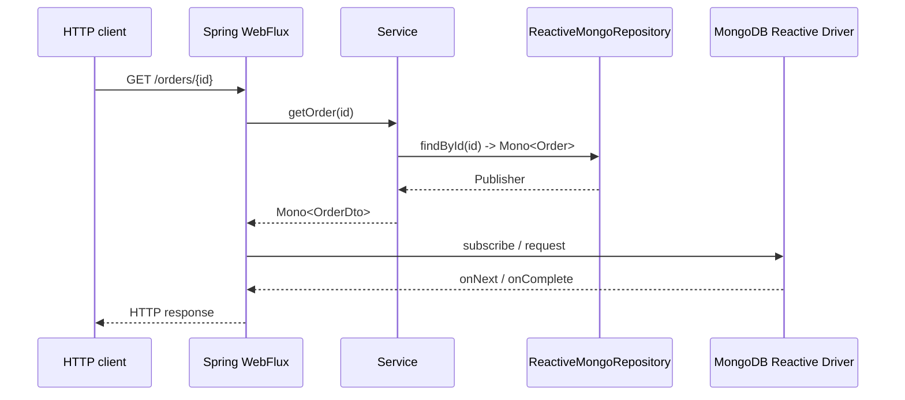

# Tránh block, subscribe thủ công và lẫn client đồng bộ trong chuỗi reactive

Trong **Spring Data MongoDB**, cách viết code reactive đúng không chỉ là đổi kiểu trả về từ `Order` thành `Mono<Order>` hay từ `List<Order>` thành `Flux<Order>`. Một luồng thực sự non-blocking phải sử dụng **MongoDB Reactive Streams Driver** thông qua `ReactiveMongoTemplate` hoặc `ReactiveMongoRepository`, **không chờ kết quả bằng `block()`** trên event-loop, **không tự `subscribe()`** bên trong service/controller và **không lén gọi `MongoTemplate` đồng bộ** trên thread đang xử lý chuỗi reactive.

Bài thuộc chương **Truy cập reactive** của module **SPRING_DATA_MONGODB**: sử dụng Spring Data MongoDB để kết nối, ánh xạ document và thao tác qua template/repository; thực hành truy vấn, aggregation, index, transaction, reactive access, kiểm thử và chẩn đoán hiệu năng dữ liệu. Trọng tâm của bài là bảo đảm **tính nhất quán về execution model** từ WebFlux controller tới MongoDB, đặc biệt khi codebase phải chuyển đổi dần từ API đồng bộ.

Sau bài này, bạn có thể:

- Giải thích vì sao một `Mono` chỉ là mô tả công việc cho tới khi được subscribe.
- Nhận diện ba anti-pattern: `block()`, `subscribe()` thủ công, và đồng bộ I/O trong `map`/`flatMap`.
- Viết lại flow với `ReactiveMongoRepository`, `ReactiveMongoTemplate`, `flatMap`, `then` và `switchIfEmpty`.
- Phân biệt `subscribeOn`, `publishOn`, `boundedElastic` và giới hạn của chúng.
- Bảo vệ transaction context, xử lý timeout/cancellation, retry, backpressure và kiểm chứng bằng `StepVerifier` cùng integration test.

## 1. Reactive là mô hình thực thi, không phải lớp bọc kiểu trả về

Xem hai chữ ký:

```java
Order findById(ObjectId id);              // Imperative, trả trực tiếp.
Mono<Order> findById(ObjectId id);        // Reactive, trả Publisher.
```

Chữ ký thứ hai **chỉ nói về hợp đồng trả về**. Nếu bên trong method vẫn gọi API blocking rồi trả `Mono.just(...)`, nó có thể **chặn thread ngay lúc method được gọi**:

```java
// SAI: truy vấn đồng bộ chạy trước khi Mono được tạo.
Mono<Order> findWrong(ObjectId id) {
    Order order = mongoTemplate.findById(id, Order.class);
    return Mono.justOrEmpty(order);
}
```

Phiên bản thực sự reactive:

```java
// ĐÚNG: ReactiveMongoTemplate dùng reactive driver.
Mono<Order> findReactive(ObjectId id) {
    return reactiveMongoTemplate.findById(id, Order.class);
}
```

Một `Mono<Order>` có thể hoàn thành **0 hoặc 1 phần tử**, lỗi hoặc hủy. Một `Flux<Order>` có thể phát nhiều phần tử, không nhất thiết đợi toàn bộ danh sách tải xong. Reactor operators giúp nối các giai đoạn theo tín hiệu `onNext`, `onError`, `onComplete` và cancellation.

**Không có một thread riêng tự động được cấp cho mọi `Mono`/`Flux`.** Thread thực thi phụ thuộc source và scheduler; non-blocking nghĩa là không giữ thread để đợi I/O, chứ không phải mọi phép tính đều chạy song song.

## 2. Một pipeline được chạy khi nào?

Với Reactor, đa số source từ MongoDB là **cold publisher**: xây một chuỗi operators không tự gửi query tới MongoDB cho tới khi có subscriber.

```java
Mono<Order> query = reactiveMongoTemplate.findById(id, Order.class);

// Tới đây chưa thể kết luận MongoDB đã nhận find.
Mono<OrderDto> response = query
    .map(order -> new OrderDto(
        order.getId().toHexString(),
        order.getDisplayName()
    ));

// WebFlux hoặc StepVerifier sẽ subscribe vào response.
```



Trong một request WebFlux bình thường, **framework là subscriber ở ranh giới HTTP**. Service chỉ **trả Publisher đã được nối đầy đủ**, không tự khởi tạo một subscription khác.

Với job không có HTTP subscriber (scheduler, CLI, message listener), điểm subscription phải được **quản lý ở ranh giới job**, với lifecycle, error handling và shutdown riêng — không phải một lời gọi `subscribe()` tùy tiện nằm sâu trong repository/service.

## 3. Anti-pattern 1: block() trong WebFlux controller

```java
import org.springframework.web.bind.annotation.GetMapping;
import org.springframework.web.bind.annotation.PathVariable;

// SAI: chặn request thread để chờ I/O.
@GetMapping("/orders/{id}")
public OrderDto getOrder(@PathVariable String id) {
    Order order = reactiveOrderRepository.findById(
        new ObjectId(id)
    ).block();

    return toDto(order);
}
```

Vấn đề:

- `block()` biến một asynchronous computation thành **chờ đồng bộ**.
- Nếu gọi trên Reactor Netty event-loop hoặc thread được đánh dấu `NonBlocking`, Reactor có thể ném `IllegalStateException` vì API blocking không được phép.
- Nếu môi trường **không** ném exception, thread vẫn có thể **bị giữ** cho tới khi query hoàn tất, làm giảm khả năng phục vụ request.
- `block()` kích hoạt **một subscription mới**; nếu trước đó cũng đã subscribe hoặc cùng Publisher bị subscribe lại, work có thể bị thực hiện lại.
- `block(Duration)` có timeout cũng vẫn **blocking** trong thời gian chờ và không phải giải pháp non-blocking.

### Sửa thành controller trả Mono

```java
import org.bson.types.ObjectId;
import org.springframework.web.bind.annotation.GetMapping;
import org.springframework.web.bind.annotation.PathVariable;
import org.springframework.web.bind.annotation.RequestMapping;
import org.springframework.web.bind.annotation.RestController;
import reactor.core.publisher.Mono;

@RestController
@RequestMapping("/orders")
class OrderController {
    private final ReactiveOrderService service;

    OrderController(ReactiveOrderService service) {
        this.service = service;
    }

    @GetMapping("/{id}")
    Mono<OrderDto> getOrder(@PathVariable String id) {
        return Mono.fromCallable(() -> new ObjectId(id))
            .flatMap(service::getOrder);
    }
}
```

`new ObjectId(id)` chỉ parse/validate trong bộ nhớ, không phải database I/O. Ở production, nên phân biệt ID không hợp lệ (HTTP 400) với bản ghi không tồn tại (404) bằng validation và exception mapping tường minh. Đoạn trên tập trung vào **không gọi `block()`**.

**Điểm then chốt:** method trả `Mono<OrderDto>`; WebFlux giữ quyền subscribe và viết HTTP response khi publisher phát tín hiệu.

## 4. Anti-pattern 2: subscribe() thủ công trong service

Một lỗi khác nguy hiểm hơn vì **response có thể được gửi trước khi ghi hoàn tất**:

```java
// SAI: fire-and-forget.
public Mono<Void> markPaidWrong(ObjectId id) {
    repository.findById(id)
        .flatMap(order -> {
            order.setStatus("PAID");
            return repository.save(order);
        })
        .subscribe();

    return Mono.empty(); // HTTP có thể báo OK ngay.
}
```

Lời gọi `subscribe()` tạo **một luồng thực thi tách rời** khỏi Publisher trả về. Nó không còn được nối vào:

- HTTP request cancellation/timeout.
- Luồng `onError` mà WebFlux có thể chuyển thành HTTP error.
- Reactive transaction context (nếu service đang trong transaction).
- Trace/correlation data của subscription chính.
- Điều phối retry và lifecycle của business operation.

Nếu write thất bại vì `DuplicateKeyException`, connection timeout hoặc validation, HTTP response ở trên có thể đã trả **204/200 thành công**. Không được coi logging trong `subscribe(error -> log...)` là cách đảm bảo correctness.

### Cách đúng: trả Publisher thể hiện chính write đó

```java
public Mono<Void> markPaid(ObjectId id) {
    return repository.findById(id)
        .switchIfEmpty(Mono.error(
            new IllegalArgumentException("Không tìm thấy đơn")
        ))
        .flatMap(order -> {
            order.setStatus("PAID");
            return repository.save(order);
        })
        .then();
}
```

`then()` chuyển `Mono<Order>` sau `save` thành `Mono<Void>`, **chỉ hoàn tất khi upstream hoàn tất**, và chuyển tiếp lỗi. Controller có thể trả `Mono<Void>` trực tiếp khi endpoint không có body.

Lưu ý về concurrency: nếu nhiều request cùng `findById→save`, có thể mất cập nhật. Khi đó cần `@Version`/optimistic locking hoặc atomic `updateFirst`; **reactive không tự giải quyết lost update**.

## 5. Anti-pattern 3: lẫn MongoTemplate đồng bộ trong chuỗi reactive

`MongoTemplate` và `ReactiveMongoTemplate` không phải hai phương thức cú pháp tương đương:

| Thành phần | Driver nền | Kết quả thường gặp | Có chờ I/O trên calling thread? |
| --- | --- | --- | --- |
| `MongoTemplate` | MongoDB Java **Sync Driver** | `Order`, `List<Order>`, `UpdateResult` | **Có thể chặn** |
| `MongoRepository` | Sync Driver thông qua imperative infrastructure | `Optional<Order>`, entity | **Có thể chặn** |
| `ReactiveMongoTemplate` | MongoDB **Reactive Streams Driver** | `Mono<T>`, `Flux<T>` | I/O theo reactive subscription |
| `ReactiveMongoRepository` | Reactive Streams Driver | `Mono<T>`, `Flux<T>` | Không chặn để chờ I/O theo API reactive |

Sai lầm phổ biến:

```java
// SAI: map callback chạy trên một thread của reactive pipeline.
return reactiveOrderRepository.findById(id)
    .map(order -> {
        // Blocking I/O bên trong map!
        Customer customer = mongoTemplate.findById(
            order.getCustomerId(), Customer.class
        );
        return merge(order, customer);
    });
```

Dù outer type là `Mono<OrderDto>`, phần MongoDB sync query bên trong `map` vẫn **chặn thread thực thi callback**. Lượng request cao có thể gây latency tăng vọt, queue quá tải và giảm throughput.

### Ưu tiên đổi sang ReactiveMongoTemplate

```java
return reactiveOrderRepository.findById(id)
    .flatMap(order ->
        reactiveMongoTemplate.findById(
                order.getCustomerId(), Customer.class
            )
            .map(customer -> merge(order, customer))
    );
```

`flatMap` nối **Publisher khác** vào cùng pipeline; `map` phù hợp khi hàm biến đổi trả **giá trị thông thường** chứ không phải Publisher.

## 6. Vì sao map(Mono) sinh kiểu lồng và không chạy logic đúng?

Giả sử:

```java
Mono<Order> orderMono = reactiveOrderRepository.findById(id);
```

Mẫu sai:

```java
Mono<Mono<Customer>> nested = orderMono.map(
    order -> reactiveCustomerRepository.findById(
        order.getCustomerId()
    )
);
```

`map` giữ kết quả trả về **như một giá trị**: ở đây giá trị ấy lại là `Mono<Customer>`, thành `Mono<Mono<Customer>>`. Nó không tự subscribe vào inner publisher.

Mẫu đúng:

```java
Mono<Customer> customerMono = orderMono.flatMap(
    order -> reactiveCustomerRepository.findById(
        order.getCustomerId()
    )
);
```

| Operator | Callback trả về | Kết quả | Dùng khi |
| --- | --- | --- | --- |
| `map(f)` | `T → R` | `Mono<R>`/`Flux<R>` | Chuyển DTO, validate thuần, tính toán nhẹ |
| `flatMap(f)` | `T → Publisher<R>` | Ghép publisher thành luồng | Query, save, gọi HTTP client reactive |
| `concatMap(f)` | `T → Publisher<R>` | Giữ thứ tự các inner publishers | Phải xử lý dữ liệu theo thứ tự |
| `flatMap(f, concurrency)` | `T → Publisher<R>` | Có thể xử lý đồng thời có giới hạn | Batch với I/O độc lập và chính sách concurrency |
| `then(next)` | Publisher tiếp theo | Chạy `next` sau khi upstream hoàn tất | Ghi A rồi ghi B, giữ lỗi |
| `zipWith`/`Mono.zip` | Các publisher độc lập | Kết hợp kết quả khi đều có dữ liệu | Đọc các nguồn song song phù hợp |

**Không dùng `flatMap` chỉ để gọi một side-effect bằng `subscribe()` bên trong callback.** Hãy trả inner Publisher.

## 7. Entity và repository reactive: ví dụ xuyên suốt

Entity lưu đơn hàng:

```java
import java.time.Instant;
import org.bson.types.ObjectId;
import org.springframework.data.annotation.Id;
import org.springframework.data.annotation.Version;
import org.springframework.data.mongodb.core.mapping.Document;
import org.springframework.data.mongodb.core.mapping.Field;

@Document("orders")
public class Order {
    @Id
    private ObjectId id;

    @Field("tenant_id")
    private String tenantId;

    @Field("customer_id")
    private ObjectId customerId;

    private String status;

    @Field("created_at")
    private Instant createdAt;

    @Version
    private Long version;

    public Order() {}

    public ObjectId getId() { return id; }
    public String getTenantId() { return tenantId; }
    public ObjectId getCustomerId() { return customerId; }
    public String getStatus() { return status; }
    public Instant getCreatedAt() { return createdAt; }
    public Long getVersion() { return version; }
    public void setStatus(String status) { this.status = status; }
}
```

Repository:

```java
import org.bson.types.ObjectId;
import org.springframework.data.mongodb.repository.ReactiveMongoRepository;
import reactor.core.publisher.Flux;
import reactor.core.publisher.Mono;

public interface ReactiveOrderRepository
        extends ReactiveMongoRepository<Order, ObjectId> {

    Mono<Order> findByIdAndTenantId(
        ObjectId id, String tenantId
    );

    Flux<Order> findByTenantIdAndStatus(
        String tenantId, String status
    );
}
```

`tenantId` trong derived query được mapping thành BSON `tenant_id` bởi Spring Data. `@Version` giúp phát hiện lost update trên các đường save được hỗ trợ với acknowledged writes; nó không làm toàn bộ reactive chain thành một transaction.

**Thiết kế đa tenant:** mọi query nghiệp vụ nên gắn `tenantId` từ authentication context. `findById(id)` thuần có thể là vấn đề phân quyền nếu ID do người dùng cung cấp và service quên kiểm tra tenant.

## 8. Reactive service đúng: một pipeline, một đường trả về

Service đọc đơn theo tenant và chuyển DTO:

```java
import org.bson.types.ObjectId;
import org.springframework.stereotype.Service;
import reactor.core.publisher.Mono;

@Service
public class ReactiveOrderService {
    private final ReactiveOrderRepository repository;

    public ReactiveOrderService(ReactiveOrderRepository repository) {
        this.repository = repository;
    }

    public Mono<OrderDto> getOrder(ObjectId id) {
        // Ví dụ: tenantId đến từ server-side auth context.
        String tenantId = "T1";

        return repository.findByIdAndTenantId(id, tenantId)
            .switchIfEmpty(Mono.error(
                new OrderNotFoundException(id)
            ))
            .map(order -> new OrderDto(
                order.getId().toHexString(),
                order.getStatus()
            ));
    }

    public Mono<Void> markPaid(ObjectId id, String tenantId) {
        return repository.findByIdAndTenantId(id, tenantId)
            .switchIfEmpty(Mono.error(
                new OrderNotFoundException(id)
            ))
            .flatMap(order -> {
                order.setStatus("PAID");
                return repository.save(order);
            })
            .then();
    }
}
```

`OrderDto` có thể là record Java:

```java
public record OrderDto(String id, String status) {}

public final class OrderNotFoundException
        extends RuntimeException {
    public OrderNotFoundException(Object id) {
        super("Không tìm thấy đơn: " + id);
    }
}
```

Giá trị `"T1"` ở ví dụ chỉ để dễ đọc; **không hard-code tenant thật** trong production. Nên truyền tenant từ authentication principal hoặc lấy qua reactive security context, bảo đảm không lẫn dữ liệu giữa requests.

Tất cả các method trong service **trả Publisher**, không `block()` hoặc `subscribe()`. Lỗi đọc/ghi tiếp tục đi tới subscriber cuối.

## 9. Controller trả Mono/Flux, không trả một kết quả được block

```java
import org.bson.types.ObjectId;
import org.springframework.http.HttpStatus;
import org.springframework.web.bind.annotation.*;

@RestController
@RequestMapping("/api/orders")
public class OrderApi {
    private final ReactiveOrderService service;

    public OrderApi(ReactiveOrderService service) {
        this.service = service;
    }

    @GetMapping("/{id}")
    public Mono<OrderDto> get(@PathVariable String id) {
        return Mono.fromCallable(() -> new ObjectId(id))
            .flatMap(service::getOrder);
    }

    @PatchMapping("/{id}/paid")
    @ResponseStatus(HttpStatus.NO_CONTENT)
    public Mono<Void> markPaid(
            @PathVariable String id,
            @RequestHeader("X-Tenant-Demo") String tenantId) {
        // Header chỉ dành cho demo; production lấy tenant từ auth.
        return Mono.fromCallable(() -> new ObjectId(id))
            .flatMap(parsed -> service.markPaid(
                parsed, tenantId
            ));
    }
}
```

`@ResponseStatus(NO_CONTENT)` và kiểu `Mono<Void>` cho phép WebFlux đợi pipeline hoàn tất trước khi response complete. Nếu DB throw exception, framework/error handler có cơ hội chuyển nó thành HTTP error.

**Chỉnh khi dùng production:** mapping `IllegalArgumentException` của ObjectId thành HTTP 400, `OrderNotFoundException` thành 404, optimistic locking thành 409 và che thông tin nhạy cảm ở response. Đừng dùng header tenant do client gửi như chứng cứ quyền truy cập.

## 10. Khi thật sự phải dùng thư viện blocking: boundedElastic tại ranh giới

Không phải mọi dự án có thể chuyển ngay tất cả dependency từ sync sang reactive. Ví dụ có legacy reporting service chỉ có `MongoTemplate` hoặc một SDK đồng bộ.

Mẫu Reactor chính thức để cách ly **một lời gọi blocking**:

```java
import reactor.core.publisher.Mono;
import reactor.core.scheduler.Schedulers;

Mono<Customer> legacyCustomer(ObjectId id) {
    return Mono.fromCallable(
            () -> mongoTemplate.findById(id, Customer.class)
        )
        .subscribeOn(Schedulers.boundedElastic());
}
```

Ở đây:

- `Mono.fromCallable` **hoãn** việc gọi sync MongoTemplate tới lúc subscription.
- `subscribeOn(Schedulers.boundedElastic())` chuyển source blocking sang scheduler dành cho công việc blocking có **giới hạn thread và hàng đợi**.
- Nếu `mongoTemplate.findById` trả `null`, `Mono.fromCallable` hoàn thành **empty**, không emit `null`.
- Việc offload không biến sync driver thành reactive. Một thread boundedElastic **vẫn bị chặn trong lúc chờ**.
- `subscribeOn` không tự tạo subscription; phải có framework/job subscriber cuối.

Sau khi bọc, có thể nối vào chuỗi:

```java
return reactiveOrderRepository.findById(id)
    .flatMap(order ->
        legacyCustomer(order.getCustomerId())
            .map(customer -> merge(order, customer))
    );
```

Đây là **giải pháp chuyển tiếp**, không phải lựa chọn kiến trúc mặc định. Ưu tiên chuyển dependency sang `ReactiveMongoTemplate`/`ReactiveMongoRepository` hoặc cô lập phần legacy trong một service riêng có quota/concurrency.

## 11. Hai mẫu "đã dùng boundedElastic" nhưng vẫn sai

### Sai vì gọi blocking quá sớm

```java
// SAI: findById chạy NGAY LẬP TỨC trên calling thread.
Mono<Customer> wrong = Mono.justOrEmpty(
    mongoTemplate.findById(id, Customer.class)
).subscribeOn(Schedulers.boundedElastic());
```

`subscribeOn` không thể chuyển lùi về trước thời điểm `findById` đã được gọi trong argument của `justOrEmpty`.

### Sai vì publishOn đặt sau đoạn blocking

```java
// SAI: map đã thực hiện blocking trước publishOn.
return reactiveOrderRepository.findById(id)
    .map(order ->
        mongoTemplate.findById(
            order.getCustomerId(), Customer.class
        )
    )
    .publishOn(Schedulers.boundedElastic());
```

`publishOn` ảnh hưởng các đoạn **sau** vị trí nó xuất hiện, không hồi tố làm source/callback ở phía trước trở nên non-blocking.

### Đúng: bao riêng nguồn blocking

```java
return reactiveOrderRepository.findById(id)
    .flatMap(order ->
        Mono.fromCallable(() ->
                mongoTemplate.findById(
                    order.getCustomerId(), Customer.class
                )
            )
            .subscribeOn(Schedulers.boundedElastic())
    );
```

**Không nên dùng `Schedulers.parallel()` để chạy blocking I/O.** Scheduler này phục vụ xử lý CPU-bound ngắn; các Reactor blocking APIs bị cấm trên thread `parallel`/`single` mặc định. Blocking trực tiếp trong các thread ấy có thể gây exception hoặc giữ tài nguyên sai mục đích.

## 12. subscribeOn và publishOn khác nhau như thế nào?

| Operator | Tác động | Hành vi thường dùng |
| --- | --- | --- |
| `subscribeOn(scheduler)` | Ảnh hưởng nơi source được subscribe và upstream thực thi | Đặt ngay sau `Mono.fromCallable(blockingCall)` |
| `publishOn(scheduler)` | Chuyển nơi downstream operators nhận tín hiệu từ vị trí đó | Tách một phần xử lý CPU hoặc boundary có chủ đích |
| `Schedulers.boundedElastic()` | Bounded scheduler được thiết kế cho blocking work | Cô lập legacy I/O, không thay reactive driver |
| `Schedulers.parallel()` | Thread pool phục vụ tác vụ CPU | Không chạy blocking database calls |
| Không scheduler tường minh | Phụ thuộc source, caller và library | Phù hợp nhiều pipeline hoàn toàn reactive |

Ví dụ quan sát thread:

```java
Mono.fromCallable(() -> blockingLegacyCall())
    .subscribeOn(Schedulers.boundedElastic())
    .doOnNext(value ->
        log.debug("Thread sau blocking source: {}",
            Thread.currentThread().getName())
    )
    .publishOn(Schedulers.parallel())
    .map(this::cpuOnlyTransform);
```

`cpuOnlyTransform` phải không có blocking I/O. Thread name chỉ phục vụ **diagnostics**, không nên dựa vào tên thread cụ thể để xác định correctness.

**Một chú ý:** `boundedElastic` có giới hạn và hàng đợi; nếu trộn quá nhiều sync calls cùng lúc, queue vẫn có thể đầy và gây latency/overload. Hãy giới hạn concurrency, theo dõi tài nguyên và ưu tiên thay sync driver thay vì mở rộng thread pool vô hạn.

## 13. Mono.defer giúp trì hoãn tạo Publisher, không tự offload blocking

`Mono.defer` hoãn việc *tạo* Publisher tới thời điểm subscription:

```java
Mono<Order> deferred = Mono.defer(() ->
    reactiveOrderRepository.findById(id)
);
```

Mẫu này có ích nếu cần tính lại tham số theo từng subscription, hoặc tạo publisher sau khi có context. Nhưng:

```java
// SAI nếu gọi trên event loop: vẫn block tại thời điểm subscribe.
Mono<Customer> notNonBlocking = Mono.defer(() ->
    Mono.justOrEmpty(
        mongoTemplate.findById(id, Customer.class)
    )
);
```

`defer` chỉ **dời lúc blocking xảy ra**, không đổi thread. Muốn gọi synchronous API mà không giữ event-loop, dùng `Mono.fromCallable(...).subscribeOn(Schedulers.boundedElastic())` và đặt ở boundary phù hợp.

## 14. Vì sao không tự subscribe trong constructor, getter hay utility?

Các hàm như sau tạo side effect ngầm:

```java
// SAI: khởi chạy việc ghi rồi không trả tín hiệu hoàn tất.
void saveAudit(Audit audit) {
    reactiveAuditRepository.save(audit)
        .subscribe(saved -> log.info("saved={}", saved.getId()));
}
```

Bất lợi:

- Service caller không chờ được save hoàn tất.
- Gặp DB error, caller có thể đã hoàn thành HTTP response.
- Cancellation của request không đi tới subscription tách riêng.
- Test khó chứng minh ghi đã được thực hiện đúng một lần.
- Nếu chứa transaction context, subscription tách rời có thể **không tham gia transaction**.
- Nếu scheduler/app shutdown, side effect có thể chưa hoàn tất.

Thay bằng:

```java
Mono<Audit> saveAudit(Audit audit) {
    return reactiveAuditRepository.save(audit);
}
```

Nếu caller không cần audit result nhưng cần **chờ write**:

```java
Mono<Void> auditThenComplete(Audit audit) {
    return saveAudit(audit).then();
}
```

Về nguyên tắc, **subscription là trách nhiệm của ranh giới chạy ứng dụng**, không phải thao tác được gọi từ một domain method mà không cho caller biết.

## 15. Nối hai write: then và flatMap thay cho hai subscribe

Giả sử cần tạo Order rồi ghi một Audit liên quan orderId.

Sai:

```java
Mono<Order> createWrong(Order order) {
    reactiveOrderRepository.save(order)
        .subscribe();

    reactiveAuditRepository.save(new Audit(/* ... */))
        .subscribe();

    return Mono.just(order);
}
```

Hai subscriptions độc lập, không bảo đảm thứ tự và không được nối vào response. ID có thể chưa được gán khi tạo audit; lỗi có thể mất.

Đúng về **thứ tự Publisher**:

```java
Mono<Order> createAndAudit(Order order) {
    return reactiveOrderRepository.save(order)
        .flatMap(saved ->
            reactiveAuditRepository.save(
                    Audit.forCreatedOrder(saved.getId())
                )
                .thenReturn(saved)
        );
}
```

`Audit.forCreatedOrder(...)` ở đây là một factory minh họa cần được định nghĩa trong entity `Audit` thật. `flatMap` bảo đảm audit publisher được tạo sau khi có `saved`, và `thenReturn(saved)` chỉ phát saved order **khi audit save hoàn tất**.

**Cực kỳ quan trọng:** thứ tự này **không làm hai writes nguyên tử với nhau**. Nếu order insert thành công nhưng audit insert lỗi, order có thể đã tồn tại. Khi cần cả hai cùng commit/rollback, dùng **reactive MongoDB transaction** trên replica set/sharded cluster có hỗ trợ.

## 16. Mono.when / Mono.zip không phải transaction

`Mono.zip(a, b)` có thể subscribe vào hai Publishers để lấy hai giá trị và kết hợp:

```java
Mono<Customer> customer =
    reactiveCustomerRepository.findById(customerId);

Mono<Order> order =
    reactiveOrderRepository.findById(orderId);

Mono<Tuple2<Customer, Order>> together =
    Mono.zip(customer, order);
```

Đây có thể phù hợp cho **hai truy vấn độc lập**. Nhưng:

- `zip` thường không emit nếu một source complete empty; xử lý empty case rõ ràng.
- Nếu một source lỗi, những source khác có thể đã thực thi một phần.
- Với **hai writes**, `when`/`zip` không tự rollback write đã thành công khi write kia thất bại.
- Trong cùng một MongoDB transaction, không tùy tiện chạy các operations **đồng thời trên cùng session**: driver/server có thể hạn chế parallelism trong transaction. Ưu tiên chuỗi tuần tự khi cần thứ tự và tính nhất quán.
- Với service cần kiểm tra tenant/permission, không song song ghi trước khi validation đầy đủ.

## 17. Ghi nguyên tử một document bằng ReactiveMongoTemplate

Thay `find→set→save`, có thể cập nhật chỉ field cần thiết qua một lệnh MongoDB:

```java
import com.mongodb.client.result.UpdateResult;
import org.bson.types.ObjectId;
import org.springframework.data.mongodb.core.ReactiveMongoTemplate;
import org.springframework.data.mongodb.core.query.Criteria;
import org.springframework.data.mongodb.core.query.Query;
import org.springframework.data.mongodb.core.query.Update;
import reactor.core.publisher.Mono;

Mono<Boolean> markPaidAtomically(
        ReactiveMongoTemplate template,
        ObjectId orderId, String tenantId) {

    Query query = Query.query(
        Criteria.where("id").is(orderId)
            .and("tenantId").is(tenantId)
            .and("status").is("NEW")
    );

    Update patch = new Update().set("status", "PAID");

    return template.updateFirst(query, patch, Order.class)
        .map(result -> result.getMatchedCount() == 1);
}
```

Ở đây `updateFirst` sử dụng Reactive Streams driver và trả `Mono<UpdateResult>`. Chỉ khi subscriber đăng ký mới gửi command. Query có điều kiện `status="NEW"`, tránh ghi lại `PAID` khi trạng thái đã đổi (phải có nghiệp vụ tương ứng để phân biệt conflict).

**Đừng nhầm atomicity với idempotency.** Nếu một payment event bị gửi lại, hệ thống cần requestId/transaction reference và quy tắc xử lý duplicate, không chỉ một `status` đơn giản. Reactive cũng không thay thế MongoDB write concern hoặc transaction khi cần nhiều document cùng commit.

## 18. Reactive MongoDB connection: dùng đúng loại client

Một dự án có thể vô tình mang cả hai hạ tầng:

```text
Blocking:
  com.mongodb.client.MongoClient
      → MongoTemplate
      → MongoRepository

Reactive:
  com.mongodb.reactivestreams.client.MongoClient
      → ReactiveMongoTemplate
      → ReactiveMongoRepository
```

Mặc dù cùng endpoint MongoDB, hai client interfaces **không hoán đổi**. Có một dependency reactor-core hay `spring-boot-starter-webflux` không khiến `MongoTemplate` dùng non-blocking I/O.

Hãy kiểm tra:

1. Ứng dụng đã có MongoDB Reactive Streams Driver tương thích.
2. `ReactiveMongoDatabaseFactory` và `ReactiveMongoTemplate` được cấu hình đúng database, credentials, TLS, pool settings.
3. Reactive repositories được enable/config đúng package và bean.
4. `MongoTemplate` đồng bộ có còn được inject vào service WebFlux không.
5. Nếu phải giữ cả hai clients vì migration, mỗi hạ tầng có pool và instrumentation phù hợp, không giả định chúng dùng chung session.

Phải biết **Spring Boot/Spring Data version** thực tế vì auto-configuration và property names thay đổi theo major version. Bài này hướng dẫn các loại interface và nguyên lý, không đoán tên property cụ thể của mọi đời Boot.

## 19. Không che synchronous repository bằng Mono.just

Sai:

```java
Mono<Order> getWrong(ObjectId id) {
    Optional<Order> result = mongoRepository.findById(id);
    return Mono.justOrEmpty(result);
}
```

`mongoRepository` ở đây là `MongoRepository` **đồng bộ**. Lệnh `findById` đã chặn calling thread trước khi xây Publisher. Hơn nữa, kiểu `Mono.justOrEmpty(Optional<Order>)` là một wrapper của kết quả đã được lấy, không phải non-blocking query.

Nếu chưa thể chuyển:

```java
Mono<Order> getTransitional(ObjectId id) {
    return Mono.fromCallable(() ->
            mongoRepository.findById(id).orElse(null)
        )
        .subscribeOn(Schedulers.boundedElastic());
}
```

Còn phương án tốt hơn:

```java
Mono<Order> getPreferred(ObjectId id) {
    return reactiveMongoRepository.findById(id);
}
```

Không lẫn repository sync và reactive chỉ dựa vào đuôi tên method `findById` vì cả hai APIs có method giống nhau.

## 20. ThreadLocal, SecurityContext và Reactor Context

Trong imperative Servlet code, request-scoped metadata thường dựa vào `ThreadLocal`. Với Reactor, một request có thể chuyển qua nhiều threads và các operators; `ThreadLocal` không nên là nguồn duy nhất cho tenant/correlation context.

Spring Security reactive cung cấp context theo reactive pipeline:

```java
import org.springframework.security.core.context.ReactiveSecurityContextHolder;
import reactor.core.publisher.Mono;

Mono<String> authenticatedName() {
    return ReactiveSecurityContextHolder.getContext()
        .map(ctx -> ctx.getAuthentication().getName());
}
```

Với metadata do ứng dụng quản lý, dùng Reactor `Context`:

```java
Mono<String> tenantScopedMessage = Mono.deferContextual(ctx -> {
    String tenantId = ctx.get("tenantId");
    return Mono.just("Tenant=" + tenantId);
});

Mono<String> supplied = tenantScopedMessage
    .contextWrite(context -> context.put("tenantId", "T1"));
```

`"T1"` chỉ là giá trị demo. **Không cho client tùy ý tự đặt quyền tenant** thông qua một header rồi tin `Context` mới; phải lấy tenant từ authentication và authorization.

Một `subscribe()` thủ công ở bên trong service có thể tạo một subscription mới **không có cùng Reactor Context** như request. Chuyển thread bằng `boundedElastic` cũng cần suy nghĩ về tích hợp logging/MDC, security context và các thư viện còn dùng ThreadLocal; nên sử dụng cơ chế context propagation chính thức thay vì đọc ThreadLocal trực tiếp.

## 21. Reactive transaction: không tách subscription và không trộn sync driver

Transaction reactive cần:

- MongoDB replica set/sharded deployment hỗ trợ transactions.
- `ReactiveMongoTransactionManager` dùng **cùng `ReactiveMongoDatabaseFactory`** với `ReactiveMongoTemplate`/repositories.
- Publisher được **compose và subscribe trong cùng reactive transaction context**.
- Service method `@Transactional` được gọi qua Spring proxy, không self-invoke rồi mong annotation chạy.
- Không dùng `MongoTemplate` sync trong cùng flow rồi giả định sync operation tự tham gia reactive transaction.

Cấu hình:

```java
import org.springframework.context.annotation.Bean;
import org.springframework.context.annotation.Configuration;
import org.springframework.data.mongodb.ReactiveMongoDatabaseFactory;
import org.springframework.data.mongodb.ReactiveMongoTransactionManager;

@Configuration
class ReactiveTxConfig {
    @Bean("reactiveMongoTransactionManager")
    ReactiveMongoTransactionManager txManager(
            ReactiveMongoDatabaseFactory factory) {
        return new ReactiveMongoTransactionManager(factory);
    }
}
```

Ví dụ service, giả định các repository/aggregate roots đã được khai báo:

```java
import org.springframework.stereotype.Service;
import org.springframework.transaction.annotation.Transactional;
import reactor.core.publisher.Mono;

@Service
public class OrderWriteService {
    private final ReactiveOrderRepository orders;
    private final ReactiveAuditRepository audits;

    public OrderWriteService(
            ReactiveOrderRepository orders,
            ReactiveAuditRepository audits) {
        this.orders = orders;
        this.audits = audits;
    }

    @Transactional(
        transactionManager = "reactiveMongoTransactionManager"
    )
    public Mono<Order> createAndAudit(Order order) {
        return orders.save(order)
            .flatMap(saved ->
                audits.save(Audit.forCreatedOrder(saved.getId()))
                    .thenReturn(saved)
            );
    }
}
```

Nếu audit save lỗi, reactive transaction có thể rollback cả hai MongoDB writes theo điều kiện cấu hình. Nhưng email, Kafka publish, external HTTP call **không được rollback** bởi transaction MongoDB. Với external event, dùng transactional outbox hoặc một workflow idempotent.

**Không làm thế này trong method trên**: `audits.save(...).subscribe()`. Subscription riêng có thể mất transaction context, làm audit ghi **ngoài** transaction hoặc chạy sau khi transaction chính đã commit.

## 22. TransactionalOperator cho phạm vi giao dịch tường minh

Khi không dùng `@Transactional`, có thể tạo `TransactionalOperator`:

```java
import org.springframework.transaction.ReactiveTransactionManager;
import org.springframework.transaction.reactive.TransactionalOperator;
import reactor.core.publisher.Mono;

TransactionalOperator tx =
    TransactionalOperator.create(reactiveTxManager);

Mono<Order> work = orders.save(order)
    .flatMap(saved ->
        audits.save(Audit.forCreatedOrder(saved.getId()))
            .thenReturn(saved)
    );

return work.as(tx::transactional);
```

`reactiveTxManager` ở đây là instance `ReactiveMongoTransactionManager` hoặc `ReactiveTransactionManager` tương thích. Transaction boundary bao phủ publisher **upstream được gắn `transactional(...)`**.

**Tạo Publisher không có nghĩa nó đã chạy trong transaction.** Việc subscribe, cancellation, failure và context đều ảnh hưởng kết quả. Không trộn một external `Mono` đã được `cache()`/shared hoặc một side effect đã chạy trước khi vào operator và nghĩ nó được rollback.

Nếu một transaction chứa nhiều read/writes, ưu tiên chuỗi có thứ tự; không lạm dụng `flatMap` concurrency trên cùng session.

## 23. Cancellation: client ngắt kết nối không đồng nghĩa write rollback

Giả sử endpoint trả:

```java
Mono<Void> update = reactiveMongoTemplate
    .updateFirst(query, patch, Order.class)
    .then();
```

Nếu HTTP client ngắt kết nối hoặc gọi hủy subscription, Reactor có thể **phát cancellation lên upstream**. Nhưng MongoDB command đã gửi qua network có thể **đã được thực hiện** trước khi tín hiệu cancel được xử lý.

Không có quy tắc an toàn rằng:

```text
HTTP cancelled → MongoDB chắc chắn chưa ghi.
```

Các tình huống cần xem xét:

- Write chưa tới server: có thể chưa có thay đổi.
- Write đã được áp dụng nhưng response bị mất: business result **không chắc chắn**.
- Write đã commit trong transaction: client disconnect không thể “undo” commit.
- Publisher bị hủy khi transaction đang mở: transaction handling phải được kiểm chứng theo Spring Data/Reactor version và trường hợp thực tế.

Với các yêu cầu có side effect quan trọng, sử dụng **requestId/idempotency key**, dữ liệu receipt và API tra cứu trạng thái. Không dùng `doOnCancel` như một transaction rollback handler tự chế.

## 24. timeout(Duration) không phải ngoại lệ cho tính nhất quán

`Mono.timeout(...)` phát lỗi khi nguồn không đáp ứng trong thời gian quy định và thường cancel upstream:

```java
Mono<Order> result = reactiveOrderRepository.findById(id)
    .timeout(java.time.Duration.ofSeconds(2));
```

Timeout này **không biến** query thành blocking; tuy nhiên nó cũng không bảo đảm MongoDB command đã ngừng xử lý tại server.

Với write:

```java
Mono<Void> write = reactiveMongoTemplate
    .updateFirst(query, patch, Order.class)
    .then()
    .timeout(java.time.Duration.ofSeconds(2));
```

Nếu timeout xuất hiện sau khi server đã ghi, caller không được tự retry toàn bộ business operation mà không đối soát. Phân biệt HTTP request timeout, Reactor timeout, driver/socket/server selection timeout và MongoDB maxTimeMS; mỗi cơ chế áp dụng ở ranh giới khác nhau.

**Timeout phục vụ latency budget, không thay idempotency và write acknowledgment.**

## 25. retryWhen có thể chạy lại toàn chuỗi, không phải driver retry một command

Ví dụ nguy hiểm:

```java
Mono<Void> workflow = orders.save(order)
    .flatMap(saved ->
        audits.save(Audit.forCreatedOrder(saved.getId()))
    )
    .then()
    .retryWhen(
        reactor.util.retry.Retry.max(3)
    );
```

Nếu order save đã thành công nhưng audit save lỗi, `retryWhen` có thể resubscribe cả workflow, dẫn tới **order save được thực hiện lại**. Điều này không tương đương MongoDB driver's **retryable write** dùng logical session/statement identity trong điều kiện hỗ trợ.

Với query **chỉ đọc**, retry có thể hợp lý hơn khi lỗi tạm thời và latency budget cho phép. Nhưng đừng retry mọi exception như validation, duplicate key hoặc permission denied.

Với write:

1. Dùng unique business key/requestId để bảo vệ xử lý lặp.
2. Tách các thao tác có side effect thành transaction/outbox hoặc staging phù hợp.
3. Chỉ retry những lỗi được phân loại và trong giới hạn.
4. Khi outcome không chắc chắn, tra cứu trạng thái business receipt trước.
5. Không tự retry `$inc`/`sendEmail`/`publishEvent` như một bước atomic.

## 26. Backpressure: không collectList dữ liệu MongoDB vô hạn

`ReactiveMongoRepository.findAll()` trả `Flux<Order>`. Không phải vì vậy mọi cách tiêu thụ đều tiết kiệm bộ nhớ.

Sai cho collection lớn:

```java
Mono<List<Order>> all = reactiveOrderRepository
    .findAll()
    .collectList(); // Đưa toàn bộ dữ liệu vào heap.
```

Với hàng triệu document, `collectList` có thể tiêu tốn bộ nhớ nghiêm trọng. Những lựa chọn phù hợp:

- `take(n)` để giới hạn số lượng khi đúng hợp đồng nghiệp vụ.
- Query có filter/index/limit rõ ràng ngay trên MongoDB.
- Pagination theo keyset hoặc `Window`/`ScrollPosition` khi framework/version hỗ trợ.
- Trả `Flux` để stream response khi response media type và client phù hợp.
- Xử lý theo lô có giới hạn với `buffer(n)`/`concatMap`, kiểm soát concurrency.
- Khi cần snapshot hoặc xuất dữ liệu lớn, thiết kế resume/checkpoint; client cancel và database changes có thể làm kết quả không ổn định.

Ví dụ xử lý tối đa 500 documents:

```java
Flux<OrderDto> first500 = reactiveOrderRepository
    .findByTenantIdAndStatus("T1", "NEW")
    .take(500)
    .map(this::toDto);
```

`take(500)` giới hạn emission ở client; nó không luôn là cách tối ưu nhất để hạn chế lượng dữ liệu query/server đã chuẩn bị. **Đưa limit vào query MongoDB** khi cần giới hạn hiệu quả tại nguồn.

## 27. flatMap concurrency và đặt giới hạn cho write workloads

Ví dụ một batch cần cập nhật trạng thái nhiều order độc lập:

```java
Flux<Order> saved = Flux.fromIterable(orderIds)
    .flatMap(id ->
        reactiveOrderRepository.findById(id)
            .flatMap(order -> {
                order.setStatus("REVIEW");
                return reactiveOrderRepository.save(order);
            }),
        8 // concurrent inner publishers tối đa
    );
```

`flatMap(..., 8)` giới hạn số inner publishers có thể active đồng thời; không mặc định giữ thứ tự output. Nhưng:

- Nếu hai ID trùng cùng document, optimistic locking hoặc duplicate work vẫn phải được xử lý.
- Một batch gồm nhiều `save` **không phải transaction**.
- Lỗi giữa batch có thể xảy ra sau một số writes đã thành công.
- Nếu backend MongoDB pool nhỏ và mỗi request kích hoạt nhiều inner operations, concurrency nhân lên theo số request.
- Với nghiệp vụ cần giữ thứ tự, dùng `concatMap` hoặc logic partition/ordering thích hợp.

Đừng tăng concurrency tới vài nghìn chỉ vì non-blocking. Connection pool, MongoDB throughput, memory, backpressure và downstream capacity là giới hạn thực.

## 28. Read preference, read concern và reactive không tự có consistency mạnh hơn

MongoDB reactive driver và sync driver đều chịu quy tắc về:

- `readPreference`: primary, secondary và các lựa chọn khác.
- `readConcern`: local, majority, snapshot trong các ngữ cảnh hỗ trợ.
- `writeConcern`: mức acknowledgment/durability của writes.
- Retryable reads/writes: giới hạn theo operation, topology và driver settings.
- Causal consistency: có thể cần `ClientSession`/context đúng.
- Transactions: cần replica set/sharded deployment và transaction manager.

Chỉ vì pipeline trả `Mono<Order>` không có nghĩa dữ liệu đó nhất quán với mọi write vừa thực hiện ở request khác, cũng không có nghĩa hai MongoDB calls cùng transaction.

Đối với optimistic locking, Spring Data vẫn cần **acknowledged writes** để nhận biết version mismatch. Đối với multi-document consistency, dùng reactive transaction thật thay vì `Mono.when(insertA, insertB)` và tưởng rằng việc compose làm chúng nguyên tử.

## 29. Dùng ReactiveMongoTemplate cho aggregate không blocking

Trong Spring Data MongoDB, aggregation reactive trả `Flux<T>`:

```java
import org.bson.Document;
import org.springframework.data.mongodb.core.aggregation.Aggregation;
import org.springframework.data.mongodb.core.query.Criteria;
import reactor.core.publisher.Flux;

Aggregation pipeline = Aggregation.newAggregation(
    Aggregation.match(
        Criteria.where("tenantId").is("T1")
            .and("status").is("PAID")
    ),
    Aggregation.group("tenantId").count().as("paidOrders")
);

Flux<Document> summaries =
    reactiveMongoTemplate.aggregate(
        pipeline, Order.class, Document.class
    );
```

Sử dụng typed aggregation giúp Spring Data map `tenantId` thành `tenant_id`. Khi dùng raw `Aggregation.stage(...)`, phải viết BSON field names đúng theo cấu trúc thực.

**Đừng**:

```java
// SAI trong pipeline reactive: chặn để gom kết quả.
List<Document> summaries = reactiveMongoTemplate
    .aggregate(pipeline, Order.class, Document.class)
    .collectList()
    .block();
```

Với `$merge` hoặc `$out` trong aggregation (write stages), execution vẫn phụ thuộc subscription. Nếu tự `subscribe()` rồi trả HTTP 204, client có thể thấy thành công **trước khi MongoDB ghi xong**. Hãy trả `Flux<?>.then()` hoặc publisher biểu diễn kết quả job, và không dùng write stage trong MongoDB transaction vì server không hỗ trợ.

## 30. Tailable cursor và change stream: subscription cần vòng đời rõ ràng

Không phải mọi `Flux` MongoDB đều kết thúc. Với capped-collection tailable cursor hoặc change stream:

- Publisher có thể chạy lâu dài.
- HTTP client cancel, reconnect, server failover và application shutdown cần được xử lý.
- Change stream cần quản lý **resume token** và idempotent processing; không tái chạy toàn stream tùy tiện.
- Memory/backpressure và consumer throughput có thể gây backlog.
- Một subscription ở application startup cần **một lifecycle manager** có error handling và disposal, không là một `subscribe()` vô chủ trong constructor.

Ví dụ dấu hiệu side effect có lifecycle không rõ:

```java
// Không phù hợp nếu chỉ gọi rồi quên:
changeStreamFlux.subscribe(event -> sendToQueue(event));
```

Trong một **worker quản lý chuyên biệt**, có thể có subscription chủ động nếu worker sở hữu `Disposable`, retry/resume strategy, backpressure, monitoring, shutdown, và việc enqueue được compose qua Publisher để không chặn. Điều cấm trong bài là **subscribe thủ công bất ngờ trong service/request pipeline**.

## 31. Quan sát thread, blocking và context bằng công cụ đúng

Các dấu hiệu cần theo dõi:

- Event-loop latency tăng, HTTP p95/p99 bất thường.
- Thread dump có Netty event-loop đang ở `MongoTemplate.find(...)`, JDBC hoặc SDK sync.
- Reactor báo `block()/blockFirst()/blockLast() are blocking` trên thread non-blocking.
- Reactor `onErrorDropped` do một inner `subscribe()` không có error consumer.
- Connection pool MongoDB sync hoạt động mạnh dù hệ thống được thiết kế WebFlux reactive.
- Thread count/queue của `boundedElastic` tăng cao.
- Reactive transaction mất session, một số writes không rollback.
- Logs thiếu correlation ID/tenant vì đọc ThreadLocal sai context.

**BlockHound** là công cụ test/dev hỗ trợ phát hiện một số blocking calls trên threads không cho blocking, nếu compatible với JDK/Reactor phiên bản đang dùng và được cài/khởi tạo đúng trong môi trường test. Không coi việc test qua BlockHound là bảo đảm toàn bộ SDK không bao giờ block.

Có thể dùng `doOnSubscribe`/`doOnError`/`doFinally` để quan sát, không gây side effect nghiệp vụ:

```java
return reactiveOrderRepository.findById(id)
    .doOnSubscribe(s -> log.debug("query subscribed"))
    .doOnError(ex -> log.warn("order read failed", ex))
    .doFinally(signal -> log.debug("terminated by {}", signal));
```

`doOnNext` thích hợp cho metrics/logging nhẹ, **không thích hợp để gọi `mongoTemplate.save` hoặc publish business event blocking**.

## 32. Unit test với StepVerifier: chứng minh publisher chưa chạy sớm

`reactor-test` cung cấp `StepVerifier`. Ta có thể kiểm tra:

1. Chưa có subscription → side effect chưa chạy.
2. Sau subscription → publisher hoàn thành.
3. Error đi qua downstream, không bị một `subscribe()` tách riêng nuốt mất.

Test cơ bản:

```java
import static org.assertj.core.api.Assertions.assertThat;

import java.util.concurrent.atomic.AtomicInteger;
import org.junit.jupiter.api.Test;
import reactor.core.publisher.Mono;
import reactor.test.StepVerifier;

class ReactiveSubscriptionTest {
    @Test
    void deferredWorkRunsOnlyWhenSubscribed() {
        AtomicInteger calls = new AtomicInteger();

        Mono<String> publisher = Mono.fromCallable(() -> {
            calls.incrementAndGet();
            return "OK";
        });

        assertThat(calls.get()).isZero();

        StepVerifier.create(publisher)
            .expectNext("OK")
            .verifyComplete();

        assertThat(calls.get()).isEqualTo(1);
    }

    @Test
    void errorIsVisibleToSubscriber() {
        Mono<Void> failure = Mono.<Void>error(
            new IllegalStateException("MongoDB không khả dụng")
        );

        StepVerifier.create(failure)
            .expectErrorMessage("MongoDB không khả dụng")
            .verify();
    }
}
```

Đây là Reactor unit test, **không chứng minh MongoDB reactive driver đã truy vấn**. Nó chứng minh hợp đồng subscription/lỗi để service không che side effect.

## 33. PublisherProbe: kiểm tra branch ghi thật sự được subscribe

`reactor-test` có `PublisherProbe` cho các tình huống cần biết một publisher có được sử dụng:

```java
import static org.assertj.core.api.Assertions.assertThat;

import java.util.concurrent.atomic.AtomicInteger;
import org.junit.jupiter.api.Test;
import reactor.core.publisher.Mono;
import reactor.test.StepVerifier;
import reactor.test.publisher.PublisherProbe;

class ReactiveAuditFlowTest {

    @Test
    void writeIsNotDetachedFromReturnedMono() {
        AtomicInteger writes = new AtomicInteger();

        PublisherProbe<Void> write = PublisherProbe.of(
            Mono.<Void>fromRunnable(writes::incrementAndGet)
        );

        Mono<Void> serviceResult = write.mono().then();

        assertThat(writes.get()).isZero();
        write.assertWasNotSubscribed();

        StepVerifier.create(serviceResult)
            .verifyComplete();

        write.assertWasSubscribed();
        write.assertWasRequested();
        assertThat(writes.get()).isEqualTo(1);
    }
}
```

Nếu service viết `write.mono().subscribe(); return Mono.empty();`, test kiểu này cần thiết kế assertions theo thời điểm để phát hiện subscription sai. Tốt nhất là **inject repository mock trả PublisherProbe** và chỉ khẳng định branch được subscribe **bởi subscription của serviceResult**, không bởi side subscription nào.

## 34. Integration test với ReactiveMongoTemplate trên MongoDB thật

Unit test không chứng minh rằng application đã inject đúng reactive driver, MongoDB pool, collection mapping hay write acknowledgment. Một integration test cần dùng **MongoDB dành riêng cho test** (ví dụ Testcontainers), Spring WebFlux/reactive repositories và database cô lập.

Ví dụ Spring Boot test context:

```java
import static org.assertj.core.api.Assertions.assertThat;

import org.bson.types.ObjectId;
import org.junit.jupiter.api.Test;
import org.springframework.beans.factory.annotation.Autowired;
import org.springframework.boot.test.context.SpringBootTest;
import org.springframework.data.mongodb.core.ReactiveMongoTemplate;
import reactor.core.publisher.Mono;
import reactor.test.StepVerifier;

@SpringBootTest
class ReactiveMongoIntegrationTest {
    @Autowired ReactiveMongoTemplate template;

    @Test
    void insertDoesNotExecuteUntilSubscription() {
        ObjectId id = new ObjectId();
        String tenant = "test-" + new ObjectId().toHexString();

        Mono<Audit> save = template.insert(
            Audit.sample(id, tenant)
        );

        // Không dùng block() trong service/controller. Đối với test,
        // dùng StepVerifier để subscribe và assert completion.
        StepVerifier.create(save)
            .assertNext(saved ->
                assertThat(saved.getId()).isEqualTo(id)
            )
            .verifyComplete();

        StepVerifier.create(
            template.findById(id, Audit.class)
        )
            .assertNext(stored ->
                assertThat(stored.getTenantId()).isEqualTo(tenant)
            )
            .verifyComplete();
    }
}
```

`Audit.sample(...)` là factory minh họa của entity test cần tự định nghĩa; test chạy trên database riêng, không dùng production. Để khẳng định **không có insert trước subscription**, cần thêm query đọc (hoặc probe) ở trước `StepVerifier.create(save)`, và xác minh ID chưa tồn tại; tránh có test khác dùng trùng ID. `StepVerifier` giúp thực hiện subscription **trong test**, khác với gọi `block()` ở request handler.

Một test production-level nên kiểm tra được:

- Reactive query/save thực thi và trả đúng BSON mapping.
- `Mono<Void>` ghi hoàn tất trước response success.
- Khi write lỗi, error signal tới caller.
- Khi transaction reactive rollback, **không có partial writes**.
- Khi HTTP request bị cancel/timeout, xử lý outcome bất định theo business key.
- Tenant isolation và bounded batch behavior.

## 35. WebTestClient: HTTP response phải đợi Publisher hoàn thành

Một test HTTP (dùng mocked service hoặc test MongoDB) có thể kiểm tra status được trả sau khi pipeline hoàn tất:

```java
import org.junit.jupiter.api.Test;
import org.springframework.test.web.reactive.server.WebTestClient;
import org.springframework.beans.factory.annotation.Autowired;
import org.springframework.boot.test.context.SpringBootTest;

@SpringBootTest(webEnvironment =
    SpringBootTest.WebEnvironment.RANDOM_PORT)
class OrderApiHttpTest {
    @Autowired WebTestClient client;

    @Test
    void getUsesReactiveResponse() {
        client.get()
            .uri("/api/orders/{id}", "674000000000000000003001")
            .exchange()
            .expectStatus().is2xxSuccessful();
    }
}
```

**Đây chỉ là khung test**: cần seed document ứng với ID và tenant, hoặc mock service trong Spring test context. Nếu không seed, endpoint đúng có thể trả 404. Để kiểm chứng **HTTP chờ write**, dùng `Sinks.One` hoặc mock repository trả `Mono` chỉ complete theo tín hiệu test; trước complete xác minh response chưa kết thúc, sau complete xác minh response 204. Không dùng `Thread.sleep` để đoán scheduler.

## 36. Reactive vs blocking: bảng chọn giải pháp

| Tình huống | Lựa chọn ưu tiên | Cần tránh |
| --- | --- | --- |
| WebFlux endpoint đọc MongoDB | `ReactiveMongoRepository` hoặc `ReactiveMongoTemplate` | `MongoTemplate.find(...).block-like waiting` |
| Biến đổi entity thành DTO | `map` với phép tính nhanh | Blocking network/database call trong `map` |
| Đọc thêm document liên quan | `flatMap` trả một reactive query | `subscribe()` bên trong `map` |
| Ghi xong mới trả 204 | `Mono<Void>` với `then()` | Fire-and-forget `subscribe()` |
| Ghi hai documents có invariant chung | Reactive transaction + sequential composition | Tưởng `Mono.when` là transaction |
| Legacy SDK blocking bắt buộc | `Mono.fromCallable` + `subscribeOn(boundedElastic)` | `Mono.just(blockingCall())` |
| Công việc CPU nặng | Scheduler CPU có kiểm soát, đo tải | Nhồi CPU vào event-loop |
| Stream nhiều documents | Filter/limit và `Flux` có backpressure | `collectList()` vô hạn |
| Lỗi mạng giữa write | Idempotency/receipt + điều tra outcome | `retryWhen` toàn business flow mù quáng |
| Dữ liệu multi-tenant | Tenant từ authentication + query filter | Header/body tenant chưa xác thực |
| CLI/test boundary | `StepVerifier`/external subscriber quản lý | `block` trong production controller |

## 37. Những lỗi triển khai thường gặp

| Sai lầm | Hậu quả | Cách khắc phục |
| --- | --- | --- |
| `block()` trong controller WebFlux | Chặn event-loop hoặc exception non-blocking | Trả `Mono`/`Flux` |
| `block(Duration)` như “non-blocking timeout” | Vẫn chặn thread | `timeout(Duration)` với xử lý state |
| `subscribe()` trong service | Detached write, response báo OK sớm, error thất lạc | Compose và return Publisher |
| Gọi `Mono.just(syncMongoCall())` | Blocking ngay khi assemble | `fromCallable` + `boundedElastic` hoặc chuyển reactive driver |
| `publishOn` sau blocking callback | Callback trước đó vẫn block | Bao riêng source blocking với `subscribeOn` |
| `Schedulers.parallel()` cho MongoTemplate sync | Giữ thread CPU, có thể block forbidden | Dùng reactive driver, legacy offload |
| `map` trả `Mono` | `Mono<Mono<T>>` | `flatMap` |
| `doOnNext` gọi business save | Ghi ngầm, lỗi/lifecycle không được nối | `flatMap`/`then` |
| `Mono.when` cho hai writes và gọi là transaction | Partial writes nếu một cái lỗi | `ReactiveMongoTransactionManager` |
| MongoTemplate sync trong reactive transaction | Không tự tham gia Reactor Context/session | Dùng reactive MongoTemplate/repo |
| `retryWhen` trên whole order+audit flow | Có thể ghi lặp khi retry | Idempotency + transaction/outbox |
| `collectList` trên findAll lớn | Heap pressure/out-of-memory | DB limit, stream, batching |
| `flatMap` không giới hạn concurrency | Quá tải pool/MongoDB | `flatMap(f, concurrency)` |
| Tin client disconnect rollback Mongo write | Có thể write đã áp dụng | Receipt/reconciliation |
| ThreadLocal tenant trong pipeline đổi thread | Tenant/correlation context sai/mất | Reactive SecurityContext/Reactor Context |
| Test chỉ Mockito, không có StepVerifier | Không thấy subscription/lỗi thực | StepVerifier + MongoDB integration |
| Tự subscribe change stream rồi quên Disposable | Leak subscription, không shutdown | Worker lifecycle + resume/error handling |

## 38. Checklist khi review code reactive MongoDB

- [ ] Controller WebFlux trả `Mono`/`Flux`/supported reactive type; không `block()`/`blockFirst()`/`blockLast()`.
- [ ] Service/repository không tự `subscribe()` trên business Publisher.
- [ ] Đường tới MongoDB sử dụng `ReactiveMongoTemplate`/`ReactiveMongoRepository` thực sự.
- [ ] Nếu còn SDK sync, nó được bọc ở boundary `fromCallable(...).subscribeOn(boundedElastic)`, có giới hạn concurrency.
- [ ] Không dùng `Mono.just(syncCall())`, `map(syncDbCall)` hoặc `doOnNext` cho blocking I/O.
- [ ] Các asynchronous calls được nối qua `flatMap`, `then`, `zip` theo semantics đúng.
- [ ] HTTP success chỉ xảy ra **sau** khi write Publisher complete.
- [ ] Error/cancellation được xử lý, không bị side subscription nuốt.
- [ ] Retry của Reactor không tự chạy lại side effects thiếu idempotency.
- [ ] Nếu có transaction, ReactiveMongoTransactionManager cùng ReactiveMongoDatabaseFactory, không trộn sync clients.
- [ ] Tenant/authorization đi qua reactive context và query scope.
- [ ] Query có filter/index/limit phù hợp; không `collectList` dữ liệu lớn ngoài ý định.
- [ ] `flatMap` concurrency, MongoDB pool, event-loop latency và boundedElastic queue được quan sát.
- [ ] Đã có StepVerifier unit tests và integration tests trên MongoDB thật cho critical paths.
- [ ] Job chủ động subscribe (nếu có) được quản lý lifecycle, logging, retry/resume, shutdown rõ ràng.

## 39. Câu hỏi tự đánh giá

**1.** `Mono<Order>` có tự đảm bảo lời gọi bên trong không blocking không?  
**Đáp án:** không. `Mono.just(mongoTemplate.findById(...))` vẫn có thể block trước khi tạo Publisher.

**2.** Ai nên subscribe một `Mono` được controller WebFlux trả về?  
**Đáp án:** WebFlux runtime, không phải controller/service tự `subscribe()`.

**3.** Vì sao `subscribe()` trong service dễ làm HTTP trả 200/204 dù MongoDB ghi lỗi?  
**Đáp án:** ghi chạy trên subscription riêng; returned Publisher không đợi và không nhận lỗi của write đó.

**4.** `map` và `flatMap` khác gì khi callback gọi repository reactive?  
**Đáp án:** `map` biến thành nested publisher; `flatMap` nối inner Publisher vào cùng chain.

**5.** `Mono.defer(() -> Mono.just(syncCall()))` có tự non-blocking không?  
**Đáp án:** không. Nó chỉ hoãn sync call tới lúc subscribe; thread thực hiện vẫn có thể bị chặn.

**6.** Mẫu bọc blocking API được Reactor khuyến nghị là gì?  
**Đáp án:** `Mono.fromCallable(() -> blockingCall()).subscribeOn(Schedulers.boundedElastic())`.

**7.** Có nên dùng `Schedulers.parallel()` để chạy legacy MongoTemplate không?  
**Đáp án:** không. Đó là scheduler cho CPU-bound work, không dành cho blocking I/O.

**8.** `publishOn(boundedElastic)` đặt **sau** callback blocking có xử lý được callback đó không?  
**Đáp án:** không, callback phía trước đã thực thi.

**9.** `Mono.when(insertA, insertB)` có đảm bảo transaction hai collection không?  
**Đáp án:** không. Cần reactive transaction manager/TransactionalOperator và MongoDB topology phù hợp.

**10.** Vì sao `retryWhen` có thể gây ghi trùng?  
**Đáp án:** vì resubscribe toàn Publisher có side effects, không chỉ retry logical write ở driver.

**11.** Khi client hủy HTTP request, MongoDB chắc chắn chưa ghi không?  
**Đáp án:** không. Server có thể đã áp dụng write trước tín hiệu cancellation.

**12.** Dùng `collectList` trên `findAll` của vài triệu documents có an toàn vì reactive không?  
**Đáp án:** không. `collectList` giữ toàn bộ kết quả trong bộ nhớ.

**13.** `@Transactional` reactive có hoạt động nếu bạn gọi `MongoTemplate` synchronous ở giữa chain không?  
**Đáp án:** không thể giả định như vậy; sync MongoTemplate không tự tham gia Reactor transaction context.

**14.** Có thể nào cần chủ động `subscribe()` hợp lệ không?  
**Đáp án:** có tại **ranh giới sở hữu lifecycle** như worker/change-stream listener được quản lý, không nên trong service được HTTP request gọi.

## 40. Bài thực hành và tài liệu chính thức

**Bài thực hành:** trên MongoDB test riêng có reactive driver, triển khai entity `Order` và `ReactiveOrderRepository`; viết WebFlux controller trả `Mono<OrderDto>` và endpoint PATCH trả `Mono<Void>`. Tạo các biến thể cố ý sai: `block()`, `subscribe()` trong service, `MongoTemplate.findById` trong `map`, và `Mono.just(syncCall())`. Dùng `StepVerifier`/`PublisherProbe` để quan sát subscription và lỗi; sau đó sửa bằng `flatMap`, `then` và `ReactiveMongoTemplate`. Nếu bắt buộc giữ một đoạn legacy sync, bọc `fromCallable` với `boundedElastic`, đo thread/queue/latency. Cuối cùng, test hai MongoDB writes trong reactive transaction trên replica set test và xác minh rollback khi audit insert bị lỗi; thử client timeout/cancel cùng requestId để phân tích outcome không chắc chắn.

**Tài liệu tham khảo chính thức:**

- [Spring Data MongoDB — Reactive MongoDB Support](https://docs.spring.io/spring-data/mongodb/reference/mongodb/reactive-mongo.html).
- [Spring Data MongoDB — Repositories](https://docs.spring.io/spring-data/mongodb/reference/mongodb/repositories/repositories.html).
- [Spring Data MongoDB — Sessions & Transactions](https://docs.spring.io/spring-data/mongodb/reference/mongodb/client-session-transactions.html).
- [Spring Framework — WebFlux Controller Return Values](https://docs.spring.io/spring-framework/reference/web/webflux/controller/ann-methods/return-types.html).
- [Spring Framework — WebClient Synchronous Use](https://docs.spring.io/spring-framework/reference/web/webflux-webclient/client-synchronous.html).
- [Reactor Core — Threading and Schedulers](https://projectreactor.io/docs/core/release/reference/coreFeatures/schedulers.html).
- [Reactor Core — FAQ: Wrap a Blocking Call](https://projectreactor.io/docs/core/release/reference/faq.html).
- [Reactor Test — Testing](https://projectreactor.io/docs/core/release/reference/testing.html).
- [MongoDB Java Reactive Streams Driver](https://www.mongodb.com/docs/drivers/reactive-streams/).

**Kết luận:** một ứng dụng reactive đúng phải **giữ pipeline không blocking và có một đường subscription rõ ràng** từ WebFlux tới MongoDB. Tránh `block()` ở controller/event-loop, tránh `subscribe()` thủ công trong service vì tách write khỏi lỗi/transaction/cancellation của request, và tránh gọi `MongoTemplate`/`MongoRepository` đồng bộ trong operators. Ưu tiên `ReactiveMongoTemplate` hoặc `ReactiveMongoRepository`; với legacy blocking API chưa chuyển được, dùng `Mono.fromCallable` kết hợp `Schedulers.boundedElastic` **tại boundary** và quản lý tài nguyên. Khi có nhiều writes, dùng reactive transaction thật nếu cần atomicity; khi có retries/cancellation, dùng idempotency và đối soát. Chứng minh hành vi bằng `StepVerifier`, integration tests, tracing và metrics trước khi đưa vào production.

