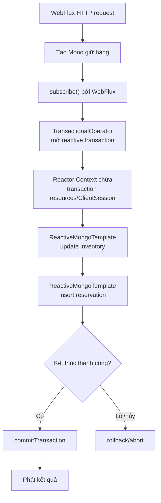

# ReactiveMongoTransactionManager và Reactor Context

## 1. Đặt vấn đề: hai thao tác MongoDB nhưng một giao dịch

Giả sử hệ thống Spring WebFlux nhận lệnh giữ hai quyển sách. Nghiệp vụ phải:

1. Giảm tồn kho có điều kiện: chỉ giữ hàng khi `available >= quantity`.
2. Tạo một document `reservation` với request ID ổn định.
3. Trả kết quả khi **cả hai thao tác đã commit**.

Nếu thao tác (1) thành công nhưng (2) thất bại, tồn kho không được phép bị giảm vĩnh viễn. Cần một **MongoDB multi-document transaction** để hai collection `inventory` và `reservations` cùng commit hoặc rollback.

Trong Spring Data MongoDB imperative, `MongoTransactionManager` liên kết `ClientSession` với **thread**. Nhưng trong Reactive Streams, một pipeline `Mono`/`Flux` có thể đổi thread, chỉ chạy khi có subscription, và chuỗi xử lý được lắp ghép từ nhiều publisher. Vì vậy, Spring cung cấp **`ReactiveMongoTransactionManager`**, liên kết tài nguyên giao dịch với **Reactor `Context` của subscriber**.



**Đích đến của bài:** biết cách cấu hình transaction manager, phân biệt Reactor Context với thread-local, giữ tất cả MongoDB operation trong một subscription/context, thực thi tuần tự, xử lý rollback/retry và kiểm thử trên MongoDB thật.

### 1.1. Session khác transaction

MongoDB `ClientSession` là ngữ cảnh liên kết các operation với một phiên của client; có thể dùng cho **causal consistency** mà không mở transaction. Một **transaction** chỉ xuất hiện khi session bắt đầu giao dịch và được commit/abort.

| Thành phần | Vai trò | Không nên hiểu thành |
| --- | --- | --- |
| `ClientSession` | Gắn các lệnh MongoDB với một session | Một khóa phân tán hoặc transaction tự động |
| MongoDB transaction | Nhóm thao tác được commit/abort theo điều kiện server | Bảo đảm nguyên tử cho HTTP provider/Kafka/email |
| `ReactiveMongoTransactionManager` | Mở/quản lý transaction, session và tài nguyên cho Spring reactive | Một bộ lưu session vào mọi Java thread |
| Reactor `Context` | Truyền metadata/tài nguyên theo **subscriber** | `ThreadLocal`, biến global hoặc payload nghiệp vụ |
| `TransactionalOperator` | Tạo phạm vi giao dịch cho một publisher | Một lệnh MongoDB hoặc một “commit” khi gọi `as(...)` |
| `ReactiveMongoTemplate` | Thực thi MongoDB operation và nhận session đã gắn | Bảo đảm transaction nếu chưa có manager/context |

### 1.2. Transaction không thay thiết kế idempotency

Hai request cùng giữ hàng có thể mở **hai transaction khác nhau**. Nếu cả hai là cùng một request bị retry, vẫn phải có `requestId`/unique index hoặc một cách nhận diện nghiệp vụ để không trừ tồn hai lần. Transaction làm mỗi **lần thực thi** nguyên tử, nhưng không tự hợp nhất mọi lần gọi trùng ý định.

## 2. Mô hình Reactor Context: gắn với subscriber, không với thread

Reactor `Context` là dữ liệu gắn với một **subscription** và được lan truyền theo các quy tắc Reactor. Với Spring reactive transaction, `ReactiveMongoTransactionManager` đặt thông tin tài nguyên giao dịch vào context; `ReactiveMongoTemplate` tra cứu session qua cơ chế tích hợp của Spring rồi gửi các lệnh MongoDB qua session đó.

Về mặt khái niệm:

```text
                 một subscription / subscriber
                           |
                 Reactor Context (immutable)
                           |
           Spring reactive transaction resources
                           |
               MongoDB ClientSession
                 /                  \\
         update inventory        insert reservation
                 \\                  /
                 commit hoặc abort
```

`Context` là **bất biến theo cách sử dụng**: `contextWrite(...)` tạo context mới cho phần publisher phù hợp, không sửa một map global cho mọi request. Dữ liệu context của subscriber A không tự chia sẻ cho subscriber B. Hãy phân biệt:

- **Payload:** `Mono<Reservation>`, `Flux<Document>` là dữ liệu đi qua `onNext`.
- **Context:** thông tin giao dịch, bảo mật, tracing hoặc metadata cho các operator/callback.
- **Thread:** nơi một đoạn code thật sự chạy; có thể đổi bởi `publishOn`, `subscribeOn` hoặc scheduler khác.

### 2.1. Tại sao `ThreadLocal` không phù hợp?

Hai publisher trong cùng subscription có thể thực thi trên các thread khác nhau. Nếu transaction chỉ dựa vào `ThreadLocal`, việc đổi thread có nguy cơ làm mất tham chiếu session. Reactor Context giúp resource gắn với **luồng subscriber**, không phụ thuộc vào một thread cố định.

```java
// Ví dụ minh họa đổi scheduler (không phải khuyến nghị
// cần đổi thread cho mọi MongoDB transaction).
return template.findById(id, OrderDocument.class)
    .publishOn(reactor.core.scheduler.Schedulers.parallel())
    .flatMap(order -> template.save(order))
    .as(transactionalOperator::transactional);
```

Việc đổi scheduler đúng cách trong **cùng pipeline** không tự làm mất Reactor Context. Nhưng một lời gọi `subscribe()` thủ công trong callback sẽ tạo **subscription mới**, và vì vậy không thể mặc định nó dùng transaction đang có. Tương tự, gọi blocking API ngoài context không thể được cứu chỉ bằng `publishOn`.

### 2.2. Context được đọc từ chiều subscriber

Reactor Context được truy cập bằng các operator như `Mono.deferContextual(...)`. Ví dụ độc lập để hiểu tính lan truyền:

```java
import reactor.core.publisher.Mono;
import reactor.util.context.Context;

Mono<String> pipeline = Mono.deferContextual(context ->
    Mono.just(context.getOrDefault("traceId", "unknown")));

Mono<String> traced = pipeline
    .contextWrite(Context.of("traceId", "TRACE-101"));

// Khi subscribe: phát "TRACE-101".
```

Đây là **traceId minh họa**, không phải cách tự cài Mongo transaction vào context. Không đặt `ClientSession` vào `Context.of("mongoSession", ...)` rồi trông chờ `ReactiveMongoTemplate` nhận ra; Spring transaction manager có cơ chế lưu và truy xuất resource riêng.

### 2.3. Nhiều subscriber không đồng nghĩa cùng transaction

```java
Mono<ReservationResult> operation =
    reservationService.reserve("SHOP-A", "K1", "BOOK-101", 2);

// Hai subscription có thể tạo hai lần thực thi nghiệp vụ:
operation.subscribe();
operation.subscribe();
```

Nếu service trả một **cold publisher**, mỗi subscribe có thể kích hoạt transaction riêng. Dù cùng object `Mono`, không được giả định hành động ghi chỉ chạy một lần. Hãy thiết kế idempotency theo `requestId`/unique key và tránh tự subscribe trong service/controller.

## 3. Điều kiện để MongoDB reactive transaction hoạt động

### 3.1. Server và topology

MongoDB multi-document transactions được hỗ trợ trên **replica set** phù hợp (MongoDB 4.0+) và trên **sharded cluster** theo điều kiện phiên bản/topology (MongoDB 4.2+). Một `mongod` standalone thông thường không phải môi trường thích hợp để kiểm thử transaction nhiều document.

Ví dụ URI cho **replica set local đã thiết lập sẵn**:

```properties
spring.data.mongodb.uri=mongodb://localhost:27017/reactive_tx_demo?replicaSet=rs0
```

`rs0` phải khớp tên replica set thật, và `mongod` phải được cấu hình/chạy với replica set. **Chỉ thêm tham số URI không biến standalone thành replica set.** Đừng sao chép URI này vào production.

### 3.2. Dependencies ở mức khái niệm

Một Spring Boot WebFlux application sử dụng:

```xml
<dependencies>
    <dependency>
        <groupId>org.springframework.boot</groupId>
        <artifactId>spring-boot-starter-webflux</artifactId>
    </dependency>
    <dependency>
        <groupId>org.springframework.boot</groupId>
        <artifactId>spring-boot-starter-data-mongodb-reactive</artifactId>
    </dependency>
    <dependency>
        <groupId>org.springframework.boot</groupId>
        <artifactId>spring-boot-starter-test</artifactId>
        <scope>test</scope>
    </dependency>
    <dependency>
        <groupId>io.projectreactor</groupId>
        <artifactId>reactor-test</artifactId>
        <scope>test</scope>
    </dependency>
</dependencies>
```

Khi dùng BOM của Spring Boot, thông thường không cần khai báo version cho các starter thuộc BOM. Với Gradle, sử dụng các dependency tương đương. Không giả định Spring Boot sẽ tự tạo đúng `ReactiveMongoTransactionManager` trong mọi cấu hình; hãy cấu hình và kiểm tra bean thực sự.

### 3.3. Chuẩn bị collection và index **trước** transaction

Đối với MongoDB và Spring Data, việc tạo collection/index ngay trong transaction có những hạn chế theo version, read concern và topology. Vì vậy, trong bài này:

- Migration tạo `inventory`, `reservations` và unique index cần thiết.
- Business transaction chỉ làm **update/insert/read/count** trên collection đã có.
- Tránh gọi `listIndexes`/`createCollection` trong pipeline transactional.

Chạy một lần trên database demo riêng:

```javascript
use reactive_tx_demo
db.createCollection("inventory")
db.createCollection("reservations")

db.reservations.createIndex(
  { tenant_id: 1, request_id: 1 },
  { unique: true, name: "reservations_tenant_request_unique" }
)

db.inventory.insertOne({
  _id: "SHOP-A:BOOK-101",
  tenant_id: "SHOP-A",
  sku: "BOOK-101",
  available: NumberLong("10"),
  reserved: NumberLong("0")
})
```

Đây chỉ là setup demo: `insertOne` với cùng `_id` sẽ lỗi nếu chạy lặp; trên môi trường thật phải có migration/seed idempotent và kiểm soát dữ liệu. Unique index được tạo trước request để database ngăn hai reservation cùng `tenant_id`/`request_id`.

## 4. Cấu hình `ReactiveMongoTransactionManager`

Spring Data MongoDB cung cấp `ReactiveMongoTransactionManager` — implementation của `ReactiveTransactionManager` — để mở/commit/abort MongoDB transaction dựa trên một `ReactiveMongoDatabaseFactory`.

```java
package com.example.reactivetx;

import org.springframework.context.annotation.Bean;
import org.springframework.context.annotation.Configuration;
import org.springframework.data.mongodb.ReactiveMongoDatabaseFactory;
import org.springframework.data.mongodb.ReactiveMongoTransactionManager;
import org.springframework.transaction.reactive.TransactionalOperator;

@Configuration
public class ReactiveTxConfiguration {

    @Bean
    ReactiveMongoTransactionManager reactiveMongoTransactionManager(
            ReactiveMongoDatabaseFactory factory) {
        return new ReactiveMongoTransactionManager(factory);
    }

    @Bean
    TransactionalOperator mongoTransactionalOperator(
            ReactiveMongoTransactionManager manager) {
        return TransactionalOperator.create(manager);
    }
}
```

Giải thích:

1. `ReactiveMongoDatabaseFactory` được Spring Data/Boot cung cấp phù hợp với kết nối reactive MongoDB.
2. `ReactiveMongoTransactionManager` lấy `ClientSession` từ factory khi transaction bắt đầu và quản lý commit/abort.
3. Session/resource transaction được gắn với **subscriber `Context`**.
4. `ReactiveMongoTemplate` sử dụng cơ chế Spring Data để lấy database/session hiện hành.
5. `TransactionalOperator` bọc một `Mono`/`Flux` trong phạm vi giao dịch.

**Điều kiện quan trọng:** `ReactiveMongoTemplate` và manager phải làm việc với **cùng factory/connection environment** thích hợp. Nếu một thao tác dùng một `ReactiveMongoTemplate` khác trỏ đến cluster/database khác hoặc native client ngoài context, thao tác đó không tự tham gia transaction.

### 4.1. Không trộn imperative và reactive manager

| Imperative | Reactive |
| --- | --- |
| `MongoTransactionManager` | `ReactiveMongoTransactionManager` |
| `MongoDatabaseFactory` | `ReactiveMongoDatabaseFactory` |
| `MongoTemplate` | `ReactiveMongoTemplate` |
| Thread-bound transaction resources | Subscriber `Reactor Context` |
| `TransactionTemplate` | `TransactionalOperator` |
| Method trả object trực tiếp | Method trả `Mono<T>`/`Flux<T>` |

Một method trả `Mono<T>` trong ứng dụng reactive không nên dùng `MongoTransactionManager` như thể đó là transaction manager của pipeline. Spring reactive transaction đòi hỏi một `ReactiveTransactionManager` và pipeline thực sự được subscribe.

### 4.2. `@Transactional(readOnly = true)` có mở transaction không?

Có một chi tiết thường gây nhầm: với `ReactiveMongoTransactionManager`, `@Transactional(readOnly = true)` vẫn có thể **bắt đầu transaction và gắn `ClientSession`** cho các operation reactive. Nó không đồng nghĩa với việc “chỉ dùng read preference nhẹ nên không có giao dịch”.

Hãy dùng `readOnly` theo đúng ý định; nó không phải công tắc tắt transaction overhead. Khi chỉ cần một truy vấn đọc đơn lẻ, thường không cần transaction nhiều document.

## 5. Entity và dữ liệu cho giao dịch giữ tồn kho

Để tập trung vào transaction/context, mỗi reservation chỉ có một SKU. Một đơn hàng nhiều SKU yêu cầu thiết kế thêm về thứ tự thao tác, xử lý hết hàng và retry.

### 5.1. `InventoryDocument`

```java
package com.example.reactivetx;

import org.springframework.data.mongodb.core.mapping.Document;
import org.springframework.data.mongodb.core.mapping.Field;
import org.springframework.data.mongodb.core.mapping.FieldType;
import org.springframework.data.mongodb.core.mapping.MongoId;

@Document(collection = "inventory")
public class InventoryDocument {

    @MongoId(FieldType.STRING)
    private String id;

    @Field("tenant_id")
    private String tenantId;

    private String sku;
    private long available;
    private long reserved;

    protected InventoryDocument() {}

    public String getId() { return id; }
    public String getTenantId() { return tenantId; }
    public String getSku() { return sku; }
    public long getAvailable() { return available; }
    public long getReserved() { return reserved; }
}
```

### 5.2. `ReservationDocument`

```java
package com.example.reactivetx;

import java.time.Instant;
import org.springframework.data.mongodb.core.mapping.Document;
import org.springframework.data.mongodb.core.mapping.Field;
import org.springframework.data.mongodb.core.mapping.FieldType;
import org.springframework.data.mongodb.core.mapping.MongoId;

@Document(collection = "reservations")
public class ReservationDocument {

    @MongoId(FieldType.STRING)
    private String id;

    @Field("tenant_id")
    private String tenantId;

    @Field("request_id")
    private String requestId;

    private String sku;
    private long quantity;
    private String status;

    @Field("created_at")
    private Instant createdAt;

    protected ReservationDocument() {}

    public ReservationDocument(
            String id, String tenantId, String requestId,
            String sku, long quantity, String status,
            Instant createdAt) {
        this.id = id;
        this.tenantId = tenantId;
        this.requestId = requestId;
        this.sku = sku;
        this.quantity = quantity;
        this.status = status;
        this.createdAt = createdAt;
    }

    public String getId() { return id; }
    public String getTenantId() { return tenantId; }
    public String getRequestId() { return requestId; }
    public String getSku() { return sku; }
    public long getQuantity() { return quantity; }
    public String getStatus() { return status; }
    public Instant getCreatedAt() { return createdAt; }
}
```

`@MongoId(FieldType.STRING)` giữ `_id` dạng BSON String. Các property `tenantId`/`requestId` ánh xạ sang `tenant_id`/`request_id`; khi dùng `Criteria`, nên viết **tên property Java** và để Spring mapping. Với các lệnh BSON native, cần dùng **tên field vật lý**.

### 5.3. Kết quả và exception

```java
package com.example.reactivetx;

public record ReservationResult(
    String reservationId,
    String tenantId,
    String requestId,
    String sku,
    long quantity
) {}
```

```java
package com.example.reactivetx;

public class InsufficientStockException extends RuntimeException {
    public InsufficientStockException(String message) {
        super(message);
    }
}
```

Để ví dụ ngắn gọn, `inventory._id` được tạo từ `tenantId + ":" + sku`. Trong hệ thống thật cần chuẩn hóa identifier, tránh ký tự delimiter gây va chạm, kiểm tra quyền tenant và không nhận số lượng âm/0. Các ví dụ sau yêu cầu `authorizedTenantId` do hệ thống xác thực cung cấp, **không** chỉ là field client tự khai.

## 6. Service dùng `TransactionalOperator`: cập nhật rồi insert

Đây là cách lập trình **programmatic reactive transaction**. `TransactionalOperator` quản lý giao dịch cho phần publisher upstream được bọc bởi `transactional(...)` hoặc `.as(tx::transactional)`.

### 6.1. Service đầy đủ

```java
package com.example.reactivetx;

import java.time.Clock;
import java.util.UUID;
import org.springframework.data.mongodb.core.ReactiveMongoTemplate;
import org.springframework.data.mongodb.core.query.Criteria;
import org.springframework.data.mongodb.core.query.Query;
import org.springframework.data.mongodb.core.query.Update;
import org.springframework.stereotype.Service;
import org.springframework.transaction.reactive.TransactionalOperator;
import reactor.core.publisher.Mono;

@Service
public class ReactiveReservationService {

    private final ReactiveMongoTemplate template;
    private final TransactionalOperator tx;
    private final Clock clock;

    public ReactiveReservationService(
            ReactiveMongoTemplate template,
            TransactionalOperator tx,
            Clock clock) {
        this.template = template;
        this.tx = tx;
        this.clock = clock;
    }

    public Mono<ReservationResult> reserve(
            String authorizedTenantId,
            String requestId,
            String sku,
            long quantity) {

        if (authorizedTenantId == null
                || authorizedTenantId.isBlank()
                || requestId == null
                || requestId.isBlank()
                || requestId.length() > 128
                || sku == null
                || sku.isBlank()
                || sku.contains(":")
                || quantity <= 0) {
            return Mono.error(new IllegalArgumentException(
                "Yêu cầu giữ hàng không hợp lệ"));
        }

        return Mono.defer(() -> {
            String inventoryId = authorizedTenantId + ":" + sku;

            Query enoughStock = Query.query(
                Criteria.where("id").is(inventoryId)
                    .and("tenantId").is(authorizedTenantId)
                    .and("available").gte(quantity)
            );

            Update takeStock = new Update()
                .inc("available", -quantity)
                .inc("reserved", quantity);

            ReservationDocument candidate =
                new ReservationDocument(
                    UUID.randomUUID().toString(),
                    authorizedTenantId,
                    requestId,
                    sku,
                    quantity,
                    "PENDING",
                    clock.instant()
                );

            return template.updateFirst(
                    enoughStock, takeStock, InventoryDocument.class)
                .flatMap(result -> {
                    if (result.getModifiedCount() != 1) {
                        return Mono.error(
                            new InsufficientStockException(
                                "Tồn kho không đủ hoặc SKU không tồn tại"));
                    }

                    // Chỉ insert khi cập nhật tồn kho thành công.
                    return template.insert(candidate);
                })
                .map(saved -> new ReservationResult(
                    saved.getId(),
                    saved.getTenantId(),
                    saved.getRequestId(),
                    saved.getSku(),
                    saved.getQuantity()
                ));
        }).as(tx::transactional);
    }
}
```

Trong `Mono.defer(...)`, việc khởi tạo candidate/ID được **hoãn tới lúc subscription**. Lệnh `updateFirst` và `insert` được nối bằng `flatMap` theo quan hệ phụ thuộc, **không chạy song song**. Nếu hết hàng hoặc insert reservation gặp lỗi unique index, publisher báo `onError` và transaction bị rollback. Nếu cả hai thao tác thành công và commit thành công, subscriber mới nhận kết quả theo hợp đồng transaction manager.

### 6.2. Thứ tự event

```text
subscribe(reserve)
  -> tx.begin(ClientSession trong Reactor Context)
  -> update inventory (conditional)
  -> nếu updated=0: onError -> tx.abort
  -> nếu updated=1: insert reservation
  -> nếu insert lỗi: onError -> tx.abort
  -> nếu insert OK: complete business publisher
  -> tx.commit
  -> downstream nhận ReservationResult
```

Mô tả là luồng logic, không phản ánh mọi chi tiết về tín hiệu/timeout nội bộ của driver. Nếu `commitTransaction` trả lỗi hoặc trạng thái không chắc chắn, transaction manager sẽ báo lỗi hoặc cần cơ chế xử lý commit/reconciliation được thiết kế rõ.

### 6.3. Vì sao `.as(tx::transactional)` phải bọc cả hai write?

Ví dụ **sai phạm vi**:

```java
return template.updateFirst(
        enoughStock, takeStock, InventoryDocument.class)
    .as(tx::transactional)
    .flatMap(result -> template.insert(reservation));
```

Ở đây `tx` chỉ bọc upstream `updateFirst`; `insert` nằm **sau** toán tử giao dịch, có thể chạy ngoài transaction. Nếu insert thất bại, update đã commit, làm tồn kho bị giảm sai.

Đặt `.as(tx::transactional)` **sau khi tạo toàn bộ publisher nghiệp vụ**:

```java
Mono<ReservationDocument> business =
    template.updateFirst(
            enoughStock, takeStock, InventoryDocument.class)
        .flatMap(changed -> {
            if (changed.getModifiedCount() != 1) {
                return Mono.error(
                    new InsufficientStockException("Hết hàng"));
            }
            return template.insert(reservation);
        });

return business.as(tx::transactional);
```

Tương tự, nếu một `Mono` có phần tác dụng phụ **downstream** sau `as(...)`, tác dụng phụ đó không mặc nhiên thuộc transaction đã bọc. Luôn xác định ranh giới giao dịch trên đồ thị publisher, không chỉ nhìn vào tên method Java.

### 6.4. `Mono.defer` không làm việc ghi “chỉ một lần”

Nếu cùng publisher được subscribe hai lần, `defer` chạy hai lần. Transaction mới được mở cho mỗi subscription; ID có thể mới trong từng lần. **Unique index trên `(tenant_id, request_id)`** ngăn hai reservation cùng request, nhưng code phải xử lý lỗi duplicate/replay ở tầng nghiệp vụ.

Trong ví dụ, duplicate reservation xảy ra **sau** update inventory, nhưng vì cả hai write trong một transaction nên lỗi duplicate khiến lần update inventory của transaction thua được rollback. Một facade ở ngoài transaction có thể đọc reservation đã commit để xác nhận payload; không nên bắt duplicate rồi tiếp tục gửi lệnh trong một transaction đã lỗi.

### 6.5. Đồng hồ và tính nhất quán request

Ví dụ dùng `Clock` để tạo timestamp của reservation; trong ứng dụng cần cung cấp bean `Clock.systemUTC()` hoặc clock tương đương. Tạo timestamp ở lúc subscription giúp thể hiện thời điểm thực thi hơn là thời điểm dựng publisher. Nhưng timestamp không phải định danh idempotency: hai request trùng ý định vẫn cần **key ổn định và so payload**.

## 7. Dùng `@Transactional` với method trả `Mono`

Cách **declarative** là để Spring AOP bọc publisher trả về từ method được annotate:

```java
package com.example.reactivetx;

import org.springframework.data.mongodb.core.ReactiveMongoTemplate;
import org.springframework.data.mongodb.core.query.Criteria;
import org.springframework.data.mongodb.core.query.Query;
import org.springframework.data.mongodb.core.query.Update;
import org.springframework.stereotype.Service;
import org.springframework.transaction.annotation.Transactional;
import reactor.core.publisher.Mono;

@Service
public class ReactiveStockStatusService {

    private final ReactiveMongoTemplate template;

    public ReactiveStockStatusService(
            ReactiveMongoTemplate template) {
        this.template = template;
    }

    @Transactional(transactionManager =
        "reactiveMongoTransactionManager")
    public Mono<Long> reserveUnits(
            String inventoryId, long quantity) {

        if (inventoryId == null || inventoryId.isBlank()
                || quantity <= 0) {
            return Mono.error(
                new IllegalArgumentException("Tham số không hợp lệ"));
        }

        Query eligible = Query.query(
            Criteria.where("id").is(inventoryId)
                .and("available").gte(quantity)
        );

        Update change = new Update()
            .inc("available", -quantity)
            .inc("reserved", quantity);

        return template.updateFirst(
                eligible, change, InventoryDocument.class)
            .flatMap(result -> {
                if (result.getModifiedCount() != 1) {
                    return Mono.error(
                        new InsufficientStockException(
                            "Không còn đủ số lượng"));
                }
                return Mono.just(result.getModifiedCount());
            });
    }
}
```

Ví dụ này chỉ sửa **một document** để minh họa annotation; việc cập nhật một document đã atomic theo MongoDB, nên không nhất thiết phải mở multi-document transaction trong thiết kế thật. `@Transactional` hữu ích rõ hơn khi gộp nhiều write liên quan.

### 7.1. Khi nào annotation có hiệu lực?

- Bean phải nằm dưới quản lý của Spring, với transaction AOP/proxy được bật phù hợp.
- Method được gọi **qua Spring proxy**, không phải tự gọi `this.reserveUnits(...)` trong cùng class.
- Method trả một reactive publisher mà transaction interceptor có thể quản lý; **không** gọi `subscribe()` bên trong service.
- Có `ReactiveMongoTransactionManager` được chọn đúng (đặc biệt khi ứng dụng có nhiều transaction manager).
- Các Mongo operation trong publisher sử dụng `ReactiveMongoTemplate`/resource đúng transaction context.

Nếu một service có cả R2DBC và Mongo transaction manager, không nên để `@Transactional` chọn manager mơ hồ. Hãy chỉ rõ `transactionManager = "reactiveMongoTransactionManager"` hoặc dùng operator riêng được inject theo qualifier.

### 7.2. `@Transactional` so với `TransactionalOperator`

| Tiêu chí | `@Transactional` | `TransactionalOperator` |
| --- | --- | --- |
| Khai báo boundary | Trên method/class Spring proxy | Trên pipeline `Mono`/`Flux` |
| Dễ hiểu cho service layer | Cao nếu mọi effect trong cùng method | Cao khi boundary được đặt rõ trong chain |
| Self-invocation | Có rủi ro bypass proxy | Không phụ thuộc proxy theo cách tương tự |
| Boundary con trong pipeline | Ít trực quan nếu nhiều nhánh/hot publisher | Có thể bọc chính xác publisher cần giao dịch |
| Chọn manager | Thuộc tính annotation/qualifier | Operator được tạo với manager phù hợp |
| Dễ test riêng chain | Cần cấu hình AOP bean | Có thể inject operator/test publisher |

**Không cần dùng cả hai cùng lúc** cho một cùng một đoạn nếu không có lý do rõ; bọc một publisher đã `@Transactional` bằng operator khác có thể tạo hành vi propagation khó đọc hoặc lựa chọn manager không mong đợi.

### 7.3. Method trả `void` và tự subscribe không có cùng hợp đồng

```java
// KHÔNG NÊN: subscribe tách rời boundary reactive.
@Transactional
public void unsafe() {
    template.insert(someDocument).subscribe();
}
```

Lời gọi `subscribe()` khởi chạy một subscription riêng; method có thể return trước khi write hoàn thành, và transaction interceptor không thể quản lý đúng publisher không được trả về. Hãy trả `Mono<Void>`/`Mono<T>` và để **WebFlux hoặc caller** subscribe đúng một lần ở rìa ứng dụng.

## 8. Reactor Context qua các operator và ranh giới subscription

`Reactor Context` lan truyền theo **subscriber** qua các operator chuẩn. Khi ở cùng một pipeline, `publishOn`/`subscribeOn` thay scheduler **không tự xóa** transaction context; nhưng tạo subscription mới hoặc dùng API không tích hợp session có thể khiến write chạy **ngoài giao dịch**.

### 8.1. `flatMap` tiếp nối phụ thuộc so với `subscribe()` độc lập

Sai cách:

```java
return template.insert(reservation)
    .doOnNext(saved -> {
        // SAI: fire-and-forget, subscription độc lập.
        template.insert(auditRecord).subscribe();
    })
    .as(tx::transactional);
```

Lời gọi `subscribe()` bên trong callback tạo subscriber riêng. Audit write không mặc định chia sẻ session transaction, và nếu thất bại cũng không báo lỗi vào pipeline bên ngoài. Cách đúng là **nối publisher**:

```java
return template.insert(reservation)
    .flatMap(saved ->
        template.insert(auditRecord)
            .thenReturn(saved))
    .as(tx::transactional);
```

Nếu phải ghi audit cùng reservation, cả hai cần sử dụng collection đã có, cùng reactive template/factory và được bọc trong cùng transaction. Nếu publish event sang message broker, thay vì cho rằng transaction sẽ rollback được Kafka/email, thường cần **outbox** hoặc quy trình đối soát riêng.

### 8.2. Đổi thread không đồng nghĩa mất context

```java
return template.findById(id, InventoryDocument.class)
    .publishOn(reactor.core.scheduler.Schedulers.parallel())
    .flatMap(item ->
        template.findById(item.getId(), InventoryDocument.class))
    .as(tx::transactional);
```

Khi vẫn là **cùng subscription** và dùng Reactor operator phù hợp, context có thể lan truyền dù thread thay đổi. Nhưng MongoDB reactive driver vốn không blocking; không cần tự đưa mỗi query sang `Schedulers.boundedElastic()`. Nếu một thư viện dùng callback/Future ngoài reactive chain, hoạt động bên trong callback đó **không tự kế thừa** transaction context.

`Mono.fromFuture(...)` có thể đưa giá trị từ một Future trở về stream, nhưng công việc tạo Future có thể đã chạy **trước** lúc subscribe và có thể dùng native MongoDB client ngoài session. Không dùng `fromFuture` làm bằng chứng các write của Future thuộc transaction.

### 8.3. `contextWrite` không phải cách tự gắn MongoDB session

```java
Mono<String> example = Mono.deferContextual(ctx ->
        Mono.just(ctx.getOrDefault("traceId", "UNKNOWN")))
    .contextWrite(context ->
        context.put("traceId", "TRACE-001"));
```

Đây là cách Reactor Context truyền một trace ID. **Không** tự đặt `ClientSession` vào `Context.of("session", session)` rồi kỳ vọng Spring Data tự nhận. `ReactiveMongoTransactionManager` dùng resource/context integration riêng để template lấy session đúng.

### 8.4. `cache`/`share` thay đổi số lần thực thi

`Mono.cache()` có thể lưu lại một kết quả cho các subscriber tiếp theo. `share()`/hot source cũng có thể thay cách nhiều subscriber chia sẻ một lần thực thi. Không dựa vào các operator này để làm idempotency cho API ghi:

```java
Mono<ReservationResult> cached =
    reservationService.reserve("SHOP-A", "K1", "BOOK-101", 2)
        .cache();
```

Cache chỉ sống trong process và trong phạm vi publisher được chia sẻ; không bảo vệ khi restart hay nhiều instance. Với retry cùng nghiệp vụ, **unique key/request identity** trong MongoDB vẫn là hàng rào thực.

## 9. Không chạy các lệnh MongoDB song song trên cùng transaction

MongoDB driver yêu cầu các operation thuộc **một transaction/session** được thực hiện tuần tự. Đừng viết:

```java
Mono<Void> unsafe = Mono.when(
    template.insert(reservation),
    template.insert(auditRecord)
).as(tx::transactional);
```

`Mono.when` có thể subscribe hai source đồng thời; điều này không phù hợp với hạn chế của session transactional. Tương tự, `Mono.zip` hoặc `Flux.flatMap` có concurrency có thể tạo các lệnh MongoDB chồng lấn.

### 9.1. Dùng `then`, `flatMap` theo phụ thuộc

```java
Mono<ReservationDocument> safe = template.insert(reservation)
    .flatMap(saved ->
        template.insert(auditRecord).thenReturn(saved))
    .as(tx::transactional);
```

Phép insert thứ hai chỉ chạy sau khi insert thứ nhất hoàn thành. `flatMap` trên **một `Mono`** có quan hệ phụ thuộc như ví dụ là phù hợp; đừng hiểu rằng mọi `Flux.flatMap` đều tuần tự.

### 9.2. Với nhiều phần tử của `Flux`, dùng `concatMap`

```java
Flux<ReservationDocument> sequentialWrites =
    Flux.fromIterable(reservations)
        .concatMap(template::insert)
        .as(tx::transactional);
```

`concatMap` gửi các lệnh theo thứ tự, một operation hoàn thành rồi mới tới operation kế tiếp. Không thêm `parallel()`/`runOn(...)` cho **MongoDB write trong cùng transaction**. Các transaction **độc lập**, dùng session riêng, vẫn có thể chạy đồng thời giữa nhiều request khi nghiệp vụ cho phép.

### 9.3. Đừng stream lâu trong transaction

Nếu trả trực tiếp `Flux` của hàng chục nghìn lần insert cho client, client có thể đọc chậm hoặc hủy giữa chừng, khiến transaction kéo dài và không rõ phạm vi commit ở thời điểm phát phần tử. Với một API ghi, nên xử lý transaction thành một `Mono<Summary>`, để client chỉ nhận **kết quả cuối cùng** sau khi commit, thay vì dùng streaming response làm dấu xác nhận từng write trung gian.

## 10. ClientSession, native driver và transaction resource

`ReactiveMongoTemplate` lấy session từ Spring transaction context khi chạy trong `TransactionalOperator`/`@Transactional`, với điều kiện dùng đúng factory và nguồn dữ liệu. Tuy nhiên, **native MongoDB driver gateway** lấy từ template không mặc định được session-proxy.

### 10.1. Template API trong managed transaction

```java
Mono<ReservationDocument> create =
    reactiveMongoTemplate.insert(reservation);

Mono<InventoryDocument> read =
    reactiveMongoTemplate.findById(
        inventoryId, InventoryDocument.class);
```

Các operation được subscribe trong transactional publisher có thể nhận `ClientSession` từ resource mà `ReactiveMongoTransactionManager` đã gắn vào subscriber context. Chúng **không tự tạo transaction** nếu chưa có manager/boundary.

### 10.2. `getCollection` không tự session-proxied

```java
// Có nguy cơ chạy ngoài transaction: native overload không nhận session.
return reactiveMongoTemplate.getCollection("reservations")
    .flatMap(collection ->
        Mono.from(collection.insertOne(nativeDocument)));
```

Tài liệu Spring Data lưu ý `(Reactive)MongoOperations#getCollection(...)` và `getMongoDatabase(...)` trả native driver gateway. Muốn sử dụng native API trong transaction, cần truyền **đúng `ClientSession`** vào overload driver nhận session. Với use case thông thường, hãy ưu tiên method `ReactiveMongoTemplate`/callback template đã tích hợp session.

Một cách xác minh quan trọng trong integration test: cố ý làm transaction báo lỗi **sau native write**, rồi đọc database ngoài transaction. Nếu document vẫn còn, native call đã bypass ranh giới giao dịch.

### 10.3. Session thủ công với `withSession` khác managed transaction

`ReactiveMongoTemplate.withSession(...)` hỗ trợ callback chạy với session do caller cung cấp. Khi tự quản lý session, code phải giải quyết lấy session vào lúc subscribe, start/commit/abort và đóng session trên **complete, error, cancel**. Đây là công việc nhiều trạng thái hơn `TransactionalOperator`.

Không tự mở một session/transaction mới **bên trong** một transaction Spring đang quản lý nếu không có thiết kế rõ. Một session chỉ có một transaction mở tại một thời điểm.

### 10.4. Repository, template và session không phải mọi thứ giống nhau

Tài liệu Spring Data phân biệt việc hỗ trợ **manual session callbacks** với repository integration. Không suy ra một native collection method hoặc một custom repository tự sử dụng session chỉ vì được gọi từ method có `@Transactional`. Với giao dịch cần chứng minh chặt chẽ, sử dụng `ReactiveMongoTemplate` và integration test rollback trên server thật; nếu dùng repository, kiểm tra version và đường thực thi cụ thể.

## 11. Completion, error, cancellation và vị trí error handler

### 11.1. `Mono.empty()` là thành công không có kết quả

Một `Mono.empty()` hoàn thành bằng `onComplete`, không phát `onError`. Spring có thể **commit** transaction dù không có item đầu ra. Ví dụ nguy hiểm:

```java
return template.updateFirst(
        query, change, InventoryDocument.class)
    .flatMap(result -> {
        if (result.getModifiedCount() == 0) {
            return Mono.empty(); // không phát lỗi nghiệp vụ
        }
        return template.insert(reservation);
    })
    .as(tx::transactional);
```

Nếu đã có MongoDB write trước nhánh này, `Mono.empty()` có thể khiến write đó được commit dù yêu cầu nghiệp vụ đã thất bại. Khi cần rollback, trả `Mono.error(...)` hoặc dùng API rollbackOnly thích hợp:

```java
if (result.getModifiedCount() == 0) {
    return Mono.error(
        new InsufficientStockException("Không đủ hàng"));
}
```

### 11.2. `onErrorResume` đặt sai phía transaction có thể commit sai

Sai cách khi **nuốt lỗi trước khi transaction manager nhìn thấy**:

```java
return businessWrites
    .onErrorResume(ex -> Mono.just(fallbackSuccess))
    .as(tx::transactional);
```

Nếu đã có write thành công trước lỗi, transaction có thể nhìn thấy publisher kết thúc bình thường và commit. Hãy để lỗi đi qua boundary trước, rồi mới ánh xạ sang phản hồi nghiệp vụ:

```java
return businessWrites
    .as(tx::transactional)
    .onErrorResume(
        InsufficientStockException.class,
        ex -> Mono.just(failureResponse));
```

Ở đây `failureResponse` là DTO do application xác định. `doOnError(...)` chỉ quan sát/log, không thay lỗi thành tín hiệu thành công; phù hợp để ghi metrics có kiểm soát.

### 11.3. Cancellation không phải commit

Client disconnect, `take(1)` trên `Flux` ghi nhiều bản ghi, hoặc `timeout` có thể hủy subscription trước khi toàn bộ write kết thúc. Spring reactive transaction thường abort/rollback khi hủy (chi tiết phụ thuộc phiên bản và timing). **Đã nhận một item** không phải bằng chứng commit toàn bộ transaction.

Với API ghi, nên tạo một `Mono<Summary>` chỉ phát response **sau khi toàn bộ business publisher và commit hoàn tất**, không trả trực tiếp từng kết quả insert trong lúc giao dịch đang mở.

### 11.4. Timeout và unknown commit result

```java
return reservationService.reserve(
        tenantId, requestId, sku, quantity)
    .timeout(java.time.Duration.ofSeconds(5));
```

Timeout của subscriber không chứng minh database rollback: nếu ACK của `commitTransaction` mất sau khi MongoDB đã commit, kết quả **không chắc chắn**. Giữ nguyên `requestId`, đối soát qua unique index và xử lý retry commit/transient theo driver/framework. Không retry một lệnh `$inc` với key mới chỉ vì timeout.

## 12. Transaction options, read concern và read-only

`ReactiveMongoTransactionManager` có thể nhận MongoDB `TransactionOptions` khi được tạo. Ví dụ chọn read concern `SNAPSHOT` và write concern `MAJORITY`:

```java
package com.example.reactivetx;

import com.mongodb.ReadConcern;
import com.mongodb.WriteConcern;
import com.mongodb.TransactionOptions;
import org.springframework.context.annotation.Bean;
import org.springframework.context.annotation.Configuration;
import org.springframework.data.mongodb.ReactiveMongoDatabaseFactory;
import org.springframework.data.mongodb.ReactiveMongoTransactionManager;

@Configuration
public class StrongMongoTxConfig {

    @Bean("strongMongoTxManager")
    ReactiveMongoTransactionManager strongMongoTxManager(
            ReactiveMongoDatabaseFactory factory) {

        TransactionOptions options = TransactionOptions.builder()
            .readConcern(ReadConcern.SNAPSHOT)
            .writeConcern(WriteConcern.MAJORITY)
            .build();

        return new ReactiveMongoTransactionManager(factory, options);
    }
}
```

Đây là **mẫu cấu hình thay thế** cho manager ở mục 4, không phải yêu cầu khai báo hai manager không có qualifier. Với nhiều manager, chọn đúng bằng tên bean khi tạo `TransactionalOperator` hoặc trong `@Transactional(transactionManager = "strongMongoTxManager")`.

| Tùy chọn | Ý nghĩa | Giới hạn |
| --- | --- | --- |
| `ReadConcern.LOCAL` | Đọc local theo semantics transaction của server | Không bảo đảm snapshot chung nhiều shard theo mọi cấu hình |
| `ReadConcern.SNAPSHOT` | Đọc theo snapshot phù hợp transaction | Chi phí history, hạn chế thao tác DDL |
| `WriteConcern.MAJORITY` | Commit được xác nhận theo majority | Không bao gồm side effect bên ngoài MongoDB |
| `@Transactional(readOnly = true)` | Đánh dấu transaction chỉ đọc | Manager Mongo reactive vẫn có thể mở transaction/session |
| Max commit time | Giới hạn thời gian commit | Timeout không chứng minh abort chắc chắn |

Một số phiên bản Spring Data hỗ trợ `@Transactional(label = {"mongo:readConcern=SNAPSHOT", "mongo:writeConcern=MAJORITY"})`. Cần kiểm tra đúng release Spring Framework/Spring Data; options chỉ áp dụng khi một transaction **mới** được mở, không thay đổi transaction outer đã bắt đầu.

Không tạo collection/index trong transaction nghiệp vụ; việc DDL được phép có điều kiện theo MongoDB server version, read concern và topology, nhưng Spring Data khuyến nghị tạo **schema/index bằng migration trước request**. Một transaction dài cũng gây tăng memory/history/lock contention, nên tránh gọi HTTP provider hay chờ người dùng trong lúc giữ transaction.

## 13. Retry transient errors và idempotency

### 13.1. Phân loại lỗi

| Tình huống | Xử lý |
| --- | --- |
| `DuplicateKeyException` trên `tenant_id,request_id` | Rollback transaction thua; đọc marker đã commit, so payload để replay hoặc conflict |
| `TransientTransactionError` hoặc write conflict | Có thể thử lại **toàn bộ transaction** an toàn, có giới hạn/backoff |
| `UnknownTransactionCommitResult` | Không tự suy ra rollback; retry commit theo driver hoặc reconcile theo request key |
| Validation fail | Không retry nguyên dữ liệu sai |
| DDL/listIndexes/count command bị cấm | Sửa kiến trúc/lệnh, không retry vô hạn |
| Client timeout/cancel | Có thể chưa rõ commit đã xảy ra hay chưa; kiểm tra marker/ledger |

### 13.2. Vì sao `retryWhen` không tự tạo exactly-once?

```java
// CHỈ là sơ đồ: phải có kiểm soát lỗi và dedupe trước khi retry.
return reservationService.reserve(
        tenantId, requestId, sku, quantity)
    .retryWhen(
        reactor.util.retry.Retry.backoff(
            3, java.time.Duration.ofMillis(100)));
```

`retryWhen` trong ví dụ này retry **mọi lỗi** nếu không có filter, có thể thử lại cả lỗi hết hàng và duplicate key. Đây **không phải code production**. Nếu commit trước đã thành công nhưng client chưa nhận ACK, retry có thể nhận duplicate và cần trả reservation cũ, thay vì tăng tồn trừ thêm. Dùng `Retry.filter(...)` chỉ cho transient error **được xác định chính xác**, giữ nguyên request ID và có cơ chế xử lý unknown outcome.

Không bắt mọi `DataAccessException` rồi tự động chạy lại nguyên luồng. Retryable writes của MongoDB Driver **khác** business retry từ HTTP/queue; driver có thể deduplicate một số retry của chính lệnh đủ điều kiện, nhưng không nhận diện một request HTTP mới sau nhiều phút.

### 13.3. Giao dịch không atomic với bên ngoài

Nếu transaction tạo reservation rồi gọi payment gateway/Kafka/email, MongoDB rollback không hoàn tác được side effect bên ngoài. Mô hình **transactional outbox** lưu reservation và event cần phát cùng MongoDB transaction; publisher phát ngoài transaction, consumer dùng unique event ID để chống xử lý lặp. Với payment provider, dùng provider-side idempotency key và reconciliation riêng.

## 14. Kiểm thử tích hợp trên MongoDB replica set

Mock `ReactiveMongoTemplate` có thể kiểm tra method nào đã được gọi, nhưng **không chứng minh** MongoDB commit/rollback nhiều document, gắn session đúng, hoặc unique index phân xử cạnh tranh. Test giao dịch cần MongoDB thực có hỗ trợ transaction (replica set/sharded phù hợp), ví dụ Testcontainers được cấu hình thành replica set.

### 14.1. Các bất biến cần chứng minh

| Tình huống | Điều cần kiểm tra sau transaction |
| --- | --- |
| Giữ 2 khi available=10 | Inventory còn 8/reserved=2 và có đúng một reservation |
| Giữ 20 khi available=10 | Không có reservation, inventory vẫn 10/0 |
| Reservation có request ID trùng | Insert báo duplicate; **update inventory trước đó rollback** |
| Hai request cùng key | Unique index không cho commit hai reservation, sau retry cần replay/đối chiếu payload |
| Client timeout sau gửi request | Không suy ra rollback; tra cứu reservation theo tenant/key |
| Method native không truyền session | Test phải phát hiện nếu write vẫn tồn tại sau rollback |

### 14.2. Test Spring Boot và StepVerifier

Ví dụ sau dùng `@SpringBootTest`, `ReactiveMongoTemplate`, `ReactiveReservationService`, `StepVerifier` và các entity/method của bài. **Phải cấu hình Spring Boot test trỏ tới database test cô lập, chạy MongoDB replica set**, cùng transaction manager ở mục 4. Không dùng URI production.

```java
package com.example.reactivetx;

import java.time.Clock;
import java.time.Instant;
import java.time.ZoneOffset;
import org.bson.Document;
import org.junit.jupiter.api.BeforeEach;
import org.junit.jupiter.api.Test;
import org.springframework.beans.factory.annotation.Autowired;
import org.springframework.boot.test.context.SpringBootTest;
import org.springframework.boot.test.context.TestConfiguration;
import org.springframework.context.annotation.Bean;
import org.springframework.data.domain.Sort;
import org.springframework.data.mongodb.core.ReactiveMongoTemplate;
import org.springframework.data.mongodb.core.index.Index;
import org.springframework.data.mongodb.core.query.Query;
import reactor.core.publisher.Mono;
import reactor.test.StepVerifier;

import static org.assertj.core.api.Assertions.assertThat;

@SpringBootTest
class ReactiveReservationTransactionIntegrationTest {

    @Autowired
    ReactiveMongoTemplate template;

    @Autowired
    ReactiveReservationService service;

    @TestConfiguration
    static class ClockForTest {
        @Bean
        Clock clock() {
            return Clock.fixed(
                Instant.parse("2026-11-20T08:00:00Z"),
                ZoneOffset.UTC);
        }
    }

    @BeforeEach
    void seedOnlyIsolatedTestDatabase() {
        // Collection/index DDL luôn nằm NGOÀI transaction.
        template.collectionExists("inventory")
            .flatMap(exists -> exists
                ? Mono.empty()
                : template.createCollection("inventory").then())
            .block();

        template.collectionExists("reservations")
            .flatMap(exists -> exists
                ? Mono.empty()
                : template.createCollection("reservations").then())
            .block();

        template.indexOps(ReservationDocument.class)
            .ensureIndex(new Index()
                .on("tenantId", Sort.Direction.ASC)
                .on("requestId", Sort.Direction.ASC)
                .unique()
                .named("reservations_tenant_request_unique"))
            .block();

        // NGUY HIỂM: xóa toàn collection; chỉ trên test DB riêng.
        template.remove(new Query(), InventoryDocument.class).block();
        template.remove(new Query(), ReservationDocument.class).block();

        // Raw driver được sử dụng chỉ để setup fixture NGOÀI tx.
        template.getCollection("inventory")
            .flatMap(collection -> Mono.from(collection.insertOne(
                new Document("_id", "SHOP-A:BOOK-101")
                    .append("tenant_id", "SHOP-A")
                    .append("sku", "BOOK-101")
                    .append("available", 10L)
                    .append("reserved", 0L)
            )))
            .block();
    }

    @Test
    void successCommitsBothDocuments() {
        StepVerifier.create(
                service.reserve("SHOP-A", "K1", "BOOK-101", 2))
            .assertNext(result -> {
                assertThat(result.tenantId()).isEqualTo("SHOP-A");
                assertThat(result.requestId()).isEqualTo("K1");
                assertThat(result.quantity()).isEqualTo(2);
            })
            .verifyComplete();

        InventoryDocument stock = template.findById(
            "SHOP-A:BOOK-101", InventoryDocument.class).block();

        assertThat(stock).isNotNull();
        assertThat(stock.getAvailable()).isEqualTo(8);
        assertThat(stock.getReserved()).isEqualTo(2);

        Long count = template.count(
            new Query(), ReservationDocument.class).block();
        assertThat(count).isEqualTo(1L);
    }

    @Test
    void insufficientStockRollsBack() {
        StepVerifier.create(
                service.reserve("SHOP-A", "K2", "BOOK-101", 20))
            .expectError(InsufficientStockException.class)
            .verify();

        InventoryDocument stock = template.findById(
            "SHOP-A:BOOK-101", InventoryDocument.class).block();

        assertThat(stock).isNotNull();
        assertThat(stock.getAvailable()).isEqualTo(10);
        assertThat(stock.getReserved()).isZero();
        assertThat(template.count(
            new Query(), ReservationDocument.class).block())
            .isEqualTo(0L);
    }

    @Test
    void duplicateKeyAbortsEarlierInventoryUpdate() {
        // Tạo reservation với cùng key từ trước, NGOÀI tx.
        template.insert(new ReservationDocument(
            "EXISTING", "SHOP-A", "K3", "BOOK-101",
            2, "PENDING", Instant.parse("2026-11-20T07:00:00Z")
        )).block();

        StepVerifier.create(
                service.reserve("SHOP-A", "K3", "BOOK-101", 2))
            .expectError()
            .verify();

        InventoryDocument stock = template.findById(
            "SHOP-A:BOOK-101", InventoryDocument.class).block();

        assertThat(stock).isNotNull();
        assertThat(stock.getAvailable()).isEqualTo(10);
        assertThat(stock.getReserved()).isZero();
        assertThat(template.count(
            new Query(), ReservationDocument.class).block())
            .isEqualTo(1L);
    }
}
```

**Cảnh báo:** `template.remove(new Query(), ...)` xóa tất cả document thuộc collection đang kết nối. Chỉ dùng trong database test hoàn toàn cô lập, không chạy production hoặc môi trường chia sẻ. `block()` trong `@BeforeEach` và khi **assert test** có thể chấp nhận để thiết lập/quan sát dữ liệu; không đem `block()` vào WebFlux request handler.

### 14.3. Test một publisher thật sự có transaction context

Spring cung cấp `TransactionSynchronizationManager` cho transaction reactive. Khi debug/test, có thể quan sát resource hiện hành ở bên trong `TransactionalOperator`:

```java
import org.springframework.transaction.reactive.TransactionSynchronizationManager;
import reactor.core.publisher.Mono;
import reactor.test.StepVerifier;

Mono<Boolean> active = Mono.defer(() ->
    TransactionSynchronizationManager
        .forCurrentTransaction()
        .map(manager -> manager.isActualTransactionActive())
).as(transactionalOperator::transactional);

StepVerifier.create(active)
    .expectNext(true)
    .verifyComplete();
```

Ví dụ này yêu cầu một `TransactionalOperator` đã được inject từ cấu hình. **Quan sát “transaction active” không đủ để chứng minh từng native driver write có dùng đúng MongoDB session**; bài test rollback nhiều collection ở trên mới là bằng chứng hành vi quan trọng.

### 14.4. Test cancellation/timeout và retry ngoài happy path

Một suite tích hợp nâng cao nên bao gồm:

- Inject lỗi sau update stock trước insert, kiểm tra rollback.
- Cho hai request đồng thời cùng `requestId`, kiểm tra unique index và không trừ kho hai lần.
- Lỗi write conflict/transient: retry transaction có giới hạn và xác minh request identity.
- Hủy một `Flux` đang ghi giữa chừng; xác minh chính sách rollback ở version Spring đang chạy.
- Timeout/mất ACK tại commit: dùng fault injection, kiểm tra reconciliation theo key.
- Thử native `getCollection().insertOne(...)` không truyền session trong luồng bọc tx, chứng minh sự khác nhau với template method.
- Dùng `@Transactional` thông qua Spring proxy và thử self-invocation để thấy ranh giới proxy.

Không chạy các test fault-injection trên database chia sẻ. Một mock trả `onError` không thể xác minh thực tế MongoDB đã abort transaction.

## 15. Chẩn đoán khi transaction reactive không như mong đợi

| Hiện tượng | Nguyên nhân thường gặp | Cách khắc phục |
| --- | --- | --- |
| `Transaction numbers are only allowed on a replica set member or mongos` | Kết nối tới standalone hoặc topology sai | Khởi tạo replica set/sharded cluster đúng cấu hình |
| Có `@Transactional` nhưng một write không rollback | Không qua Spring proxy, thiếu manager hoặc native call không gắn session | Kiểm tra manager, bean/proxy và test rollback |
| Method gọi `subscribe()` nội bộ | Tạo subscription riêng ngoài boundary của caller | Trả `Mono`/`Flux`, nối bằng `flatMap`/`then` |
| `Mono.zip`/`Mono.when` trong tx báo lỗi driver | Các MongoDB operation chạy song song trên cùng session | Chuỗi tuần tự bằng `then`/`flatMap` hoặc `concatMap` |
| `Flux.flatMap(template::insert)` có lỗi cạnh tranh | Nhiều insert đang cùng sử dụng một transactional session | Đổi thành `concatMap(template::insert)` |
| Có dữ liệu trong collection dù transaction abort | Native `getCollection` không truyền session | Dùng `ReactiveMongoTemplate` hoặc overload driver nhận session |
| Update tồn được commit dù insert sau lỗi | `.as(tx::transactional)` chỉ bọc update, insert ở downstream | Bọc **toàn bộ** business publisher |
| Có dữ liệu bị commit khi nghiệp vụ báo thất bại | `onErrorResume`/`onErrorReturn` nuốt lỗi bên trong tx | Giữ `onError` đi qua boundary, xử lý response bên ngoài |
| API trả `Mono.empty()` khi cần rollback | `empty` là complete bình thường | Phát `Mono.error` khi bất biến thất bại |
| `take(1)` nhận một kết quả nhưng không thấy commit | Subscription bị cancel trước khi transaction kết thúc | Không phát kết quả trung gian của transaction ghi |
| Retry làm trừ kho nhiều lần | Transaction retry không có business key/dedupe | Unique index, request ID ổn định, so payload/reconcile |
| `DuplicateKeyException` bị biến thành success | Không kiểm tra scope/payload và transaction rollback | Bắt ở facade ngoài tx, tra lại marker đã commit |
| `collectionExists/createIndex` thất bại trong tx | DDL/metadata operation bị hạn chế | Migration ngoài transaction trước khi nhận request |
| `@Transactional(readOnly=true)` vẫn dùng session | Spring Mongo reactive vẫn mở session/transaction | Chỉ dùng khi thực sự cần consistency read |
| Publisher chạy đúng khi test nhưng sai ở app | Test gọi trực tiếp method không qua proxy, hoặc test không có replica set | Test Spring bean thật, kết nối MongoDB đúng topology |
| `cache()` làm request sau không chạy lại | Publisher được chia sẻ/cache | Không dùng cache thay idempotency business |
| Lúc đầu đúng, sau đổi scheduler lỗi | Callback/native I/O chạy ngoài reactive chain | Kiểm tra mỗi operation có nằm trong cùng subscription |
| Commit bị timeout nhưng reservation đã tồn tại | Unknown commit outcome | Không giả định rollback; tra cứu theo unique request key |
| Có hai MongoDB manager/factory | Chọn nhầm manager hoặc kết nối khác cluster | Đặt bean name/qualifier rõ; kiểm tra cùng factory |
| Mất dữ liệu sau một retry transient | Retry đã làm đổi request ID hoặc chạy lại tác dụng không idempotent | Giữ key ổn định và kiểm tra marker/outcome |

### 15.1. Đường chẩn đoán theo thứ tự

1. **Topology:** replica set/sharded cluster thực sự hỗ trợ transaction chưa?
2. **Manager:** có bean `ReactiveMongoTransactionManager` chưa; service đang chọn đúng manager nào?
3. **Boundary:** `.as(tx::transactional)` có bao trùm toàn bộ publisher không?
4. **Subscription:** ai subscribe, có lời gọi `subscribe()` riêng hoặc publisher hot/cache không?
5. **Resource:** mọi write dùng cùng `ReactiveMongoTemplate`/factory hay có native client không truyền session?
6. **Operator:** có `zip`/`when`/`flatMap` concurrent trên một session không?
7. **Signals:** lỗi có bị đổi thành `Mono.empty()`/fallback success trước khi tới tx không?
8. **Kết quả:** test rollback đọc document sau abort chứng minh điều gì?
9. **Retry:** outcome có không chắc chắn không; đã có idempotency key/unique index chưa?
10. **Observability:** xem commit/abort count, write conflict, transaction latency và trace theo request (không log token cá nhân).

### 15.2. Đo thời gian transaction

Không tạo nhiều metric labels từ requestId/tenantId vô hạn. Một số chỉ số hữu ích:

| Metric | Tác dụng |
| --- | --- |
| `reactive_tx_duration_ms` p50/p95/p99 | Theo dõi thời gian giữ session/transaction |
| `reactive_tx_commit_total` / `abort_total` | Tỷ lệ hoàn tất/thất bại |
| `reactive_tx_cancel_total` | Phát hiện client hủy giữa chừng |
| `mongo_write_conflict_total` | Đánh giá contention |
| `mongo_duplicate_request_total` | Phân biệt retry hợp lệ và conflict |
| `mongo_unknown_commit_total` | Đo nhu cầu reconciliation |
| `outbox_pending_events` | Phát hiện event chưa phát sau khi commit |
| `stock_reservations_created_total` | Tác dụng nghiệp vụ đã commit |
| `transaction_retry_total` | Phát hiện retry storm |

Ghi trace của một request có thể dùng Reactor Context/observability APIs của Spring và Reactor. Nhưng **trace ID không thay thế transaction session**: hai loại context data có vai trò khác nhau.

## 16. Bài tập thực hành kèm đáp án

### Bài tập 1. Vì sao không dùng `ThreadLocal`?

**Câu hỏi:** Trong WebFlux, service chuyển thread bằng `publishOn`. Nếu session được giữ chỉ trong `ThreadLocal` thì điều gì có thể xảy ra?

**Đáp án:** Thread khác không có cùng thread-local value. `ReactiveMongoTransactionManager` dùng **subscriber Reactor Context** để gắn resource giao dịch xuyên các operator reactive phù hợp, tránh phụ thuộc vào một Java thread.

### Bài tập 2. Tạo manager

**Câu hỏi:** Để dùng MongoDB reactive transaction theo Spring Data, cần factory và manager gì?

**Đáp án:** `ReactiveMongoDatabaseFactory` và `ReactiveMongoTransactionManager`; với programmatic boundary, tạo `TransactionalOperator.create(manager)`. Cần MongoDB replica set hoặc sharded topology hỗ trợ transaction.

### Bài tập 3. Đặt `as(tx::transactional)` ở đâu?

```java
Mono<?> flow = template.updateFirst(query, update, InventoryDocument.class)
    .as(tx::transactional)
    .flatMap(r -> template.insert(reservation));
```

**Câu hỏi:** Vì sao vẫn có thể giảm kho mà không có reservation?

**Đáp án:** `insert` nằm downstream **ngoài** boundary do `as(...)` tạo. Bọc toàn bộ pipeline sau khi ghép đủ hai operation, hoặc để method reactive `@Transactional` trả toàn bộ chain.

### Bài tập 4. `subscribe()` nội bộ

**Câu hỏi:** Trong `doOnNext` của một transactional publisher, gọi `template.insert(audit).subscribe()` có đảm bảo audit rollback cùng reservation không?

**Đáp án:** Không. Đây là subscription độc lập. Dùng `flatMap(saved -> template.insert(audit).thenReturn(saved))` trong cùng chain transactional.

### Bài tập 5. Thứ tự với `Flux`

**Câu hỏi:** `Flux.fromIterable(reservations).flatMap(template::insert)` có thể gây vấn đề gì trong transaction?

**Đáp án:** `Flux.flatMap` có thể chạy nhiều insert đồng thời trên cùng session; dùng `concatMap(template::insert)` để tuần tự hóa.

### Bài tập 6. Lỗi bị nuốt

**Câu hỏi:** Vì sao `businessWrites.onErrorResume(e -> Mono.just(fallback)).as(tx::transactional)` nguy hiểm?

**Đáp án:** Bởi lỗi có thể bị chuyển thành kết thúc thành công trước khi transaction manager nhìn thấy; các write đã chạy có thể commit. Để rollback, giữ error đi qua `as(...)` trước, rồi mới biến thành response bên ngoài.

### Bài tập 7. Không có giá trị không có nghĩa rollback

**Câu hỏi:** Một step trả `Mono.empty()` sau khi có một insert thành công. Transaction có tự rollback không?

**Đáp án:** Không. `Mono.empty()` là completion bình thường. Khi cần rollback theo nghiệp vụ, phát `Mono.error(...)` hoặc đánh dấu rollback theo API thích hợp.

### Bài tập 8. Native MongoCollection

**Câu hỏi:** Một native `MongoCollection.insertOne(document)` lấy từ `getCollection` trong method reactive `@Transactional` có chắc dùng cùng session không?

**Đáp án:** Không. Cần overload nhận `ClientSession` chính xác, hoặc dùng `ReactiveMongoTemplate.insert(...)` đã tích hợp với Spring context.

### Bài tập 9. Hai subscription một Mono

**Câu hỏi:** Hai lần `subscribe` cùng một cold `Mono` chứa lệnh giữ kho có tạo một transaction duy nhất không?

**Đáp án:** Không. Mỗi subscription có thể kích hoạt một lần thực thi và transaction riêng. Business idempotency cần unique request key và policy replay.

### Bài tập 10. Cancellation

**Câu hỏi:** API dùng `Flux` để insert nhiều document rồi client `take(1)`. Element đầu tiên đã đến client có đủ chứng minh commit không?

**Đáp án:** Không. Downstream có thể hủy upstream trước completion; transaction có thể bị abort. Thiết kế API ghi nên trả một summary **sau khi hoàn tất**.

### Bài tập 11. Timeout sau commit

**Câu hỏi:** `timeout` báo lỗi nhưng MongoDB đã tạo reservation. Có nên tạo requestId mới và gọi lại?

**Đáp án:** Không. Timeout có thể là unknown commit. Giữ requestId cũ, tra cứu/đối soát, xử lý duplicate và chỉ retry khi an toàn.

### Bài tập 12. Transaction và bên ngoài MongoDB

**Câu hỏi:** `@Transactional` tạo reservation, sau đó gọi payment provider. Khi provider thành công nhưng MongoDB rollback, có tự hoàn tác thanh toán không?

**Đáp án:** Không. Transaction chỉ điều phối effect MongoDB tham gia session. Dùng provider idempotency key, outbox/reconciliation/saga tùy nghiệp vụ.

## 17. Checklist khi triển khai Reactive MongoDB transactions

1. **Xác định ranh giới nghiệp vụ:** cần đồng nhất các document/collection nào; có thể dùng atomic single-document thay transaction không?
2. **Kiểm tra topology:** MongoDB replica set/sharded cluster hỗ trợ transaction và connection URI đúng.
3. **Migration schema/index trước khi nhận request:** không tạo collection/index tùy hứng trong business transaction.
4. **Cấu hình `ReactiveMongoTransactionManager` với đúng factory:** không trộn nhầm imperative manager.
5. **Đặt boundary rõ:** `TransactionalOperator` bọc toàn bộ publisher, hoặc `@Transactional` trên method trả `Mono`/`Flux` qua Spring proxy.
6. **Không gọi `subscribe` trong service:** caller/WebFlux điều phối subscription.
7. **Giữ resource trong Reactor Context:** dùng template/session-aware API, không dựa vào thread-local hay tự gắn session key tùy ý.
8. **Không fan-out MongoDB operations concurrent:** dùng `then`/`flatMap` phụ thuộc hoặc `concatMap` cho nhiều document.
9. **Dùng `Mono.defer` khi cần tạo state theo subscription:** không đánh đồng defer với idempotency.
10. **Không cache/hot publisher ghi dữ liệu vô ý:** kiểm soát số lần subscription và retry.
11. **Đưa lỗi nghiệp vụ thành `onError` trước tx:** tránh nuốt bằng `onErrorResume`/`Mono.empty()`.
12. **Xử lý cancellation/timeout như tình huống cần hiểu rõ:** không coi mỗi item đã phát là commit.
13. **Không dùng native driver ngoài session:** truyền `ClientSession` hoặc dùng template.
14. **Giữ transaction ngắn:** không gọi HTTP provider, chờ người dùng hay stream lâu trong giao dịch.
15. **Chọn read/write concern theo rủi ro và topology:** kiểm tra options đúng release.
16. **Bảo vệ request lặp:** unique index `tenantId+requestId`, so payload, trạng thái/ledger.
17. **Phân loại retry:** transient vs duplicate vs validation vs unknown commit; giới hạn số lần và backoff.
18. **Đừng coi MongoDB transaction bao phủ external side effects:** dùng outbox/provider-side idempotency/reconciliation.
19. **Kiểm thử rollback/commit với server thật:** đặc biệt sau write đã chạy và trước write bị lỗi.
20. **Theo dõi latency/abort/unknown outcomes:** log/trace có kiểm soát, không dùng raw key làm metric label.

## 18. Tài liệu tham khảo

Tài liệu chính thức nên đối chiếu theo đúng phiên bản Spring Data MongoDB, Reactor, Spring Framework và MongoDB server đang triển khai:

1. **Spring Data MongoDB — Sessions & Transactions:** https://docs.spring.io/spring-data/mongodb/reference/mongodb/client-session-transactions.html
2. **Spring Data — `ReactiveMongoTransactionManager` Javadoc:** https://docs.spring.io/spring-data/mongodb/docs/current/api/org/springframework/data/mongodb/ReactiveMongoTransactionManager.html
3. **Spring Framework — Programmatic Transaction Management:** https://docs.spring.io/spring-framework/reference/data-access/transaction/programmatic.html
4. **Spring Framework — Transaction Bound Event/Reactive Semantics:** https://docs.spring.io/spring-framework/reference/data-access/transaction/event.html
5. **Project Reactor — Context:** https://projectreactor.io/docs/core/release/reference/advancedFeatures/context.html
6. **MongoDB Manual — Transactions:** https://www.mongodb.com/docs/manual/core/transactions/
7. **MongoDB Manual — Transactions and Operations:** https://www.mongodb.com/docs/manual/core/transactions-operations/
8. **MongoDB Java Driver — Transactions:** https://www.mongodb.com/docs/drivers/java/sync/current/crud/transactions/

Lưu ý tài liệu driver synchronous ở nguồn cuối giải thích transaction/error concepts nhưng API session của **reactive streams driver** khác cách gọi blocking. Với reactive app, luôn kiểm tra Javadoc/mẫu code tương ứng nhánh reactive, không copy nguyên `block()` hay synchronous session calls vào WebFlux.

## 19. Kết luận

**`ReactiveMongoTransactionManager` gắn MongoDB `ClientSession` vào Reactor Context của subscriber**, không gắn vào một `ThreadLocal` cố định. `TransactionalOperator` hoặc reactive `@Transactional` tạo ranh giới commit/rollback cho **publisher**; mọi `ReactiveMongoTemplate` operation cần được subscribe trong chính ranh giới đó và dùng đúng resource. Đặt sai `as(tx::transactional)`, gọi `subscribe()` riêng, dùng native driver không truyền session, hoặc chạy `zip`/`flatMap` concurrent có thể làm mất tính nguyên tử dù code nhìn giống một giao dịch.

Để triển khai an toàn, hãy chuẩn bị collection/index trước, giữ các MongoDB operation **tuần tự và ngắn**, để lỗi thực sự đi qua boundary, hiểu semantics cancellation/timeout, chọn read/write concern phù hợp, và kiểm thử rollback nhiều collection trên MongoDB replica set thật. Transaction bảo đảm các thao tác **bên trong MongoDB session**, nhưng không giải quyết business idempotency hay side effect ngoài database; unique request key, outbox và reconciliation vẫn là những lớp thiết kế cần thiết.
