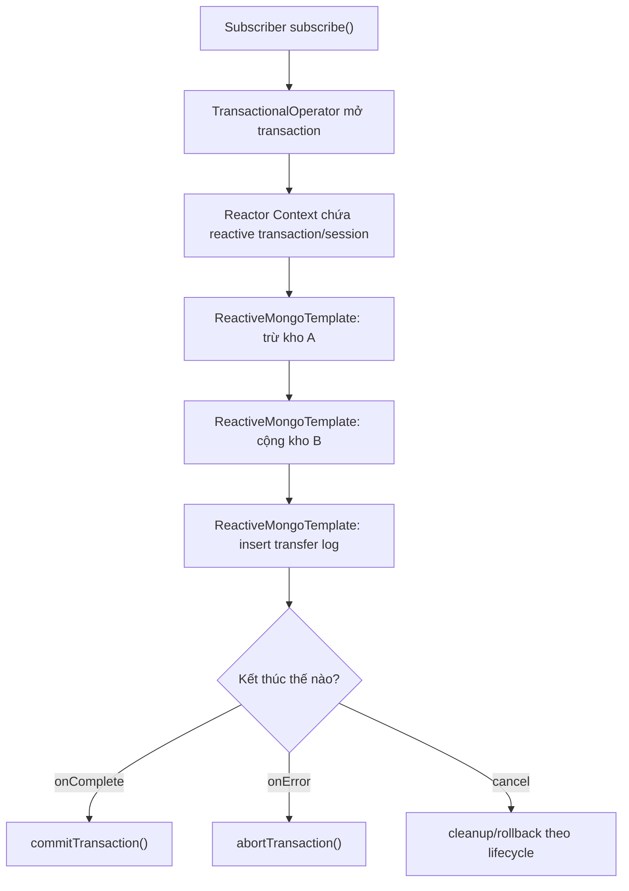

# `TransactionalOperator` và ranh giới giao dịch lập trình

Một service reactive thường trả về `Mono<T>` hoặc `Flux<T>` thay vì thực thi ngay công việc. Khi service cần trừ hàng trong một kho, cộng hàng sang kho khác và ghi lịch sử chuyển kho, yêu cầu nghiệp vụ là **hoặc cả ba thao tác MongoDB cùng được commit, hoặc không thao tác nào được giữ lại**. Trong Spring Data MongoDB reactive, API quan trọng để tổ chức yêu cầu này bằng mã là **`TransactionalOperator`**.

Điểm khó là **ranh giới giao dịch trong Reactive Streams không giống một khối `try/catch` thông thường**. Publisher thường *lazy*, có thể được subscribe nhiều lần; transaction được gắn với **Reactor Context** của subscription, không gắn cố định với thread. Đặt `.as(operator::transactional)` sai vị trí có thể khiến bước cập nhật thứ hai chạy **ngoài transaction**, trong khi `onErrorResume` sai vị trí có thể biến một lỗi cần rollback thành kết quả hoàn tất bình thường. Ngoài lỗi, **cancellation**, retry và cách ghép nhiều publisher cũng ảnh hưởng transaction.

Bài thuộc chương **Giao dịch reactive** của module `SPRING_DATA_MONGODB`. Theo phạm vi module, người học sử dụng Spring Data MongoDB để kết nối, ánh xạ document và truy cập qua `MongoTemplate` hoặc repository; thực hành truy vấn, aggregation, index, transaction, reactive access, kiểm thử và chẩn đoán hiệu năng. Ở đây trọng tâm là **`TransactionalOperator` và cách xác định phần nào thực sự thuộc một reactive transaction**, chứ không chỉ thêm annotation để code chạy.

Sau bài, bạn có thể:

1. Phân biệt `ReactiveMongoTransactionManager`, `TransactionalOperator`, `ReactiveMongoTemplate` và `ReactiveMongoRepository`.
2. Giải thích vì sao transaction bắt đầu **khi subscription xảy ra**, cách session được truyền qua **Reactor Context**, và vì sao gọi `block()` trong luồng WebFlux là sai.
3. Dùng `.as(operator::transactional)` hoặc `operator.execute(...)` để đặt **ranh giới transaction đúng** cho một chuỗi thao tác.
4. Thực hiện giao dịch nhiều document/collection có `matchedCount`, rollback đúng khi điều kiện nghiệp vụ không thỏa.
5. Nhận ra các anti-pattern như chỉ bọc publisher cuối, `Mono.zip` các thao tác DB cùng transaction, `onErrorResume` che lỗi, ghép blocking API, hoặc retry có side effect.
6. Thiết kế retry với transaction mới, idempotency cho request lặp, timeout và bảo vệ tài nguyên MongoDB.
7. Kiểm thử với `StepVerifier` trên **MongoDB replica set thật**, xác nhận cả commit, rollback và phạm vi giao dịch.

## 1. Định nghĩa ranh giới giao dịch trong Reactive Streams

Một transaction MongoDB là một đơn vị công việc đọc/ghi được liên kết với một **`ClientSession`**. Khi tất cả thao tác đã hoàn tất, transaction **commit**; nếu pipeline kết thúc bằng lỗi phù hợp, transaction **rollback/abort** theo chính sách transaction manager.



Với một publisher được bọc đúng, mọi thao tác MongoDB thực hiện **trong cùng subscription, cùng reactive transaction context và qua cơ sở hạ tầng reactive phù hợp** mới có khả năng tham gia transaction ấy.

### 1.1. Reactive không có nghĩa giao dịch tự động

```java
Mono<UpdateResult> debit = reactiveTemplate.updateFirst(...);
Mono<UpdateResult> credit = reactiveTemplate.updateFirst(...);
```

Đoạn trên **chỉ tạo hai publisher**. Nó không tự gọi MongoDB ngay khi biến được khai báo, không tự đồng bộ hai thao tác và **không tự tạo transaction**.

Nếu code sau đó subscribe riêng:

```java
debit.subscribe();
credit.subscribe();
```

thì mỗi subscription là một luồng thực thi riêng; **không thể coi hai update thuộc một transaction chung**. Trong web application, cũng không nên gọi `subscribe()` thủ công trong service để “kích hoạt công việc”; hãy trả Publisher để framework subscribe ở ranh giới phù hợp.

### 1.2. Transaction imperative và reactive khác ở đâu?

| Khía cạnh | Imperative | Reactive |
| --- | --- | --- |
| Manager | `MongoTransactionManager` | `ReactiveMongoTransactionManager` |
| API bao transaction bằng mã | `TransactionTemplate.execute(...)` | `TransactionalOperator.transactional(...)` hoặc `execute(...)` |
| Ngữ cảnh thường dùng | Thread-bound transaction resources | **Reactor Context** của subscription |
| Thao tác MongoDB | `MongoTemplate`/repository blocking | `ReactiveMongoTemplate`/`ReactiveMongoRepository` |
| Lúc thực thi | Gọi phương thức blocking | **Khi subscribe** vào Publisher |
| Kết thúc | Trả về / ném exception | `onComplete` / `onError` / `cancel` |
| Cảnh báo | Exception bị nuốt, proxy, multi-thread | Context mất, scope sai, publisher không subscribe, cancellation |

Không dùng `MongoTransactionManager` với `ReactiveMongoTemplate` chỉ vì tên class đều chứa MongoDB. Hai đường quản lý transaction có cơ chế bind context khác nhau.

## 2. Điều kiện bắt buộc trước khi dùng `TransactionalOperator`

### 2.1. MongoDB topology

**Multi-document transaction** cần MongoDB replica set hoặc sharded cluster có hỗ trợ transaction. Một MongoDB standalone chưa được khởi tạo replica set **không đáp ứng** yêu cầu này.

Trong local/test, một **single-node replica set** là cấu hình dễ kiểm soát. Trong production, phải xác minh URI, topology, phiên bản server, feature compatibility version và quyền truy cập.

Ví dụ URI dành cho một replica set test đã cấu hình đúng:

```properties
spring.data.mongodb.uri=mongodb://localhost:27017/stock_tx_test?replicaSet=rs0
```

Không suy từ chuỗi URI này rằng một `mongod` standalone tự nhiên trở thành replica set. Nếu dùng Docker/Testcontainers, hostname/port trong replica-set configuration phải thực sự truy cập được từ Java Driver.

### 2.2. Dependency và stack reactive

Ứng dụng Spring Boot thường dùng `spring-boot-starter-data-mongodb-reactive` để có `ReactiveMongoTemplate` và reactive repositories; WebFlux hữu ích nếu ứng dụng cung cấp HTTP endpoint reactive. Với testing, dùng `spring-boot-starter-test`, `reactor-test` và một MongoDB test server phù hợp.

Không trộn các ví dụ này với `spring-boot-starter-data-mongodb` và `MongoTemplate` blocking trong cùng transaction rồi mặc định mọi thao tác tham gia. Một ứng dụng có thể có cả hai starter, nhưng phải phân biệt rõ manager/factory và transaction boundary.

### 2.3. Tạo collection/index trước transaction

Đối với ví dụ sẽ dùng `stockBins` và `stockMovements`, chuẩn bị collection/index trong bước migration hoặc test setup **ngoài transaction**:

```javascript
db.createCollection("stockBins");
db.createCollection("stockMovements");

db.stockMovements.createIndex(
  { tenantId: 1, operationId: 1 },
  { unique: true, name: "ux_movement_tenant_operation" }
);
```

Tạo collection/index bên trong transaction có thể gặp giới hạn DDL theo version/topology. Không phụ thuộc vào việc mapping tự tạo collection lần đầu **ngay giữa một giao dịch quan trọng**.

### 2.4. Một document có thể không cần transaction

Đối với yêu cầu “trừ 3 tồn kho nếu `stock >= 3`” trên **một document**, MongoDB hỗ trợ atomic update theo filter:

```javascript
db.stockBins.updateOne(
  { _id: "BIN-A", tenantId: "T-A", available: { $gte: 3 } },
  { $inc: { available: -3 } }
);
```

Một transaction chỉ có một update như vậy thường không làm phép toán trở nên đúng hơn. Chọn `TransactionalOperator` khi nghiệp vụ cần **nhiều document/collection cùng commit/abort**, hoặc một snapshot đọc nhất quán theo yêu cầu.

## 3. Bốn thành phần và vai trò riêng

| Thành phần | Vai trò | Có tự bắt đầu transaction không? |
| --- | --- | --- |
| `ReactiveMongoDatabaseFactory` | Tạo/điều phối access reactive tới MongoDB database | Không |
| `ReactiveMongoTransactionManager` | Bắt đầu/commit/rollback transaction, quản lý session bằng Reactor Context | Khi transaction được yêu cầu |
| `TransactionalOperator` | Tạo ranh giới **bằng mã** quanh Publisher/callback | Có khi Publisher được subscribe |
| `ReactiveMongoTemplate` hoặc reactive repository | Thực thi MongoDB operations bằng reactive driver; tham gia session phù hợp | Không khi chỉ gọi update/find |

### 3.1. Tạo transaction manager và operator

```java
import com.mongodb.ReadConcern;
import com.mongodb.ReadPreference;
import com.mongodb.TransactionOptions;
import com.mongodb.WriteConcern;
import org.springframework.context.annotation.Bean;
import org.springframework.context.annotation.Configuration;
import org.springframework.data.mongodb.ReactiveMongoDatabaseFactory;
import org.springframework.data.mongodb.ReactiveMongoTransactionManager;
import org.springframework.transaction.reactive.TransactionalOperator;

@Configuration
public class ReactiveTransactionConfig {

    @Bean
    ReactiveMongoTransactionManager reactiveMongoTransactionManager(
            ReactiveMongoDatabaseFactory databaseFactory
    ) {
        TransactionOptions transactionOptions =
                TransactionOptions.builder()
                        .readConcern(ReadConcern.SNAPSHOT)
                        .writeConcern(WriteConcern.MAJORITY)
                        .readPreference(ReadPreference.primary())
                        .build();

        return new ReactiveMongoTransactionManager(
                databaseFactory, transactionOptions);
    }

    @Bean
    TransactionalOperator stockTransactionalOperator(
            ReactiveMongoTransactionManager transactionManager
    ) {
        return TransactionalOperator.create(transactionManager);
    }
}
```

Đây là cấu hình minh họa cho **Spring Data MongoDB** và **Spring Framework 6.x** phổ biến trong Spring Boot 3.x. Nếu dự án có nhiều transaction manager (ví dụ R2DBC/JPA/Mongo), nên đặt tên rõ bean và inject `TransactionalOperator` phù hợp, tránh lấy nhầm manager.

### 3.2. Chọn `TransactionOptions` có chủ đích

- `ReadConcern.SNAPSHOT`: yêu cầu view snapshot trong multi-document transaction; với commit `majority`, MongoDB cung cấp bảo đảm majority-committed snapshot phù hợp.
- `WriteConcern.MAJORITY`: commit cần mức xác nhận majority; không tự đảm bảo HTTP response không mất.
- `ReadPreference.primary()`: transaction có read operations phải dùng primary.

Không phải mọi use case đều phải dùng cấu hình mạnh này. Khi giảm `write concern` xuống `w:1`, bạn **thay đổi bảo đảm dữ liệu**, không chỉ tuning latency. Khi commit `w:1`, không thể khẳng định các bảo đảm majority-committed snapshot dành cho `snapshot` giống như khi commit majority.

### 3.3. Operator là một cấu hình tái sử dụng, không phải một transaction lâu dài

Bean `TransactionalOperator` **không sở hữu một session đang mở vĩnh viễn**. Nó là một đối tượng cấu hình cho các subscription; mỗi lần Publisher được subscribe trong bối cảnh chưa có transaction, operator có thể bắt đầu một transaction mới.

Điều này quan trọng khi ai đó viết:

```java
Mono<String> work = buildTransferPipeline()
        .as(stockTransactionalOperator::transactional);

// Chưa subscribe: chưa thực hiện giao dịch.
```

Khi có nhiều subscription, code có thể chạy nhiều lần. Vì vậy **không cache/reuse Publisher non-idempotent** tùy tiện và không dùng một field `Mono` khởi tạo từ command cũ để phục vụ nhiều HTTP request.

## 4. Cách thứ nhất: `.as(operator::transactional)`

`TransactionalOperator` cung cấp phương thức `transactional(Publisher<T>)`, và Reactor có `.as(...)` để chuyển Publisher qua một transformer:

```java
import org.springframework.transaction.reactive.TransactionalOperator;
import reactor.core.publisher.Mono;

Mono<String> flow = stepOne()
        .then(stepTwo())
        .thenReturn("DONE")
        .as(operator::transactional);
```

Đây là **đoạn trong service** có ba method/biến được định nghĩa sẵn. Đặt `.as(operator::transactional)` ở **cuối chuỗi** khiến những bước upstream thuộc phạm vi transaction của subscription ấy, miễn các MongoDB operation sử dụng cùng reactive context.

### 4.1. Sai ranh giới: chỉ bọc update đầu

```java
Mono<Void> wrong = debitStock()
        .as(operator::transactional)
        .then(creditStock())
        .then(writeMovementLog());
```

Ở đây **chỉ `debitStock()`** được bọc bằng operator. `creditStock()` và `writeMovementLog()` chạy **sau khi transaction đầu đã hoàn tất** nên không thể mặc định rollback cả ba. Nếu `creditStock` thất bại, debit có thể đã commit.

Đúng:

```java
Mono<Void> correct = debitStock()
        .then(creditStock())
        .then(writeMovementLog())
        .as(operator::transactional);
```

Nếu lỗi xảy ra trong ba bước, error được truyền qua operator để rollback toàn bộ MongoDB operations đã tham gia transaction.

### 4.2. Vì sao `.then(...)` quan trọng?

`then(nextPublisher)` chỉ subscribe vào `nextPublisher` sau khi source hoàn tất thành công. Với ba update phải theo thứ tự:

```text
debit thành công
       ↓
credit thành công
       ↓
insert movement
       ↓
commit
```

Nếu debit báo `matchedCount=0` nhưng code vẫn `then(credit)`, transaction có thể hoàn tất mà không ghi đúng nghiệp vụ. Phải **kiểm tra kết quả từng bước** và phát `Mono.error(...)` khi điều kiện không thỏa, để operator rollback.

### 4.3. `Mono.zip` không phải cách “cho nhanh” trong một transaction

```java
// KHÔNG dùng cho hai DB writes cần cùng transaction/session:
Mono.zip(debitStock(), creditStock())
        .as(operator::transactional);
```

`zip` subscribe hai publisher theo cách có thể thực hiện đồng thời. MongoDB **không hỗ trợ tùy tiện nhiều thao tác song song trong cùng transaction/session**; transaction không phải một connection pool để parallelize nhiều command.

Thay bằng thứ tự tuần tự `flatMap`/`then`. Đổi lại một transaction ngắn hơn bằng cách giảm số round-trip và thiết kế dữ liệu tốt, **không bằng parallel DB operations trong cùng session**.

## 5. Fixture: chuyển tồn kho giữa hai kho trong cùng tenant

Ta dùng collection `stockBins` và `stockMovements`. Một giao dịch chuyển 3 đơn vị hàng từ `BIN-A` sang `BIN-B` phải đảm bảo:

```text
Trước chuyển:
  BIN-A: available = 10
  BIN-B: available =  4
  Tổng:                 14

Sau commit:
  BIN-A: available =  7
  BIN-B: available =  7
  Tổng:                 14

Nếu lỗi sau khi đã trừ BIN-A:
  Rollback → BIN-A = 10, BIN-B = 4.
```

### 5.1. Seed fixture cho database test

```javascript
// Chỉ chạy trên database test đã được cô lập.
db.stockBins.insertMany([
  {
    _id: "BIN-A",
    tenantId: "T-A",
    sku: "BOOK-001",
    available: NumberLong("10")
  },
  {
    _id: "BIN-B",
    tenantId: "T-A",
    sku: "BOOK-001",
    available: NumberLong("4")
  },
  {
    _id: "BIN-X",
    tenantId: "T-B",
    sku: "BOOK-001",
    available: NumberLong("99")
  }
]);
```

Node `BIN-X` cố ý có **cùng SKU nhưng khác tenant**. Service phải dùng `authorizedTenantId` ở **mọi query**, kể cả khi tìm lịch sử hoặc retry. Nếu chỉ kiểm tra tenant lúc tìm kho nguồn rồi ghi kho đích theo `_id` bất kỳ, request có thể gây ghi chéo tenant.

### 5.2. Tách entity và command

```java
import java.time.Instant;
import org.springframework.data.mongodb.core.mapping.Document;
import org.springframework.data.mongodb.core.mapping.MongoId;

@Document(collection = "stockBins")
public record StockBin(
        @MongoId String id,
        String tenantId,
        String sku,
        long available
) {}

@Document(collection = "stockMovements")
public record StockMovement(
        @MongoId String id,
        String tenantId,
        String operationId,
        String fromBin,
        String toBin,
        String sku,
        long quantity,
        Instant createdAt
) {}

public record TransferStockCommand(
        String operationId,
        String fromBin,
        String toBin,
        String sku,
        long quantity
) {}
```

Các record này dùng Java 17+ và Spring Data có hỗ trợ constructor/record mapping. Trong dự án Java thật, **mỗi public top-level record nằm trong một file .java riêng**; ba khai báo được đặt cạnh nhau ở đây để mô tả schema, không có nghĩa dán cả ba vào một file là hợp lệ.

Ý định nghiệp vụ phải là **chuyển một lượng hàng** chứ không phải `set available=7` từ snapshot cũ. Vì thế ta sử dụng atomic `$inc` trên hai document, và `TransactionalOperator` đảm bảo hai phép cộng/trừ cùng commit với lịch sử.

## 6. Service hoàn chỉnh: toàn bộ workflow nằm trong operator

Ví dụ dưới đây dùng `ReactiveMongoTemplate` và `TransactionalOperator` đã cấu hình ở mục 3. Quy trình:

1. Kiểm tra request và tenant được xác thực.
2. Trong transaction, xem `operationId` có được commit trước đó hay chưa.
3. Nếu đã có và payload trùng, trả kết quả có sẵn; nếu payload khác, báo conflict.
4. Nếu mới, trừ nguồn với filter `available >= quantity`.
5. Chỉ khi debit match, cộng đích thuộc **cùng tenant và SKU**.
6. Ghi `StockMovement` có ID riêng cho tenant/operation.
7. Chỉ commit khi cả ba bước thành công.

### 6.1. Định nghĩa lỗi nghiệp vụ

```java
public class StockTransferRejectedException
        extends RuntimeException {
    public StockTransferRejectedException(String message) {
        super(message);
    }
}
```

Khi command thiếu hàng hoặc đích không tồn tại, ném exception để pipeline phát **`onError`** và transaction manager **rollback**. Không thay một lỗi nghiệp vụ bằng `Mono.empty()` nếu việc đó khiến operator hiểu giao dịch đã hoàn tất bình thường.

### 6.2. Triển khai reactive, không gọi `subscribe()` hoặc `block()`

```java
import java.time.Instant;
import org.springframework.data.mongodb.core.ReactiveMongoTemplate;
import org.springframework.data.mongodb.core.query.Criteria;
import org.springframework.data.mongodb.core.query.Query;
import org.springframework.data.mongodb.core.query.Update;
import org.springframework.stereotype.Service;
import org.springframework.transaction.reactive.TransactionalOperator;
import reactor.core.publisher.Mono;

@Service
public class StockTransferService {

    private final ReactiveMongoTemplate template;
    private final TransactionalOperator operator;

    public StockTransferService(
            ReactiveMongoTemplate template,
            TransactionalOperator stockTransactionalOperator
    ) {
        this.template = template;
        this.operator = stockTransactionalOperator;
    }

    public Mono<String> transfer(
            String authorizedTenantId,
            TransferStockCommand command
    ) {
        validate(authorizedTenantId, command);

        Mono<String> work = Mono.defer(() -> {
            Query existingQuery = Query.query(
                    Criteria.where("tenantId")
                            .is(authorizedTenantId)
                            .and("operationId")
                            .is(command.operationId()));

            return template.findOne(
                            existingQuery, StockMovement.class)
                    .flatMap(existing -> verifyExisting(
                            existing, command))
                    .switchIfEmpty(Mono.defer(() ->
                            applyTransfer(authorizedTenantId, command)));
        });

        // TẤT CẢ các query và write trong work thuộc transaction.
        return work.as(operator::transactional);
    }

    private Mono<String> verifyExisting(
            StockMovement existing,
            TransferStockCommand command
    ) {
        boolean same = existing.fromBin().equals(command.fromBin())
                && existing.toBin().equals(command.toBin())
                && existing.sku().equals(command.sku())
                && existing.quantity() == command.quantity();

        if (!same) {
            return Mono.error(new StockTransferRejectedException(
                    "operationId đã được dùng với payload khác"));
        }
        return Mono.just(existing.id());
    }

    private Mono<String> applyTransfer(
            String tenantId, TransferStockCommand command
    ) {
        Query debitQuery = Query.query(
                Criteria.where("_id").is(command.fromBin())
                        .and("tenantId").is(tenantId)
                        .and("sku").is(command.sku())
                        .and("available").gte(command.quantity()));

        Query creditQuery = Query.query(
                Criteria.where("_id").is(command.toBin())
                        .and("tenantId").is(tenantId)
                        .and("sku").is(command.sku()));

        Mono<Void> debit = template.updateFirst(
                        debitQuery,
                        new Update().inc(
                                "available", -command.quantity()),
                        StockBin.class)
                .flatMap(result -> {
                    if (result.getMatchedCount() != 1) {
                        return Mono.error(
                                new StockTransferRejectedException(
                                        "Kho nguồn không tồn tại hoặc thiếu hàng"));
                    }
                    return Mono.<Void>empty();
                });

        Mono<Void> credit = template.updateFirst(
                        creditQuery,
                        new Update().inc(
                                "available", command.quantity()),
                        StockBin.class)
                .flatMap(result -> {
                    if (result.getMatchedCount() != 1) {
                        return Mono.error(
                                new StockTransferRejectedException(
                                        "Kho đích không tồn tại"));
                    }
                    return Mono.<Void>empty();
                });

        StockMovement movement = new StockMovement(
                tenantId + ":" + command.operationId(),
                tenantId,
                command.operationId(),
                command.fromBin(),
                command.toBin(),
                command.sku(),
                command.quantity(),
                Instant.now());

        return debit.then(credit)
                .then(template.insert(movement))
                .map(StockMovement::id);
    }

    private void validate(
            String tenantId, TransferStockCommand command
    ) {
        if (tenantId == null || tenantId.isBlank()
                || command == null
                || command.operationId() == null
                || command.operationId().isBlank()
                || command.fromBin() == null
                || command.fromBin().isBlank()
                || command.toBin() == null
                || command.toBin().isBlank()
                || command.fromBin().equals(command.toBin())
                || command.sku() == null
                || command.sku().isBlank()
                || command.quantity() < 1
                || command.quantity() > 1000) {
            throw new IllegalArgumentException(
                    "Thông tin chuyển kho không hợp lệ");
        }
    }
}
```

**Lưu ý về lambda `Mono<Void>`:** với từng update, `flatMap` trả `Mono.<Void>empty()` sau khi đã kiểm tra `matchedCount`. Không có dữ liệu cần truyền tiếp, nên dùng `debit.then(credit)` để thực thi tuần tự. Nếu debit/credit phát lỗi, `then` không subscribe vào bước sau.

**Phạm vi transaction nằm ở dòng `return work.as(operator::transactional)`.** Việc xây các `Query`, `Update` hoặc record `movement` không tự ghi DB. Các update reactive chỉ thực sự chạy khi subscriber thực thi work trong reactive transaction context.

### 6.3. Có thể idempotent trong test tuần tự, chưa đủ cho “exactly once” toàn hệ thống

`operationId` và unique index giúp tránh gửi lại cùng command nhiều lần. Nhưng:

- Hai request đồng thời có thể cùng đọc “chưa có movement”; MongoDB có thể báo **write conflict** hoặc duplicate key, cần đối soát command đã commit trước đó.
- Sau network error ở commit, client không thể tự biết transaction đã commit hay chưa; **không retry mù toàn bộ command** nếu chưa có chiến lược commit outcome/idempotency.
- `operationId` phải được tạo ở tầng đáng tin hoặc được xác thực, có độ dài/định dạng hợp lệ; tenant phải lấy từ security context.
- ID movement `tenantId + ":" + operationId` chỉ mang tính minh họa. Trong thực tế, chọn khóa có chuẩn hóa, giới hạn độ dài và tránh va chạm.
- Nếu có external side effect, ví dụ publish event chuyển kho, cần outbox/idempotent consumer hoặc workflow được thiết kế tương ứng; nó không thuộc MongoDB transaction chỉ vì được gọi trong cùng method.

Để tránh tràn `long` ở kho đích, một hệ thống production cần kiểm tra **giới hạn số lượng hợp lệ**, quyền truy cập, giới hạn tồn kho tối đa và mọi invariant khác. `$inc` bảo đảm atomicity của một field trong một document nhưng không tự validate toàn bộ domain.

## 7. Cách thứ hai: `operator.execute(...)` cho phạm vi transaction cục bộ

`TransactionalOperator.execute(...)` nhận một callback:

```java
<T> Flux<T> execute(TransactionCallback<T> action);
```

Callback được gọi với một `ReactiveTransaction` và phải trả Publisher. Đây là lựa chọn hữu ích khi **chỉ một phần** của pipeline cần transaction, còn phần khác nên chạy ngoài.

### 7.1. Ví dụ với callback

```java
import org.springframework.transaction.reactive.TransactionalOperator;
import reactor.core.publisher.Mono;

public Mono<String> transactionWithCallback(
        TransactionalOperator operator
) {
    return operator.execute(status ->
            findAuthorizedStockBin()
                .flatMap(bin -> debitBin(bin)
                        .then(creditDestination()))
                .then(writeMovement())
                .thenReturn("DONE")
        ).single();
}
```

`execute` trả **`Flux<T>`**; vì callback trên tạo `Mono<String>` phát một phần tử, `.single()` chuyển Flux sang `Mono<String>` và báo lỗi nếu không đúng một phần tử. Nếu nghiệp vụ có thể hoàn tất mà **không phát phần tử**, dùng kiểu terminal operator khác hoặc `then()`, không áp `single()` máy móc.

Các method `findAuthorizedStockBin`, `debitBin`, `creditDestination` và `writeMovement` trong ví dụ là **các hàm service giả định được định nghĩa đúng**; ví dụ nhằm cho thấy cấu trúc callback, còn service đầy đủ ở mục 6 dùng những MongoDB operation cụ thể.

### 7.2. Dùng callback khi có nhánh rollback rõ ràng

`ReactiveTransaction` trong callback hỗ trợ cách đánh dấu **rollback-only** trong những tình huống framework cho phép. Nhưng đơn giản và rõ nhất cho lệnh nghiệp vụ bị từ chối là phát `Mono.error(...)` để operator nhận `onError`. Việc gọi `setRollbackOnly()` rồi tiếp tục phát kết quả “SUCCESS” cho client có thể dẫn đến hiểu sai nghĩa nghiệp vụ.

Ví dụ khi chủ động đánh dấu rollback:

```java
return operator.execute(status ->
        checkBusinessRule()
                .flatMap(ok -> {
                    if (!ok) {
                        status.setRollbackOnly();
                        return Mono.just("REJECTED");
                    }
                    return doMongoWrites().thenReturn("DONE");
                })
).single();
```

Đoạn này minh họa **cách dùng rollback-only**: một Publisher hoàn tất bình thường không nhất thiết đồng nghĩa DB đã commit nếu transaction status được đánh dấu rollback. Nhưng API phải thiết kế rõ một kết quả `REJECTED` không phải thành công chuyển tiền. Với business rejection thông thường, phát lỗi domain và xử lý ở **ngoài** operator thường dễ đọc hơn.

### 7.3. `execute` và `transactional` nên dùng khi nào?

| Mục đích | Lựa chọn | Lợi ích |
| --- | --- | --- |
| Bọc toàn bộ pipeline đã xây | `publisher.as(operator::transactional)` | Dễ nhận ra scope từ vị trí cuối chuỗi |
| Bọc một callback nhiều nhánh | `operator.execute(callback)` | Scope được định nghĩa ngay trong callback |
| Chỉ transaction phần ghi, không bao HTTP/cache/format output | `execute` hoặc bọc riêng sub-pipeline | Giảm thời gian giữ transaction |
| Cần quyết định rollback-only có chủ đích | `execute` | Có `ReactiveTransaction` status |
| Cần transaction declarative bao một method | `@Transactional` với reactive manager | Ít code, nhưng cần hiểu proxy và return type |

**Không cần dùng cả hai cách trên cùng một workflow** nếu không có lý do tạo ranh giới khác: đặt `execute(...)` bên trong `as(operator::transactional)` có thể gây tham gia transaction lồng, làm khó diễn giải. Xác định rõ một nơi sở hữu boundary.

## 8. Chọn vị trí bọc: transaction chỉ sống trong Publisher được bọc

Một ứng dụng có thể có các bước:

```text
HTTP authentication
  → validate payload
  → đọc configuration ngoài DB
  → UPDATE kho nguồn
  → UPDATE kho đích
  → INSERT movement
  → commit transaction
  → format HTTP response
  → phát metric
```

Không nhất thiết tất cả bước phải ở trong transaction. Thời gian giữ transaction càng dài, rủi ro contention, timeout và memory pressure càng tăng.

### 8.1. Bọc chỉ đoạn ghi cần atomic

```java
Mono<TransferResponse> result = loadPublicConfiguration()
        .flatMap(config -> {
            Mono<String> mongoWrites = validateWithConfig(config)
                    .then(transferMongoDocuments(config));

            return mongoWrites
                    .as(operator::transactional);
        })
        .map(operationId -> new TransferResponse(
                operationId, "ACCEPTED"));
```

`loadPublicConfiguration()` chạy **ngoài** transaction, còn `validateWithConfig(config)` và `transferMongoDocuments(config)` nằm **trong** transaction. Đây là snippet cấu trúc: các hàm/DTO được giả định đã khai báo và cần có cách xác thực lại các invariant nghiệp vụ tại thời điểm ghi.

Nếu validation đọc một dữ liệu phải nhất quán với các cập nhật, **đưa phần đọc đó vào transaction**; không “tiết kiệm transaction” bằng cách chuyển một precondition quan trọng ra ngoài rồi bỏ qua race.

### 8.2. Ghi bên ngoài trước rồi bọc sau không được rollback

```java
Mono<UpdateResult> firstWrite = reactiveTemplate.updateFirst(...);
Mono<UpdateResult> secondWrite = reactiveTemplate.updateFirst(...);

Mono<UpdateResult> wrong = firstWrite
        .then(secondWrite.as(operator::transactional));
```

`firstWrite` không thuộc transaction. Nếu second thất bại, first có thể đã commit. **Vị trí operator**, không phải vị trí các dòng Java nằm gần nhau, quyết định scope.

### 8.3. Một Publisher hoàn tất sau khi operator đã commit

```java
return mongoWrite()
        .as(operator::transactional)
        .flatMap(id -> anotherMongoUpdate(id));
```

`anotherMongoUpdate` ở **sau** operator, nằm ngoài boundary. Khi nó lỗi, transaction cho `mongoWrite` có thể đã commit. Nếu hai update phải atomic, chuyển `.as(operator::transactional)` xuống **sau cùng**:

```java
return mongoWrite()
        .flatMap(id -> anotherMongoUpdate(id))
        .as(operator::transactional);
```

### 8.4. Đừng tạo transaction bao quanh việc gọi API ngoài

```java
return requestBankApi()        // External side effect.
        .then(updateMongo())
        .as(operator::transactional);
```

Việc gọi ngân hàng không được MongoDB rollback. Nếu MongoDB update lỗi, tiền đã bị tính nhưng transaction DB có thể abort. Với ngoại hệ thống, nên dùng thiết kế **outbox/saga/compensation/idempotency**, không “bọc thêm operator” để tạo tính nguyên tử không tồn tại.

## 9. `onError`, `onComplete` và `onErrorResume`: lỗi xảy ra ở phía nào của operator?

Với `TransactionalOperator`, những terminal signals của Publisher được bọc quyết định cách manager kết thúc giao dịch.

| Terminal signal đi tới operator | Hành vi dự kiến | Ý nghĩa nghiệp vụ |
| --- | --- | --- |
| `onComplete` | Commit khi không bị rollback-only và commit hợp lệ | Tất cả bước transaction đã hoàn tất thành công |
| `onError` | Rollback/abort transaction | Một bước thất bại, không giữ các write đã tham gia |
| `cancel` | Cleanup; trên Spring Framework hiện hành cancellation kích hoạt rollback | Subscriber không còn tiêu thụ toàn bộ sequence |

### 9.1. Anti-pattern: nuốt lỗi **bên trong** transaction

```java
Mono<String> dangerous = debitStock()
        .then(creditStock())
        .onErrorResume(ex -> Mono.just("IGNORED"))
        .as(operator::transactional);
```

Nếu debit thành công còn credit lỗi, `onErrorResume` biến lỗi thành một giá trị thành công. Operator có thể nhận `onComplete` và **commit debit** — sai invariant nghiệp vụ.

Một phiên bản tốt hơn:

```java
Mono<String> safe = debitStock()
        .then(creditStock())
        .thenReturn("DONE")
        .as(operator::transactional)
        .onErrorMap(ex -> new TransferFailedException(ex));
```

`onErrorMap` nằm **sau operator**, nên lỗi vẫn đi qua boundary để rollback; sau đó mới được chuyển thành domain exception. `TransferFailedException` là exception domain giả định trong ví dụ, không phải class có sẵn của Spring Data.

### 9.2. Muốn trả fallback cho HTTP? Đặt sau transaction

```java
return performTransfer()
        .as(operator::transactional)
        .onErrorResume(StockTransferRejectedException.class,
                err -> Mono.just("REJECTED"));
```

Ở đây operator **đã nhìn thấy lỗi**, nên rollback trước khi `onErrorResume` biến lỗi thành response domain. Vẫn phải phân biệt trả “rejected” với “success”: HTTP contract cần phản ánh request không được áp dụng.

Nếu `performTransfer()` **đã tự bọc operator**, không bọc lần hai; chỉ viết:

```java
return stockTransferService.transfer(tenantId, command)
        .onErrorResume(StockTransferRejectedException.class,
                ex -> Mono.error(toHttpConflict(ex)));
```

Việc convert exception cần **không làm mất metadata quan trọng** và không đưa MongoDB stack trace/secret ra response.

### 9.3. `onErrorContinue` không phải giải pháp cho transaction đa document

```java
// KHÔNG làm như một chính sách transaction chung:
source.flatMap(this::writeOneDocument)
      .onErrorContinue((error, element) -> log(error))
      .as(operator::transactional);
```

`onErrorContinue` có semantics phụ thuộc operator hỗ trợ, dễ làm mất lỗi hoặc bỏ qua record mà không rollback như kỳ vọng. Nếu yêu cầu **all-or-nothing**, nên để lỗi dừng workflow và rollback. Nếu bài toán là xử lý từng bản ghi độc lập, thiết kế **mỗi bản ghi một transaction riêng** và log kết quả rõ, thay vì nuốt lỗi giữa một transaction lớn.

### 9.4. `doOnError` để quan sát, không để sửa lỗi

`doOnError` phù hợp để ghi metric/log có kiểm soát:

```java
return work.as(operator::transactional)
        .doOnError(ex -> metrics.increment("stock_tx_failed"));
```

Nó không tự retry, không tự khôi phục trạng thái và không bảo đảm log/outbox bên ngoài được transaction rollback. Tránh log toàn bộ document, token hoặc payload nhạy cảm.

## 10. Cancellation: subscriber có thể dừng trước khi commit

Trong Reactive Streams, downstream có thể hủy subscription vì HTTP client ngắt kết nối, timeout, `take(1)`, `next()` trên Flux nhiều phần tử, hoặc một operator kết thúc sớm.

### 10.1. Transaction không phải “bất chấp subscriber”

Spring Framework từ 5.3 có chính sách **rollback khi reactive transaction bị cancellation** để tránh commit khi không thể biết Publisher đã hoàn tất toàn bộ công việc chưa. Nhưng nếu commit đã hoàn tất **trước** lúc client mất kết nối, việc hủy về sau không thể hoàn tác commit.

Vì vậy, không lấy HTTP timeout/cancel làm bằng chứng “chắc chắn MongoDB đã rollback”. Client có thể mất response **sau commit**. Với lệnh thay đổi tồn kho/tài chính, dùng `operationId` để đối soát.

### 10.2. Anti-pattern với `Flux.take(1)`

```java
Flux<StockMovement> movements = processManyMovements()
        .as(operator::transactional);

Mono<StockMovement> firstOnly = movements.next();
```

`next()` có thể **cancel** upstream sau phần tử đầu tiên. Nếu `processManyMovements` đang thực hiện các write khác, cancellation có thể rollback transaction hoặc khiến việc giao tiếp với client không diễn ra như bạn mong. Không dùng `next()` hoặc `take(1)` để “lấy kết quả” từ một transaction nhiều writes khi các write phía sau còn quan trọng.

Nếu nghiệp vụ chỉ cần một output sau khi nhiều writes hoàn tất, thiết kế flow với `Mono.when(... )` **cần cẩn thận về parallelism**, hoặc tốt nhất chain tuần tự `then(...)` và `thenReturn(result)`, để terminal signal xuất hiện khi toàn bộ công việc đã hoàn tất.

### 10.3. `timeout` có hai vị trí khác nhau

```java
// Timeout bên trong operator:
return work.timeout(Duration.ofSeconds(5))
        .as(operator::transactional);
```

Timeout này tạo `onError` **bên trong** transaction scope, nên manager có cơ hội abort khi quá hạn.

```java
// Timeout ở downstream của operator:
return work.as(operator::transactional)
        .timeout(Duration.ofSeconds(5));
```

Timeout ở ngoài có thể **cancel subscription tới operator**, dẫn tới cleanup/rollback nếu transaction chưa hoàn tất. Nhưng trong cả hai trường hợp, **thời điểm commit có thể đang ở trạng thái không rõ** và timeout HTTP không nhất thiết hủy ngay công việc MongoDB bên server.

Không xem timeout là thay thế cho **MongoDB transaction lifetime limit**, driver/socket timeout, cancellation policy và idempotency. Cần đo trên deployment thực.

### 10.4. Không subscribe thủ công rồi trả response rỗng

```java
public Mono<Void> badEndpoint() {
    stockTransferService.transfer("T-A", command)
            .subscribe();
    return Mono.empty();
}
```

HTTP request có thể trả thành công **trước commit**, exception bị xử lý ngoài request và cancellation của HTTP không liên kết đúng với công việc. Phải **return** Publisher:

```java
public Mono<String> goodEndpoint() {
    return stockTransferService.transfer("T-A", command);
}
```

Tất nhiên `"T-A"` và `command` ở đây là giả định của đoạn minh họa; tenant thật phải lấy từ security context, không hard-code.

## 11. Subscription, `Mono.defer`, `cache` và tính lặp lại

### 11.1. Mỗi subscription có thể là một giao dịch mới

```java
Mono<String> transfer = service.transfer("T-A", command);

// Nếu không có sharing/cache, hai subscriptions có thể
// thực thi body của một cold publisher hai lần.
StepVerifier.create(transfer).expectNextCount(1).verifyComplete();
StepVerifier.create(transfer).expectNextCount(1).verifyComplete();
```

Trong ví dụ đã thiết kế `operationId`, lần thứ hai có thể đọc movement đã commit và trả lại ID; nhưng đây là **idempotency ở tầng domain**, không phải vì Reactor tự bảo đảm exactly-once.

### 11.2. `cache()` có thể thay đổi thời điểm và phạm vi thực thi

```java
Mono<String> shared = service.transfer("T-A", command).cache();
```

`cache()` có thể lưu kết quả terminal signal để các subscribers sau không re-run nguồn. Điều đó có thể hữu ích **trong một phạm vi giới hạn**, nhưng không phải một kho idempotency bền vững: process restart sẽ mất cache, memory có thể tăng và cache lỗi có thể gây khó xử. **Không dùng Reactor `cache()` thay cho unique operation ID/ledger trên MongoDB**.

### 11.3. `Mono.defer` tạo lại công việc mỗi lượt subscribe

```java
Mono<String> deferred = Mono.defer(() ->
        buildAndExecuteMongoSteps()
).as(operator::transactional);
```

`Mono.defer` hữu ích khi mỗi lần subscribe cần đọc lại state, tạo timestamp hoặc tạo query dựa trên dữ liệu mới. Nó không tự tạo transaction nếu thiếu operator; và việc dùng `defer` phải tránh tạo **operation ID mới** ở mỗi retry nếu muốn nhận biết một lệnh nghiệp vụ duy nhất.

### 11.4. Không giữ `ReactiveTransaction`/`ClientSession` trong field

```java
// Anti-pattern:
private ClientSession sessionForEveryRequest;
```

Session phải sống trong scope thực thi được quản lý đúng, không dùng chung một session mutable cho nhiều requests hoặc lưu nó vào singleton field. Reactive transaction manager liên kết transaction với **Reactor Context**, và các MongoDB operations tương thích truy xuất session từ đó.

Nếu cần thao tác driver trực tiếp ngoài `ReactiveMongoTemplate`, phải dùng API nhận `ClientSession` phù hợp và kiểm tra nó tham gia đúng transaction. Không suy rằng gọi `ReactiveMongoTemplate.getCollection()` rồi gọi raw driver methods luôn tự gắn session như các template operations.

## 12. Retry: transaction abort khác commit chưa rõ kết quả

Với các giao dịch có nhiều writer cạnh tranh cùng document, MongoDB có thể abort một transaction do write conflict hoặc trả một lỗi tạm thời. Mặt khác, client có thể **không nhận được response của commit** dù server đã commit thành công. Hai tình huống này khác nhau về cách xử lý.

| Kịch bản | Điều client biết | Hướng xử lý |
| --- | --- | --- |
| Business rejection: thiếu hàng, sai tenant | Request không hợp lệ theo nghiệp vụ | Trả lỗi, **không tự retry** |
| `TransientTransactionError` từ transaction abort | Transaction không thể hoàn thành như đã xây | Có thể **thử lại toàn transaction mới** nếu phù hợp |
| `UnknownTransactionCommitResult` | Commit **có thể** thành công; kết quả không chắc chắn | Retry **commit** theo protocol/driver hoặc đối soát `operationId` |
| Network timeout sau khi gửi request | Không chắc server đã ghi chưa | Không retry mù non-idempotent command |
| `DuplicateKeyException` từ movement ID | Operation có thể đã có, hoặc payload trùng/khác | Xác minh operation ledger và payload trước khi quyết định |

### 12.1. Sai: retry cả lệnh business khi không phân loại lỗi

```java
// KHÔNG LÀM:
return service.transfer(tenant, command)
        .retry(10);
```

Retry này áp dụng cho **mọi lỗi**, kể cả thiếu hàng, duplicate key, và commit chưa rõ kết quả. Nó có thể làm nóng một “hot document”, nhân độ trễ hoặc lặp ý định nghiệp vụ ngoài tầm kiểm soát.

### 12.2. Retry có giới hạn cho lỗi transaction thực sự tạm thời

Reactor cho phép `Retry.backoff(...)` và lọc exception:

```java
import java.time.Duration;
import reactor.util.retry.Retry;

Retry retryPolicy = Retry.backoff(
        2, Duration.ofMillis(30))
    .maxBackoff(Duration.ofMillis(200))
    .jitter(0.3)
    .filter(this::isRetryableAbortedTransaction);
```

Trong một service thực, `isRetryableAbortedTransaction` phải **kiểm tra MongoDB error labels/causes phù hợp** trong chuỗi exception do driver và Spring Data chuyển đổi. Đây là hàm domain giả định để nhấn mạnh không bắt mọi `Throwable`. Ví dụ không tự cài parser chuỗi message `"transaction aborted"` vì thông điệp lỗi có thể thay đổi theo version.

Đặt retry **sau ranh giới transaction** nếu mục đích là tạo transaction mới mỗi lượt:

```java
Mono<String> result = Mono.defer(
        () -> buildTransferWork(tenant, command)
                .as(operator::transactional))
        .retryWhen(retryPolicy);
```

`buildTransferWork` là method giả định xây pipeline MongoDB mới; `Mono.defer` đảm bảo mỗi lượt retry dựng lại work. **Không đặt retry chỉ trên phép credit** bên trong transaction đã abort.

### 12.3. `retryWhen` không giải quyết commit mơ hồ

`UnknownTransactionCommitResult` có nghĩa **không biết transaction đã commit chưa**. Retry body của transaction mà không có idempotency có thể ghi hai lần. Với use case chuyển kho, cần:

1. Stable `operationId` xuyên suốt mọi lần retry của **cùng hành động người dùng**.
2. Unique ledger/marker trong cùng transaction với debit/credit.
3. Truy vấn kết quả operation sau lỗi commit mơ hồ theo consistency phù hợp.
4. Nếu retry commit được driver/framework hỗ trợ, để **cơ chế đó** thử lại commit của transaction đang có theo quy tắc.
5. Chỉ quyết định tạo transaction **mới** khi đã hiểu trạng thái operation và lỗi thuộc nhóm có thể retry.

Không đưa logic này vào một `onErrorResume` mơ hồ chuyển mọi exception thành `"RETRY"`.

### 12.4. Transaction retry và external side effects

```java
return callPaymentGateway() // Có thể thu tiền thật.
        .then(buildMongoTransaction())
        .as(operator::transactional)
        .retryWhen(retryPolicy);
```

Nếu retry publisher, `callPaymentGateway` cũng có thể chạy lại, nhưng MongoDB không có quyền rollback payment API. Đối với hệ thống tài chính, dùng outbox/saga và idempotency của cổng thanh toán. Chỉ để **các thao tác MongoDB cần atomic** trong transaction.

### 12.5. Vì sao nên giữ transaction ngắn?

Mỗi transaction giữ snapshot, session và tài nguyên trên server. Một transaction dài làm tăng khả năng write conflict và timeout. MongoDB có các giới hạn như `transactionLifetimeLimitSeconds`; mặc định thường khoảng 60 giây tùy deployment/cấu hình. Không đặt xử lý file lớn, chờ người dùng xác nhận, hoặc request bên thứ ba chậm **bên trong** transaction.

## 13. Isolation, read concern và write concern trong reactive transaction

Reactive transaction **không có một mô hình isolation MongoDB mới** so với imperative. Các bảo đảm vẫn do MongoDB Server quy định và được đưa vào transaction qua `TransactionOptions`.

### 13.1. Các lựa chọn thông dụng

| Tuỳ chọn | Trong ví dụ | Tại sao |
| --- | --- | --- |
| `readConcern` | `SNAPSHOT` | Các read cần một snapshot phù hợp trong transaction |
| `writeConcern` | `MAJORITY` | Xác nhận commit ở mức majority |
| `readPreference` | `primary` | Transaction có read operations phải đọc primary |

Trong multi-document transaction, read concern thường được hỗ trợ gồm `local`, `majority` và `snapshot`. Bảo đảm read từ **majority-committed snapshot** của `snapshot` trong transaction gắn với việc commit bằng **`w:"majority"`**. Không chỉ đặt `SNAPSHOT` rồi kết luận mọi read đã majority-committed khi commit `w:1`.

### 13.2. Snapshot không khóa mọi document được đọc

Timeline:

```text
t0: T1 bắt đầu snapshot và đọc BIN-A.available=10
t1: T2 cập nhật BIN-A và commit
t2: T1 có thể vẫn đọc snapshot cũ =10
t3: T1 cố ghi BIN-A → có thể nhận write conflict và bị abort
```

Không cho rằng `SNAPSHOT` luôn đọc “giá trị mới nhất” hoặc thay thế filter `available >= quantity`. Mỗi transaction phải kiểm tra invariant trong điều kiện ghi và xử lý conflict.

### 13.3. Đừng đặt read concern/write concern riêng trên từng thao tác

Trong transaction, các read/write phải theo option của transaction; **write concern áp ở commit**, không nên đặt một `WriteConcern.MAJORITY` riêng cho update A rồi `WriteConcern.W1` cho update B.

Đối với ReactiveMongoTemplate, cấu hình `ReactiveMongoTransactionManager` cho cả transaction và để template dùng session được bind. Nếu dùng driver trực tiếp, truyền đúng `ClientSession` trên các lời gọi reactive driver.

### 13.4. Transaction nhiều shard vẫn cần hiểu snapshot visibility

MongoDB hỗ trợ distributed transactions trên sharded cluster ở các phiên bản phù hợp, nhưng query/DDL có giới hạn riêng. `readConcern: "snapshot"` với majority commit có bảo đảm snapshot đồng bộ qua shard. `readConcern: "majority"` không tự đem lại một synchronized snapshot across shards trong mọi trường hợp.

Nếu nghiệp vụ chỉ cần một update đơn-document, dùng transaction nhiều shard có thể làm phức tạp hệ thống không cần thiết. Cân đối chi phí network, lock, snapshot/commit và mục tiêu nhất quán.

## 14. `@Transactional` và `TransactionalOperator`: chọn một chủ sở hữu boundary

Spring cũng hỗ trợ giao dịch reactive bằng annotation khi method được gọi qua proxy và **trả một reactive Publisher**:

```java
import org.springframework.transaction.annotation.Transactional;
import reactor.core.publisher.Mono;

@Transactional(transactionManager = "reactiveMongoTransactionManager")
public Mono<String> transferAnnotated(
        String tenant, TransferStockCommand command
) {
    return buildTransferWork(tenant, command);
}
```

Đây là ví dụ schematic trong một **Spring-managed service** có method `buildTransferWork`. Nó không tự tạo transaction khi chưa có subscriber; Spring reactive transaction advice áp dụng khi Publisher được subscribe qua proxy.

### 14.1. So sánh hai cách

| Tiêu chí | `@Transactional` | `TransactionalOperator` |
| --- | --- | --- |
| Cách khai báo | Annotation trên method | Ranh giới cụ thể trong pipeline |
| Phụ thuộc Spring proxy | Có ở chế độ proxy thông thường | Không cần proxy cho operator dùng trực tiếp |
| Chỉ bọc một đoạn nội bộ của pipeline | Khó hơn nếu cả method có thêm I/O | **Rõ ràng** bằng cách đặt `as`/`execute` |
| Cần status rollback-only | Có thể dùng API transaction context riêng | `execute(status -> ...)` có status |
| Dễ thấy toàn bộ operations thuộc transaction | Phải xem return chain và proxy boundary | Scope được nhìn ngay trong mã |
| Rủi ro khi self-invocation | Có | Không đối với việc gọi operator trực tiếp |

Không viết method `@Transactional` rồi bên trong lại `.as(operator::transactional)` chỉ vì “hai lớp an toàn hơn”. Nếu chúng cùng tham gia transaction, code thừa gây khó kiểm chứng. Nếu cố ý tạo transaction mới, phải xét propagation, session và rollback semantics.

### 14.2. Self-invocation là bẫy của annotation

```java
@Service
class SomeService {
    public Mono<String> outer() {
        // Trong proxy mode, this gọi trực tiếp có thể
        // bỏ qua @Transactional của inner.
        return this.inner();
    }

    @Transactional(transactionManager = "reactiveMongoTransactionManager")
    public Mono<String> inner() {
        return doReactiveWrites();
    }
}
```

Nếu dùng `TransactionalOperator` ngay trong `inner()`, việc self-invocation không làm mất operator boundary như Spring AOP annotation, miễn trả Publisher đúng và có subscriber.

### 14.3. Propagation và nested transaction

`TransactionalOperator.create(manager)` thường dùng mặc định `PROPAGATION_REQUIRED`. Nếu đang có một reactive transaction phù hợp trong Reactor Context, work có thể **tham gia transaction hiện tại** chứ không tự tạo nested transaction độc lập.

Do đó:

- Đừng giả định mỗi lần gọi operator đều tạo **một commit riêng**.
- Không coi `REQUIRES_NEW` là công cụ “savepoint” miễn phí; suspend/resume và hỗ trợ MongoDB/reactive manager có giới hạn theo version.
- Không thay `readConcern` hay `writeConcern` của một transaction **đã bắt đầu** bằng cách thêm operator bên trong.
- Đặt boundary ở service/application workflow **sở hữu invariant**, thay vì mỗi repository tự mở transaction riêng.

### 14.4. Tùy biến `TransactionDefinition` cho operator riêng

Spring cho phép tạo operator với `TransactionDefinition`:

```java
import org.springframework.transaction.TransactionDefinition;
import org.springframework.transaction.support.DefaultTransactionDefinition;
import org.springframework.transaction.reactive.TransactionalOperator;

DefaultTransactionDefinition definition =
        new DefaultTransactionDefinition();
definition.setPropagationBehavior(
        TransactionDefinition.PROPAGATION_REQUIRED);
definition.setName("stock-transfer");

TransactionalOperator custom = TransactionalOperator.create(
        reactiveMongoTransactionManager, definition);
```

`reactiveMongoTransactionManager` ở đây là bean đã khởi tạo. `TransactionDefinition` mô tả các yếu tố như propagation, name, timeout và read-only theo framework. **Read concern/write concern/read preference MongoDB** phải được cấu hình qua `TransactionOptions` hoặc cơ chế per-transaction được **Spring Data version tương ứng hỗ trợ**; không mặc định `TransactionDefinition` generic có setter cho cả ba.

Nếu cần nhiều operator cho nhiều workload, đặt bean name/`@Qualifier` rõ ràng. Không để một operator “default” phục vụ đồng thời JDBC, R2DBC và MongoDB vì chúng không chia sẻ transaction manager.

## 15. Kiểm thử tích hợp bằng `StepVerifier` và MongoDB replica set

Mock `ReactiveMongoTemplate` có thể chứng minh một method đã được gọi, nhưng **không chứng minh** commit/rollback xảy ra đúng trên MongoDB. Với bài toán transaction, cần integration test trên MongoDB Server thật **ở topology có hỗ trợ transaction**.

Một bộ test tốt phải xác minh:

- Không có ghi nào được thực hiện trước khi subscribe.
- Transfer hợp lệ commit **hai số dư và movement**.
- Đích không tồn tại khiến debit đã thực hiện trong transaction **rollback**.
- Nguồn không đủ hàng không làm thay đổi state.
- Lỗi tenant không dẫn tới ghi chéo tenant.
- Gửi lại cùng `operationId` sau commit không chuyển hai lần.
- Dùng `operationId` trùng với payload khác bị từ chối.
- Các trường hợp concurrent commit/unknown outcome được test riêng với cơ chế điều phối phù hợp.

### 15.1. Test configuration: không dùng MongoDB standalone

Ví dụ sau minh họa **Spring Boot 3.x + JUnit 5 + Reactor Test**. Cần một MongoDB replica set test kết nối qua cấu hình môi trường; có thể dùng Testcontainers MongoDB module với replica set và replica hostname truy cập được.

```properties
# Ví dụ khi test replica set rs0 đã sẵn sàng ở localhost.
spring.data.mongodb.uri=mongodb://localhost:27017/stock_tx_test?replicaSet=rs0
```

Không hard-code URI production hoặc tài khoản thật vào test. Test chỉ được phép tạo/xóa document trong database test riêng. Với CI, nên khởi tạo replica set test bằng automation và xác minh primary trước khi chạy.

### 15.2. Setup fixture bằng reactive template

```java
import static org.assertj.core.api.Assertions.assertThat;

import org.junit.jupiter.api.BeforeEach;
import org.junit.jupiter.api.Test;
import org.springframework.beans.factory.annotation.Autowired;
import org.springframework.boot.test.context.SpringBootTest;
import org.springframework.context.annotation.Import;
import org.springframework.data.domain.Sort;
import org.springframework.data.mongodb.core.ReactiveMongoTemplate;
import org.springframework.data.mongodb.core.index.Index;
import org.springframework.data.mongodb.core.query.Query;
import reactor.core.publisher.Mono;
import reactor.test.StepVerifier;

@SpringBootTest
@Import(ReactiveTransactionConfig.class)
class StockTransferTransactionIntegrationTest {

    @Autowired
    ReactiveMongoTemplate template;

    @Autowired
    StockTransferService service;

    private TransferStockCommand command(
            String operationId, String toBin, long quantity
    ) {
        return new TransferStockCommand(
                operationId, "BIN-A", toBin,
                "BOOK-001", quantity);
    }

    @BeforeEach
    void seed() {
        // Chạy ngoài transaction, chỉ trên DB test cô lập.
        Mono<Void> prepare = template
                .remove(new Query(), StockMovement.class)
                .then(template.remove(
                        new Query(), StockBin.class))
                .then(template.indexOps(StockMovement.class)
                        .ensureIndex(new Index()
                                .on("tenantId", Sort.Direction.ASC)
                                .on("operationId", Sort.Direction.ASC)
                                .unique()
                                .named("ux_movement_tenant_operation")))
                .then(template.insert(
                        new StockBin("BIN-A", "T-A", "BOOK-001", 10)))
                .then(template.insert(
                        new StockBin("BIN-B", "T-A", "BOOK-001", 4)))
                .then(template.insert(
                        new StockBin("BIN-X", "T-B", "BOOK-001", 99)))
                .then();

        StepVerifier.create(prepare).verifyComplete();
    }

    private void assertAvailable(String id, long expected) {
        StepVerifier.create(
                template.findById(id, StockBin.class))
                .assertNext(bin ->
                        assertThat(bin.available()).isEqualTo(expected))
                .verifyComplete();
    }

    // Các test tiếp theo được đặt trong cùng class này.
}
```

**Lưu ý:** `@SpringBootTest` cần ứng dụng có `@SpringBootApplication`/cấu hình Spring Boot thích hợp. `@Import(ReactiveTransactionConfig.class)` chỉ minh họa bảo đảm có reactive manager/operator; nếu project đã auto-scan class `@Configuration` này, không import lặp tùy tiện. Test fixture cũng phải có collection/index **trước khi transaction đầu tiên bắt đầu**; `ensureIndex` ở setup được chạy **ngoài transaction**.

### 15.3. Test 1 — transaction chưa chạy nếu chưa subscribe

```java
@Test
void noSubscriptionMeansNoTransfer() {
    Mono<String> pending = service.transfer(
            "T-A", command("OP-LAZY", "BIN-B", 3));

    // Chỉ tạo Mono không làm thay đổi DB.
    assertAvailable("BIN-A", 10);
    assertAvailable("BIN-B", 4);

    StepVerifier.create(pending)
            .expectNext("T-A:OP-LAZY")
            .verifyComplete();

    assertAvailable("BIN-A", 7);
    assertAvailable("BIN-B", 7);
}
```

Test này giúp phân biệt **assembly** của Publisher với **subscription**. Nếu code tự `subscribe()` trong service, kết quả test có thể chạy ngoài kiểm soát và việc đợi/khẳng định trong test trở nên khó tin.

### 15.4. Test 2 — commit ba thao tác như một đơn vị

```java
@Test
void successfulTransferCommitsBothBinsAndMovement() {
    StepVerifier.create(service.transfer(
            "T-A", command("OP-001", "BIN-B", 3)))
            .expectNext("T-A:OP-001")
            .verifyComplete();

    assertAvailable("BIN-A", 7);
    assertAvailable("BIN-B", 7);

    StepVerifier.create(template.findById(
                    "T-A:OP-001", StockMovement.class))
            .assertNext(movement -> {
                assertThat(movement.tenantId()).isEqualTo("T-A");
                assertThat(movement.quantity()).isEqualTo(3);
                assertThat(movement.fromBin()).isEqualTo("BIN-A");
                assertThat(movement.toBin()).isEqualTo("BIN-B");
            })
            .verifyComplete();
}
```

Chỉ kiểm tra `expectNext("T-A:OP-001")` là **chưa đủ**: một service có thể phát ra ID dù transaction thất bại nếu code nuốt lỗi. Test phải đọc lại **cả hai kho và movement** sau khi Publisher hoàn tất.

### 15.5. Test 3 — lỗi đích làm rollback debit đã thực hiện

```java
@Test
void missingDestinationRollsBackDebit() {
    StepVerifier.create(service.transfer(
            "T-A", command("OP-NO-DEST", "MISSING", 3)))
            .expectError(StockTransferRejectedException.class)
            .verify();

    assertAvailable("BIN-A", 10);
    assertAvailable("BIN-B", 4);

    StepVerifier.create(template.findById(
                    "T-A:OP-NO-DEST", StockMovement.class))
            .verifyComplete(); // Không có movement.
}
```

Đây là test quan trọng nhất để xác nhận **ranh giới transaction thực sự hoạt động**: debit đã match nguồn nhưng credit không match đích, nên nếu transaction được cấu hình đúng, debit phải rollback. Nếu test thấy `BIN-A = 7`, cần điều tra: operator đặt sai chỗ, template không tham gia cùng session, hoặc transaction manager/topology không hoạt động.

### 15.6. Test 4 — không đủ số lượng và sai tenant

```java
@Test
void insufficientStockChangesNothing() {
    StepVerifier.create(service.transfer(
            "T-A", command("OP-TOO-MUCH", "BIN-B", 100)))
            .expectError(StockTransferRejectedException.class)
            .verify();

    assertAvailable("BIN-A", 10);
    assertAvailable("BIN-B", 4);
}

@Test
void foreignTenantDestinationIsRejectedAndRolledBack() {
    StepVerifier.create(service.transfer(
            "T-A", command("OP-FOREIGN", "BIN-X", 3)))
            .expectError(StockTransferRejectedException.class)
            .verify();

    assertAvailable("BIN-A", 10);
    assertAvailable("BIN-X", 99);
}
```

`BIN-X` thuộc T-B. Vì `creditQuery` bắt buộc `tenantId = T-A`, không tìm thấy kho đích hợp lệ; transaction abort và không ảnh hưởng đến cả nguồn/đích. Đây là test **isolation theo tenant**, không chỉ test số lượng.

### 15.7. Test 5 — idempotency khi gọi lại tuần tự

```java
@Test
void sameCommittedOperationReturnsWithoutApplyingAgain() {
    TransferStockCommand command = command(
            "OP-IDEMPOTENT", "BIN-B", 3);

    StepVerifier.create(service.transfer("T-A", command))
            .expectNext("T-A:OP-IDEMPOTENT")
            .verifyComplete();

    StepVerifier.create(service.transfer("T-A", command))
            .expectNext("T-A:OP-IDEMPOTENT")
            .verifyComplete();

    assertAvailable("BIN-A", 7);
    assertAvailable("BIN-B", 7);
}

@Test
void sameOperationIdWithDifferentPayloadIsRejected() {
    StepVerifier.create(service.transfer(
            "T-A", command("OP-SAME-ID", "BIN-B", 3)))
            .expectNext("T-A:OP-SAME-ID")
            .verifyComplete();

    StepVerifier.create(service.transfer(
            "T-A", command("OP-SAME-ID", "BIN-B", 2)))
            .expectError(StockTransferRejectedException.class)
            .verify();

    assertAvailable("BIN-A", 7);
    assertAvailable("BIN-B", 7);
}
```

Hai test này chứng minh **idempotency tuần tự sau khi lần đầu commit**, chưa chứng minh an toàn tuyệt đối khi có **hai request cùng operationId đồng thời** hoặc khi commit outcome chưa rõ. Cần test riêng với latch/fault injection và cơ chế đối soát error labels, không tự dùng `retry()` cho mọi exception.

## 16. Kiểm thử những chỗ dễ làm mất transaction boundary

### 16.1. Test để phát hiện lỗi “operator chỉ bọc debit”

Một bài test đối kháng có thể tạo hai biến thể service:

```java
// Biến thể SAI: debit được commit riêng.
Mono<Void> wrong = debit()
        .as(operator::transactional)
        .then(creditThatFails());

// Biến thể ĐÚNG: debit và credit nằm cùng transaction.
Mono<Void> correct = debit()
        .then(creditThatFails())
        .as(operator::transactional);
```

Với MongoDB test thật, sau `wrong` debit **có thể vẫn được ghi**, còn sau `correct` debit phải rollback. Đây là cách học **vị trí operator** bằng kết quả thực; các method `debit`/`creditThatFails` là stub minh họa cần triển khai qua reactive template phù hợp.

### 16.2. Test `onErrorResume` trước/sau operator

```java
// SAI: lỗi bị chuyển thành onComplete trước khi operator thấy.
Mono<String> swallowed = debit().then(creditThatFails())
        .onErrorResume(error -> Mono.just("IGNORED"))
        .as(operator::transactional);

// ĐÚNG: operator rollback trước khi map thành response.
Mono<String> preserved = debit().then(creditThatFails())
        .thenReturn("DONE")
        .as(operator::transactional)
        .onErrorResume(error -> Mono.just("REJECTED"));
```

Trong test, đừng chỉ assert hai publisher đều phát một String. **Đọc lại số dư/ledger** để chứng minh một phiên bản đã commit sai và phiên bản còn lại rollback đúng.

### 16.3. Test cancellation và timeout cần kiểm soát nguồn

Một test cancellation phải có Publisher rõ ràng đang **chưa hoàn tất**, ví dụ một `TestPublisher` hoặc một step được điều phối bằng signal, để biết cancel đến **trước commit**. Không dùng `Thread.sleep(100)` như bằng chứng chắc chắn transaction chưa commit.

Với MongoDB transaction thật, cần quan sát snapshot sau cleanup và xem version/framework có rollback on cancel đúng như mong đợi. Nếu client mất response **sau commit**, test phải xem tình huống đó là **ambiguous outcome** cần đối soát, không đồng nhất mọi cancellation với “chắc chắn chưa ghi”.

### 16.4. Test concurrency không nên dựa vào may rủi

Nếu cần tái hiện hai transaction cùng sửa một `StockBin`, sử dụng latch/`Sinks.One` để điều phối việc mỗi transaction đã đọc/chuẩn bị xong trước khi thử ghi. Tuy nhiên không nên ép **hai commands song song trong một ClientSession**; cần hai subscriptions **khác nhau**, mỗi subscription có transaction của riêng mình.

Kết quả hợp lệ có thể là một transaction thành công, transaction còn lại gặp conflict rồi retry theo policy. Hãy assert **invariant cuối** (tổng tồn kho, movement, không âm), không assert một thứ tự scheduling cụ thể nếu không có điều kiện đồng bộ chắc chắn.

## 17. Chẩn đoán lỗi khi dùng `TransactionalOperator`

| Triệu chứng | Khả năng thường gặp | Cách kiểm tra |
| --- | --- | --- |
| Không thấy update nào trong MongoDB | Publisher chưa được subscribe, hoặc pipeline bị filter/`Mono.empty` | Xác nhận HTTP/controller trả Publisher và subscriber chạy đến bước write |
| Gặp `Transaction numbers are only allowed on a replica set member or mongos` | Kết nối standalone MongoDB | Chạy replica set test, kiểm tra URI và primary |
| Debit đã ghi dù credit lỗi | Operator chỉ bọc debit, template thoát session, hoặc lỗi bị nuốt | Xem vị trí `as(operator::transactional)`, `onErrorResume`, command monitoring |
| Dữ liệu không rollback khi có exception | Exception xảy ra **sau khi transaction commit**, không phải lỗi trong Publisher được bọc | Di chuyển boundary đúng, kiểm tra terminal signals |
| `onErrorResume` trả “SUCCESS” dù credit fail | Fallback nằm **bên trong** transaction và chuyển error thành complete | Đặt recovery ngoài operator; giữ business error |
| Gọi `subscribe()` nhưng HTTP đã trả 200 trước DB commit | Fire-and-forget trong controller/service | Return Publisher tới WebFlux, không subscribe thủ công |
| `block()` gây chậm hoặc lỗi event loop | Blocking call trong reactive chain | Dùng reactive driver và composition không chặn |
| Transaction không thấy cùng session | Dùng `MongoTemplate` blocking, raw driver call, khác factory hoặc mất Reactor Context | Dùng `ReactiveMongoTemplate`/repository cùng reactive factory; monitor session |
| Lỗi do `MongoTransactionManager` | Dùng manager imperative cho reactive source | Dùng `ReactiveMongoTransactionManager` |
| Có lỗi khi chạy `Mono.zip` nhiều writes | Các command song song trên session transaction | Chạy tuần tự bằng `flatMap`/`then` |
| `StepVerifier` pass nhưng DB sai state | Test chỉ assert emitted value, không đọc lại DB | Assert debit/credit/movement sau terminal signal |
| Transaction commit lặp khi subscribe hai lần | Cold Publisher chạy lại mỗi subscription | Stable operation ID/idempotency, không reuse Publisher non-idempotent |
| `cache()` khiến request mới không chạy | Reuse cached Publisher | Không dùng in-memory cache như transaction ledger |
| `take(1)`/`next()` khiến transaction rollback | Downstream cancel Flux trước khi hoàn tất | Dùng `thenReturn` hoặc drain Publisher phù hợp |
| Timeout nhưng sau đó vẫn thấy movement | Transaction có thể đã commit trước khi client mất response | Đối soát operation ID, không suy rollback từ timeout |
| `TransientTransactionError` khi hai request sửa cùng BIN | Write contention/snapshot conflict | Retry **toàn transaction mới** có giới hạn sau khi phân loại |
| `UnknownTransactionCommitResult` | Client không rõ kết quả commit | Retry commit đúng protocol và tra ledger, không retry mù body |
| Duplicate movement ID | Hai request cùng operationId hoặc dữ liệu cũ | Đối chiếu payload đã commit, không tự bỏ qua conflict |
| Lỗi transaction khi collection chưa có | DDL/auto-creation trong transaction | Migration tạo collection/index trước traffic |
| Reactive method `@Transactional` không hiệu lực | Self-invocation, sai manager, return type không reactive | Dùng operator rõ ràng hoặc gọi qua Spring proxy đúng |
| Test chạy local nhưng fail CI | CI dùng standalone hoặc URI replica set không kết nối được | Tạo replica set test và kiểm tra hostname/port/config |

### 17.1. Quy trình điều tra “debit không rollback”

Nếu test `missingDestinationRollsBackDebit` trả error nhưng vẫn thấy `BIN-A.available=7`:

1. Kiểm tra `operator` có được tạo từ **`ReactiveMongoTransactionManager`** hay nhầm một manager khác.
2. Kiểm tra `work.as(operator::transactional)` có bao **cả debit và credit**, không chỉ debit.
3. Kiểm tra `credit` không bị `onErrorResume(... Mono.empty())` ở trong scope.
4. Kiểm tra mọi thao tác dùng **cùng `ReactiveMongoTemplate`/database factory và Reactor Context**.
5. Kiểm tra có raw driver call hoặc blocking `MongoTemplate` thoát transaction không.
6. Kiểm tra request thực sự subscribe vào **Publisher hoàn chỉnh**, không subscribe rời từng thao tác.
7. Kiểm tra MongoDB đã là replica set, collection đã được tạo ngoài transaction.
8. Dùng driver command monitoring trong test để đối chiếu `lsid`/`txnNumber`, `startTransaction`, `commitTransaction`/`abortTransaction` theo cách server/driver thực gửi.
9. Chạy lại test commit và rollback trên database riêng; không chữa sai bằng cách tự cộng hàng bù vào catch một cách thiếu kiểm soát.

**Phần cuối quan trọng:** khi một transaction bị bỏ qua do boundary sai, việc bổ sung lệnh “hoàn tác” riêng có thể lại thất bại hoặc bị request khác can thiệp. Phải sửa **atomicity** trước, không biến hệ thống thành chuỗi compensating writes không có thiết kế.

### 17.2. Vì sao `try/catch` đồng bộ không bắt được error reactive?

```java
try {
    return service.transfer(tenant, command);
} catch (Exception ex) {
    // Thường KHÔNG bắt lỗi MongoDB xảy ra sau lúc subscribe.
}
```

Method chỉ **trả một Mono**; phần lớn lỗi I/O xuất hiện khi Publisher được subscribe sau đó. Xử lý với `onErrorMap`, `onErrorResume`, `doOnError` hay controller error handler phù hợp, **đặt đúng phía sau transaction operator** khi cần rollback.

Lỗi validation đồng bộ có thể ném ngay ở lúc gọi method (trước khi Mono được trả), tùy cách service viết. Trong WebFlux có thể ưu tiên trả `Mono.error(...)` cho consistency, nhưng điều này không thay đổi nguyên tắc phải xử lý MongoDB I/O bất đồng bộ bằng reactive operators.

### 17.3. Quan sát transaction qua command monitoring

Trong **test/staging** được cấp quyền, một `CommandListener` của MongoDB Java Driver có thể ghi tên command và metadata cần thiết:

```text
update / find / insert
lsid: cùng logical session trong transaction
txnNumber: cùng transaction number
startTransaction: xuất hiện khi transaction được khởi chạy
autocommit: false
commitTransaction hoặc abortTransaction
```

Chi tiết fields thay đổi theo command/driver version, và commit/abort có thể được gửi bằng command riêng. Không log raw command chứa tenant, user, token hay payload giao dịch vào production. Dùng correlation ID, command name, latency và error labels để chẩn đoán.

### 17.4. Giám sát

Một số metric **do ứng dụng tự định nghĩa**:

```text
mongodb.reactive_tx.completed_total{outcome="committed"}
mongodb.reactive_tx.completed_total{outcome="aborted"}
mongodb.reactive_tx.error_total{kind="conflict|business|unknown_commit"}
mongodb.reactive_tx.commit_latency_ms{workflow="stock_transfer"}
mongodb.reactive_tx.retry_total{workflow="stock_transfer"}
mongodb.reactive_tx.retry_exhausted_total{workflow="stock_transfer"}
mongodb.reactive_tx.cancel_total{workflow="stock_transfer"}
```

Đây **không phải** tên metric Spring Data tự sinh. Tránh đưa `operationId`, raw tenant ID hay document ID vào label có cardinality rất cao. Theo dõi p95/p99 latency, replication lag, lock pressure và số transaction đang mở để biết khi nào transaction quá dài hoặc contention tăng.

## 18. Bài tập thực hành: đặt transaction boundary cho một luồng thanh toán

Giả sử API xử lý đơn hàng gồm:

```text
1. Xác thực user / tenant.
2. Đọc bảng phí dịch vụ từ cache.
3. Trừ balance ví trong MongoDB nếu đủ.
4. Tăng balance ví người bán trong MongoDB.
5. Insert paymentLedger trong MongoDB.
6. Trả HTTP response.
7. Gửi email xác nhận.
```

Yêu cầu: ba thao tác **3–5** phải commit/rollback cùng nhau. Không phải mọi bước đều nên ở trong transaction.

### 18.1. Bài 1 — Đặt operator đúng vị trí

Cho pipeline:

```java
Mono<PaymentReceipt> pipeline = authenticateRequest()
        .flatMap(user -> loadPricingFromCache()
                .flatMap(price -> debitWallet(user, price)
                        .then(creditMerchant(price))
                        .then(writeLedger(user, price))
                        .map(this::toReceipt)))
        .as(operator::transactional)
        .flatMap(receipt -> sendEmail(receipt)
                .thenReturn(receipt));
```

**Câu hỏi:** đoạn nào đang trong transaction và có cần thu hẹp scope không?

Ở đây operator bọc cả `authenticateRequest` và `loadPricingFromCache`, có thể không cần thiết, trong khi `sendEmail` ở ngoài transaction — đó là hướng **đúng cho side effect** nhưng cần idempotency/outbox để không mất email nếu process crash.

Một cách tổ chức rõ hơn:

```java
Mono<PaymentReceipt> improved = authenticateRequest()
        .flatMap(user -> loadPricingFromCache()
                .flatMap(price ->
                        debitWallet(user, price)
                            .then(creditMerchant(price))
                            .then(writeLedger(user, price))
                            .map(this::toReceipt)
                            .as(operator::transactional)))
        .flatMap(receipt -> enqueueNotificationFromOutbox(receipt)
                .thenReturn(receipt));
```

Đây là **pseudo-code về boundary**: các method `authenticateRequest`, `loadPricingFromCache`, `debitWallet`... được giả định đã định nghĩa và phải đảm bảo security/invariants. Nếu `enqueueNotificationFromOutbox` thực sự ghi một document outbox cần commit cùng payment, phải **chuyển chính thao tác insert outbox vào transaction**; chỉ publish/dispatch ra ngoài sau commit. Không nhầm một bước enqueue MongoDB outbox với gửi email trực tiếp.

### 18.2. Bài 2 — Phát hiện lỗi trong `onErrorResume`

```java
return debitWallet()
        .then(creditMerchant())
        .onErrorResume(ex -> Mono.empty())
        .as(operator::transactional);
```

Nếu debit đã ghi nhưng credit bị lỗi, transaction có thể nhận `onComplete` và commit debit. **Sửa:** để lỗi truyền tới operator; nếu cần chuyển thành HTTP error hoặc fallback, xử lý `onErrorResume` **sau** `.as(operator::transactional)`.

### 18.3. Bài 3 — Subscription lặp

```java
Mono<String> payment = paymentService.process(command);
payment.subscribe();
payment.subscribe();
```

Đây không phải cách chạy một transaction “hai lần để đảm bảo thành công”. Hai subscriptions có thể thực thi **hai workflow riêng**. **Sửa:** không subscribe thủ công; trả Publisher cho framework, lưu `operationId` bền vững và dùng unique ledger để nhận biết cùng hành động.

### 18.4. Bài 4 — Cần xử lý `UnknownTransactionCommitResult` thế nào?

Giả sử payment ledger đã commit nhưng TCP connection bị mất trước response. Nếu client gửi lại command cùng `operationId`, service phải kiểm tra operation đã có và payload có khớp; nếu có, trả kết quả đã commit. **Không tự retry `$inc` với operation ID mới** vì có thể tăng/giảm số dư hai lần.

### 18.5. Bài 5 — Hệ thống có thể dùng `Mono.zip` để tăng tốc không?

Đối với nhiều DB writes tham gia **cùng một MongoDB transaction/session**, không nên chạy song song bằng `zip`/`flatMap(concurrency > 1)`. Transactional workflow nên được phối hợp tuần tự, hoặc thiết kế lại mô hình dữ liệu để giảm số command, thay vì parallelize cùng session.

### 18.6. Bài 6 — Khi nào không cần transaction?

Nếu yêu cầu chỉ là “tăng số lần xem một bài viết trong **một document**”, một atomic `$inc` có thể đủ. Transaction đa document mang lại overhead và nguy cơ contention mà không làm phép tăng đơn giản an toàn hơn.

## 19. Checklist triển khai `TransactionalOperator`

1. **Use case có thực sự cần nhiều document/collection cùng commit không?** Một update đơn-document có thể atomic sẵn.
2. **MongoDB có replica set/sharded topology hỗ trợ transaction không?** Không test bằng standalone rồi suy ra production.
3. **Collection và index đã tạo trước transaction chưa?** Tránh runtime DDL trong workflow quan trọng.
4. **`ReactiveMongoTransactionManager` có dùng đúng `ReactiveMongoDatabaseFactory` không?** Đừng nhầm manager imperative.
5. **`TransactionOptions` có phù hợp read/write guarantee không?** Snapshot/majority/primary nếu use case yêu cầu.
6. **`TransactionalOperator` có được inject đúng bean không?** Với nhiều manager/operator, đặt tên/`@Qualifier` rõ.
7. **Toàn bộ MongoDB operations cần atomic có nằm trong một Publisher được bọc không?** Không để credit/log nằm sau operator.
8. **Reactive operation có chạy cùng Reactor Context không?** Không mix raw driver/template blocking ngoài session.
9. **Pipeline có lazy và không gọi `subscribe()` thủ công không?** Framework nên điều khiển subscription.
10. **Các lệnh DB trong một transaction có tuần tự không?** Tránh `zip`/parallel trên cùng session.
11. **Đã kiểm tra `matchedCount`/business invariants chưa?** Lỗi phải phát `onError` để rollback.
12. **Có `onErrorResume` nuốt lỗi bên trong operator không?** Đặt fallback sau boundary khi cần.
13. **Có xử lý cancellation, timeout và commit chưa rõ kết quả không?** Không suy client disconnect nghĩa rollback chắc chắn.
14. **Retry có giới hạn và phân loại error labels không?** Không retry mọi Throwable hoặc business rejection.
15. **Mỗi retry có tạo transaction mới và đọc lại dữ liệu không?** Không tiếp tục session đã abort.
16. **Có stable operation ID và unique ledger cho request lặp không?** Không dùng cache/Reactor retry làm exactly-once.
17. **Có tránh external I/O bên trong transaction không?** Outbox/saga cho email/payment/queue.
18. **Có dùng `TransactionDefinition`/propagation đúng không?** Không giả định nested operator tạo commit riêng.
19. **Có kiểm thử `StepVerifier` trên MongoDB thật không?** Assert commit và rollback bằng trạng thái database.
20. **Có test tenant isolation và thiếu hàng không?** Không chỉ test happy path.
21. **Có kiểm tra sau failover/ambiguous commit theo môi trường riêng không?** Không gây fault production chỉ để đo.
22. **Có metrics/error taxonomy và logging không lộ dữ liệu nhạy cảm không?** Theo dõi commit/abort/retry/cancel.

**Quy tắc ghi nhớ:** `TransactionalOperator` xác định **phần reactive Publisher tham gia transaction**, không phải “mọi code nằm trong method”. Bọc **toàn bộ các MongoDB thao tác phải cùng commit** bằng `.as(operator::transactional)` hoặc `execute(...)`; để lỗi đi tới operator để rollback; không chạy DB commands song song trên cùng session; không `subscribe()`/`block()` trong WebFlux; retry phải có giới hạn và idempotency. Hãy chứng minh bằng **MongoDB replica set + `StepVerifier` + assert dữ liệu sau rollback**, không chỉ nhìn một reactive chain có vẻ đúng.

### Tài liệu tham khảo chính thức

- [Spring Framework — Programmatic Transaction Management](https://docs.spring.io/spring-framework/reference/data-access/transaction/programmatic.html): `TransactionalOperator`, cách dùng `transactional`/`execute`, transaction lifecycle và cancellation.
- [Spring Framework — Reactive Transaction Management](https://docs.spring.io/spring-framework/reference/data-access/transaction/declarative/annotations.html): phương pháp declarative và lưu ý reactive methods.
- [Spring Data MongoDB — Client Sessions and Transactions](https://docs.spring.io/spring-data/mongodb/reference/mongodb/client-session-transactions.html): `ReactiveMongoTransactionManager`, `TransactionalOperator`, session propagation và ví dụ MongoDB.
- [Spring Data MongoDB — `ReactiveMongoTransactionManager` API](https://docs.spring.io/spring-data/mongodb/docs/current/api/org/springframework/data/mongodb/ReactiveMongoTransactionManager.html): quản lý transaction reactive.
- [Spring Framework — `TransactionalOperator` API](https://docs.spring.io/spring-framework/docs/current/javadoc-api/org/springframework/transaction/reactive/TransactionalOperator.html): `transactional(Publisher)` và `execute(TransactionCallback)`.
- [Project Reactor — Reference Guide](https://projectreactor.io/docs/core/release/reference/): `Mono`, `Flux`, `defer`, error handling, context, retry và cancellation.
- [Project Reactor Test — `StepVerifier`](https://projectreactor.io/docs/test/release/api/reactor/test/StepVerifier.html): kiểm thử terminal signals của Publisher.
- [MongoDB Manual — Transactions](https://www.mongodb.com/docs/manual/core/transactions/): atomicity nhiều document, topology và read/write concerns.
- [MongoDB Manual — Transactions Production Considerations](https://www.mongodb.com/docs/manual/core/transactions-production-consideration/): write conflict, lifetime, snapshot và tài nguyên.
- [MongoDB Manual — Transactions in Applications](https://www.mongodb.com/docs/manual/core/transactions-in-applications/): retry, error labels và commit outcome.
- [MongoDB Manual — Read Concern](https://www.mongodb.com/docs/manual/reference/read-concern/): giới hạn/bảo đảm `snapshot` và `majority`.
- [MongoDB Manual — Write Concern](https://www.mongodb.com/docs/manual/reference/write-concern/): `w:1`, majority và durability.
