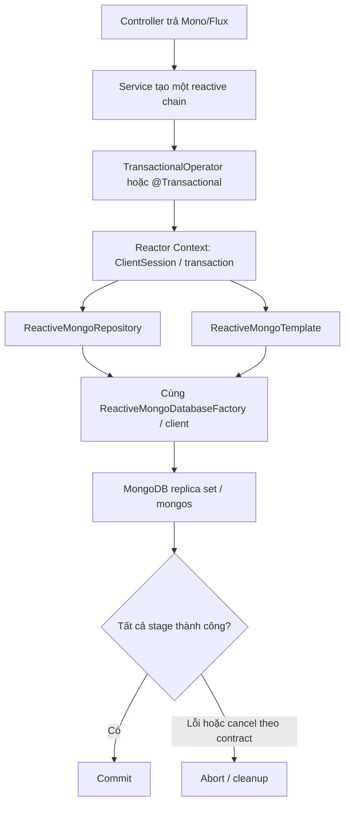

# Ghép thao tác repository và template trong cùng giao dịch

## 1. Bài toán: một nghiệp vụ dùng hai API MongoDB

Một dịch vụ ví điện tử viết bằng **Spring WebFlux + Spring Data MongoDB** cần chuyển số dư giữa hai ví:

1. Đọc ví nguồn bằng **`ReactiveMongoRepository`**.
2. Trừ số dư nguồn có điều kiện, sau đó cộng số dư đích bằng **`ReactiveMongoTemplate`**.
3. Ghi bản ghi chuyển tiền bằng **repository** để có lịch sử nghiệp vụ và khóa chống ghi trùng.

Nếu bước 2 trừ tiền thành công nhưng bước 3 thất bại, dữ liệu có thể thiếu ledger; nếu chỉ cộng tiền đích thành công, tổng tiền có thể thay đổi. Những thao tác này nằm trên **nhiều document**, vì vậy nếu nghiệp vụ yêu cầu *all-or-nothing*, ta cần một **multi-document transaction** thực sự.

Bài học có tên **“Ghép thao tác repository và template trong cùng giao dịch”**, thuộc chương **Giao dịch reactive** của module **SPRING_DATA_MONGODB**. Trong module này, ta thực hành kết nối, ánh xạ BSON/document, truy vấn, aggregation, index, transaction, reactive access, kiểm thử và chẩn đoán hiệu năng. Riêng bài này tập trung vào câu hỏi:

> Khi một nghiệp vụ vừa gọi `ReactiveMongoRepository` vừa gọi `ReactiveMongoTemplate`, điều kiện nào bảo đảm chúng **cùng transaction**, và kiểm chứng điều đó như thế nào?

**Câu trả lời cốt lõi:** cả hai phải được cấu hình trên **cùng cơ sở MongoDB và transaction-aware reactive infrastructure** (thường là cùng `ReactiveMongoDatabaseFactory`), thực thi bên trong **cùng một Reactor subscriber context** do `ReactiveMongoTransactionManager` quản lý, và phải kết nối các publisher thành **một chuỗi** chờ đủ kết quả trước khi commit.

`@Transactional` không biến một MongoDB standalone thành server hỗ trợ multi-document transaction; `Mono.zip(...)` không tự tạo transaction; `subscribe()` riêng bên trong service thường tách công việc ra khỏi transaction đang điều phối.

## 2. Phân biệt ba cơ chế: atomic update, session và transaction

| Cơ chế | Phạm vi | Ví dụ | Có thể rollback nhiều document? |
| --- | --- | --- | --- |
| Atomic update một document | Một document trong một write operation | `$inc` hai field trên cùng ví | Không cần multi-document transaction |
| Client session | Ngữ cảnh logic của một chuỗi thao tác | `ClientSession` | Chưa chắc; session không tự là transaction |
| Multi-document transaction | Nhiều writes/read cùng commit/abort | Trừ ví A, cộng ví B, chèn ledger | Có, khi topology và session hỗ trợ |

Ví dụ không cần multi-document transaction:

```javascript
db.inventory.updateOne(
  { _id: "sku-1", available: { $gte: 3 } },
  {
    $inc: {
      available: -3,
      reserved: 3
    }
  }
);
```

Đây là **một thao tác nguyên tử trên một document**. Ngược lại, ba lệnh viết ở ba document ví/ledger không tự thành một khối nguyên tử chỉ vì được gọi liền nhau trong Java.

### 2.1. Topology hỗ trợ transaction

- **Replica set:** hỗ trợ multi-document transactions từ MongoDB **4.0**.
- **Sharded cluster:** hỗ trợ transactions từ MongoDB **4.2** với router `mongos` và các điều kiện triển khai tương ứng.
- **Standalone `mongod`:** không hỗ trợ multi-document transactions.
- **Single-node replica set** đã chạy `--replSet`, `rs.initiate()` và có PRIMARY: phù hợp để học/kiểm thử transaction nhưng không phải cấu hình HA production.

Kiểm tra topology từ đúng endpoint ứng dụng đang kết nối:

```javascript
db.adminCommand({ hello: 1 });
```

Kết quả có `setName` và PRIMARY là dấu hiệu replica set; `msg: "isdbgrid"` là dấu hiệu `mongos`. Đừng chỉ nhìn `isWritablePrimary:true` rồi kết luận đó không phải standalone.

### 2.2. Vì sao đây là giao dịch *reactive*?

Trong lập trình imperative, Spring quản lý tài nguyên transaction thông dụng bằng **thread-bound context**. Với reactive, mỗi lệnh database được thực hiện **bất đồng bộ qua subscription**, có thể đổi thread. Vì thế, `ReactiveMongoTransactionManager` gắn session/transaction vào **Reactor Context**, không đòi mọi operator luôn chạy trên cùng một Java thread.

Đổi thread bằng `publishOn`/`subscribeOn` trong **cùng chuỗi subscriber context** không mặc định làm mất transaction; ngược lại, gọi `subscribe()` mới riêng, tạo publisher bị tách khỏi chain hoặc dùng Mongo client/factory khác có thể làm thao tác không tham gia transaction mong muốn.

## 3. Sơ đồ các thành phần phải khớp



Điều kiện kiểm tra thực tế:

1. `ReactiveMongoTransactionManager` nhận **`ReactiveMongoDatabaseFactory`** của hệ thống.
2. `ReactiveMongoTemplate` được tạo từ cùng factory hoặc factory tương thích thực sự với transaction manager.
3. `ReactiveMongoRepository` dùng reactive Mongo infrastructure trên **cùng factory/session context**. Với nhiều database hoặc custom repository configuration, đừng mặc định điểm này.
4. Toàn bộ publisher thuộc một chain nằm trong boundary của `TransactionalOperator` hoặc một phương thức reactive có `@Transactional` hoạt động qua Spring proxy.
5. Luồng chờ các lệnh cập nhật và insert **phát hoàn tất**; không fire-and-forget.
6. Khi bất kỳ điều kiện nghiệp vụ bắt buộc nào thất bại, phát **`Mono.error(...)`** để transaction manager abort.

Một lớp `@Service` có field `ReactiveMongoTemplate` và field repository **không tự chứng minh** chúng sẽ cùng transaction; điều quyết định là infrastructure và context lúc thực thi.

## 4. Dependency và cấu hình tối thiểu

Ví dụ dự án **Java 17, Spring Boot 3.x** dùng BOM quản lý version:

```xml
<dependencies>
  <dependency>
    <groupId>org.springframework.boot</groupId>
    <artifactId>spring-boot-starter-data-mongodb-reactive</artifactId>
  </dependency>
  <dependency>
    <groupId>org.springframework.boot</groupId>
    <artifactId>spring-boot-starter-webflux</artifactId>
  </dependency>
  <dependency>
    <groupId>org.springframework.boot</groupId>
    <artifactId>spring-boot-starter-test</artifactId>
    <scope>test</scope>
  </dependency>
  <dependency>
    <groupId>io.projectreactor</groupId>
    <artifactId>reactor-test</artifactId>
    <scope>test</scope>
  </dependency>
</dependencies>
```

Trong worker/background service không có HTTP, starter WebFlux là tùy chọn; thư viện reactive MongoDB có thể được dùng độc lập. Testcontainers cho MongoDB cần thêm dependency test tương ứng nếu dự án sử dụng nó.

Kết nối replica set mẫu:

```properties
spring.data.mongodb.uri=mongodb://db1:27017,db2:27017,db3:27017/walletdb?replicaSet=rs-wallet
```

Với test một node đã khởi tạo thành replica set:

```properties
spring.data.mongodb.uri=mongodb://localhost:27017/walletdb?replicaSet=rs0
```

URI không tạo replica set thay server. Khi dùng Docker, tên host được quảng bá trong `rs.conf()` phải phân giải được từ nơi JVM chạy.

### 4.1. Không bọc template blocking vào `Mono.just`

Sai:

```java
// Đã gọi blocking I/O trước khi Mono được tạo.
Mono<WalletAccount> one = Mono.just(
    imperativeMongoTemplate.findById(id, WalletAccount.class)
);
```

Đúng: dùng `ReactiveMongoTemplate`/reactive repository thực sự:

```java
Mono<WalletAccount> one =
    reactiveMongoTemplate.findById(id, WalletAccount.class);
```

Việc bọc một API blocking trong `Mono` không biến nó thành MongoDB Reactive Streams operation và cũng không bảo đảm tham gia cùng reactive transaction.

## 5. Tạo `ReactiveMongoTransactionManager` và `TransactionalOperator`

Một cấu hình tường minh:

```java
import org.springframework.context.annotation.Bean;
import org.springframework.context.annotation.Configuration;
import org.springframework.data.mongodb.ReactiveMongoDatabaseFactory;
import org.springframework.data.mongodb.ReactiveMongoTransactionManager;
import org.springframework.transaction.reactive.TransactionalOperator;

@Configuration
public class MongoReactiveTxConfig {

    @Bean("reactiveMongoTransactionManager")
    public ReactiveMongoTransactionManager mongoTransactionManager(
        ReactiveMongoDatabaseFactory factory
    ) {
        return new ReactiveMongoTransactionManager(factory);
    }

    @Bean
    public TransactionalOperator mongoTransactionalOperator(
        ReactiveMongoTransactionManager manager
    ) {
        return TransactionalOperator.create(manager);
    }
}
```

Các ý quan trọng:

- `ReactiveMongoTransactionManager` là manager dành cho **Reactive Streams**; đừng dùng `MongoTransactionManager` imperative để quản lý `Mono`/`Flux`.
- `TransactionalOperator.create(...)` tạo một API programmatic để bao một publisher trong transaction.
- Manager sử dụng factory để lấy database/session; nó **không** tự tạo replica set hoặc đảm bảo collection đã có.
- Trong ứng dụng có nhiều manager, dùng `@Qualifier` hoặc tham chiếu bean cụ thể để tránh chọn sai.
- Nếu Spring Boot đã cung cấp infrastructure phù hợp, xác minh những bean thật trong application context trước khi tự khai báo một bản thứ hai.

Ví dụ lựa chọn manager khi có nhiều bean:

```java
import org.springframework.beans.factory.annotation.Qualifier;
import org.springframework.context.annotation.Bean;
import org.springframework.transaction.reactive.TransactionalOperator;

@Bean
TransactionalOperator walletTx(
    @Qualifier("reactiveMongoTransactionManager")
    ReactiveMongoTransactionManager manager
) {
    return TransactionalOperator.create(manager);
}
```

Chỉ dùng **một bean operator với tên/phạm vi bạn định nghĩa rõ** trong ứng dụng thật; hai ví dụ trên là hai cách cấu hình thay thế, không phải yêu cầu khai báo trùng một operator.

### 5.1. Transaction options khi cần ràng buộc rõ

```java
import com.mongodb.ReadConcern;
import com.mongodb.ReadPreference;
import com.mongodb.TransactionOptions;
import com.mongodb.WriteConcern;

TransactionOptions options = TransactionOptions.builder()
    .readConcern(ReadConcern.SNAPSHOT)
    .writeConcern(WriteConcern.MAJORITY)
    .readPreference(ReadPreference.primary())
    .build();

ReactiveMongoTransactionManager manager =
    new ReactiveMongoTransactionManager(factory, options);
```

Mẫu này mô tả cách cấp `TransactionOptions` cho manager; `factory` là `ReactiveMongoDatabaseFactory` đã cấu hình. Trên phiên bản/server khác nhau, cần kiểm tra driver Javadoc và semantics read/write concern thực tế. Không coi `snapshot` là snapshot chung giữa hai request HTTP độc lập, hoặc `majority` là bảo đảm response sẽ không bao giờ bị mất.

## 6. Mô hình dữ liệu: ví và ledger chuyển tiền

Để kết nối ví dụ code, ta sử dụng hai collection đã được provision:

- `wallet_accounts`: mỗi document là một ví.
- `wallet_transfers`: mỗi document là một giao dịch chuyển tiền, khóa `_id` chính là `transferId`.

### 6.1. `WalletAccount`

```java
import org.springframework.data.annotation.Version;
import org.springframework.data.mongodb.core.mapping.Document;
import org.springframework.data.mongodb.core.mapping.Field;
import org.springframework.data.mongodb.core.mapping.FieldType;
import org.springframework.data.mongodb.core.mapping.MongoId;

@Document(collection = "wallet_accounts")
public record WalletAccount(
    @MongoId(FieldType.STRING)
    String id,

    @Field("tenant_id")
    String tenantId,

    @Field("balance_cents")
    long balanceCents,

    @Version
    Long version
) {}
```

Số tiền được lưu bằng **đơn vị nguyên nhỏ nhất** (`long`) để tránh các lỗi floating-point khi cộng/trừ; hệ thống multi-currency cần định nghĩa currency/scale/overflow policy riêng.

`@Version` hỗ trợ optimistic locking trong những API lưu entity thích hợp. Khi ta dùng `ReactiveMongoTemplate.updateFirst(...)` trực tiếp, bài sẽ **tự tăng version** và tùy yêu cầu đặt version kỳ vọng trong filter.

### 6.2. `TransferRecord`

```java
import java.time.Instant;
import org.springframework.data.mongodb.core.mapping.Document;
import org.springframework.data.mongodb.core.mapping.Field;
import org.springframework.data.mongodb.core.mapping.FieldType;
import org.springframework.data.mongodb.core.mapping.MongoId;

@Document(collection = "wallet_transfers")
public record TransferRecord(
    @MongoId(FieldType.STRING)
    String id,

    @Field("tenant_id")
    String tenantId,

    @Field("from_wallet_id")
    String fromWalletId,

    @Field("to_wallet_id")
    String toWalletId,

    @Field("amount_cents")
    long amountCents,

    @Field("payload_hash")
    String payloadHash,

    Instant createdAt
) {}
```

`id` ở đây là `transferId` bền vững của một business request. Dùng `insert` thay vì `save` cho ledger mới để một ID đã tồn tại không bị upsert/ghi đè không chủ ý.

### 6.3. Ví dụ dữ liệu BSON ban đầu

```javascript
db.wallet_accounts.insertMany([
  {
    _id: "wallet-A",
    tenant_id: "tenant-A",
    balance_cents: NumberLong("200000"),
    version: NumberLong("0")
  },
  {
    _id: "wallet-B",
    tenant_id: "tenant-A",
    balance_cents: NumberLong("10000"),
    version: NumberLong("0")
  }
]);
```

Chuyển `50000` cents từ A sang B thành công phải tạo kết quả:

| Document | Ban đầu | Sau commit |
| --- | ---: | ---: |
| `wallet-A.balance_cents` | 200000 | 150000 |
| `wallet-B.balance_cents` | 10000 | 60000 |
| `wallet_transfers["transfer-001"]` | Không có | Có một bản ghi |

Trường hợp credit không có ví đích, cả debit và insert ledger (nếu đã thực hiện) đều phải không còn sau rollback.

## 7. Reactive repositories dùng trong cùng một nghiệp vụ

Khai báo hai repository:

```java
import org.springframework.data.mongodb.repository
    .ReactiveMongoRepository;
import reactor.core.publisher.Mono;

public interface WalletRepository
        extends ReactiveMongoRepository<WalletAccount, String> {

    Mono<WalletAccount> findByIdAndTenantId(
        String id,
        String tenantId
    );
}

public interface TransferRecordRepository
        extends ReactiveMongoRepository<TransferRecord, String> {
}
```

`findByIdAndTenantId(...)` là derived query; với `WalletAccount`, Spring Data dùng metadata `@Field("tenant_id")` để ánh xạ property Java sang BSON field.

### 7.1. Tại sao dùng repository và template chung?

Repository thuận tiện cho:

- `findByIdAndTenantId(...)`, các derived queries có ý nghĩa.
- `insert(...)`/`save(...)` với mapping entity, lifecycle callbacks và hợp đồng optimistic locking của API.
- Tổ chức domain operations thành interface dễ test và tái sử dụng.

Template thuận tiện cho:

- `Query`/`Criteria`/`Update` với điều kiện phức tạp.
- Atomic `$inc` với filter số dư/tenant/version.
- `findAndModify`, bulk writes, aggregation và các thao tác linh hoạt.

Một service có thể sử dụng cả hai **trong cùng transaction** khi cùng reactive infrastructure; không bắt buộc phải ép tất cả thao tác sang một API.

### 7.2. Repository không phải một transaction riêng

`ReactiveMongoRepository` trả publisher. Khi repository được Spring Data cấu hình cùng reactive database factory, thao tác repository được subscribe bên trong một reactive transaction context sẽ tham gia session do manager quản lý.

Không có “transaction của repository” độc lập được tạo tự động chỉ vì gọi `repository.insert(...)`. Muốn nhiều thao tác commit chung, phải có boundary bao toàn bộ luồng.

## 8. Định nghĩa request, kết quả và lỗi domain

```java
public record TransferCommand(
    String transferId,
    String trustedTenantId,
    String fromWalletId,
    String toWalletId,
    long amountCents,
    String payloadHash
) {}

public record TransferReceipt(
    String transferId,
    String status
) {}

public final class TransferRejectedException
        extends RuntimeException {

    public TransferRejectedException(String message) {
        super(message);
    }
}
```

`trustedTenantId` phải được lấy từ security context đã xác thực, không tin nguyên vẹn một chuỗi tenant do client tự chọn. `payloadHash` là fingerprint từ **canonical business payload** để đối chiếu retry; không tự hash một chuỗi ngẫu nhiên mỗi lần request.

Với ví dụ học tập, ta giữ số tiền là `long` và kiểm tra không âm/tràn ở update. Production cần định nghĩa thêm hạn mức, loại currency, AML/authorization, audit và cách xử lý giao dịch pending; không coi code mẫu là một sản phẩm tài chính hoàn chỉnh.

## 9. Service ghép repository và template trong `TransactionalOperator`

Service đầy đủ dưới đây:

- Đọc ví nguồn bằng **`WalletRepository`**.
- Dùng **`ReactiveMongoTemplate.updateFirst`** trừ ví nguồn theo điều kiện số dư/version.
- Dùng **`ReactiveMongoTemplate.updateFirst`** cộng ví đích, kiểm tra ID/tenant và tránh overflow.
- Dùng **`TransferRecordRepository.insert`** để chèn ledger với `transferId`.
- Đưa **toàn bộ chain** qua **`TransactionalOperator`**.

```java
import java.time.Instant;

import com.mongodb.client.result.UpdateResult;
import org.springframework.data.mongodb.core.ReactiveMongoTemplate;
import org.springframework.data.mongodb.core.query.Criteria;
import org.springframework.data.mongodb.core.query.Query;
import org.springframework.data.mongodb.core.query.Update;
import org.springframework.stereotype.Service;
import org.springframework.transaction.reactive.TransactionalOperator;
import reactor.core.publisher.Mono;

@Service
public final class WalletTransferService {

    private final WalletRepository wallets;
    private final TransferRecordRepository transfers;
    private final ReactiveMongoTemplate template;
    private final TransactionalOperator tx;

    public WalletTransferService(
        WalletRepository wallets,
        TransferRecordRepository transfers,
        ReactiveMongoTemplate template,
        TransactionalOperator tx
    ) {
        this.wallets = wallets;
        this.transfers = transfers;
        this.template = template;
        this.tx = tx;
    }

    public Mono<TransferReceipt> transfer(TransferCommand c) {
        return Mono.defer(() -> {
            validate(c);

            Mono<TransferReceipt> work =
                wallets.findByIdAndTenantId(
                    c.fromWalletId(), c.trustedTenantId()
                )
                .switchIfEmpty(Mono.error(
                    new TransferRejectedException(
                        "Ví nguồn không tồn tại hoặc không có quyền"
                    )
                ))
                .flatMap(source -> debit(c, source))
                .flatMap(ignored -> credit(c))
                .flatMap(ignored -> transfers.insert(
                    new TransferRecord(
                        c.transferId(),
                        c.trustedTenantId(),
                        c.fromWalletId(),
                        c.toWalletId(),
                        c.amountCents(),
                        c.payloadHash(),
                        Instant.now()
                    )
                ))
                .map(ledger -> new TransferReceipt(
                    ledger.id(), "APPLIED"
                ));

            return tx.transactional(work);
        });
    }

    private Mono<UpdateResult> debit(
        TransferCommand c,
        WalletAccount source
    ) {
        if (source.version() == null) {
            return Mono.error(new TransferRejectedException(
                "Ví chưa có version hợp lệ"
            ));
        }

        Query query = Query.query(
            Criteria.where("id").is(c.fromWalletId())
                .and("tenantId").is(c.trustedTenantId())
                .and("version").is(source.version())
                .and("balanceCents").gte(c.amountCents())
        );

        Update update = new Update()
            .inc("balanceCents", -c.amountCents())
            .inc("version", 1L);

        return template.updateFirst(
            query, update, WalletAccount.class
        ).flatMap(r -> matchedOnce(
            r, "Ví nguồn thay đổi hoặc không đủ số dư"
        ));
    }

    private Mono<UpdateResult> credit(TransferCommand c) {
        Query query = Query.query(
            Criteria.where("id").is(c.toWalletId())
                .and("tenantId").is(c.trustedTenantId())
                .and("balanceCents").lte(
                    Long.MAX_VALUE - c.amountCents()
                )
        );

        Update update = new Update()
            .inc("balanceCents", c.amountCents())
            .inc("version", 1L);

        return template.updateFirst(
            query, update, WalletAccount.class
        ).flatMap(r -> matchedOnce(
            r, "Ví đích không tồn tại hoặc không nhận được tiền"
        ));
    }

    private Mono<UpdateResult> matchedOnce(
        UpdateResult result, String message
    ) {
        if (!result.wasAcknowledged()) {
            return Mono.error(
                new IllegalStateException(
                    "Không có acknowledgement từ MongoDB"
                )
            );
        }
        if (result.getMatchedCount() != 1L) {
            return Mono.error(
                new TransferRejectedException(message)
            );
        }
        return Mono.just(result);
    }

    private void validate(TransferCommand c) {
        if (c == null
                || blank(c.transferId())
                || blank(c.trustedTenantId())
                || blank(c.fromWalletId())
                || blank(c.toWalletId())
                || blank(c.payloadHash())
                || c.fromWalletId().equals(c.toWalletId())
                || c.amountCents() <= 0) {
            throw new IllegalArgumentException(
                "TransferCommand không hợp lệ"
            );
        }
    }

    private boolean blank(String value) {
        return value == null || value.isBlank();
    }
}
```

### 9.1. Vì sao đặt `tx.transactional(work)` bao tất cả thao tác?

`work` gồm một lời gọi **repository đọc**, hai lời gọi **template cập nhật** và một lời gọi **repository ghi**. Khi subscriber subscribe `tx.transactional(work)`, manager bắt đầu transaction và gắn session vào Reactor Context dùng bởi **cả ba loại thao tác**.

`Mono.defer(...)` làm validation và xây work tại thời điểm subscribe, giúp mỗi subscription có một lần xây transaction flow. Nhưng **subscribe lại** vẫn có thể thử chuyển tiền thêm lần nữa: `defer` không phải idempotency.

### 9.2. Vì sao không dùng `Mono.when(...)`?

Trong cùng transaction/session MongoDB, các lệnh nên được **thực hiện tuần tự** khi có quan hệ phụ thuộc. Sử dụng `when`/`zip` hoặc `flatMap` concurrency cao để thực hiện nhiều MongoDB operations **song song trong cùng transaction** không phải pattern đáng dựa vào; driver/server có những ràng buộc về concurrent operations trên cùng session.

Trong code trên, `flatMap` nối theo thứ tự:

```text
wallets.findByIdAndTenantId
       |
       v
template.updateFirst(debit)
       |
       v
template.updateFirst(credit)
       |
       v
transfers.insert(ledger)
       |
       v
TransferReceipt
       |
       v
transaction commit / response
```

Không có subscription phụ ở giữa, không fork các lệnh ghi đồng thời.

### 9.3. Vì sao mỗi `updateFirst` kiểm tra `matchedCount`?

Một update có điều kiện không khớp **không mặc định phát lỗi**. Ví dụ ví nguồn không đủ tiền, query có `balanceCents >= amount` không khớp, MongoDB trả `matchedCount=0` và publisher có thể phát thành công `UpdateResult`.

Nếu bỏ qua count rồi tiếp tục chèn ledger, transaction có thể **commit một workflow sai nghiệp vụ**. Chúng ta chuyển count 0 thành `Mono.error(...)` để manager abort.

### 9.4. Vì sao dùng `@Version` và tăng version thủ công?

`WalletAccount` có `@Version Long version`. Đường repository `save(entity)` có cơ chế optimistic locking theo version; tuy nhiên `Update` trực tiếp không nhận snapshot version đã đọc trong entity để tự xây precondition.

Trong ví dụ:

- Debit filter kiểm tra `version` của source lấy từ repository.
- Debit và credit dùng `Update.inc("version",1L)` trong **cùng atomic update**.
- Version được ghi tường minh trong `Update` nên không yêu cầu Spring Data tự thêm một lần tăng thứ hai.

Nếu các writer khác bỏ qua version policy hoặc cập nhật raw driver không tăng version, optimistic locking có thể bị vô hiệu về mặt nghiệp vụ. Cần thống nhất mọi write paths.

## 10. Kết quả khi commit thành công

Dữ liệu ban đầu:

```javascript
{
  _id: "wallet-A",
  tenant_id: "tenant-A",
  balance_cents: NumberLong("200000"),
  version: NumberLong("0")
}
{
  _id: "wallet-B",
  tenant_id: "tenant-A",
  balance_cents: NumberLong("10000"),
  version: NumberLong("0")
}
```

Gọi:

```java
TransferCommand request = new TransferCommand(
    "transfer-001",
    "tenant-A",
    "wallet-A",
    "wallet-B",
    50000L,
    "fingerprint-v1"
);

Mono<TransferReceipt> result =
    walletTransferService.transfer(request);

// Ở WebFlux controller, trả Mono result cho framework.
// Trong test, StepVerifier sẽ subscribe.
```

Nếu toàn bộ work và commit thành công:

- Ví A có `balance_cents = 150000`, version tăng 1.
- Ví B có `balance_cents = 60000`, version tăng 1.
- `wallet_transfers` có một record `_id = "transfer-001"`.
- Subscriber nhận `TransferReceipt("transfer-001","APPLIED")` và tín hiệu completion.

Không trả HTTP 200/receipt cho caller trước khi transaction thực sự commit. Bằng cách trả publisher đã được `TransactionalOperator` bao, completion bình thường tương ứng luồng commit hoàn tất theo contract reactive transaction infrastructure. Dù vậy, nếu commit response bị mất, caller có thể thấy lỗi trong khi server đã commit — cần đối soát.

## 11. Kết quả khi credit thất bại: rollback sau một write hợp lệ

Giả sử:

- Ví A tồn tại và đủ `50000` cents.
- Ví B **không tồn tại** hoặc thuộc tenant khác.

Luồng:

```text
1. wallet repository tìm ví A              → thành công
2. template debit ví A: matchedCount=1      → đã thực hiện trong transaction
3. template credit ví B: matchedCount=0     → không có document khớp
4. matchedOnce(...) phát Mono.error(...)    → transaction manager abort
5. Không có ledger insert hoàn tất
6. Readback sau abort: ví A vẫn 200000
```

**Đây là lý do kiểm thử rollback phải gây lỗi sau khi đã có ít nhất một write hợp lệ trong transaction.** Nếu lỗi xảy ra ngay trước bước debit, số dư không đổi không đủ chứng minh rollback đang hoạt động.

### 11.1. Repository insert trùng `transferId` cũng phải rollback

Nếu có ledger `transfer-001` từ trước, `transfers.insert(...)` có thể bị MongoDB từ chối bởi unique `_id`. Transaction phải abort các debit/credit đã làm trước đó.

Không catch lỗi duplicate key **bên trong transaction** rồi return một `TransferReceipt` giả mà không đánh giá trạng thái: nếu không phát lỗi, manager có thể cố commit một work không đáp ứng hợp đồng.

Muốn coi request trùng là `ALREADY_APPLIED`, phải đối soát ledger sau khi transaction thất bại, so sánh đầy đủ payload và trạng thái — không chỉ thấy duplicate ID.

## 12. Những pattern sai làm repository và template không thực sự chung transaction

### 12.1. Sai: tự `subscribe()` trong service

```java
Mono<UpdateResult> debit =
    template.updateFirst(debitQuery, debitUpdate,
        WalletAccount.class);

debit.subscribe(); // CHẠY ĐỘC LẬP, tách khỏi transaction chain!

return tx.transactional(
    transfers.insert(ledger)
);
```

Lệnh debit được subscribe bởi **một subscriber khác**, không tham gia đúng transaction context của ledger. Nếu ledger lỗi, debit có thể đã commit độc lập.

### 12.2. Sai: gọi `block()` trong WebFlux service

```java
WalletAccount source =
    wallets.findById(sourceId).block();

return tx.transactional(
    template.updateFirst(query, update,
        WalletAccount.class)
);
```

`block()` thực hiện subscription riêng và blocking. Kết quả đọc có thể nằm ngoài transaction, và gọi trên event loop làm chặn thread xử lý request.

Đúng là nối `wallets.find...flatMap(...)` trong **cùng** work publisher.

### 12.3. Sai: dùng một `MongoClient` khác cho raw driver

```java
// Ví dụ kiến trúc sai: tự tạo ReactiveMongoClient riêng,
// rồi thao tác với session tách biệt khỏi manager.
// Ngoài ra còn làm tăng pools và khó quản lý lifecycle.
```

Nếu repository dùng factory A và template dùng factory B, manager chỉ gắn session vào infrastructure phù hợp với nó. Không có bảo đảm transaction bao phủ cả hai nếu không có cơ chế phối hợp chuyên biệt.

### 12.4. Sai: trả thành công khi một update không khớp

```java
return template.updateFirst(query, update, WalletAccount.class)
    .then(transfers.insert(ledger));
```

`then(...)` chỉ chờ publisher trước **hoàn tất bình thường**, không biết `matchedCount=0` có phải sai nghiệp vụ không. Khi đó ledger vẫn có thể được insert dù update không tìm được ví.

### 12.5. Sai: gọi hai writes đồng thời trong cùng session

```java
return tx.transactional(Mono.when(
    template.updateFirst(debitQuery, debitUpdate,
        WalletAccount.class),
    template.updateFirst(creditQuery, creditUpdate,
        WalletAccount.class)
));
```

`Mono.when` đăng ký hai thao tác gần như song song. Trong MongoDB transaction, đừng dựa vào concurrent operations trên cùng session để cải thiện throughput; dùng chain tuần tự `flatMap`/`then` và tối ưu bằng giảm số round trips/đơn giản hóa nghiệp vụ.

### 12.6. Sai: `onErrorResume` nuốt lỗi trong transaction

```java
Mono<TransferRecord> unsafe =
    transfers.insert(ledger)
        .onErrorResume(error -> Mono.empty());
```

Nếu lỗi đã được chuyển thành completion rỗng, transaction infrastructure không còn nhận cùng tín hiệu thất bại từ chain đó; nguy cơ commit một số thay đổi trước đó. Với business rejection, **phát lỗi ra khỏi transaction boundary**; việc chuyển thành HTTP 409/404 nên thực hiện sau khi manager xử lý abort hoặc trong controller/advice.

## 13. Alternative: `@Transactional` trên method trả `Mono`

Ngoài `TransactionalOperator`, Spring có thể quản lý reactive transaction khi method trả publisher và được gọi qua Spring proxy:

```java
import org.springframework.stereotype.Service;
import org.springframework.transaction.annotation.Transactional;
import reactor.core.publisher.Mono;
import org.springframework.data.mongodb.core.ReactiveMongoTemplate;
import org.springframework.data.mongodb.core.query.Criteria;
import org.springframework.data.mongodb.core.query.Query;
import org.springframework.data.mongodb.core.query.Update;
import java.time.Instant;

@Service
public class AnnotatedTransferService {

    private final WalletRepository wallets;
    private final ReactiveMongoTemplate template;
    private final TransferRecordRepository transfers;

    public AnnotatedTransferService(
        WalletRepository wallets,
        ReactiveMongoTemplate template,
        TransferRecordRepository transfers
    ) {
        this.wallets = wallets;
        this.template = template;
        this.transfers = transfers;
    }

    @Transactional(
        transactionManager = "reactiveMongoTransactionManager"
    )
    public Mono<TransferReceipt> transfer(
        TransferCommand c
    ) {
        if (c == null || c.amountCents() <= 0
                || c.transferId() == null
                || c.trustedTenantId() == null
                || c.fromWalletId() == null
                || c.toWalletId() == null
                || c.fromWalletId().equals(c.toWalletId())
                || c.payloadHash() == null) {
            return Mono.error(new IllegalArgumentException(
                "TransferCommand không hợp lệ"
            ));
        }

        return wallets.findByIdAndTenantId(
            c.fromWalletId(), c.trustedTenantId()
        ).switchIfEmpty(Mono.error(
            new TransferRejectedException("Ví nguồn không tồn tại")
        )).flatMap(source -> {
            if (source.version() == null) {
                return Mono.error(new TransferRejectedException(
                    "Version nguồn không hợp lệ"
                ));
            }
            Query debit = Query.query(
                Criteria.where("id").is(c.fromWalletId())
                    .and("tenantId").is(c.trustedTenantId())
                    .and("version").is(source.version())
                    .and("balanceCents").gte(c.amountCents())
            );
            return template.updateFirst(
                debit,
                new Update()
                    .inc("balanceCents", -c.amountCents())
                    .inc("version", 1L),
                WalletAccount.class
            );
        }).flatMap(debit -> {
            if (!debit.wasAcknowledged()
                    || debit.getMatchedCount() != 1L) {
                return Mono.error(new TransferRejectedException(
                    "Không trừ được ví nguồn"
                ));
            }
            Query credit = Query.query(
                Criteria.where("id").is(c.toWalletId())
                    .and("tenantId").is(c.trustedTenantId())
                    .and("balanceCents").lte(
                        Long.MAX_VALUE - c.amountCents()
                    )
            );
            return template.updateFirst(
                credit,
                new Update()
                    .inc("balanceCents", c.amountCents())
                    .inc("version", 1L),
                WalletAccount.class
            );
        }).flatMap(credit -> {
            if (!credit.wasAcknowledged()
                    || credit.getMatchedCount() != 1L) {
                return Mono.error(new TransferRejectedException(
                    "Không cộng được ví đích"
                ));
            }
            return transfers.insert(new TransferRecord(
                c.transferId(), c.trustedTenantId(),
                c.fromWalletId(), c.toWalletId(),
                c.amountCents(), c.payloadHash(), Instant.now()
            ));
        }).map(record -> new TransferReceipt(
            record.id(), "APPLIED"
        ));
    }
}
```

Ví dụ trên là một phiên bản **tự chứa của cùng workflow**: repository đọc nguồn, template thực hiện hai cập nhật và repository chèn ledger. Spring áp dụng transaction cho publisher trả về khi gọi qua proxy. Trong sản phẩm thật, nên rút các bước chung thành component để không duy trì hai bản logic chuyển tiền, bổ sung validation/hạn mức/overflow đầy đủ và **không bao thêm `tx.transactional(work)`** một lần nữa.

### 13.1. Chọn cơ chế phù hợp

| Tiêu chí | `@Transactional` reactive | `TransactionalOperator` |
| --- | --- | --- |
| Khai báo boundary | Annotation trên method proxied | Programmatic bao publisher |
| Dễ bỏ sót self-invocation? | Có | Ít phụ thuộc proxy của method |
| Chọn đúng manager | `transactionManager="..."` | Inject đúng operator/manager |
| Linh hoạt theo flow | Phù hợp đa số service methods | Dễ áp riêng từng publisher |
| Cần chain không tự subscribe? | Có | Có |
| Có bảo đảm Mongo standalone hỗ trợ? | Không | Không |

Reactive transaction annotation được áp dụng qua hạ tầng transaction AOP/metadata tương ứng. Nếu tự gọi `this.transfer(...)` trong cùng instance, method có thể không qua proxy; cần test đường gọi thật.

### 13.2. Có nhiều transaction manager

Một dự án có cả PostgreSQL R2DBC, JPA và MongoDB có thể có nhiều manager. Không mặc định `@Transactional` sẽ chọn MongoDB manager; tên/qualifier và framework transaction configuration phải rõ.

Một manager MongoDB **không tự gom** writes vào PostgreSQL transaction. Với nhiều database hoặc broker, dùng outbox/saga/idempotency hoặc cơ chế phối hợp được thiết kế riêng; đừng hứa ACID xuyên hệ thống chỉ bằng một annotation.

## 14. Ranh giới transaction phải bao toàn bộ chuỗi bất đồng bộ

Một ví dụ về thứ tự đúng:

```java
Mono<TransferReceipt> work =
    wallets.findByIdAndTenantId(fromId, tenantId)
        .flatMap(wallet -> debit(wallet))
        .flatMap(debitResult -> credit())
        .flatMap(creditResult -> transfers.insert(record))
        .map(saved -> toReceipt(saved));

return tx.transactional(work);
```

Đây là **pseudo-code về bố cục**; `debit`, `credit`, `toReceipt` là các helper giả định. Phần triển khai Java hoàn chỉnh đã ở mục 9.

Các nguyên tắc:

- Không subscribe ở giữa.
- Không tách publisher quan trọng ra ngoài scope của `tx.transactional(...)`.
- Nếu gọi async client khác để phát email, nó **không** tự có MongoDB rollback semantics.
- Không return thành công trước khi hoàn tất insert ledger/commit.
- Không tạo một `Flux` vô hạn nằm trong transaction và mong transaction tự kết thúc.
- Tránh pause/đợi người dùng hoặc remote HTTP lâu trong lúc giữ transaction mở.

### 14.1. Vì sao `then` có thể phù hợp?

```java
Mono<Void> flow = template.updateFirst(
    query, update, WalletAccount.class
).flatMap(result -> {
    if (result.getMatchedCount() != 1L) {
        return Mono.error(
            new TransferRejectedException("Không khớp")
        );
    }
    return Mono.<Void>empty();
}).then(
    transfers.insert(record).then()
);
```

Ở đây `then(...)` chỉ chạy sau khi update **được kiểm tra** và hoàn tất bình thường. Dùng `then(...)` không sai; sai là bỏ qua result trước khi nối vào lệnh khác.

### 14.2. Cancellation và resource lifecycle

Nếu client HTTP hủy request trong lúc transaction đang chạy, Reactor cancellation và transaction cleanup có thể abort transaction chưa commit theo contract của manager. Nhưng **không suy** từ cancellation rằng server chắc chắn chưa commit. Nếu cancel/timeout xảy ra đúng giai đoạn commit, outcome có thể mơ hồ.

Đối với các business effects quan trọng, transaction completion phải được đối soát qua operation ID/ledger khi response không chắc chắn.

## 15. `Mono.defer`, subscription nhiều lần và idempotency

Một publisher cold có thể thực hiện lại khi subscribe lần nữa:

```java
Mono<TransferReceipt> transfer =
    walletTransferService.transfer(command);

// Hai subscriber khác nhau có thể yêu cầu hai transaction riêng.
StepVerifier.create(transfer).expectNextCount(1).verifyComplete();
StepVerifier.create(transfer).expectError().verify();
```

Đoạn trên chỉ là mô tả rủi ro **hai subscription**; test thật không nên giả định lần thứ hai luôn phát một loại lỗi nhất định mà chưa kiểm soát dữ liệu, error mapping và trạng thái commit. `Mono.defer` không bảo đảm at-most-once giữa requests.

### 15.1. Operation ID bền vững

Giải pháp nền tảng:

1. Caller dùng `transferId` ổn định cho **cùng business operation**.
2. Ledger có unique `_id = transferId`.
3. Ledger lưu `tenantId`, hai ví, `amountCents`, `payloadHash`.
4. Nếu một request trùng ID, đối soát ledger và payload; trả `ALREADY_APPLIED` **chỉ khi dữ liệu khớp**.
5. Nếu không chắc commit đã xảy ra, không tự tạo transfer ID mới để retry.

Không cố “khóa” việc chuyển tiền bằng cách `findById(transferId)` trước rồi `insert`: read-before-write **có race**. Unique index cuối cùng vẫn cần thiết.

### 15.2. Điều gì không đủ?

`Mono.cache()` chỉ cache tín hiệu trong **một instance publisher ở JVM hiện tại**. Nó không bảo vệ giữa hai pods, restart, redelivery từ broker hoặc client retry sau HTTP timeout.

`retryWhen(...)` không an toàn cho write transaction nếu retry chạy lại toàn bộ business flow sau một **unknown commit result**. Phải phân biệt transient transaction error với unknown commit result và dùng ledger để xử lý trạng thái chưa xác định.

## 16. Xử lý kết quả sau commit: `APPLIED`, `ALREADY_APPLIED` và `UNKNOWN`

Một mô hình response domain rõ:

```java
public enum TransferState {
    APPLIED,
    ALREADY_APPLIED,
    REJECTED,
    UNKNOWN
}
```

Diễn giải:

| Trạng thái | Có thể kết luận khi nào? |
| --- | --- |
| `APPLIED` | Transaction hoàn tất bình thường và được xác nhận phù hợp |
| `ALREADY_APPLIED` | Ledger đã tồn tại, payload hash/các field khớp request đã thực hiện |
| `REJECTED` | Business precondition không đạt: không đủ số dư, ví không tồn tại... |
| `UNKNOWN` | Lỗi mạng, timeout hoặc commit response không đủ bằng chứng |

Không trả `REJECTED` cho mọi `MongoException`. Nếu server có thể đã commit nhưng phản hồi bị mất, trả “chắc chắn chưa ghi” có thể khiến caller gửi lại dưới ID mới.

### 16.1. Đối soát ledger bên ngoài transaction thất bại

Một luồng readback:

```java
public Mono<TransferState> reconcile(
    TransferRecordRepository transfers,
    TransferCommand c
) {
    return transfers.findById(c.transferId())
        .map(saved -> {
            boolean same =
                saved.tenantId().equals(c.trustedTenantId())
                && saved.fromWalletId().equals(c.fromWalletId())
                && saved.toWalletId().equals(c.toWalletId())
                && saved.amountCents() == c.amountCents()
                && saved.payloadHash().equals(c.payloadHash());

            return same
                ? TransferState.ALREADY_APPLIED
                : TransferState.REJECTED;
        })
        .defaultIfEmpty(TransferState.UNKNOWN);
}
```

`reconcile(...)` là **kiểm tra sau một kết quả cần đối soát**, không thay thế transaction chính. Với collection sharded/replica set, read preference/read concern phù hợp rất quan trọng: đọc từ secondary bị trễ có thể tạm thời chưa thấy ledger đã commit. Nếu không thấy ledger, kết quả **UNKNOWN** chứ không tự khẳng định chưa ghi.

Đối với transaction đang tiến hành hoặc một commit mơ hồ, cần quy trình retry/đối soát có deadline và thông tin audit. Không log raw payload hay account secrets trong lỗi trả về.

## 17. Vì sao `$inc` và optimistic version vẫn cần khi có transaction?

Transaction bảo đảm **tập writes** commit/abort chung, nhưng điều kiện nghiệp vụ vẫn cần được bảo vệ:

- Số dư nguồn không được âm.
- Số dư đích không vượt giới hạn numeric.
- Ví nguồn và đích thuộc cùng tenant được phép.
- Đơn vị tiền/loại currency tương thích.
- Các writer khác không được ghi đè snapshot cũ mà bỏ qua precondition.

`$inc` trên một document là atomic. `@Version`/`expectedVersion` giúp phát hiện stale data khi read-modify-write. Trong ví dụ, debit kết hợp:

```javascript
{
  _id: "wallet-A",
  tenant_id: "tenant-A",
  version: NumberLong("0"),
  balance_cents: { $gte: NumberLong("50000") }
}
```

với:

```javascript
{
  $inc: {
    balance_cents: NumberLong("-50000"),
    version: NumberLong("1")
  }
}
```

Lệnh này có thể không khớp do version thay đổi hoặc không đủ tiền. `matchedCount=0` trong transaction được biến thành lỗi, làm abort toàn bộ work.

**Không retry tự động bằng cách chỉ tăng expectedVersion** để ép update thành công; phải đọc lại trạng thái, kiểm tra quy tắc nghiệp vụ và xử lý concurrent write conflicts.

## 18. Cùng factory là điều kiện hạ tầng, không chỉ cùng connection string

Ví dụ cấu hình một factory:

```java
import com.mongodb.reactivestreams.client.MongoClient;
import org.springframework.data.mongodb.core.ReactiveMongoTemplate;
import org.springframework.data.mongodb.core.SimpleReactiveMongoDatabaseFactory;

SimpleReactiveMongoDatabaseFactory factory =
    new SimpleReactiveMongoDatabaseFactory(
        mongoClient, "walletdb"
    );

ReactiveMongoTemplate template =
    new ReactiveMongoTemplate(factory);

ReactiveMongoTransactionManager manager =
    new ReactiveMongoTransactionManager(factory);
```

Đây là **đoạn lắp ghép minh họa** với `mongoClient` đã được khởi tạo từ đúng connection config; không phải cấu hình Spring Boot hoàn chỉnh, và không tự cấu hình repositories. Với Spring Boot, nên ưu tiên infrastructure auto-configuration đã được xác minh, hoặc khai báo các bean phù hợp khi có nhiều MongoDB factories.

### 18.1. Repository phải được liên kết với factory nào?

Trong cấu hình reactive repositories tùy chỉnh, có thể khai báo `@EnableReactiveMongoRepositories` và chỉ rõ bean `ReactiveMongoTemplate`/factory theo API version. Nếu ứng dụng có hai Mongo databases, kiểm tra:

- Reactive repository A dùng template/factory của database nào?
- Template inject vào service có cùng database/client/session infrastructure?
- Transaction manager đang gắn với factory tương ứng hay một factory khác?
- Repository scan có vô tình đưa một repository vào MongoDB khác?

Đừng chỉ so hai chuỗi URI bằng text. Hai client riêng biệt đến cùng endpoint vẫn không tự chia sẻ **session object/transaction context**. Việc transaction manager điều phối một session trên factory A không tạo giao dịch phân tán cho MongoDB B.

### 18.2. Ghi multi-database khác ghi multi-resource

MongoDB transaction trên cùng deployment có thể hỗ trợ thao tác trên nhiều collections/databases theo những giới hạn nhất định, nhưng điều đó **không** có nghĩa một `ReactiveMongoTransactionManager` điều phối cả hai MongoClients tách biệt hoặc MongoDB và SQL.

Nếu thật sự cần cross-resource atomicity, cân nhắc architecture và transaction coordination chuyên biệt; không tự suy từ việc cả hai repository đều có tên Reactive.

## 19. `@Transactional` và self-invocation/proxy

Một method reactive có annotation transaction:

```java
@Service
public class PaymentFacade {
    private final AnnotatedTransferService transfers;

    public PaymentFacade(AnnotatedTransferService transfers) {
        this.transfers = transfers;
    }

    public Mono<TransferReceipt> execute(TransferCommand c) {
        return transfers.transfer(c);
    }
}
```

Trong mô hình Spring proxy thông dụng, lời gọi qua injected bean có thể được interceptor transaction bao. Ngược lại:

```java
@Service
public class BrokenFacade {

    public Mono<Void> outer() {
        return this.inner(); // self-invocation, bỏ qua proxy.
    }

    @Transactional(
        transactionManager = "reactiveMongoTransactionManager"
    )
    public Mono<Void> inner() {
        return Mono.empty();
    }
}
```

Annotation trên `inner` **không được áp dụng qua proxy** khi gọi bằng `this.inner()` trong cùng class. Vì vậy, cần test đúng đường gọi production, không chỉ unit test gọi method trực tiếp trên object được tạo bằng `new`.

### 19.1. Không làm transaction phụ vì method con cũng annotated

Khi method A đang có transaction, method B được gọi qua proxy và có propagation `REQUIRED` thông thường sẽ tham gia transaction hiện tại khi cùng manager/context. Nhưng đổi propagation sang `REQUIRES_NEW` có thể tạo transaction mới và phá giả định rollback chung; trong MongoDB reactive, còn phải đối chiếu hỗ trợ semantics cụ thể.

Không đặt annotation lên mọi repository/service method rồi coi propagation là chuyện mặc định. Quy định **transaction boundary** nên ở lớp application service cho một business unit of work.

## 20. Aggregation và truy vấn bên trong transaction

Một transaction có thể bao các thao tác đọc/aggregation được server hỗ trợ và các thao tác ghi có liên quan. Ví dụ sau khi chuyển tiền, đọc lại số dư ví bằng template **trong cùng chain**:

```java
Mono<WalletAccount> afterDebit =
    template.findOne(
        Query.query(
            Criteria.where("id").is(fromId)
                .and("tenantId").is(tenantId)
        ),
        WalletAccount.class
    );
```

Khi publisher được subscribe trong transaction context, query dùng session tương ứng. Nhưng hãy xác định **lúc nào đọc snapshot**, **lúc nào transaction bắt đầu**, và read concern được chọn.

### 20.1. Ví dụ aggregation typed

```java
import org.springframework.data.mongodb.core.aggregation.Aggregation;

Aggregation agg = Aggregation.newAggregation(
    Aggregation.match(
        Criteria.where("tenantId").is(tenantId)
    ),
    Aggregation.group()
        .sum("balanceCents").as("totalBalanceCents")
);

Flux<org.bson.Document> totals = template.aggregate(
    agg,
    WalletAccount.class,
    org.bson.Document.class
);
```

Nếu subscription diễn ra bên trong transaction, aggregation đọc theo transaction context; **nhưng không phải mọi aggregation stage đều được phép trong transaction**. Các stage ghi như `$out`/`$merge` có hạn chế rõ ràng; không dùng chúng trong một transaction với giả định được rollback như các writes thông thường.

### 20.2. Không chạy query phân tích lớn giữa transaction chuyển tiền

Một `$group` quét hàng triệu ví có thể kéo dài transaction, tăng lock/conflict và nguy cơ quá giới hạn thời gian. Nếu chỉ cần một invariant liên quan hai ví, nên đọc/ghi đúng hai document và ledger, không chạy một báo cáo tổng hợp lớn ngay trong transaction.

Tận dụng `$match`, shard key/index và projection để giảm dữ liệu truy cập. `ReactiveMongoTemplate.aggregate(...)` vẫn có thể gây tải CPU/RAM cao trên MongoDB; Reactor không loại chi phí đó.

## 21. Error labels, transient errors và commit chưa rõ

MongoDB cung cấp những error labels quan trọng:

- **`TransientTransactionError`:** một số lỗi cho phép retry **toàn bộ transaction** với dữ liệu mới, theo policy/driver contract.
- **`UnknownTransactionCommitResult`:** không biết commit đã được áp dụng hay chưa; cần xử lý **commit retry/đối soát**, không mặc định chạy lại business transaction ngay.

`ReactiveMongoTransactionManager` không tự bảo đảm đầy đủ business idempotency, nhất là khi có HTTP/broker side effects. Nếu muốn retry, phải đánh giá exception và phạm vi retry của transaction boundary.

### 21.1. Trường hợp mất phản hồi khi commit

```text
T1: Debit và credit, ghi ledger trong transaction.
T2: MongoDB đã commit cả ba document.
T3: Network đứt trước khi client nhận ACK của commit.
T4: Reactive pipeline phát error/timeout.
T5: Client retry cùng request.
```

Ở T4, không thể tự kết luận rollback. Nếu T5 tự sinh `transferId` mới, có thể chuyển tiền hai lần. Nếu giữ ID cố định, unique ledger và payloadHash, client có thể đối soát.

### 21.2. Có nên dùng `retryWhen`?

Chỉ dùng với **bounded retry** và bộ lọc lỗi đúng:

```java
// Ví dụ đọc thuần, không phải retry transaction ghi:
Mono<WalletAccount> one =
    wallets.findByIdAndTenantId(id, tenantId)
        .retryWhen(
            reactor.util.retry.Retry.backoff(
                2, java.time.Duration.ofMillis(150)
            ).filter(this::isTransientReadFailure)
        );
```

`isTransientReadFailure` là predicate do ứng dụng triển khai phù hợp driver/version. Với workflow chuyển tiền, không copy `retryWhen` trên vào toàn transaction mà chưa xử lý `UnknownTransactionCommitResult` và idempotency.

### 21.3. Duplicate ledger là tín hiệu cần kiểm tra, không phải cứ thành công

`DuplicateKeyException` có thể đến từ ledger `transferId` đã tồn tại. Nhưng dữ liệu ledger hiện có có thể mang **payload khác** với request. Chỉ trả `ALREADY_APPLIED` khi so sánh tenant, ví nguồn/đích, số tiền/currency và hash nghiệp vụ đúng; khác thì trả conflict.

## 22. Transaction resource limits và cancellation

Transaction giữ trạng thái trên server và có chi phí. MongoDB có tham số như `transactionLifetimeLimitSeconds`, cùng giới hạn thời gian lock, cache và khả năng xử lý write conflicts. Mặc định phổ biến khoảng 60 giây ở nhiều deployment, nhưng phải đối chiếu server/config thực tế.

Một transaction tốt thường:

- Ngắn, ít document và collection cần chạm.
- Không chờ HTTP/cổng thanh toán/người dùng giữa các DB operations.
- Không xử lý `Flux` vô hạn trong transaction.
- Không mở cursor lâu hoặc chuyển hàng triệu document trong một giao dịch.
- Không tự tạo index/collection trong transaction nếu server/version/topology không hỗ trợ.
- Có timeout hợp lý, monitoring commit/abort và retry policy.

### 22.1. Cancellation khác abort xác nhận

Nếu browser hủy request:

```java
Mono<TransferReceipt> result =
    service.transfer(command)
        .timeout(java.time.Duration.ofSeconds(4));
```

`timeout` của Reactor có thể làm subscription bị cancel và transaction infrastructure dọn tài nguyên theo contract. Tuy nhiên, nếu server đã commit gần thời điểm cancel và client không nhận phản hồi, outcome có thể **UNKNOWN**.

Không xem HTTP 504 là bằng chứng chắc chắn “tiền chưa chuyển”. Phải tra ledger/transaction status bằng operation ID.

## 23. Dữ liệu ban đầu và chuẩn bị collection cho integration test

Một test xác minh transaction **không** nên dùng standalone MongoDB. Với Testcontainers, dùng image/driver có replica-set support, hoặc một MongoDB replica set riêng cho CI.

Ví dụ tạo môi trường với **Testcontainers 1.x** khi API tương ứng sẵn có:

```java
import org.testcontainers.containers.MongoDBContainer;
import org.testcontainers.junit.jupiter.Container;
import org.testcontainers.junit.jupiter.Testcontainers;
import org.testcontainers.utility.DockerImageName;
import org.springframework.test.context.DynamicPropertyRegistry;
import org.springframework.test.context.DynamicPropertySource;

@Testcontainers
class ReplicaSetContainerSupport {

    @Container
    static final MongoDBContainer mongo = new MongoDBContainer(
        DockerImageName.parse("mongo:7.0")
    );

    @DynamicPropertySource
    static void mongoProperties(
        DynamicPropertyRegistry registry
    ) {
        registry.add(
            "spring.data.mongodb.uri",
            mongo::getReplicaSetUrl
        );
    }
}
```

Đây là đoạn **thiết lập độc lập** để giải thích cách cấp replica set URI, không phải test class hoàn chỉnh của service. Cần dependency Testcontainers MongoDB/JUnit Jupiter và phiên bản API đúng với dự án. Các phiên bản Testcontainers mới có thể đổi class/package; hãy dùng Javadoc của dependency thực tế.

### 23.1. Provision collections trước khi transaction chạy

Trong nhiều môi trường/phiên bản, tự động tạo collection hoặc index bên trong một transaction có những hạn chế. Đặc biệt ở sharded cluster, nên provision collection `wallet_accounts` và `wallet_transfers` trước.

```java
Mono<Void> provision = template
    .collectionExists(WalletAccount.class)
    .flatMap(exists -> exists
        ? Mono.empty()
        : template.createCollection(WalletAccount.class).then()
    )
    .then(
        template.collectionExists(TransferRecord.class)
            .flatMap(exists -> exists
                ? Mono.empty()
                : template.createCollection(
                    TransferRecord.class
                ).then()
            )
    );
```

Chạy provision **ngoài transaction nghiệp vụ**, dưới một deployment/test initialization step có quyền DDL. Nếu nhiều test chạy song song cùng DB, tránh race và dùng database name riêng.

### 23.2. Kiểm tra bean thực sự dùng đúng factory

Test nên xác minh application context chứa:

- `ReactiveMongoTemplate` đúng database.
- `WalletRepository` và `TransferRecordRepository` dùng reactive infrastructure phù hợp.
- `ReactiveMongoTransactionManager` được khởi tạo từ cùng factory.
- `TransactionalOperator` do manager đó tạo.
- `@Document` và converters ánh xạ đúng `_id`, `tenant_id`, `balance_cents`.

Chỉ unit-test `new WalletTransferService(mockRepo,mockTemplate,mockTx)` **không thể chứng minh** session của repository và template thực sự dùng chung.

## 24. Test commit bằng `StepVerifier`

Ví dụ JUnit 5/AssertJ/Spring Boot 3.x sử dụng MongoDB replica set test database đã cấp qua cấu hình môi trường.

```java
import static org.assertj.core.api.Assertions.assertThat;

import org.junit.jupiter.api.BeforeEach;
import org.junit.jupiter.api.Test;
import org.springframework.beans.factory.annotation.Autowired;
import org.springframework.boot.test.autoconfigure.data.mongo.DataMongoTest;
import org.springframework.context.annotation.Import;
import org.springframework.data.mongodb.core.ReactiveMongoTemplate;
import reactor.core.publisher.Mono;
import reactor.test.StepVerifier;

@DataMongoTest
@Import({
    MongoReactiveTxConfig.class,
    WalletTransferService.class
})
class WalletTransferReactiveIntegrationTest {

    @Autowired ReactiveMongoTemplate template;
    @Autowired WalletRepository wallets;
    @Autowired TransferRecordRepository transfers;
    @Autowired WalletTransferService service;

    @BeforeEach
    void ensureCollections() {
        Mono<Void> provision = template
            .collectionExists(WalletAccount.class)
            .flatMap(exists -> exists
                ? Mono.empty()
                : template.createCollection(
                    WalletAccount.class
                ).then()
            )
            .then(template
                .collectionExists(TransferRecord.class)
                .flatMap(exists -> exists
                    ? Mono.empty()
                    : template.createCollection(
                        TransferRecord.class
                    ).then()
                )
            );

        StepVerifier.create(provision).verifyComplete();
    }

    @Test
    void repositoryAndTemplateCommitTogether() {
        String suffix = java.util.UUID.randomUUID()
            .toString();
        String tenant = "test-" + suffix;
        String from = "from-" + suffix;
        String to = "to-" + suffix;
        String transferId = "transfer-" + suffix;

        Mono<Void> setup = wallets.insert(
            new WalletAccount(from, tenant, 200000L, null)
        ).then(wallets.insert(
            new WalletAccount(to, tenant, 10000L, null)
        )).then();

        TransferCommand command = new TransferCommand(
            transferId, tenant, from, to,
            50000L, "hash-for-test"
        );

        Mono<Void> scenario = setup
            .then(service.transfer(command))
            .flatMap(receipt -> {
                assertThat(receipt.status())
                    .isEqualTo("APPLIED");
                return wallets.findByIdAndTenantId(
                    from, tenant
                );
            })
            .flatMap(source -> {
                assertThat(source.balanceCents())
                    .isEqualTo(150000L);
                return wallets.findByIdAndTenantId(
                    to, tenant
                );
            })
            .flatMap(target -> {
                assertThat(target.balanceCents())
                    .isEqualTo(60000L);
                return transfers.findById(transferId);
            })
            .doOnNext(ledger -> {
                assertThat(ledger.amountCents())
                    .isEqualTo(50000L);
            })
            .then();

        StepVerifier.create(scenario)
            .verifyComplete();
    }
}
```

Trong Spring Boot test slice, khả năng autoconfigure reactive repositories phụ thuộc starter/phiên bản; nếu bean `WalletRepository` không được tạo, kiểm tra `@EnableReactiveMongoRepositories` hoặc test configuration tương ứng thay vì tự đổi sang blocking repository.

**Điểm quan trọng:** test chỉ có giá trị nếu URI chỉ đến replica set thật và transaction manager đang được dùng. Nếu MongoDB standalone trả lỗi ở lệnh đầu, test commit này sẽ thất bại, không bị nhầm thành “transaction đã được kiểm chứng”.

## 25. Test rollback sau template debit và lỗi ở bước tiếp theo

Một kịch bản khác: debit ví nguồn thành công, credit ví đích không khớp, service phát lỗi; transaction phải rollback debit.

Thêm method này vào **cùng test class** ở mục 24:

```java
@Test
void abortsDebitWhenTargetWalletMissing() {
    String suffix = java.util.UUID.randomUUID()
        .toString();
    String tenant = "test-" + suffix;
    String from = "from-" + suffix;
    String missingTarget = "missing-" + suffix;
    String transferId = "transfer-" + suffix;

    WalletAccount source = new WalletAccount(
        from, tenant, 200000L, null
    );

    TransferCommand command = new TransferCommand(
        transferId, tenant, from, missingTarget,
        50000L, "rollback-hash"
    );

    Mono<Void> setup = wallets.insert(source).then();

    StepVerifier.create(
        setup.then(service.transfer(command))
    )
        .expectError(TransferRejectedException.class)
        .verify();

    StepVerifier.create(
        wallets.findByIdAndTenantId(from, tenant)
    )
        .assertNext(after -> {
            assertThat(after.balanceCents())
                .isEqualTo(200000L);
        })
        .verifyComplete();

    StepVerifier.create(transfers.findById(transferId))
        .verifyComplete();
}
```

Kịch bản này chứng minh:

1. Source wallet đã được insert và có tiền.
2. Debit query khớp và đã chạy trong transaction.
3. Credit query không khớp vì ví đích không tồn tại.
4. `Mono.error` làm transaction abort.
5. Readback nguồn vẫn có **200000**, ledger không tồn tại.

Nếu transaction không thực sự được mở, debit có thể tồn tại sau lỗi; test rollback sẽ phát hiện bug đó. Nếu DB standalone từ chối transaction trước debit, test cũng phát lỗi nhưng cần test commit ở mục 24 để chứng minh môi trường transaction-capable.

### 25.1. Test lỗi repository chèn ledger

Một test bổ sung nên:

1. Pre-insert ledger với một `transferId` cố định **ngoài transaction**.
2. Tạo hai ví đủ điều kiện.
3. Gửi command có **cùng `transferId`**.
4. Debit và credit trong transaction đều khớp, nhưng `transfers.insert(...)` phát duplicate key.
5. Assert hai ví **không đổi số dư**, ledger cũ không bị ghi đè.

Đây là test nhấn mạnh **lỗi từ repository cũng rollback writes đã thực hiện bởi template**. Nó trực tiếp xác minh ý nghĩa “ghép repository và template trong cùng giao dịch” hơn một unit test chỉ mock repository.

## 26. Kiểm thử điều kiện âm: chứng minh những sai lầm không tham gia transaction

Ngoài happy path và rollback, nên có những test tình huống sai có kiểm soát:

| Tình huống | Kỳ vọng |
| --- | --- |
| Repository và template dùng cùng factory/context | Commit/abort chung như ví dụ |
| Template dùng factory/client khác | Không giả định cùng transaction; test/config phải phát hiện |
| Gọi `subscribe()` riêng trong service | Lệnh ngoài chain có thể đã commit độc lập |
| Dùng `Mono.when(debit,credit)` trong một session | Không dựa vào concurrent operations; sửa thành tuần tự |
| Bỏ kiểm tra `matchedCount` | Test bắt được ledger được chèn dù source/target không hợp lệ |
| `onErrorResume(Mono.empty())` nuốt lỗi | Test bắt được workflow hoàn tất sai |
| `@Transactional` self-invocation | Method không qua proxy; có thể không mở tx |
| MongoDB standalone | Transaction không hoạt động |
| URI replica set sai/PRIMARY không có | Server selection hoặc transaction startup lỗi |
| Duplicate ledger ID | Debit/credit rollback, có thể đối soát idempotency |
| Hai requests cùng source | Version/write conflict được xử lý |
| HTTP timeout gần commit | Phân loại UNKNOWN và đối soát, không chuyển tiền hai lần |

**Không thử cố tình phá production database hoặc ngắt cluster đang phục vụ người dùng.** Dùng Testcontainers/failpoint có kiểm soát trên môi trường test để mô phỏng lỗi mạng/commit nếu thực sự cần.

### 26.1. Test hot-wallet cạnh tranh

Trên số liệu đại diện, nhiều transaction cùng debit một ví có thể gây write conflicts. Test concurrency nên:

- Cố định tổng số dư và tổng yêu cầu.
- Dùng transferId riêng cho những yêu cầu khác nhau.
- Đếm số `APPLIED` và số business rejections/conflicts.
- Đối chiếu ledger count và tổng số dư cuối.
- Không giả định mọi transaction sẽ được driver tự retry thành công.
- Giới hạn concurrency, backoff và thời gian test.

Không kết luận transaction “không hỗ trợ concurrency” nếu cần retry ở mức nghiệp vụ; transaction vừa bảo vệ bất biến vừa có cơ chế phát hiện conflict.

## 27. Hiệu năng: index, snapshot và tuổi thọ transaction

Đọc và cập nhật nhiều document trong transaction có chi phí. Những yếu tố cần theo dõi:

| Yếu tố | Rủi ro | Hướng giảm |
| --- | --- | --- |
| Query thiếu index | Collection scan kéo dài transaction | Index theo filter thực tế |
| Giao dịch dài | Giữ tài nguyên, tăng abort/conflict | Ít round trips, không gọi remote HTTP |
| Hot document | Nhiều writes tranh nhau | Queue/serialize theo wallet key hoặc giảm cạnh tranh |
| Sharded transaction nhiều shards | Coordination/commit chậm | Shard key và placement phù hợp |
| Nhiều concurrent subscriptions | Tăng pool pressure/abort rate | Giới hạn concurrency |
| Retry mù | Business effect lặp, tải tăng | OperationId, ledger và error classification |
| Cursor/aggregation trong transaction | Tăng memory/timeout | Chỉ query những gì cần cho bất biến |

Với filter `_id + tenant_id + version`, default unique index trên `_id` thường đủ để định vị ví; **không mặc định** phải thêm compound index `{_id:1,version:1}` cho mỗi CAS.

Đối với danh sách giao dịch theo tenant và thời gian, một index riêng có thể hữu ích:

```javascript
db.wallet_transfers.createIndex(
  {
    tenant_id: 1,
    createdAt: -1,
    _id: 1
  },
  {
    name: "idx_transfers_tenant_created_id"
  }
);
```

`@Field` mapping cần đúng BSON field thực tế. Index cho read/report không tự bảo đảm transaction atomicity, idempotency hoặc uniqueness giữa các document; chúng là cơ chế khác nhau.

### 27.1. Đọc `explain` nhưng không coi nó là transaction profiler

```javascript
db.wallet_accounts.find({
  _id: "wallet-A",
  tenant_id: "tenant-A",
  balance_cents: { $gte: NumberLong("50000") }
}).explain("executionStats");
```

Theo dõi `IXSCAN`, `COLLSCAN`, `totalKeysExamined`, `totalDocsExamined`, `nReturned`. Nhưng `explain` cho `find` không bao gồm toàn bộ chi phí commit, replication, write concern hoặc lock contention.

Cần metrics transaction: active/aborted/committed transactions, commit latency, write conflicts, MongoDB driver pool, timeouts và throughput. Dùng command monitoring/profiler có masking để tránh lộ dữ liệu tài chính trong log.

## 28. Các lỗi thường gặp và cách sửa

**Lỗi 1 — “Repository và template cùng inject vào service nên tự cùng transaction.”** Không. Cần same reactive infrastructure và same transaction subscriber context.

**Lỗi 2 — “`@Transactional` trên Mono hoạt động cả khi service tự `subscribe()` giữa chừng.”** Không bảo đảm; subscription riêng có thể tách khỏi context.

**Lỗi 3 — “MongoDB standalone vẫn chạy được multi-document transaction vì Spring có manager.”** Sai. Hạ tầng cần replica set hoặc sharded cluster phù hợp.

**Lỗi 4 — “`Mono.zip` hoặc `Mono.when` giúp chạy song song hai update trong cùng Mongo transaction an toàn hơn.”** Không nên dựa vào concurrent operations trên cùng session; nối tuần tự.

**Lỗi 5 — “`Mono.then(...)` tự hiểu update trước đó matched=0 là lỗi.”** Không. Phải đọc `UpdateResult` và phát `Mono.error` khi precondition không đạt.

**Lỗi 6 — “Nuốt lỗi repository insert bằng `onErrorResume` vẫn rollback.”** Không nếu lỗi bị chuyển thành completion bình thường trong transaction boundary.

**Lỗi 7 — “`@Transactional` qua `this.inner()` vẫn được proxy.”** Không theo cấu hình Spring proxy thông thường.

**Lỗi 8 — “Một `ReactiveMongoTransactionManager` quản lý mọi MongoClient hoặc PostgreSQL trong JVM.”** Không. Nó quản lý MongoDB sessions theo factory của mình.

**Lỗi 9 — “Dùng `@Version` thì direct `Update` tự có expectedVersion.”** Không tự suy version snapshot từ query nếu bạn không đưa vào precondition.

**Lỗi 10 — “`walletRepo.save` luôn tương đương `insert` cho ledger mới.”** Không. `save` có semantics insert/update; ledger idempotency nên dùng `insert` và unique key ổn định.

**Lỗi 11 — “Có `Mono.defer` nên request chỉ chạy đúng một lần trong đời.”** Không. Subscribe lại có thể kích hoạt transaction mới.

**Lỗi 12 — “Mất phản hồi commit chứng minh transaction đã abort.”** Không. Outcome có thể UNKNOWN.

**Lỗi 13 — “Có unique transfer ID nên mọi retry với payload khác cũng là thành công.”** Không. Phải so khớp canonical payload.

**Lỗi 14 — “Reactive backpressure làm database transaction tự có chi phí thấp.”** Không. Index, snapshot, locks và sharded coordination vẫn có chi phí thực.

**Lỗi 15 — “Rollback test trên standalone ném lỗi là bằng chứng transaction đúng.”** Không. Cần test commit thành công và rollback sau write hợp lệ trên replica set.

**Lỗi 16 — “`@DataMongoTest` luôn tự tạo transaction manager/replica set.”** Không. Test context và MongoDB topology cần được cấu hình, xác minh riêng.

**Lỗi 17 — “Transaction rollback được email, HTTP và broker messages.”** Không. Cần outbox hoặc kiến trúc eventual consistency riêng.

**Lỗi 18 — “`timeout` của Reactor đồng nghĩa server không thể commit.”** Không. Client cancellation/timeout và server commit là hai vấn đề khác nhau.

## 29. Bài thực hành từng bước

1. Tạo MongoDB **single-node replica set** cho máy test hoặc dùng Testcontainers hỗ trợ replica set.
2. Kiểm tra `db.adminCommand({hello:1})` để xác nhận `setName`/PRIMARY.
3. Cấu hình starter reactive MongoDB và connection URI đúng advertised host.
4. Khai báo `WalletAccount`/`TransferRecord` với `@Document` và BSON field mapping.
5. Tạo `WalletRepository` và `TransferRecordRepository`.
6. Khai báo `ReactiveMongoTransactionManager` và `TransactionalOperator` dùng đúng `ReactiveMongoDatabaseFactory`.
7. Provision `wallet_accounts` và `wallet_transfers` **trước** khi chạy transaction.
8. Insert hai ví ban đầu A=200000 và B=10000.
9. Viết query template debit: tenant, ID, version, balance đủ.
10. Viết update credit có kiểm tra target/tenant và giới hạn overflow.
11. Chèn ledger bằng repository `insert` có transferId ổn định.
12. Ghép cả ba writes và một repository read vào **một Mono chain**.
13. Bọc bằng `tx.transactional(work)`, không tự subscribe.
14. Dùng `StepVerifier` kiểm tra commit: A=150000, B=60000, ledger tồn tại.
15. Dùng target không tồn tại để gây lỗi **sau debit**, kiểm tra rollback.
16. Thử duplicate ledger ID và kiểm tra debit/credit rollback.
17. Viết phiên bản dùng `@Transactional(transactionManager="reactiveMongoTransactionManager")`, gọi qua bean proxy.
18. Thử một self-invocation để thấy vì sao không nên dựa vào annotation trên method gọi bằng `this`.
19. Trong test cô lập, thử factory khác và xác minh không phải cùng transaction.
20. Đổi `flatMap` tuần tự thành `Mono.when` để phân tích vì sao concurrent commands cùng session không là pattern tốt.
21. Thiết kế service `reconcile(...)` và phân loại `APPLIED`, `ALREADY_APPLIED`, `UNKNOWN`.
22. Tạo load test có nhiều giao dịch cạnh tranh một ví, đo abort rate và p95/p99.
23. Xem execution plan của query debit bằng `explain("executionStats")`.
24. Ghi lại tài liệu vận hành: topology, timeout, retry/commit unknown, monitoring, idempotency.

## 30. Checklist trước production

| Câu hỏi | Tiêu chí kiểm tra |
| --- | --- |
| Hạ tầng | Replica set/sharded cluster hỗ trợ transaction, có PRIMARY? |
| Factory | Manager, template và repositories dùng cùng reactive infrastructure? |
| Transaction boundary | `TransactionalOperator` hoặc `@Transactional` bao hết unit of work? |
| Proxy | Method annotated được gọi qua Spring proxy? |
| Subscription | Không `subscribe()` thủ công hoặc `block()` giữa chain? |
| Lệnh DB | Có thứ tự, không song song tùy tiện trên cùng session? |
| Read/Write | Repository find/insert và template updates đều được subscribe trong transaction? |
| Filter | Tenant/ACL, balance/version và business preconditions đặt trong Mongo query? |
| Result | `matchedCount==0` có phát lỗi để rollback? |
| Version | Có kiểm soát expectedVersion và atomic increment khi cần? |
| Uniqueness | Ledger có transferId unique, payloadHash để đối soát? |
| Ambiguous commit | Có trạng thái UNKNOWN và quy trình readback? |
| Retry | Không retry mù sau timeout, xử lý transient vs unknown commit? |
| Schema/Index | Collections đã provision; index phục vụ read path, không tự tạo giữa transaction? |
| Resource | Giao dịch ngắn, không gọi remote HTTP, không xử lý infinite Flux? |
| Sharding | Có shard key phù hợp, giảm fan-out nếu cần? |
| Reactive context | Không chuyển sang imperative/raw client khác mà mất session? |
| Test | Có commit **và** rollback sau write bằng StepVerifier trên replica set? |
| Performance | Có latency, abort rate, write conflict, pool/cursor metrics? |
| Security | Không lộ tenant khác, không log payload/secret tài chính? |

## 31. Tài liệu chính thức và lưu ý phiên bản

Hành vi transaction phụ thuộc **MongoDB Server**, **MongoDB Java Reactive Streams Driver**, **Spring Data MongoDB**, **Reactor** và **Spring Boot** mà ứng dụng đang dùng. Kiểm tra Javadoc/BOM đúng phiên bản; ví dụ Java 17 và Spring Boot 3.x trong bài mang tính hướng dẫn, không thay một lượt compile/integration test trên dự án thực.

- [Spring Data MongoDB — Client Sessions and Transactions](https://docs.spring.io/spring-data/mongodb/reference/mongodb/client-session-transactions.html)
- [Spring Data MongoDB — Reactive MongoDB Support](https://docs.spring.io/spring-data/mongodb/reference/mongodb/reactive-mongodb.html)
- [Spring Data MongoDB — ReactiveMongoTransactionManager Javadoc](https://docs.spring.io/spring-data/mongodb/reference/api/java/org/springframework/data/mongodb/ReactiveMongoTransactionManager.html)
- [Spring Data MongoDB — ReactiveMongoTemplate Javadoc](https://docs.spring.io/spring-data/mongodb/reference/api/java/org/springframework/data/mongodb/core/ReactiveMongoTemplate.html)
- [Spring Data MongoDB — Reactive Repositories](https://docs.spring.io/spring-data/mongodb/reference/mongodb/repositories/repositories.html)
- [Spring Framework — Programmatic Transaction Management](https://docs.spring.io/spring-framework/reference/data-access/transaction/programmatic.html)
- [Spring Framework — TransactionalOperator](https://docs.spring.io/spring-framework/docs/current/javadoc-api/org/springframework/transaction/reactive/TransactionalOperator.html)
- [Project Reactor — Reactor Context](https://projectreactor.io/docs/core/release/reference/advancedFeatures/context.html)
- [MongoDB Manual — Transactions](https://www.mongodb.com/docs/manual/core/transactions/)
- [MongoDB Manual — Transactions Production Considerations](https://www.mongodb.com/docs/manual/core/transactions-production-consideration/)
- [MongoDB Manual — Retryable Writes](https://www.mongodb.com/docs/manual/core/retryable-writes/)
- [Testcontainers — MongoDB Module](https://java.testcontainers.org/modules/databases/mongodb/)

**Kết luận:** `ReactiveMongoRepository` và `ReactiveMongoTemplate` có thể thực hiện những thao tác **trong cùng MongoDB multi-document transaction** khi chúng dùng **cùng reactive database/session infrastructure** và được subscribe như **một chuỗi** bên trong boundary do `ReactiveMongoTransactionManager` quản lý. `TransactionalOperator` cho phép bao trọn lời gọi repository, conditional update từ template và repository insert ledger, còn `@Transactional` là lựa chọn khai báo khi lời gọi đi qua Spring proxy đúng cách. Để đảm bảo tính đúng, phải kiểm tra `matchedCount`/precondition, phát lỗi để rollback, tránh subscriptions và concurrent writes tách rời context, dùng transaction-capable replica set/sharded cluster, cùng cơ chế idempotency và đối soát kết quả commit chưa rõ. Bằng chứng đáng tin là **integration test commit thành công và rollback sau một write đã chạy**, với `StepVerifier`, MongoDB thật và quan sát dữ liệu sau transaction.

