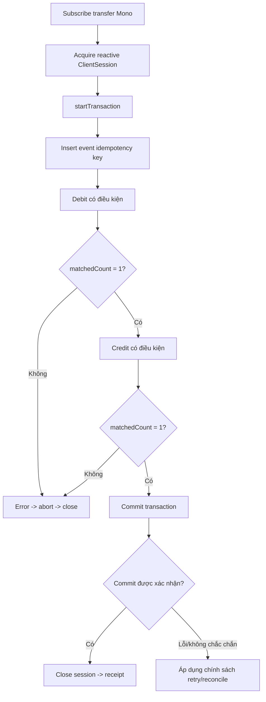
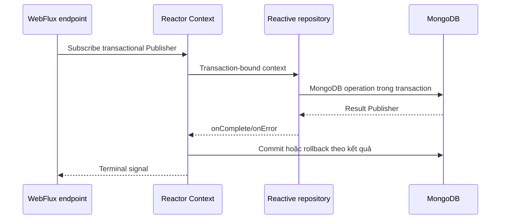

# ClientSession thủ công qua template và giới hạn tích hợp repository

## 1. Bài toán: vì sao hai lệnh reactive chưa chắc nằm trong cùng transaction?

Một service chuyển tiền giữa hai ví nội bộ:

1. Trừ số dư ví nguồn.
2. Cộng số dư ví đích.
3. Ghi một document xác nhận giao dịch.

Yêu cầu nghiệp vụ: **hoặc cả ba thay đổi được commit, hoặc tất cả bị rollback**. Nếu ví nguồn đã bị trừ mà ví đích chưa được cộng, dữ liệu không còn nhất quán.

Trong Spring Data MongoDB, lập trình reactive thường dùng `Mono`, `Flux`, `ReactiveMongoTemplate` hoặc `ReactiveMongoRepository`. Các Publisher được tạo trong Java **không tự đồng nghĩa** các lệnh MongoDB đã bắt đầu. Đồng thời, việc hai lời gọi nằm trong cùng method hoặc cùng thread **không tự biến chúng thành một transaction**.

Một sai lầm dễ gặp:

```java
Mono<UpdateResult> debit = reactiveTemplate.updateFirst(
    debitQuery, debitUpdate, Wallet.class
);

Mono<UpdateResult> credit = reactiveTemplate.updateFirst(
    creditQuery, creditUpdate, Wallet.class
);

return debit.then(credit);
```

Đoạn code trên bảo đảm thứ tự subscription **debit rồi credit**. Tuy nhiên, nếu không có session/transaction được cấu hình thích hợp, **debit có thể đã ghi thành công trong khi credit thất bại**. `then(...)` không cung cấp atomic commit.

Để kiểm soát một transaction theo cách thủ công, MongoDB cung cấp **`ClientSession`**. Spring Data MongoDB reactive cho phép gắn một session vào **template operations** qua `ReactiveMongoTemplate.withSession(...)`. Nhưng việc dùng explicit session này có những giới hạn đáng kể khi code khác gọi repository.

Bài nằm trong chương **Giao dịch reactive** của module **SPRING_DATA_MONGODB**, nơi Spring Data được sử dụng để kết nối, ánh xạ document, truy vấn, aggregation, transaction, reactive access, kiểm thử và chẩn đoán hiệu năng. Trọng tâm là:

- Cách tạo và sử dụng **reactive `ClientSession` thủ công** qua `ReactiveMongoTemplate`.
- Phân biệt **session**, **transaction**, **subscription** và **transaction context**.
- Cách giữ mọi lệnh trong cùng session, tuần tự và có vòng đời đúng.
- Cách **commit/abort/close** mà không bỏ qua nhánh error hoặc cancellation.
- Vì sao một lời gọi `ReactiveMongoRepository` thông thường **không tự dùng explicit session** vừa truyền vào một template khác.
- Khi nào nên chuyển sang **`ReactiveMongoTransactionManager` + `TransactionalOperator` hoặc `@Transactional`**.

Đây là bài hướng dẫn kỹ thuật và ví dụ thiết kế; những đoạn mã minh họa cần kiểm tra với phiên bản Spring Data MongoDB, MongoDB driver và Spring Boot cụ thể trước khi dùng ở production.

## 2. Bốn lớp khái niệm phải tách biệt

| Khái niệm | Trách nhiệm | Không tự bảo đảm |
| --- | --- | --- |
| `ClientSession` | Định danh và ngữ cảnh logic của chuỗi thao tác MongoDB | Không tự bắt đầu transaction |
| `ReactiveMongoTemplate.withSession(...)` | Tạo operations sử dụng explicit session | Không tự làm các repository khác tham gia |
| `startTransaction / commitTransaction / abortTransaction` | Điều phối transaction trên session | Không tự xử lý business invariant hoặc retry đúng |
| `ReactiveMongoTransactionManager` | Quản lý reactive transaction theo Spring/Reactor context | Không áp dụng cho thao tác bị tách thành subscription khác |

**Reactive Publisher** là lớp thứ năm: nó quyết định khi nào luồng thao tác thực sự chạy. Nếu bạn tạo một session tại assembly-time rồi đóng trước lúc subscribe, mọi ý định transactional đều có thể bị phá hỏng.

### 2.1. Ví dụ session không transaction

```text
startSession
  insert A  -> ghi độc lập
  insert B  -> ghi độc lập
close session
```

Nếu insert B thất bại, insert A **không tự rollback**, bởi chưa có transaction.

### 2.2. Ví dụ transaction trên session

```text
startSession
  startTransaction
    insert A
    insert B
  commitTransaction
close session
```

Nếu insert B thất bại và transaction được abort, các thay đổi của transaction không được commit. Điều kiện này cần một MongoDB deployment hỗ trợ multi-document transactions; không phải mọi cấu hình MongoDB đều hỗ trợ.

### 2.3. Ví dụ session thủ công không lan vào repository

```java
ReactiveMongoOperations bound =
    template.withSession(sessionPublisher);

Mono<Wallet> a = bound.findById(idA, Wallet.class);
Mono<Wallet> b = walletRepository.findById(idB);
```

`a` dùng đối tượng operations được gắn explicit session; `b` đi qua repository proxy và **không được tự động bảo đảm dùng session ấy**. Không có một tham số `ClientSession` được truyền xuyên qua `walletRepository.findById(...)` ở ví dụ này.

Điều này **khác** với repository operation tham gia một **Spring-managed reactive transaction** đã được thiết lập đúng bằng `ReactiveMongoTransactionManager`. Hai cơ chế sở hữu/bind session phải được xem xét riêng, không đánh đồng.

## 3. Hạ tầng tối thiểu cho reactive transactions

### 3.1. MongoDB deployment

MongoDB multi-document transactions cần topology được hỗ trợ, chẳng hạn **replica set** hoặc **sharded cluster** tương thích. Chạy một MongoDB standalone không được cấu hình phù hợp rồi gọi `startTransaction` có thể thất bại khi các lệnh transaction được thực hiện.

Đối với test local, có thể dùng một **single-node replica set** thật sự đã khởi tạo replica set, hoặc Testcontainers MongoDB với cấu hình hỗ trợ transaction. Chỉ mở cổng tới một MongoDB server không đủ để suy ra transaction sẽ hoạt động.

### 3.2. Chọn đúng reactive driver

Reactive MongoDB sử dụng reactive client interfaces:

```java
import com.mongodb.reactivestreams.client.MongoClient;
import com.mongodb.reactivestreams.client.ClientSession;
import org.springframework.data.mongodb.core.ReactiveMongoTemplate;
import org.springframework.data.mongodb.core.ReactiveMongoOperations;
```

Đừng nhầm với API đồng bộ:

```java
// Đồng bộ — KHÔNG dùng làm reactive ClientSession:
import com.mongodb.client.ClientSession;
```

Hai class có cùng tên đơn giản nhưng khác package, phương thức quản lý commit/abort và lifecycle. Việc trộn chúng khiến ví dụ không compile hoặc phá mô hình non-blocking.

### 3.3. Đối tượng nào được dùng chung?

| Đối tượng | Vòng đời điển hình | Cách dùng |
| --- | --- | --- |
| `ReactiveMongoClient` / reactive `MongoClient` | Cấp ứng dụng, tái sử dụng pool | Bean dùng chung |
| `ReactiveMongoTemplate` | Cấp ứng dụng, dùng chung | Bean dùng chung |
| `ReactiveMongoRepository` | Proxy cấp ứng dụng | Dùng cho CRUD/query thông thường |
| Reactive `ClientSession` | Một chuỗi thao tác, request hoặc transaction có phạm vi | Tạo và đóng theo subscription |
| `ReactiveMongoOperations` gắn session | Không vượt quá session tương ứng | Chỉ sử dụng trong resource scope |
| `Flux`/cursor đang tiêu thụ | Tới khi completion/error/cancel | Dọn trước khi hoàn tất session |

Không tạo MongoClient mới ở mỗi request chỉ để “có session riêng”. Không lưu một `ClientSession` dùng chung trong singleton bean.

## 4. Subscription mới là thời điểm cần tạo session

`Mono` và `Flux` là các mô tả thực thi reactive. Một Publisher trả về từ method có thể chưa có subscriber. Vì thế:

```java
Mono<ClientSession> sessionSource =
    Mono.from(client.startSession());

// Tạo Mono chưa có nghĩa session đã được cấp.
```

Khi source được subscribe, driver mới thực hiện yêu cầu tạo client session theo semantics của API. Nếu thực hiện:

```java
ClientSession session = client.startSession().block();
// Đây không phải mẫu reactive thích hợp.
```

thì vừa sai kiểu nếu gọi vào raw `Publisher`, vừa kéo một API blocking vào WebFlux/service. **Không dùng `block()` để lấy session trong reactive pipeline.**

### 4.1. Anti-pattern: đóng session trước subscription

```java
Mono<Wallet> wrongFlow(ClientSession session) {
    try {
        ReactiveMongoOperations ops =
            template.withSession(Mono.just(session));
        return ops.findById("wallet-1", Wallet.class);
    } finally {
        session.close();
    }
}
```

Hàm ở trên trả về một **Publisher lazy**; trước khi caller subscribe, khối `finally` đã đóng session. Đừng dùng lexical try/finally ở một method **chỉ trả Publisher** mà không có cơ chế giữ session sống theo subscription.

### 4.2. Đúng: phạm vi tài nguyên bao toàn bộ Publisher

Reactor `Mono.usingWhen`/`Flux.usingWhen` phù hợp để tạo resource khi subscribe và cleanup khi luồng hoàn thành, lỗi hoặc bị hủy.

```java
Mono<Wallet> flow = Mono.usingWhen(
    Mono.from(client.startSession()),
    session -> {
        ReactiveMongoOperations ops =
            template.withSession(Mono.just(session));
        return ops.findById("wallet-1", Wallet.class);
    },
    session -> Mono.fromRunnable(session::close)
);
```

Giải thích:

1. `Mono.from(client.startSession())` là nguồn cung cấp session.
2. Mỗi subscription tới `flow` có một resource scope.
3. `template.withSession(Mono.just(session))` gắn explicit session đó vào operations.
4. `ops.findById` được tiêu thụ **khi session còn sống**.
5. `usingWhen` thực hiện cleanup khi luồng kết thúc; với overload ba tham số, cùng async cleanup được sử dụng cho các đường terminal phù hợp.

Ví dụ trên **không start transaction**. Nó minh họa vòng đời session đúng để sử dụng cùng template.

## 5. Mô hình dữ liệu: ví nguồn, ví đích và transfer event

### 5.1. Wallet

```java
package example.transfer;

import org.springframework.data.mongodb.core.mapping.Document;
import org.springframework.data.mongodb.core.mapping.FieldType;
import org.springframework.data.mongodb.core.mapping.MongoId;

@Document("wallets")
public record Wallet(
    @MongoId(FieldType.STRING) String id,
    String tenantId,
    long balanceCents
) {}
```

Ví dụ dùng BSON Int64 cho số tiền ở đơn vị nhỏ nhất được hệ thống quy định. Nếu xử lý nhiều loại tiền, phải xác định đơn vị và currency trong contract nghiệp vụ; `balanceCents` chỉ là tên minh họa.

### 5.2. TransferEvent

```java
package example.transfer;

import org.springframework.data.mongodb.core.mapping.Document;
import org.springframework.data.mongodb.core.mapping.FieldType;
import org.springframework.data.mongodb.core.mapping.MongoId;

@Document("transfer_events")
public record TransferEvent(
    @MongoId(FieldType.STRING) String id,
    String tenantId,
    String sourceWalletId,
    String targetWalletId,
    long amountCents
) {}
```

`TransferEvent.id` có thể đóng vai trò **idempotency key** do phía server xác minh. Phải có chính sách đảm bảo khóa duy nhất, cách phân biệt retry cùng giao dịch với giao dịch mới và cách trả kết quả khi đã commit. Một event được insert với cùng `_id` hai lần sẽ vướng unique constraint trên `_id`, nhưng **duplicate key alone không giải quyết mọi ambiguity của network/commit**.

### 5.3. Dữ liệu thử

```javascript
db.wallets.insertMany([
  {
    _id: "w-a",
    tenantId: "shop-a",
    balanceCents: NumberLong("10000")
  },
  {
    _id: "w-b",
    tenantId: "shop-a",
    balanceCents: NumberLong("2500")
  }
]);

db.transfer_events.createIndex(
  { tenantId: 1, sourceWalletId: 1 },
  { name: "ix_transfer_tenant_source" }
);
```

Mục tiêu: chuyển 3.000 đơn vị từ `w-a` sang `w-b`:

| Trạng thái | `w-a` | `w-b` |
| --- | ---: | ---: |
| Trước | 10.000 | 2.500 |
| Sau commit | 7.000 | 5.500 |
| Nếu lỗi và abort | 10.000 | 2.500 |

Phải đảm bảo cả hai ví cùng tenant được cấp quyền. Không để client tùy ý truyền một `tenantId` ngoài phạm vi được ủy quyền.

## 6. ReactiveMongoTemplate.withSession(Publisher<ClientSession>)

Ở tầng reactive template, có thể tạo **session-bound operations**:

```java
Publisher<ClientSession> sessionPublisher =
    client.startSession(
        ClientSessionOptions.builder()
            .causallyConsistent(true)
            .build()
    );

ReactiveMongoOperations ops =
    template.withSession(sessionPublisher);
```

Những import liên quan:

```java
import com.mongodb.ClientSessionOptions;
import com.mongodb.reactivestreams.client.ClientSession;
import com.mongodb.reactivestreams.client.MongoClient;
import org.reactivestreams.Publisher;
import org.springframework.data.mongodb.core.ReactiveMongoOperations;
import org.springframework.data.mongodb.core.ReactiveMongoTemplate;
```

Với API này, truyền **Publisher của reactive ClientSession**, không phải một session đồng bộ. Vòng đời nên nằm trong **một callback/resource scope**; không tạo operations session-bound rồi giữ trong singleton để các request dùng chung.

### 6.1. Sự khác nhau với MongoTemplate đồng bộ

| Đồng bộ | Reactive |
| --- | --- |
| `MongoTemplate.withSession(ClientSession)` | `ReactiveMongoTemplate.withSession(Publisher<ClientSession>)` |
| Session được mở trước một khối synchronous | Session thường được cấp khi Publisher được subscribe |
| `try (session) { ... }` | `Mono/Flux.usingWhen` hoặc resource callback của API |
| Driver sync `ClientSession` | Driver reactive `ClientSession` |
| Method thường trả entity/List | Method thường trả `Mono`/`Flux` |

Không copy nguyên mẫu synchronous có `try-with-resources` quanh method trả `Flux`; nó có thể đóng session trước khi downstream tiêu thụ cursor.

### 6.2. Không dùng lại Publisher chứa một session đã đóng

```java
ClientSession session = ...; // Đã có từ một scope trước.
Mono<ClientSession> source = Mono.just(session);
```

Nếu `source` được giữ sau khi session đóng, subscription mới có thể dùng resource không còn hợp lệ. Để **mỗi subscription tạo session mới**, hãy dùng resource Publisher do driver tạo trong `usingWhen` và không cache/replay đối tượng `ClientSession` như một DTO thông thường.

### 6.3. Không tự động tham gia session ngoài bound operations

```java
ReactiveMongoOperations ops =
    template.withSession(Mono.just(session));

Mono<Wallet> withinSession =
    ops.findById(id, Wallet.class);

Mono<Wallet> outsideExplicitSession =
    walletRepository.findById(id);
```

`outsideExplicitSession` **không được bảo đảm** dùng explicit session `session` chỉ vì nằm trong cùng method. Nếu cần tất cả thao tác cùng manual session, tiếp tục dùng `ops` hoặc API custom được thiết kế nhận session-bound operations.

## 7. Manual session không transaction: ví dụ hoàn chỉnh

Trước khi viết commit/abort, hãy kiểm tra ta đã giữ session sống đúng cách cho hai thao tác có quan hệ thứ tự.

```java
package example.transfer;

import com.mongodb.ClientSessionOptions;
import com.mongodb.reactivestreams.client.MongoClient;
import org.springframework.data.mongodb.core.ReactiveMongoOperations;
import org.springframework.data.mongodb.core.ReactiveMongoTemplate;
import org.springframework.data.mongodb.core.query.Criteria;
import org.springframework.data.mongodb.core.query.Query;
import org.springframework.stereotype.Service;
import reactor.core.publisher.Mono;

@Service
public class WalletReadSequence {

    private final MongoClient client;
    private final ReactiveMongoTemplate template;

    public WalletReadSequence(
            MongoClient client,
            ReactiveMongoTemplate template) {
        this.client = client;
        this.template = template;
    }

    public Mono<Wallet> findForTenant(
            String authorizedTenantId,
            String walletId) {

        if (authorizedTenantId == null
                || authorizedTenantId.isBlank()) {
            return Mono.error(new IllegalArgumentException(
                "Tenant không hợp lệ"
            ));
        }

        return Mono.usingWhen(
            Mono.from(client.startSession(
                ClientSessionOptions.builder()
                    .causallyConsistent(true)
                    .build()
            )),
            session -> {
                ReactiveMongoOperations ops =
                    template.withSession(Mono.just(session));
                Query query = Query.query(
                    Criteria.where("id").is(walletId)
                        .and("tenantId").is(authorizedTenantId)
                );
                return ops.findOne(query, Wallet.class);
            },
            session -> Mono.fromRunnable(session::close)
        );
    }
}
```

Service này chỉ **đọc một document**; nó không mở transaction vì không cần multi-document atomicity. Nếu cần đảm bảo *read-your-writes* bền vững với secondary, phải cấu hình **read concern majority, write concern majority** cho những thao tác thực tế và thực hiện tuần tự trong causally consistent session. `causallyConsistent(true)` một mình không nâng read/write concerns.

### 7.1. Khi nào không cần explicit session?

Nhiều truy vấn `findById` hoặc `findOne` đơn lẻ không cần mở session thủ công ở tầng ứng dụng. Driver có thể sử dụng **implicit sessions** tùy API/deployment. Chỉ dùng explicit session nếu cần:

- Điều phối một transaction thủ công.
- Thực hiện nhiều thao tác có cùng **causal context**.
- Điều chỉnh một workflow mà API template cho phép quản lý cùng session.
- Kiểm tra/kiểm soát việc gắn session với lệnh một cách có chủ đích.

Session không phải “nút tăng tốc” cho mọi query. Nếu truy vấn chậm, cần xem index, pipeline và số document trước khi thêm session.

## 8. Bắt đầu một transaction thủ công: thứ tự đúng

Một manual transaction cần ít nhất:

```text
subscribe
  acquire ClientSession
  startTransaction(TransactionOptions)
  gắn session vào ReactiveMongoOperations
  thực hiện các thao tác MongoDB tuần tự
  kiểm tra matchedCount và các invariant
  commitTransaction (Publisher phải được subscribe)
  release ClientSession

Nếu có lỗi trước commit:
  abortTransaction nếu còn active
  release ClientSession

Nếu subscriber cancel:
  abort khi có transaction active nếu phù hợp
  release ClientSession
```

Với reactive driver, `session.startTransaction(...)` thiết lập trạng thái transaction trên session, còn `session.commitTransaction()` và `session.abortTransaction()` được xử lý theo **Publisher** do driver reactive cung cấp. Không gọi chúng như các phương thức synchronous rồi bỏ qua Publisher.

### 8.1. TransactionOptions

```java
import com.mongodb.ReadConcern;
import com.mongodb.ReadPreference;
import com.mongodb.TransactionOptions;
import com.mongodb.WriteConcern;

TransactionOptions options = TransactionOptions.builder()
    .readConcern(ReadConcern.SNAPSHOT)
    .writeConcern(WriteConcern.MAJORITY)
    .readPreference(ReadPreference.primary())
    .build();
```

- `ReadConcern.SNAPSHOT`: phù hợp cho snapshot reads trong transaction theo hỗ trợ của MongoDB.
- `WriteConcern.MAJORITY`: cấu hình mức xác nhận cho **commit transaction** theo semantics MongoDB.
- `ReadPreference.primary()`: phù hợp với nhiều luồng transaction thực tế.

Không giả định có thể tùy ý thay read preference/concern riêng lẻ giữa các thao tác của cùng transaction. Transaction options phải được chọn theo topology, phiên bản và yêu cầu nghiệp vụ.

### 8.2. Bảo đảm thứ tự trong Reactor

```java
Mono<UpdateResult> debit = ops.updateFirst(
    debitQuery, debitUpdate, Wallet.class
);

Mono<UpdateResult> credit = ops.updateFirst(
    creditQuery, creditUpdate, Wallet.class
);

Mono<Void> ordered = debit
    .flatMap(first -> {
        if (first.getMatchedCount() != 1) {
            return Mono.error(new IllegalStateException(
                "Không đủ tiền hoặc ví nguồn không hợp lệ"
            ));
        }
        return credit;
    })
    .flatMap(second -> {
        if (second.getMatchedCount() != 1) {
            return Mono.error(new IllegalStateException(
                "Ví đích không tồn tại hoặc khác tenant"
            ));
        }
        return Mono.<Void>empty();
    });
```

Đây là đoạn **minh họa** có các biến `ops`, `debitQuery`, `debitUpdate`, `creditQuery`, `creditUpdate` được định nghĩa trong scope transaction. Điểm quan trọng là **không dùng `Mono.zip(debit, credit)`** để chạy đồng thời hai thao tác trên cùng session: driver sessions không được thiết kế cho concurrent operations theo kiểu đó.

## 9. Transaction mẫu bằng ReactiveMongoTemplate và usingWhen

Đoạn code dưới đây minh họa **session + transaction + cleanup** trong một service. Nó chưa thay thế cơ chế retry sản xuất đầy đủ: phần xử lý `UnknownTransactionCommitResult` và `TransientTransactionError` được bàn riêng.

### 9.1. Request và result

```java
package example.transfer;

public record TransferCommand(
    String transferId,
    String sourceWalletId,
    String targetWalletId,
    long amountCents
) {}

public record TransferReceipt(
    String transferId,
    String sourceWalletId,
    String targetWalletId,
    long amountCents
) {}
```

`authorizedTenantId` phải được xác định từ lớp bảo mật server-side, không được tùy tiện tin một field do client gửi. `transferId` cần gắn với một command/idempotency key đã được xác thực theo chính sách hệ thống.

### 9.2. Service

```java
package example.transfer;

import com.mongodb.ClientSessionOptions;
import com.mongodb.ReadConcern;
import com.mongodb.ReadPreference;
import com.mongodb.TransactionOptions;
import com.mongodb.WriteConcern;
import com.mongodb.reactivestreams.client.ClientSession;
import com.mongodb.reactivestreams.client.MongoClient;
import org.slf4j.Logger;
import org.slf4j.LoggerFactory;
import org.springframework.data.mongodb.core.ReactiveMongoOperations;
import org.springframework.data.mongodb.core.ReactiveMongoTemplate;
import org.springframework.data.mongodb.core.query.Criteria;
import org.springframework.data.mongodb.core.query.Query;
import org.springframework.data.mongodb.core.query.Update;
import org.springframework.stereotype.Service;
import reactor.core.publisher.Mono;

@Service
public class ManualTransferService {

    private static final Logger log =
        LoggerFactory.getLogger(ManualTransferService.class);

    private final MongoClient client;
    private final ReactiveMongoTemplate template;

    public ManualTransferService(
            MongoClient client,
            ReactiveMongoTemplate template) {
        this.client = client;
        this.template = template;
    }

    public Mono<TransferReceipt> transfer(
            String authorizedTenantId,
            TransferCommand command) {

        if (authorizedTenantId == null
                || authorizedTenantId.isBlank()
                || command == null
                || command.transferId() == null
                || command.transferId().isBlank()
                || command.sourceWalletId() == null
                || command.targetWalletId() == null
                || command.sourceWalletId().equals(
                    command.targetWalletId())
                || command.amountCents() <= 0) {
            return Mono.error(new IllegalArgumentException(
                "Thông tin chuyển tiền không hợp lệ"
            ));
        }

        return Mono.usingWhen(
            Mono.from(client.startSession(
                ClientSessionOptions.builder().build()
            )),
            session -> executeInTransaction(
                session, authorizedTenantId, command
            ),
            session -> Mono.fromRunnable(session::close),
            (session, failure) -> abortAndClose(session),
            session -> abortAndClose(session)
        );
    }

    private Mono<TransferReceipt> executeInTransaction(
            ClientSession session,
            String tenantId,
            TransferCommand command) {

        return Mono.defer(() -> {
            TransactionOptions options =
                TransactionOptions.builder()
                    .readConcern(ReadConcern.SNAPSHOT)
                    .writeConcern(WriteConcern.MAJORITY)
                    .readPreference(ReadPreference.primary())
                    .build();

            session.startTransaction(options);

            ReactiveMongoOperations ops =
                template.withSession(Mono.just(session));

            TransferEvent event = new TransferEvent(
                command.transferId(),
                tenantId,
                command.sourceWalletId(),
                command.targetWalletId(),
                command.amountCents()
            );

            Query source = Query.query(
                Criteria.where("id")
                    .is(command.sourceWalletId())
                    .and("tenantId").is(tenantId)
                    .and("balanceCents")
                    .gte(command.amountCents())
            );

            Query target = Query.query(
                Criteria.where("id")
                    .is(command.targetWalletId())
                    .and("tenantId").is(tenantId)
            );

            Mono<TransferReceipt> work =
                ops.insert(event)
                    // Insert event trước: duplicate ID làm
                    // transaction lỗi trước khi debit/credit.
                    .then(ops.updateFirst(
                        source,
                        new Update().inc(
                            "balanceCents",
                            -command.amountCents()
                        ),
                        Wallet.class
                    ))
                    .flatMap(debit -> {
                        if (debit.getMatchedCount() != 1) {
                            return Mono.error(
                                new IllegalStateException(
                                    "Ví nguồn không đủ tiền"
                                )
                            );
                        }
                        return ops.updateFirst(
                            target,
                            new Update().inc(
                                "balanceCents",
                                command.amountCents()
                            ),
                            Wallet.class
                        );
                    })
                    .flatMap(credit -> {
                        if (credit.getMatchedCount() != 1) {
                            return Mono.error(
                                new IllegalStateException(
                                    "Ví đích không hợp lệ"
                                )
                            );
                        }

                        return Mono.just(new TransferReceipt(
                            command.transferId(),
                            command.sourceWalletId(),
                            command.targetWalletId(),
                            command.amountCents()
                        ));
                    });

            return work.flatMap(receipt ->
                Mono.from(session.commitTransaction())
                    .thenReturn(receipt)
            );
        });
    }

    private Mono<Void> abortAndClose(
            ClientSession session) {

        return Mono.defer(() -> {
            Mono<Void> abort = session.hasActiveTransaction()
                ? Mono.from(session.abortTransaction())
                : Mono.empty();

            return abort
                .doOnError(error ->
                    log.error(
                        "Không abort được giao dịch MongoDB; " +
                        "cần đối soát. exceptionType={}",
                        error.getClass().getSimpleName()
                    )
                )
                .onErrorResume(error -> Mono.empty())
                .then(Mono.fromRunnable(session::close));
        });
    }
}
```

**Lưu ý phạm vi của ví dụ:** code diễn tả **lifecycle cơ bản**; đây **không phải** một transaction retry engine production. Nhánh abort/cleanup có logging loại exception để phục vụ điều tra mà không tự ghi payload nhạy cảm. `onErrorResume` ở đây giúp cleanup tiếp tục tới bước đóng session nếu abort thất bại, **không có nghĩa lỗi abort được coi là đã xử lý xong về nghiệp vụ**; hệ thống thật phải có monitoring/alert và đối soát. Trạng thái commit không chắc chắn vẫn cần xử lý riêng theo error labels, idempotency và khả năng transaction đã commit.

### 9.3. Vì sao code trên không commit sớm?

`ops.insert(...)`, `ops.updateFirst(...)` đều trả về Publisher. Chúng được nối qua `then`/`flatMap`, và `commitTransaction()` chỉ được gọi trong `flatMap(receipt -> ...)` **sau khi các thao tác đã hoàn thành** và các điều kiện `matchedCount` đạt yêu cầu.

Nếu debit hoặc credit không khớp:

1. `work` phát lỗi.
2. Nhánh commit không chạy.
3. `usingWhen` gọi cleanup cho error.
4. Cleanup cố abort transaction nếu còn active rồi đóng session.
5. Không trả receipt thành công.

Nếu một lệnh ghi thất bại do MongoDB write error, luồng cũng đi qua nhánh error.

### 9.4. Vì sao không dùng zip cho debit và credit?

`Mono.zip(debit, credit)` có thể subscribe hai Publisher cùng lúc. Khi cả hai dùng **cùng ClientSession**, cách này vi phạm mô hình thao tác tuần tự được khuyến nghị cho session/transaction, và còn làm mất trật tự cần thiết để kiểm tra debit trước credit.

Thứ tự đúng:



**Không dùng** sơ đồ này để ngầm hiểu mọi commit error đều có thể abort để chắc chắn chưa ghi. Đặc biệt, khi kết quả commit **không rõ**, server có thể đã commit mặc dù client không nhận được phản hồi.

## 10. Quyền sở hữu resource: complete, error và cancel

### 10.1. Tại sao dùng năm tham số của usingWhen?

`Mono.usingWhen` có overload với các nhánh cleanup riêng:

```java
Mono.usingWhen(
    resourcePublisher,
    resource -> useResource(resource),
    resource -> cleanupOnComplete(resource),
    (resource, error) -> cleanupOnError(resource, error),
    resource -> cleanupOnCancel(resource)
);
```

Trong manual transaction:

- **Complete:** transaction đã commit thành công, chỉ cần đóng session.
- **Error:** nếu transaction còn active, thử abort rồi đóng session.
- **Cancel:** nếu luồng còn transaction, cần cleanup/abort theo khả năng driver.

Không dùng `doFinally(session::close)` cho một session được cấp bất đồng bộ mà chưa xử lý đúng quyền sở hữu, vì `doFinally` không tự đợi Publisher cleanup hoàn thành. `usingWhen` giúp mô hình hóa cleanup là một phần của flow.

### 10.2. Cancellation không biến ghi thành rollback chắc chắn

Nếu subscriber hủy sau khi transaction commit đã được server xử lý nhưng trước khi response tới client, trạng thái commit có thể **không chắc chắn** từ góc nhìn ứng dụng.

```text
Client subscribe transfer
  MongoDB xử lý commit
  mạng/HTTP client ngắt
  client không nhận receipt

Trạng thái đúng cần điều tra:
  Có thể đã commit
  Có thể chưa commit
  Không được mặc định "chắc chắn rollback"
```

Gọi abort trong nhánh cancel khi session còn active **không phải phép màu** giải quyết ambiguity đó. Cần **idempotency key, kiểm tra event/ledger đã commit, retry theo lỗi phù hợp và đối soát**.

### 10.3. Nhớ đóng cursor trước session

Nếu bên trong transaction có `Flux` đọc nhiều document qua cursor, không trả một Flux đang chạy ra khỏi resource scope mà session đã bị đóng. `Flux.usingWhen` và việc consume hoàn tất/cleanup cursor đúng lúc là cần thiết.

Không giữ transaction mở trong nhiều giây chỉ để stream hàng trăm MB tới HTTP client; transaction nên ngắn, có giới hạn và chỉ bao các thao tác thực sự cần atomicity.

## 11. Manual transaction không chỉ là lệnh MongoDB

Transaction bảo vệ **các thao tác MongoDB nằm bên trong cùng transaction**, không tự làm atomic cho:

- Gửi email.
- Gọi cổng thanh toán HTTP.
- Ghi vào một database khác không cùng transaction.
- Phát thông điệp Kafka trực tiếp từ một thread khác.
- Thay đổi dữ liệu trong Redis cache.

### 11.1. Anti-pattern: gọi dịch vụ ngoài khi transaction còn mở

```java
return transferMongoWrites()
    .flatMap(result -> externalPaymentApi.capture());
```

Nếu API payment gọi ngoài thất bại, MongoDB transaction không thể tự rollback **tác dụng đã xảy ra** ở hệ thống thanh toán. Ngược lại, nếu đã gọi payment trước commit và commit MongoDB thất bại, trạng thái cũng lệch.

Đối với workflow đa hệ thống, cân nhắc **outbox pattern, saga, idempotent event consumers** hoặc đối soát có kiểm soát. Đừng coi một `ClientSession` MongoDB là transaction manager toàn hệ thống.

### 11.2. Không giữ transaction chờ người dùng

Không mở session/transaction rồi trả một token để request sau tiếp tục sử dụng cùng session đã mở từ nhiều phút trước. Cách này tạo rủi ro resource leaks, timeout, concurrency và failover.

Thay vào đó, mỗi request/workflow nên có boundary rõ. Những thao tác dài nên được thiết kế bằng state machine hoặc job có khả năng resume.

## 12. Giới hạn tích hợp repository: hai con đường khác nhau

### 12.1. Explicit session qua template

```java
ReactiveMongoOperations txOps =
    template.withSession(Mono.just(session));

Mono<Wallet> fromTemplate =
    txOps.findById(sourceWalletId, Wallet.class);

Mono<Wallet> fromRepository =
    walletRepository.findById(targetWalletId);
```

**`fromRepository` không được tự động gắn vào explicit session `session`** chỉ vì code cùng gọi trong method. Repository proxy không nhận tham số `ClientSession` ở `findById`.

Nếu sau đó gọi:

```java
return fromTemplate
    .flatMap(wallet ->
        walletRepository.save(wallet)
    );
```

thì `save` có thể nằm **ngoài manual transaction** và commit độc lập. Điều này phá giả định “cả method cùng transaction”.

### 12.2. Có phải reactive repositories không dùng được transaction?

Không nên đưa ra kết luận tuyệt đối đó. **Explicit manual session** và **Spring-managed reactive transaction** có cơ chế tích hợp khác nhau:

- Với **explicit session qua `withSession`**, bạn phải giữ các thao tác của manual workflow trên **session-bound template operations**. Repository calls không có API tham số session tương ứng tự lan truyền explicit session.
- Với **`ReactiveMongoTransactionManager`**, Spring có thể gắn session/transaction với reactive context cho các operations/repository đi qua hạ tầng phù hợp khi đã được cấu hình; phải kiểm tra phiên bản và test thực tế.

**Không dùng sự tham gia của repository trong Spring-managed transaction làm bằng chứng repository tự động tham gia mọi explicit manual session.**

### 12.3. Bảng lựa chọn API

| Yêu cầu | Nên cân nhắc | Ranh giới cần nhớ |
| --- | --- | --- |
| Một CRUD reactive | `ReactiveMongoRepository` | Thường không cần explicit session |
| Query phức tạp, muốn kiểm soát session cụ thể | `ReactiveMongoTemplate.withSession` | Chỉ bound operations thuộc manual session |
| Nhiều repository trong một transaction service | `ReactiveMongoTransactionManager` + `TransactionalOperator` / `@Transactional` | Cùng reactive transaction context |
| Luồng cần tự quyết định commit/abort | Manual `ClientSession`/template | Phải quản lý lỗi, retry, cleanup |
| Workflow ngoài MongoDB | Outbox/saga/đối soát | MongoDB session không atomic với hệ thống ngoài |

## 13. Giải pháp thường dễ bảo trì hơn: ReactiveMongoTransactionManager

### 13.1. Bean transaction manager

```java
package example.transfer;

import org.springframework.context.annotation.Bean;
import org.springframework.context.annotation.Configuration;
import org.springframework.data.mongodb.ReactiveMongoDatabaseFactory;
import org.springframework.data.mongodb.ReactiveMongoTransactionManager;

@Configuration
public class ReactiveTransactionConfiguration {

    @Bean
    ReactiveMongoTransactionManager reactiveMongoTransactionManager(
            ReactiveMongoDatabaseFactory factory) {
        return new ReactiveMongoTransactionManager(factory);
    }
}
```

Transaction manager liên kết MongoDB transaction với **Reactor Context** của subscription. Nhờ vậy, reactive Spring Data operations/repositories thích hợp có thể sử dụng cùng transaction-bound session mà không phải truyền một explicit `ClientSession` thủ công qua từng method.

### 13.2. TransactionalOperator

```java
package example.transfer;

import org.springframework.stereotype.Service;
import org.springframework.transaction.reactive.TransactionalOperator;
import reactor.core.publisher.Mono;

@Service
public class ManagedTransferService {

    private final WalletRepository walletRepository;
    private final TransactionalOperator tx;

    public ManagedTransferService(
            WalletRepository walletRepository,
            TransactionalOperator tx) {
        this.walletRepository = walletRepository;
        this.tx = tx;
    }

    public Mono<Void> runAsTransaction(
            String sourceId,
            String targetId) {

        Mono<Void> operations =
            walletRepository.findById(sourceId)
                .switchIfEmpty(Mono.error(
                    new IllegalStateException("Ví nguồn thiếu")
                ))
                .flatMap(source ->
                    walletRepository.findById(targetId)
                )
                .switchIfEmpty(Mono.error(
                    new IllegalStateException("Ví đích thiếu")
                ))
                .then();

        return operations.as(tx::transactional);
    }
}
```

Đây là **ví dụ về cách đặt transaction boundary**, chưa có lệnh chuyển tiền và không được dùng như một service thanh toán thật. `WalletRepository` cần do ứng dụng khai báo; `TransactionalOperator` có thể được tạo:

```java
import org.springframework.context.annotation.Bean;
import org.springframework.context.annotation.Configuration;
import org.springframework.data.mongodb.ReactiveMongoTransactionManager;
import org.springframework.transaction.reactive.TransactionalOperator;

@Configuration
public class ReactiveOperatorConfiguration {

    @Bean
    TransactionalOperator transactionalOperator(
            ReactiveMongoTransactionManager manager) {
        return TransactionalOperator.create(manager);
    }
}
```

`operations.as(tx::transactional)` là cách compose transaction vào một Publisher; transaction bắt đầu khi chain được subscribe theo contract reactive. Không tự `subscribe()` một nhánh khác bên trong callback, vì nó sẽ tạo **subscription mới** có thể không chia sẻ transaction context.

### 13.3. @Transactional với Mono/Flux

```java
@Service
public class TransactionalWalletService {

    private final WalletRepository wallets;

    public TransactionalWalletService(
            WalletRepository wallets) {
        this.wallets = wallets;
    }

    @Transactional(
        transactionManager = "reactiveMongoTransactionManager"
    )
    public Mono<Wallet> readInsideTransaction(String id) {
        return wallets.findById(id);
    }
}
```

Code trên minh họa **transaction được Spring quản lý** với method trả `Mono`. Trong production cần:

- Spring-managed bean được gọi qua proxy phù hợp; self-invocation có thể bỏ qua transaction interceptor.
- Reactive transaction manager tồn tại và được chọn đúng.
- MongoDB topology hỗ trợ transactions.
- Pipeline được **subscribe** trong boundary.
- Không gọi blocking MongoTemplate/repository synchronous trong reactive transaction rồi mặc định chúng cùng context.

**Không coi `@Transactional` là cách thay thế tự động cho mọi manual session workflow**: nếu code dùng raw driver với explicit session riêng hoặc nested subscription, chúng có thể nằm ngoài transaction của Spring.

## 14. ThreadLocal và Reactor Context khác nhau thế nào?

Với code synchronous, transaction thường được kết nối tới thread-bound resources. Trong reactive flow, một chuỗi có thể đổi thread trong quá trình xử lý. Spring reactive transactions sử dụng **Reactor Context** thay vì dựa vào một `ThreadLocal` cố định xuyên suốt pipeline.



### 14.1. Nested subscribe là lỗi ranh giới nghiêm trọng

```java
return tx.transactional(
    walletRepository.findById(id)
        .doOnNext(wallet -> {
            walletRepository.save(wallet).subscribe();
        })
);
```

`save(...).subscribe()` tạo subscription độc lập. Kết quả commit của chain ngoài có thể diễn ra trước khi save hoàn thành, và save không được bảo đảm nằm trong cùng transaction context.

Sửa:

```java
return tx.transactional(
    walletRepository.findById(id)
        .flatMap(wallet ->
            walletRepository.save(wallet)
        )
);
```

`flatMap` giúp compose thao tác thứ hai vào cùng pipeline; tất nhiên cần kiểm tra thêm logic cập nhật, tenant và concurrency.

### 14.2. Dùng zip trong transaction cũng nguy hiểm

```java
// Không dùng để chạy hai lệnh trên cùng session song song:
Mono.zip(
    txOps.updateFirst(queryA, updateA, Wallet.class),
    txOps.updateFirst(queryB, updateB, Wallet.class)
);
```

Session/transaction MongoDB không nên có nhiều thao tác concurrent trên cùng session. Hãy dùng `then`/`flatMap`/`concatMap` theo thứ tự; đừng để `flatMap` có concurrency lớn tự phát nhiều lệnh cùng lúc trong transaction.

## 15. Khả năng hủy, lỗi và commit ambiguity

### 15.1. Ba loại lỗi khác nhau

| Trường hợp | Ý nghĩa | Cách xử lý |
| --- | --- | --- |
| Write error trước commit | Một thao tác trong transaction thất bại | Abort nếu phù hợp, đóng session, báo lỗi |
| `TransientTransactionError` | Lỗi transient liên quan transaction | Cân nhắc retry **toàn transaction** theo hướng dẫn |
| `UnknownTransactionCommitResult` | Client không biết chắc commit đã hoàn tất | Retry **commit** theo hướng dẫn; không tự lặp business side effects |

Không triển khai:

```java
return transferMono.retry(3);
```

trên mọi exception rồi khẳng định exactly-once. `retry` có thể tạo một subscription mới, session mới và **lặp lại thao tác**. Nếu lần trước đã commit nhưng response mất, transaction mới có thể làm phát sinh duplicate business side effects nếu không có idempotency.

### 15.2. Retry transaction đúng phạm vi

Một retry policy thực tế phải xét:

1. Error label của MongoDB có cho phép retry không?
2. Lỗi xảy ra **trước commit** hay **trong commit**?
3. Có thể dùng retry commit trên cùng session không?
4. Nếu retry toàn transaction, idempotency key có chặn chạy lại nghiệp vụ không?
5. Có side effects ngoài MongoDB trong callback không?
6. Có deadline và số lần thử tối đa không?

**Manual transaction example ở phần 9 không triển khai retry-commit đầy đủ**. Đây là một giới hạn cố ý được ghi rõ; nếu ứng dụng cần transaction production-grade, hãy tuân thủ hướng dẫn driver MongoDB và cân nhắc dùng transaction manager để giảm lượng code lifecycle phải tự viết.

### 15.3. Cancel và timeout không tự xác định kết quả cuối

```java
Mono<TransferReceipt> bounded =
    manualService.transfer(tenant, command)
        .timeout(Duration.ofSeconds(5));
```

Timeout phía Reactor có thể cancel upstream. Nhưng nếu commit đã xử lý ở server, client **không được suy luận chắc chắn rollback**. Với payment/transfer, response cần phân biệt rõ **thành công**, **thất bại được xác nhận**, và **trạng thái chưa rõ cần đối soát**.

## 16. Kiểm thử transaction thực: các kịch bản tối thiểu

Một test đáng tin không chỉ kiểm tra method trả `Mono`. Cần xác minh **database sau commit/rollback**.

### 16.1. Môi trường

- MongoDB test deployment hỗ trợ **multi-document transactions**.
- Reactive MongoDB driver tương thích Spring Data/Boot version.
- Testcontainers hoặc MongoDB test replica set đã cấu hình thật.
- Một database/collection riêng cho test hoặc ID ngẫu nhiên để tránh va chạm.
- Không chạy test migration/transaction phá dữ liệu trên production.

### 16.2. Kiểm tra commit

Fixture:

```javascript
db.wallets.insertMany([
  { _id: "a", tenantId: "test", balanceCents: NumberLong("10000") },
  { _id: "b", tenantId: "test", balanceCents: NumberLong("1000") }
]);
```

Gọi `transfer(test, 3000)`, sau đó đọc bằng các lệnh **ngoài transaction đã kết thúc**:

```text
Wallet a.balanceCents == 7000
Wallet b.balanceCents == 4000
transfer_events có đúng event với transferId được yêu cầu
```

Không chỉ assert `Mono<TransferReceipt>` có giá trị: một bug có thể trả receipt trước commit nếu code viết sai.

### 16.3. Kiểm tra rollback

Tạo tình huống nguồn đủ tiền nhưng đích không tồn tại:

```text
Trước:
  a = 10000
  b = không tồn tại

Thao tác:
  insert transfer event (trong transaction)
  debit a
  credit b matchedCount == 0
  abort

Sau:
  a vẫn = 10000
  không có transfer event mới
```

Nếu debit đã xảy ra trên một repository **ngoài explicit manual session**, test này sẽ dễ phát hiện vì số dư a có thể bị giảm dù transaction bound trên template đã abort.

### 16.4. Kiểm tra duplicate transferId

Gửi hai yêu cầu cùng `transferId` sau khi lần đầu commit. Lần sau không được trừ tiền lần nữa. Trong code mẫu, event có `_id=transferId` khiến lần insert thứ hai xung đột; service nên chuyển lỗi đó thành contract đã xác định:

- Nếu payload/idempotency key trùng và kết quả cũ đã commit, trả receipt cũ nếu được phép và đã đối chiếu.
- Nếu cùng key nhưng khác payload, trả conflict.
- Nếu commit status chưa rõ, thực hiện reconcile theo chính sách; không tự coi duplicate key là lỗi hệ thống cần retry vô hạn.

### 16.5. Không viết test transaction trên standalone rồi mặc định pass

Một test chỉ lưu một document rồi đọc lại có thể pass trên MongoDB standalone mà chưa thử transaction thật. Vì vậy integration test phải **thực sự gọi `startTransaction` và ít nhất hai thao tác cần commit/abort chung** trên topology thích hợp.

## 17. JUnit 5 và StepVerifier: ví dụ kiểm tra nghiệp vụ

Giả sử test context cung cấp `ManualTransferService`, reactive `MongoTemplate` và MongoDB replica set:

```java
package example.transfer;

import static org.junit.jupiter.api.Assertions.*;

import java.util.UUID;
import org.junit.jupiter.api.Test;
import org.springframework.beans.factory.annotation.Autowired;
import org.springframework.boot.test.autoconfigure.data.mongo.DataMongoTest;
import org.springframework.context.annotation.Import;
import org.springframework.data.mongodb.core.ReactiveMongoTemplate;
import reactor.core.publisher.Mono;
import reactor.test.StepVerifier;

@DataMongoTest
@Import(ManualTransferService.class)
class ManualTransferTransactionTest {

    @Autowired
    ReactiveMongoTemplate template;

    @Autowired
    ManualTransferService service;

    @Test
    void commitsBothWalletUpdatesAndEvent() {
        String suffix = UUID.randomUUID().toString();
        String tenant = "tenant-" + suffix;
        String sourceId = "source-" + suffix;
        String targetId = "target-" + suffix;
        String transferId = "transfer-" + suffix;

        Mono<Void> seed = template.insert(
                new Wallet(sourceId, tenant, 10000L)
            )
            .then(template.insert(
                new Wallet(targetId, tenant, 2500L)
            ))
            .then();

        StepVerifier.create(seed)
            .verifyComplete();

        StepVerifier.create(service.transfer(
            tenant,
            new TransferCommand(
                transferId, sourceId, targetId, 3000L
            )
        ))
            .assertNext(receipt ->
                assertEquals(transferId,
                    receipt.transferId())
            )
            .verifyComplete();

        StepVerifier.create(
            template.findById(sourceId, Wallet.class)
        )
            .assertNext(wallet ->
                assertEquals(7000L, wallet.balanceCents())
            )
            .verifyComplete();

        StepVerifier.create(
            template.findById(targetId, Wallet.class)
        )
            .assertNext(wallet ->
                assertEquals(5500L, wallet.balanceCents())
            )
            .verifyComplete();

        StepVerifier.create(
            template.findById(transferId, TransferEvent.class)
        )
            .assertNext(event ->
                assertEquals(3000L, event.amountCents())
            )
            .verifyComplete();
    }
}
```

**Lưu ý thiết lập:** Ví dụ trên không kèm cấu hình Testcontainers/replica set hoặc cleanup fixture vì tùy phiên bản dự án. Cần cung cấp MongoDB test instance hỗ trợ transactions, bean reactive MongoClient/template và quyền tương ứng. Test dùng ID ngẫu nhiên giảm xung đột nhưng không thay thế test database cô lập và teardown.

### 17.1. Test rollback bằng StepVerifier

Thêm một test trong cùng class:

```java
@Test
void abortsWhenTargetWalletIsMissing() {
    String suffix = UUID.randomUUID().toString();
    String tenant = "tenant-" + suffix;
    String sourceId = "source-" + suffix;
    String missingTarget = "missing-" + suffix;
    String transferId = "transfer-" + suffix;

    StepVerifier.create(template.insert(
        new Wallet(sourceId, tenant, 10000L)
    ))
        .expectNextCount(1)
        .verifyComplete();

    StepVerifier.create(service.transfer(
        tenant,
        new TransferCommand(
            transferId, sourceId, missingTarget, 3000L
        )
    ))
        .expectError(IllegalStateException.class)
        .verify();

    StepVerifier.create(template.findById(
        sourceId, Wallet.class
    ))
        .assertNext(wallet ->
            assertEquals(10000L, wallet.balanceCents())
        )
        .verifyComplete();

    StepVerifier.create(template.findById(
        transferId, TransferEvent.class
    ))
        .verifyComplete(); // Không có event đã commit.
}
```

Đây là test quan trọng nhất để phân biệt **transaction thật** với hai lệnh write chạy tuần tự nhưng không atomic.

### 17.2. Không test timeout bằng sleep tùy ý

Không viết test đòi hỏi “MongoDB chắc chắn timeout sau 1 ms” trên một tập document nhỏ. Với cancel/failover/commit ambiguity, dùng môi trường riêng kiểm soát được, **fakes/test hooks** cho resource lifecycle, và kiểm tra error labels/số lần commit theo khả năng thực tế. Test chức năng commit/rollback không cần dựa vào replication lag.

## 18. Kiểm thử resource cleanup khi error/cancel

### 18.1. Điều cần chứng minh

Một resource test tốt nên kiểm tra:

| Tình huống | Kỳ vọng |
| --- | --- |
| Transaction commit thành công | Session được đóng sau commit |
| Business logic phát lỗi | Abort nếu active, session được đóng |
| MongoDB operation phát lỗi | Cleanup thực hiện; lỗi không bị đổi thành success |
| Subscriber cancel | Cleanup chạy theo subscription lifecycle |
| Commit status không rõ | Không khẳng định rollback hoặc thành công khi chưa có bằng chứng |

### 18.2. Test Reactor usingWhen độc lập

```java
import static org.junit.jupiter.api.Assertions.*;

import java.util.concurrent.atomic.AtomicBoolean;
import org.junit.jupiter.api.Test;
import reactor.core.publisher.Mono;
import reactor.test.StepVerifier;

class ReactiveResourceScopeTest {

    @Test
    void closesResourceOnSuccess() {
        AtomicBoolean closed = new AtomicBoolean();

        Mono<String> result = Mono.usingWhen(
            Mono.just("resource"),
            resource -> Mono.just("done"),
            resource -> Mono.fromRunnable(
                () -> closed.set(true)
            )
        );

        StepVerifier.create(result)
            .expectNext("done")
            .verifyComplete();

        assertTrue(closed.get());
    }

    @Test
    void closesResourceOnError() {
        AtomicBoolean closed = new AtomicBoolean();

        Mono<String> result = Mono.usingWhen(
            Mono.just("resource"),
            resource -> Mono.error(
                new IllegalStateException("failure")
            ),
            resource -> Mono.fromRunnable(
                () -> closed.set(true)
            )
        );

        StepVerifier.create(result)
            .expectError(IllegalStateException.class)
            .verify();

        assertTrue(closed.get());
    }
}
```

Test này chứng minh **Reactor resource lifecycle**, không chứng minh driver đã gửi `abortTransaction`. Đối với manual service, dùng session factory inject được hoặc wrapper có Mockito để xác minh `commitTransaction`/`abortTransaction`/`close`; việc mock trực tiếp nhiều driver APIs có thể cần setup Publisher cụ thể và phải tránh kết luận từ test giả lập thay cho transaction thật.

### 18.3. Cancellation cần test riêng

Trong một test reactive:

```java
AtomicBoolean closed = new AtomicBoolean();

Mono<String> neverEnding = Mono.usingWhen(
    Mono.just("resource"),
    resource -> Mono.never(),
    resource -> Mono.fromRunnable(
        () -> closed.set(true)
    )
);

StepVerifier.create(neverEnding)
    .thenCancel()
    .verify();

assertTrue(closed.get());
```

Đoạn này có thể thêm dưới dạng method test phù hợp. Với cleanup Publisher thực sự bất đồng bộ, test nên dùng synchronization/test instrumentation thích hợp để đợi cleanup hoàn tất; không mặc định một callback trong `doFinally` đã xử lý xong toàn bộ I/O khi assertion chạy.

## 19. Kiểm chứng các lệnh thuộc cùng session

### 19.1. Quan sát lệnh qua CommandListener

MongoDB driver cho phép `CommandListener` để đọc metadata `CommandStartedEvent` trong môi trường kiểm thử.

```java
import com.mongodb.event.CommandListener;
import com.mongodb.event.CommandStartedEvent;

public final class SessionCommandObserver
        implements CommandListener {

    @Override
    public void commandStarted(CommandStartedEvent event) {
        String name = event.getCommandName();

        if (!"update".equals(name)
                && !"insert".equals(name)
                && !"commitTransaction".equals(name)
                && !"abortTransaction".equals(name)) {
            return;
        }

        boolean hasSession =
            event.getCommand().containsKey("lsid");
        boolean hasTransactionNumber =
            event.getCommand().containsKey("txnNumber");

        System.out.println(
            name + " lsid=" + hasSession
                + " txnNumber=" + hasTransactionNumber
        );
    }
}
```

Phải **đăng ký listener với đúng MongoClientSettings** trước khi tạo client. Bản thân class này không tự kích hoạt. Trong production, không log toàn command có chứa ID/tenant/payload nhạy cảm nếu chưa có cơ chế redaction.

**Quan trọng:** MongoDB driver có thể dùng **implicit sessions**; thấy `lsid` ở hai command chỉ chứng minh các lệnh có session metadata, **không chứng minh cùng explicit session hay cùng transaction**. Muốn kiểm chứng, phải:

1. Đối chiếu giá trị `lsid` (đã xử lý an toàn) giữa các command.
2. Kiểm tra `txnNumber` và các trường transaction theo semantics của driver/server.
3. Quan sát `commitTransaction` hoặc `abortTransaction`.
4. Xác minh dữ liệu cuối cùng trong database sau commit/rollback.

### 19.2. Vì sao repository có thể “lọt” khỏi manual transaction?

`walletRepository.save(...)` không nhận một session ID từ `template.withSession(Mono.just(session))` theo magic. Để phát hiện lỗi:

- Viết integration test rollback với một thao tác thực hiện qua repository và một qua bound template; xem dữ liệu nào thực sự rollback.
- Dùng command monitoring xác minh `lsid`/transaction metadata.
- Sửa code để mọi thao tác manual workflow dùng `ops` hoặc chuyển toàn workflow sang Spring-managed transaction.

**Không** dùng thử nghiệm trên production để chứng minh điều này; transaction rollback test có thể ghi/xóa dữ liệu.

## 20. Debug lỗi thường gặp

| Triệu chứng | Nguyên nhân có thể | Cách xử lý |
| --- | --- | --- |
| Lỗi “transaction numbers are only allowed on a replica set” | MongoDB standalone hoặc topology không hỗ trợ | Dùng replica set/sharded deployment phù hợp |
| Reactive code báo sai kiểu ClientSession | Nhầm sync/reactive package | Dùng `com.mongodb.reactivestreams.client.ClientSession` |
| Truy vấn chạy sau khi session đóng | Đóng tại assembly, Publisher chưa subscribe | Dùng `usingWhen`/resource callback |
| Commit chạy trước write | Không chain Publisher đúng thứ tự | `then`/`flatMap`, chỉ commit sau kết quả |
| Transaction lỗi khi hai lệnh chạy cùng lúc | `zip` hoặc concurrent `flatMap` trên một session | Tuần tự hóa các operations |
| Một thay đổi vẫn tồn tại sau abort | Lệnh chạy qua repository/template ngoài manual session | Dùng bound `ops`, kiểm tra `lsid` |
| Có `@Transactional` nhưng không rollback | Sai transaction manager/proxy/context | Kiểm tra reactive TM, subscription và topology |
| `subscribe()` bên trong service | Tạo subscription độc lập | Compose bằng `flatMap` |
| Commit trả timeout, service retry rồi trừ hai lần | Unknown commit result và thiếu idempotency | Retry commit theo label, reconcile |
| Cancel HTTP nhưng DB vẫn ghi | Server đã thực thi/commit trước cancel | Thiết kế response trạng thái chưa rõ, idempotency |
| Session leak hoặc pool cạn | Thiếu cleanup, giữ transaction quá lâu | `usingWhen` complete/error/cancel, metrics |
| Dùng MongoClient mới mỗi request | Sai vòng đời của client/pool | Dùng bean chung |
| `Mono.block()` trong WebFlux | Chặn event loop và phá model reactive | Trả/compose Publisher |
| Lỗi duplicate transfer ID | Idempotency conflict hoặc client retry | Phân biệt retry cùng payload và conflict |
| Matched count = 0 nhưng vẫn commit | Không kiểm tra business invariant | Kiểm tra từng update trước commit |
| Test trên standalone vẫn pass | Test chưa thực sự gọi transaction | Dùng replica set và test commit/abort đa document |
| Thấy lsid trong logs nhưng tưởng đúng session | Implicit sessions cũng có lsid | Đối chiếu ID và transaction metadata |

### Checklist thiết kế trước khi merge

1. Reactive `MongoClient`/`ReactiveMongoTemplate` có phải bean dùng chung?
2. `ClientSession` được cấp khi subscribe chứ không đóng trước subscription?
3. Tất cả lệnh của **manual transaction** đều đi qua session-bound operations?
4. Có thao tác repository nào không được bind vào manual session?
5. Các lệnh trong session có được thực hiện **tuần tự**?
6. `startTransaction` chạy trước các lệnh ghi, `commit` sau tất cả kiểm tra?
7. Có xử lý `abortTransaction` khi lỗi và khi cancellation?
8. Có cơ chế đóng session trong mọi terminal signal?
9. Có phân biệt write error, transient transaction error và unknown commit result?
10. Có idempotency/đối soát khi mạng timeout?
11. Có tenant filter, kiểm tra balance và matchedCount?
12. Có test rollback thật trên replica set?
13. Có command monitoring/test để xác minh cùng session và transaction?
14. Có tránh giữ transaction mở qua HTTP I/O hoặc long streaming?
15. Nếu ưu tiên repository, có dùng **Spring-managed transaction** thay vì explicit session không lan truyền?

## 21. Bài tập thực hành

### Bài 1 — Session không transaction

Tạo `Mono.usingWhen` cấp reactive `ClientSession` và gọi hai `ReactiveMongoOperations` trong cùng session. Cố ý làm thao tác thứ hai lỗi mà **không startTransaction**, rồi quan sát thao tác đầu có rollback không. Giải thích vì sao.

### Bài 2 — Đóng session đúng lifecycle

Viết một method sai tạo session và đóng trong `finally` trước khi trả `Mono<Wallet>`. Sửa bằng `Mono.usingWhen`, kiểm tra nhánh success/error/cancel và xác minh cleanup.

### Bài 3 — Manual transaction

Triển khai chuyển 3.000 đơn vị giữa hai ví với `startTransaction`, `ReactiveMongoTemplate.withSession`, `updateFirst` có điều kiện, `commitTransaction`, `abortTransaction` và `close`. Bổ sung test các đường commit và rollback.

### Bài 4 — Lệnh lọt khỏi session

Trong manual transaction, thử gọi một update qua `walletRepository` thông thường thay vì `sessionOps`. Dùng rollback test và command monitoring phân tích sự khác nhau. Sau đó sửa để cùng template-bound session.

### Bài 5 — ReactiveMongoTransactionManager

Cấu hình `ReactiveMongoTransactionManager` và `TransactionalOperator`, viết lại chuyển tiền bằng repository operations trong transaction-bound reactive context. So sánh lượng code session cleanup so với manual approach.

### Bài 6 — Không subscribe lồng nhau

Tạo một lỗi dùng `doOnNext(x -> repository.save(x).subscribe())` trong transaction. Giải thích vì sao save có thể chạy ngoài boundary; sửa thành `flatMap` và viết integration test.

### Bài 7 — Concurrency

Thay chuỗi `then/flatMap` bằng `Mono.zip` để chạy debit/credit cùng lúc trên một session. Xem vì sao mô hình này không được khuyến nghị và sửa về thao tác tuần tự. Không làm thử nghiệm cạnh tranh không kiểm soát trên production.

### Bài 8 — Commit ambiguity

Giả lập lỗi mạng tại thời điểm commit. Thiết kế idempotency key, cách truy vấn event đã commit và quy tắc retry chỉ khi error label cho phép. Phân biệt **retry commit** và **retry toàn transaction**.

### Bài 9 — Cancellation

Viết một resource test với `Mono.never()` để hủy subscription giữa chừng, xác nhận nhánh cleanup. Sau đó thiết kế integration test transaction cancel phù hợp, ghi rõ không thể đảm bảo server đã rollback nếu commit đã hoàn tất.

### Bài 10 — Testcontainers

Dựng MongoDB test replica set, seed hai wallets, gọi transfer và kiểm tra tổng số dư giữ nguyên trong cả nhánh commit/abort. Thêm test trùng transferId và kiểm tra event không bị ghi hai lần.

### Câu hỏi tự kiểm tra

- Tạo `ClientSession` có tự bắt đầu transaction không?
- `ReactiveMongoTemplate.withSession(...)` nhận kiểu session nào và vì sao là Publisher?
- Vì sao session scope phải kéo dài theo subscription thay vì method Java trả Mono?
- Có thể dùng `MongoTemplate.withSession` synchronous với reactive ClientSession không?
- `Mono.usingWhen` xử lý complete/error/cancel khác `doFinally` thế nào?
- Vì sao manual session trên template không tự lan vào `ReactiveMongoRepository.save`?
- Spring-managed reactive transaction dùng cơ chế nào để truyền transaction context?
- `TransactionalOperator` và `@Transactional` khác explicit manual session ở quyền sở hữu resource ra sao?
- Vì sao dùng `Mono.zip` với hai writes cùng session có nguy cơ?
- `session.commitTransaction()` trong reactive driver cần được làm gì để thực thi?
- Nếu một update trong transaction có `matchedCount=0`, vì sao phải abort?
- HTTP client cancel có bảo đảm MongoDB abort transaction không?
- Lỗi `UnknownTransactionCommitResult` khác `TransientTransactionError` thế nào?
- Vì sao không dùng `retry(3)` vô điều kiện quanh transfer?
- Lệnh có `lsid` có chứng minh đã thuộc đúng manual transaction không?
- Vì sao test transaction trên MongoDB standalone có thể không kiểm tra được mục tiêu?

## Ghi nhớ

**ClientSession thủ công trong Spring Data MongoDB reactive phải được quản lý theo lifecycle của subscription.** Dùng reactive driver `ClientSession`, gắn session vào **`ReactiveMongoTemplate.withSession(Publisher<ClientSession>)`** và giữ mọi thao tác của **manual transaction** trên session-bound `ReactiveMongoOperations`. Bắt đầu transaction trước lệnh ghi, thực hiện các Publisher **tuần tự**, kiểm tra business invariant rồi subscribe commit; trên lỗi/cancel phải có chiến lược abort/cleanup, nhưng **không ngầm coi timeout là rollback**. Một repository call thông thường **không tự tham gia explicit session** do template khác tạo; nếu nghiệp vụ sử dụng nhiều repositories, hãy cân nhắc **`ReactiveMongoTransactionManager` và `TransactionalOperator`/`@Transactional`** để Spring quản lý transaction thông qua Reactor Context. Dù dùng cách nào, vẫn phải có **idempotency, retry theo error labels, quyền tenant, kiểm thử commit/abort thật và quản lý session/cursor đúng cách**.

## Tài liệu tham khảo

- [Spring Data MongoDB Reference — Client Sessions and Transactions](https://docs.spring.io/spring-data/mongodb/reference/mongodb/client-session-transactions.html)
- [Spring Data MongoDB API — ReactiveMongoOperations](https://docs.spring.io/spring-data/mongodb/docs/current/api/org/springframework/data/mongodb/core/ReactiveMongoOperations.html)
- [Spring Data MongoDB API — ReactiveMongoTemplate](https://docs.spring.io/spring-data/mongodb/docs/current/api/org/springframework/data/mongodb/core/ReactiveMongoTemplate.html)
- [Spring Data MongoDB API — ReactiveMongoTransactionManager](https://docs.spring.io/spring-data/mongodb/docs/current/api/org/springframework/data/mongodb/ReactiveMongoTransactionManager.html)
- [Spring Framework Reference — Reactive Transaction Management](https://docs.spring.io/spring-framework/reference/data-access/transaction/programmatic.html)
- [MongoDB Manual — Transactions](https://www.mongodb.com/docs/manual/core/transactions/)
- [MongoDB Manual — Transactions Production Considerations](https://www.mongodb.com/docs/manual/core/transactions-production-consideration/)
- [MongoDB Manual — Retry a Transaction](https://www.mongodb.com/docs/manual/core/transactions-in-applications/)
- [MongoDB Java Reactive Streams Driver — Transactions](https://www.mongodb.com/docs/languages/java/reactive-streams-driver/current/write/transactions/)
- [Project Reactor — Resource Handling with usingWhen](https://projectreactor.io/docs/core/release/reference/coreFeatures/error-handling.html)
- [Project Reactor — Testing with StepVerifier](https://projectreactor.io/docs/core/release/reference/testing.html)
