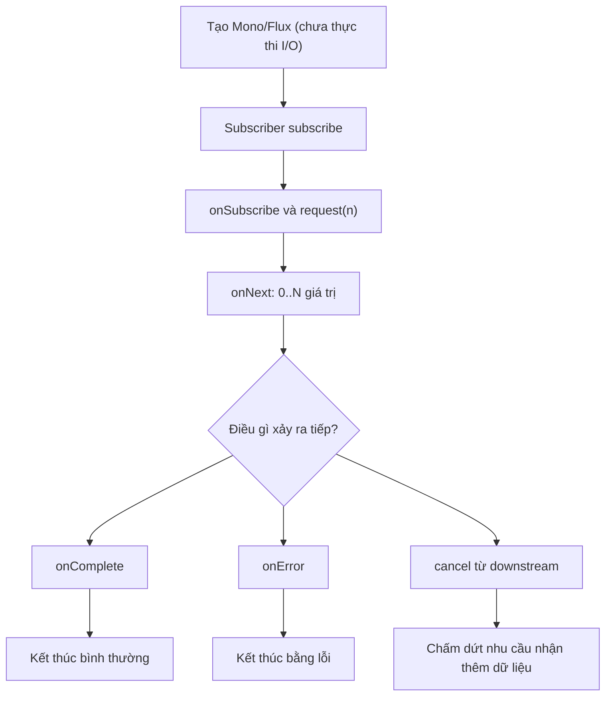
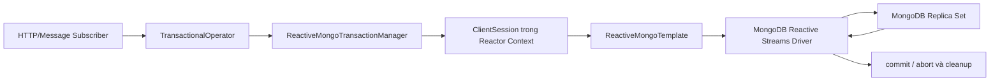

# Rollback khi phát lỗi, hủy subscription và đóng tài nguyên

## 1. Vấn đề: reactive transaction không kết thúc bằng một lệnh return

Một nghiệp vụ đặt hàng cần **giữ tồn kho**, **tạo đơn hàng** và **ghi sự kiện outbox** trong MongoDB. Nếu giữ tồn kho thành công nhưng insert đơn hàng thất bại, hệ thống phải rollback cả phần giữ kho. Nếu HTTP client đóng kết nối giữa chừng, chain Reactor có thể nhận tín hiệu **cancel** chứ không phải exception. Nếu pipeline còn giữ `ClientSession`, cursor hoặc tài nguyên tùy chỉnh, chúng phải được giải phóng dù publisher hoàn tất, thất bại hay bị hủy.

Trong mã đồng bộ, ta quen với:

```java
try {
    beginTransaction();
    writeInventory();
    writeOrder();
    commit();
} catch (Exception ex) {
    rollback();
    throw ex;
} finally {
    closeResources();
}
```

Trong hệ thống reactive, việc thực thi bắt đầu **khi publisher được subscribe**. Lỗi, hoàn tất và hủy là các **tín hiệu trong vòng đời subscription**, không tương đương với đường điều khiển đồng bộ của lời gọi tạo ra `Mono`/`Flux`. Đặt `try/catch` bao quanh câu lệnh `return repository.save(...);` thường **không** bắt được lỗi MongoDB xuất hiện sau đó khi subscriber thực thi pipeline.

Bài thuộc chương **Giao dịch reactive** của module **SPRING_DATA_MONGODB**. Module học dùng Spring Data MongoDB để kết nối, ánh xạ document và thao tác MongoDB qua `MongoTemplate` hoặc repository; thực hành query, aggregation, index, transaction, reactive access, kiểm thử và chẩn đoán hiệu năng dữ liệu.

Sau bài học, bạn có thể:

1. Phân biệt ba kết thúc chính của Reactive Streams: **complete**, **error** và **cancel**.
2. Giải thích cách `ReactiveMongoTransactionManager` và `TransactionalOperator` commit, rollback, giải phóng `ClientSession`.
3. Tổ chức nhiều thao tác reactive trong **một transaction boundary** thay vì gọi `subscribe()` tách rời.
4. Nhận diện các operator `onErrorResume`, `onErrorComplete`, `take`, `next` và `timeout` có thể thay đổi kết quả giao dịch.
5. Dùng `Mono.usingWhen`/`Flux.usingWhen` khi **tự sở hữu tài nguyên bất đồng bộ**, phân biệt cleanup với transaction rollback.
6. Xử lý timeout/cancel khi không thể khẳng định một write/commit đã bị rollback.
7. Thiết kế test có MongoDB replica set, `StepVerifier` và assertions sau transaction.

> **Nguyên tắc:** Chỉ xem dữ liệu đã được commit khi có **bằng chứng phù hợp với write/transaction contract**; không coi HTTP disconnect, `cancel` hoặc timeout tự động là chứng cứ MongoDB đã hoàn nguyên mọi side effect.

## 2. Đọc ba tín hiệu kết thúc trong Reactor

Một publisher thường đi qua chu trình:



| Tín hiệu | Nguồn phát | Diễn giải |
| --- | --- | --- |
| `onComplete` | Upstream | Publisher hoàn tất bình thường |
| `onError(Throwable)` | Upstream | Pipeline thất bại; error signal kết thúc publisher |
| `cancel()` | Subscriber/downstream operator | Subscriber không còn muốn nhận dữ liệu; không phải một `onError` |

**Cancel không chứa lý do tiêu chuẩn.** Nó có thể phát sinh vì người dùng đóng HTTP connection, WebFlux timeout, `take(1)`, `next()`, đổi subscription hoặc một operator điều phối khác. Không thể suy đoán an toàn rằng mỗi cancel đều là lỗi hệ thống.

### 2.1. Không có subscription thì thường chưa có write

```java
Mono<OrderDocument> pending = repository.save(order);
// Chỉ tạo publisher; chưa có nghĩa insert đã được thực thi.
```

Với reactive repository phổ biến, I/O được kích hoạt khi subscribed. Trong code production, để caller/framework quản lý subscription; đừng gọi `subscribe()` từ service để rồi trả kết quả thành công trước khi MongoDB xử lý.

### 2.2. Cần phân biệt complete của Publisher và commit thành công

Nếu chuỗi đã được **bọc trong `TransactionalOperator`**, publisher transactional phải thực hiện commit theo lifecycle. Nếu một `Mono` chứa thao tác MongoDB được subscribe **ngoài transaction**, complete chỉ thể hiện đường publisher đó đã hoàn tất, không nói rằng có multi-document transaction đang bảo vệ nó.

### 2.3. Error bị bắt bên trong cũng có thể biến thành complete

```java
// Khi gọi bên trong transaction, onErrorResume biến lỗi thành
// một completion thành công đối với transaction boundary.
Mono<String> step = repository.insert(order)
    .map(saved -> saved.id())
    .onErrorResume(ex -> Mono.just("IGNORED"));
```

Nếu nghiệp vụ cần rollback khi insert thất bại, cách xử lý này có thể dẫn đến **commit những bước đã thành công trước đó**. Phải đặt error handling đúng bên ngoài boundary hoặc đánh dấu rollback-only có chủ đích.

## 3. Vai trò của transaction manager trong Spring Data MongoDB

Reactive MongoDB transaction dựa trên **MongoDB ClientSession** và transaction support của server. Trong Spring Data, `ReactiveMongoTransactionManager` quản lý việc bắt đầu, commit, abort và dọn lifecycle cho session được cấp qua `ReactiveMongoDatabaseFactory`.



| Thành phần | Trách nhiệm |
| --- | --- |
| `ReactiveMongoDatabaseFactory` | Cung cấp MongoDB database/client resources cho reactive stack |
| `ReactiveMongoTransactionManager` | Quản lý MongoDB transaction dựa trên session và Reactor Context |
| `TransactionalOperator` | Bọc một publisher trong transaction lifecycle |
| `ReactiveMongoTemplate` / `ReactiveMongoOperations` | Thực thi read/write tham gia vào context transaction hiện hành |
| `ReactiveMongoRepository` | Tạo publisher thao tác với mapping/repository infrastructure |
| `Reactor Context` | Mang thông tin transaction theo subscription, không phụ thuộc duy nhất vào thread |

### 3.1. Không dùng ThreadLocal như transaction đồng bộ

Trong reactive chain, processing có thể di chuyển scheduler/thread. Spring ReactiveTransactionManager dùng **subscriber context** để truyền transaction state. Không lấy thread hiện tại làm nguồn sự thật cho transaction; không dùng `ThreadLocal<ClientSession>` tự dựng và mong tất cả `flatMap` cùng tìm thấy.

### 3.2. Template/factory phải thuộc cùng transaction infrastructure

Nếu repository dùng một `ReactiveMongoDatabaseFactory` và `ReactiveMongoTemplate` khác lại được tạo từ client/factory độc lập, không mặc định các operation sẽ chung session/transaction. Nên để các repositories/template tham gia vào cùng cấu hình quản lý.

### 3.3. Transaction có điều kiện server

MongoDB multi-document transactions cần topology hỗ trợ, thường là **replica set hoặc sharded cluster** với phiên bản/config thích hợp. Một test trên standalone MongoDB không chứng minh behavior transaction.

Thao tác đổi nhiều field trên **một document** vốn nguyên tử trong MongoDB và thường không cần transaction nhiều lệnh. Chỉ dùng transaction khi bất biến nghiệp vụ thực sự bao trùm nhiều document hoặc collection.

## 4. Chuẩn bị dependency và cấu hình tối thiểu

### 4.1. Maven

```xml
<dependencies>
    <dependency>
        <groupId>org.springframework.boot</groupId>
        <artifactId>spring-boot-starter-data-mongodb-reactive</artifactId>
    </dependency>

    <!-- Nếu có HTTP API reactive -->
    <dependency>
        <groupId>org.springframework.boot</groupId>
        <artifactId>spring-boot-starter-webflux</artifactId>
    </dependency>
</dependencies>
```

Trong Gradle:

```groovy
dependencies {
    implementation 'org.springframework.boot:spring-boot-starter-data-mongodb-reactive'
    implementation 'org.springframework.boot:spring-boot-starter-webflux'
}
```

Phiên bản Spring Data MongoDB và driver nên do Spring Boot BOM/parent quản lý, trừ khi có override đã được kiểm thử. Không thêm starter blocking `spring-boot-starter-data-mongodb` chỉ để dùng transaction trong reactive flow.

### 4.2. Cấu hình MongoDB URI

Đối với **Spring Boot 3.x**:

```yaml
spring:
  data:
    mongodb:
      uri: "${MONGODB_URI}"
```

Đối với **Spring Boot 4.x**:

```yaml
spring:
  mongodb:
    uri: "${MONGODB_URI}"
```

**Chọn đúng property theo phiên bản Boot đang chạy.** Không commit credentials vào mã nguồn, không in nguyên URI có mật khẩu. Test multi-document transaction với MongoDB replica set và reactive driver phù hợp.

### 4.3. ReactiveMongoTransactionManager

```java
package com.example.orders.config;

import org.springframework.context.annotation.Bean;
import org.springframework.context.annotation.Configuration;
import org.springframework.data.mongodb.ReactiveMongoDatabaseFactory;
import org.springframework.data.mongodb.ReactiveMongoTransactionManager;

@Configuration
public class ReactiveTransactionConfig {

    @Bean
    ReactiveMongoTransactionManager reactiveMongoTransactionManager(
        ReactiveMongoDatabaseFactory factory
    ) {
        return new ReactiveMongoTransactionManager(factory);
    }
}
```

Bean này là cơ chế kết nối Spring reactive transactions với MongoDB. Với Spring Boot auto-config, `ReactiveMongoDatabaseFactory` và `ReactiveMongoTemplate` thường được tạo khi dependency/properties đủ điều kiện. Nếu custom MongoClient, hãy bảo đảm factory/template/transaction manager phù hợp.

### 4.4. TransactionalOperator

```java
import org.springframework.context.annotation.Bean;
import org.springframework.context.annotation.Configuration;
import org.springframework.transaction.ReactiveTransactionManager;
import org.springframework.transaction.reactive.TransactionalOperator;

@Configuration
public class ReactiveTxOperatorConfig {

    @Bean
    TransactionalOperator mongoTransactionalOperator(
        ReactiveTransactionManager manager
    ) {
        return TransactionalOperator.create(manager);
    }
}
```

Nếu ứng dụng có nhiều reactive transaction managers, phải chỉ định đúng bean bằng `@Qualifier` hoặc cấu hình rõ; đừng để MongoDB workflow vô tình dùng manager của một hệ lưu trữ khác.

## 5. Dữ liệu mẫu: order, inventory và outbox

Chúng ta xét transaction gồm ba hành động:

1. Giữ một sản phẩm trong `inventory` bằng update điều kiện.
2. Thêm document `orders`.
3. Thêm sự kiện `outbox_events` để phát sau commit.

Để tiện test, các collection:

```javascript
// Chỉ chạy trong DB TEST độc lập và đã reset trước khi seed.
db.inventory.insertOne({
  _id: "tenant-a:sku-101",
  tenantId: "tenant-a",
  sku: "sku-101",
  available: 2,
  reserved: 0
});

db.orders.createIndex(
  { tenantId: 1, operationId: 1 },
  { unique: true, name: "uk_order_tenant_operation" }
);

db.outbox_events.createIndex(
  { tenantId: 1, eventId: 1 },
  { unique: true, name: "uk_outbox_tenant_event" }
);
```

Không tạo collection/index mới **lần đầu** bên trong transaction nếu topology/version/DDL restrictions của deployment chưa được kiểm tra. Với bài thực hành, tạo sẵn collections/indexes ở bước setup môi trường test.

### 5.1. Domain mẫu

```java
package com.example.orders.persistence;

import java.time.Instant;
import org.springframework.data.mongodb.core.mapping.Document;
import org.springframework.data.mongodb.core.mapping.FieldType;
import org.springframework.data.mongodb.core.mapping.MongoId;

@Document("orders")
public record OrderDocument(
    @MongoId(FieldType.STRING) String id,
    String tenantId,
    String operationId,
    String sku,
    int quantity,
    String status,
    Instant createdAt
) {}

@Document("outbox_events")
public record OutboxEvent(
    @MongoId(FieldType.STRING) String id,
    String tenantId,
    String eventId,
    String orderId,
    String type,
    Instant createdAt
) {}
```

Trong project Java thực tế, tách mỗi `public record` ra file tương ứng. Mẫu dùng `@MongoId(FieldType.STRING)` để BSON `_id` thực sự lưu dạng String. Không dùng fixture này trên production.

### 5.2. Kết quả mong đợi

| Kịch bản | Inventory sau transaction | Orders | Outbox |
| --- | --- | --- | --- |
| Thành công | available giảm 1, reserved tăng 1 | Có một đơn mới | Có một event |
| Insert order phát error | **Rollback** giữ kho | Không có đơn | Không có event |
| Insert outbox phát error | **Rollback** giữ kho | Không có đơn | Không có event |
| Subscriber cancel trước khi transaction hoàn tất | **Yêu cầu rollback qua manager**, kiểm tra completion/commit race | Không khẳng định bằng cancel signal đơn độc | Không khẳng định bằng cancel signal đơn độc |
| Commit response mất | Outcome có thể chưa rõ | Cần reconcile | Cần reconcile |

Hàng về cancellation cố ý không tuyên bố một bảo đảm tuyệt đối. Nếu commit **đã hoàn tất** trước khi cancellation tới hoặc transaction result không rõ do network failure, không thể dùng `cancel` để đảo một commit đã có hiệu lực.

## 6. Repository và gateway cho ba thao tác

### 6.1. Order repository

```java
package com.example.orders.persistence;

import org.springframework.data.mongodb.repository.ReactiveMongoRepository;

public interface ReactiveOrderRepository
        extends ReactiveMongoRepository<OrderDocument, String> {
}
```

### 6.2. Outbox repository

```java
package com.example.orders.persistence;

import org.springframework.data.mongodb.repository.ReactiveMongoRepository;

public interface ReactiveOutboxRepository
        extends ReactiveMongoRepository<OutboxEvent, String> {
}
```

### 6.3. Atomic reservation gateway

```java
package com.example.orders.persistence;

import org.springframework.data.mongodb.core.ReactiveMongoOperations;
import org.springframework.data.mongodb.core.query.Criteria;
import org.springframework.data.mongodb.core.query.Query;
import org.springframework.data.mongodb.core.query.Update;
import org.springframework.stereotype.Component;
import reactor.core.publisher.Mono;

@Component
public class InventoryGateway {
    private final ReactiveMongoOperations mongo;

    public InventoryGateway(ReactiveMongoOperations mongo) {
        this.mongo = mongo;
    }

    public Mono<Void> reserveOne(String tenantId, String sku) {
        String inventoryId = tenantId + ":" + sku;

        Query filter = Query.query(
            Criteria.where("_id").is(inventoryId)
                .and("tenantId").is(tenantId)
                .and("available").gte(1)
        );

        Update update = new Update()
            .inc("available", -1)
            .inc("reserved", 1);

        return mongo.updateFirst(filter, update, "inventory")
            .flatMap(result -> {
                if (!result.wasAcknowledged()) {
                    return Mono.error(new IllegalStateException(
                        "Write was not acknowledged"
                    ));
                }
                if (result.getMatchedCount() != 1L) {
                    return Mono.error(new OutOfStockException());
                }
                return Mono.<Void>empty();
            });
    }
}

class OutOfStockException extends RuntimeException {}
```

Trong bài thực hành, `OutOfStockException` cùng package có thể để package-private; trong dự án thật, đặt exception nơi service/gateway sử dụng phù hợp. Query/Update được tạo **mới cho mỗi invocation**, không giữ mutable state của tenant trên singleton component.

Vì `reserveOne` trả `Mono<Void>` hoàn tất bình thường khi thành công, nên phải dùng `then(...)` để ghép bước tiếp theo. Nếu không match (hết hàng), nó phát **error signal** — điều này rất quan trọng để transaction manager rollback.

## 7. TransactionalOperator: ghép đủ các bước vào một boundary

### 7.1. Service đúng

```java
package com.example.orders.service;

import com.example.orders.persistence.InventoryGateway;
import com.example.orders.persistence.OrderDocument;
import com.example.orders.persistence.OutboxEvent;
import com.example.orders.persistence.ReactiveOrderRepository;
import com.example.orders.persistence.ReactiveOutboxRepository;
import java.time.Instant;
import org.springframework.stereotype.Service;
import org.springframework.transaction.reactive.TransactionalOperator;
import reactor.core.publisher.Mono;

@Service
public class PlaceOrderService {

    private final InventoryGateway inventory;
    private final ReactiveOrderRepository orders;
    private final ReactiveOutboxRepository outbox;
    private final TransactionalOperator tx;

    public PlaceOrderService(
        InventoryGateway inventory,
        ReactiveOrderRepository orders,
        ReactiveOutboxRepository outbox,
        TransactionalOperator tx
    ) {
        this.inventory = inventory;
        this.orders = orders;
        this.outbox = outbox;
        this.tx = tx;
    }

    public Mono<String> placeOne(
        String tenantId,
        String orderId,
        String operationId,
        String sku
    ) {
        if (tenantId == null || tenantId.isBlank()
                || orderId == null || orderId.isBlank()
                || operationId == null || operationId.isBlank()
                || sku == null || sku.isBlank()) {
            return Mono.error(
                new IllegalArgumentException("Invalid request")
            );
        }

        return Mono.defer(() -> {
            Instant now = Instant.now();
            OrderDocument order = new OrderDocument(
                orderId, tenantId, operationId,
                sku, 1, "RESERVED", now
            );
            OutboxEvent event = new OutboxEvent(
                "event-" + operationId,
                tenantId, operationId, orderId, "ORDER_RESERVED", now
            );

            return inventory.reserveOne(tenantId, sku)
                .then(orders.insert(order))
                .flatMap(saved ->
                    outbox.insert(event)
                        .thenReturn(saved.id())
                );
        }).as(tx::transactional);
    }
}
```

Trên đường thành công, publisher trong `Mono.defer` gồm **giữ kho → insert đơn → insert outbox** và kết thúc bằng ID đơn. `.as(tx::transactional)` bọc **toàn bộ chuỗi upstream** trong một transaction. Không tách một bước ra `subscribe()` riêng.

### 7.2. Tại sao dùng Mono.defer?

`Mono.defer` tạo dữ liệu request và pipeline bên trong **mỗi subscription**. Một publisher có thể được subscribe lại khi retry; cách này giúp tránh vô tình chia sẻ đối tượng có state giữa subscribers. Nhưng `defer` **không tự làm retry idempotent**: cùng operationId có thể được dùng lại và cần unique constraint/reconciliation.

### 7.3. Ranh giới transaction thực tế

```text
Subscriber
  |
  v
TransactionalOperator opens session/transaction
  |
  +-- update inventory
  |
  +-- insert order
  |
  +-- insert outbox
  |
  +-- success → commit
  +-- error   → abort/rollback
  +-- cancel  → rollback request nếu transaction còn active
  |
  v
cleanup session, release transaction resources
```

**Chú ý:** `TransactionalOperator` chỉ quản lý các reactive operations thực sự **tham gia vào transaction context**. Một lệnh dùng blocking `MongoTemplate` hoặc raw driver client tự tạo độc lập có thể chạy ngoài transaction dù nằm trong cùng Java method.

## 8. Rollback khi một Publisher phát onError

### 8.1. Error phải đi qua transaction boundary

Khi `orders.insert(...)` phát lỗi vì trùng unique index hoặc dữ liệu không hợp lệ, error đi qua `flatMap`/`then` tới `TransactionalOperator`:

```text
inventory.reserveOne → completed
orders.insert         → onError(DuplicateKeyException)
outbox.insert         → không chạy
TransactionalOperator → rollback transaction
MongoDB               → inventory trở về trước reservation
downstream            → nhận error hoặc lỗi rollback/cleanup phù hợp
```

Với database hỗ trợ transaction và các operation dùng cùng session, những thay đổi chưa commit thuộc transaction phải bị abort. Nhưng **error signal không tự bảo đảm mọi side effect khác được hoàn nguyên**: message đã phát ra broker hoặc HTTP call đã chạy không thuộc MongoDB transaction.

### 8.2. Demo tạo lỗi có chủ đích

```java
Mono<String> failurePath = inventory
    .reserveOne("tenant-a", "sku-101")
    .then(Mono.<String>error(
        new IllegalStateException("Simulated failure")
    ))
    .as(tx::transactional);
```

Đoạn này giả định `inventory` và `tx` đã được inject như service ở mục 7. Với môi trường MongoDB transaction thật, sau khi subscribe, lỗi test được phát **trước commit**, nên transaction manager phải rollback phần reserve nếu phần reserve đã chạy trong transaction.

**Đừng thử trên production.** Chạy trong integration test với fixture riêng và xác minh dữ liệu sau transaction thay vì chỉ assert type exception.

### 8.3. doOnError không nuốt lỗi

```java
Mono<String> observed = failurePath
    .doOnError(ex ->
        metrics.recordTransactionFailure(ex.getClass().getSimpleName())
    );
```

`metrics` là dependency monitoring minh họa, cần định nghĩa trong dự án thật. `doOnError` phù hợp để ghi nhận lỗi; theo mặc định nó **không đổi error thành success**. Tránh log nguyên credentials, BSON payload hoặc thông tin nhạy cảm của khách hàng.

### 8.4. Lỗi commit/rollback cũng phải được xử lý

Đôi khi các write trong transaction đã hoàn tất nhưng **commit** gặp lỗi network hoặc phản hồi chưa rõ. Client có thể nhận exception ở giai đoạn commit, khác với lỗi insert trước commit. Cần phân biệt:

- **Pre-commit operation error:** manager cố abort transaction.
- **Abort/rollback failure:** việc dọn transaction không hoàn tất như kỳ vọng; cần quan sát trạng thái và logs.
- **Commit error:** có trường hợp commit chắc chắn thất bại, có trường hợp **không rõ** commit đã xảy ra hay chưa.

Không suy ra một error cuối pipeline luôn đồng nghĩa **chưa có commit nào được áp dụng**. Phải kết hợp MongoDB error labels, operation ID và reconciliation.

## 9. Vị trí onErrorResume có thể đổi kết quả commit/rollback

### 9.1. Anti-pattern: nuốt lỗi trước khi TransactionalOperator thấy

```java
// SAI nếu nghiệp vụ yêu cầu rollback phần reserve khi insert lỗi.
Mono<String> unsafe = inventory
    .reserveOne(tenantId, sku)
    .then(orders.insert(order))
    .map(OrderDocument::id)
    .onErrorResume(ex -> Mono.just("FALLBACK_SUCCESS"))
    .as(tx::transactional);
```

Trong ví dụ này, nếu reserve thành công và insert thất bại, `onErrorResume` **nằm bên trong transactional publisher** biến error thành completion bình thường. Transaction manager có thể **commit phần reserve**, gây sai lệch. Đây là lỗi logic, ngay cả khi Java compile và endpoint trả 200.

### 9.2. Xử lý lỗi sau transaction boundary

```java
Mono<String> safe = inventory
    .reserveOne(tenantId, sku)
    .then(orders.insert(order))
    .map(OrderDocument::id)
    .as(tx::transactional)
    .onErrorMap(OutOfStockException.class,
        ex -> new IllegalStateException("Out of stock", ex));
```

Với `onErrorMap` ở **downstream sau transaction**, error được transaction manager quan sát trước khi map thành exception API/domain. Đây thường là vị trí phù hợp để đổi loại lỗi mà không che mất tín hiệu rollback.

### 9.3. Fallback bên ngoài được phép, nhưng phải thành thật

```java
Mono<OrderResult> outcome = placeOrderService
    .placeOne(tenantId, orderId, operationId, sku)
    .map(OrderResult::applied)
    .onErrorResume(OutOfStockException.class,
        ex -> Mono.just(OrderResult.rejected("OUT_OF_STOCK")));
```

Ở đây `OrderResult` là contract response minh họa cần định nghĩa riêng. Fallback nằm **sau transactional service method**. Một business rejection có thể được biểu diễn bằng response thay vì HTTP 500 **sau khi rollback hoàn tất**.

Không bắt tất cả `Throwable` để luôn trả `REJECTED`: network/commit ambiguity cần phân loại là **UNKNOWN_NEEDS_RECONCILIATION**, không mặc định «chưa đặt hàng».

### 9.4. Nếu cần xử lý lỗi bên trong nhưng vẫn rollback?

Một cách là **phát lại error**:

```java
Mono<String> stillRollsBack = inventory
    .reserveOne(tenantId, sku)
    .then(orders.insert(order))
    .map(OrderDocument::id)
    .onErrorResume(DuplicateKeyException.class,
        ex -> Mono.error(
            new OrderAlreadyExistsException(ex)
        ))
    .as(tx::transactional);
```

Các exception `DuplicateKeyException` và `OrderAlreadyExistsException` cần import/định nghĩa phù hợp. Vì chuỗi cuối cùng vẫn phát `onError`, transaction manager có cơ sở rollback.

Trong các trường hợp đặc biệt muốn trả kết quả bình thường nhưng cố rollback, có thể dùng callback `TransactionalOperator.execute(status -> ...)` và `status.setRollbackOnly()`. Cách này phức tạp hơn, cần test contract rollback-only và hậu quả commit; **ưu tiên để error propagate** nếu tình huống là thất bại nghiệp vụ.

## 10. @Transactional trên method trả Mono hoặc Flux

Ngoài `TransactionalOperator`, Spring hỗ trợ declarative transaction:

```java
package com.example.orders.service;

import com.example.orders.persistence.InventoryGateway;
import com.example.orders.persistence.OrderDocument;
import com.example.orders.persistence.ReactiveOrderRepository;
import com.example.orders.persistence.ReactiveOutboxRepository;
import com.example.orders.persistence.OutboxEvent;
import org.springframework.stereotype.Service;
import org.springframework.transaction.annotation.Transactional;
import reactor.core.publisher.Mono;

@Service
public class DeclarativeOrderService {
    private final InventoryGateway inventory;
    private final ReactiveOrderRepository orders;
    private final ReactiveOutboxRepository outbox;

    public DeclarativeOrderService(
        InventoryGateway inventory,
        ReactiveOrderRepository orders,
        ReactiveOutboxRepository outbox
    ) {
        this.inventory = inventory;
        this.orders = orders;
        this.outbox = outbox;
    }

    @Transactional
    public Mono<String> place(
        String tenantId,
        OrderDocument order,
        OutboxEvent event
    ) {
        return inventory.reserveOne(tenantId, order.sku())
            .then(orders.insert(order))
            .flatMap(saved ->
                outbox.insert(event)
                    .thenReturn(saved.id())
            );
    }
}
```

Để annotation có hiệu lực:

1. Spring phải chọn **reactive transaction manager** cho method reactive.
2. Method phải được gọi **qua Spring proxy/đường interception phù hợp**, không tự gọi trực tiếp một method annotated khác trên `this` rồi mong có transaction mới.
3. Các operations cần cùng reactive MongoDB factory/session infrastructure.
4. Caller phải **subscribe** publisher trả về; service không gọi `subscribe()` nội bộ.
5. Đảm bảo no rollback-swallowing operators bên trong boundary.

Không trộn `@Transactional` và `TransactionalOperator` lên cùng một workflow chỉ để «chắc chắn hơn» nếu chưa xác định propagation/nesting. Chọn một boundary rõ ràng để dễ hiểu và test.

### 10.1. Khi có nhiều transaction managers

Nếu dự án đồng thời có `ReactiveMongoTransactionManager` và manager của hệ lưu trữ khác, cần chỉ định manager phù hợp theo khả năng Spring framework/version đang dùng (chẳng hạn qualifier và transaction configuration). Nếu không, workflow MongoDB có thể nhận nhầm manager hoặc fail ngay lúc tạo transaction.

### 10.2. ReadOnly không có nghĩa không mở session

Với `ReactiveMongoTransactionManager`, một method `@Transactional(readOnly = true)` vẫn có thể tạo transaction/session theo semantics Spring Data MongoDB. Đừng dùng annotation readOnly như một cách mặc định miễn phí để đọc từ secondary; hãy cân nhắc read concern, read preference và overhead.

## 11. Cancel signals: lý do chúng làm transaction khó hơn

Từ **Spring Framework 5.3**, cancel signal trên transactional publisher được xử lý theo hướng **rollback**. Đây là thay đổi quan trọng so với behavior cũ ở Spring Framework 5.2.

Tài liệu Spring Framework giải thích rằng transaction publisher nên **tránh bị cancel giữa chừng**: downstream không thể truyền một lý do cancel chuẩn; manager phải xử lý cancel thận trọng để tránh commit một workflow chưa được tiêu thụ đầy đủ.

### 11.1. Cancel có thể đến từ đâu?

| Nguồn | Ví dụ |
| --- | --- |
| Subscriber chủ động | `Disposable.dispose()` |
| HTTP client disconnect | Browser đóng tab, reverse proxy ngắt response |
| `take(1)` | Downstream chỉ muốn một giá trị |
| `next()` | Chuyển Flux thành Mono đầu tiên |
| `timeout(Duration)` | Hạn chờ của downstream kết thúc |
| `switchMap` | Chuyển sang publisher mới, hủy publisher cũ |
| `takeUntilOther(...)` | Hủy khi tín hiệu khác tới |

Không phải mọi signal đều đồng nghĩa application lỗi; nhưng với giao dịch chứa write chưa commit, hủy chuỗi trước completion có thể khiến transaction rollback.

### 11.2. Ví dụ nguy hiểm với Flux nhiều kết quả

```java
Flux<OrderDocument> transactionalStream = mongo
    .find(query, OrderDocument.class)
    .as(tx::transactional);

// next() ở DOWNSTREAM hủy upstream sau phần tử đầu tiên.
Mono<OrderDocument> first = transactionalStream.next();
```

Nếu đây là một transaction chỉ đọc, cancel vẫn có thể kích hoạt rollback/cleanup thay vì kết thúc hoàn chỉnh. Nếu upstream còn chứa writes, cancellation có thể khiến những writes chưa commit bị rollback. Vì thế không dùng `.next()` hoặc `.take(1)` **ở bên ngoài transactional Flux** khi mục tiêu là commit toàn bộ workflow.

### 11.3. Ví dụ chứa write rồi phát nhiều phần tử

```java
Flux<String> workflow = inventory
    .reserveOne(tenantId, sku)
    .thenMany(Flux.just("reserved", "order-will-follow"))
    .as(tx::transactional);

// Có thể chỉ thấy "reserved", rồi take(1) cancel transaction.
Flux<String> firstOnly = workflow.take(1);
```

Trong ví dụ, còn phải xác định nghiệp vụ thật có insert order hay không; mục tiêu là thấy **một chuỗi write rồi nhiều onNext** có thể bị downstream cancel trước onComplete. Đừng thiết kế thành công của transaction dựa trên việc client nhận «một phần stream».

## 12. Completion, error và cancellation trong bảng trạng thái

| Trạng thái publisher transactional | Transaction manager thường làm gì? | Điều caller cần hiểu |
| --- | --- | --- |
| Hoàn tất bình thường trước commit | Cố **commit** | Kết quả chỉ chắc chắn khi commit đã được xác nhận đúng contract |
| `onError` trước commit | Cố **rollback/abort** | Phải quan sát cả rollback failure nếu có |
| `cancel` khi transaction còn active | Cố **rollback/abort** theo Spring Framework hiện đại | Không nhận được một onError mang lý do cancel |
| Cancel trước subscription | Chưa có transaction I/O | Không có căn cứ nói transaction đã bắt đầu |
| Cancel trong khi commit đang thực hiện | Có thể xảy ra race | Không khẳng định đã rollback được commit |
| Commit response không rõ do network | Có thể đã commit hoặc chưa | Reconcile theo operation ID |
| Out-of-band side effect trước cancel | Ngoài MongoDB transaction | Không tự rollback side effect đó |

**Điểm quan trọng:** «Rollback khi cancel» mô tả **chính sách của reactive transaction manager trong một scope còn quản lý được**. Nó không tạo bảo đảm rằng một commit đã hoàn tất có thể được đảo lại, hoặc mọi hệ thống ngoài MongoDB sẽ tự trở về như cũ.

### 12.1. Không suy luận thứ tự sự kiện từ HTTP disconnect

Một client HTTP hủy response sau khi server đã gửi commit tới MongoDB có thể không nhận được trạng thái cuối cùng. Service cần operation ID/idempotency để client truy vấn lại. Không gửi lại `POST` không-idempotent chỉ vì browser báo «network error».

### 12.2. Trong Reactor, cancel không phải onError

`doOnError(...)` **không chạy chỉ vì cancel**. Muốn theo dõi cả ba loại tín hiệu, dùng `doFinally(SignalType)` hoặc metric operator thích hợp; không dựa vào `doOnError` để đo số lần hủy.

## 13. Timeout: đặt trước hay sau TransactionalOperator?

### 13.1. Timeout ở bên trong transactional publisher

```java
Mono<String> insideTimeout = inventory
    .reserveOne(tenantId, sku)
    .then(orders.insert(order))
    .map(OrderDocument::id)
    .timeout(Duration.ofSeconds(5))
    .as(tx::transactional);
```

Ở đây `timeout` nằm **upstream của TransactionalOperator**. Nếu hết hạn trong lúc transaction chưa hoàn tất, nó phát `TimeoutException` tới manager, nên manager có thể xử lý theo đường **onError → rollback**. Một MongoDB operation vừa bị cancel có thể vẫn đang được xử lý; đọc lại sau khi cleanup là cần thiết trong test.

### 13.2. Timeout bên ngoài transactional publisher

```java
Mono<String> outsideTimeout = inventory
    .reserveOne(tenantId, sku)
    .then(orders.insert(order))
    .map(OrderDocument::id)
    .as(tx::transactional)
    .timeout(Duration.ofSeconds(5));
```

Ở đây `timeout` **downstream** có thể **cancel** transactional publisher rồi phát TimeoutException cho subscriber. Spring Framework hiện đại cố rollback nếu transaction còn active, nhưng vẫn có cửa sổ race với commit/abort.

### 13.3. Không có một vị trí timeout giải quyết mọi ambiguity

Cả hai cách đều cần:

- Lựa chọn deadline dựa trên SLA và thời gian commit thực tế.
- Không dùng cancel/timeout làm chứng cứ đã rollback chắc chắn.
- Operation ID để reconcile nếu client chưa nhận ack.
- Tách biệt timeout của HTTP, Reactor, MongoDB driver, write concern và transaction.
- Kiểm thử trên topology hỗ trợ transaction dưới tải và failover.

Không tùy tiện đặt timeout quá ngắn rồi retry vô hạn; điều đó có thể tăng áp lực lên cluster và tạo thêm xung đột.

## 14. doOnCancel, doFinally và doOnTerminate

### 14.1. Dùng doFinally để quan sát đủ signal

```java
Mono<String> traced = placeOrderService
    .placeOne(tenantId, orderId, operationId, sku)
    .doFinally(signal -> {
        if (signal == SignalType.CANCEL) {
            metrics.incrementCancelledOrders();
        } else if (signal == SignalType.ON_ERROR) {
            metrics.incrementFailedOrders();
        } else if (signal == SignalType.ON_COMPLETE) {
            metrics.incrementCompletedOrders();
        }
    });
```

`SignalType` là `reactor.core.publisher.SignalType`; `metrics` là service minh họa. Hãy kiểm tra vị trí đặt operator: `doFinally` downstream có thể quan sát completion của một fallback dù transaction đã rollback, hoặc cancel trước khi rollback cleanup hoàn tất.

### 14.2. doOnCancel không phải rollback command

```java
Mono<String> flow = placeOrderService
    .placeOne(tenantId, orderId, operationId, sku)
    .doOnCancel(() -> auditLogger.noteCancellation(operationId));
```

Callback trên chỉ **ghi nhận cancellation**. Rollback do `TransactionalOperator`/transaction manager thực hiện trong lifecycle. Không tự gọi `mongo.abortTransaction()` từ `doOnCancel` nếu session do transaction manager sở hữu.

### 14.3. Không làm I/O blocking trong doFinally

`doFinally` thích hợp cho metric/log nhẹ. Nếu phải đóng tài nguyên bằng một asynchronous Publisher, dùng `usingWhen` hoặc transaction lifecycle phù hợp; gọi `closeAsync().subscribe()` trong `doFinally` tách cleanup ra khỏi việc quan sát completion, dễ bỏ sót lỗi.

### 14.4. Vị trí logging ảnh hưởng tín hiệu đo được

```java
Mono<String> txFlow = writeSteps
    .as(tx::transactional)
    .doFinally(signal -> log.info("tx flow signal={}", signal));

Mono<String> httpFlow = txFlow
    .onErrorResume(BusinessException.class,
        ex -> Mono.just("REJECTED"))
    .doFinally(signal -> log.info("http signal={}", signal));
```

Nếu business error đã làm transaction rollback, downstream HTTP flow có thể hoàn tất bình thường do fallback. Đo metric **transaction rollback** và **HTTP response** riêng, không chỉ có một counter tổng «successful requests».

## 15. Ai phải đóng ClientSession?

### 15.1. Managed session thuộc transaction manager

Khi dùng:

```java
return inventory.reserveOne(tenantId, sku)
    .then(orders.insert(order))
    .as(tx::transactional);
```

`ReactiveMongoTransactionManager` chịu trách nhiệm quản lý session/transaction lifecycle theo Spring Data infrastructure. Không tự gọi `session.close()` trong business service nếu session đang được manager quản lý.

### 15.2. Vì sao không nên tự đóng session trong doFinally?

Một callback có thể chạy trong tình huống rollback hoặc commit còn đang xử lý. Đóng session do manager sở hữu không đúng thời điểm có thể gây lỗi lệnh đang chạy hoặc làm mất khả năng quan sát kết quả. Dễ gây ra:

- Double-close hoặc sử dụng tài nguyên đã đóng.
- Commit/abort lỗi khó phân loại.
- Context bị mất với operation sau đó.
- Đóng một session dùng chung không đúng ownership.

**Quy tắc ownership:** Ai mở/session-owning layer nào phải đóng theo lifecycle của layer đó. Khi dùng transaction manager, **để manager quản lý**. Khi dùng raw driver session do chính code tạo, code đó phải có một cơ chế cleanup đáng tin cả complete/error/cancel.

### 15.3. Không tự đặt ClientSession trong singleton field

```java
// Anti-pattern (không triển khai):
// @Component
// class BadSessionHolder {
//     ClientSession current; // Mutable session chia sẻ request!
// }
```

Reactive transaction context gắn với subscriber; nhiều request có thể chạy song song. Chia sẻ session giữa các request không kiểm soát có thể gây trộn thao tác và race.

### 15.4. Driver và template phải tham gia cùng session

Spring Data `ReactiveMongoTemplate` lấy session qua infrastructure phù hợp với Reactor Context. Nếu code tự tạo một `com.mongodb.reactivestreams.client.MongoClient` độc lập rồi chạy query qua nó, lệnh đó **không tự tham gia transaction** do Spring quản lý.

Khi cần raw reactive driver operations có session, kiểm tra API lấy database/session đúng của Spring Data, hoặc tổ chức persistence adapter với session explicit được quản lý chặt. Đừng gọi trực tiếp factory lấy database bỏ qua transaction-aware utility nếu điều đó không dùng session gắn với context.

## 16. Đóng tài nguyên bằng Mono.usingWhen

`usingWhen` là API Reactor dùng để **cấp phát resource theo publisher** và chạy **asynchronous cleanup publisher** khi resource processing hoàn thành, lỗi hoặc bị hủy. Nó hữu ích với một connection/lease/cursor/temporary handle do ứng dụng **tự quản lý**.

### 16.1. API năm tham số

Ý tưởng:

```text
Mono.usingWhen(
    resourceSupplier,    // cấp phát resource
    resourceClosure,     // dùng resource, trả Mono<T>
    asyncComplete,       // cleanup nếu success
    asyncError,          // cleanup nếu error
    asyncCancel          // cleanup nếu cancel
)
```

Đây là tên vai trò các tham số, không phải đoạn mã Java có thể compile nguyên vẹn. Với `Flux.usingWhen`, resourceClosure trả Publisher nhiều phần tử.

### 16.2. Ví dụ resource tự quản lý

```java
import java.util.concurrent.atomic.AtomicBoolean;
import reactor.core.publisher.Mono;

final class AuditLease {
    private final AtomicBoolean closed = new AtomicBoolean();

    Mono<String> run(String requestId) {
        return Mono.defer(() -> {
            if (closed.get()) {
                return Mono.error(new IllegalStateException(
                    "Lease already closed"
                ));
            }
            return Mono.just("processed:" + requestId);
        });
    }

    Mono<Void> closeAsync() {
        return Mono.fromRunnable(() -> closed.set(true));
    }
}

public final class AuditLeaseGateway {
    public Mono<String> work(String requestId) {
        return Mono.usingWhen(
            Mono.fromSupplier(AuditLease::new),
            lease -> lease.run(requestId),
            AuditLease::closeAsync,
            (lease, error) -> lease.closeAsync(),
            AuditLease::closeAsync
        );
    }
}
```

Ví dụ minh họa lifecycle, không phải MongoDB transaction. `AuditLease` không tạo một database session thật. Nó cho thấy cách một tài nguyên do caller sở hữu được cleanup qua cả ba đường kết thúc.

### 16.3. Không lẫn cleanup với rollback

`AuditLease.closeAsync()` **đóng resource**, không hoàn nguyên MongoDB writes. Nếu resource là một manual MongoDB transaction, logic abort/commit riêng phải đúng. Với transaction do `ReactiveMongoTransactionManager` quản lý, **không bọc Spring-managed ClientSession trong usingWhen do service tự tạo**.

### 16.4. Cleanup failure cũng là một lỗi

Nếu asynchronous cleanup thất bại, Reactor có thể thay đổi error/result cuối cùng theo semantics của `usingWhen`. Đừng mặc định một exception ở cleanup luôn vô hại hoặc luôn giữ nguyên exception nghiệp vụ ban đầu. Cần logs/metrics đủ để chẩn đoán cả lỗi gốc lẫn lỗi cleanup, nhưng tránh biến cleanup failure thành «thành công» ngoài ý muốn.

## 17. Flux.usingWhen và resource kéo dài suốt stream

Giả sử một API bên ngoài cấp lease cho một stream phân mảnh:

```java
Flux<String> output = Flux.usingWhen(
    leaseFactory.acquire(),
    lease -> lease.streamRecords(),
    lease -> lease.closeAsync(),
    (lease, error) -> lease.closeAsync(),
    lease -> lease.closeAsync()
);
```

Ở đây `leaseFactory` và `lease` là abstractions minh họa, phải được định nghĩa nếu muốn compile. Ý nghĩa:

- Nếu stream chạy tới onComplete, gọi cleanup success.
- Nếu stream phát onError, gọi cleanup error.
- Nếu subscriber cancel, gọi cleanup cancel.
- Tài nguyên phải **được sử dụng trong closure**; không trả một publisher giữ resource nhưng thực hiện phần còn lại ở ngoài boundary.

### 17.1. Không tự assume đóng khi Flux còn sống

Một stream chưa được subscribe chưa cấp phát resource. Một stream có subscription nhưng không được tiêu thụ hết có thể giữ cursor/lease tới khi cancel. Cần timeout/cancellation policy và monitoring tài nguyên đang mở.

### 17.2. using vs usingWhen

| API | Phù hợp |
| --- | --- |
| `Mono.using(...)` / `Flux.using(...)` | Resource với cleanup **đồng bộ** rõ ràng |
| `Mono.usingWhen(...)` / `Flux.usingWhen(...)` | Resource cần cleanup **Publisher bất đồng bộ** |
| `doFinally(...)` | Ghi metric/side effect nhẹ theo signal |
| `TransactionalOperator` | Transaction lifecycle managed by Spring |

Nếu dùng `doFinally(x -> resource.close())` với close blocking, có nguy cơ chặn thread. Nếu dùng `doFinally(x -> closeAsync().subscribe())`, cleanup bị tách khỏi lifecycle và khó quan sát lỗi. Chọn API đúng theo loại resource/ownership.

## 18. doFinally là hook quan sát, không thay đổi contract kết thúc

Đối với một publisher đã được bọc transaction:

```java
return tx.transactional(workflow)
    .doFinally(signal -> {
        switch (signal) {
            case ON_COMPLETE -> statistics.complete();
            case ON_ERROR -> statistics.error();
            case CANCEL -> statistics.cancel();
            default -> {}
        }
    });
```

`statistics` là dependency thống kê minh họa. Code trên giả định `workflow` là một `Mono<T>` hoặc `Flux<T>` và Java version hỗ trợ switch arrow syntax.

Không thực hiện raw MongoDB abort trong hook này. Nếu manager đã bắt đầu abort, việc tự abort thêm là race. Nếu manager đã commit, abort thêm không làm đảo commit.

### 18.1. Cần đo thời gian cleanup

Khi lượng request cancellation cao, thời gian abort/cleanup có thể ảnh hưởng pool pressure. Nên quan sát:

1. Active transactions/sessions theo metrics được driver/server cung cấp.
2. Tần suất `CANCEL`, `ON_ERROR`, `ON_COMPLETE`.
3. Commit/abort latency và lỗi.
4. HTTP disconnect/timeout rate.
5. Connection pool checkout wait, active connections và queued operations.

Hãy phân biệt **HTTP response đã kết thúc** với **transaction cleanup đã hoàn tất**: không phải mọi hook downstream đều đồng bộ đợi một cleanup async sau cancel.

## 19. Vì sao onErrorContinue thường nguy hiểm với transaction?

Reactor có operator `onErrorContinue` trong một số tình huống cho phép bỏ qua lỗi xử lý một phần tử và tiếp tục upstream, nhưng semantics của nó rất khác với «rollback transaction».

```java
// Không khuyến nghị trong transaction ghi:
// rows.flatMap(this::write)
//     .onErrorContinue((error, row) -> log.warn("skipped", error))
//     .as(tx::transactional);
```

Nếu lỗi bị bỏ qua, transaction boundary có thể thấy **onComplete bình thường** và commit những write còn lại. Điều này dễ vi phạm invariant «tất cả hoặc không». Ngoài ra, `onErrorContinue` có behavior phụ thuộc upstream operators, khó suy luận.

### 19.1. Khi cần bỏ record lỗi

Nếu use case thật sự cho phép **partial success**, hãy mô tả bằng batch policy rõ:

- Mỗi record có transaction riêng, hoặc
- Dùng validation trước rồi chạy transaction cho nhóm hợp lệ, hoặc
- Lưu lỗi riêng có idempotency và report rõ.

Không tuyên bố một batch «atomic» nếu pipeline đang chủ động bỏ qua exception giữa chừng.

### 19.2. Không đổi error sang boolean false tùy tiện

```java
// Anti-pattern nếu đã reserve trước:
// return reserve()
//     .then(insertOrder())
//     .onErrorReturn(false)
//     .as(tx::transactional);
```

Chuyển `onError` thành `onNext(false) + onComplete` **trước transaction manager** có thể dẫn tới commit. Nếu cần một response false sau rollback, đặt chuyển đổi **sau** boundary và chỉ áp dụng cho lỗi nghiệp vụ đã phân loại.

## 20. Kiểm soát side effects ngoài MongoDB transaction

### 20.1. Lỗi kinh điển: gửi message trước commit

```java
// Không nên coi message broker là thành phần MongoDB transaction.
Mono<String> risky = orders.insert(order)
    .flatMap(saved ->
        messagePublisher.publishOrderCreated(saved)
            .thenReturn(saved.id())
    )
    .as(tx::transactional);
```

Nếu broker đã nhận event nhưng MongoDB transaction bị rollback, consumer có thể nhận sự kiện về một đơn chưa tồn tại. Ngược lại, nếu database commit rồi service chết trước publish, event có thể bị mất.

### 20.2. Outbox an toàn hơn

```text
Transaction:
  update inventory
  insert order
  insert outbox document
  commit

Sau commit:
  dispatcher đọc outbox
  publish message với eventId
  đánh dấu đã gửi theo policy

Consumer:
  deduplicate theo eventId / operationId
```

Outbox giúp giải quyết cửa sổ lỗi giữa DB commit và publish nhưng **không** tự tạo exactly-once delivery ở message broker. Dispatcher có thể publish lại, nên consumer cần idempotency.

### 20.3. Cancel từ HTTP không đồng nghĩa cancel tác vụ ngoại vi

Một REST call ngoài hoặc message publish đã gửi có thể tiếp tục xử lý sau khi Reactor subscriber bị cancel; việc hủy subscription ở MongoDB service không thể đảo side effect ở hệ thống khác. Với nghiệp vụ quan trọng, trạng thái cần được ghi nhận và đối soát theo operation ID.

### 20.4. Fire-and-forget là anti-pattern

```java
// SAI: sự kiện có thể chạy ngoài transaction và không đợi ack.
// messagePublisher.publish(event).subscribe();
// return orders.insert(order);
```

Thay vì thế, ghi outbox trong transaction và phát ngoài transaction bằng worker riêng có retry/idempotency được quản lý.

## 21. Retry sau rollback: điều gì có thể được chạy lại?

### 21.1. Retry entire transaction có thể hợp lệ khi nào?

Một số lỗi transient cho phép thử lại **toàn bộ transaction** nếu tất cả bước trong transaction idempotent/có cách nhận biết kết quả và không chứa side effect ngoài DB chưa kiểm soát.

```java
Mono<String> guarded = placeOrderService
    .placeOne(tenantId, orderId, operationId, sku)
    .retryWhen(
        Retry.backoff(2, Duration.ofMillis(200))
            .filter(this::isClearlyRetryableTransactionError)
    );
```

`Retry` thuộc `reactor.util.retry.Retry`; `Duration` thuộc `java.time.Duration`; `isClearlyRetryableTransactionError` là predicate do ứng dụng định nghĩa theo **nhãn lỗi/contract cụ thể**. Đoạn mã này là **mẫu có điều kiện**, không phải policy để copy mà không kiểm tra.

### 21.2. Lỗi duplicate-key thường không nên retry tự động

Nếu client đã gửi cùng `operationId` trước đó, unique index có thể báo duplicate. Một retry vô điều kiện không giải quyết được nguyên nhân; cần đọc record theo tenant/operation ID, so payload và trả response idempotent nếu đúng cùng request.

### 21.3. UnknownTransactionCommitResult cần xử lý riêng

MongoDB driver có thể cung cấp các **error labels** như `TransientTransactionError` và `UnknownTransactionCommitResult`. Chúng không đồng nghĩa:

- Lỗi transient trong một transaction đang hoạt động có thể dẫn tới retry **toàn transaction** theo hướng dẫn driver.
- Kết quả commit không rõ thường cần **retry commit hoặc reconcile** theo semantics driver, không luôn bắt đầu nghiệp vụ mới.

Không bắt mọi `TransactionException` rồi chạy lại `placeOrder(...)` ngay; một transaction trước đó có thể đã commit và tạo event/order.

### 21.4. TransactionalOperator + Retry: vị trí và replay

```java
Mono<String> retried = writeSteps
    .as(tx::transactional)
    .retryWhen(safeRetryPolicy);
```

Khi retry ở **bên ngoài** boundary, một subscription mới có thể tạo một transaction mới và chạy lại toàn workflow. Đây chỉ đúng nếu có operation ID, giới hạn retry, phân loại transient errors và không tái chạy side effects bên ngoài.

Ngược lại:

```java
Mono<String> insideRetry = writeSteps
    .retryWhen(safeRetryPolicy)
    .as(tx::transactional);
```

Retry ở **trong** boundary có thể phát lại các bước trong **cùng một transaction context** đã gặp lỗi, không phải cách mặc định an toàn để recover một MongoDB transaction bị abort. **Ưu tiên retry transaction có quản lý** thay vì chèn `retryWhen` bừa bãi vào các bước ghi.

### 21.5. Hạn chế retry storm

Cần đặt:

- Tổng số lần retry hữu hạn.
- Backoff và jitter theo policy phù hợp.
- Request deadline và circuit-breaking khi cluster không sẵn sàng.
- Giới hạn concurrency/retry budget.
- Metric cho retry attempts, final success, final errors và unknown outcomes.

Một chiến lược retry làm database nghẽn hơn dưới outage không phải cải thiện availability.

## 22. MongoDB transaction options và tính nhất quán

### 22.1. ReadConcern, WriteConcern và TransactionOptions

```java
import com.mongodb.ReadConcern;
import com.mongodb.TransactionOptions;
import com.mongodb.WriteConcern;

TransactionOptions mongoOptions = TransactionOptions.builder()
    .readConcern(ReadConcern.SNAPSHOT)
    .writeConcern(WriteConcern.MAJORITY)
    .build();
```

Spring Data có các constructor/config API để truyền transaction options phù hợp vào `ReactiveMongoTransactionManager`. Chi tiết có thể khác theo Spring Data version; kiểm tra bean thật và transaction context được sử dụng.

### 22.2. Transaction boundaries khác write concern

| Thành phần | Trách nhiệm |
| --- | --- |
| `TransactionalOperator` | Bao vùng các publisher trong một transaction lifecycle |
| `readConcern: snapshot` | Điều chỉnh view đọc trong transaction |
| `writeConcern: majority` | Mức acknowledgment của transaction commit theo policy |
| CAS/unique index | Giữ bất biến trạng thái và chống duplicate |
| Retry/idempotency | Xử lý transient/unknown outcome và replay |

Đặt majority không tự bảo đảm ứng dụng có rollback khi error nếu một operation chạy **ngoài** transaction. Và transaction không thay thế filter tenant/version trong những command có concurrency.

### 22.3. Không áp per-operation write concern tùy tiện trong transaction

Trong MongoDB transaction, write concern thường được điều khiển ở **cấp transaction/commit**, không phải muốn đặt một concern khác cho từng write bên trong. Đọc server/driver docs theo version, đừng dựa vào việc gọi `withWriteConcern(...)` trên collection handle rồi mặc định nó override transaction policy.

### 22.4. Read-only transaction cũng có chi phí

Một read-only transactional publisher vẫn quản lý session/transaction; nó không phải query thông thường miễn phí. Nếu use case chỉ đọc một document và không cần snapshot giữa nhiều operations, cân nhắc một reactive query bình thường theo read concern/read preference đã chọn.

## 23. Integration test cần MongoDB replica set thật

Không thể chứng minh rollback transaction chỉ bằng mock repository hoặc `Mono.error(...)` chạy ngoài MongoDB. Cần một **MongoDB instance hỗ trợ transaction** với cấu hình reactive client/manager đúng.

### 23.1. Dependency cho test

Maven ví dụ (phiên bản dependency được Spring Boot BOM/test platform quản lý khi phù hợp):

```xml
<dependency>
    <groupId>org.springframework.boot</groupId>
    <artifactId>spring-boot-starter-test</artifactId>
    <scope>test</scope>
</dependency>
<dependency>
    <groupId>io.projectreactor</groupId>
    <artifactId>reactor-test</artifactId>
    <scope>test</scope>
</dependency>
<dependency>
    <groupId>org.testcontainers</groupId>
    <artifactId>mongodb</artifactId>
    <scope>test</scope>
</dependency>
<dependency>
    <groupId>org.testcontainers</groupId>
    <artifactId>junit-jupiter</artifactId>
    <scope>test</scope>
</dependency>
```

Với Testcontainers 2.x hoặc Spring Boot 4.x, tên một số artifact/test starter và API container có thể khác; cần chọn **cùng dòng tương thích** theo build thực, không copy các phụ thuộc cũ một cách mù quáng.

### 23.2. Khung Spring Boot 3.x + Testcontainers

```java
package com.example.orders;

import org.junit.jupiter.api.Test;
import org.springframework.beans.factory.annotation.Autowired;
import org.springframework.boot.test.context.SpringBootTest;
import org.springframework.test.context.DynamicPropertyRegistry;
import org.springframework.test.context.DynamicPropertySource;
import org.testcontainers.containers.MongoDBContainer;
import org.testcontainers.junit.jupiter.Container;
import org.testcontainers.junit.jupiter.Testcontainers;
import reactor.test.StepVerifier;

@Testcontainers
@SpringBootTest
class ReactiveTransactionIntegrationTest {
    @Container
    static MongoDBContainer mongo =
        new MongoDBContainer("mongo:7.0");

    @DynamicPropertySource
    static void mongoProperties(DynamicPropertyRegistry registry) {
        registry.add(
            "spring.data.mongodb.uri",
            mongo::getReplicaSetUrl
        );
        // Spring Boot 4.x: "spring.mongodb.uri".
    }

    @Autowired PlaceOrderService service;

    @Test
    void exampleTest() {
        // Seed inventory, orders, outbox tại database test.
        // Dùng StepVerifier subscribe flow và assert sau commit/rollback.
    }
}
```

Đây là **khung tích hợp**, không phải một test hoàn chỉnh chỉ cần paste. Phải import/đăng ký các beans ở bài, seed collection/index, cleanup giữa tests, cấu hình transaction manager và kiểm tra MongoDB test container thực sự chạy replica set.

### 23.3. Không cho các tests dùng chung fixture mutable

Mỗi test nên dùng database riêng, cleanup rõ ràng hoặc ID ngẫu nhiên/test prefix. Nếu một test rollback làm `available=2` và test sau mong `available=1`, suite phụ thuộc thứ tự sẽ không đáng tin. Khi chạy test song song, bảo đảm test collection/DB độc lập.

### 23.4. Không áp transaction cho setup/verification một cách vô tình

Seed fixture và assert sau rollback thường phải thực hiện trong **subscription/transaction tách biệt** với workflow được kiểm tra. Nếu dùng cùng transaction context chưa hoàn tất, lần đọc có thể nhìn thấy dữ liệu tạm thời, gây kết luận sai.

## 24. Kiểm thử rollback khi onError

### 24.1. Thử lỗi ngay sau khi giữ kho

Với inventory đã seed `available=2, reserved=0`:

```java
Mono<String> failing = inventory
    .reserveOne("tenant-a", "sku-101")
    .then(Mono.<String>error(
        new IllegalStateException("Forced failure")
    ))
    .as(tx::transactional);

StepVerifier.create(failing)
    .expectErrorMatches(error ->
        error instanceof IllegalStateException
            && error.getMessage().contains("Forced failure")
    )
    .verify();
```

Ở đây `StepVerifier` subscribe vào publisher, cho transaction bắt đầu, reserve thành công rồi phát lỗi giả lập. Nếu transaction manager hoạt động đúng trên replica set, phải abort phần reserve.

### 24.2. Đọc lại sau rollback

```java
StepVerifier.create(
    mongo.findById(
        "tenant-a:sku-101",
        org.bson.Document.class,
        "inventory"
    )
)
    .assertNext(row -> {
        assertEquals(2, row.getInteger("available"));
        assertEquals(0, row.getInteger("reserved"));
    })
    .verifyComplete();
```

Đây là đoạn assert bổ sung, đặt trong test class có `mongo` là `ReactiveMongoOperations` được inject và imports JUnit assertions. Quan trọng: chỉ kiểm tra **sau khi transactional publisher đã phát error và cleanup/rollback được xử lý**; nếu setup/test version khác, thêm một bước chờ/retry bounded để tránh timing race.

### 24.3. Lỗi xuất hiện ở bước cuối

Một test khác phải cho:

```text
reserve inventory = thành công
insert order      = thành công
insert outbox     = lỗi trùng eventId

Expected:
  inventory trở về ban đầu
  order mới không tồn tại
  outbox event mới không được commit
```

Tạo unique index `{tenantId,eventId}` **trước** khi chạy transaction, seed một event trùng khóa ở ngoài transaction, rồi gọi service với cùng event ID. `DuplicateKeyException` làm transaction rollback; test phải so sánh collection state ở cả ba nơi.

### 24.4. Đừng chỉ mock Mono.error

Một unit test:

```java
when(orders.insert(any()))
    .thenReturn(Mono.error(new IllegalStateException("fail")));
```

giúp kiểm tra **service error composition** nhưng không chứng minh MongoDB transaction rollback. Dùng unit test cho logic và integration test cho semantics database.

## 25. Kiểm thử cancellation và những giới hạn thực tế

### 25.1. Tạo transaction Flux có thể bị cancel

```java
Flux<String> cancelable = inventory
    .reserveOne("tenant-a", "sku-101")
    .thenMany(
        Flux.concat(
            Mono.just("reservation-observed"),
            Mono.<String>never()
        )
    )
    .as(tx::transactional);

StepVerifier.create(cancelable)
    .expectNext("reservation-observed")
    .thenCancel()
    .verify();
```

Test này chủ động **không gửi onComplete** từ body; sau một giá trị, `StepVerifier` cancel subscription. Trong Spring Framework hiện đại, transactional publisher nhận cancellation và manager **cố rollback** active transaction.

### 25.2. Assertion sau cancel cần quan sát đúng thời điểm

`thenCancel().verify()` xác nhận quá trình test đã cancel, **không tự chứng minh abort đã ghi nhận xong tại MongoDB** trong mọi timing. Vì cleanup/rollback có thể bất đồng bộ, sau cancel:

1. Chờ một khoảng **bounded** hoặc dùng công cụ await-condition trong test.
2. Dùng một subscription **mới và ngoài transaction cũ** để đọc inventory.
3. Xác minh `available=2` và `reserved=0`.
4. Xác minh không có order/outbox chưa commit.
5. Thu metrics/errors nếu rollback không hoàn tất trong deadline.

Không dùng `Thread.sleep(...)` không giới hạn trong production; với test có thể dùng polling bounded phù hợp và tránh assertion race/flaky.

### 25.3. Test với take(1)

```java
Flux<String> transactionValues = inventory
    .reserveOne("tenant-a", "sku-101")
    .thenMany(Flux.just("one", "two"))
    .as(tx::transactional);

StepVerifier.create(transactionValues.take(1))
    .expectNext("one")
    .verifyComplete();
```

Đừng vì downstream `take(1)` hoàn tất bình thường mà kết luận **transaction đã commit**. `take(1)` thường cancel upstream sau giá trị đầu; transaction operator có thể xử lý theo cancellation rollback. Cần kiểm tra dữ liệu như mục 25.2.

### 25.4. Test dùng timeout

```java
Mono<String> stuck = inventory
    .reserveOne("tenant-a", "sku-101")
    .then(Mono.<String>never())
    .as(tx::transactional)
    .timeout(Duration.ofMillis(300));

StepVerifier.create(stuck)
    .expectError(java.util.concurrent.TimeoutException.class)
    .verify();
```

Đây là bài test **đường cancellation do timeout**, không chứng minh một write cụ thể đã rollback nếu transaction đang commit. Test phải có bounded readback và dùng fixture/cấu hình độc lập. Khoảng 300 ms chỉ để minh họa test; trong CI với máy chậm nên dùng VirtualTime cho phần Reactor thuần và timeout thực tế có dư cho DB integration tests.

### 25.5. Đừng lấy timeout làm cơ chế bảo đảm nghiệp vụ

Một HTTP timeout sau khi MongoDB commit thành công có thể khiến client không nhận response. Với order/payment, dùng operation ID và API tra cứu trạng thái thay vì cứ retry tạo order mới.

## 26. Kiểm thử usingWhen: complete, error, cancel

### 26.1. Test cleanup khi complete

```java
import static org.junit.jupiter.api.Assertions.assertEquals;
import java.util.concurrent.atomic.AtomicInteger;
import org.junit.jupiter.api.Test;
import reactor.core.publisher.Mono;
import reactor.test.StepVerifier;

class UsingWhenLifecycleTest {
    @Test
    void closesOnComplete() {
        AtomicInteger closed = new AtomicInteger();

        Mono<String> result = Mono.usingWhen(
            Mono.just("lease"),
            lease -> Mono.just("ok"),
            lease -> Mono.fromRunnable(() ->
                closed.incrementAndGet()
            ),
            (lease, error) -> Mono.fromRunnable(() ->
                closed.incrementAndGet()
            ),
            lease -> Mono.fromRunnable(() ->
                closed.incrementAndGet()
            )
        );

        StepVerifier.create(result)
            .expectNext("ok")
            .verifyComplete();

        assertEquals(1, closed.get());
    }
}
```

Ở `Mono.usingWhen`, việc hoàn tất thành công có thể bị trì hoãn tới khi cleanup async hoàn thành, vì cleanup là một phần của lifecycle.

### 26.2. Test cleanup khi lỗi

```java
AtomicInteger closed = new AtomicInteger();
AtomicInteger errors = new AtomicInteger();

Mono<String> failed = Mono.usingWhen(
    Mono.just("lease"),
    lease -> Mono.<String>error(
        new IllegalStateException("failure")
    ),
    lease -> Mono.fromRunnable(() -> closed.incrementAndGet()),
    (lease, error) -> Mono.fromRunnable(() -> {
        closed.incrementAndGet();
        errors.incrementAndGet();
    }),
    lease -> Mono.fromRunnable(() -> closed.incrementAndGet())
);

StepVerifier.create(failed)
    .expectError(IllegalStateException.class)
    .verify();

assertEquals(1, closed.get());
assertEquals(1, errors.get());
```

Đoạn này để trong một test method/class có imports tương ứng. Nó xác nhận resource cleanup theo **error branch**, không thay thế test rollback transaction thực trên MongoDB.

### 26.3. Test cleanup khi cancel

```java
AtomicInteger cancelled = new AtomicInteger();

Mono<String> endless = Mono.usingWhen(
    Mono.just("lease"),
    lease -> Mono.<String>never(),
    lease -> Mono.empty(),
    (lease, error) -> Mono.empty(),
    lease -> Mono.fromRunnable(() -> {
        cancelled.incrementAndGet();
    })
);

StepVerifier.create(endless)
    .thenCancel()
    .verify();

// Kiểm tra cancelled == 1 bằng bounded eventual assertion
// khi cleanup chạy bất đồng bộ trong implementation thực tế.
```

Test dùng `Mono.never()` để giữ resource closure không complete. Cancellation kích hoạt **asyncCancel cleanup path** của `usingWhen`, nhưng `thenCancel().verify()` không nhất thiết đợi mọi side effect của cleanup xong ngay. Trong test thực, dùng latch/polling có timeout.

### 26.4. Test lỗi cleanup

Tạo một `asyncError` hoặc `asyncComplete` trả `Mono.error(new CleanupException(...))` và xác nhận terminal signal của `usingWhen` theo contract Reactor version. Điều này nhắc team không giả định lỗi gốc luôn là exception duy nhất được nhìn thấy sau cleanup.

## 27. Observability: phân biệt hoàn tất API và trạng thái transaction

### 27.1. Các metric cần quan sát

| Metric | Vì sao quan trọng |
| --- | --- |
| Transaction begin/commit/abort count | Tỷ lệ hoàn tất và rollback |
| Commit/abort latency | Transaction tài nguyên còn giữ trong bao lâu |
| Reactors signal count | `ON_COMPLETE`, `ON_ERROR`, `CANCEL` |
| HTTP disconnect/cancel rate | Client/proxy hủy response |
| Transaction active/session count | Có giữ session/cursor quá lâu? |
| Connection pool wait/checked-out | Có cạn pool dưới cancel burst? |
| Duplicate key/optimistic conflict | Cạnh tranh nghiệp vụ |
| Transient/unknown commit errors | Cần retry/reconcile |
| Outbox backlog age | Có event tồn sau commit chưa phát? |
| Retry attempts | Có retry storm? |
| Resource cleanup failures | Rò rỉ lease/cursor/session tự quản lý |

### 27.2. Đừng đồng nhất «HTTP 200» với «MongoDB đã commit»

Ví dụ `onErrorResume(... -> Mono.just("OK"))` có thể làm HTTP thành công dù transaction rollback. Chỉ trả success khi application có kết quả đúng contract; nếu lỗi chưa rõ, trả trạng thái có thể tra cứu bằng operation ID.

### 27.3. Structured logging

Nên ghi:

```text
traceId
operationId
tenantScope (theo policy)
transactionOutcome = COMMITTED | ROLLED_BACK | UNKNOWN
terminalSignal     = COMPLETE | ERROR | CANCEL
errorCategory
durationMs
attemptNo
```

TransactionOutcome và terminalSignal **không phải cùng trường**. Nếu chỉ có CANCEL mà chưa có xác nhận rollback/commit, ghi `UNKNOWN` hoặc trạng thái đang cleanup, không tuyên bố chắc chắn ROLLED_BACK.

Không log connection URI, token, mật khẩu hoặc toàn bộ BSON document chứa dữ liệu khách hàng.

### 27.4. Metrics không thay integration tests

Một dashboard báo ít rollback không chứng minh không có dữ liệu sai nếu code dùng `onErrorComplete` trong transaction hoặc tách operation ra subscription riêng. Test những đường error/cancel đặc trưng mới phát hiện lỗi semantics.

## 28. Bảng lỗi và anti-pattern cần tránh

| Dấu hiệu | Nguyên nhân khả dĩ | Cách sửa |
| --- | --- | --- |
| Insert order lỗi nhưng inventory vẫn giảm | `onErrorResume` nằm trước `TransactionalOperator` hoặc update chạy ngoài tx | Để error propagate; kiểm tra boundary/context |
| Không có transaction dù dùng `@Transactional` | Thiếu reactive manager, gọi qua `this`, self-invocation | Cấu hình manager, gọi qua proxy hoặc dùng operator |
| Transaction rollback khi UI chỉ lấy dòng đầu | `next()`/`take(1)` downstream cancel transactional Flux | Tiêu thụ toàn publisher hoặc dùng Mono transaction có kết quả rõ |
| HTTP timeout được hiểu là rollback chắc chắn | Cancel/commit có race, response có thể mất | Operation ID, reconcile |
| Resource không được đóng khi cancel | Chỉ cleanup trên `onComplete` | Dùng `usingWhen`/resource owner cleanup cả cancel |
| `doOnError` không chạy khi client disconnect | Cancel không phải onError | Thêm metrics `doFinally(CANCEL)` |
| `doFinally` báo success nhưng dữ liệu rollback | Hook đặt sau fallback `onErrorResume` | Đo transaction outcome riêng |
| MongoSession closed exception | Service tự đóng session của manager | Để manager sở hữu lifecycle |
| Cạn session/connection pool | Publisher kéo dài, stream không đóng, cleanup lỗi | Timeout/bounded streams, pool/session metrics |
| Không thể rollback message broker | Broker không thuộc MongoDB transaction | Transactional outbox + idempotent consumer |
| Retry tạo hai đơn | Unknown commit outcome và operation ID không ổn định | Unique key, reconcile, retry policy |
| Mọi lỗi đều bị coi là retryable | Retry cả duplicate-key/validation | Phân loại transient vs permanent |
| `Flux.collectList()` gây OOM | Tải dữ liệu lớn để tránh cancel | Truy vấn giới hạn hợp lý, không tạo stream tx vô tận |
| Rollback test pass nhưng không verify DB | Chỉ mock `Mono.error` | Replica set integration, readback cả collections |
| Spring transaction manager không thấy repository writes | Hai MongoDB factories/clients khác nhau | Đồng bộ infrastructure/session context |
| Pipeline mất transaction context | `subscribe()` nội bộ, raw client độc lập | Compose publishers, dùng Reactor context của Spring |
| `onErrorContinue` khiến commit partial | Error bị bỏ qua bên trong transaction | Policy atomic rõ và phát lỗi phù hợp |
| Abort transaction bị lỗi khi disconnect | Network/topology/commit race | Tách cleanup error, unknown outcome reconciliation |
| Test cancel flaky | Assert DB ngay khi `thenCancel()` trả về | Bounded eventual consistency check trong test |
| Auto retry làm tăng tải đột biến | Retry storm khi cluster lỗi | Giới hạn attempts, jitter, deadline, circuit policy |

### 28.1. Quy trình điều tra cụ thể

```text
1. Xác định publisher nào có transaction boundary.
                       ↓
2. Kiểm tra reactive transaction manager / factory.
                       ↓
3. Có subscribe nội bộ, raw client hoặc blocking MongoTemplate?
                       ↓
4. Error đã tới transaction manager hay bị swallow?
                       ↓
5. Downstream có next/take/timeout/switchMap gây cancel?
                       ↓
6. Commit / abort / session close đã được quan sát ra sao?
                       ↓
7. Có unknown outcome / operation ID cần reconcile?
                       ↓
8. Đọc trạng thái database từ subscription mới.
                       ↓
9. Xem metrics session/pool/latency, so sánh replica logs.
```

## 29. Bài thực hành có lời giải

### Bài 1 — Lỗi insert có rollback inventory không?

**Đề bài:** Pipeline:

```java
Mono<String> flow = reserveInventory()
    .then(insertOrder())
    .as(tx::transactional);
```

`insertOrder()` phát `DuplicateKeyException`. Điều gì nên xảy ra?

**Lời giải:** Nếu cả hai reactive operations tham gia cùng transaction của `ReactiveMongoTransactionManager`, error tới operator làm manager cố abort/rollback, nên reservation chưa commit phải bị hoàn nguyên. Test phải đọc lại inventory/orders sau rollback trên MongoDB replica set, không chỉ kiểm tra exception.

### Bài 2 — Phát hiện onErrorResume sai vị trí

**Đề bài:** Developer sửa pipeline thành:

```java
Mono<String> flow = reserveInventory()
    .then(insertOrder())
    .onErrorResume(ex -> Mono.just("OK"))
    .as(tx::transactional);
```

Có bảo đảm rollback không?

**Lời giải:** Không. `onErrorResume` bên trong boundary đổi error thành completion bình thường, transaction manager có thể commit inventory đã reserve. Để error truyền qua `tx`, xử lý fallback **sau** `.as(tx::transactional)`, đồng thời không báo «OK» cho lỗi hạ tầng hoặc unknown commit.

### Bài 3 — Đặt timeout ở đâu?

**Đề bài:** So sánh `work.timeout(5s).as(tx::transactional)` và `work.as(tx::transactional).timeout(5s)`.

**Lời giải:** Đặt timeout trước operator thường tạo `onError` trong transaction → rollback path. Đặt sau operator khiến downstream timeout **cancel** transactional publisher và phát lỗi timeout ra ngoài → cancellation rollback path khi transaction còn active. Cả hai đều có thể gặp race với commit/response; không coi timeout là bằng chứng write chắc chắn chưa áp dụng.

### Bài 4 — next() trên transactional Flux

**Đề bài:** Code gọi `someFlux.as(tx::transactional).next()` để lấy kết quả đầu. Có nguy cơ gì?

**Lời giải:** `next()` cancel upstream sau phần tử đầu. Với Spring Framework từ 5.3, cancel trên transactional publisher gây rollback trong scope còn active. Cần thiết kế transaction **Mono trả kết quả nghiệp vụ** và để mọi bước kết thúc trước commit, hoặc thay query lấy một phần tử **ở trong** logic transaction theo semantics phù hợp.

### Bài 5 — doOnError có thấy cancellation không?

**Đề bài:** Người dùng đóng browser, chain bị cancel. `doOnError(ex -> ...)` có chắc chạy?

**Lời giải:** Không. Cancel là signal khác `onError`. Dùng `doFinally(signal)` để ghi nhận `SignalType.CANCEL`, nhưng không làm manual abort/session close bằng callback đó.

### Bài 6 — Đóng tài nguyên bất đồng bộ

**Đề bài:** Code tự tạo một lease cần `closeAsync()` trả `Mono<Void>`. Chọn `doFinally(() -> closeAsync().subscribe())` hay `Mono.usingWhen`?

**Lời giải:** Dùng `Mono.usingWhen` với resource supplier, closure và cleanup cho complete/error/cancel. `doFinally(...subscribe())` tách cleanup khỏi lifecycle, khó quan sát exception và dễ rò rỉ khi cancel.

### Bài 7 — Ai đóng ClientSession?

**Đề bài:** Một service dùng `ReactiveMongoTransactionManager` và muốn gọi `session.close()` trong `doOnCancel`.

**Lời giải:** Không. Session thuộc transaction manager, được quản lý qua Reactor Context và transaction lifecycle. Service tự close có thể gây race với abort/commit. Nếu code tự tạo raw session ngoài manager, chính code đó mới chịu trách nhiệm cleanup qua phương thức thích hợp.

### Bài 8 — Test rollback tối thiểu

**Đề bài:** Test giả lập một lỗi sau khi reserve inventory. Hai assertion nào thiết yếu?

**Lời giải:** (1) `StepVerifier` xác nhận publisher phát lỗi expected; (2) một lần đọc database **sau rollback** xác nhận `available`/`reserved` trở về giá trị ban đầu. Nếu workflow còn tạo order/outbox, kiểm tra các collection đó không có write chưa commit. Test cần MongoDB replica set và transaction manager thật.

### Bài 9 — Vì sao retry không luôn đúng?

**Đề bài:** Transaction commit response mất, client tự chạy lại `placeOne(...)` với một order ID mới. Có thể xảy ra gì?

**Lời giải:** Transaction trước có thể đã commit. Retry với order ID mới có thể tạo hai đơn logic và trừ tồn kho hai lần nếu thiếu idempotency. Dùng **operationId ổn định**, unique index và reconcile; với error label unknown commit, xử lý theo hướng dẫn driver về retry commit.

### Bài 10 — Outbox trong hay ngoài transaction?

**Đề bài:** Service cần lưu order và phát sự kiện `ORDER_RESERVED` tới broker. Tại sao không publish trực tiếp trong transaction MongoDB?

**Lời giải:** Broker không thuộc MongoDB transaction; event có thể phát trước khi database rollback. Ghi **outbox document trong transaction**, dispatcher phát sau commit và consumer deduplicate theo eventId.

### Bài 11 — usingWhen cleanup error

**Đề bài:** `resourceClosure` hoàn tất bình thường nhưng `asyncComplete` báo lỗi. Publisher có chắc trả onComplete thành công không?

**Lời giải:** Không. Asynchronous cleanup là một phần lifecycle của `usingWhen` và lỗi cleanup có thể ảnh hưởng terminal signal. Cần test semantics Reactor version và ghi metric/log cleanup errors; đừng nuốt lỗi để báo thành công giả.

### Bài 12 — Thiết kế tiêu chí nghiệm thu

**Đề bài:** Hãy liệt kê tối thiểu những kiểm chứng cần có cho quy trình `inventory → order → outbox`.

**Lời giải:** Test success commit cả ba thay đổi; lỗi insert order rollback inventory; lỗi insert outbox rollback order/inventory; cancel giữa transaction kích hoạt rollback với bounded readback; unknown commit được reconcile theo operation ID; cleanup session/lease không rò rỉ; lỗi duplicate được phân loại; retry không gây side effect lặp; metrics phân biệt HTTP completion và transaction outcome. Tất cả test DB cần topology hỗ trợ transaction.

## 30. Checklist trước khi đưa reactive transaction vào production

| Câu hỏi review | Bằng chứng cần có |
| --- | --- |
| Có thật sự cần multi-document transaction? | Invariant nghiệp vụ qua nhiều documents |
| Database hỗ trợ transaction? | Replica set/sharded topology, server version |
| Reactive starter và driver đúng? | Dependency graph, connection URI |
| Có `ReactiveMongoTransactionManager`? | Bean/auto-configuration inspection |
| Template/repository cùng factory? | Integration test, session context |
| Transaction boundary ở đâu? | `@Transactional` hoặc `TransactionalOperator` rõ ràng |
| Có `subscribe()` nội bộ không? | Code review và Reactor tests |
| Có blocking API trong reactive chain? | Instrumentation/BlockHound nếu phù hợp |
| Error có tới transaction manager? | Lỗi insert/outbox rollback test |
| Có `onErrorResume`/`onErrorContinue` trước boundary? | Review khả năng nuốt lỗi |
| Cancellation downstream đã được xét? | Review `next/take/timeout/switchMap` |
| Cancel có thể xảy ra khi commit? | Reconciliation contract |
| Có phân biệt ERROR và CANCEL không? | Reactor signal metrics |
| Session do ai sở hữu và đóng? | Không manual close Spring-managed session |
| Tài nguyên tự mở có cleanup cả ba đường? | `usingWhen` tests complete/error/cancel |
| Cleanup failure được theo dõi? | Metrics, logs và alerts |
| Transaction resource giữ bao lâu? | Duration/active session metrics |
| Có operation ID/idempotency? | Unique index và duplicate replay test |
| Retry policy có giới hạn? | Transient/unknown labels, backoff, budget |
| Side effects bên ngoài MongoDB? | Outbox/saga, không publish trước commit |
| Write concern/commit options được kiểm tra? | Topology và durability SLA |
| Tenant/authorization có trong write filter? | Cross-tenant integration tests |
| Có kiểm tra trạng thái DB sau rollback? | Post-transaction readback |
| Có thử failover và network ambiguity? | Test environment riêng + runbook |
| Monitoring commit/abort/unknown đầy đủ? | Dashboard và alerting |
| Có phiên bản Spring Framework phù hợp? | Cancel rollback behavior từ 5.3 |
| Có vòng QA chuyên môn kế tiếp? | STEP 6 NEW theo quy trình |

## 31. Tài liệu tham khảo để đối chiếu chính xác

Các nguồn chính thức để kiểm tra transaction semantics theo đúng dependency/server version:

- Spring Framework — [Programmatic Transaction Management, TransactionalOperator và Cancel Signals](https://docs.spring.io/spring-framework/reference/data-access/transaction/programmatic.html).
- Spring Data MongoDB — [Client Sessions and Transactions](https://docs.spring.io/spring-data/mongodb/reference/mongodb/client-session-transactions.html).
- Spring Data MongoDB — [Reactive MongoDB support](https://docs.spring.io/spring-data/mongodb/reference/mongodb/reactive-mongodb.html).
- Spring Data MongoDB — [ReactiveMongoTransactionManager API](https://docs.spring.io/spring-data/mongodb/docs/current/api/org/springframework/data/mongodb/ReactiveMongoTransactionManager.html).
- Project Reactor — [Mono API, usingWhen](https://projectreactor.io/docs/core/release/api/reactor/core/publisher/Mono.html).
- Project Reactor — [Flux API, usingWhen](https://projectreactor.io/docs/core/release/api/reactor/core/publisher/Flux.html).
- MongoDB — [Transactions](https://www.mongodb.com/docs/manual/core/transactions/).
- MongoDB — [Transaction production considerations](https://www.mongodb.com/docs/manual/core/transactions-production-consideration/).
- MongoDB — [Retryable writes and transactions](https://www.mongodb.com/docs/manual/core/retryable-writes/).
- Testcontainers — [MongoDB module](https://java.testcontainers.org/modules/databases/mongodb/).

## 32. Tổng kết: hoàn tất transaction là một hợp đồng end-to-end

1. **`onComplete`, `onError` và `cancel` là ba đường kết thúc khác nhau**. Reactive transaction logic phải được thiết kế theo đủ ba đường.
2. **`TransactionalOperator` và `ReactiveMongoTransactionManager` quản lý begin, commit, rollback và session lifecycle** khi reactive operations tham gia đúng Reactor Context.
3. **Lỗi cần tới transaction boundary**. `onErrorResume` hoặc `onErrorComplete` bên trong có thể đổi lỗi thành complete, khiến một phần write được commit.
4. **Cancel của transactional publisher trong Spring Framework 5.3+ dẫn đến yêu cầu rollback** khi transaction còn active; `next()`/`take(1)`/timeout downstream có thể tạo cancel không mong muốn.
5. **Cancel/timeout không đảo commit đã hoàn tất và không chứng minh outcome chắc chắn**. Khi response không rõ, dùng operation ID, idempotency và reconciliation.
6. **ClientSession do Spring transaction manager mở thì để manager đóng**. Với resource tự sở hữu, dùng `usingWhen` nếu cleanup bất đồng bộ và cần xử lý complete/error/cancel.
7. **Không dùng `doFinally` làm manual abort hoặc async close fire-and-forget**; dùng nó để quan sát signal và làm metric/log nhẹ.
8. **Không phát message/HTTP side effect ra ngoài MongoDB rồi trông chờ transaction rollback giúp hoàn tác**. Với tích hợp bất đồng bộ, dùng transactional outbox và idempotent consumer.
9. **Test rollback phải đọc trạng thái database thực** sau error/cancel trên topology hỗ trợ transaction; mock và `StepVerifier.expectError` một mình chưa đủ.
10. Tối ưu reactive concurrency chỉ có ý nghĩa khi **correctness, resource lifecycle, retry safety, topology và latency** được đo bằng dữ liệu thực tế.

**Kết luận:** Một giao dịch reactive đáng tin cậy không chỉ là gọi `.as(tx::transactional)`. Nó đòi hỏi boundaries chính xác, xử lý error/cancellation có chủ đích, đóng tài nguyên đúng ownership và xác minh commit/rollback bằng integration tests. Khi những điều kiện đó được đảm bảo, Spring Data MongoDB mới có thể bảo vệ bất biến nghiệp vụ một cách rõ ràng trong môi trường bất đồng bộ.


