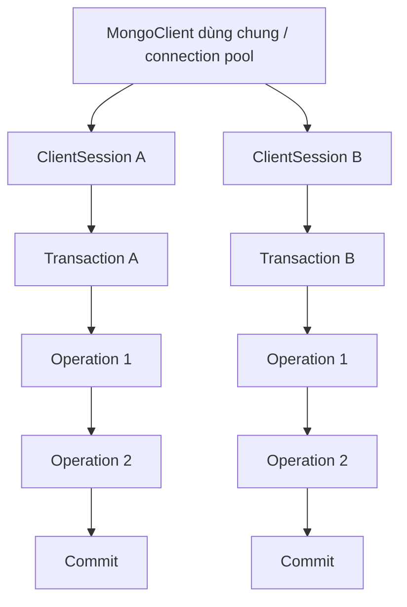

# Giới hạn xử lý song song trên cùng session hoặc transaction

Trong **Spring Data MongoDB reactive**, Reactor có thể chạy nhiều công việc bất đồng bộ đồng thời bằng `flatMap`, `Mono.when`, `Mono.zip` hoặc `merge`. Điều này hữu ích khi các tác vụ I/O **độc lập**, nhưng dễ trở thành lỗi nếu những lệnh MongoDB ấy cùng tham gia **một `ClientSession` hoặc một transaction**. Tài liệu chính thức của **MongoDB Java Reactive Streams Driver** nêu rõ: **không hỗ trợ thực hiện các operation song song trong cùng một transaction**.

Điều này không phủ nhận khả năng mở **nhiều transaction độc lập** cùng lúc trên nhiều sessions. Giới hạn nằm ở **các operation dùng chung session/transaction**: bạn phải xây luồng để một lệnh hoàn tất trước khi lệnh kế tiếp dùng cùng transaction được subscribe. Trong Reactor, cách dễ đọc là `then`, `flatMap` dựa trên kết quả của một `Mono`, hoặc `concatMap` khi xử lý nhiều phần tử. Những phép kết hợp subscribe đồng thời như `when`, `zip` và `flatMap` trên `Flux` nhiều phần tử phải được đánh giá cẩn thận.

Bài thuộc chương **Giao dịch reactive** của module `SPRING_DATA_MONGODB`. Module sử dụng Spring Data MongoDB để kết nối, ánh xạ document, thao tác MongoDB qua template hoặc repository, đồng thời thực hành truy vấn, aggregation, index, transaction, reactive access, kiểm thử và chẩn đoán hiệu năng. Bài tập trung vào ranh giới concurrency của **MongoDB Reactive Streams Driver**, `ReactiveMongoTemplate`, `ReactiveMongoRepository`, `ReactiveMongoTransactionManager` và `TransactionalOperator`, thay vì trình bày mọi operator Reactor nói chung.

> **Nguyên tắc:** Trong **một transaction**, thực thi các lệnh MongoDB **tuần tự** và giữ chúng trong **cùng reactive transaction context**. Đừng dùng `Mono.when(writeA, writeB)` hoặc `Flux.fromIterable(items).flatMap(repository::save)` để tăng song song cho các lệnh nằm trong cùng transaction. Nếu cần throughput, song song hóa **giữa các transaction/sessions độc lập** có giới hạn hoặc dùng một **bulk write command** phù hợp, chứ không khởi chạy nhiều command đồng thời trên cùng session.

## 1. Mục tiêu học tập

Sau bài này, bạn có thể:

1. Phân biệt `ClientSession`, server session, transaction và Reactor subscription.
2. Giải thích vì sao **một transaction không hỗ trợ nhiều operation song song** trong MongoDB Java Reactive Streams Driver.
3. Hiểu một `ClientSession` không được sử dụng đồng thời một cách tùy tiện, kể cả bên ngoài transaction.
4. Phân biệt **song song giữa các sessions** với **song song bên trong một session**.
5. Nhận diện nguy cơ khi dùng `Mono.when`, `Mono.zip`, `Flux.merge`, `flatMap` và `parallel()` trong transactional flow.
6. Dùng `then`, `flatMap` phụ thuộc kết quả, `concatMap` hoặc `flatMapSequential` đúng ngữ cảnh.
7. Phân biệt **thứ tự kết quả** với **thứ tự thực sự thực hiện operation**.
8. Thiết lập `ReactiveMongoTransactionManager` và `TransactionalOperator` với cùng database factory.
9. Hiểu cách Spring ràng buộc `ClientSession` với **Reactor Context**.
10. Tránh việc gọi `subscribe()` riêng trong service khiến lệnh MongoDB rời transaction hiện tại.
11. Phân biệt `Publisher` cold, thời điểm assembly và thời điểm subscription.
12. Xây một transaction hai accounts và ledger theo **chuỗi thao tác tuần tự**, kèm kiểm tra kết quả.
13. Phân biệt lỗi query/duplicate key với **transaction concurrency errors**; không “fix” bằng retry vô hạn.
14. Giải thích giới hạn của `ClientSession` khi dùng trực tiếp với MongoDB Reactive Streams Driver.
15. Quản lý commit, abort, cancellation và session cleanup đúng vòng đời.
16. Đánh giá việc dùng `bulkWrite`/`insertMany` so với nhiều Publisher chạy đồng thời.
17. Thiết kế chiến lược throughput: giao dịch độc lập, bounded concurrency và backpressure.
18. Viết unit tests với `StepVerifier` kiểm chứng **không overlap** giữa các inner publishers.
19. Viết integration tests trên MongoDB replica set để xác minh commit/rollback và tính toàn vẹn dữ liệu.
20. Nhận diện trường hợp transaction không cần thiết, thay bằng một phép atomic update có điều kiện.

## 2. MongoDB ClientSession và transaction: phạm vi chia sẻ

MongoDB transaction được thực hiện trong một **logical session**. `ClientSession` do Driver tạo và sử dụng để gắn các command vào cùng phiên, kết hợp `lsid` và transaction metadata. Trong transaction, các operation thuộc cùng transaction cần được **gắn đúng session**, bất kể chúng thao tác collection nào.



**Transaction A và Transaction B có thể chạy đồng thời** nếu sử dụng **hai sessions độc lập** và tài nguyên DB đủ. Nhưng **Operation 1 và Operation 2 cùng Transaction A phải được điều phối tuần tự** theo giới hạn Driver.

Một session có thể tồn tại mà **không** có transaction (ví dụ dùng causal consistency). `ClientSession.startTransaction()` mới bắt đầu transaction. Trong cùng một session, MongoDB không cho mở hai transaction active đồng thời.

### 2.1. Không đồng nhất ClientSession với connection

`ClientSession` là ngữ cảnh phiên logic, không phải tên khác của socket/connection pool. Mở hai `ClientSession` không có nghĩa mở hai MongoClient hay tạo thêm một connection cố định cho mỗi session. MongoClient nên được tái sử dụng và đóng lúc ứng dụng kết thúc; session có vòng đời ngắn hơn, gắn với một chuỗi thao tác có chủ đích.

### 2.2. Cùng collection nhưng khác session

Hai request độc lập đều cập nhật collection `accounts` có thể chạy đồng thời trên **hai sessions khác nhau**. MongoDB xử lý tính nguyên tử từng document và transaction isolation theo chính sách. Nếu chúng cập nhật cùng document, vẫn có thể phát sinh **write conflict**: chia session không làm mất tranh chấp nghiệp vụ.

## 3. Giới hạn chính thức: không hỗ trợ parallel operations trong transaction

MongoDB Java Reactive Streams Driver documentation có ghi chú riêng **“Parallel Operations Not Supported”** cho các transaction. Trọng tâm là **không chạy nhiều MongoDB operations cùng lúc trong cùng transaction**.

Không an toàn:

```java
Mono<Void> both = Mono.when(
    reactiveTemplate.insert(accountA),
    reactiveTemplate.insert(accountB)
).as(transactionalOperator::transactional);
```

`Mono.when` subscribe các nguồn để chờ **tất cả** hoàn thành; nó không đảm bảo insert A hoàn tất trước khi insert B bắt đầu. Nếu `ReactiveMongoTransactionManager` ràng buộc cả hai lệnh vào **cùng ClientSession**, workflow trên yêu cầu hoạt động song song mà Driver không hỗ trợ.

An toàn hơn:

```java
Mono<Void> both = reactiveTemplate.insert(accountA)
    .then(reactiveTemplate.insert(accountB))
    .then()
    .as(transactionalOperator::transactional);
```

`then` chỉ subscribe Publisher thứ hai sau khi thứ nhất **hoàn tất thành công**. Nếu insert A phát `onError`, insert B **không được subscribe** và transaction manager có cơ hội rollback theo contract của transaction boundary.

`reactiveTemplate`, `accountA`, `accountB` và `transactionalOperator` được ứng dụng cấu hình trong các mục sau; ví dụ này tập trung vào **thứ tự subscription**.

### 3.1. Không coi hành vi lỗi là tất định

Nếu cố chạy song song, lỗi có thể xuất hiện dưới dạng command failure, transaction aborted, lỗi trạng thái session, hoặc một bất thường do race/timing. Không cần và không nên phụ thuộc vào **một chuỗi thông báo lỗi cố định** để phát hiện bug.

**“Test chạy 10 lần vẫn pass” không chứng minh parallel operations được hỗ trợ.** Hai operation nhỏ có thể tình cờ không overlap trên một môi trường; phiên bản Driver/Server, scheduler và tải thực tế có thể thay đổi thứ tự.

### 3.2. Một ngoại lệ: một bulk command không phải nhiều commands song song

MongoDB Server 8.0+ và Java Reactive Streams Driver có thể hỗ trợ một lệnh **client-level bulk write** thao tác nhiều namespaces trong transaction khi phù hợp API/phiên bản. Đó là **một command có nhiều write models**, không phải `Mono.when(writeA,writeB)` gửi hai commands đồng thời. `bulkWrite` vẫn có semantics, giới hạn và kết quả riêng; không suy “bulk được hỗ trợ” thành “mọi lệnh trong transaction có thể chạy song song”.

## 4. Phiên còn một giới hạn: ClientSession không nên được dùng đồng thời

MongoDB Driver Sessions Specification ghi rõ các `ClientSession` **không thread-safe**; mỗi session chỉ nên được một thread/process sử dụng tại một thời điểm. Trong ứng dụng reactive, nhiều Publishers dùng chung session có thể hoạt động xen kẽ trên các scheduler/threads dù service chỉ có một HTTP request.

Nguyên tắc an toàn:

- Không giữ `ClientSession` như singleton được chia sẻ giữa requests.
- Không phát session ra một `Flux` rồi `flatMap` nhiều commands trên cùng session với concurrency lớn.
- Không dùng `parallel().runOn(...)` với operations cần session chung.
- Khi tạo session thủ công, chỉ sử dụng với **MongoClient đã tạo session**.
- Không đóng session trước khi tất cả operations/commit hoặc abort hoàn tất.
- Bảo đảm operations trong session được **subscribe và hoàn tất theo thứ tự**.

### 4.1. Session use không có transaction cũng cần trật tự

Với một **causally consistent session**, thứ tự nhân quả giữa read/write là thành phần của guarantee. Khi bạn gửi hai operations dùng chung session **đồng thời**, không thể suy rằng `read1` đã hoàn tất trước `write2` hay thao tác sau nhìn thấy kết quả của thao tác trước. Vì vậy giữ thứ tự cũng cần thiết cho causal consistency, dù MongoDB không tự tạo transaction atomicity chỉ vì có session.

### 4.2. Reactor Context khác thread affinity

Spring Data reactive transaction sử dụng **Reactor Context**, không dựa vào một Java thread cố định. Vì vậy:

- Không suy rằng đổi scheduler luôn làm mất transaction: Context có thể được propagate đúng.
- **Nhưng** Context được propagate **không biến ClientSession thành thread-safe**, cũng không cho phép nhiều operations dùng session cùng lúc.
- Không suy rằng một chain có cùng Context là đủ: **operator topology vẫn có thể gây concurrency**.

## 5. Phân biệt song song, concurrency và thứ tự

Một số thuật ngữ hay bị dùng lẫn nhau:

| Khái niệm | Ý nghĩa | Hệ quả với MongoDB session |
| --- | --- | --- |
| Concurrent subscriptions | Hai nguồn có thể active cùng lúc | Nguy hiểm nếu cùng transaction |
| Parallel execution | Hoạt động trên nhiều thread/CPU thật sự cùng lúc | Không được hỗ trợ cho lệnh chung transaction |
| Sequential subscription | Publisher sau chỉ subscribe khi Publisher trước kết thúc | Mô hình an toàn cần ưu tiên |
| Ordered output | Kết quả xuất đúng thứ tự input | **Không nhất thiết** các operation thực thi tuần tự |
| Backpressure | Downstream điều tiết demand `request(n)` | Không tự đảm bảo “chỉ một DB command active” |
| Transaction isolation | Các writes có boundary commit/abort | Không tự cho phép parallel operations |

Đặc biệt, **`flatMapSequential` giữ thứ tự phát kết quả, nhưng vẫn có thể subscribe inner Publishers đồng thời**. Nó **không phải** thay thế của `concatMap` khi mục tiêu là ngăn operations overlap.

```java
Flux<Result> notSequentialInExecution =
    Flux.fromIterable(commands)
        .flatMapSequential(this::executeInSameSession, 8);
```

Dòng trên có thể giữ thứ tự kết quả mà vẫn mở tối đa tám inner Publishers cùng lúc. Nếu tất cả dùng **một transaction**, đây vẫn là anti-pattern.

## 6. Các operator thường gây overlap

| Reactor operator | Subscription pattern thường gặp | Dùng cho nhiều DB commands cùng transaction? |
| --- | --- | --- |
| `Mono.when(a,b)` | Subscribe cả a và b để chờ hoàn tất | **Không** |
| `Mono.zip(a,b)` | Subscribe cả a và b, ghép giá trị | **Không** |
| `Flux.merge(a,b)` | Subscribe nhiều nguồn đồng thời | **Không** |
| `Flux.fromIterable(xs).flatMap(f)` | Inner operations có concurrency/prefetch | **Không** nếu cùng session |
| `flatMapSequential(f,n)` | Inner concurrency nhưng output ordered | **Không** nếu cùng session |
| `parallel().runOn(scheduler)` | Chia rails để hoạt động đồng thời | **Không** nếu cùng session |
| `Mono<A>.flatMap(a -> Mono<B>)` | Mono B được subscribe sau khi A phát value | **Có**, nếu không khởi chạy nhánh khác |
| `Mono<Void>.then(Mono<B>)` | B được subscribe sau A complete | **Có** |
| `Flux.fromIterable(xs).concatMap(f)` | Inner Publishers được xử lý tuần tự | **Có** |
| `Flux.fromIterable(xs).flatMap(f,1)` | Giới hạn một inner active | Có thể, nhưng `concatMap` rõ ý hơn |
| `doOnNext(...)` | Side-effect đồng bộ, không tự đợi Publisher phụ | **Không** dùng để khởi động DB command thứ hai |

Đây là bảng cho **trường hợp mỗi Publisher gọi MongoDB trong cùng session/transaction**. `Mono.zip` trên hai thao tác **CPU thuần** hoặc hai requests dùng **hai sessions độc lập** không bị cùng giới hạn đó.

### 6.1. FlatMap trên một Mono khác flatMap trên nhiều phần tử

`Mono<Read>.flatMap(read -> write)` chỉ tạo Publisher ghi sau khi đọc có giá trị; đây là kiểu **phụ thuộc dữ liệu tuần tự**. Trong khi `Flux<Read>.flatMap(read -> write)` có thể khởi động **nhiều writes song song** cho các records, vì outer Flux phát nhiều items.

Vì thế không đánh giá an toàn chỉ bằng từ khóa `flatMap` — phải xem **publisher upstream có bao nhiêu onNext** và số inner publishers được subscribe đồng thời.

## 7. Bẫy Mono.when: chờ hai lệnh không có nghĩa chạy tuần tự

```java
// Anti-pattern khi cả hai operations tham gia một transaction.
Mono<Void> result = Mono.when(
    template.updateFirst(debitQuery, debit, Account.class),
    template.updateFirst(creditQuery, credit, Account.class)
).as(tx::transactional);
```

`Mono.when` là phép kết hợp **không tạo thứ tự trước–sau** giữa hai nguồn. Ngay cả khi cả hai cập nhật **hai documents khác nhau**, chúng vẫn chia **session của cùng transaction** và do đó không được Driver hỗ trợ song song.

Sửa:

```java
Mono<Void> result =
    template.updateFirst(debitQuery, debit, Account.class)
        .flatMap(debitResult -> {
            if (debitResult.getMatchedCount() != 1) {
                return Mono.error(
                    new IllegalStateException("Không ghi nợ được"));
            }
            return template.updateFirst(
                creditQuery, credit, Account.class);
        })
        .flatMap(creditResult -> {
            if (creditResult.getMatchedCount() != 1) {
                return Mono.error(
                    new IllegalStateException("Không ghi có được"));
            }
            return Mono.<Void>empty();
        })
        .as(tx::transactional);
```

Ở đây debit hoàn thành phát `UpdateResult` trước khi credit được subscribe. Tuy nhiên việc dùng `Mono.<Void>empty()` chỉ để kết thúc chain có thể làm logic khó đọc; ví dụ production ở mục 15 sẽ dùng `then` và kiểm tra kết quả rõ ràng hơn.

## 8. Bẫy Mono.zip: ghép kết quả không tạo dependency

Sai nếu đọc hai tài khoản **trong cùng transaction** bằng `zip`:

```java
Mono<reactor.util.function.Tuple2<Account, Account>> both =
    Mono.zip(
        template.findById(sourceId, Account.class),
        template.findById(targetId, Account.class)
    ).as(tx::transactional);
```

`zip` subscribe hai Monos để ghép kết quả. Nó không có quy tắc “find source hoàn thành rồi mới find target”. Vì vậy đây là **hai operations cùng session có thể overlap**.

Nếu các reads thực sự phải tham gia transaction, làm tuần tự:

```java
Mono<reactor.util.function.Tuple2<Account, Account>> both =
    template.findById(sourceId, Account.class)
        .flatMap(source ->
            template.findById(targetId, Account.class)
                .map(target -> reactor.util.function.Tuples.of(
                    source, target))
        )
        .as(tx::transactional);
```

**Lưu ý về empty:** nếu source/target không có, chain có thể complete empty; nghiệp vụ cần `switchIfEmpty(Mono.error(...))` ở vị trí phù hợp. Không coi `Mono.zip` trên reads ngoài transaction là luôn xấu: nó có thể hợp lý khi **mỗi read dùng session/connection riêng** và không có yêu cầu snapshot chung.

## 9. Bẫy Flux.flatMap: một session, nhiều writes

Ví dụ xử lý 100 dòng ledger:

```java
Flux<LedgerEntry> writes =
    Flux.fromIterable(entries)
        .flatMap(template::insert, 8);

Mono<Void> all = writes.then()
    .as(tx::transactional);
```

`flatMap(...,8)` có thể mở tám inner subscriptions cùng lúc. Với transaction context chung, đó là một yêu cầu Driver **không hỗ trợ**.

Thay bằng:

```java
Mono<Void> all =
    Flux.fromIterable(entries)
        .concatMap(template::insert)
        .then()
        .as(tx::transactional);
```

`concatMap` subscribe từng inner Publisher và đợi nó hoàn tất rồi mới subscribe inner kế. `then()` chỉ complete khi toàn bộ inserts thành công; một insert phát lỗi sẽ làm outer chain thất bại và manager xử lý rollback.

### 9.1. concatMap đảm bảo thứ tự thao tác, không tự đảm bảo commit

`concatMap` không phải transaction. Nếu bỏ `.as(tx::transactional)`, mỗi insert có thể đã commit riêng, và lỗi ở phần tử thứ ba **không tự rollback** hai phần tử trước.

Ngược lại, `TransactionalOperator` cung cấp transaction boundary nhưng **không tự đổi `flatMap` thành `concatMap`**. Muốn có cả atomicity lẫn hạn chế concurrency, cần **cả hai**.

### 9.2. Khi dữ liệu nguồn được phát bất đồng bộ

`concatMap` quản lý inner subscriptions theo thứ tự outer signals. Outer Flux vẫn có thể làm prefetch/queue, nhưng không có nhiều **inner DB Publisher** active cùng lúc do chính `concatMap` khởi tạo. Nếu outer source cũng là một query MongoDB **trong cùng session**, cần xem xét cursor/read lifecycle: đừng assume đọc streaming chưa kết thúc trong transaction rồi ghi trên cùng session là mẫu an toàn; cân nhắc materialize một tập **có giới hạn** trước khi chạy writes tuần tự hoặc thiết kế workflow bằng các query tách pha.

## 10. Subscription lặp và phạm vi session

MongoDB Reactive Streams Driver trả các Publisher **cold**. `Mono<Void> transactionPipeline` không tương đương một transaction đã chạy:

```java
Mono<Void> transactionPipeline =
    template.insert(entryA)
        .then(template.insert(entryB))
        .then()
        .as(tx::transactional);

// Chưa có subscriber -> chưa chạy.
// Subscription A -> một transaction.
// Subscription B -> một lần thực thi transaction mới.
```

Với transaction manager, mỗi subscription hợp lệ thường tạo transaction/session riêng, nên hai subscriptions **có thể chạy song song như hai transactions độc lập**. Nhưng chúng có thể ghi **cùng business data** hoặc gặp duplicate key; không coi cold Publisher là exactly-once.

### 10.1. Không dùng inner subscribe

Sai:

```java
Mono<Void> unsafe() {
    template.insert(entryA).subscribe(); // Một luồng riêng, không được await.
    return template.insert(entryB).then()
        .as(tx::transactional);
}
```

`insert(entryA).subscribe()` tạo subscription riêng; nó có thể chạy ngoài transaction của nhánh trả về, không được đợi commit/rollback, và có thể xảy ra cùng lúc với insert B. Nếu insert B rollback, insert A đã chạy riêng **có thể vẫn tồn tại**.

Sửa:

```java
Mono<Void> safe() {
    return template.insert(entryA)
        .then(template.insert(entryB))
        .then()
        .as(tx::transactional);
}
```

**Một chain được return/subscribe bởi ranh giới ứng dụng**; không có hidden subscription.

## 11. Parallel trên những gì thì có thể?

Điểm cần phân biệt: **MongoDB không cấm ứng dụng reactive có nhiều công việc đồng thời.** Không nên chuyển mọi luồng sang tuần tự vì hiểu sai giới hạn của **session**.

Các trường hợp có thể chạy song song, nếu đã đánh giá nghiệp vụ:

| Trường hợp | Có thể đồng thời? | Điều kiện |
| --- | --- | --- |
| Hai HTTP requests, mỗi request một transaction/session | Có | Tài nguyên, write conflicts, retry và idempotency |
| Hai CPU calculations độc lập không chạm MongoDB session | Có | Không chia sẻ mutable state không an toàn |
| Hai API calls bên ngoài transaction | Có | Cần hiểu side effects và kết quả |
| Hai queries dùng sessions riêng ngoài transaction | Có | Cần xem consistency/replication |
| Hai commands dùng cùng `ClientSession` | Không nên | Session không thread-safe; giữ trật tự |
| Hai commands trong cùng transaction | **Không hỗ trợ** | Dùng tuần tự |
| Một bulk command cập nhật nhiều documents | Có thể | Theo driver/server/operation semantics, không phải parallel calls |
| Hai transactions cạnh tranh một account | Có thể chạy song song, có thể conflict | Thiết kế contention handling |

### 11.1. Tính toán độc lập trước khi mở transaction

Có thể chạy song song những việc thuần tính toán/I/O bên ngoài transaction, rồi mới bắt đầu chuỗi write tuần tự:

```java
Mono<ValidatedTransfer> prepared = Mono.zip(
    validateTransferRules(command),
    loadPricingPolicy(command)
).map(tuple -> combine(tuple.getT1(), tuple.getT2()));

Mono<Void> write = prepared.flatMap(validated ->
    writeTransferSequentially(validated)
        .as(tx::transactional)
);
```

`validateTransferRules`, `loadPricingPolicy`, `combine` và `writeTransferSequentially` là **hàm nghiệp vụ do ứng dụng định nghĩa**. Giả sử các nguồn trước transaction không có side effect không thể hoàn tác. Nếu cần snapshot/authorization từ DB trong transaction, **phải kiểm tra lại tại thời điểm ghi**: việc validate trước transaction không tránh stale data.

### 11.2. Đặt boundary transaction đúng chỗ

Trong ví dụ trên, operator `.as(tx::transactional)` nằm **bên trong** `flatMap`, chỉ bao phần `writeTransferSequentially`. Nếu đặt ở cuối `prepared.flatMap(...).as(tx::transactional)`, các tác vụ chuẩn bị cũng tham gia transaction context nếu chúng dùng MongoDB template. Điều này có thể kéo dài transaction không cần thiết hoặc làm các reads độc lập thành operations chung session chạy đồng thời.

## 12. Throughput: song song giữa các transaction độc lập

Giả sử có nhiều transfer **độc lập**. Mỗi transfer đã có một service method trả `Mono<TransferResult>`, và **transaction boundary nằm bên trong method**:

```java
Flux<TransferResult> results =
    Flux.fromIterable(transferCommands)
        .flatMap(
            command -> transferService.transfer(command),
            4
        );
```

Ở đây `flatMap(...,4)` có thể có **tối đa bốn transfer Monos active cùng lúc**, và nếu mỗi transfer tự bắt đầu transaction riêng với session riêng, đây là song song **giữa các transactions**, không phải song song **bên trong một transaction**.

Điểm quan trọng: **đừng** bọc toàn bộ Flux bằng **một** `.as(tx::transactional)`:

```java
// Không phù hợp nếu mục tiêu là 4 transactions độc lập:
Flux<TransferResult> wrong =
    Flux.fromIterable(transferCommands)
        .flatMap(transferService::transfer, 4)
        .as(tx::transactional); // Một transaction context cho outer flow.
```

Trong trường hợp đó, outer transaction có thể khiến các inner database operations chia sẻ session/context không phù hợp, hoặc thay đổi propagation theo những cách không được mong muốn.

### 12.1. Concurrency 4 không có nghĩa 4 transactions không bao giờ conflict

Hai transfers có thể cùng trừ một account. Dù khác sessions, MongoDB vẫn có thể abort một transaction vì write conflict. Cần rollback/retry có giới hạn, idempotency và invariants; chỉ tách session là **điều kiện vận hành**, không phải sự bảo đảm business conflicts biến mất.

### 12.2. Một outer Flux là nhiều requests hay một batch?

Nếu một HTTP request gửi 100 transfers và hệ thống phải đáp ứng tính chất **“tất cả 100 transfers cùng commit hoặc cùng rollback”**, không được thay bằng 4 transactions độc lập mà không làm rõ thay đổi semantics. Có thể cần một transaction tuần tự hoặc thiết kế business batch khác, đồng thời xem xét transaction time limit/bộ nhớ/locks. Nếu 100 transfers được phép thành công/thất bại độc lập, bounded parallel transactions là thiết kế khác hợp lệ.

## 13. Cấu hình ReactiveMongoTransactionManager

`ReactiveMongoTransactionManager` quản lý session/transaction của MongoDB trong ứng dụng reactive. Nó gắn tài nguyên vào **Reactor Context** để các operations trong cùng subscription có thể tham gia transaction, thay vì giả định transaction nằm trong một `ThreadLocal` cố định.

```java
package dev.learning.transactions;

import org.springframework.context.annotation.Bean;
import org.springframework.context.annotation.Configuration;
import org.springframework.data.mongodb.ReactiveMongoDatabaseFactory;
import org.springframework.data.mongodb.ReactiveMongoTransactionManager;

@Configuration
public class ReactiveMongoTxConfiguration {

    @Bean
    ReactiveMongoTransactionManager reactiveMongoTransactionManager(
            ReactiveMongoDatabaseFactory factory) {

        return new ReactiveMongoTransactionManager(factory);
    }
}
```

Điều kiện quan trọng:

- MongoDB là **replica set** hoặc sharded cluster hỗ trợ transaction.
- `ReactiveMongoTemplate`, repository và manager có cùng **ReactiveMongoDatabaseFactory** phù hợp.
- Collection/index của nghiệp vụ nên được provision trước business transaction; DDL trong transaction có hạn chế theo server/topology.
- Tài khoản MongoDB có quyền phù hợp; transaction có read preference hợp lệ.
- Nếu có nhiều clients/factories, chọn rõ đúng manager theo bean, không suy mọi repository đều dùng một transaction.

### 13.1. TransactionalOperator và @Transactional

```java
import org.springframework.transaction.reactive.TransactionalOperator;

TransactionalOperator tx =
    TransactionalOperator.create(reactiveMongoTransactionManager);
```

Ví dụ declarative:

```java
import org.springframework.transaction.annotation.Transactional;

@Transactional
public Mono<Void> insertBoth() {
    return template.insert(first)
        .then(template.insert(second))
        .then();
}
```

Ví dụ method trên chỉ minh họa; `template`, `first` và `second` là fields/values do ứng dụng cung cấp. `@Transactional` chỉ được áp dụng khi method đi qua Spring proxy hoặc cơ chế quản lý tương ứng; self-invocation có thể bỏ qua proxy.

**Cả `TransactionalOperator` và `@Transactional` đều không tự serialize `Mono.when` hay `flatMap`.** Tác giả pipeline vẫn phải chọn operator bảo đảm thứ tự.

## 14. Domain ví dụ: account và ledger

Giả sử chuyển 2.000 cents từ tài khoản A-1 sang A-2. Hai accounts và một ledger entry phải cùng commit hoặc cùng rollback.

```java
package dev.learning.transactions;

import org.springframework.data.annotation.Id;
import org.springframework.data.mongodb.core.mapping.Document;
import org.springframework.data.mongodb.core.mapping.Field;

@Document("rx_tx_accounts")
public record TxAccount(
    @Id String id,
    @Field("tenant_id") String tenantId,
    long balanceCents) {
}
```

```java
package dev.learning.transactions;

import org.springframework.data.annotation.Id;
import org.springframework.data.mongodb.core.mapping.Document;
import org.springframework.data.mongodb.core.mapping.Field;

@Document("rx_tx_ledger")
public record TxLedger(
    @Id String id,
    @Field("tenant_id") String tenantId,
    String fromAccountId,
    String toAccountId,
    long amountCents) {
}
```

**Mỗi `public record` đặt trong một tệp Java riêng.** Collection names `rx_tx_accounts`/`rx_tx_ledger` được tạo trong database test hoặc provision bằng migration trước khi transaction chạy.

| Account | tenant_id | Trước | Sau commit |
| --- | --- | ---: | ---: |
| `A-1` | tenant-a | 10.000 | 8.000 |
| `A-2` | tenant-a | 4.000 | 6.000 |
| `B-1` | tenant-b | 99.000 | Không đổi |

Một giao dịch sai tenant hoặc không đủ số dư **không được commit**. `TransactionalOperator` bảo đảm transaction boundary theo MongoDB, nhưng không tự viết điều kiện authorization hay điều kiện số dư.

### 14.1. Business predicate cần nằm trong lệnh ghi

```javascript
db.rx_tx_accounts.updateOne(
  {
    _id: "A-1",
    tenant_id: "tenant-a",
    balanceCents: { $gte: NumberLong("2000") }
  },
  { $inc: { balanceCents: NumberLong("-2000") } }
);
```

Bản thân `$inc` cùng predicate trên **một document** là atomic. Transaction được sử dụng ở đây vì nghiệp vụ cần thêm **credit tài khoản nhận** và **insert ledger** trong cùng ranh giới commit.

## 15. Service chuyển khoản: ba lệnh MongoDB tuần tự

```java
package dev.learning.transactions;

import org.springframework.data.mongodb.ReactiveMongoTransactionManager;
import org.springframework.data.mongodb.core.ReactiveMongoTemplate;
import org.springframework.data.mongodb.core.query.Criteria;
import org.springframework.data.mongodb.core.query.Query;
import org.springframework.data.mongodb.core.query.Update;
import org.springframework.stereotype.Service;
import org.springframework.transaction.reactive.TransactionalOperator;
import reactor.core.publisher.Mono;

@Service
public class TxTransferService {

    private final ReactiveMongoTemplate template;
    private final TransactionalOperator tx;

    public TxTransferService(
            ReactiveMongoTemplate template,
            ReactiveMongoTransactionManager manager) {
        this.template = template;
        this.tx = TransactionalOperator.create(manager);
    }

    public Mono<Void> transfer(
            String tenantId,
            String fromId,
            String toId,
            long cents,
            String requestId) {

        return Mono.defer(() -> {
            if (tenantId == null || tenantId.isBlank()
                    || fromId == null || toId == null
                    || fromId.equals(toId)
                    || requestId == null || requestId.isBlank()
                    || cents <= 0) {
                return Mono.error(
                    new IllegalArgumentException("Transfer không hợp lệ"));
            }

            Query debitQuery = Query.query(
                Criteria.where("id").is(fromId)
                    .and("tenantId").is(tenantId)
                    .and("balanceCents").gte(cents)
            );
            Query creditQuery = Query.query(
                Criteria.where("id").is(toId)
                    .and("tenantId").is(tenantId)
            );

            Update debit = new Update().inc("balanceCents", -cents);
            Update credit = new Update().inc("balanceCents", cents);

            TxLedger ledger = new TxLedger(
                "TRANSFER-" + requestId, tenantId,
                fromId, toId, cents
            );

            return template
                .updateFirst(debitQuery, debit, TxAccount.class)
                .flatMap(debitResult -> {
                    if (debitResult.getMatchedCount() != 1) {
                        return Mono.error(new IllegalStateException(
                            "Tài khoản nguồn không hợp lệ hoặc thiếu số dư"));
                    }

                    // Credit chỉ được subscribe sau khi debit có kết quả.
                    return template.updateFirst(
                        creditQuery, credit, TxAccount.class);
                })
                .flatMap(creditResult -> {
                    if (creditResult.getMatchedCount() != 1) {
                        return Mono.error(new IllegalStateException(
                            "Tài khoản nhận không hợp lệ"));
                    }

                    // Insert ledger chỉ sau khi credit có kết quả.
                    return template.insert(ledger);
                })
                .then();
        }).as(tx::transactional);
    }
}
```

Đây là ví dụ **lõi MongoDB transaction**, không phải toàn bộ hệ thống tài chính production. Để vận hành thực tế còn cần principal-based tenant authorization, unique index/idempotency cho requestId, retry transient write conflicts, kiểm soát overflow/kiểu tiền, xử lý unknown commit outcome và transactional outbox cho side effects ngoài MongoDB.

### 15.1. Đọc chuỗi theo thứ tự thực thi

1. `Mono.defer` trì hoãn việc dựng query/ledger đến **subscription**.
2. MongoDB nhận lệnh debit và trả `UpdateResult`.
3. `flatMap` sau debit kiểm tra `matchedCount`; nếu 0, phát `onError`.
4. Chỉ khi debit match, reactive chain subscribe credit.
5. `flatMap` sau credit kiểm tra `matchedCount`; nếu 0, phát `onError`.
6. Chỉ khi credit match, chain subscribe insert ledger.
7. `then()` phát terminal completion khi ledger insert thành công.
8. `TransactionalOperator` được đặt **bao quanh cả chuỗi**; khi success nó commit, khi error nó rollback theo manager contract.

**Không dùng `Mono.when`/`Mono.zip`/`flatMap` trên nhiều phần tử** để gửi các DB writes này.

### 15.2. Vì sao phải kiểm tra matchedCount?

`updateFirst` không nhất thiết phát lỗi khi query không khớp document. Nó có thể trả `UpdateResult` với `matchedCount=0` và complete thành công về mặt giao tiếp với server. Nếu service bỏ qua `matchedCount`, transaction có thể commit dù một nửa logic chuyển tiền không thực hiện.

`matchedCount=0` có thể là thiếu số dư, sai tenant, tài khoản không tồn tại hoặc tranh chấp dữ liệu. Trả thông tin cụ thể cho caller phải tuân thủ phân quyền, tránh làm lộ tài khoản của tenant khác.

### 15.3. Không gọi subscribe trong service

Sai:

```java
// Anti-pattern: credit chạy ở subscription độc lập.
template.updateFirst(creditQuery, credit, TxAccount.class)
    .subscribe();

return template.updateFirst(
    debitQuery, debit, TxAccount.class).then();
```

Lệnh credit có thể chạy **ngoài transaction đang được quản lý**, ngoài thứ tự nghiệp vụ, không propagate error/cancel về caller. `subscribe()` thủ công chỉ nên ở ranh giới đã quản lý lifecycle, không xuất hiện ngẫu nhiên trong service transaction.

## 16. Batch trong một transaction: concatMap thay flatMap

```java
import java.util.List;
import reactor.core.publisher.Flux;
import reactor.core.publisher.Mono;

// Trong cùng service có fields template và tx:
public Mono<Void> insertLedgerBatch(List<TxLedger> entries) {
    return Flux.fromIterable(entries)
        .concatMap(template::insert)
        .then()
        .as(tx::transactional);
}
```

`concatMap` đợi mỗi insert Publisher hoàn thành trước khi subscribe insert kế tiếp. Với `flatMap(template::insert, 16)`, có thể có 16 operations cùng lúc **trong cùng transaction context** — không được Driver hỗ trợ.

**`concatMap` không tự tạo transaction.** Nếu bỏ `as(tx::transactional)`, những inserts đầu có thể đã commit khi một insert sau gặp lỗi. Cần **cả thứ tự thực thi và transaction boundary** khi muốn all-or-nothing.

### 16.1. Tránh một transaction quá dài

Một transaction chứa hàng trăm nghìn writes tuần tự có thể quá thời gian sống, tăng lock contention hoặc snapshot overhead. Nếu business cho phép từng nhóm commit riêng, chia thành các transactions nhỏ, xử lý **các transactions độc lập** với bounded concurrency. Nhưng nếu yêu cầu all-or-nothing trên toàn batch, không được âm thầm tách transaction làm mất contract.

### 16.2. Cursor read chưa xong và write trong cùng session

```java
// Cần thận trọng: read cursor có thể vẫn active.
Mono<Void> questionable = template.find(
        query, TxAccount.class)
    .concatMap(acc -> template.updateFirst(
        buildQuery(acc), buildUpdate(acc), TxAccount.class).then())
    .then()
    .as(tx::transactional);
```

`concatMap` bảo đảm chỉ một **inner update** active, nhưng outer `find` có thể còn cursor/`getMore` đang hoạt động. Điều này cần đánh giá kỹ nếu cùng session. Khi tập kết quả nhỏ và **đã giới hạn**, có thể hoàn tất pha đọc trước:

```java
Mono<Void> twoPhase = template.find(
        query.limit(100), TxAccount.class)
    .collectList()
    .flatMapMany(rows -> Flux.fromIterable(rows)
        .concatMap(acc -> template.updateFirst(
            buildQuery(acc), buildUpdate(acc),
            TxAccount.class).then()))
    .then()
    .as(tx::transactional);
```

`query`, `buildQuery` và `buildUpdate` là giá trị/hàm ứng dụng. `collectList` chỉ hợp lý với tập bounded; không dùng trên hàng triệu rows. Sau pha đọc, cần bảo vệ các bất biến của write bằng predicate/locking và hiểu snapshot semantics.

## 17. Bulk command khác song song nhiều commands

`insertMany`/`bulkWrite` của Driver có thể gửi nhiều write models trong **một operation có semantics riêng**.

```java
import java.util.List;
import org.bson.Document;
import reactor.core.publisher.Mono;

// reactiveCollection là MongoDB Reactive Streams MongoCollection<Document>
// session thuộc client tương ứng và đã có transaction active.
Mono<?> oneOperation = Mono.from(
    reactiveCollection.insertMany(
        session,
        List.of(
            new Document("_id", "BATCH-1"),
            new Document("_id", "BATCH-2")
        )
    )
);
```

Đây là **một Publisher cho một API operation**, không tương đương `Mono.when(insertOneA, insertOneB)` với hai subscriptions đồng thời.

- `insertMany`/`bulkWrite` có ordered/unordered, kết quả lỗi và giới hạn riêng.
- MongoDB Server **8.0+** có hỗ trợ client-level bulk writes nhiều namespaces trong transaction qua driver/API phù hợp.
- Bulk API không tự thực thi optimistic locking per-entity như `repository.save(versionedEntity)`.
- Bulk không làm transaction miễn nhiễm với timeouts/write conflicts.
- Sau một bulk operation, không khởi chạy operation khác **đồng thời trên cùng session**.

## 18. Quản lý session trực tiếp qua Reactive Streams Driver

Khi không sử dụng Spring `ReactiveMongoTransactionManager`, Driver API yêu cầu truyền session ở **mỗi operation tham gia transaction**.

```java
import com.mongodb.reactivestreams.client.MongoClient;
import com.mongodb.reactivestreams.client.MongoCollection;
import org.bson.Document;
import reactor.core.publisher.Mono;

// client là reactive MongoClient do ứng dụng quản lý:
MongoCollection<Document> a = client.getDatabase("training_tx")
    .getCollection("first");
MongoCollection<Document> b = client.getDatabase("training_tx")
    .getCollection("second");

Mono<Void> manualIllustration =
    Mono.from(client.startSession())
        .flatMap(session -> {
            session.startTransaction();
            return Mono.from(
                    a.insertOne(session, new Document("_id", "ONE")))
                .then(Mono.from(
                    b.insertOne(session, new Document("_id", "TWO"))))
                .then(Mono.from(session.commitTransaction()))
                .doFinally(signal -> session.close());
        });
```

**Đây chỉ là ví dụ thứ tự tham số session.** Nó **chưa xử lý abort khi lỗi/cancel**, chưa retry commit và không nên copy nguyên trạng cho production.

### 18.1. Quy trình manual đầy đủ cần gì?

Nếu dùng Driver thuần, phải quản lý:

1. Lấy session khi subscription bắt đầu.
2. Gọi `startTransaction` với options hợp lệ.
3. Đưa chính session vào từng Driver API overload.
4. Compose operations **tuần tự**.
5. Commit chỉ sau khi tất cả nghiệp vụ thành công.
6. Abort khi có error; xử lý cancellation riêng.
7. Đóng session sau commit/abort (kể cả khi cleanup phát lỗi).
8. Phân loại `TransientTransactionError` và `UnknownTransactionCommitResult`.
9. Không chia sẻ session giữa các requests/threads.
10. Bảo vệ external side effects/idempotency.

Một hướng quản lý tài nguyên là `Mono.usingWhen` hoặc `Flux.usingWhen` với các callbacks **asyncComplete → commit/close**, **asyncError → abort/close**, **asyncCancel → abort/close**. Khác với `doFinally`, asynchronous cleanup phải được **compose và await**, không gọi `abortTransaction().subscribe()` riêng rồi hy vọng hoàn tất đúng.

### 18.2. Vì sao ưu tiên TransactionalOperator?

`TransactionalOperator` lo transaction resource lifecycle và Spring Data integration, giúp service tập trung vào query/result checks. Nếu có lý do đặc biệt phải quản lý session thủ công, cần integration test bao phủ cancellation/commit failure/abort failure, không chỉ trường hợp thành công.

## 19. Retry đúng lỗi, không dùng retry để che concurrency misuse

Một transaction có thể thất bại vì **write conflict**, timeout, lỗi mạng, duplicate key, điều kiện nghiệp vụ không thỏa hoặc lỗi dùng session. Không được coi tất cả đều là lỗi transient.

| Tình huống | Ý nghĩa | Hành động |
| --- | --- | --- |
| `TransientTransactionError` | Lỗi transient theo nhãn Driver | Có thể retry toàn transaction theo contract |
| `UnknownTransactionCommitResult` | Chưa chắc commit đã thành công | Xử lý/retry commit theo Driver, tránh nhân đôi lệnh |
| `DuplicateKeyException` | Vi phạm unique key/idempotency | Kiểm tra dữ liệu và requestId |
| `matchedCount=0` | Predicate không match | Lỗi nghiệp vụ, thiếu quyền hoặc dữ liệu thay đổi |
| Parallel operations cùng session | Pipeline dùng sai topology | **Sửa `when/zip/flatMap` thành tuần tự** |
| Transaction lifetime exceeded | Giao dịch quá dài | Rút ngắn scope, tối ưu query/batch |
| HTTP request bị cancel | Outcome có thể không rõ | Cleanup và idempotency/reconciliation |

Không viết:

```java
return transactionalWork
    .retryWhen(reactor.util.retry.Retry.max(100));
```

`retryWhen` sẽ **subscribe lại** upstream. Nếu trong workflow có email, charge payment hoặc ghi ngoài MongoDB, những side effect ấy không tự rollback. Retry phải có số lần giới hạn, phân loại lỗi rõ ràng, và idempotency key cho business commands.

### 19.1. Retry transaction không giống retry commit

Với `TransientTransactionError` thích hợp, một chương trình có thể abort và chạy lại transaction. Với `UnknownTransactionCommitResult`, commit có thể đã thành công nhưng mất phản hồi, nên không được mặc định **chạy lại toàn nghiệp vụ**. MongoDB Driver có callback helpers và các quy tắc retry commit riêng; implementation thủ công phải tuân thủ error labels chính thức.

### 19.2. Retry không hợp thức hóa Mono.when

Một pipeline `Mono.when(writeA,writeB).retryWhen(...)` vẫn subscribe hai lệnh cùng lúc mỗi lần thử. Nếu cả hai dùng chung transaction, đây vẫn là yêu cầu **không được Driver hỗ trợ**. Sửa topology trước khi nghĩ tới retry.

## 20. Commit, abort, cancel và terminal signals

| Tín hiệu từ Publisher | Mong muốn | Cần lưu ý |
| --- | --- | --- |
| `onComplete` | Commit rồi kết thúc boundary | Commit có thể lỗi/unknown |
| `onError` | Abort/rollback và truyền lỗi | Đừng nuốt lỗi thành empty |
| `cancel` | Cleanup, cố abort nếu chưa commit | Cancel không luôn undo write đã commit |
| Timeout | Error/cancel theo Reactor | Server có thể đã nhận command |
| Resubscribe | Một lần chạy transaction mới | Business action có thể lặp |

### 20.1. Nuốt lỗi trước transaction boundary có thể gây commit sai

```java
Mono<Void> incorrect = template.insert(entry)
    .onErrorResume(error -> Mono.empty())
    .then()
    .as(tx::transactional);
```

Nếu insert lỗi nhưng bị biến thành `Mono.empty` **trước** manager, manager có thể chỉ nhìn thấy completion rồi thử commit. Chỉ recover lỗi thành success khi **nghiệp vụ thật sự cho phép** bỏ qua.

### 20.2. Không abort bằng inner subscribe

```java
// Anti-pattern, không dùng cùng Spring manager:
return businessFlow
    .doOnError(error ->
        session.abortTransaction().subscribe());
```

Đây là lệnh abort bất đồng bộ không được await; nó có thể cạnh tranh với rollback do manager đang làm trên cùng session. Khi dùng Spring, để transaction manager quản lý. Khi dùng Driver raw, **compose/await** abort Publisher trong cleanup flow thích hợp.

### 20.3. Client hủy không bảo đảm rollback tức thì

WebFlux cancel có thể lan upstream, nhưng nếu commit đã tới MongoDB hoặc phản hồi commit bị mất, kết quả chưa chắc. Với nghiệp vụ quan trọng, dùng requestId/unique key và endpoint tra cứu trạng thái; không hứa “ngắt kết nối thì chưa có write nào xảy ra”.

## 21. Reactor Context không tự bảo đảm thứ tự

`ReactiveMongoTransactionManager` ràng buộc session qua **Reactor Context**. Khác với transaction imperative dùng `ThreadLocal`, một reactive chain có thể đổi thread mà Context vẫn được propagate qua integration của Reactor/Spring.

```text
Cùng Reactor Context
    -> có thể cùng transaction-bound ClientSession
    -> KHÔNG làm ClientSession thread-safe

Cùng ClientSession + cùng transaction
    -> KHÔNG hỗ trợ parallel MongoDB commands
    -> phải điều phối operations tuần tự
```

### 21.1. Scheduler không sửa concurrency topology

```java
Mono<Void> stillWrong = Mono.when(
    template.insert(entryA).subscribeOn(schedulerA),
    template.insert(entryB).subscribeOn(schedulerB)
).as(tx::transactional);
```

`subscribeOn` có thể đổi thread bắt đầu subscription; `publishOn` đổi execution context downstream. Cả hai **không** thay `when` thành `then`. Đặt hai branches cùng một scheduler cũng không phải đảm bảo tuần tự hoàn tất DB operations.

### 21.2. Không tự lưu session trong ThreadLocal/global

Reactive code có thể chuyển threads. Đừng tạo `ThreadLocal<ClientSession>` rồi tự lấy session trong từng callback, cũng đừng lưu session singleton để chia sẻ giữa requests. Dùng session-aware `ReactiveMongoTemplate` và transaction manager đúng factory.

### 21.3. Self-invocation có thể bỏ qua @Transactional

Method `@Transactional` gọi qua `this.method()` trong cùng bean có thể không đi qua Spring AOP proxy. Khi ấy returned Publisher có thể **không được transaction manager bao**, dù annotation xuất hiện trên source. Kiểm thử rollback trên replica set, không chỉ kiểm tra annotation bằng reflection.

## 22. Hiệu năng: transaction ngắn và bounded parallel transactions

Giới hạn song song trên cùng session không có nghĩa ứng dụng reactive mất throughput. Có thể xử lý nhiều **transactions độc lập** cùng lúc với `flatMap(...,concurrency)` khi business cho phép.

Các chỉ số cần theo dõi:

- Số transaction đang mở, commit/abort/error rate.
- Transaction duration và commit latency.
- Số MongoDB commands mỗi transaction và thời gian chạy mỗi command.
- Write conflicts, transient retries, unknown commit outcomes.
- Driver connection pool, wait queues và server selection timeouts.
- Replication lag, lock contention, snapshot memory.
- Kích thước batch, request rate và concurrency ở service.
- Tỷ lệ `matchedCount=0` ở debit/credit.
- Index usage của query theo `tenant_id`/`_id`.

### 22.1. Không gọi remote service chậm bên trong transaction nếu tránh được

```java
Mono<Void> slow = template.updateFirst(
        debitQuery, debit, TxAccount.class)
    .then(remoteFraudCheck()) // HTTP call kéo dài.
    .then(template.insert(ledger))
    .then()
    .as(tx::transactional);
```

`remoteFraudCheck` là Publisher gọi hệ thống ngoài MongoDB. Transaction giữ tài nguyên trong lúc chờ; nếu fraud check không cần MongoDB snapshot, chạy nó **trước** transaction. Khi bắt đầu transaction, kiểm tra lại business invariant trong atomic query.

### 22.2. Giới hạn thời gian và memory

MongoDB có `transactionLifetimeLimitSeconds` (mặc định thường khoảng 60 giây, có thể cấu hình theo phiên bản/triển khai), cùng các giới hạn vận hành riêng. Không đưa 100.000 documents vào một transaction dài chỉ vì `concatMap` có thể duyệt hết. Tối ưu schema/index và rút ngắn transaction scope.

### 22.3. Khi một atomic update đủ dùng

Nếu chỉ trừ tồn kho trong **một document**, query có predicate và một `$inc` nguyên tử có thể đủ:

```java
Query q = Query.query(
    Criteria.where("id").is(productId)
        .and("tenantId").is(authorizedTenant)
        .and("available").gte(quantity));

Update u = new Update().inc("available", -quantity);

Mono<Boolean> reserved = template.updateFirst(
    q, u, StockItem.class)
    .map(result -> result.getMatchedCount() == 1);
```

`StockItem` là entity minh họa có `id`, `tenantId` và `available`. Transaction nhiều documents chỉ cần khi bất biến yêu cầu đồng bộ thay đổi nhiều tài nguyên, không phải vì mọi reactive update phải nằm trong transaction.

## 23. Unit test: chứng minh không overlap inner subscriptions

Test thuộc tính của `concatMap` bằng Reactor `StepVerifier`, **không cần** cố gây lỗi trên MongoDB session thật.

```java
package dev.learning.transactions;

import static org.assertj.core.api.Assertions.assertThat;

import java.time.Duration;
import java.util.concurrent.atomic.AtomicInteger;
import org.junit.jupiter.api.Test;
import reactor.core.publisher.Flux;
import reactor.core.publisher.Mono;
import reactor.test.StepVerifier;

class SequentialOperatorsTest {

    @Test
    void concatMapKeepsOnlyOneInnerActive() {
        AtomicInteger active = new AtomicInteger();
        AtomicInteger peak = new AtomicInteger();

        Mono<Void> pipeline = Flux.range(1, 5)
            .concatMap(n -> Mono.defer(() -> {
                int now = active.incrementAndGet();
                peak.accumulateAndGet(now, Math::max);

                return Mono.delay(Duration.ofMillis(10))
                    .doOnSuccess(value -> active.decrementAndGet());
            }))
            .then();

        StepVerifier.create(pipeline).verifyComplete();

        assertThat(active.get()).isZero();
        assertThat(peak.get()).isEqualTo(1);
    }
}
```

Ở đây `doOnSuccess` giảm counter trước khi completion lan xuống `concatMap`, khiến test peak dễ hiểu. Test này kiểm chứng **operator topology**, không chứng minh MongoDB Driver support/unsupported bằng một lỗi cụ thể.

### 23.1. Không test “flatMap nhất định phải lỗi”

Nếu gửi 10 commands song song trên một session thật, môi trường có thể vô tình serialize một số commands và không báo lỗi, hoặc báo lỗi khác theo driver/server. Test kiểu “phải ném thông báo X” dễ flaky. Hãy sửa pipeline theo contract đã được tài liệu hóa, test serialization bằng Reactor và test transaction success/rollback trên replica set.

### 23.2. Ordered output không phải ordered execution

`flatMapSequential` giữ thứ tự phát kết quả nhưng có thể subscribe inner Publishers đồng thời. Assert một danh sách đầu ra đã được sort đúng **không chứng minh DB commands không overlap**.

## 24. Integration test: commit và rollback trên replica set

Dùng MongoDB **test replica set** (Testcontainers hoặc cluster test riêng), không dùng standalone để xác nhận transaction behavior. Collections `rx_tx_accounts` và `rx_tx_ledger` cần provision **trước** transactions.

### 24.1. Chuyển thành công

```java
package dev.learning.transactions;

import static org.assertj.core.api.Assertions.assertThat;

import java.util.UUID;
import org.junit.jupiter.api.Test;
import org.springframework.beans.factory.annotation.Autowired;
import org.springframework.boot.test.context.SpringBootTest;
import org.springframework.data.mongodb.core.ReactiveMongoTemplate;
import reactor.core.publisher.Mono;
import reactor.test.StepVerifier;

@SpringBootTest
class ReactiveTransferIntegrationTest {

    @Autowired ReactiveMongoTemplate template;
    @Autowired TxTransferService service;

    @Test
    void commitsBothAccountsAndLedger() {
        String suffix = UUID.randomUUID().toString();
        String tenant = "tenant-" + suffix;
        String sourceId = "SOURCE-" + suffix;
        String targetId = "TARGET-" + suffix;
        String requestId = "REQ-" + suffix;

        TxAccount source = new TxAccount(
            sourceId, tenant, 10_000L);
        TxAccount target = new TxAccount(
            targetId, tenant, 4_000L);

        Mono<Void> scenario = template.insert(source)
            .then(template.insert(target))
            .then(service.transfer(
                tenant, sourceId, targetId, 2_000L, requestId))
            // Các reads được subscribe sau khi transaction đã kết thúc.
            .then(Mono.zip(
                template.findById(sourceId, TxAccount.class),
                template.findById(targetId, TxAccount.class),
                template.findById(
                    "TRANSFER-" + requestId, TxLedger.class)
            ))
            .doOnNext(tuple -> {
                assertThat(tuple.getT1().balanceCents())
                    .isEqualTo(8_000L);
                assertThat(tuple.getT2().balanceCents())
                    .isEqualTo(6_000L);
                assertThat(tuple.getT3().amountCents())
                    .isEqualTo(2_000L);
            })
            .then();

        StepVerifier.create(scenario).verifyComplete();
    }
}
```

**`Mono.zip` ở phần xác minh là hợp lệ**: nó bắt đầu **sau khi service.transfer complete**, ranh giới transaction bên trong service đã kết thúc; ba phép đọc xác minh độc lập, không thuộc cùng active transaction.

### 24.2. Credit thất bại khiến debit rollback

Bổ sung vào cùng class:

```java
@Test
void missingTargetRollsBackDebit() {
    String suffix = UUID.randomUUID().toString();
    String tenant = "tenant-" + suffix;
    String sourceId = "SOURCE-" + suffix;
    String requestId = "REQ-" + suffix;

    StepVerifier.create(
        template.insert(new TxAccount(
            sourceId, tenant, 10_000L))
        .then(service.transfer(
            tenant, sourceId,
            "MISSING-" + suffix,
            2_000L, requestId))
    ).expectError(IllegalStateException.class).verify();

    StepVerifier.create(
        template.findById(sourceId, TxAccount.class))
        .assertNext(source ->
            assertThat(source.balanceCents())
                .isEqualTo(10_000L))
        .verifyComplete();

    StepVerifier.create(
        template.findById(
            "TRANSFER-" + requestId, TxLedger.class))
        .verifyComplete();
}
```

Trong transaction, debit đã match nhưng credit không match; service phát error, manager rollback, số dư nguồn vẫn là 10.000 và không có ledger. Test dùng UUID để không chạm dữ liệu của test khác; không `dropCollection`/`deleteAll` trên namespace có thể là production.

### 24.3. Kiểm thử yêu cầu dữ liệu và topology thật

- MongoDB test phải là replica set, transaction manager đúng factory.
- Collections/indexes cần provision trước test hoặc theo migration của test environment.
- Không được tự kết luận “đã có transaction” chỉ vì code có `@Transactional`.
- Dùng `StepVerifier` để subscribe và đợi terminal signal; không assert Publisher khác null rồi kết luận đã ghi.
- Không dùng các test này làm bằng chứng rằng `Mono.when` parallel trong transaction được hỗ trợ.

## 25. Quan sát cùng session bằng CommandListener

Khi điều tra một transaction, sử dụng MongoDB Java Driver `CommandListener` trong test để quan sát metadata:

- `lsid`: logical session id.
- `txnNumber`: transaction number.
- `startTransaction` trên command bắt đầu transaction.
- `autocommit:false` cho các command trong transaction.
- `commitTransaction`/`abortTransaction` cho kết thúc.
- Tên command, thời gian bắt đầu/kết thúc và kết quả driver.

Không log toàn bộ BSON production chứa dữ liệu tài chính, PII hoặc credential.

### 25.1. Chứng minh non-overlap

Khi nhiều commands có **cùng `lsid + txnNumber`**, có thể kiểm tra xem command B được phát trước khi A kết thúc hay không bằng events phù hợp. Kết hợp với unit test `concatMap` để xác nhận topology. Cần hiểu command monitoring và driver internals thay đổi theo phiên bản, không viết assertion dựa trên thông báo lỗi cứng.

### 25.2. Không chỉ kiểm tra thứ tự outputs

`flatMapSequential` trả dữ liệu đúng thứ tự nhưng **vẫn có thể thực thi inner operations concurrent**. Test output-order không đủ để chứng minh yêu cầu “không chạy MongoDB operations song song” đã được đáp ứng.

## 26. Sai lầm thường gặp

| Triệu chứng | Nguyên nhân | Sửa |
| --- | --- | --- |
| `Mono.when` của hai DB writes trong transaction | Subscribe đồng thời | `writeA.then(writeB)` |
| `Mono.zip` của hai reads cùng transaction | Subscribe đồng thời | Dependent `flatMap` tuần tự |
| `flatMap(repository::save,8)` trong transaction | Nhiều inners active | `concatMap` |
| `flatMapSequential` bị coi là tuần tự | Chỉ ordered output | `concatMap` |
| `parallel().runOn` trên cùng session | Session không thread-safe | Parallel giữa sessions |
| Inner `subscribe()` | Rời transaction/context | Return/compose Publisher |
| Outer Flux flatMap bọc một transaction | Inner flows chia session | Từng transaction riêng hoặc tuần tự |
| Có concatMap nhưng không transaction | Partial success | Bọc transaction khi cần all-or-nothing |
| Có @Transactional nhưng vẫn Mono.when | Annotation không serialize | Sửa topology |
| Không check `matchedCount` | Commit sai nghiệp vụ | Phát `Mono.error` |
| Nuốt lỗi thành `Mono.empty` | Manager thấy completion | Chỉ recover khi được phép |
| Manual abort bằng subscribe | Không await abort | Async cleanup có thứ tự |
| Session singleton/shared | Race giữa requests | Session per workflow |
| Dùng session sai MongoClient | Driver error | Đúng client đã tạo session |
| Đóng session trước subscribe | Không còn tài nguyên | Close sau terminal |
| Read cursor còn active khi viết | Có nguy cơ overlap getMore/write | Tách pha read bounded |
| Retry concurrency misuse | Lặp một pipeline sai | Sửa operator |
| Retry unknown commit như failed transfer | Double business command | Idempotency/commit handling |
| Transaction quá dài | Timeout/locks | Rút ngắn scope |
| Chia một transaction thành bốn | Mất all-or-nothing | Theo invariant, không theo tốc độ |
| Test parallel phải ném đúng exception | Không deterministic | Test operator contract |
| Test trên standalone | Không xác minh transaction | Replica set |
| Nhầm bulk với parallel commands | Sai semantics | Hiểu một bulk command |

### 26.1. Debug checklist

1. Bao nhiêu Publisher inner active cùng lúc?
2. Có `when`/`zip`/`merge`/`flatMap`/`parallel` không?
3. Chúng có dùng cùng `ClientSession`/transaction không?
4. Boundary nằm ở từng transfer hay cả outer batch?
5. Có inner `subscribe()` không?
6. Đã await xong mọi DB write trước commit chưa?
7. Có swallow error khiến transaction commit sai không?
8. Session đóng đúng terminal signal chưa?
9. Có cursor active/`getMore` cùng session khi bắt đầu write?
10. Write conflicts, abort, unknown commit và latency có bất thường không?

## 27. Bài tập thực hành

**Bài 1.** Hai transactions trên hai sessions khác nhau có thể chạy đồng thời không? Hai commands trên một transaction thì sao?

**Bài 2.** Sửa `Mono.when(insertA, insertB)` thành `insertA.then(insertB)` và bọc một `TransactionalOperator`.

**Bài 3.** Sửa `Mono.zip(findA,findB)` trong transaction bằng dependent `flatMap`.

**Bài 4.** So sánh `flatMap(...,16)` và `concatMap` trên 100 ledger entries trong một transaction.

**Bài 5.** Vì sao `flatMapSequential` giữ thứ tự output vẫn không bảo đảm không overlap?

**Bài 6.** Thay `repository.save(a).subscribe(); return repository.save(b);` bằng chain trả về Publisher.

**Bài 7.** Viết debit update có tenant, ID và `balanceCents≥amount`; kiểm tra matchedCount trước khi credit.

**Bài 8.** Tạo target account không tồn tại; verify debit rollback và ledger không được insert.

**Bài 9.** Có 20 independent transfers: dùng `flatMap(service::transfer,4)` với transaction boundary riêng trong mỗi transfer.

**Bài 10.** Khi 20 transfers phải **all-or-nothing**, vì sao không thể chia thành bốn transactions chỉ để nhanh hơn?

**Bài 11.** `thenCancel` của StepVerifier chứng minh gì và không chứng minh gì về commit/rollback?

**Bài 12.** Phân biệt `TransientTransactionError` và `UnknownTransactionCommitResult`; vì sao retry whole business command có thể nguy hiểm?

**Bài 13.** Đọc 100 documents rồi update trên cùng session: tại sao phải kiểm soát cursor lifecycle?

**Bài 14.** So sánh một lệnh `insertMany(session,list)` với `Mono.when` của nhiều `insertOne`.

**Bài 15.** Dùng AtomicInteger/StepVerifier assert `concatMap` có peak active inners = 1.

**Bài 16.** So sánh transaction duration/abort rate khi gộp một batch lớn so với chia nhiều transactions nhỏ; đề xuất giải pháp đúng business invariant.

## 28. Checklist triển khai và nguồn chính thức

- [ ] Nắm rõ MongoDB Java Reactive Streams Driver **không hỗ trợ parallel operations trong một transaction**.
- [ ] Không chia sẻ `ClientSession` cùng lúc giữa nhiều threads/requests.
- [ ] Phân biệt song song giữa transactions độc lập và trong một transaction.
- [ ] Không dùng `Mono.when`/`zip`/`merge` cho commands cùng session.
- [ ] Không dùng concurrent `flatMap`/`flatMapSequential` cho writes cùng transaction.
- [ ] Dùng `then`, dependent `flatMap` hoặc `concatMap` để thực thi tuần tự.
- [ ] Biết `flatMapSequential` chỉ giữ output ordering, không serialize inner subscriptions.
- [ ] Không inner `subscribe()` trong transactional service.
- [ ] Không coi Publisher đã được tạo là operation đã chạy; resubscribe có thể lặp.
- [ ] `ReactiveMongoTemplate` và manager dùng cùng `ReactiveMongoDatabaseFactory`.
- [ ] Transaction boundary chỉ bao các operations cần commit/rollback cùng nhau.
- [ ] `@Transactional` được gọi qua proxy hoặc operator programmatic tương đương.
- [ ] Có tenant authorization và predicate business ở ngay lệnh ghi.
- [ ] Check `matchedCount`, phát error khi business operation không hợp lệ.
- [ ] Không swallow lỗi bên trong transaction.
- [ ] Xử lý abort/commit/cancel và session cleanup đúng thứ tự.
- [ ] Retry dựa trên error labels; có idempotency key.
- [ ] Có thể parallel hóa transactions độc lập với concurrency hữu hạn nếu nghiệp vụ cho phép.
- [ ] Không biến all-or-nothing thành partial success không có chủ đích.
- [ ] Không nhầm bulk command với hai commands concurrent.
- [ ] Tránh transaction quá dài và cursor streaming không kiểm soát.
- [ ] Test topology bằng StepVerifier và transaction bằng MongoDB replica set.
- [ ] Không yêu cầu misuse phải ném một exception cố định.
- [ ] Dùng CommandListener an toàn khi cần quan sát session/txn ordering.
- [ ] Đo pool/latency/write conflicts/abort và unknown commit thật.
- [ ] `WRITTEN` chỉ là trạng thái viết, không có nghĩa đã Content QA/publish.

### Tài liệu chính thức

1. [MongoDB Java Reactive Streams Driver — Transactions](https://www.mongodb.com/docs/languages/java/reactive-streams-driver/current/crud/transactions/): ghi rõ giới hạn không hỗ trợ parallel operations trong một transaction.
2. [MongoDB Java Sync Driver — Transactions](https://www.mongodb.com/docs/drivers/java/sync/current/crud/transactions/): session và giới hạn parallel tương tự.
3. [MongoDB Server Manual — Transactions](https://www.mongodb.com/docs/manual/core/transactions/): atomicity, một transaction tại một thời điểm mỗi session và restricted operations.
4. [MongoDB Driver Sessions Specification](https://github.com/mongodb/specifications/blob/master/source/sessions/driver-sessions.md): thread-safety của `ClientSession`.
5. [Spring Data MongoDB — Sessions and Transactions](https://docs.spring.io/spring-data/mongodb/reference/mongodb/client-session-transactions.html): session-aware operations, reactive transaction manager và operator.
6. [Spring Data MongoDB — ReactiveMongoTransactionManager API](https://docs.spring.io/spring-data/mongodb/docs/current/api/org/springframework/data/mongodb/ReactiveMongoTransactionManager.html): manager reactive.
7. [Spring Framework — TransactionalOperator](https://docs.spring.io/spring-framework/docs/current/javadoc-api/org/springframework/transaction/reactive/TransactionalOperator.html): wrapping transaction boundary.
8. [Project Reactor — Mono/Flux](https://projectreactor.io/docs/core/release/reference/coreFeatures/mono-flux.html): signals và composition.
9. [Project Reactor — Operator Choice](https://projectreactor.io/docs/core/release/reference/apdx-operatorChoice.html): `then`, `zip`, `flatMap` và `concatMap`.
10. [Project Reactor — Hot versus Cold](https://projectreactor.io/docs/core/release/reference/advancedFeatures/reactor-hotCold.html): resubscription.
11. [Project Reactor — Testing](https://projectreactor.io/docs/core/release/reference/testing.html): StepVerifier và testing signals.
12. [MongoDB Java Reactive Streams Driver — Bulk Writes](https://www.mongodb.com/docs/languages/java/reactive-streams-driver/current/write/bulk-write/): single bulk command và API version.
13. [MongoDB Manual — Transactions Production Considerations](https://www.mongodb.com/docs/manual/core/transactions-production-consideration/): transaction duration/locks.
14. [MongoDB Manual — Retryable Writes](https://www.mongodb.com/docs/manual/core/retryable-writes/): phân biệt driver retry với business idempotency.
15. [Spring Data MongoDB — Reactive Template](https://docs.spring.io/spring-data/mongodb/reference/mongodb/template-api.html): typed reactive CRUD.

**Kết luận:** MongoDB Java Reactive Streams Driver **không hỗ trợ thực hiện nhiều MongoDB operations song song trong một transaction**, và `ClientSession` không được dùng đồng thời tùy tiện. `Mono.when`, `Mono.zip`, concurrent `flatMap` hay `flatMapSequential` có thể làm các lệnh dùng chung session **overlap** dù kết quả nhìn đúng thứ tự. Thiết kế transactional flow bằng `then`, `flatMap` phụ thuộc kết quả hoặc `concatMap`, đặt `TransactionalOperator` đúng boundary, kiểm tra kết quả ghi và để manager quản lý commit/rollback. Khi cần throughput, mở **các transactions độc lập** có bounded concurrency hoặc chọn một **bulk command** phù hợp — không phá vỡ bảo đảm all-or-nothing chỉ vì muốn tăng tốc. Kiểm chứng bằng StepVerifier, replica set integration tests và command monitoring trước khi chạy production.


