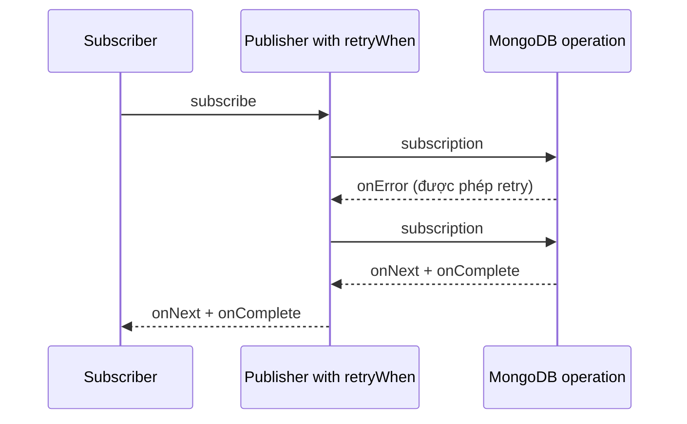
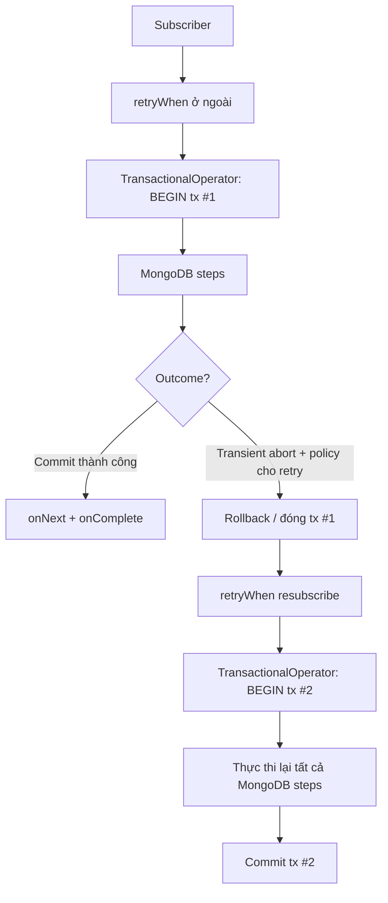
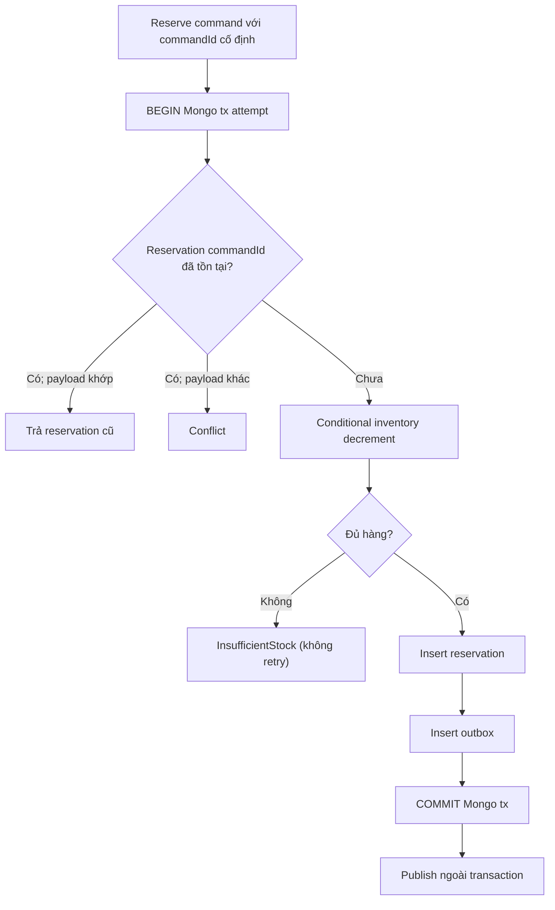
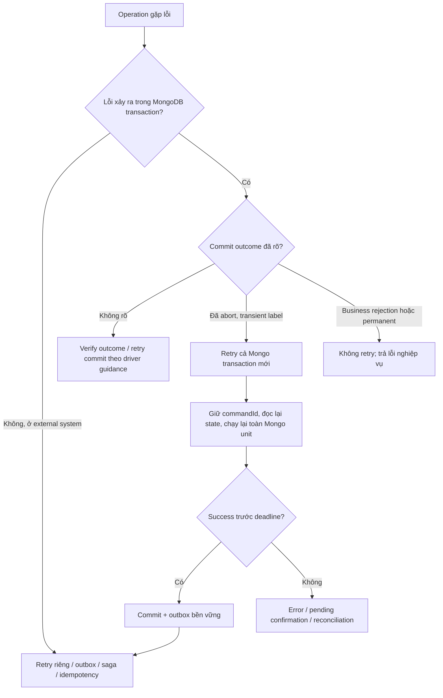

# Đặt retry bao quanh đúng đơn vị công việc trong giao dịch reactive Spring Data MongoDB

## 1. Vì sao vị trí retry quan trọng hơn số lần retry?

Trong Spring Data MongoDB, `ReactiveMongoTemplate` và reactive repositories trả về `Mono` hoặc `Flux`. Khi cần cập nhật nhiều document nhất quán, ứng dụng có thể dùng `ReactiveMongoTransactionManager` kết hợp `TransactionalOperator`. Nếu gặp lỗi tạm thời như write conflict, phản xạ quen thuộc của lập trình viên Reactor là thêm `retryWhen(...)`.

Nhưng **retry cái gì?** Có ít nhất ba phạm vi khác nhau:

1. Thử lại **một thao tác MongoDB** như `updateFirst`.
2. Thử lại **toàn bộ transaction MongoDB**, gồm các phép đọc, điều kiện và phép ghi phụ thuộc nhau.
3. Thử lại **toàn bộ workflow nghiệp vụ** có thể bao gồm payment HTTP, Kafka, PostgreSQL hoặc gửi email.

Ba phạm vi này **không tương đương**. Một transaction MongoDB đã bị abort do lỗi transient không thể được chữa bằng cách gọi lại riêng câu update trên cùng transaction. Ngược lại, thử lại toàn bộ HTTP workflow sau khi payment đã thành công có thể tạo side effect trùng, dù MongoDB transaction cuối cùng chỉ commit một lần.

```text
Client / API command
  │
  ├─ Validate input và tạo commandId ổn định
  │
  └─ Reactive MongoDB transaction
       ├─ Đọc trạng thái/kiểm tra bất biến
       ├─ Update document A
       ├─ Insert document B
       └─ Insert outbox event C
            │
            └─ Commit/abort MongoDB
  │
  └─ Relay và hệ thống ngoài xử lý bất đồng bộ
```

Khi ba thao tác MongoDB phải cùng thành công hoặc cùng rollback, **đơn vị retry tối thiểu đúng về mặt transaction là cả transaction**. Khi external payment nằm ngoài MongoDB, **không** coi cả workflow phân tán là một giao dịch có thể retry mù quáng.

Bài này thuộc chương **Giao dịch reactive** của module **SPRING_DATA_MONGODB**: kết nối, ánh xạ document và thao tác MongoDB qua `ReactiveMongoTemplate`/repository, bảo đảm transaction, kiểm thử và chẩn đoán hiệu năng. Không có ghi chú học thuật bổ sung. Mục tiêu tập trung vào **ranh giới retry** chứ không chỉ vào cú pháp một toán tử Reactor.

### 1.1. Kết quả học tập

Sau bài học, người đọc có thể:

- Giải thích `retryWhen` hoạt động bằng **resubscribe**, không phải “quay lại giữa method Java”.
- Sắp xếp `TransactionalOperator` và `retryWhen` để retry tạo **transaction mới**.
- Phân biệt retry của toàn transaction, retry operation riêng và retry request nghiệp vụ.
- Nhận diện `TransientTransactionError`, `UnknownTransactionCommitResult`, duplicate key, lỗi thiếu tồn kho và lỗi schema.
- Bảo vệ mọi lần retry bằng **command ID**, unique indexes, conditional writes, idempotency và transaction outcome lookup.
- Giữ các thao tác cùng transaction trong **Reactor Context**, tránh `subscribe()`/`block()`/fire-and-forget tách scope.
- Tách HTTP/Kafka khỏi transaction và thực hành transaction + outbox.
- Viết test kiểm tra commit, rollback, resubscription, lỗi tạm thời và trường hợp commit không rõ kết quả.

## 2. Những đối tượng và khái niệm cần phân biệt

| Thành phần | Chức năng | Không làm điều gì? |
|---|---|---|
| `ReactiveMongoTemplate` | Thực thi MongoDB operation bằng reactive driver và mapping Spring Data | Không tự mở transaction cho mọi chuỗi operation |
| `ReactiveMongoRepository` | Khai báo truy xuất reactive theo domain | Không tự biến hai repository calls thành atomic multi-document unit |
| `ReactiveMongoTransactionManager` | Mở/commit/abort MongoDB transaction và gắn session vào reactive transaction context | Không rollback PostgreSQL, Kafka hoặc HTTP |
| `TransactionalOperator` | Áp ranh giới transaction cho một `Publisher` | Không tự biết nên retry lỗi nào |
| Reactor `retry`/`retryWhen` | Resubscribe vào source sau lỗi theo policy | Không tự làm nghiệp vụ idempotent |
| `Mono.defer` | Tạo/ghép source khi có subscription, hỗ trợ chạy lại logic đúng mỗi lần | Không tự cấp transaction hay unique ID ổn định |
| `Retry.backoff` | Policy retry có giới hạn, delay và jitter | Không phân biệt đúng lỗi nghiệp vụ nếu filter viết sai |
| `ClientSession` | Mang context MongoDB transaction ở driver | Không được chia sẻ tùy ý giữa luồng đồng thời |
| **Idempotency key** | Nhận diện một yêu cầu nghiệp vụ qua các lần retry | Không tự chứng minh commit đã thành công |
| **Transactional outbox** | Lưu trạng thái và ý định gửi event trong cùng MongoDB transaction | Không tạo exactly-once end-to-end |

**Quy tắc nền tảng:** transaction boundary bao gồm *đầy đủ* các database operations phải commit cùng nhau. Retry boundary phải bao quanh transaction boundary khi mục tiêu là **thử lại cả transaction**.

## 3. Reactor retryWhen thực sự làm gì?

### 3.1. Cold publisher và mỗi subscription

Trong Reactor, đa số publisher của reactive MongoDB là **cold**: không chạy database I/O lúc chỉ tạo `Mono`/`Flux`; operation chạy khi có subscriber.

```java
Mono<OrderDocument> query =
    reactiveMongoTemplate.findById(
        "O-101", OrderDocument.class);

// Chưa có database read nào chỉ vì khai báo biến query.
// Khi subscribe, driver mới có cơ hội thực thi.
```

`retryWhen` nghe tín hiệu `onError` rồi **đăng ký lại vào source**. Nó không lưu snapshot Java stack frame rồi quay ngược từng câu lệnh; cũng không tự hoàn tác side effects đã xảy ra ở ngoài MongoDB.



Với `Mono`, một retry sau error có thể làm toàn bộ source upstream chạy lại. Với `Flux`, nếu đã phát một phần tử cho downstream rồi sau đó lỗi, subscription mới có thể phát lại **những phần tử đã từng được thấy**. Điều này đặc biệt nguy hiểm khi downstream thực thi side effect trên từng phần tử.

### 3.2. retry có giới hạn khác retry vô hạn

```java
import reactor.util.retry.Retry;
import java.time.Duration;

Retry policy = Retry.backoff(3, Duration.ofMillis(100))
    .maxBackoff(Duration.ofSeconds(2))
    .jitter(0.3);
```

`3` trong `Retry.backoff(3, ...)` là số **retry sau lần chạy đầu**, tức tối đa bốn attempts nếu mọi lần đều thất bại và không có cancellation. Vì policy trên chưa `filter(...)`, nó có thể thử lại **mọi loại lỗi**. Đây **chưa phải** một transaction retry policy an toàn.

Trong production, policy phải:

1. Giới hạn số attempts.
2. Chỉ retry những exception/labels đã được phân loại là transient phù hợp.
3. Có backoff và jitter để tránh retry storm.
4. Có timeout/deadline tổng thể nếu workflow yêu cầu.
5. Ghi metrics theo attempt và kết quả cuối cùng.
6. Để lỗi không retry được đi thẳng tới caller hoặc cơ chế nghiệp vụ xử lý.

### 3.3. onErrorResume không giống retryWhen

```java
source.onErrorResume(ex -> Mono.just(fallback));
```

đổi lỗi thành giá trị fallback, **không chạy lại source**. Nếu đặt bên trong transaction, việc chuyển một database error thành completion bình thường có thể khiến transaction operator **thử commit** phần thao tác trước đó, nếu transaction vẫn còn hợp lệ.

```java
source.retryWhen(retryPolicy);
```

thì **chạy lại source khi có lỗi được filter cho phép**. Chọn operator theo nghiệp vụ; không dùng `onErrorResume(Mono.empty())` để “bỏ qua lỗi” khi thao tác bắt buộc phải thành công.

### 3.4. defer và thời điểm tạo dữ liệu

```java
Mono<String> fresh = Mono.defer(() ->
    Mono.just(java.util.UUID.randomUUID().toString()));
```

Mỗi subscription vào `fresh` tạo một UUID mới. Điều này phù hợp cho trace attempt tạm thời, **nhưng sai nếu UUID là idempotency key của cùng một business command**. Hãy tạo `commandId` một lần tại API/nhận request và truyền xuyên suốt các lần resubscribe:

```java
String commandId = request.commandId(); // Ổn định qua retry.

Mono<Result> operation =
    Mono.defer(() -> executeOneAttempt(commandId));
```

`executeOneAttempt` là helper do ứng dụng triển khai, không phải API có sẵn của Spring Data. Nó phải trả reactive publisher **cold** và không làm side effect ngoài transaction khi chỉ được gọi để xây pipeline.

## 4. Ranh giới đúng: TransactionalOperator ở trong, retryWhen ở ngoài

### 4.1. Hai cách ghép trông giống nhau nhưng khác ý nghĩa

**Cách A — Đúng khi cần thử lại toàn bộ transaction:**

```java
Mono<Result> result =
    Mono.defer(() -> performAllMongoSteps(command))
        .as(mongoTx::transactional)
        .retryWhen(transactionRetryPolicy);
```

**Cách B — Nguy hiểm khi retry lỗi làm abort transaction:**

```java
Mono<Result> result =
    Mono.defer(() -> performAllMongoSteps(command))
        .retryWhen(transactionRetryPolicy)
        .as(mongoTx::transactional);
```

Giả định:

- `mongoTx` được tạo từ **ReactiveMongoTransactionManager** tương ứng.
- `performAllMongoSteps(command)` thực thi các MongoDB operations phải commit cùng nhau, không gọi HTTP/Kafka trong chain.
- `transactionRetryPolicy` chỉ chọn lỗi có thể retry **toàn transaction**, không chọn mọi error.

Trong **cách A**, mỗi resubscription từ `retryWhen` bao gồm cả `TransactionalOperator`. Mỗi attempt có cơ hội bắt đầu một **transaction mới** với session/transaction context mới.

Trong **cách B**, retry xảy ra **bên trong một transaction đã mở**. Nếu MongoDB báo lỗi transient làm transaction bị abort, retry riêng source trong cùng transaction không phục hồi được transaction cũ. Ngoài ra cách B có thể nuốt lỗi của bước giữa rồi làm operator cố commit trạng thái không như mong muốn.

### 4.2. Minh họa thứ tự subscription



**Không** hiểu sơ đồ này là lời hứa mọi lần retry đều sẽ thành công: có thể hết attempts, không đủ quorum, transaction conflict lặp hoặc commit outcome không rõ.

### 4.3. Viết lại bằng transformDeferred để nhìn rõ composition

Người học có thể gặp các cách viết:

```java
Mono<Result> businessAttempt =
    Mono.defer(() -> performAllMongoSteps(command));

Mono<Result> withTransaction =
    mongoTx.transactional(businessAttempt);

Mono<Result> retried =
    withTransaction.retryWhen(transactionRetryPolicy);
```

Điểm quyết định không phải tên toán tử mà là **vùng publisher được transaction operator bao lại** và **vùng publisher mà retry resubscribe**. Khi dùng `@Transactional` reactive trên một bean, phải hiểu AOP/proxy placement tương tự: caller ở ngoài cần retry **toàn lời gọi method transactional**, không chỉ một repository operation nằm bên trong.

### 4.4. Retry phải nằm sau commit signal, không chỉ sau thao tác ghi cuối

Ví dụ:

```java
return template.insert(order)
    .then(template.insert(outbox))
    .thenReturn(order)
    .as(mongoTx::transactional)
    .retryWhen(policy);
```

Khi `TransactionalOperator` hoàn tất bình thường, transaction commit đã được xử lý theo transaction infrastructure. Nếu write cuối trả thành công nhưng commit gặp lỗi, retry **bên ngoài** có thể quan sát lỗi commit (cần phân loại chính xác).

**Cảnh báo quan trọng:** nếu commit trả kết quả không chắc chắn (`UnknownTransactionCommitResult`), không tự động retry **toàn business transaction** như thể chắc chắn chưa commit; cần xem mục 9 về commit ambiguity.

## 5. Transaction scope không phải request scope

### 5.1. Ba vòng phải được xác định rõ

```text
HTTP request / Business command (commandId ổn định)
   |
   +-- Retry policy cho transaction MongoDB
   |     |
   |     +-- Attempt #1: begin → Mongo writes → commit/abort
   |     +-- Attempt #2: begin → Mongo writes → commit/abort
   |
   \-- Sau commit: outbox relay / remote workflows độc lập
```

Nếu một API vừa có unit MongoDB vừa có HTTP payment, phải phân tách thành **các local units** với durable intent và compensation/idempotency. Không ghép:

```java
template.insert(order)
    .then(paymentClient.charge(order.id()))
    .as(mongoTx::transactional)
    .retryWhen(Retry.max(3));
```

vì payment HTTP không tham gia MongoDB transaction. Nếu transaction fail sau charge, retry có thể charge nhiều lần.

### 5.2. Transaction trong Spring reactive dùng Reactor Context

`ReactiveMongoTransactionManager` gắn session/resources vào **Reactor Context**, không phải ThreadLocal theo cách của imperative `MongoTransactionManager`. Các operation cần được **compose trong cùng reactive chain** và sử dụng cùng reactive database factory.

```text
TransactionalOperator
      |
      +-- Mono step 1
      +-- flatMap(step 2)
      \-- then(step 3)

Reactor Context mang MongoDB session qua các signals.
```

Chỉ dùng cùng `ReactiveMongoTemplate` instance là **chưa đủ** nếu một thao tác bị tách bằng `subscribe()` hoặc thực thi ngoài transaction publisher.

### 5.3. Không tự tạo subscription phụ

```java
// ANTI-PATTERN: outbox insert có thể chạy ngoài transaction.
return template.insert(order)
    .doOnNext(saved -> template.insert(outbox).subscribe())
    .as(mongoTx::transactional);
```

Publisher của `template.insert(outbox)` được subscribe độc lập; việc gọi side effect trong `doOnNext` không chờ nó hoàn tất và không bảo đảm cùng transaction context.

Viết:

```java
return template.insert(order)
    .flatMap(saved ->
        template.insert(outbox).thenReturn(saved))
    .as(mongoTx::transactional);
```

Lúc này **hai inserts thuộc cùng transaction publisher**, giả định factory/configuration và transaction support hợp lệ. Không có lời gọi `subscribe()`/`block()` tự phát ở giữa.

### 5.4. Không chạy song song nhiều operations trên cùng transaction session

MongoDB driver/session/transaction không hỗ trợ tùy ý những database operations **song song** trong cùng transaction. Một số code Reactor như:

```java
// Tránh cho nhiều write đồng thời trong một MongoDB transaction.
Mono.when(
    template.insert(order),
    template.insert(outbox)
).as(mongoTx::transactional);
```

có thể tạo concurrent operations không được MongoDB transaction contract bảo đảm. Thay bằng thứ tự rõ:

```java
template.insert(order)
    .then(template.insert(outbox))
    .as(mongoTx::transactional);
```

Đối với một `Flux` chứa nhiều Mongo writes, cân nhắc `concatMap` hoặc concurrency giới hạn **một** trong transaction. Đừng mặc định `flatMap` với concurrency cao là an toàn chỉ vì Reactor xử lý được nhiều publishers.

## 6. Cấu hình ReactiveMongoTransactionManager và TransactionalOperator

### 6.1. Yêu cầu hạ tầng trước khi thử

Reactive multi-document transactions cần MongoDB deployment hỗ trợ transaction (replica set hoặc sharded cluster với phiên bản tương ứng), reactive MongoDB driver và Spring Data MongoDB transaction manager được nối với **cùng** `ReactiveMongoDatabaseFactory` dùng bởi template/repositories.

Một MongoDB standalone thông thường không đủ để kiểm chứng multi-document transaction. Một single-node replica set có thể dùng cho integration test API căn bản nhưng không mô phỏng đúng failover/majority replication behavior của cluster nhiều thành viên.

Ví dụ configuration với Java 17+:

```java
import com.mongodb.ReadConcern;
import com.mongodb.ReadPreference;
import com.mongodb.TransactionOptions;
import com.mongodb.WriteConcern;
import org.springframework.beans.factory.annotation.Qualifier;
import org.springframework.context.annotation.Bean;
import org.springframework.context.annotation.Configuration;
import org.springframework.data.mongodb.ReactiveMongoDatabaseFactory;
import org.springframework.data.mongodb.ReactiveMongoTransactionManager;
import org.springframework.transaction.ReactiveTransactionManager;
import org.springframework.transaction.reactive.TransactionalOperator;

@Configuration
public class ReactiveMongoTxConfiguration {

    @Bean("reactiveMongoTransactionManager")
    ReactiveMongoTransactionManager mongoTxManager(
            ReactiveMongoDatabaseFactory factory) {
        TransactionOptions options = TransactionOptions.builder()
            .readConcern(ReadConcern.SNAPSHOT)
            .writeConcern(WriteConcern.MAJORITY)
            .readPreference(ReadPreference.primary())
            .build();
        return new ReactiveMongoTransactionManager(factory, options);
    }

    @Bean("mongoTx")
    TransactionalOperator mongoTxOperator(
            @Qualifier("reactiveMongoTransactionManager")
            ReactiveTransactionManager manager) {
        return TransactionalOperator.create(manager);
    }
}
```

Lưu ý:

- `SNAPSHOT` và `MAJORITY` là lựa chọn ví dụ khi nghiệp vụ cần snapshot/read và majority commit durability; không phải một công thức áp dụng cho mọi use case.
- Spring Boot có thể tự cấu hình client/factory/template; không khai báo bean trùng hoặc vô tình thay đổi TLS, pool, credentials và monitoring.
- `TransactionalOperator` ở trên chỉ dành cho **MongoDB resource factory được inject**. Một `R2dbcTransactionManager` khác trong cùng app không tự tham gia.
- Không kéo một Kafka producer hoặc payment HTTP vào `mongoTx` rồi tưởng chúng có thể rollback theo MongoDB.
- Không đổi configuration của shared transaction manager/template giữa các request đang chạy.

### 6.2. Thực thi MongoDB operations tuần tự

Ví dụ đơn giản kiểm tra tính nguyên tử của hai inserts:

```java
public Mono<OrderDocument> createWithOutbox(
        OrderDocument order, OutboxEvent event) {
    return reactiveMongoTemplate.insert(order)
        .flatMap(saved ->
            reactiveMongoTemplate.insert(event)
                .thenReturn(saved))
        .as(mongoTx::transactional);
}
```

Ở đây `order`, `event` và `mongoTx` là giá trị/bean do service đã tạo; phần sau có ví dụ class đầy đủ hơn. `flatMap` tạo chuỗi tuần tự, không có `subscribe()` phụ.

Nếu `insert(event)` lỗi và transaction abort, `insert(order)` **không được commit độc lập** khi tất cả hoạt động thực sự nằm trong transaction được cấu hình.

### 6.3. Áp retry ngoài transaction

```java
public Mono<OrderDocument> createWithRetry(
        OrderDocument order, OutboxEvent event) {
    return Mono.defer(() ->
        reactiveMongoTemplate.insert(order)
            .flatMap(saved ->
                reactiveMongoTemplate.insert(event)
                    .thenReturn(saved)))
        .as(mongoTx::transactional)
        .retryWhen(mongoTransactionRetry());
}
```

`mongoTransactionRetry()` ở ví dụ này là helper ứng dụng tự định nghĩa (mục 8), **không phải API có sẵn của Spring Data**. Mỗi retry phải trải qua lại transaction operator, không chạy lại riêng `insert(event)` bên trong transaction cũ.

Nhưng `order.id` và `event.id` phải **ổn định giữa các lần thử**; không sinh ID mới ngẫu nhiên trong `Mono.defer` cho một command đã được caller gửi. Nếu commit lần trước không rõ kết quả, không mù quáng retry toàn transaction.

## 7. Ví dụ hoàn chỉnh: giữ tồn kho + reservation + outbox

### 7.1. Hợp đồng nghiệp vụ

Service nhận một command đã xác thực:

```text
ReserveInventory(
  commandId: UUID ổn định của yêu cầu,
  tenantId: lấy từ authentication context,
  orderId: đơn cần giữ hàng,
  sku: mặt hàng,
  quantity: số lượng > 0
)
```

Trong cùng MongoDB deployment, cần ba thay đổi:

1. Giảm `available` của một inventory document nếu vẫn đủ hàng.
2. Insert `reservation` mang `commandId` làm khóa định danh.
3. Insert `outbox event` để thông báo inventory đã giữ, xử lý broker sau commit.

Các bất biến:

- Số hàng còn lại không âm.
- Một command idempotency key không tạo hai reservations.
- Nếu reservation thành công thì outbox intent cũng tồn tại.
- Không phát event ra bên ngoài trước khi MongoDB transaction commit.
- Retry sau write conflict không làm trừ tồn kho hai lần.



### 7.2. Document types

```java
import java.time.Instant;
import org.springframework.data.annotation.Id;
import org.springframework.data.mongodb.core.mapping.Document;

@Document(collection = "inventory")
public record InventoryItem(
    @Id String id,
    long available
) {}

@Document(collection = "inventory_reservations")
public record Reservation(
    @Id String id,
    String tenantId,
    String orderId,
    String sku,
    long quantity,
    Instant createdAt
) {}

@Document(collection = "inventory_outbox")
public record ReservationOutbox(
    @Id String id,
    String reservationId,
    String type,
    String tenantId,
    String orderId,
    String sku,
    long quantity,
    Instant occurredAt
) {}

public record ReserveCommand(
    String commandId,
    String tenantId,
    String orderId,
    String sku,
    long quantity
) {}
```

Đây là **các Java types minh họa**; đặt mỗi public top-level type vào file Java thích hợp. Trong một ứng dụng multi-tenant, `InventoryItem.id` nên là business key bất biến và tenant-scoped, ví dụ được service tạo sau khi validate tenant/SKU (không cho client tùy ý tạo path/ID vượt tenant).

### 7.3. Lỗi nghiệp vụ không được retry

```java
public final class InsufficientStockException
        extends RuntimeException {
    public InsufficientStockException(String sku) {
        super("Insufficient stock for " + sku);
    }
}

public final class IdempotencyConflictException
        extends RuntimeException {
    public IdempotencyConflictException(String commandId) {
        super("Conflicting command payload: " + commandId);
    }
}
```

Không gán các lỗi này vào retry filter chỉ vì chúng là `RuntimeException`. Thiếu hàng là outcome nghiệp vụ; payload khác dưới cùng idempotency key là conflict cần làm rõ, không thể giải quyết bằng backoff.

### 7.4. Service với một unit MongoDB thực sự

```java
import java.time.Instant;
import java.util.Objects;

import org.springframework.beans.factory.annotation.Qualifier;
import org.springframework.dao.DuplicateKeyException;
import org.springframework.data.mongodb.core.FindAndModifyOptions;
import org.springframework.data.mongodb.core.ReactiveMongoTemplate;
import org.springframework.data.mongodb.core.query.Criteria;
import org.springframework.data.mongodb.core.query.Query;
import org.springframework.data.mongodb.core.query.Update;
import org.springframework.stereotype.Service;
import org.springframework.transaction.reactive.TransactionalOperator;
import reactor.core.publisher.Mono;
import reactor.util.retry.Retry;

@Service
public class ReactiveReservationService {
    private final ReactiveMongoTemplate template;
    private final TransactionalOperator mongoTx;

    public ReactiveReservationService(
            ReactiveMongoTemplate template,
            @Qualifier("mongoTx") TransactionalOperator mongoTx) {
        this.template = template;
        this.mongoTx = mongoTx;
    }

    public Mono<Reservation> reserve(ReserveCommand command) {
        // API validation và tenant authorization được thực hiện
        // trước khi xây operation; bảo đảm commandId ổn định.
        validate(command);

        return Mono.defer(() -> reserveOnce(command))
            .as(mongoTx::transactional)
            .retryWhen(MongoRetryPolicy.transientTransactionRetry())
            // Duplicate key KHÔNG được coi là transient retry.
            // Nếu một request cùng commandId đã thắng cuộc đua,
            // chỉ trả kết quả cũ khi payload đã được đối chiếu.
            .onErrorResume(
                DuplicateKeyException.class,
                ignored -> findExistingMatching(command));
    }

    private Mono<Reservation> reserveOnce(
            ReserveCommand command) {
        String reservationId = reservationId(command);
        return template.findById(
                reservationId, Reservation.class)
            .flatMap(existing ->
                matches(existing, command)
                    ? Mono.just(existing)
                    : Mono.error(
                        new IdempotencyConflictException(
                            command.commandId())))
            .switchIfEmpty(Mono.defer(
                () -> createReservation(command, reservationId)));
    }

    private Mono<Reservation> createReservation(
            ReserveCommand command, String reservationId) {
        String stockId =
            command.tenantId() + ":" + command.sku();

        Query enough = Query.query(
            Criteria.where("id").is(stockId)
                .and("available").gte(command.quantity()));
        Update subtract = new Update()
            .inc("available", -command.quantity());

        return template.findAndModify(
                enough,
                subtract,
                FindAndModifyOptions.options().returnNew(true),
                InventoryItem.class)
            .switchIfEmpty(Mono.error(
                new InsufficientStockException(command.sku())))
            .flatMap(ignoredStock -> {
                Instant now = Instant.now();
                Reservation reservation = new Reservation(
                    reservationId,
                    command.tenantId(),
                    command.orderId(),
                    command.sku(),
                    command.quantity(),
                    now);
                ReservationOutbox event = new ReservationOutbox(
                    "reserved:" + reservationId,
                    reservationId,
                    "InventoryReserved",
                    command.tenantId(),
                    command.orderId(),
                    command.sku(),
                    command.quantity(),
                    now);

                return template.insert(reservation)
                    .then(template.insert(event))
                    .thenReturn(reservation);
            });
    }

    private Mono<Reservation> findExistingMatching(
            ReserveCommand command) {
        return template.findById(
                reservationId(command), Reservation.class)
            .switchIfEmpty(Mono.error(
                new IllegalStateException(
                    "Duplicate key but no reservation found")))
            .flatMap(existing ->
                matches(existing, command)
                    ? Mono.just(existing)
                    : Mono.error(
                        new IdempotencyConflictException(
                            command.commandId())));
    }

    private static String reservationId(
            ReserveCommand command) {
        // Ví dụ yêu cầu commandId là UUID / canonical value;
        // tenantId được cấp từ auth, không cho nhập tự do.
        return command.tenantId() + ":" + command.commandId();
    }

    private static boolean matches(
            Reservation existing, ReserveCommand command) {
        return Objects.equals(
                existing.tenantId(), command.tenantId())
            && Objects.equals(
                existing.orderId(), command.orderId())
            && Objects.equals(existing.sku(), command.sku())
            && existing.quantity() == command.quantity();
    }

    private static void validate(ReserveCommand command) {
        if (command == null
                || isBlank(command.commandId())
                || isBlank(command.tenantId())
                || isBlank(command.orderId())
                || isBlank(command.sku())
                || command.quantity() <= 0) {
            throw new IllegalArgumentException(
                "Invalid inventory reservation command");
        }
        // Thực tế: UUID format, input size, quantity max, tenant auth.
    }

    private static boolean isBlank(String s) {
        return s == null || s.isBlank();
    }
}
```

#### Vì sao code có thể retry toàn transaction?

`Mono.defer(() -> reserveOnce(command))` ở **bên trong** `mongoTx::transactional`; `retryWhen` ở **bên ngoài**. Nếu attempt #1 gặp lỗi transaction transient, transaction bị abort; attempt #2 mở transaction mới rồi đọc lại reservation và kiểm tra hàng tồn ở trạng thái mới nhất mà transaction quan sát được.

Nếu request trước đó đã commit nhưng response bị mất, một request mới **cùng commandId** có thể thấy `Reservation` đã tồn tại và trả lại kết quả, không trừ hàng thêm. Tuy nhiên `UnknownTransactionCommitResult` cần cách giải quyết riêng; code trên không coi timeout commit là lời chứng minh chưa commit (mục 9).

#### Vì sao vẫn cần unique key khi đã đọc existing?

Hai requests đồng thời có thể đều đọc “chưa có reservation” trước khi cùng cố tạo. `@Id` đảm nhiệm uniqueness cho `reservationId` ở database. Tùy conflict timing, một transaction bị write conflict hoặc duplicate-key; chỉ một transaction commit reservation với ID đó.

Đường `onErrorResume(DuplicateKeyException.class, ...)` nằm **sau transaction wrapper**, để không cố đọc lại bên trong một transaction đã abort. Nó chỉ trả lại kết quả đã có nếu **payload khớp**; nếu không khớp thì phát lỗi conflict. Production có thể cần lookup/read concern, retry nhẹ riêng cho trường hợp winner vừa commit và secondary chưa apply, thay vì trả “thành công” khi chưa đọc thấy bản ghi.

#### Vì sao outbox cũng nằm trong cùng transaction?

Nếu inventory đã giảm và reservation đã insert nhưng outbox bị lỗi, MongoDB transaction abort **cả ba thay đổi**. Relay phát `InventoryReserved` sau commit qua outbox với cùng `event.id` dù phải gửi lại; consumer cần dedup. Không gửi Kafka trong `flatMap` nói trên.

#### Cần chuẩn bị dữ liệu và indexes

`inventory` chứa một document có `_id=tenantId:sku` và `available` không âm. `inventory_reservations`/`inventory_outbox` dùng `_id` duy nhất; thêm indexes theo cách query thực tế của relay. Không tạo collection/index mới ngay giữa transaction ở môi trường chưa hỗ trợ operation đó; quản trị schema trước khi test/release.

## 8. Chọn lỗi retry: TransientTransactionError không giống mọi RuntimeException

### 8.1. Phân loại theo transaction error labels

MongoDB gắn **error labels** trên một số exception, bao gồm:

- `TransientTransactionError`: lỗi transient có thể khiến **toàn transaction** cần được thử lại từ đầu.
- `UnknownTransactionCommitResult`: không xác minh được kết quả commit; **không** mặc định an toàn khi retry toàn business transaction.

Java Driver có `MongoException.hasErrorLabel(...)`. Nhưng Spring Data có thể **translate/wrap** exception thành `DataAccessException`. Vì vậy chỉ kiểm tra `error instanceof MongoException` ở lớp ngoài có thể bỏ sót cause.

Không mở rộng retry policy sang toàn bộ `TimeoutException`, `MongoException`, `DataAccessException` hoặc `RuntimeException`: một network timeout sau commit có thể là **unknown outcome**.

### 8.2. Retry policy ví dụ có giới hạn

```java
import java.time.Duration;
import com.mongodb.MongoException;
import reactor.util.retry.Retry;

public final class MongoRetryPolicy {
    private MongoRetryPolicy() {}

    public static Retry transientTransactionRetry() {
        return Retry.backoff(3, Duration.ofMillis(100))
            .maxBackoff(Duration.ofSeconds(2))
            .jitter(0.35)
            .filter(MongoRetryPolicy::isTransientTransactionError)
            .onRetryExhaustedThrow(
                (spec, signal) -> signal.failure());
    }

    public static boolean isTransientTransactionError(
            Throwable failure) {
        // Spring Data có thể bọc nguyên nhân Driver.
        Throwable current = failure;
        for (int depth = 0;
                current != null && depth < 16;
                depth++, current = current.getCause()) {
            if (current instanceof MongoException mongo) {
                // UNKNOWN commit phải đi vào nhánh xác minh outcome.
                if (mongo.hasErrorLabel(
                        "UnknownTransactionCommitResult")) {
                    return false;
                }
                if (mongo.hasErrorLabel(
                        "TransientTransactionError")) {
                    return true;
                }
            }
        }
        return false;
    }
}
```

Policy trên **cố ý hẹp**: chỉ retry khi cause chứa driver label `TransientTransactionError` và không mang `UnknownTransactionCommitResult`. Một số lỗi `OptimisticLockingFailureException` có thể retry được ở cấp business command **nếu toàn đơn vị công việc và mô hình idempotency cho phép**; đó là policy riêng, không tự thêm chúng vào list mặc định.

### 8.3. Bảng quyết định retry

| Lỗi/trạng thái | Retry toàn Mongo transaction? | Vì sao? |
|---|---|---|
| `TransientTransactionError` | Có thể, có giới hạn | Transaction đã fail/abort theo loại lỗi này; tạo transaction mới |
| `UnknownTransactionCommitResult` | **Không mù quáng** | Commit có thể đã thành công; xác minh outcome hoặc retry commit theo driver guidance |
| Duplicate key của `reservationId` | Không coi là transient | Có thể là request trùng hoặc payload conflict; lookup có guard |
| Không đủ hàng | Không | Business rejection, backoff không tạo tồn kho |
| Tenant không hợp lệ | Không | Validation/authorization |
| `OptimisticLockingFailureException` | Có thể theo policy riêng | Đọc lại state/version, retry toàn unit nếu đảm bảo idempotency |
| JSON Schema validation failure | Không | Cần sửa payload/schema |
| Error không rõ từ HTTP payment | Không trong Mongo retry | Remote outcome cần idempotency/status lookup |
| MongoDB server-selection timeout | Không mặc định | Có thể xảy ra ở nhiều pha; xác định phase và outcome trước |
| Cancellation từ downstream | Không mặc định | Cancellation không phải tín hiệu retry; transaction handling cần đúng scope |

### 8.4. Backoff, jitter và deadline

Giả sử 1.000 requests cùng gặp write conflict. Nếu tất cả retry ngay lập tức, chúng có thể tiếp tục tranh cùng inventory document. Backoff tăng dần với jitter giúp giảm retry storm.

Nhưng:

- Không đặt `Retry.max(Long.MAX_VALUE)` cho lỗi transaction, tạo vô hạn tài nguyên.
- Không retry nhanh hơn database có thể hồi phục.
- Không vượt quá HTTP request deadline, SLO hay thời hạn command.
- Không log toàn bộ dữ liệu nhạy cảm ở mỗi attempt.
- Nếu ứng dụng hết ngân sách retry, trả một trạng thái **chưa chắc hoàn tất** phù hợp theo loại lỗi, không tự biến mọi lỗi thành “thiếu hàng”.

### 8.5. Timeout placement cũng thay đổi ý nghĩa

```java
// Một timeout budget cho toàn bộ chuỗi bao gồm retries.
source.as(mongoTx::transactional)
    .retryWhen(policy)
    .timeout(Duration.ofSeconds(8));

// Một timeout cho mỗi transaction attempt; mỗi retry được cấp lại budget.
source.as(mongoTx::transactional)
    .timeout(Duration.ofSeconds(3))
    .retryWhen(policy);
```

Hai đoạn không tương đương. Đoạn thứ hai có thể kéo dài tổng thời gian đến nhiều lần timeout + backoff. Trong cả hai trường hợp, timeout tại thời điểm **commit** có thể làm outcome không rõ; không được áp filter “retry mọi timeout” mà không phân biệt phase.

Đối với service sản xuất, kết hợp một **overall deadline** với transaction-level timeout và retry predicate được phân loại rõ, đồng thời tôn trọng cancellation.

## 9. UnknownTransactionCommitResult: đừng retry mù toàn business command

### 9.1. Commit có thể thành công dù client không nhận được ACK

Một MongoDB transaction có thể đã gửi `commitTransaction` đến server, server đã xử lý commit, nhưng kết nối bị ngắt trước khi client nhận kết quả.

```mermaid
sequenceDiagram
    participant A as Reactive client
    participant M as MongoDB
    A->>M: BEGIN tx; ghi inventory/reservation/outbox
    A->>M: commitTransaction
    M-->>M: Có thể đã commit
    Note over A,M: Network timeout / ACK thất lạc
    M--xA: Không nhận được commit result
    Note over A: Outcome = UNKNOWN, không đồng nghĩa ABORTED
```

Driver có thể gắn label `UnknownTransactionCommitResult`. Đây là trường hợp khác với một lỗi `TransientTransactionError` xuất hiện **khi transaction chưa commit thành công** và có thể được retry theo hướng dẫn.

**Điểm then chốt:** resubscribe toàn source sau một commit chưa rõ kết quả có thể chạy lại business logic sau khi attempt trước **đã commit**.

### 9.2. Hai loại retry phải tách biệt

| Hành động | Điều đang được thử lại | Khi nào cân nhắc |
|---|---|---|
| **Retry commit** | Cùng transaction/session và commit request | Khi driver/transaction API cho phép, theo guidance cho UnknownTransactionCommitResult |
| **Retry transaction** | Bắt đầu transaction mới rồi chạy lại read/write logic | Khi lỗi transient khiến transaction phải abort và business unit an toàn để chạy lại |
| **Retry API command** | Gửi lại ý định nghiệp vụ từ client/service | Chỉ khi có idempotency key, lookup/checkpoint và hợp đồng kết quả rõ |

Một retry của Spring/Reactor đặt tùy tiện:

```java
.retryWhen(Retry.backoff(5, Duration.ofMillis(200)))
```

không phân biệt ba trường hợp. Đặc biệt nếu callback tạo UUID mới, ghi outbox mới hoặc charge HTTP, retry có thể tạo nhiều giao dịch kinh doanh.

### 9.3. Cách xử lý outcome ở tầng nghiệp vụ

Đối với `ReserveCommand` ở mục 7:

1. Mỗi business command có **`commandId` ổn định**.
2. Transaction lưu `Reservation` với `_id` dựa trên tenant + commandId.
3. Sau một commit outcome không rõ, **không tuyên bố đơn chưa được giữ hàng**.
4. Dùng một truy vấn idempotency lookup độc lập để kiểm tra reservation theo key, tốt nhất qua nguồn/read policy nhất quán với guarantee cần thiết.
5. Nếu thấy reservation và payload khớp, trả lại kết quả cũ.
6. Nếu không thấy, không được từ một lần “not found” ngay sau timeout kết luận transaction cũ chắc chắn abort; tùy policy có thể trả `PENDING_CONFIRMATION`, chờ có giới hạn, kiểm tra commit/result hoặc để job reconciliation quyết định.
7. Chỉ phát lại business command theo một cơ chế được review, có unique index/idempotency guard bảo vệ nếu outcome cũ xuất hiện muộn.

### 9.4. Ví dụ tách một lookup sau transaction error

```java
public Mono<Reservation> reserveOrVerify(
        ReserveCommand command) {
    return reserve(command)
        .onErrorResume(
            this::isUnknownCommitOutcome,
            failure -> verifyUnknownOutcome(command, failure));
}

private boolean isUnknownCommitOutcome(Throwable error) {
    // Duyệt cause chain tìm MongoException có label
    // "UnknownTransactionCommitResult".
    // Không coi mọi network timeout là abort.
    return MongoErrorInspection.hasLabel(
        error, "UnknownTransactionCommitResult");
}

private Mono<Reservation> verifyUnknownOutcome(
        ReserveCommand command, Throwable original) {
    return findExistingMatching(command)
        .onErrorResume(
            IllegalStateException.class,
            missing -> Mono.error(
                new ReservationOutcomeUnknownException(
                    command.commandId(), original)));
}
```

Các helper `MongoErrorInspection` và `ReservationOutcomeUnknownException` ở đây là **API ứng dụng cần tự triển khai**; minh họa sự tách **lỗi commit không rõ** khỏi retry transient. Ví dụ lookup đơn giản này **không chứng minh** transaction abort nếu không tìm thấy reservation; nó trả một lỗi/response “outcome unknown” để caller hoặc reconciliation tiếp tục.

Trong production, cần tránh một `onErrorResume(IllegalStateException.class, ...)` quá rộng nếu nhiều lỗi không liên quan cũng dùng exception đó. Nên tạo loại lỗi riêng `ReservationNotFoundException`/`OutcomeNotVisibleYetException` để phân biệt failure chính xác. Khi code đưa vào dự án, xác minh Spring Data exception translation và đọc trên primary với read/write concerns phù hợp.

Một triển khai tối thiểu cho **helper kiểm tra driver label** (dùng được trong predicate ở trên) là:

```java
import com.mongodb.MongoException;

public final class MongoErrorInspection {
    private MongoErrorInspection() {}

    public static boolean hasLabel(
            Throwable failure, String label) {
        Throwable current = failure;
        for (int depth = 0;
                current != null && depth < 16;
                depth++, current = current.getCause()) {
            if (current instanceof MongoException mongo
                    && mongo.hasErrorLabel(label)) {
                return true;
            }
        }
        return false;
    }
}
```

Và một exception domain chuyên dụng:

```java
public final class ReservationOutcomeUnknownException
        extends RuntimeException {
    public ReservationOutcomeUnknownException(
            String commandId, Throwable cause) {
        super("Reservation outcome not verified: " + commandId,
            cause);
    }
}
```

Trong ứng dụng thực, tuyệt đối không trả nguyên exception details chứa dữ liệu nhạy cảm cho client; map sang mã API phù hợp, lưu correlation ID và giữ evidence để reconciliation.

### 9.5. Ổn định business IDs quan trọng hơn “retry đúng cú pháp”

Trong ví dụ `ReserveCommand`:

```java
// Tốt: commandId đã được tạo trước khi bắt đầu transaction/retry.
ReserveCommand command = new ReserveCommand(
    "a8f2352a-4020-47f7-b432-b08cbf414a82",
    "T-A", "O-101", "SKU-BOOK", 2L);

Mono<Reservation> result = reservationService.reserve(command);
```

Ngược lại:

```java
// Sai nếu mỗi resubscription sinh business operation mới.
Mono<Reservation> result = Mono.defer(() ->
    reservationService.reserve(
        new ReserveCommand(
            java.util.UUID.randomUUID().toString(),
            "T-A", "O-101", "SKU-BOOK", 2L)))
    .retryWhen(Retry.max(3));
```

Đoạn sai có thể giữ hàng nhiều lần nếu attempt trước đã commit nhưng response không tới. **Chỉ retry đúng vị trí mà thiếu idempotency vẫn chưa an toàn.**

## 10. @Transactional reactive: đặt retry ở caller, không trong phần thân transactional

### 10.1. Reactive annotation tạo transaction theo subscription

Spring hỗ trợ reactive `@Transactional` khi method trả `Publisher` như `Mono` hoặc `Flux` và transaction manager là `ReactiveTransactionManager`.

```java
import org.springframework.stereotype.Service;
import org.springframework.transaction.annotation.Transactional;
import reactor.core.publisher.Mono;

@Service
public class ReservationTransactionalBoundary {
    private final ReactiveReservationSteps steps;

    public ReservationTransactionalBoundary(
            ReactiveReservationSteps steps) {
        this.steps = steps;
    }

    @Transactional(
        transactionManager = "reactiveMongoTransactionManager")
    public Mono<Reservation> reserveOnce(ReserveCommand cmd) {
        return steps.reserveMongoOnly(cmd);
    }
}
```

`ReactiveReservationSteps` là một service thành phần trả publisher có các MongoDB operations, không tự tạo subscription hoặc call HTTP. Annotation phải được Spring AOP proxy áp lên lời gọi method.

### 10.2. Retry ở một facade bên ngoài transaction proxy

```java
import org.springframework.stereotype.Service;
import reactor.core.publisher.Mono;

@Service
public class ReservationFacade {
    private final ReservationTransactionalBoundary txBoundary;

    public ReservationFacade(
            ReservationTransactionalBoundary txBoundary) {
        this.txBoundary = txBoundary;
    }

    public Mono<Reservation> reserve(ReserveCommand command) {
        // Gọi qua Spring proxy sang bean transactional.
        return Mono.defer(() -> txBoundary.reserveOnce(command))
            .retryWhen(
                MongoRetryPolicy.transientTransactionRetry());
    }
}
```

Ở mô hình này, một lần retry **resubscribe** vào publisher do lời gọi `txBoundary.reserveOnce(...)` cung cấp; transaction interceptor của Spring bọc publisher, mở transaction mới khi source được subscribe lại. Dùng `Mono.defer` còn giúp tạo lại publisher mỗi attempt trong trường hợp thành phần có logic xây pipeline phụ thuộc trạng thái.

Không cần vừa gắn `@Transactional` vào method vừa wrap **cùng scope** bằng `TransactionalOperator` nếu không có mục đích nesting/propagation rõ ràng. Chọn một cách thể hiện transaction boundary có thể review/test.

### 10.3. Anti-pattern: retry bên trong method được @Transactional

```java
@Transactional(
    transactionManager = "reactiveMongoTransactionManager")
public Mono<Reservation> reserveOnce(ReserveCommand cmd) {
    return steps.reserveMongoOnly(cmd)
        .retryWhen(
            MongoRetryPolicy.transientTransactionRetry());
}
```

Khi transaction interceptor bọc **toàn publisher do method trả về**, `retryWhen` bên trong method nằm **dưới** transaction wrapper. Lỗi làm transaction abort không được chữa bằng resubscribe vào `steps` trong cùng transaction. Đặt retry ở caller/facade **bên ngoài proxy**.

### 10.4. Self-invocation không kích hoạt AOP proxy như kỳ vọng

```java
public Mono<Reservation> outer(ReserveCommand cmd) {
    return this.reserveOnce(cmd); // Có thể bypass @Transactional proxy.
}
```

Trong chế độ Spring proxy mặc định, gọi `this.reserveOnce` bên trong cùng instance không đi qua transaction interceptor. Khi đó `retryWhen` ở caller cũng không thể làm transaction xuất hiện. Tách bean hoặc dùng transaction operator programmatically.

### 10.5. Reactive return type và method boundary

Không khai báo một method `@Transactional` trả `void` rồi gọi `subscribe()`:

```java
// ANTI-PATTERN.
@Transactional(
    transactionManager = "reactiveMongoTransactionManager")
public void reserveNow(ReserveCommand cmd) {
    steps.reserveMongoOnly(cmd).subscribe();
}
```

Caller không nhận được completion/error signal để quyết định commit/retry, và reactive transaction context có thể không được áp đúng vào subscription. Hãy trả `Mono`/`Flux` cho framework điều phối; dùng `StepVerifier` hoặc web runtime làm subscriber **ở rìa ứng dụng**.

### 10.6. Khi có nhiều reactive transaction managers

Nếu app vừa dùng MongoDB reactive vừa dùng R2DBC, phải chỉ định:

```java
@Transactional(
    transactionManager = "reactiveMongoTransactionManager")
```

cho MongoDB operation. Dù `Mono` chứa cả R2DBC và MongoDB stages, một transaction manager **không trở thành 2PC coordinator**. Nhiều resource cần outbox/saga và thiết kế eventual consistency, không dùng “retry cả Mono” để bù cho thiếu atomicity.

## 11. Những toán tử Reactor dễ làm thay đổi transaction/retry semantics

### 11.1. onErrorResume đặt sai vị trí có thể biến lỗi thành commit

```java
// Nguy hiểm: một bước bắt buộc lỗi nhưng chuyển thành complete.
return template.insert(order)
    .then(template.insert(outbox))
    .onErrorResume(ex -> Mono.empty())
    .as(mongoTx::transactional);
```

Source có thể trở thành completion bình thường và transaction operator cố commit nếu transaction chưa bị server abort. Nếu việc ghi outbox là bắt buộc, **đừng bỏ qua lỗi**. Giữ `onError` đi qua transaction boundary để Spring thực hiện rollback.

Nếu muốn đổi lỗi thành response API có kiểm soát:

```java
return performAllMongoSteps(command)
    .as(mongoTx::transactional)
    .retryWhen(policy)
    .onErrorResume(ex -> mapFinalFailureToResponse(ex));
```

`mapFinalFailureToResponse` là helper nghiệp vụ **ở ngoài transaction**, sau khi các retry đã hết, không làm biến mất lỗi trước commit. Không dùng nó để che `UnknownTransactionCommitResult` thành “operation failed chắc chắn”.

### 11.2. repeatWhen không phải retryWhen

`repeat`/`repeatWhen` resubscribe khi source **hoàn tất bình thường**. Dùng chúng trên một transaction thành công có thể chạy business operation thêm lần nữa và trừ inventory hai lần.

```java
// ANTI-PATTERN: chạy lại khi thành công.
reservePublisher
    .as(mongoTx::transactional)
    .repeat(3);
```

Chỉ dùng repeat cho polling/streaming có chủ đích và đảm bảo idempotency, không dùng như error recovery của transaction.

### 11.3. retryWhen trên Flux đã phát dữ liệu có thể tạo duplicate downstream

```java
Flux<OrderLine> lines = loadOrderLines();

lines.concatMap(this::reserveLine)
    .retryWhen(policy);
```

Nếu vài lines đã được downstream xử lý rồi mới lỗi, resubscribe có thể **phát lại** các lines trước. Nếu mỗi line tương ứng một side effect ngoài MongoDB, sẽ có duplicate business effects.

Nếu mọi line phải ở **cùng MongoDB transaction**, cân nhắc gom/validate command trước hoặc dùng `concatMap` tuần tự trong transaction; đặt transaction wrapper ngoài toàn bộ nhóm:

```java
Mono<java.util.List<Reservation>> result =
    lines.concatMap(this::reserveLineMongoOnly)
        .collectList()
        .as(mongoTx::transactional)
        .retryWhen(policy);
```

`reserveLineMongoOnly` phải thực thi **chỉ các MongoDB operations** tham gia cùng transaction. Không coi `collectList` là giải pháp vô hạn: danh sách quá lớn sẽ giữ memory và transaction lâu; tách batch với business boundaries rõ ràng.

### 11.4. cache, share và hot publishers có thể phá giả định mỗi retry chạy lại I/O

```java
Mono<Reservation> cached =
    performAllMongoSteps(command).cache();
```

`cache()` giữ tín hiệu completion/error theo semantics Reactor. Nếu source được cache ngoài transaction hoặc giữ kết quả giữa những subscribers, retry có thể không thực hiện lại database work như dự kiến. Ngược lại, một hot publisher tạo network call sớm có thể đã làm side effect trước khi transaction được subscribe.

**Nguyên tắc:** transaction unit nên là **cold source có thể resubscribe**. Không chia sẻ/caching publisher chứa thao tác ghi transaction giữa những business commands.

### 11.5. publishOn/subscribeOn không tự mất Reactor Context

Reactor Context được truyền qua operator chain theo cơ chế Reactor, không phụ thuộc đơn giản vào thread hiện tại. `publishOn` hoặc `subscribeOn` **không tự động làm mất** transaction context nếu reactive chain được compose đúng.

Nhưng khi code tạo một subscription độc lập, chuyển sang callback không được compose, hoặc gọi thư viện blocking không hỗ trợ reactive context, transaction có thể bị phá scope.

Không dùng `ThreadLocal` do app tự tạo để “gắn” MongoDB `ClientSession` cho reactive request.

### 11.6. doOnNext không nên dùng để phát remote side effect

```java
// ANTI-PATTERN: publish event chưa chắc commit.
template.insert(order)
    .doOnNext(saved -> kafka.send("orders", saved.id()))
    .as(mongoTx::transactional);
```

`doOnNext` là hook đồng bộ cho signal, không chờ broker ACK và có thể chạy **trước khi transaction commit hoàn tất**. Nếu transaction abort sau đó, broker vẫn có thể nhận event. Dùng MongoDB outbox trong transaction rồi publish qua relay sau commit.

### 11.7. Cancellation cũng là một kết thúc khác

Reactive downstream có thể cancel do HTTP client disconnect, `take`, timeout, hoặc backpressure behavior. Spring transaction operator phải cleanup/rollback theo cancellation handling của framework, nhưng một HTTP side effect ở ngoài MongoDB đã xảy ra **không thể undo bằng cancel**.

Không diễn dịch cancellation thành “chắc chắn không có commit”. Nếu cancellation xảy ra sát thời điểm commit, có thể có **unknown outcome**, đòi idempotency/status lookup.

### 11.8. usingWhen và session resource

Một số code dùng `Mono.usingWhen(...)` để quản lý tài nguyên có lifecycle bất đồng bộ. Điều này có thể phù hợp cho driver-level client session nếu bạn tự quản lý transactions, nhưng phức tạp: cleanup phải phân biệt complete/error/cancel và commit/abort errors.

Trong Spring Data MongoDB, nếu không có nhu cầu driver-level đặc biệt, **ưu tiên `ReactiveMongoTransactionManager` + `TransactionalOperator`** thay vì tự ghép `ClientSession` lifecycle thủ công để tránh bỏ sót rollback/close.

## 12. Optimistic locking, write conflict và retry cùng dữ liệu mới

### 12.1. Conflict không có nghĩa “ghi lại y nguyên lần trước”

Giả sử hai transactions cùng cố giữ 8 sản phẩm trên một inventory document đang còn 10:

```text
inventory.available = 10

Transaction A đọc available = 10
Transaction B đọc available = 10

A trừ 8 → dự kiến còn 2
B trừ 8 → dự kiến còn 2
```

Nếu code không có conditional predicate/transaction conflict detection, một cách cập nhật ngây thơ dễ đưa tới **lost update** hoặc bán quá số tồn kho. Khi MongoDB báo write conflict/transient transaction error, retry đúng phải **đọc lại trạng thái hiện hành, đánh giá lại điều kiện**, rồi quyết định.

Ở ví dụ mục 7, `findAndModify` với `available >= quantity` giúp bảo vệ bất biến không âm ngay trong một atomic conditional update. Transaction retry chạy lại từ đầu; nếu giờ chỉ còn 2 mà cần 8, kết quả đúng là **InsufficientStockException**, không phải tự cố ghi available âm.

### 12.2. @Version cho optimistic locking

Spring Data MongoDB hỗ trợ `@Version` trên entity:

```java
import org.springframework.data.annotation.Id;
import org.springframework.data.annotation.Version;
import org.springframework.data.mongodb.core.mapping.Document;

@Document("inventory")
public class InventoryVersioned {
    @Id
    private String id;

    @Version
    private Long version;

    private long available;

    // Constructor, getters, setters theo mapping policy của dự án.
}
```

Một `save` thông qua mapping layer có thể dùng version để phát hiện thay đổi đồng thời; khi version không còn khớp, Spring Data có thể ném `OptimisticLockingFailureException`. Nhưng:

- `@Version` không tự áp lên **mọi raw driver update** nếu operation bỏ qua mapping/version handling.
- Các custom update pipelines/query cần kiểm tra semantics version riêng.
- Khi muốn phát hiện lỗi concurrency đáng tin cậy, cần cấu hình write concern phù hợp; đừng dựa vào unacknowledged writes.
- Một optimistic locking failure có thể retry ở **cấp command**, nhưng phải đọc lại entity/version và chạy lại toàn đơn vị nghiệp vụ, không chỉ gọi lại `save` với object version cũ.

### 12.3. Trường hợp có thể retry khác với TransientTransactionError

Nếu dùng `@Version` và business command là idempotent, có thể đưa `OptimisticLockingFailureException` vào một **policy riêng**:

```java
import org.springframework.dao.OptimisticLockingFailureException;
import reactor.util.retry.Retry;

Retry optimisticRetry = Retry.max(2)
    .filter(
        error -> error instanceof OptimisticLockingFailureException);
```

Nhưng chỉ áp khi source được retry **bao gồm bước đọc lại version + tính toán lại business logic + transaction mới nếu cần**. Không “cứ gặp OptimisticLockingFailureException là retry mọi flow” nếu flow chứa HTTP payment, email hoặc một side effect không thể đảo ngược.

### 12.4. Mẫu sai: retry riêng save với entity cũ

```java
// Không chắc chữa conflict: entity có thể giữ version cũ.
return template.save(staleInventoryObject)
    .retryWhen(optimisticRetry);
```

Nếu version đã thay đổi, gửi lại **cùng staleInventoryObject** thường vẫn xung đột. Mẫu đúng là **load + check + mutate + save** trong source cold, và retry **toàn source** dưới policy/transaction boundary thích hợp.

### 12.5. Retry có thể làm business decision đổi khác

Lần đầu:

```text
available = 10
reserve 8: có thể chấp nhận
```

Lần retry:

```text
available = 2
reserve 8: phải từ chối
```

Retry **không** có mục tiêu trả cùng quyết định như attempt đầu khi dữ liệu đã thay đổi; mục tiêu là **giữ invariant**, trả kết quả phù hợp với trạng thái mà transaction cuối được phép commit. Nếu nghiệp vụ phải bảo đảm một quyết định đã được khách hàng cam kết giữ trong thời hạn, cần mô hình **reservation có expiry** hoặc hợp đồng điều phối khác.

## 13. Retry ngoài transaction không đồng nghĩa retry mọi side effect sau nó

### 13.1. Tách một MongoDB unit khỏi message broker

```text
HTTP request
   |
   +-- MongoDB transaction:
   |      reserve stock
   |      insert reservation
   |      insert outbox
   |
   +-- Transaction retry (chỉ MongoDB)
   |
   \-- Outbox relay:
          publish InventoryReserved
          retry broker riêng với cùng eventId
```

**Không** đặt publisher Kafka trong `reserveOnce`. Khi MongoDB commit và app crash trước khi publish, event vẫn phải có trong outbox để relay phục hồi.

### 13.2. Retry sau commit cũng có failure window

Một mẫu dễ thấy:

```java
return reserveMongoOnly(command)
    .as(mongoTx::transactional)
    .flatMap(saved ->
        kafkaPublisher.publish(saved).thenReturn(saved))
    .retryWhen(policy);
```

Nếu Kafka lỗi sau khi MongoDB commit, `retryWhen` ở ngoài **bao trùm cả việc reserve MongoDB lần nữa**. Dù ID stable giúp tránh double reservation, thiết kế này vẫn khó phân biệt commit/query ambiguity và broker delivery. Nếu ID thiếu bảo vệ, nó rất nguy hiểm.

Mẫu đúng về **phân tách concerns**:

```java
Mono<Reservation> outcome =
    reserveMongoOnly(command)
        .as(mongoTx::transactional)
        .retryWhen(mongoTransactionRetryPolicy);

// Một relay khác đọc MongoDB outbox đã commit và publish.
return outcome;
```

Ở đây `reserveMongoOnly` và `mongoTransactionRetryPolicy` là phần mềm ứng dụng phải triển khai; có thể dùng `ReactiveReservationService.reserve` ở mục 7. HTTP response trả trạng thái nghiệp vụ **reservation accepted/pending event delivery**, không khẳng định consumer đã nhận event.

### 13.3. Redis cache invalidation không đồng transactional

`template.updateFirst(...).as(mongoTx::transactional).flatMap(...redisDel...)` vẫn có khoảng cách Mongo commit → Redis DEL. Nếu Redis không khả dụng, việc retry cả MongoDB business command chỉ để xóa cache có thể tăng load và làm xuất hiện duplicate effects.

Có thể xử lý cache qua outbox, TTL/version keys hoặc một chính sách eventual consistency có SLA; với dữ liệu bắt buộc strong consistency nên đọc nguồn MongoDB theo hợp đồng phù hợp thay vì tin cache.

### 13.4. Không thể rollback external payment bằng MongoDB transaction

Nếu một workflow gồm MongoDB state và payment API:

1. Lưu payment intent + outbox trong MongoDB.
2. Worker dùng stable paymentOperationId để gọi provider.
3. Provider response/notification được dedup và lưu vào local inbox.
4. MongoDB update status trong transaction mới và có thể ghi outbox tiếp.
5. Nếu provider outcome unknown, query status/reconciliation; không charge bằng ID mới.

Một `Retry.max(3)` của Reactor không thay thế saga/idempotency cho workflow nhiều resource.

### 13.5. MongoDB transaction và Kafka transaction có ranh giới khác nhau

Kafka producer transaction có thể bảo đảm atomicity trên các Kafka records/offsets theo phạm vi nó hỗ trợ. Nó không tự enlist MongoDB writes vào một commit XA chung. Retry Kafka producer và retry MongoDB transaction **là hai policy khác nhau**, và cả hai cần được đo/kiểm thử độc lập.

## 14. Chọn độ dài transaction và độ lớn đơn vị retry

### 14.1. Đơn vị công việc quá lớn gây tác dụng ngược

Giả sử một endpoint xử lý 5.000 orders trong một transaction reactive:

```java
Flux.fromIterable(commands)
    .concatMap(this::reserveOneMongoOnly)
    .collectList()
    .as(mongoTx::transactional)
    .retryWhen(policy);
```

Nếu lỗi ở command thứ 4.999, retry có thể chạy lại gần như **toàn bộ 5.000 operations**; transaction giữ snapshot/resources lâu, tăng lock conflicts, memory và rủi ro timeout. Dù code đúng thứ tự, business boundary có thể đang quá rộng.

### 14.2. Chia theo batch phải tuân thủ invariant

Nếu từng order độc lập, chia thành các **business units** nhỏ:

```java
Flux.fromIterable(commands)
    .concatMap(command ->
        Mono.defer(() -> reserveOneMongoOnly(command))
            .as(mongoTx::transactional)
            .retryWhen(policy));
```

Ở đây mỗi command có transaction/attempts riêng, giúp giới hạn tác động của một lỗi. Nhưng đổi từ “mọi 5.000 orders atomic” sang “mỗi order atomic” là **thay đổi contract**, không được tự làm nếu nghiệp vụ yêu cầu all-or-nothing cho cả batch.

### 14.3. Tối ưu hot document trước khi tăng retry

Khi mọi transaction cùng cập nhật một document inventory nóng, thêm 20 retries có thể chỉ tạo thêm write contention. Cân nhắc:

- Atomic conditional update khi chỉ cần một document.
- Thiết kế sharding/partition key đúng tenant và SKU.
- Giảm transaction scope và batch size.
- Throttling concurrency theo SKU/hot key.
- Mẫu reservation phân tán hoặc pre-allocation khi cần throughput cao.
- Đo transaction abort rate và P95/P99 latency, không chỉ success rate sau retry.

Thay đổi mô hình dữ liệu cần cân nhắc invariants, không chuyển sang eventual-consistent counter chỉ để đạt throughput nếu sản phẩm không chấp nhận oversell.

### 14.4. Kiểm tra index và query cost

Với `findAndModify` kiểu:

```java
Criteria.where("id").is(stockId)
    .and("available").gte(quantity)
```

MongoDB `_id` index hỗ trợ định vị inventory document; condition `available >= quantity` được kiểm tra trên document đó. Với các query outbox `state/nextAttemptAt`, cần index riêng phục vụ polling/retry.

Một transaction retry không làm một query unindexed trở nên nhanh; nó có thể khiến query chậm được chạy nhiều lần. Đọc `explain("executionStats")` trên query tương đương bên ngoài transaction và theo dõi actual production workload.

### 14.5. Deadline và user experience

Service có thể đặt response:

```text
RESERVED           đã commit và có dữ liệu xác nhận
INSUFFICIENT_STOCK business rejection
INVALID_COMMAND    validation error
RETRY_EXHAUSTED    không thực hiện thành công trong budget
OUTCOME_UNKNOWN    không chắc commit đã xảy ra
```

Không tự biến `RETRY_EXHAUSTED` hoặc `OUTCOME_UNKNOWN` thành `INSUFFICIENT_STOCK`. UI có thể thông báo “đang xác minh trạng thái” và truy vấn lại theo `commandId`, tùy hợp đồng.

### 14.6. Scheduler khác database connection pool

Reactor Scheduler điều phối subscriptions/operators, còn MongoDB reactive driver quản lý I/O và connection pool. Dùng `publishOn(Schedulers.boundedElastic())` không tự tăng pool MongoDB hay làm transaction chạy nhanh hơn. Blocking I/O trong reactive chain có thể bão hòa threads, tăng latency và đẩy timeout gây retry storm.

Khi thấy nhiều retries, đo connection pool utilization, server selection latency, transaction duration, write conflicts và backpressure cùng lúc. Đừng chỉ tăng `maxRetries`.

## 15. Kiểm thử đúng vị trí retry bằng StepVerifier và MongoDB thật

### 15.1. Ba cấp kiểm thử cần tách biệt

| Cấp test | Kiểm chứng | Không chứng minh |
|---|---|---|
| Reactor unit test | `retryWhen` resubscribe, filter, max attempts, backoff | Mongo transaction thực sự rollback/commit |
| MongoDB integration test | `TransactionalOperator` dùng session/commit/rollback, các writes atomic | Failover/unknown commit thực trên cluster nhiều node |
| Fault-injection/chaos test | Write conflict, failover, timeout, broker ACK loss, commit ambiguity | Không thể thay bằng một mock trả exception sau `Mono.just` |

Để có giá trị kỹ thuật, bài test phải phân biệt **attempt count** với **business effect count**. Hai transaction attempts có thể hợp lệ trong khi số reservations được commit cuối cùng chỉ là một.

### 15.2. StepVerifier kiểm tra retry predicate và delay

Đây là Reactor unit test không cần MongoDB:

```java
import java.time.Duration;
import java.util.concurrent.atomic.AtomicInteger;
import org.junit.jupiter.api.Test;
import reactor.core.publisher.Mono;
import reactor.test.StepVerifier;
import reactor.util.retry.Retry;

import static org.assertj.core.api.Assertions.assertThat;

class ReactorRetrySemanticsTest {
    static final class InjectedRetryable
            extends RuntimeException {}

    @Test
    void resubscribesTwiceThenSucceeds() {
        AtomicInteger attempts = new AtomicInteger();

        StepVerifier.withVirtualTime(() ->
            Mono.defer(() -> {
                    int n = attempts.incrementAndGet();
                    return n < 3
                        ? Mono.<String>error(
                            new InjectedRetryable())
                        : Mono.just("OK");
                })
                .retryWhen(
                    Retry.fixedDelay(
                            2, Duration.ofSeconds(5))
                        .filter(
                            InjectedRetryable.class::isInstance)))
            .expectSubscription()
            .thenAwait(Duration.ofSeconds(10))
            .expectNext("OK")
            .verifyComplete();

        assertThat(attempts.get()).isEqualTo(3);
    }

    @Test
    void doesNotRetryBusinessRejection() {
        AtomicInteger attempts = new AtomicInteger();

        Mono<String> source = Mono.defer(() -> {
            attempts.incrementAndGet();
            return Mono.error(
                new InsufficientStockException("SKU-X"));
        });

        StepVerifier.create(
                source.retryWhen(
                    Retry.max(3)
                        .filter(
                            InjectedRetryable.class::isInstance)))
            .expectError(InsufficientStockException.class)
            .verify();

        assertThat(attempts.get()).isEqualTo(1);
    }
}
```

`StepVerifier.withVirtualTime` giúp kiểm tra thời gian retry mà không cần chờ 10 giây đồng hồ thật. Sử dụng `Retry.fixedDelay` không jitter để phép đo deterministic. Test này chỉ kiểm chứng Reactor operators; ngoại lệ `InjectedRetryable` không phải lỗi MongoDB thực.

### 15.3. Integration test: lỗi sau update làm rollback attempt đầu

Ví dụ sau cần Spring Test context đã cấu hình `ReactiveMongoTemplate`, `TransactionalOperator` và MongoDB **replica set test cô lập**. Nó tạo một inventory document riêng cho mỗi test bằng UUID, không xóa collection dùng chung:

```java
import java.time.Instant;
import java.util.UUID;
import java.util.concurrent.atomic.AtomicInteger;

import org.junit.jupiter.api.Test;
import org.springframework.beans.factory.annotation.Autowired;
import org.springframework.beans.factory.annotation.Qualifier;
import org.springframework.boot.test.context.SpringBootTest;
import org.springframework.data.mongodb.core.FindAndModifyOptions;
import org.springframework.data.mongodb.core.ReactiveMongoTemplate;
import org.springframework.data.mongodb.core.query.Criteria;
import org.springframework.data.mongodb.core.query.Query;
import org.springframework.data.mongodb.core.query.Update;
import org.springframework.transaction.reactive.TransactionalOperator;
import reactor.core.publisher.Mono;
import reactor.test.StepVerifier;
import reactor.util.retry.Retry;

import static org.assertj.core.api.Assertions.assertThat;

@SpringBootTest
class ReservationRetryBoundaryIntegrationTest {
    @Autowired
    ReactiveMongoTemplate template;

    @Autowired
    @Qualifier("mongoTx")
    TransactionalOperator mongoTx;

    static final class InjectedTransient
            extends RuntimeException {}

    @Test
    void outerRetryRollsBackFirstAttemptThenCommitsOnce() {
        String tenant = "T-TEST";
        String sku = "SKU-" + UUID.randomUUID();
        String commandId = UUID.randomUUID().toString();
        String stockId = tenant + ":" + sku;
        String reservationId = tenant + ":" + commandId;
        String eventId = "reserved:" + reservationId;

        StepVerifier.create(
                template.insert(new InventoryItem(stockId, 10L)))
            .expectNextCount(1)
            .verifyComplete();

        AtomicInteger attempts = new AtomicInteger();

        Mono<Reservation> oneAttempt = Mono.defer(() -> {
            Query query = Query.query(
                Criteria.where("id").is(stockId)
                    .and("available").gte(2L));
            Update update = new Update()
                .inc("available", -2L);

            return template.findAndModify(
                    query, update,
                    FindAndModifyOptions.options()
                        .returnNew(true),
                    InventoryItem.class)
                .switchIfEmpty(Mono.error(
                    new InsufficientStockException(sku)))
                .flatMap(stock -> {
                    // Lần đầu: inventory đã update trong tx,
                    // nhưng fault phải abort toàn transaction.
                    if (attempts.incrementAndGet() == 1) {
                        return Mono.error(
                            new InjectedTransient());
                    }

                    Instant now = Instant.now();
                    Reservation reservation =
                        new Reservation(
                            reservationId, tenant,
                            "O-TEST", sku, 2L, now);
                    ReservationOutbox event =
                        new ReservationOutbox(
                            eventId, reservationId,
                            "InventoryReserved",
                            tenant, "O-TEST", sku, 2L, now);

                    return template.insert(reservation)
                        .then(template.insert(event))
                        .thenReturn(reservation);
                });
        });

        // Đúng: retry ở bên ngoài transaction wrapper.
        Mono<Reservation> retried = oneAttempt
            .as(mongoTx::transactional)
            .retryWhen(
                Retry.max(1)
                    .filter(InjectedTransient.class::isInstance));

        StepVerifier.create(retried)
            .assertNext(reservation ->
                assertThat(reservation.id())
                    .isEqualTo(reservationId))
            .verifyComplete();

        assertThat(attempts.get()).isEqualTo(2);

        StepVerifier.create(
                template.findById(stockId, InventoryItem.class)
                    .map(InventoryItem::available))
            .expectNext(8L)  // Không phải 6L.
            .verifyComplete();

        StepVerifier.create(
                template.findById(
                    reservationId, Reservation.class))
            .expectNextCount(1)
            .verifyComplete();

        StepVerifier.create(
                template.findById(
                    eventId, ReservationOutbox.class))
            .expectNextCount(1)
            .verifyComplete();
    }
}
```

Điều test chứng minh: **attempt đầu đã update inventory nhưng bị rollback**, attempt hai mới commit giảm tồn kho một lần, đồng thời reservation và outbox tồn tại. Vì thế `available = 8`, không phải `6`.

Test này dùng **lỗi synthetic** để kiểm tra ranh giới transaction, **không giả lập đầy đủ MongoDB `TransientTransactionError`**. Cần test riêng driver-label handling và fault injection khi server thật gặp write conflict/failover.

### 15.4. Test rollback khi insert outbox lỗi

Thêm một integration test:

1. Seed inventory `available=10`.
2. Chạy transaction giảm inventory, insert reservation.
3. Khi insert outbox, cố ý tạo duplicate `_id` hoặc phát một error trong publisher.
4. Assert transaction trả `onError`.
5. Read lại ngoài transaction: inventory vẫn 10, reservation mới không tồn tại.
6. Assert outbox không được commit thêm.

Không test chỉ với mock `template.insert(...)`: mock không đảm bảo MongoDB rollback.

### 15.5. Test lỗi nghiệp vụ không retry

Với `available=1` và command yêu cầu `quantity=2`:

```java
ReserveCommand cmd = new ReserveCommand(
    UUID.randomUUID().toString(),
    "T-TEST", "O-101", "SKU-BOOK", 2L);

StepVerifier.create(service.reserve(cmd))
    .expectError(InsufficientStockException.class)
    .verify();
```

Đoạn này giả định `service` được inject và test fixture có inventory state đúng. Cần instrument attempt metrics/command counter trong test nếu muốn assert chính xác **chỉ một attempt**. Không suy số lần retry từ kết quả cuối là `InsufficientStockException`.

### 15.6. Test commandId ổn định và payload conflict

Một test quan trọng:

1. Gọi `service.reserve(commandId=K, sku=X, qty=2)`, đợi commit.
2. Gọi lại **cùng K, cùng payload**: phải trả cùng reservation ID; available không giảm thêm.
3. Gọi lại **cùng K nhưng qty=3**: phải báo `IdempotencyConflictException`.
4. Gọi hai requests có cùng K **đồng thời**: chỉ một reservation commit; request thua cần phát hiện conflict/đọc lại, không gây over-reserve.
5. Với hai tenants khác nhau, namespace `tenantId:commandId` phải tách biệt.

Đừng assert chỉ rằng MongoDB trả duplicate key; đây là lớp bảo vệ cuối, còn API phải có một hợp đồng idempotency rõ ràng.

### 15.7. Test @Transactional proxy bằng service bean thực

Nếu dùng `@Transactional` thay vì `TransactionalOperator`:

- Gọi method qua Spring-managed bean, không qua `this.method()`.
- Inject error sau write đầu để xem rollback.
- Đặt retry ở facade/caller ngoài transaction method và chứng minh source được resubscribe.
- Dùng application context cùng reactive transaction manager/factory của production.

Một unit test chỉ khởi tạo class bằng `new ReservationTransactionalBoundary(...)` **không kiểm tra AOP proxy**, nên không chứng minh `@Transactional` hoạt động.

### 15.8. Test error labels bằng exception thật hoặc lớp kiểm tra rõ ràng

Nếu test `MongoRetryPolicy.isTransientTransactionError(...)`:

- Tạo fixture `MongoException` có `TransientTransactionError` label theo API driver hỗ trợ, hoặc capture lỗi thật từ fault injection trên test cluster.
- Xác minh label cho phép retry.
- Xác minh `UnknownTransactionCommitResult` không được retry như transient transaction.
- Xác minh `DuplicateKeyException`, `InsufficientStockException` và validation error không được retry.
- Xác minh wrapper `DataAccessException` vẫn cho phép tìm cause đúng.

Không dựa vào việc Java exception message có chữ “transient”; label semantics mới là phần driver cung cấp để chọn strategy.

### 15.9. Virtual time không thay cho MongoDB timing

Virtual time test chỉ biết Reactor scheduler. Nó **không tua nhanh MongoDB server clocks, replication hoặc transaction commit**. Muốn tái hiện failover, snapshot, write conflict và unknown commit, cần test cluster/fault-injection; tuyệt đối không dùng production cluster làm nơi cố tình ngắt majority.

## 16. Failure windows: lỗi xảy ra ở pha nào sẽ quyết định retry cách nào

### 16.1. Ma trận từ trước transaction đến sau khi publish

| Pha xảy ra lỗi | MongoDB có thể đã commit chưa? | Hướng xử lý chính |
|---|---|---|
| Validate input, trước khi subscribe | Chưa | Báo lỗi input, **không** retry database |
| Bắt đầu transaction nhưng chưa write | Chưa có business effect | Retry toàn transaction nếu lỗi transient phù hợp và trong budget |
| Sau update inventory, trước insert reservation | Chưa commit; transaction phải abort khi lỗi | Retry toàn transaction mới nếu `TransientTransactionError` |
| Sau insert reservation, trước outbox insert | Chưa commit; cùng transaction phải rollback | Retry transaction mới khi lỗi transient; lỗi schema/duplicate xử lý riêng |
| Sau outbox insert, **trước commit** | Chưa commit thành công | Retry theo transaction error classification |
| Trong khi `commitTransaction`, response mất | **Không rõ** đã commit chưa | Retry commit theo driver guidance/verify ID, không mù quáng replay business |
| Sau commit nhưng trước HTTP response | **Có thể đã commit thành công** | Client retry cùng commandId; lookup idempotency outcome |
| Sau commit, relay chưa publish | Order/reservation và outbox đã commit | Relay đọc pending; **không** retry MongoDB business command |
| Broker đã ACK, relay chưa mark SENT | Outbox có thể được gửi lại | Consumer inbox/dedup; mark SENT sau ACK |
| Consumer cập nhật SQL rồi ACK offset thất lạc | Local SQL effect có thể đã commit | Retry message với stable eventId; SQL inbox unique constraint |
| Payment API đã xử lý nhưng HTTP timeout | MongoDB và payment có outcome độc lập | Provider idempotency/status lookup, saga/reconciliation |

**Câu hỏi đầu tiên khi xử lý lỗi:** “Đã qua ranh giới commit của resource nào?” Thông tin này quyết định cần **abort**, **retry transaction**, **retry commit**, **lookup** hay **compensate**.

### 16.2. Transient errors không có nghĩa mọi bước đều an toàn để retry

Một lỗi liên quan mạng xảy ra:

```text
MongoDB snapshot read -> insert -> COMMIT -> Kafka publish
                                          ^
                                      lỗi mạng
```

khác với:

```text
MongoDB snapshot read -> insert -> COMMIT -> Kafka publish
                                                  ^
                                               broker lỗi
```

Đặt một `retryWhen` bao cả chuỗi không phân biệt được nguyên nhân nếu không tổ chức lại boundaries. Hãy chia Mongo transaction publisher và relay/broker publisher thành **hai đơn vị công việc** với chính sách khác.

### 16.3. Process crash không phát onError cho application retry

Nếu JVM hoặc container chết, `retryWhen` **không có cơ hội nhận signal** để chạy lại. In-memory retry giúp khi process còn sống; nó không thay cho durability.

Để phục hồi qua restart:

- Ghi request/reservation/outbox trong database.
- Có unique idempotency keys.
- Có relay/reconciliation đọc trạng thái sau khi app chạy lại.
- Dùng broker ACK/replay policy.
- Không dựa vào `AtomicInteger` trong bộ nhớ để biết event đã xử lý.

### 16.4. Hết retry attempts cũng không có nghĩa rollback mọi resource

Nếu MongoDB transaction retry cạn attempts trước commit, local writes của các aborted transactions không được commit; nhưng những external effects nếu bị gọi sai bên trong workflow **vẫn có thể đã xảy ra**. Vì vậy mục tiêu là giữ transaction publisher **thuần MongoDB**, hạn chế side effects và có idempotency ở các giai đoạn sau.

### 16.5. Broker không online: đừng giữ transaction chờ broker

Nếu một event cần được publish khi broker offline, MongoDB transaction nên commit **business state + outbox intent**, rồi trả trạng thái phù hợp. Relay retry theo SLA riêng. Không mở transaction giữ chỗ inventory hàng phút để chờ Kafka online.

### 16.6. Đọc sau commit cần có contract nhất quán

Khi trả kết quả qua một lookup sau commit không rõ, read preference/read concern có ảnh hưởng:

- `majority` tránh dữ liệu có thể rollback nhưng không tự đảm bảo phiên bản mới nhất trên secondary.
- Đọc qua primary với write concern majority và causal context phù hợp giúp giảm khả năng trả bản cũ theo use case.
- Một lookup `not found` trong khi commit outcome không rõ **không đủ** để chứng minh lệnh chưa được commit.
- Nếu API yêu cầu thứ tự thời gian thực cho một document, tìm hiểu read concern `linearizable` với điều kiện primary/unique key và `maxTimeMS`; không dùng bừa cho mọi query.

Đừng giải quyết mọi unknown outcome bằng một vòng poll vô hạn; cần deadline, trạng thái `PENDING_CONFIRMATION` và job reconciliation có khả năng phục hồi.

## 17. Observability và chẩn đoán retry reactive transaction

### 17.1. Những chỉ số nên theo dõi

| Metric | Diễn giải |
|---|---|
| `mongo_tx_attempts_total` | Số attempts của transaction unit |
| `mongo_tx_retry_count` | Số lần retry bởi policy |
| `mongo_tx_commit_success_total` | Số lần commit có ACK thành công |
| `mongo_tx_abort_total` | Lỗi/rollback/abort theo nhãn nguyên nhân |
| `mongo_tx_unknown_commit_total` | Commit không rõ kết quả, cần đối soát |
| `mongo_tx_retry_exhausted_total` | Cạn ngân sách retry |
| `mongo_tx_duration_p95/p99` | Thời lượng mỗi transaction và end-to-end |
| `mongo_write_conflict_total` | Mức độ xung đột write trên hot keys |
| `reservation_idempotency_hit_total` | Số requests trả reservation cũ |
| `reservation_idempotency_conflict_total` | Cùng commandId nhưng payload khác |
| `outbox_pending_oldest_age` | Thời gian outbox intent còn chờ publish |
| `inventory_stock_rejection_total` | Thiếu hàng là business outcome, không phải transient retry |
| `reactor_cancel_before_commit_total` | Cancellation cần theo dõi với outcome rules |

Không nhất thiết phải dùng chính những metric names này; quan trọng là **tách retry attempts khỏi số lần business effect được commit**. Nếu chỉ đo tỷ lệ HTTP 200 sau retry, có thể bỏ lỡ nguy cơ transaction contention tăng hoặc commit ambiguity.

### 17.2. Log mỗi attempt nhưng bảo vệ dữ liệu

Có thể gắn quan sát:

```java
Mono<Reservation> flow =
    Mono.defer(() -> reserveOnce(command))
        .as(mongoTx::transactional)
        .retryWhen(
            MongoRetryPolicy.transientTransactionRetry()
                .doBeforeRetry(signal ->
                    logRetryAttempt(
                        command.commandId(),
                        signal.totalRetries() + 1,
                        signal.failure())));
```

`logRetryAttempt(...)` là helper ứng dụng, chỉ nên ghi correlation ID, event labels, loại lỗi và attempt number. Không log toàn bộ credit card/order payload hoặc credentials. Đừng thực hiện blocking I/O trong retry hook; tốt nhất dùng metrics/logging không chặn event loop.

`doBeforeRetry` chạy khi Reactor chuẩn bị một retry, **không** chứng minh transaction mới đã commit. Một retry metric cần được đối chiếu với business outcome sau cùng.

### 17.3. Bảng sự cố thường gặp

| Hiện tượng | Khả năng sai | Cách xử lý |
|---|---|---|
| Retry xong vẫn `NoSuchTransaction` hoặc lỗi aborted transaction | `retryWhen` đặt trong `TransactionalOperator` | Đưa retry ra **ngoài** transaction wrapper |
| Available bị trừ hai lần sau timeout | Sinh commandId mới hoặc replay ambiguous commit | Stable idempotency key + lookup |
| Transaction timeout khi Kafka chậm | HTTP/broker call nằm trong tx | Outbox và relay ngoài tx |
| Một Mongo insert nằm ngoài transaction | Gọi `subscribe()` riêng trong `doOnNext` | Compose bằng `flatMap`/`then` |
| Đôi khi lỗi “parallel operations not supported” | `Mono.when`/`flatMap` concurrency trên cùng session | Tuần tự hóa writes trong tx |
| `@Transactional` dường như không áp dụng | Self-invocation, sai proxy/manager | Bean boundary, verify session/rollback |
| Retry chạy ba lần cả khi thiếu hàng | `Retry.max(3)` không có filter | Retry transient label cụ thể |
| Retry không chạy khi DB conflict | Spring Data exception wrapping che Mongo label | Kiểm tra cause chain và version behavior |
| Retry nhiều nhưng không bao giờ thành công | Hot document và contention cao | Giảm concurrency, shorten tx, index, backoff |
| Outbox event bị gửi lại | Crash giữa publish và mark SENT | Consumer inbox/dedup, không xóa event |
| `onErrorResume` khiến DB commit một phần | Swallow error trong transaction publisher | Đưa lỗi ra ngoài tx, rollback đúng scope |
| Unit test thành công, failover vẫn sai | Mock không có real session/commit ambiguity | Replica set integration/fault tests |
| `cache()` làm retry không gọi lại DB | Publisher bị memoize/hot | Dùng cold source, không share DB write publisher |
| Backoff làm vượt HTTP deadline | Timeout ở mỗi attempt, không có overall deadline | Giới hạn tổng thời gian, retry count |
| Cùng commandId nhưng payload khác vẫn trả thành công | Không so sánh payload khi lookup | Validate immutable command fields/hash |
| Retry callback transaction có side effect trùng | Remote calls được thực thi trong callback | Chuyển sang outbox và idempotent worker |

### 17.4. Quy trình debug từng lớp

1. **Nhìn source code operators theo chiều subscription:** `retryWhen` nằm ngoài hay trong `TransactionalOperator`?
2. **Xác định transaction manager:** `ReactiveMongoTransactionManager` đúng factory chưa? Có bị chọn nhầm R2DBC manager không?
3. **Xác định resource scope:** mọi MongoDB operation có cùng Reactor Context và không tạo subscription phụ?
4. **Xác định error phase:** body, commit, query sau commit, Kafka/HTTP hay consumer?
5. **Kiểm tra error label:** `TransientTransactionError`, `UnknownTransactionCommitResult`, duplicate key hay business error?
6. **Kiểm tra idempotency:** commandId/eventId/provider operationId có giữ nguyên giữa attempts?
7. **Kiểm tra dữ liệu đã commit:** reservation/outbox/stock thực trên MongoDB sau khi tx hoàn tất, không chỉ mock logs.
8. **Đánh giá contention và thời gian:** query indexes, pool, transaction duration, backoff, overall SLA.
9. **Tạo test regression đúng failure window:** inject lỗi sau update, trong commit, sau publish, trước ACK...

Không sửa bằng cách thêm `retryWhen(Retry.max(50))` vào mọi method. Việc đó có thể che lỗi kiến trúc và tăng tải đúng lúc cluster đang gặp sự cố.

### 17.5. Tracing theo commandId và attempt

Một tracing span nên có:

```text
traceId: request trace
commandId: UUID ổn định theo nghiệp vụ
mongoTxAttempt: 1, 2, 3...
mongoTxResult: COMMITTED / ABORTED / UNKNOWN
outboxEventId: ổn định
downstreamDeliveryId: ổn định
```

Không sinh một **business commandId mới** mỗi attempt; chỉ attempt ID/trace span mới thay đổi. Cách này giúp hậu kiểm: ba attempts của cùng command có thể tương ứng **một reservation đã commit**, chứ không phải ba đơn vị nghiệp vụ.

## 18. Bài thực hành: sửa một pipeline retry sai

### 18.1. Bài toán đầu vào

Một team viết chức năng reserve inventory:

```java
public Mono<Reservation> reserveUnsafe(
        ReserveCommand command) {
    return template.findById(
            command.sku(), InventoryItem.class)
        .flatMap(stock -> {
            // Code minh họa cố ý thiếu predicate kiểm tra
            // available >= quantity và tenant scope.
            Mono<?> update = template.updateFirst(
                Query.query(
                    Criteria.where("id").is(command.sku())),
                new Update()
                    .inc("available", -command.quantity()),
                InventoryItem.class);

            return update.then(
                template.insert(new Reservation(
                    java.util.UUID.randomUUID().toString(),
                    command.tenantId(),
                    command.orderId(),
                    command.sku(),
                    command.quantity(),
                    java.time.Instant.now()
                )));
        })
        .retryWhen(Retry.max(5))
        .as(mongoTx::transactional)
        .flatMap(saved ->
            paymentClient.charge(saved.id()).thenReturn(saved));
}
```

Đây là một **anti-pattern tổng hợp**, không phải method hợp lệ để dùng ngay. Các biến `template`, `mongoTx` và `paymentClient` là dependencies của service. Hãy tìm ít nhất tám vấn đề:

1. `retryWhen` nằm **bên trong** transaction wrapper.
2. Filter cho phép retry mọi lỗi, kể cả thiếu hàng, validation, unknown commit.
3. Sinh reservation ID mới trong mỗi attempt.
4. Điều kiện update không bảo vệ available không âm.
5. Inventory ID không scope theo tenant tin cậy.
6. Payment HTTP chạy ngay sau Mongo transaction, nằm trong vùng lỗi của workflow nhưng không có durable intent/reconciliation.
7. Không có outbox event để phục hồi nếu process crash sau commit.
8. Không có idempotency key hoặc payload compatibility check.
9. Tách read/compute/update có thể tạo stale-state assumptions khi nhiều requests.
10. Không có retry/deadline/metrics theo phase hoặc error labels.

### 18.2. Yêu cầu sửa

1. Đưa `commandId` ổn định vào request DTO, bảo đảm tenantId đến từ security context.
2. Dùng `Criteria.where("id").is(stockId).and("available").gte(qty)` cho atomic conditional stock decrement.
3. Tạo reservation ID có thể suy ra từ tenantId + commandId, không dùng UUID mới mỗi retry.
4. Ghi `Reservation` và `ReservationOutbox` cùng Mongo transaction.
5. Đặt `retryWhen` **sau** `as(mongoTx::transactional)`, chỉ cho phép transient transaction errors có thể retry.
6. Gặp duplicate key thì lookup kết quả cũ **bên ngoài transaction abort** và so sánh payload.
7. Gặp unknown commit result thì xác minh commit/outcome; không retry payment hoặc business command mù quáng.
8. Cho relay/consumer riêng xử lý event; bổ sung inbox/dedup khi cần.
9. Viết test abort ở giữa các writes, retry sau transient, concurrent same commandId và payload conflict.
10. Đo thời gian transaction, số attempts, số reservations thực sự commit và backlog outbox.

### 18.3. Điền vị trí operator cho đúng

Điền dấu `A` và `B` vào:

```java
Mono<Reservation> result =
    Mono.defer(() -> reserveMongoOnly(command))
        // [A]
        // [B]
        ;
```

Đáp án:

```java
Mono<Reservation> result =
    Mono.defer(() -> reserveMongoOnly(command))
        .as(mongoTx::transactional)                  // A
        .retryWhen(MongoRetryPolicy.transientTransactionRetry()); // B
```

Giải thích: `retryWhen` resubscribe **publisher đã được transaction operator bọc**, nên mỗi attempt chạy trong transaction mới. Không có khẳng định rằng mọi error đều phải retry hoặc mọi commit timeout đều có outcome chắc chắn.

### 18.4. Bài suy luận tình huống

| Tình huống | Hành vi đúng |
|---|---|
| Attempt #1 bị write conflict trước commit | Abort transaction; retry toàn source với transaction mới nếu label/policy cho phép |
| Attempt #2 thấy stock không đủ | Trả business rejection, dừng retry |
| Attempt #2 commit nhưng response mất | Không sinh commandId mới; lookup/checkpoint/unknown outcome |
| Broker offline sau Mongo commit | Outbox còn pending; relay retry, không gọi lại Mongo reserve |
| Kafka gửi event hai lần | Consumer dedup cùng event ID, không thực hiện business effect hai lần |
| Một API retry cùng commandId nhưng số lượng khác | Báo idempotency conflict |
| Test pass trên MongoDB mock nhưng fail replica set | Kiểm tra real transactions và error labels, không kết luận mock phản ánh MongoDB semantics |
| Transaction query dùng `Mono.when` với hai writes | Xem lại support concurrency; ưu tiên tuần tự hóa |
| Một `onErrorResume` trong transaction trả `Mono.empty` | Nguy cơ đổi lỗi thành success/commit; phải xem lại contract |
| Call payment chạy trong `retryWhen` | Tách remote workflow và dùng provider idempotency/saga |

### 18.5. Tiêu chí hoàn thành

Học viên đạt yêu cầu khi:

- Giải thích chính xác **resubscription** và thứ tự `as(tx::transactional) → retryWhen`.
- Phân biệt retry scope của Mongo operation, Mongo transaction, business request và external system.
- Đọc transaction error labels và **không retry unknown commit toàn business unit**.
- Giữ `commandId` và outbox event ID ổn định qua retry.
- Thiết kế conditional update bảo vệ tồn kho và unique key chống duplicate reservation.
- Không dùng `subscribe()`/`block()` phá transaction scope và không chạy Mongo operations song song tùy ý.
- Viết `StepVerifier` unit test và MongoDB replica set integration test chứng minh rollback/commit.
- Xử lý business rejection, timeout, cancellation và commit ambiguity thành các outcome riêng.
- Có retry budget, backoff/jitter, metrics và recovery sau process crash.

## 19. Checklist trước khi release

### 19.1. Kiểm tra cấu trúc reactive transaction

- [ ] Mỗi thao tác cần atomic nằm trong **cùng cold Publisher**.
- [ ] `ReactiveMongoTransactionManager` dùng đúng `ReactiveMongoDatabaseFactory`.
- [ ] Không có `subscribe()` riêng hoặc blocking call trong transaction chain.
- [ ] Không có nhiều MongoDB operations chạy song song trên một transaction session.
- [ ] `retryWhen` nằm **ngoài** transaction wrapper hoặc ở facade gọi qua transaction proxy.
- [ ] Không có `onErrorResume` bên trong transaction làm bỏ qua lỗi của bước bắt buộc.
- [ ] Không có remote HTTP/Kafka side effect trong vùng MongoDB retry.
- [ ] Read/write concern và transaction timeouts được chọn theo nghiệp vụ.

### 19.2. Kiểm tra retry safety

- [ ] Có max attempts, backoff, jitter và overall deadline.
- [ ] Retry predicate chọn đúng transient transaction errors và kiểm tra wrapper causes.
- [ ] `UnknownTransactionCommitResult` được xử lý tách biệt, không coi như transaction chắc chắn abort.
- [ ] Duplicate key không bị retry mù mà được so payload/lookup với business key.
- [ ] Business rejections như thiếu hàng/invalid input không được retry.
- [ ] Mỗi command có stable `commandId` qua mọi attempts và qua HTTP client retry.
- [ ] External side effects có stable operation IDs và retry policy riêng.
- [ ] Không dùng hot/cached publisher làm unit ghi transaction.

### 19.3. Kiểm tra khả năng phục hồi và quan sát

- [ ] Outbox ghi cùng MongoDB transaction nếu cần publish event.
- [ ] Relay có cơ chế restart/retry/lease/ACK và consumer dedup.
- [ ] Có reconciliation cho commit/outcome không rõ và remote business steps.
- [ ] Metrics tách transaction attempts, committed business effects và retries exhausted.
- [ ] Integration test có fault sau first write, duplicate races và crash giữa publish/ACK.
- [ ] Không test fault injection trên production/shared databases.
- [ ] Logs không lộ tenant data, payment tokens hoặc nguyên document nhạy cảm.

## 20. Bảng tổng kết và sơ đồ quyết định

| Câu hỏi | Trả lời ngắn |
|---|---|
| `retryWhen` làm gì? | Resubscribe vào source khi onError theo retry policy |
| Nên retry ở đâu cho transaction MongoDB? | **Ngoài** `TransactionalOperator` hoặc ở caller ngoài `@Transactional` proxy |
| Retry một update bên trong transaction đã abort có đủ không? | Không; phải khởi tạo transaction mới và chạy lại toàn đơn vị công việc |
| Có nên retry mọi `RuntimeException`? | Không; phân biệt transient labels, business errors, unknown commit |
| `TransientTransactionError` là gì? | Một chỉ dấu MongoDB cho trường hợp có thể retry transaction theo guidance |
| `UnknownTransactionCommitResult` là gì? | Commit có thể đã hoàn tất nhưng client chưa xác minh được |
| `Retry.max(3)` nghĩa là ba lần tổng cộng? | Không; **ba retries** sau attempt đầu |
| `Mono.defer` tạo idempotency key tự động không? | Không; ID phải ổn định qua re-subscriptions |
| Có thể dùng `@Transactional` không? | Có, với reactive manager và proxy; retry ở caller |
| Có dùng `@Version` cho optimistic locking được không? | Có, nhưng retry phải đọc lại entity/version và giữ business invariant |
| `onErrorResume(Mono.empty())` ở trong transaction có an toàn? | Không nếu nó che lỗi của bước bắt buộc |
| `Mono.when(writeA, writeB)` trong tx có nên dùng? | Tránh concurrent writes trên cùng MongoDB transaction session |
| HTTP payment nằm trong MongoDB transaction có rollback cùng không? | Không; tách outbox/saga/idempotency |
| Retry sau process crash bằng Reactor được không? | Không; cần durable state, outbox và reconciliation |
| Virtual-time StepVerifier có chứng minh MongoDB rollback? | Không; phải có real replica set integration test |

### 20.1. Sơ đồ chọn phạm vi retry



### 20.2. Kết luận

**Đặt retry bao quanh đúng đơn vị công việc** nghĩa là xác định **commit boundary** trước khi thêm toán tử Reactor. Với Spring Data MongoDB reactive, khi một nhóm thao tác MongoDB cần commit cùng nhau, hãy tạo một **cold publisher** chứa toàn bộ nhóm, áp `TransactionalOperator` cho nhóm đó, rồi đặt `retryWhen` **bên ngoài** để mỗi resubscription có transaction mới.

Điều kiện cần nhưng chưa đủ: retry policy phải phân biệt lỗi transient với business rejection và unknown commit; business command phải có **idempotency key cố định**; các side effects sang Kafka/HTTP/SQL/Redis không được coi là một phần MongoDB transaction. Cuối cùng, chỉ integration/fault-injection tests cùng observability mới xác nhận giải pháp không trừ tồn kho hai lần, không mất outbox event và phục hồi đúng khi hệ thống gặp sự cố.

### 20.3. Tài liệu tham khảo chính thức

- [Spring Data MongoDB — Client Sessions and Transactions](https://docs.spring.io/spring-data/mongodb/reference/mongodb/client-session-transactions.html): `ReactiveMongoTransactionManager`, `TransactionalOperator`, session binding, transaction options.
- [Spring Framework — Reactive Transaction Management](https://docs.spring.io/spring-framework/reference/data-access/transaction/programmatic.html): `TransactionalOperator` và reactive transaction boundary.
- [Spring Framework — Declarative @Transactional](https://docs.spring.io/spring-framework/reference/data-access/transaction/declarative/annotations.html): proxy boundaries, reactive return types, qualifiers và error/rollback behavior.
- [Project Reactor — Handling Errors](https://projectreactor.io/docs/core/release/reference/coreFeatures/error-handling.html): `retry`, `retryWhen` và resubscription.
- [Project Reactor — Retry API](https://projectreactor.io/docs/core/release/api/reactor/util/retry/Retry.html): `Retry.backoff`, `Retry.fixedDelay`, filtering và hooks.
- [Project Reactor — Testing](https://projectreactor.io/docs/core/release/reference/testing.html): `StepVerifier` và virtual time.
- [MongoDB — Transactions](https://www.mongodb.com/docs/manual/core/transactions/): transaction limitations, sessions, commit/abort và error labels.
- [MongoDB Java Driver — Transactions](https://www.mongodb.com/docs/drivers/java/sync/current/crud/transactions/): transaction retry guidance và outcome ambiguity (tham khảo thêm tài liệu reactive Java Driver tương ứng).
- [MongoDB — Retryable Writes](https://www.mongodb.com/docs/manual/core/retryable-writes/): phân biệt retryable writes với transaction-level retry.

**Lưu ý phiên bản:** Cú pháp Spring Data MongoDB, cách exception được dịch/bọc, driver error labels và semantics transaction/commit có thể thay đổi theo phiên bản Spring Framework, Spring Data, MongoDB Server, Java Driver và Reactor. Các code snippets là hướng dẫn xây dựng, không phải chứng nhận đã compile/run trong dự án cụ thể; cần đối chiếu Javadoc/dependency và kiểm thử trên MongoDB replica set có cấu hình thực tế.
