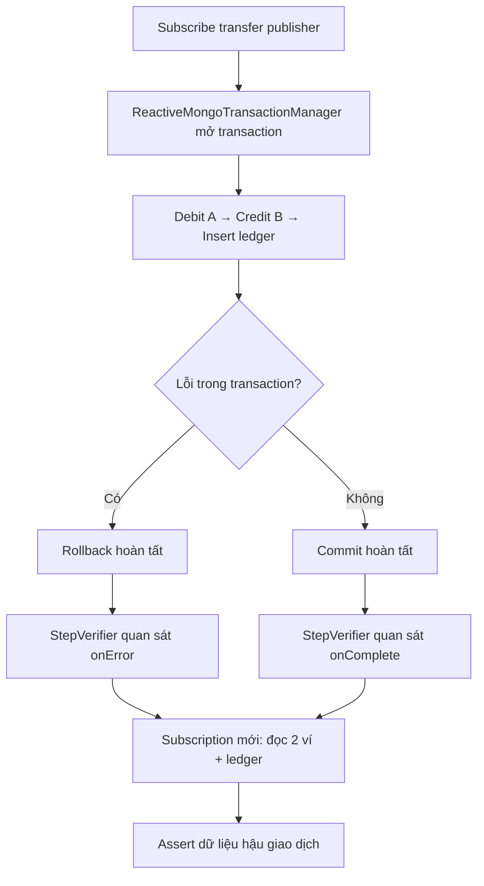

# Kiểm thử bằng StepVerifier và xác minh trạng thái sau commit

> **Chương:** Giao dịch reactive  
> **Module:** `SPRING_DATA_MONGODB` — dùng Spring Data MongoDB để kết nối, ánh xạ document và thao tác qua `MongoTemplate` hoặc repository; thực hành truy vấn, aggregation, index, transaction, reactive access, kiểm thử và chẩn đoán hiệu năng. Bài tập trung vào **kiểm thử transaction reactive với `StepVerifier`**, xác minh **trạng thái thực sự đã commit** và kiểm tra **rollback** trên MongoDB thật.

## 1. Bài toán: tín hiệu thành công có chứng minh dữ liệu đã commit?

Một service chuyển 3.000 cent từ ví A sang ví B và ghi nhật ký:

1. Trừ tiền ví A, với điều kiện số dư đủ.
2. Cộng tiền ví B cùng tenant.
3. Chèn một bản ghi chuyển tiền có `transferId` duy nhất.
4. **Commit** tất cả hoặc **rollback** tất cả.

Nếu test chỉ viết:

```java
StepVerifier.create(service.transfer(command))
    .expectNextCount(1)
    .verifyComplete();
```

thì test mới xác nhận publisher phát một item và hoàn tất **theo contract của method**; nó chưa kiểm tra **hai số dư** hay **bản ghi ledger**. Thậm chí nếu tự phát `onNext` trong transaction, item đó có thể xuất hiện **trước khi transaction commit hoàn toàn**; không nên xem `onNext` là bằng chứng dữ liệu đã durable.

Một kiểm thử có ý nghĩa cần **hai lớp xác nhận**:

- **Lớp reactive:** `StepVerifier` kiểm subscription, giá trị phát ra, `onComplete` hoặc `onError`.
- **Lớp database:** sau khi transaction publisher **đã kết thúc**, đọc lại bằng **subscription độc lập, không nằm trong transaction cũ**, rồi khẳng định trạng thái MongoDB.



**Mục tiêu:** viết test đáng tin cậy cho commit, rollback, lỗi nghiệp vụ, duplicate key, cancellation, concurrent updates và commit outcome chưa rõ; tránh các test “xanh” dù có ghi ngoài transaction hoặc chỉ kiểm trạng thái **bên trong** transaction.

## 2. Các tầng cần phân biệt

| Tầng | Công cụ | Nó chứng minh được gì? | Không chứng minh được gì? |
| --- | --- | --- | --- |
| **Publisher** | Reactor `Mono`/`Flux` | Chuỗi xử lý và tín hiệu reactive | Database đã commit nếu publisher là nguồn giả hoặc ranh giới sai |
| **Verification** | Reactor Test `StepVerifier` | `onNext`, demand, completion, error, cancellation | Số dư và ledger thực nếu không query database |
| **Transaction scope** | `TransactionalOperator` hoặc `@Transactional` | Các thao tác Spring Data cùng context được điều phối start/commit/rollback | Raw driver không session hoặc side effects ngoài MongoDB tự tham gia |
| **MongoDB** | Replica set/sharded cluster hỗ trợ | Atomic commit/rollback nhiều document | Business rule như số dư đủ tiền nếu code không kiểm |
| **External verification** | Đọc lại `ReactiveMongoTemplate` | Trạng thái được thấy sau transaction tại thời điểm đọc | Một snapshot vĩnh viễn xuyên nhiều request/clients |
| **Idempotency** | Unique transfer ID + xử lý retry | Tránh xử lý lại cùng lệnh theo chính sách | Tự phát sinh chỉ vì có transaction |

### 2.1. Vì sao `onNext` không phải “commit event”?

Một service có thể xây chuỗi:

```java
Mono<Receipt> writeSteps = debit()
    .then(credit())
    .then(insertLedger())
    .map(doc -> new Receipt(doc.getString("transferId")));

Mono<Receipt> transactional = writeSteps
    .as(transactionalOperator::transactional);
```

`Receipt` là record do ứng dụng định nghĩa; `debit`, `credit`, `insertLedger` minh họa các publisher. Kết quả `Receipt` có thể được phát khi các operation **bên trong** đã chạy, nhưng transaction manager còn phải thực hiện commit khi nguồn hoàn tất.

Để kết luận “commit thành công”, cần **terminal success** của publisher transaction do framework quản lý, rồi kiểm database nếu bài test yêu cầu độ chắc chắn về trạng thái nghiệp vụ.

### 2.2. `onComplete` không bảo đảm mọi thứ ngoài MongoDB đã thành công

MongoDB transaction không rollback email, HTTP request, external payment gateway hoặc message broker publish riêng. Nếu callback gửi email trước commit, một transaction rollback sau đó không lấy lại email. Do đó integration test phải khẳng định transaction MongoDB và kiểm riêng giao thức outbox/idempotency cho hệ thống ngoài.

### 2.3. `onError` không tự nói rõ transaction đã rollback

Nếu lỗi phát ra **bên trong transactional publisher**, transaction manager bình thường thực hiện rollback theo contract. Nhưng một lỗi được gắn **sau khi transactional publisher đã hoàn tất** không thể quay ngược một commit trước đó:

```java
Mono<Void> errorAfterCommit = service.transfer(command)
    .then(Mono.error(new IllegalStateException(
        "An unrelated step failed after transfer"
    )));
```

Publisher `errorAfterCommit` báo lỗi, nhưng giao dịch có thể **đã commit thành công**. Vì vậy không assert “`expectError` nghĩa là hai ví chưa đổi” mà không xác định **vị trí lỗi trong transaction boundary**.

## 3. Môi trường kiểm thử đúng: MongoDB replica set

Multi-document transactions cần topology hỗ trợ:

- Replica set từ MongoDB 4.0.
- Sharded cluster từ MongoDB 4.2.
- **Standalone MongoDB không hỗ trợ multi-document transactions.**

Khi kiểm thử bằng `@SpringBootTest`/`@DataMongoTest`, phải cung cấp MongoDB **replica set thử nghiệm thực**, ví dụ Testcontainers với image/version hỗ trợ. `StepVerifier` không mô phỏng được MongoDB commit/rollback nếu test chỉ có mock repository.

### 3.1. Những yêu cầu để test không bị dương tính giả

1. MongoDB server phải được khởi động ở topology hỗ trợ transaction.
2. `ReactiveMongoTransactionManager` và `ReactiveMongoTemplate` phải dùng **cùng `ReactiveMongoDatabaseFactory`**.
3. Transaction method phải thực sự được bọc bởi `TransactionalOperator` hoặc proxy `@Transactional`.
4. Cả debit, credit, insert ledger phải **tham gia cùng Reactor Context/session**.
5. Test seed vào database cô lập, **ngoài** transaction đang kiểm tra.
6. Test đọc lại **sau khi transaction đã kết thúc**, không dựa vào entity đang có trong heap.
7. Test chạy qua một lần subscription có chủ đích; không vô ý subscribe hai lần vào cold transaction publisher.

### 3.2. Không test trên standalone rồi kết luận rollback đã ổn

Nếu server báo lỗi dạng transaction numbers/replica set required, đó là **lỗi môi trường**, không phải kiểm thử nghiệp vụ thất bại hợp lệ. Đừng sửa test bằng cách bỏ `@Transactional` hay bỏ `TransactionalOperator` cho “xanh”.

### 3.3. Testcontainers theo từng version

Trong Spring Boot 3.x và Testcontainers 1.x, ví dụ thường dùng `org.testcontainers.containers.MongoDBContainer` với `getReplicaSetUrl()`. Testcontainers/Spring Boot phiên bản mới có package/module tương ứng khác, nên ví dụ cần kiểm dependency thực:

```java
import org.junit.jupiter.api.Test;
import org.springframework.boot.test.context.SpringBootTest;
import org.springframework.test.context.DynamicPropertyRegistry;
import org.springframework.test.context.DynamicPropertySource;
import org.testcontainers.containers.MongoDBContainer;
import org.testcontainers.junit.jupiter.Container;
import org.testcontainers.junit.jupiter.Testcontainers;
import org.testcontainers.utility.DockerImageName;

@Testcontainers
@SpringBootTest
class MongoReplicaSetSmokeTest {

    @Container
    static final MongoDBContainer mongo =
        new MongoDBContainer(DockerImageName.parse("mongo:7.0"));

    @DynamicPropertySource
    static void properties(DynamicPropertyRegistry registry) {
        registry.add(
            "spring.data.mongodb.uri",
            mongo::getReplicaSetUrl
        );
        registry.add(
            "spring.data.mongodb.database",
            () -> "reactive_tx_test"
        );
    }

    @Test
    void contextLoads() {
        // Mới kiểm setup; chưa chứng minh transaction hoạt động.
    }
}
```

Phụ thuộc tối thiểu: Spring Boot test, Spring Data MongoDB reactive, Reactor Test, JUnit 5, Testcontainers MongoDB + JUnit Jupiter và môi trường chạy container. Với Spring Boot 4/Testcontainers 2, package/configuration có thể khác. Trong CI, container phải được phép khởi tạo replica set và test cần chờ server sẵn sàng.

**Không đặt lệnh xóa collection trong production:** các ví dụ reset fixture ở các phần sau chỉ chạy với database thử nghiệm độc lập.

## 4. Chuẩn bị dữ liệu: hai ví và transfer ledger

Giả sử collection `wallets` có hai document:

```javascript
db.wallets.insertMany([
  {
    _id: "W-A",
    tenantId: "TENANT-A",
    currency: "USD",
    balanceCents: NumberLong(10000)
  },
  {
    _id: "W-B",
    tenantId: "TENANT-A",
    currency: "USD",
    balanceCents: NumberLong(2000)
  }
]);
```

Và collection `transfers` lưu receipt:

```javascript
{
  _id: "TENANT-A|TR-001",
  tenantId: "TENANT-A",
  transferId: "TR-001",
  fromId: "W-A",
  toId: "W-B",
  amountCents: NumberLong(3000),
  currency: "USD"
}
```

Thêm unique index `{tenantId:1,transferId:1}` để bảo vệ idempotency key trong cùng tenant:

```javascript
db.transfers.createIndex(
  { tenantId: 1, transferId: 1 },
  { name: "ux_tenant_transfer", unique: true }
);
```

| Trạng thái | Ví A (cent) | Ví B (cent) | Số ledger |
| --- | ---: | ---: | ---: |
| Ban đầu | 10.000 | 2.000 | 0 |
| Chuyển 3.000 thành công | 7.000 | 5.000 | 1 |
| Thiếu tiền, rollback | 10.000 | 2.000 | 0 |
| Ví đích không tồn tại, rollback | 10.000 | 2.000 | 0 |
| Gửi lại cùng transferId sau commit | 7.000 | 5.000 | 1 |

Để test **rollback giữa chừng**, ta cố ý cho phép bước debit hoàn thành nhưng bước credit không match. Khi method phát lỗi, transaction phải abort; một phép đọc **sau rollback** thấy ví A vẫn có 10.000, dù trong transaction trước đó từng thực hiện update trừ tiền.

### 4.1. Số dư và ledger là dữ liệu thật, không phải object cache

Tránh tạo một `AtomicLong` trong service rồi assert nó đã đổi; test như vậy chỉ kiểm state của JVM. Hãy query lại `wallets` và `transfers` qua ReactiveMongoTemplate sau terminal signal.

### 4.2. Tránh dùng `double` cho tiền

Ví dụ dùng `long` cent và `$inc` để giảm lỗi dấu phẩy động. Production cần validate amount, currency, giới hạn số nguyên, tiền đa currency và business authorization; transaction không thể tự hiểu những quy tắc đó.

## 5. Cấu hình ReactiveMongoTransactionManager

Từ Spring Data MongoDB, transaction reactive được gắn với **Reactor Context**, không phải thread-local như imperative MongoTransactionManager:

```java
package demo.transfers;

import org.springframework.context.annotation.Bean;
import org.springframework.context.annotation.Configuration;
import org.springframework.data.mongodb.ReactiveMongoDatabaseFactory;
import org.springframework.data.mongodb.ReactiveMongoTransactionManager;
import org.springframework.transaction.reactive.TransactionalOperator;

@Configuration
public class ReactiveTxConfig {

    @Bean
    ReactiveMongoTransactionManager reactiveMongoTransactionManager(
        ReactiveMongoDatabaseFactory factory
    ) {
        return new ReactiveMongoTransactionManager(factory);
    }

    @Bean
    TransactionalOperator mongoTransactionalOperator(
        ReactiveMongoTransactionManager manager
    ) {
        return TransactionalOperator.create(manager);
    }
}
```

`ReactiveMongoTemplate` phải dùng cùng `ReactiveMongoDatabaseFactory` với manager này. Trong ứng dụng có nhiều reactive transaction managers (MongoDB, R2DBC...), hãy khai báo qualifier/bean name để không chọn nhầm.

### 5.1. TransactionalOperator bọc phạm vi nào?

`TransactionalOperator.transactional(publisher)` quản lý transaction cho **upstream publisher** được bọc. Với `Mono`:

```java
Mono<Receipt> tx = doWrites()
    .as(mongoTransactionalOperator::transactional);
```

`doWrites` chỉ là ví dụ publisher do service cung cấp. Khi có subscription, manager mở transaction, cho upstream chạy trong context và commit/rollback khi publisher hoàn tất/lỗi theo contract.

**Không** dùng:

```java
// PHẢN VÍ DỤ: lệnh insert detached chạy ngoài chuỗi transaction.
someWrite().subscribe();
return otherWrite().as(mongoTransactionalOperator::transactional);
```

Một `subscribe()` tự phát tạo subscription mới, không mặc nhiên kế thừa transaction context của chuỗi trả về. Không chạy hai operation đồng thời trên cùng transactional session bằng `Mono.when`/`zip`, vì MongoDB driver không hỗ trợ parallel operations trong cùng transaction như một cách tăng tốc.

### 5.2. @Transactional là phương án khác

Nếu dùng declarative:

```java
@org.springframework.transaction.annotation.Transactional(
    transactionManager = "reactiveMongoTransactionManager"
)
public Mono<Receipt> transferAnnotated(TransferCommand command) {
    return doWrites(command);
}
```

Method public cần được gọi **qua Spring proxy**. Self-invocation kiểu `this.transferAnnotated(...)` thường không kích hoạt transaction interceptor ở proxy mode. `@Transactional` không tự quản lý một `subscribe()` detached hoặc raw driver operation thiếu context.

**Chọn một strategy cho ví dụ chính:** phần tiếp theo dùng `TransactionalOperator` để boundary được nhìn thấy rõ trong test; bài thực hành có thể viết lại bằng `@Transactional` và kiểm tương đương.

## 6. Service chuyển tiền reactive dùng trong các test

Hai record dữ liệu:

```java
package demo.transfers;

public record TransferCommand(
    String tenantId,
    String fromId,
    String toId,
    long amountCents,
    String transferId
) {}
```

```java
package demo.transfers;

public record Receipt(
    String tenantId,
    String transferId,
    long amountCents
) {}
```

### 6.1. Toàn bộ các operation phải nằm cùng chain

```java
package demo.transfers;

import com.mongodb.client.result.UpdateResult;
import org.bson.Document;
import org.springframework.data.mongodb.core.ReactiveMongoTemplate;
import org.springframework.data.mongodb.core.query.Criteria;
import org.springframework.data.mongodb.core.query.Query;
import org.springframework.data.mongodb.core.query.Update;
import org.springframework.stereotype.Service;
import org.springframework.transaction.reactive.TransactionalOperator;
import reactor.core.publisher.Mono;

@Service
public class TransferService {

    private final ReactiveMongoTemplate mongo;
    private final TransactionalOperator txOperator;

    public TransferService(
        ReactiveMongoTemplate mongo,
        TransactionalOperator mongoTransactionalOperator
    ) {
        this.mongo = mongo;
        this.txOperator = mongoTransactionalOperator;
    }

    public Mono<Receipt> transfer(TransferCommand c) {
        return Mono.defer(() -> {
            validate(c);

            Query source = Query.query(
                Criteria.where("_id").is(c.fromId())
                    .and("tenantId").is(c.tenantId())
                    .and("currency").is("USD")
                    .and("balanceCents").gte(c.amountCents())
            );

            Query destination = Query.query(
                Criteria.where("_id").is(c.toId())
                    .and("tenantId").is(c.tenantId())
                    .and("currency").is("USD")
            );

            Document ledger = new Document(
                    "_id", c.tenantId() + "|" + c.transferId())
                .append("tenantId", c.tenantId())
                .append("transferId", c.transferId())
                .append("fromId", c.fromId())
                .append("toId", c.toId())
                .append("amountCents", c.amountCents())
                .append("currency", "USD");

            Mono<Receipt> work = mongo.updateFirst(
                    source,
                    new Update().inc(
                        "balanceCents", -c.amountCents()
                    ),
                    "wallets"
                )
                .flatMap(debit -> {
                    if (debit.getMatchedCount() != 1L) {
                        return Mono.<UpdateResult>error(
                            new IllegalStateException(
                                "Source missing or insufficient funds"
                            )
                        );
                    }
                    return mongo.updateFirst(
                        destination,
                        new Update().inc(
                            "balanceCents", c.amountCents()
                        ),
                        "wallets"
                    );
                })
                .flatMap(credit -> {
                    if (credit.getMatchedCount() != 1L) {
                        return Mono.<Receipt>error(
                            new IllegalStateException(
                                "Destination missing"
                            )
                        );
                    }
                    return mongo.insert(ledger, "transfers")
                        .map(ignored -> new Receipt(
                            c.tenantId(),
                            c.transferId(),
                            c.amountCents()
                        ));
                });

            return work.as(txOperator::transactional);
        });
    }

    private static void validate(TransferCommand c) {
        if (c == null
            || c.tenantId() == null || c.tenantId().isBlank()
            || c.fromId() == null || c.fromId().isBlank()
            || c.toId() == null || c.toId().isBlank()
            || c.transferId() == null || c.transferId().isBlank()
            || c.fromId().equals(c.toId())
            || c.amountCents() <= 0) {
            throw new IllegalArgumentException(
                "Invalid transfer command"
            );
        }
    }
}
```

**Các quyết định thiết kế:**

1. `Mono.defer` khiến validation và việc dựng đối tượng theo request xảy ra **tại subscription**, không thực thi MongoDB trong lúc gọi method.
2. `updateFirst` trên ví nguồn sử dụng filter `balanceCents >= amount`, tránh trừ vượt số dư trong một update document nguyên tử.
3. Khi `matchedCount=0`, service phát **`Mono.error`**, không phát `Mono.empty` vì empty sẽ là completion thành công và transaction có thể commit.
4. Cả debit, credit và insert ledger được nối **tuần tự**, không subscribe rời, không `Mono.when`.
5. `work.as(txOperator::transactional)` bọc **cả ba operation**.
6. Không ném `Receipt` ra khỏi transaction bằng cách bắt lỗi bên trong rồi chuyển thành một thành công giả.

Đây là mã giáo dục: production cần chuẩn hóa tenant từ principal, kiểm quyền sở hữu ví và currency, kiểm tràn số, kiểm idempotency với **payload đã lưu**, mã hóa lỗi và transaction retry policy. ID ledger kết hợp bằng dấu `|` chỉ minh họa; nếu tenant/transferId có thể chứa dấu này, chọn encoding không mơ hồ hoặc ObjectId cùng unique compound index.

### 6.2. Vì sao không đặt `onErrorResume` bên trong transaction?

Phản ví dụ:

```java
Mono<Receipt> wrong = debit()
    .then(creditThatMayFail())
    .onErrorResume(ex -> Mono.empty())
    .as(txOperator::transactional);
```

Nếu `creditThatMayFail` báo lỗi sau khi debit đã sửa document, `onErrorResume` biến lỗi thành **completion thành công**, khiến transaction manager có thể **commit debit đơn lẻ**. Đó là dữ liệu sai dù test `verifyComplete()` trả xanh.

Muốn rollback, giữ error trong transactional publisher. Nếu UI cần chuyển error thành response thân thiện, xử lý **sau transaction boundary**, rồi kiểm database:

```java
Mono<TransferResponse> response = transfer(command)
    .map(receipt -> TransferResponse.success(receipt))
    .onErrorResume(
        IllegalStateException.class,
        e -> Mono.just(TransferResponse.rejected(e.getMessage()))
    );
```

`TransferResponse` chỉ là DTO ví dụ của ứng dụng. Cần xác nhận `transfer(command)` đã bọc transaction như ở trên và trạng thái sau rollback được kiểm trong test.

## 7. StepVerifier: API tối thiểu để kiểm chứng transaction publisher

Dependency test sử dụng `io.projectreactor:reactor-test`. Trong Spring Boot, thường đưa qua `spring-boot-starter-test` hoặc khai báo trực tiếp scope test tùy build.

```java
import reactor.test.StepVerifier;
```

Các thao tác chính:

| API | Công dụng | Chú ý |
| --- | --- | --- |
| `StepVerifier.create(publisher)` | Tạo verifier, mặc định có demand ban đầu | **Chưa chạy** trước khi `verify()` |
| `expectNext(value)` | Kiểm item tiếp theo bằng equality | Hợp với kiểu đơn giản/record |
| `assertNext(consumer)` | Assert các field của item | Lỗi assertion khiến test fail |
| `expectNextCount(n)` | Nhận n items bất kỳ | Không kiểm payload cụ thể |
| `expectComplete()`, `verify()` | Kiểm terminal completion | Không tự query database |
| `verifyComplete()` | Rút gọn completion + verify | Chờ publisher kết thúc theo timeout/config test |
| `expectErrorSatisfies(...)` | Kiểm loại/nội dung error | Không tự suy ra rollback nếu lỗi ở ngoài boundary |
| `thenRequest(n)` | Cấp thêm demand | Nên dùng cho Flux/backpressure tests |
| `thenCancel()` | Cancel subscription | Cần kiểm hậu quả transaction riêng |
| `verify(Duration)` | Giới hạn thời gian chờ | Tránh test treo vô hạn khi MongoDB lỗi |

### 7.1. Ví dụ một Mono thuần

```java
StepVerifier.create(Mono.just("OK"))
    .expectNext("OK")
    .verifyComplete();

StepVerifier.create(Mono.<String>error(
        new IllegalStateException("boom")))
    .expectErrorMatches(e ->
        e instanceof IllegalStateException
            && "boom".equals(e.getMessage()))
    .verify();
```

Những ví dụ này chỉ kiểm Reactor, **không** chứng minh MongoDB transaction hoạt động.

### 7.2. Đừng gọi `subscribe()` trước StepVerifier

```java
Mono<Receipt> transfer = service.transfer(command);

// SAI: có thể tạo 2 subscriptions / 2 lần thử ghi.
transfer.subscribe();
StepVerifier.create(transfer).expectNextCount(1).verifyComplete();
```

Reactive MongoDB publishers thường là cold: **mỗi subscription** có thể chạy lại query/transaction. Với transfer không idempotent, lần thứ hai có thể trừ tiền lần nữa hoặc gặp duplicate key. Để test một lần ghi, tạo publisher rồi chỉ subscribe bằng `StepVerifier`.

### 7.3. Sự kiện emitted trước complete không phải trạng thái durable

```java
StepVerifier.create(service.transfer(command))
    .assertNext(receipt -> {
        assertThat(receipt.transferId()).isEqualTo("TR-001");
        // ĐỪNG đồng bộ/block() để đọc DB ở đây và suy ra commit.
    })
    .verifyComplete();
```

Ở `assertNext`, transaction có thể vẫn đang ở giai đoạn gửi/nhận tín hiệu. Kiểm dữ liệu từ **subscription mới sau `verifyComplete()`**, hoặc dùng `.then(Mono.defer(...))` đặt sau toàn bộ transactional publisher và hiểu rõ boundary.

## 8. Chụp trạng thái MongoDB sau commit

Tạo DTO phản ánh dữ liệu **đọc lại từ DB**, không phải object đang được service giữ:

```java
package demo.transfers;

public record TransferSnapshot(
    long fromCents,
    long toCents,
    long ledgerCount
) {}
```

Helper trong integration test:

```java
private Mono<TransferSnapshot> snapshot() {
    Mono<Long> from = template
        .findById("W-A", Document.class, "wallets")
        .map(doc -> ((Number) doc.get("balanceCents")).longValue());

    Mono<Long> to = template
        .findById("W-B", Document.class, "wallets")
        .map(doc -> ((Number) doc.get("balanceCents")).longValue());

    Mono<Long> ledgerCount = template.count(
        new Query(), "transfers"
    );

    return Mono.zip(from, to, ledgerCount)
        .map(tuple -> new TransferSnapshot(
            tuple.getT1(),
            tuple.getT2(),
            tuple.getT3()
        ));
}
```

`template` là một `ReactiveMongoTemplate` đã inject; cần imports `org.bson.Document`, `org.springframework.data.mongodb.core.query.Query`, `reactor.core.publisher.Mono`. Đọc qua database sau terminal success là cách kiểm tra dữ liệu thực, **không** chỉ assert giá trị `Receipt`.

### 8.1. Hai lần verification là cách rõ ràng nhất

```java
TransferCommand c = new TransferCommand(
    "TENANT-A", "W-A", "W-B", 3000L, "TR-001"
);

// Subscription 1: transaction và commit.
StepVerifier.create(service.transfer(c))
    .assertNext(r -> {
        assertThat(r.transferId()).isEqualTo("TR-001");
        assertThat(r.amountCents()).isEqualTo(3000L);
    })
    .verifyComplete();

// Subscription 2: đọc trạng thái sau khi publisher giao dịch hoàn tất.
StepVerifier.create(snapshot())
    .expectNext(new TransferSnapshot(7000L, 5000L, 1L))
    .verifyComplete();
```

**Điểm then chốt:** lần đọc thứ hai được tạo **sau** `verifyComplete`, nên không vô tình đọc snapshot ở giữa transaction. Với các concern phù hợp và một primary ổn định, test có thể xác nhận trạng thái đã được commit. Nếu yêu cầu durability qua failover, cần đánh giá write concern (`majority`) riêng; test không tự thay thế chính sách durability.

### 8.2. Ghép đọc sau completion trong một publisher

Khi muốn một `StepVerifier` duy nhất:

```java
Mono<TransferSnapshot> afterCommit = service.transfer(c)
    .then(Mono.defer(this::snapshot));

StepVerifier.create(afterCommit)
    .expectNext(new TransferSnapshot(7000L, 5000L, 1L))
    .verifyComplete();
```

`then` chỉ subscribe nguồn tiếp theo **sau khi publisher trước hoàn tất thành công**. Vì `service.transfer` trả về transactional publisher đã bọc toàn bộ `work`, `snapshot()` nằm **sau boundary đó**. `Mono.defer` khiến helper được gọi ở thời điểm subscription tới stage post-commit, không phải khi xây pipeline.

Đừng chuyển `snapshot()` vào `flatMap` của `work` **trước `.as(tx::transactional)`** rồi kết luận đây là state sau commit: lúc ấy nó vẫn là một phép đọc **trong transaction**, có thể thấy các thay đổi chưa commit theo cơ chế read-your-own-writes.

### 8.3. Đọc trong transaction có thể thấy dữ liệu chưa commit

Phản ví dụ:

```java
Mono<TransferSnapshot> misleading = writeSteps()
    .then(Mono.defer(this::snapshot))
    .as(txOperator::transactional);
```

Nếu `snapshot` dùng cùng ReactiveMongoTemplate/context, nó có thể đọc được số dư đã cập nhật **bên trong transaction**, nhưng commit sau đó vẫn có thể thất bại. Một assertion về state ở đây **không** chứng minh đã commit.

### 8.4. Test chỉ đọc một collection là chưa đủ

Sau transfer, nếu chỉ kiểm ví A bằng 7.000, test không phát hiện thiếu credit cho ví B. Nếu chỉ kiểm ledger có 1 row, test không phát hiện số dư sai. Contract giao dịch nhiều document phải assert **tất cả các tài nguyên bất biến liên quan**, ít nhất A, B và ledger; với workflow rộng còn có outbox và version/audit.

## 9. Integration test hoàn chỉnh: commit và rollback

Lớp test sau sử dụng **Spring Boot 3.x + Testcontainers 1.x**. Mỗi test seed trên database cô lập, dùng `StepVerifier` kiểm publisher giao dịch, rồi xác minh trạng thái qua **subscription mới**:

```java
package demo.transfers;

import static org.assertj.core.api.Assertions.assertThat;

import java.time.Duration;
import java.util.concurrent.atomic.AtomicInteger;
import org.bson.Document;
import org.junit.jupiter.api.BeforeEach;
import org.junit.jupiter.api.Test;
import org.springframework.beans.factory.annotation.Autowired;
import org.springframework.boot.test.context.SpringBootTest;
import org.springframework.data.domain.Sort;
import org.springframework.data.mongodb.core.ReactiveMongoTemplate;
import org.springframework.data.mongodb.core.index.Index;
import org.springframework.data.mongodb.core.query.Query;
import org.springframework.test.context.DynamicPropertyRegistry;
import org.springframework.test.context.DynamicPropertySource;
import org.testcontainers.containers.MongoDBContainer;
import org.testcontainers.junit.jupiter.Container;
import org.testcontainers.junit.jupiter.Testcontainers;
import org.testcontainers.utility.DockerImageName;
import reactor.core.publisher.Mono;
import reactor.test.StepVerifier;

@SpringBootTest
@Testcontainers
class ReactiveTransferIntegrationTest {

    @Container
    static final MongoDBContainer mongo =
        new MongoDBContainer(DockerImageName.parse("mongo:7.0"));

    @DynamicPropertySource
    static void mongoProperties(DynamicPropertyRegistry registry) {
        registry.add(
            "spring.data.mongodb.uri", mongo::getReplicaSetUrl
        );
        registry.add(
            "spring.data.mongodb.database",
            () -> "reactive_tx_test"
        );
    }

    @Autowired ReactiveMongoTemplate template;
    @Autowired TransferService service;

    @BeforeEach
    void resetDatabase() {
        // CHỈ dùng MongoDB test riêng; dropCollection xóa dữ liệu.
        template.dropCollection("transfers")
            .then(template.dropCollection("wallets"))
            .then(template.insert(
                wallet("W-A", 10_000L), "wallets"
            ))
            .then(template.insert(
                wallet("W-B", 2_000L), "wallets"
            ))
            .then(template.indexOps("transfers").ensureIndex(
                new Index()
                    .on("tenantId", Sort.Direction.ASC)
                    .on("transferId", Sort.Direction.ASC)
                    .named("ux_tenant_transfer")
                    .unique()
            ))
            .then()
            .block(Duration.ofSeconds(30));
    }

    private Document wallet(String id, long cents) {
        return new Document("_id", id)
            .append("tenantId", "TENANT-A")
            .append("currency", "USD")
            .append("balanceCents", cents);
    }

    private TransferCommand command(String transferId) {
        return new TransferCommand(
            "TENANT-A", "W-A", "W-B", 3_000L, transferId
        );
    }

    private Mono<TransferSnapshot> snapshot() {
        Mono<Long> from = template
            .findById("W-A", Document.class, "wallets")
            .map(d -> ((Number) d.get("balanceCents")).longValue());

        Mono<Long> to = template
            .findById("W-B", Document.class, "wallets")
            .map(d -> ((Number) d.get("balanceCents")).longValue());

        Mono<Long> count = template.count(
            new Query(), "transfers"
        );

        return Mono.zip(from, to, count)
            .map(t -> new TransferSnapshot(
                t.getT1(), t.getT2(), t.getT3()
            ));
    }

    private void assertState(
        long from, long to, long ledgerCount
    ) {
        StepVerifier.create(snapshot())
            .expectNext(new TransferSnapshot(
                from, to, ledgerCount
            ))
            .expectComplete()
            .verify(Duration.ofSeconds(20));
    }

    @Test
    void successCommitsBothWalletsAndOneLedgerEntry() {
        StepVerifier.create(service.transfer(command("TR-001")))
            .assertNext(receipt -> {
                assertThat(receipt.transferId()).isEqualTo("TR-001");
                assertThat(receipt.amountCents()).isEqualTo(3_000L);
            })
            .expectComplete()
            .verify(Duration.ofSeconds(20));

        assertState(7_000L, 5_000L, 1L);

        StepVerifier.create(template.findById(
                "TENANT-A|TR-001", Document.class, "transfers"
            ))
            .assertNext(doc -> {
                assertThat(doc.getString("tenantId"))
                    .isEqualTo("TENANT-A");
                assertThat(doc.getString("fromId"))
                    .isEqualTo("W-A");
                assertThat(doc.getString("toId"))
                    .isEqualTo("W-B");
                assertThat(
                    ((Number) doc.get("amountCents")).longValue()
                ).isEqualTo(3_000L);
            })
            .expectComplete()
            .verify(Duration.ofSeconds(20));
    }

    @Test
    void missingDestinationRollsBackAfterDebit() {
        TransferCommand missing = new TransferCommand(
            "TENANT-A", "W-A", "W-MISSING",
            3_000L, "TR-002"
        );

        StepVerifier.create(service.transfer(missing))
            .expectErrorMatches(e ->
                e instanceof IllegalStateException
                    && e.getMessage().contains("Destination missing"))
            .verify(Duration.ofSeconds(20));

        // Debit đã match bên trong transaction nhưng phải rollback.
        assertState(10_000L, 2_000L, 0L);
    }

    @Test
    void insufficientFundsDoesNotCreditDestination() {
        TransferCommand tooLarge = new TransferCommand(
            "TENANT-A", "W-A", "W-B",
            20_000L, "TR-003"
        );

        StepVerifier.create(service.transfer(tooLarge))
            .expectErrorMatches(e ->
                e instanceof IllegalStateException
                    && e.getMessage().contains("insufficient funds"))
            .verify(Duration.ofSeconds(20));

        assertState(10_000L, 2_000L, 0L);
    }

    @Test
    void duplicateTransferIdRollsBackSecondAttempt() {
        StepVerifier.create(service.transfer(command("TR-004")))
            .expectNextCount(1)
            .expectComplete()
            .verify(Duration.ofSeconds(20));

        assertState(7_000L, 5_000L, 1L);

        StepVerifier.create(service.transfer(command("TR-004")))
            .expectErrorSatisfies(error ->
                assertThat(error).hasMessageContaining("duplicate"))
            .verify(Duration.ofSeconds(20));

        // Request thứ hai đã thử debit/credit, nhưng ledger trùng
        // khiến cả transaction của nó rollback.
        assertState(7_000L, 5_000L, 1L);
    }

    @Test
    void publisherIsLazyAndHasOneSubscription() {
        AtomicInteger subscriptions = new AtomicInteger();

        Mono<Receipt> write = service.transfer(command("TR-005"))
            .doOnSubscribe(s -> subscriptions.incrementAndGet());

        assertThat(subscriptions.get()).isZero();
        assertState(10_000L, 2_000L, 0L);

        StepVerifier.create(write)
            .expectNextCount(1)
            .expectComplete()
            .verify(Duration.ofSeconds(20));

        assertThat(subscriptions.get()).isEqualTo(1);
        assertState(7_000L, 5_000L, 1L);
    }

    @Test
    void errorAfterCommitCannotUndoCommittedData() {
        Mono<Void> afterwards = service
            .transfer(command("TR-006"))
            .then(Mono.error(new IllegalStateException(
                "failure after transaction"
            )));

        StepVerifier.create(afterwards)
            .expectErrorMessage("failure after transaction")
            .verify(Duration.ofSeconds(20));

        // Publisher cuối báo lỗi, nhưng lỗi nằm SAU boundary.
        assertState(7_000L, 5_000L, 1L);
    }
}
```

### 9.1. Vì sao test này mạnh hơn chỉ verifyComplete?

Success test khẳng định **A giảm 3.000, B tăng 3.000, ledger tăng 1** và metadata ledger đúng. Missing destination test chứng minh **debit được thực hiện trước lỗi nhưng vẫn rollback**; duplicate test chứng minh **cả debit lẫn credit của lần thứ hai không được commit**.

Test chính chỉ có một subscription vào `service.transfer(...)`. `assertState` dùng một subscription **khác**, tạo sau khi giao dịch đã phát terminal signal. Không đọc “số dư đang sửa” trên object cache của JVM rồi coi đó là trạng thái đã commit.

### 9.2. Đừng quá phụ thuộc message của duplicate key

Test `hasMessageContaining("duplicate")` là ví dụ gọn. Tùy driver và Spring exception translation, một lỗi duplicate có thể bị wrap hoặc có message khác. Trong dự án thật, nên kiểm **exception type phù hợp hoặc MongoDB error code 11000** thay vì dựa hoàn toàn vào chuỗi thông báo.

### 9.3. Fixture và package quan trọng

`@SpringBootTest` cần một `@SpringBootApplication` trong package cha (hoặc chỉ rõ classes) để scan `TransferService` và `ReactiveTxConfig`; nếu không, lỗi bean là lỗi setup, không phải lỗi transaction. Trong CI, Testcontainers cần quyền khởi tạo container/replica set và phải dùng dependency package đúng version.

`.block(Duration)` trong `@BeforeEach` chỉ để chuẩn bị fixture **trên thread của JUnit**, không phải code WebFlux production. Các test không được bật chạy song song trên **cùng database tên cố định** vì `dropCollection` của một test có thể xóa dữ liệu khi test khác đang chạy.

### 9.4. Không dùng `@Transactional` cho chính test method

Nếu test method được wrap trong transaction riêng, những đọc kiểm sau operation có thể còn ở **cùng transaction/context** hoặc bị rollback bởi test framework cuối test. Với bài này, test method không gắn `@Transactional`: **service** tự mở và đóng transaction, rồi test đọc trạng thái bên ngoài. Tránh test xanh do đọc được uncommitted writes hoặc rollback giả tạo.

## 10. Kiểm tra rollback khi Mono.empty, lỗi nghiệp vụ và vị trí bắt lỗi

### 10.1. matchedCount=0 không phải lỗi MongoDB tự phát

`updateFirst` có thể hoàn thành bình thường với `UpdateResult.matchedCount=0`. Không được bỏ qua:

```java
// PHẢN VÍ DỤ: có thể commit credit/ledger dù debit không match.
return mongo.updateFirst(source, debit, "wallets")
    .then(mongo.updateFirst(destination, credit, "wallets"))
    .then(mongo.insert(ledger, "transfers"))
    .as(txOperator::transactional);
```

Muốn rollback do điều kiện nghiệp vụ, tạo `Mono.error` khi matchedCount không như kỳ vọng; đừng chỉ xem việc method trả về `Mono<UpdateResult>` là đã sửa thành công.

### 10.2. switchIfEmpty không bắt matchedCount=0

```java
// SAI: updateFirst có thể phát UpdateResult với matchedCount=0.
mongo.updateFirst(source, debit, "wallets")
    .switchIfEmpty(Mono.error(
        new IllegalStateException("Insufficient funds")
    ));
```

`switchIfEmpty` chỉ chạy khi publisher **không phát item**, còn MongoDB thường trả một `UpdateResult` ngay cả khi không document nào match. Cần kiểm `getMatchedCount()` trong `flatMap`. Tương tự, khi xóa cần kiểm `DeleteResult.getDeletedCount()` nếu hợp đồng nghiệp vụ yêu cầu xóa đúng một document.

### 10.3. Rollback sau khi đã ghi thành công

Test insufficient funds chứng minh logic chặn chuyển tiền trước debit. Nhưng test **missing destination** có giá trị kiểm transaction hơn: debit đã match, rồi credit không match, nên transaction phải hoàn nguyên debit. Test duplicate lại kiểm failure ở stage thứ ba, sau cả hai cập nhật.

### 10.4. Xử lý lỗi ở ngoài transactional publisher

```java
Mono<TransferResponse> response = service.transfer(command)
    .map(TransferResponse::accepted)
    .onErrorResume(
        IllegalStateException.class,
        ex -> Mono.just(TransferResponse.rejected(
            "Transfer was not accepted"
        ))
    );
```

`TransferResponse` là DTO do ứng dụng định nghĩa. `onErrorResume` trong snippet nằm **ngoài** transactional publisher mà `service.transfer` trả về. Nó chuyển error thành API response; để test rollback, vẫn phải kiểm trạng thái database sau response.

### 10.5. Lỗi sau commit không rollback hồi tố

`service.transfer(...).then(callExternalService())` có thể phát lỗi từ external call **sau khi MongoDB commit**, nên một `expectError` ở publisher tổng không chứng minh MongoDB rollback. Nếu có external side effect cần nhất quán, dùng transactional outbox và idempotency ở downstream thay vì phụ thuộc vào rollback xuyên hệ thống.

## 11. Cancellation: thenCancel, take, timeout và ranh giới rollback

Spring Framework tài liệu hóa rằng từ **phiên bản 5.3**, cancel signal trên transactional publisher khiến transaction **rollback**. Với một `Flux` được bọc transaction, subscriber phải **tiêu thụ toàn bộ nguồn để cho transaction hoàn tất**; dừng sớm có thể hủy công việc và rollback.

### 11.1. Các operator thường gây cancellation

```java
// Từng ví dụ có thể cancel upstream:
Flux<Order> onlyFirst = allOrders.take(1);
Mono<Order> first = allOrders.next();
Mono<Order> timed = longRunning.timeout(
    Duration.ofSeconds(2)
);
```

`take` và `next` có thể hủy subscription khi đã có đủ item; `timeout` có thể cancel upstream khi hết hạn. Nếu upstream đang nằm trong transaction, hành vi cancel không giống việc “commit mọi thứ đã emit”.

**Phân biệt:** cancel trong khi transaction **vẫn đang hoạt động** dẫn tới rollback theo contract; cancel xảy ra **sau khi commit đã hoàn tất** không thể rollback hồi tố.

### 11.2. StepVerifier.thenCancel không tự chứng minh rollback

```java
StepVerifier.create(transactionalPublisher)
    .expectSubscription()
    .thenCancel()
    .verify();
```

Test này chỉ cho biết subscription được hủy. Nếu cancel **trước khi các lệnh ghi bắt đầu**, database vốn chưa đổi — assert trạng thái ban đầu không chứng minh rằng transaction rollback được các ghi đã thực hiện.

Muốn kiểm rollback do cancellation **sau một write thực**:

1. Tạo một **gate** trong pipeline transaction: insert/update đầu tiên thành công, rồi chờ tín hiệu chưa được mở.
2. Dùng `Sinks.One`, `PublisherProbe` hoặc một cơ chế đồng bộ của test báo rằng stage ghi đầu tiên **đã chạy trong transaction**.
3. `StepVerifier` cancel **khi gate vẫn đóng**, trước khi pipeline được phép complete.
4. Cho cơ chế rollback/cleanup bất đồng bộ đủ điều kiện kết thúc, quan sát bằng bounded await/metrics; đừng assert tức thì sau `thenCancel` nếu cleanup chưa kết thúc.
5. Đọc lại MongoDB từ context ngoài transaction, xác minh write trung gian **không được commit**, kiểm cursor/session resources nếu bài test yêu cầu.

### 11.3. Một mô hình gate để kiểm điểm hủy

```java
import java.time.Duration;
import java.util.concurrent.atomic.AtomicBoolean;
import org.bson.Document;
import reactor.core.publisher.Mono;
import reactor.core.publisher.Sinks;
import reactor.test.StepVerifier;

Sinks.One<Boolean> firstWriteReached = Sinks.one();
Sinks.One<Void> neverOpenedGate = Sinks.one();
AtomicBoolean cancelled = new AtomicBoolean(false);

Mono<Void> pendingTransaction = template.insert(
        new Document("_id", "TX-CANCEL-1")
            .append("value", "uncommitted"),
        "tx_probe"
    )
    .doOnNext(doc -> firstWriteReached.tryEmitValue(true))
    .then(neverOpenedGate.asMono())
    .as(txOperator::transactional)
    .doOnCancel(() -> cancelled.set(true));

StepVerifier.create(pendingTransaction)
    .expectSubscription()
    // Chỉ block trong test thread để bảo đảm write stage đã tới gate.
    .then(() -> firstWriteReached.asMono()
        .block(Duration.ofSeconds(10)))
    .thenCancel()
    .verify(Duration.ofSeconds(20));

assert cancelled.get();
```

**Giới hạn của snippet:** nó chỉ kiểm **đã tới gate rồi cancel**. `doOnNext` của `insert` đánh dấu operation phía driver có phản hồi trong transaction, **không phải commit**. Để xác nhận rollback/cleanup thật cần một integration assertion khác sau khi transaction hủy đã được xử lý, có timeout và đọc từ context độc lập; không nên biến `assert cancelled` thành khẳng định MongoDB đã rollback xong. Dùng một test collection riêng `tx_probe` và dọn trước test.

### 11.4. Không dùng take(1) để “commit một phần” của Flux transaction

```java
// RỦI RO: người gọi chỉ lấy phần tử đầu của Flux transaction.
Flux<Receipt> allReceipts = writeManyTransactionsAsOneFlux()
    .as(txOperator::transactional);

Mono<Receipt> firstOnly = allReceipts.next();
```

Nếu `next()` cancel upstream trước khi transaction complete, các lệnh trước đó có thể bị rollback; **không** coi item đầu tiên được nhận là đã durable. Với API cần nhiều item độc lập, cân nhắc transaction boundary nhỏ theo mỗi nghiệp vụ, thay vì một transaction dài cho toàn bộ Flux.

## 12. Timeout và virtual time: không mô phỏng MongoDB commit bằng clock ảo

### 12.1. Gắn timeout cho integration test

Một `StepVerifier.verifyComplete()` không có giới hạn thời gian mặc định nếu chưa thiết lập `StepVerifier.setDefaultTimeout`. Với MongoDB test server có thể bị treo/network chậm, nên:

```java
StepVerifier.create(service.transfer(command))
    .expectNextCount(1)
    .expectComplete()
    .verify(Duration.ofSeconds(20));
```

`verify(Duration)` giới hạn **thời gian test chờ để kiểm tín hiệu**. Nó không phải MongoDB server transaction timeout và không mặc nhiên bảo đảm driver đã cleanup sau khi verifier báo timeout.

Nếu cần giới hạn cả query/transaction production, cấu hình transaction timeout, MongoDB `maxTimeMS`/driver timeouts và cancellation/retry policy theo yêu cầu, không chỉ đặt timeout của test.

### 12.2. withVirtualTime dùng cho timer/retry, không thay database

```java
StepVerifier.withVirtualTime(
        () -> Mono.delay(Duration.ofHours(1))
    )
    .thenAwait(Duration.ofHours(1))
    .expectNext(0L)
    .verifyComplete();
```

`withVirtualTime` có thể điều khiển Reactor schedulers cho timer. Nhưng nó **không làm MongoDB trả lời nhanh hơn**, không tạo transaction snapshot và không mô phỏng commit trên server.

Trong integration test cần kiểm ghi thật, hãy dùng **real MongoDB + StepVerifier.verify(Duration)**. Dùng virtual time riêng cho unit test của retry backoff/time-based logic, với publisher dựng lazy trong supplier, không dùng nó làm bằng chứng persistence.

### 12.3. Retry timeout có thể gây duplicate nếu commit đã thành công

Nếu client nhận timeout ngay sau khi gửi commit, kết quả commit có thể **chưa rõ**. Tự lặp `service.transfer` với transfer ID mới có thể khiến tài khoản bị trừ lần hai. Các test cần phân biệt:

- Transaction fail **trước commit**, kết quả biết chắc rollback.
- Commit outcome **không rõ**, phải retry commit theo driver protocol hoặc đối soát idempotency key.
- HTTP client timeout **sau khi transaction đã commit**, dữ liệu đã đổi dù client chưa nhận receipt.

Một `StepVerifier.expectError(TimeoutException.class)` không tự nói database rollback hay commit. Cần kiểm receipt/ledger và policy retry.

## 13. Lỗi commit, MongoException labels và tính không chắc chắn

MongoDB Java Driver có các **error labels** để phân loại lỗi transaction:

| Nhãn | Ý nghĩa thường gặp | Hướng kiểm thử |
| --- | --- | --- |
| `TransientTransactionError` | Có thể retry **whole transaction** trong điều kiện phù hợp | Inject lỗi có kiểm soát, đảm bảo retry bounded và revalidate business rules |
| `UnknownTransactionCommitResult` | Client chưa biết commit đã thành công hay chưa | Đối soát theo `transferId`; không tự đổi ID rồi lặp tiền |
| `E11000 duplicate key` | Key ledger đã tồn tại | Rollback transaction lần 2, xác minh hai ví không đổi lần nữa |
| Business `IllegalStateException` | Filter không match / vi phạm state | Rollback, trả lỗi nghiệp vụ; không retry vô hạn |

`ReactiveMongoTransactionManager` JavaDoc mô tả rằng commit failure có thể tạo `TransactionSystemException`; nếu muốn retry commit theo error labels, phải thiết kế riêng theo Spring/driver version. Không dùng một `Retry.backoff` bọc toàn bộ `service.transfer(...)` như một giải pháp tổng quát cho **unknown commit**.

### 13.1. Retry whole transaction là một subscription mới

```java
Mono<Receipt> retried = service.transfer(command)
    .retryWhen(
        reactor.util.retry.Retry.backoff(
            2, Duration.ofMillis(100)
        ).filter(this::isRetryableTransactionError)
    );
```

`isRetryableTransactionError` do ứng dụng triển khai, kiểm error type/label và business policy, **không** phải method có sẵn. `retryWhen` có thể tạo **subscription mới**, chạy lại cả transaction callback, nên những external side effects trong callback có thể bị thực hiện lặp.

**Không áp mẫu retry trên cho lỗi commit outcome chưa rõ nếu chưa thiết kế idempotency/commit retry**. Với duplicate transfer ID, cần so receipt đã lưu, so payload (source, dest, amount, currency) rồi trả kết quả phù hợp; không coi mọi duplicate đều là cùng một request hợp lệ.

### 13.2. Test lỗi driver bằng fault injection tách riêng

Test thông thường không dễ tạo network loss **đúng giữa commit và response**. Nếu cần xác thực khả năng phục hồi, dùng công cụ fault injection/chaos test được kiểm soát:

- MongoDB failpoints nếu môi trường test cho phép.
- Proxy làm gián đoạn kết nối vào thời điểm chọn trước.
- Tái khởi động primary/failover theo kịch bản an toàn.
- Driver command monitoring ghi `commitTransaction`, retry counts và MongoDB error labels.

Không hardcode kỳ vọng “mọi lần mất kết nối đều rollback”; kết quả có thể khác tùy thời điểm server đã xử lý commit.

## 14. Kiểm thử hai giao dịch đồng thời: đừng dựa vào thứ tự ngẫu nhiên

Hai request cùng rút tiền từ ví A có thể cạnh tranh. Mỗi subscription `service.transfer` nên có **transaction/session riêng**; khác hoàn toàn việc dùng `flatMap(concurrency)` để chạy song song nhiều operation **trong cùng một transaction**.

### 14.1. Kiểm bất biến thay vì ép một winner

Giả sử hai request cùng chuyển 8.000 từ A (10.000) sang B (2.000), với `transferId` khác nhau:

```java
TransferCommand c1 = new TransferCommand(
    "TENANT-A", "W-A", "W-B", 8000L, "PAR-1"
);
TransferCommand c2 = new TransferCommand(
    "TENANT-A", "W-A", "W-B", 8000L, "PAR-2"
);

Mono<Void> twoRequests = Mono.when(
    service.transfer(c1).then()
        .onErrorResume(e -> Mono.empty()),
    service.transfer(c2).then()
        .onErrorResume(e -> Mono.empty())
);

StepVerifier.create(twoRequests)
    .verifyComplete();
```

Ví dụ này **chỉ dành cho test cạnh tranh**; `onErrorResume` ở đây nằm **bên ngoài** từng transactional publisher, dùng để đợi cả hai request kết thúc mà không làm fail aggregate test. Trong production, cần log/phân loại lỗi, không nuốt lỗi như vậy.

Sau khi cả hai kết thúc, đọc lại (không nằm trong transaction):

- Tổng `fromCents + toCents` vẫn bằng **12.000**.
- `fromCents` không âm.
- Với số tiền 8.000 và nguồn 10.000, tối đa **một** transfer được commit.
- `ledgerCount <= 1`.
- Nếu ledger=1, ví A/B phải là **2.000/10.000**; nếu ledger=0, ví phải giữ **10.000/2.000**.

Không assert “PAR-1 luôn thắng” vì scheduling và write conflicts không xác định. Nếu service chưa có retry policy, một request có thể fail vì write conflict và request còn lại thành công hoặc cả hai fail do lỗi khác; test phải phân loại nguyên nhân, không coi mọi outcome là hợp lệ một cách mù quáng.

### 14.2. Quan sát write conflicts đúng chỗ

Với transaction, MongoDB có thể ném write conflict cho một request cạnh tranh. Đây là tín hiệu cần retry **transaction** trong trường hợp phù hợp, không phải lệnh “cứ gọi lại mỗi update ngay trên cùng transactional context”.

Trước khi retry phải đọc lại số dư, kiểm điều kiện `balance >= amount` trong transaction mới. Nếu tiền không đủ sau khi request kia commit, kết quả đúng là **từ chối nghiệp vụ**, không phải cố retry vô hạn.

### 14.3. Không dùng cùng một session cho hai operations song song

`Mono.when` ở mục 14.1 chạy **hai transaction độc lập**. Không nhầm với:

```java
// SAI nếu cả hai dùng chung transactional session:
Mono.when(
    template.updateFirst(source, debit, "wallets"),
    template.updateFirst(destination, credit, "wallets")
).as(txOperator::transactional);
```

MongoDB driver không hỗ trợ thực thi song song nhiều operations trên cùng session/transaction như chiến lược tăng tốc. Hãy chain tuần tự bằng `flatMap`/`then`.

## 15. @Transactional reactive: test đường proxy thật

`@Transactional(transactionManager="reactiveMongoTransactionManager")` có thể là cách khai báo tiện hơn `TransactionalOperator`, nhưng phải có:

- Reactive return type `Mono`/`Flux` để interceptor nhận biết reactive transaction.
- Method được gọi **qua Spring bean proxy**.
- `ReactiveMongoTransactionManager` đúng factory với các ReactiveMongoTemplate/repository.
- Tất cả work được kết hợp vào publisher **trả về**, không detached `subscribe()`.

### 15.1. Mẫu annotation

```java
@Service
public class AnnotatedTransferService {
    private final ReactiveMongoTemplate template;

    public AnnotatedTransferService(ReactiveMongoTemplate template) {
        this.template = template;
    }

    @Transactional(
        transactionManager = "reactiveMongoTransactionManager"
    )
    public Mono<Void> writeBoth(
        Query source, Update debit,
        Query destination, Update credit
    ) {
        return template.updateFirst(
                source, debit, "wallets"
            )
            .flatMap(r -> {
                if (r.getMatchedCount() != 1L) {
                    return Mono.<UpdateResult>error(
                        new IllegalStateException("Debit failed")
                    );
                }
                return template.updateFirst(
                    destination, credit, "wallets"
                );
            })
            .flatMap(r -> r.getMatchedCount() == 1L
                ? Mono.just(r)
                : Mono.error(new IllegalStateException(
                    "Credit failed"
                )))
            .then();
    }
}
```

Snippet trên cần imports `@Service`, `@Transactional`, `ReactiveMongoTemplate`, `Query`, `Update`, `Mono` và `UpdateResult`. Đây là ví dụ **hai ví** để nhấn mạnh proxy; một transfer production còn cần ledger/idempotency/authorization như service hoàn chỉnh ở mục 6.

### 15.2. Test proxy khác self-invocation

```java
@Autowired AnnotatedTransferService annotatedService;

StepVerifier.create(annotatedService.writeBoth(
        source, debit, destination, credit
    ))
    .verifyComplete();
```

`annotatedService` là bean do Spring inject; cách gọi này đi qua proxy. Nếu trong chính `AnnotatedTransferService` gọi `this.writeBoth(...)`, interceptor transaction theo proxy mode có thể không chạy.

Muốn chứng minh điều này, viết một integration test tạo lỗi **sau debit** và xác minh rollback với bean proxy; so sánh có kiểm soát với lời gọi bypass interceptor. Đừng cố sửa bug bằng cách chỉ thêm `@Transactional` vào private method.

### 15.3. Đừng chồng hai transaction strategies không cần thiết

Nếu method đã có `@Transactional` và code bên trong lại `.as(txOperator::transactional)`, có thể gặp propagation/nested boundary khó hiểu, nhất là khi có nhiều transaction managers. Hãy chọn rõ một owner transaction boundary cho test, rồi kiểm trạng thái sau terminal signal.

## 16. Đọc hậu commit: consistency, write concern và thời điểm quan sát

Một assertion hậu commit hợp lý cần biết **đang đọc ở đâu** và **được bảo đảm gì**:

### 16.1. Đọc từ primary sau terminal success

Trong test đơn giản, `ReactiveMongoTemplate` đọc từ cùng MongoDB replica set **sau khi `StepVerifier` đã nhận terminal completion** của publisher giao dịch. Chọn read preference primary để không nhầm độ trễ replication ở secondary với rollback.

MongoDB write concern có mức `w:1`, `majority` và các tùy chọn khác; commit được acknowledged không tự đồng nghĩa “dữ liệu đã bền vững qua mọi loại failover”. Nếu ứng dụng đòi durability mạnh, cần cấu hình **transaction commit write concern** phù hợp và kiểm thử failover riêng.

Một ví dụ cấu hình transaction options ở bước khởi tạo (không thay cấu hình mỗi request):

```java
import com.mongodb.ReadConcern;
import com.mongodb.ReadPreference;
import com.mongodb.TransactionOptions;
import com.mongodb.WriteConcern;
import org.springframework.data.mongodb.ReactiveMongoDatabaseFactory;
import org.springframework.data.mongodb.ReactiveMongoTransactionManager;

TransactionOptions options = TransactionOptions.builder()
    .readConcern(ReadConcern.SNAPSHOT)
    .writeConcern(WriteConcern.MAJORITY)
    .readPreference(ReadPreference.primary())
    .build();

ReactiveMongoTransactionManager manager =
    new ReactiveMongoTransactionManager(factory, options);
```

`factory` là `ReactiveMongoDatabaseFactory` đã có từ cấu hình ứng dụng. Đoạn này minh họa một lựa chọn **thay thế** cho bean manager mặc định ở mục 5; không đăng ký thêm manager thứ hai không có chủ đích. `ReadConcern.SNAPSHOT` và `WriteConcern.MAJORITY` phục vụ những bảo đảm riêng, không thay thế business authorization hay idempotency. Replica set **một node** của test cũng không thể chứng minh độ bền trước failover nhiều node.

### 16.2. Một phép đọc sau commit không phải snapshot vĩnh viễn

Nếu test đọc ví A rồi ví B bằng hai subscriptions tách nhau trong môi trường có writer cạnh tranh, dữ liệu có thể thay đổi **giữa hai lần đọc**. Để test có kết quả xác định:

- Dùng **database fixture cô lập**, không để worker ngoài test ghi đồng thời.
- Dùng `Mono.zip` đọc các document cần thiết sau commit cho tiện tổng hợp assertion, nhưng **không coi `zip` tự tạo một MongoDB snapshot transaction**.
- Nếu thật sự cần ảnh nhất quán xuyên nhiều document trong môi trường đang ghi, thiết kế **snapshot read/transaction** phù hợp read concern và topology.

Với integration test tuần tự trên database test riêng, `snapshot()` của mục 9 là một cách kiểm hậu trạng thái thực dụng.

### 16.3. MongoDB transaction commit và tín hiệu client

`ReactiveMongoTransactionManager` commit thông qua driver. Sau khi publisher giao dịch hoàn tất thành công, code test mới thực hiện read ngoài boundary. Nếu client nhận **`UnknownTransactionCommitResult`**/timeout, không suy transaction chắc chắn rollback; test chiến lược lỗi không rõ kết quả phải đối soát receipt theo idempotency key.

### 16.4. Không nhầm `onNext` với durability

`Receipt` có thể được tạo trong pipeline trước commit. Không gửi kết quả thanh toán ra broker dựa trên `doOnNext(receipt -> publish(...))` **bên trong** transactional work, vì callback có thể được gọi rồi transaction rollback.

Nếu cần phát event sau commit, cân nhắc ghi **outbox document trong transaction** cùng ví và ledger; worker độc lập đọc outbox đã commit rồi publish với cơ chế idempotent.

## 17. Chẩn đoán lỗi test và quan sát command thật

### 17.1. Log đúng loại sự kiện

Một test suite transaction reactive nên thu thập:

| Nguồn | Dấu hiệu | Giá trị chẩn đoán |
| --- | --- | --- |
| `StepVerifier` | `onNext/onComplete/onError/cancel` | Biết publisher đã phát tín hiệu gì |
| Reactor `doOnSubscribe` | Số subscriptions | Phát hiện double subscribe / retry |
| Reactor `doFinally` | `CANCEL/ON_ERROR/ON_COMPLETE` | Nhận biết đường kết thúc luồng |
| MongoDB command monitoring | `startTransaction` flag trên command, `commitTransaction`, `abortTransaction` | Kiểm thao tác thực tế đã dùng transaction |
| MongoDB driver error | Error code/labels | Phân biệt transient, unknown commit, duplicate |
| MongoDB post-state | Hai số dư, ledger, outbox | Xác minh kết quả nghiệp vụ sau commit/rollback |
| Transaction metrics | Active/committed/aborted, latency | Đánh giá xu hướng lỗi và tải |

MongoDB transaction thường không có command `startTransaction` độc lập: driver có thể đánh dấu `startTransaction:true` trên command đầu trong transaction, rồi gửi `commitTransaction`/`abortTransaction`. Đừng thiết kế listener bắt buộc phải thấy **một command riêng có tên startTransaction** mới coi là transaction đã mở.

### 17.2. CommandListener trên driver

Nếu bật Java Driver command monitoring khi cấu hình reactive MongoDB client, có thể xem command names, `lsid`/transaction metadata và thời gian thực thi:

```text
update        (transaction start flag trên command đầu khi phù hợp)
update
insert
commitTransaction
```

Khi rollback:

```text
update
update
abortTransaction
```

Đây chỉ là **minh họa luồng có thể quan sát**, không phải cam kết số lượng/tên command của mọi phiên bản và mọi lỗi. Transaction có thể fail trước khi gửi insert; driver có thể tối ưu/đóng session theo cơ chế nội bộ.

Không log toàn bộ account number, PII, token, connection URI hoặc bản ghi thanh toán trong production. Có thể log một `transferId` đã được quản lý, status, error label và trace ID với chính sách bảo vệ dữ liệu.

### 17.3. AssertJ và StepVerifier diagnostics

`StepVerifierOptions.scenarioName` và `.as("...")` giúp mô tả ngữ cảnh:

```java
import reactor.test.StepVerifierOptions;

StepVerifier.create(
        service.transfer(command),
        StepVerifierOptions.create()
            .scenarioName("transfer commits ledger and balances")
    )
    .assertNext(r -> assertThat(r.amountCents()).isPositive())
    .as("valid receipt")
    .expectComplete()
    .verify(Duration.ofSeconds(20));
```

Với một test lỗi, thêm mô tả về operation và expected state trong assertion message thay vì retry ngầm. Điều này đặc biệt hữu ích khi test suite có nhiều kịch bản rollback, duplicate, write conflict và failover.

### 17.4. Không đo latency bằng virtual time cho MongoDB thật

Phép đo p95/p99 transaction latency phải dựa trên thời gian thực ở môi trường thử nghiệm phù hợp, có dataset/replica/network đại diện. Virtual time chỉ thay các scheduler của Reactor; nó không mô phỏng disk I/O, commit acknowledgement hay replica lag.

## 18. Lớp test nào giải quyết câu hỏi nào?

| Loại test | Được phép mock gì? | Câu hỏi chính |
| --- | --- | --- |
| **Unit test service logic** | Mock operations, fake publisher kết quả | Khi `matchedCount=0` service có phát `Mono.error`? |
| **Reactor contract test** | `Mono.just/error`, `Sinks`, `StepVerifier` | Demand, cancellation, propagation, ordering có đúng? |
| **Spring slice/context test** | Có thể dùng test bean nhỏ | Manager/operator/proxy có được tạo và inject đúng không? |
| **MongoDB integration test** | **Không mock MongoDB** cho commit/rollback | Debit/credit/ledger có cùng commit hoặc rollback thực? |
| **Concurrency test** | Dùng hai subscriptions/transactions thực | Business invariants giữ được khi write conflict? |
| **Fault-injection test** | Điều khiển network/failover test | Retry/unknown commit/idempotency xử lý đúng không? |
| **Performance test** | Replica set test đủ lớn | Commit latency, contention, tài nguyên và throughput? |

### 18.1. Mock chỉ chứng minh chaining, không chứng minh transaction

`StepVerifier.create(Mono.just(receipt)).verifyComplete()` có thể pass **không cần MongoDB**. Điều đó phù hợp khi muốn kiểm DTO mapping, nhưng không xác minh transaction. Đừng quảng bá một test chỉ mock `ReactiveMongoTemplate.updateFirst` là integration test của rollback nhiều document.

### 18.2. Test input validation phải chạy trước mutation

Với `TransferService` ở mục 6, có thể test:

```java
StepVerifier.create(service.transfer(
        new TransferCommand(
            "TENANT-A", "W-A", "W-B", -100, "INVALID"
        )
    ))
    .expectError(IllegalArgumentException.class)
    .verify();
```

Sau test, query ví và ledger để xác nhận **chưa ghi gì**. Với một command sai, không cần cố bắt transaction đã mở; điều quan trọng là validation được áp dụng trước mọi write.

### 18.3. Test isolation khác transaction isolation

Transaction isolation nói về visibility của database operations trong transaction. Test isolation nói về **các test không ghi/xóa dữ liệu của nhau**. Dùng chung DB và chạy `dropCollection` đồng thời có thể tạo kết quả flaky ngay cả khi MongoDB transaction hoạt động đúng.

### 18.4. Test rollback không thay thế test durability

Rollback test chứng minh các ghi không bị commit sau business failure. Durability test qua restart/failover lại phụ thuộc transaction write concern, replica configuration và chính sách recovery — là một mục kiểm thử riêng.

## 19. Bảo mật, tenant và idempotency trong kiểm thử

### 19.1. Tenant phải có trong cả hai filter

Trong service, filter ví nguồn và ví đích đều chứa:

```javascript
{
  tenantId: "TENANT-A",
  currency: "USD"
}
```

Nếu client nhập `toId` thuộc TENANT-B nhưng service chỉ filter `_id`, transaction vẫn có thể commit một chuyển tiền **sai quyền**. Database transaction không tự biết principal/authorization.

Test nên seed một ví khác tenant và xác nhận transfer bị từ chối, hai số dư và ledger không đổi. Không dùng `tenantId` lấy thẳng từ request không xác thực; service production phải lấy từ principal/trusted identity.

### 19.2. Duplicate transferId không đồng nghĩa mọi retry là hợp lệ

Một request lặp lại cùng `transferId` nhưng khác amount hoặc destination là **conflict nghiệp vụ**, không được tự coi là “chuyển tiền này đã thành công”. Nếu muốn cung cấp idempotent API:

1. Dùng unique key theo `tenantId + transferId`.
2. Lưu đủ input canonical (source, destination, amount, currency) trong ledger.
3. Khi thấy duplicate, đọc receipt đã commit và **so payload**.
4. Nếu khớp, trả receipt đã lưu; nếu khác, trả conflict.
5. Xử lý race và unknown commit outcome theo policy; không bật retry vô hạn.

Test duplicate của mục 9 chứng minh rollback lần thứ hai; **chưa** hoàn tất chính sách response idempotent (đó là bước mở rộng).

### 19.3. Không dùng transaction cho external side effects

Email/push notification/broker publish không tự rollback với MongoDB. Test transactional outbox cần xác minh outbox record chỉ có sau commit và không có sau rollback; sau đó test worker publish/idempotency bằng một suite khác.

### 19.4. Không lộ internal exception details

`StepVerifier` có thể assert message chi tiết trong nội bộ test, nhưng HTTP API không nên trả raw MongoDB command/URI, khóa, credential hay toàn bộ error stack cho client. Map lỗi duplicate/insufficient funds/write conflict sang error contract an toàn và có audit/tracing được kiểm soát.

## 20. Bảng lỗi thường gặp và checklist chẩn đoán

| Hiện tượng | Nguyên nhân hay gặp | Cách xử lý |
| --- | --- | --- |
| `StepVerifier.verifyComplete()` pass nhưng dữ liệu không thay đổi | Chỉ mock publisher, không thật sự subscribe vào DB, hoặc nhìn nhầm collection | Đọc raw document hậu transaction bằng MongoDB test thật |
| Có receipt nhưng không có ledger | `Receipt` phát sớm, ledger không tham gia transaction hoặc query sai | Đảm bảo insert ledger ở cùng publisher và query hậu commit |
| Debit không rollback khi credit fail | Credit error bị `onErrorResume` biến thành complete bên trong transaction | Cho error propagate; test missing destination sau debit |
| Test insufficient funds pass nhưng không phát hiện thiếu atomicity | Debit không match, chưa có write nào cần rollback | Bổ sung test fail ở bước 2 và bước 3 |
| `switchIfEmpty` không bắt việc update không match | `updateFirst` phát `UpdateResult` với `matchedCount=0` | Kiểm `getMatchedCount()` |
| `expectError` pass nhưng số dư vẫn đã đổi | Lỗi xảy ra sau transaction commit | Xác định boundary; test trạng thái sau error |
| Transaction không được mở | Thiếu `ReactiveMongoTransactionManager`, dùng wrong factory/manager | Khai báo đúng bean, kiểm command monitoring |
| `@Transactional` không có tác dụng | Self-invocation, method không qua proxy, sai bean | Gọi qua Spring bean được inject, test rollback thật |
| Operation chạy ngoài transaction | Detached `subscribe()`, raw driver không session, khác factory | Compose trên một chain/context; dùng cùng template/factory |
| Lỗi transaction numbers / replica set required | MongoDB standalone | Dùng Testcontainers replica set hoặc cluster hỗ trợ |
| `StepVerifier` treo trên CI | DB chưa sẵn sàng, publisher không hoàn tất, thiếu timeout | `verify(Duration)`, health/readiness, diagnostics |
| `thenCancel` pass nhưng không biết DB có rollback | Hủy trước write hoặc cleanup async chưa hoàn tất | Gate sau write, bounded wait và post-state query |
| `take(1)` làm transaction Flux không commit | Cancel trước completion | Tiêu thụ đầy đủ hoặc đặt transaction boundary khác |
| Duplicate key vẫn làm debit/credit lần hai | Lỗi insert bị nuốt/transaction thiếu coverage | Unique ledger + error propagation + post-state assertion |
| Duplicate test không nhận đúng exception | Spring/driver bọc error, message thay đổi | Kiểm exception type hoặc MongoDB code 11000 |
| Hai test phá dữ liệu nhau | Dùng DB chung và `dropCollection` song song | DB fixture độc lập, không parallel trên namespace chung |
| Assertion hậu commit nhìn thấy giá trị cũ | Đọc trên secondary lag hoặc chưa chờ terminal commit | Đọc sau completion ở primary; kiểm concerns |
| Dữ liệu có vẻ đúng trước commit nhưng commit sau thất bại | Đã đọc bên trong transaction | Đọc bằng subscription ngoài boundary sau terminal |
| Test code gọi `block()` gây treo | Block trên event loop trong production test flow | `StepVerifier`/nonblocking service; block chỉ lúc seed từ JUnit thread |
| Commit timeout và retry tạo chuyển tiền hai lần | Unknown commit bị hiểu là rollback | Đối soát ledger bằng transferId và retry policy đúng |
| Test concurrent thỉnh thoảng fail | Ép thứ tự winner hoặc không xử lý write conflict | Kiểm invariants và phân loại errors, không assert scheduling |
| `withVirtualTime` không rút ngắn test MongoDB | DB I/O không theo Reactor virtual clock | Real DB + `verify(Duration)` cho integration |
| Transaction giữ lâu, throughput thấp | Publisher có timeout ngoài, blocking/parallel ops, scan lớn | Transaction ngắn, query có index, theo dõi commit latency |
| Test green nhưng tenant khác bị credit | Thiếu tenant/permission guard trên query đích | Seed cross-tenant case và assert cả hai ví/ledger |

### Quy trình chẩn đoán 10 bước

1. Xác nhận **MongoDB replica set** và URI của test đang kết nối tới nó.
2. Xác nhận bean `ReactiveMongoTransactionManager` được dùng và cùng factory với `ReactiveMongoTemplate`.
3. Xác định transaction boundary thực tế ở đâu: `.as(tx::transactional)` hay `@Transactional`.
4. Kiểm **số subscriptions**: có người gọi `subscribe()` trước `StepVerifier` hoặc `retryWhen` đang chạy lại không?
5. Kiểm **cả ba operation** thực sự nằm trong một reactive chain, không detached subscribe/parallel operations cùng session.
6. Kiểm business predicates và update result: tenant, currency, đủ tiền, `matchedCount`.
7. Kiểm error placement: nằm **trong** hay **sau** transaction boundary; có bị `onErrorResume` nuốt không?
8. Quan sát MongoDB driver command/transaction metrics và error labels nếu cần.
9. **Sau terminal signal**, tạo subscription mới đọc ví A, ví B, ledger (và outbox nếu có); kiểm state đúng.
10. Nếu test flaky, kiểm fixture isolation, scheduling, replica readiness, timeout và writer cạnh tranh thay vì bỏ assertion.

## 21. Bài thực hành: tự viết bộ test đảm bảo commit/rollback

**Bối cảnh:** hệ thống đa tenant có ví A=10.000 cent và ví B=2.000 cent, chuyển 3.000 cent phải ghi ledger duy nhất theo transferId. Nhiệm vụ là chứng minh **transaction reactive đúng** bằng StepVerifier lẫn database state.

1. **Chuẩn bị môi trường:** dùng Spring Data MongoDB reactive, Reactor Test, JUnit 5, Testcontainers MongoDB phiên bản phù hợp. Bảo đảm Testcontainers đang chạy ở chế độ replica set, không standalone.
2. **Định nghĩa domain:** tạo `TransferCommand`, `Receipt`, `TransferSnapshot` và collection `wallets`/`transfers`.
3. **Seed cô lập:** mỗi test reset hai ví và ledger, tạo unique index `tenantId+transferId` **trước** khi bắt đầu transaction.
4. **Cấu hình:** tạo `ReactiveMongoTransactionManager` từ cùng `ReactiveMongoDatabaseFactory` với `ReactiveMongoTemplate`, tạo `TransactionalOperator`.
5. **Service:** nối `debit → credit → insert ledger` bằng `flatMap`, không gọi `subscribe()` thủ công.
6. **Bắt buộc validate:** tenant, source ID, destination ID, amount dương, hai ví khác nhau và currency hợp lệ.
7. **Kiểm update outcome:** nếu `matchedCount != 1` ở debit hoặc credit, trả `Mono.error` để rollback, không `Mono.empty`.
8. **StepVerifier success:** assert receipt đúng transfer ID và amount; chờ terminal success.
9. **Đọc sau commit:** subscription mới với `snapshot()` phải trả `(7000,5000,1)`, và ledger phải có đúng metadata.
10. **Rollback sau debit:** chuyển tới một ví không tồn tại; assert `onError`, sau đó state phải `(10000,2000,0)`.
11. **Thiếu tiền:** thử chuyển 20.000, assert business error và state không đổi.
12. **Duplicate ledger:** chạy transfer ID cũ lần hai, assert lỗi duplicate sau khi hai update được thử; state phải vẫn `(7000,5000,1)`.
13. **Chống double subscribe:** dùng `doOnSubscribe` đếm số subscriptions, không subscribe riêng trước StepVerifier.
14. **Sau commit phát lỗi:** nối `.then(Mono.error(...))` sau service; assert publisher báo lỗi nhưng DB **vẫn đã commit**, giải thích ranh giới.
15. **Đọc sai thời điểm:** viết một anti-example `writeSteps.then(read).as(tx::transactional)` và giải thích vì sao phép đọc đó không chứng minh commit.
16. **Cancellation:** dựng gate sau một write trong transaction, `thenCancel()` khi gate chưa mở, quan sát rollback bằng cơ chế đồng bộ test phù hợp và post-state read.
17. **Timeout:** dùng `verify(Duration)` để giới hạn thời gian test; mô tả vì sao `withVirtualTime` không thay thế server thật.
18. **Transaction concurrent:** chạy hai transfer 8.000 từ cùng A với hai IDs, xác minh tổng số dư vẫn 12.000, số dư không âm, ledger không vượt quá 1.
19. **@Transactional:** viết service phiên bản annotation, gọi qua bean proxy và chứng minh rollback; thử self-invocation như một lỗi cần tránh.
20. **Cross-tenant test:** thêm ví TENANT-B, thử gửi tiền sai tenant; expect error và cả hai tenant không bị sửa.
21. **Idempotency contract:** khi request cũ đến lại, đọc receipt đã commit và so payload; khác amount/destination phải trả conflict.
22. **Quan sát:** cấu hình driver command monitoring trên test để nhận biết `commitTransaction/abortTransaction` và error labels; không log PII.
23. **CI:** bảo đảm fixtures không xung đột giữa các test, có timeout, môi trường container sẵn sàng và không nhầm database test với production.
24. **Báo cáo:** ghi rõ test nào xác minh subscriber signals, test nào xác minh database post-state, test nào chỉ kiểm mock/business validation và test nào kiểm durability/failover.

### Câu hỏi tự kiểm tra

- Vì sao `assertNext(receipt)` chưa đủ khẳng định transaction đã commit?
- `verifyComplete()` của transactional publisher chứng minh điều gì? Cần làm gì để xác minh số dư thực?
- Khi nào `snapshot()` được gọi nếu viết `service.transfer(c).then(Mono.defer(this::snapshot))`?
- Tại sao một phép đọc **bên trong** transaction có thể thấy số dư mới mà vẫn chưa durable?
- Test nào đủ chứng minh rollback sau khi một write đã được thực hiện thành công?
- Vì sao `matchedCount=0` không tự tạo `onError`?
- `switchIfEmpty` có bắt được một `UpdateResult` không match không?
- Điều gì xảy ra nếu `onErrorResume` nằm **trong** transaction chain?
- Một `onError` **sau** transactional publisher có rollback được commit trước đó không?
- Vì sao duplicate ledger test phải kiểm cả hai số dư sau lỗi, không chỉ số ledger?
- Khi dùng `StepVerifier.thenCancel`, làm thế nào bảo đảm cancel diễn ra sau write nhưng trước commit?
- Spring Framework 5.3+ xử lý cancel signal của transactional publisher thế nào?
- Có thể dùng `withVirtualTime` để mô phỏng MongoDB commit thật không?
- `TransientTransactionError` khác `UnknownTransactionCommitResult` ra sao?
- Tại sao retry whole transaction với transferId mới rất nguy hiểm?
- Hai transaction độc lập chạy song song khác hai MongoDB operations song song trong cùng session như thế nào?
- Vì sao test concurrency nên kiểm invariants thay vì cố định request nào thắng?
- Vì sao không gắn `@Transactional` cho chính test method khi muốn kiểm commit của service?
- Một test chỉ mock `ReactiveMongoTemplate` có đủ chứng minh rollback nhiều document không?
- Cần test gì nếu database có read preference secondary hoặc yêu cầu majority durability?
- Vì sao transaction không tự bảo vệ permission/tenant hoặc một HTTP call bên ngoài MongoDB?

## 22. Tổng kết và tài liệu đối chiếu

### Ghi nhớ

- **StepVerifier kiểm tín hiệu reactive; MongoDB post-state kiểm kết quả commit/rollback.** Cần cả hai để khẳng định transaction nhiều document đúng.
- **`onNext` có thể đến trước commit**. Hãy chờ **terminal success** của transactional publisher rồi kiểm bằng subscription độc lập.
- **`onError` chỉ hàm ý rollback nếu lỗi ở trong transaction boundary** và được transaction manager xử lý. Lỗi xuất hiện sau commit không rollback hồi tố.
- **`Mono.empty` hoặc `onErrorResume` bên trong transaction** có thể khiến transaction commit một phần nếu business failure bị biến thành completion.
- **`matchedCount=0` là kết quả nghiệp vụ phải kiểm**, không tự là `onError` từ `updateFirst`.
- **Rollback test tốt nhất gây lỗi ở bước 2 hoặc 3** sau khi một/mọi write trước đã thực hiện, rồi xác minh tất cả quay về trạng thái ban đầu.
- **Duplicate key test không chỉ kiểm exception**: assert số dư và ledger không đổi lần nữa; idempotency còn cần so payload của receipt.
- **Từ Spring Framework 5.3, cancellation của transactional publisher dẫn tới rollback**; test cancel cần kiểm thời điểm hủy và cleanup bất đồng bộ.
- **`withVirtualTime` không thay MongoDB thật**; test integration dùng replica set, transaction manager/factory đúng và timeout `StepVerifier.verify(Duration)`.
- **Không detached subscribe hoặc parallel writes cùng session**; dùng một reactive chain và một transaction boundary rõ ràng.
- **Concurrent transaction tests kiểm bất biến**, không kiểm thứ tự winner cố định.
- **Unknown commit outcome phải đối soát theo transferId**; không tự retry bằng ID mới và tạo duplicate business effects.
- **Test nên đọc sau terminal ở primary trong database cô lập**, không gắn `@Transactional` quanh test method nếu mục đích là xác nhận service đã commit.
- **Transaction không thay authorization, idempotency, write concern hay outbox**.

### Tài liệu chính thức

Đối chiếu chữ ký API và khả năng hỗ trợ theo đúng phiên bản Spring Framework, Reactor, Spring Data MongoDB, Testcontainers và MongoDB server trong dự án:

- [Spring Data MongoDB — Sessions & Transactions](https://docs.spring.io/spring-data/mongodb/reference/mongodb/client-session-transactions.html)
- [Spring Data MongoDB — ReactiveMongoTransactionManager JavaDoc](https://docs.spring.io/spring-data/mongodb/docs/current/api/org/springframework/data/mongodb/ReactiveMongoTransactionManager.html)
- [Spring Framework — Programmatic Transaction Management và Cancel Signals](https://docs.spring.io/spring-framework/reference/data-access/transaction/programmatic.html)
- [Spring Framework — Declarative Transactions](https://docs.spring.io/spring-framework/reference/data-access/transaction/declarative/annotations.html)
- [Project Reactor — Testing with StepVerifier](https://projectreactor.io/docs/core/release/reference/testing.html)
- [Project Reactor — StepVerifier JavaDoc](https://projectreactor.io/docs/test/release/api/reactor/test/StepVerifier.html)
- [Spring Boot — Testcontainers](https://docs.spring.io/spring-boot/reference/testing/testcontainers.html)
- [Testcontainers Java — MongoDB Module](https://java.testcontainers.org/modules/databases/mongodb/)
- [MongoDB Java Driver — Transactions](https://www.mongodb.com/docs/drivers/java/sync/current/crud/transactions/)
- [MongoDB — Transactions](https://www.mongodb.com/docs/manual/core/transactions/)
- [MongoDB — Transaction Production Considerations](https://www.mongodb.com/docs/manual/core/transactions-production-consideration/)
- [MongoDB — Write Concern](https://www.mongodb.com/docs/manual/reference/write-concern/)
- [MongoDB — Read Concern](https://www.mongodb.com/docs/manual/reference/read-concern/)
- [MongoDB — Atomicity and Transactions](https://www.mongodb.com/docs/manual/core/write-operations-atomicity/)
