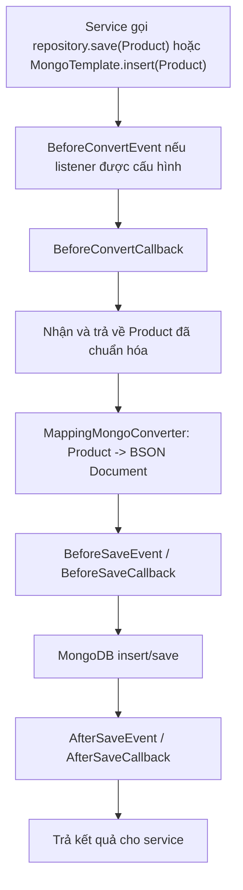

# BeforeConvertCallback trước khi chuyển entity thành Document

## 1. Vấn đề cần giải quyết trong Mini Commerce

Hệ thống **Mini Commerce** lưu `Product`, `Customer` và `Order` trong MongoDB bằng **Spring Data MongoDB**. Một Product mới có thể đi vào hệ thống qua REST API, importer hoặc thao tác từ trang quản trị:

```json
{
  "sku": "  kbd-001  ",
  "name": "  Bàn phím Mini  ",
  "price": 129900.00,
  "stock": 12
}
```

Ta muốn lưu dữ liệu ở dạng nhất quán:

- SKU hiển thị được loại khoảng trắng đầu/cuối, còn một khóa `sku_key` chuẩn hóa thành `KBD-001` để kiểm tra trùng trong **từng tenant**.
- `name` giữ nguyên dấu tiếng Việt để người dùng đọc; `name_search` là `ban phim mini` phục vụ tra cứu theo trường đã chuẩn hóa.
- `price` lưu dưới BSON Decimal128 thay vì một BSON String.
- Nếu SKU không hợp lệ hoặc tên chỉ toàn khoảng trắng, thao tác ghi phải thất bại **trước khi gửi document xuống database**.
- Các đường `MongoRepository.save(...)` và `MongoTemplate.insert(...)` cùng dùng logic chuẩn hóa, thay vì lặp trong từng controller.

Đây là trường hợp phù hợp cho **`BeforeConvertCallback<Product>`**: một điểm chèn vào vòng đời ghi entity, **trước khi Spring Data chuyển entity thành `org.bson.Document`**.

Bài học **“BeforeConvertCallback trước khi chuyển entity thành Document”** thuộc chương **“Vòng đời và callback”** của mô-đun `SPRING_DATA_MONGODB`. Chúng ta sẽ thực hành mapping, repository, `MongoTemplate`, index, transactions, reactive access, kiểm thử và chẩn đoán hiệu năng có liên quan đến callback.

### Mục tiêu

Sau bài này, bạn có thể:

1. Giải thích thời điểm `BeforeConvertCallback` chạy và phân biệt nó với `BeforeSaveCallback`, `AfterSaveCallback`, `BeforeConvertEvent`.
2. Cài đặt đúng interface `BeforeConvertCallback<T>` và chữ ký `T onBeforeConvert(T entity, String collection)`.
3. Đăng ký callback bằng `@Component` hoặc `@Bean`, kiểm soát kiểu entity và thứ tự `@Order`.
4. Biết **entity trả về** mới là đầu vào cho bước chuyển đổi BSON, đặc biệt với các entity immutable/Java record.
5. Thiết kế logic chuẩn hóa **thuần, có tính idempotent**, không ghi dữ liệu phụ ngoài transaction hoặc gọi dịch vụ mạng từ callback.
6. Hiểu mối liên hệ với Spring Data auditing và `@CreatedDate`/`@LastModifiedDate`.
7. Biết rằng `updateFirst`, `findAndModify`, repository `@Update`, raw driver và bulk operations không mặc định chạy đường entity `BeforeConvertCallback`.
8. Kiểm tra kiểu BSON thực, `@Field`, unique index và tính nhất quán của khóa dẫn xuất.
9. Triển khai `ReactiveBeforeConvertCallback` với `Publisher<T>`, tránh blocking I/O.
10. Viết unit test, integration test với MongoDB thật, và xác minh đường ghi vượt qua callback.

**Điều kiện học:** Java 17+, Spring Boot + `spring-boot-starter-data-mongodb` (phần reactive dùng starter reactive tương ứng), MongoDB đang chạy, hiểu `@Document`, `@Id`, `@Field`, `MongoTemplate` và repository. Các API `EntityCallback` được hỗ trợ từ Spring Data Commons 2.2; trước khi chép ví dụ, hãy đối chiếu phiên bản Spring Data của dự án.

## 2. BeforeConvert nằm ở bước nào?

Với một operation ghi entity qua Spring Data mapping, luồng điển hình là:



Trong pipeline này:

- **`BeforeConvertCallback` nhìn thấy đối tượng Java**, chưa có BSON `Document` đã chuyển đổi.
- **`BeforeSaveCallback` nhìn thấy entity **và** BSON `Document`**, nên phù hợp cho các xử lý đặc thù trên document đã map.
- **`AfterSaveCallback`** hoạt động sau bước save và có thể điều chỉnh entity được trả về, nhưng **không phải một cơ chế rollback hoặc gửi event exactly-once**.
- **Các event** thuộc `ApplicationEvent` khác với callback được gọi trực tiếp trong pipeline; asynchronous event multicaster có thể làm việc thay đổi entity thiếu tính xác định. `EntityCallback` là cơ chế được Spring Data khuyến nghị khi cần sửa entity trước lưu.

Trình tự trên là mô hình khái niệm để hiểu checkpoint. Các chi tiết nội bộ như ID/version, auditing, converter và event delegate phụ thuộc vào API/phiên bản; cần integration test khi kết hợp nhiều callback và custom conversion.

### 2.1. Đường ghi nào thường đi qua BeforeConvert?

| Đường ghi | Có entity callback trước chuyển đổi? | Lưu ý |
| --- | --- | --- |
| `MongoTemplate.insert(product)` | Có | Ghi entity, bước chuyển đổi chạy |
| `MongoTemplate.save(product)` | Có | Kiểm tra chính sách version/auditing |
| `MongoTemplate.insert(List<Product>, "products")` | Có trong đường entity insert thông thường | Không đồng nhất với driver bulk |
| `MongoRepository.save(product)` | Có | Repository dùng Spring Data mapping |
| `MongoRepository.saveAll(...)` | Có cho các entity được ghi theo mapping path | Cách triển khai/batch phụ thuộc repository và version |
| `MongoTemplate.updateFirst(Query, Update, Product.class)` | **Không** | Gửi update modifiers, không chuyển đổi một Product nguyên vẹn |
| `MongoTemplate.findAndModify(...)` | **Không** theo entity-save lifecycle | Query/update, không gọi `onBeforeConvert(Product)` cho bản ghi bị sửa |
| Repository `@Update` | **Không** | Update trực tiếp, không phải `save(entity)` |
| `BulkOperations` | **Không giả định** callbacks chạy | Batch update/insert cần chuẩn hóa riêng nếu protocol yêu cầu |
| `MongoCollection<Document>.insertOne(...)` | **Không** | Raw Java driver không gọi callback Spring Data |
| Aggregation `$merge`/`$out` | **Không** | Ghi từ pipeline server, không phải chuyển đổi entity bởi mapper |

**Bất biến nghiệp vụ cần được bảo vệ ở database và service**, không chỉ trong callback, vì không phải mọi writer đều đi qua callback.

### 2.2. Root entity và embedded object

Lifecycle events trong MongoDB được phát cho root-level document, không tự gọi một `BeforeConvertCallback<OrderLine>` riêng cho mọi phần tử `Order.lines` được embedded. Entity callbacks cũng được áp dụng tại **điểm ghi root entity qua mapping lifecycle**, không phải một hệ thống duyệt cây object rồi gọi callback độc lập cho mọi embedded value.

Ví dụ:

```java
@Document(collection = "orders")
public class Order {
    @Id
    private String id;
    private List<OrderLine> lines;
}

public record OrderLine(String productId, int quantity) {}
```

Hai type ở trên là **hai khai báo minh họa**; khi đưa vào dự án, đặt trong những file Java phù hợp và thêm imports `List`, `Id`, `Document`. Nếu cần chuẩn hóa các phần tử `OrderLine`, hãy làm trong service/validator của Order hoặc trong callback cho **Order root**, thay vì mặc định trông chờ `BeforeConvertCallback<OrderLine>` nhận từng phần tử.

## 3. Hợp đồng interface BeforeConvertCallback

Interface thuộc:

```java
import org.springframework.data.mongodb.core.mapping.event.BeforeConvertCallback;
```

Hợp đồng chính:

```java
@FunctionalInterface
public interface BeforeConvertCallback<T> {
    T onBeforeConvert(T entity, String collection);
}
```

Đây là **sơ đồ chữ ký giản lược**: interface thực còn kế thừa `EntityCallback<T>` từ Spring Data Commons. Cần chú ý ba điểm:

1. `entity` là object được Spring Data sắp chuyển thành `Document`.
2. `collection` là **tên collection thực tế** của write operation, ví dụ `"products"`, không phải tên Java class.
3. Giá trị **return** là entity được dùng cho bước chuyển đổi. Có thể trả lại cùng instance đã sửa hoặc một instance immutable mới; **không trả `null`**.

### 3.1. Callback nhận entity, không nhận Document

```java
// Đúng:
public Product onBeforeConvert(Product entity, String collection)

// Không phải chữ ký BeforeConvertCallback:
// onBeforeConvert(Product entity, Document document, String collection)
```

Chữ ký thứ hai gần với `BeforeSaveCallback`, diễn ra sau mapping. Tách bạch hai interface giúp tránh lỗi “sửa Java object quá muộn nhưng tưởng BSON tự đổi theo”.

### 3.2. Đồng bộ và reactive là hai hợp đồng khác nhau

| Imperative API | Reactive API |
| --- | --- |
| `BeforeConvertCallback<T>` | `ReactiveBeforeConvertCallback<T>` |
| Trả `T` | Trả `Publisher<T>` |
| `MongoTemplate`/repository đồng bộ | `ReactiveMongoTemplate`/repository reactive |
| Chạy trong synchronous write path | Publisher được tham gia trong reactive chain |
| Không gọi DB/network chậm từ callback | Không `block()`, compose publisher |

Spring Data phân biệt callback theo loại API: **callback đồng bộ không tự trở thành callback reactive**. Nếu ứng dụng có cả hai stack, hãy cấu hình mỗi loại rõ ràng và dùng chung một **dịch vụ chuẩn hóa thuần** khi muốn hành vi tương đương.

## 4. Entity Product và hợp đồng BSON của Mini Commerce

Một Product của shop có SKU, tên tiếng Việt, tiền hàng, tồn kho và metadata.

```java
package com.example.minicommerce.domain;

import java.math.BigDecimal;
import java.time.Instant;

import org.springframework.data.annotation.Id;
import org.springframework.data.annotation.Version;
import org.springframework.data.annotation.CreatedDate;
import org.springframework.data.annotation.LastModifiedDate;
import org.springframework.data.mongodb.core.mapping.Document;
import org.springframework.data.mongodb.core.mapping.Field;
import org.springframework.data.mongodb.core.mapping.FieldType;

@Document(collection = "products")
public class Product {

    @Id
    private String id;

    @Field("tenant_id")
    private String tenantId;

    private String sku;

    @Field("sku_key")
    private String skuKey;

    private String name;

    @Field("name_search")
    private String nameSearch;

    @Field(name = "unit_price", targetType = FieldType.DECIMAL128)
    private BigDecimal price;

    private int stock;
    private boolean active;

    @Version
    private Long version;

    @CreatedDate
    private Instant createdAt;

    @LastModifiedDate
    private Instant updatedAt;

    public Product() {}

    public Product(String id, String tenantId, String sku,
                   String name, BigDecimal price, int stock) {
        this.id = id;
        this.tenantId = tenantId;
        this.sku = sku;
        this.name = name;
        this.price = price;
        this.stock = stock;
        this.active = true;
    }

    public String getId() { return id; }
    public String getTenantId() { return tenantId; }
    public String getSku() { return sku; }
    public String getSkuKey() { return skuKey; }
    public String getName() { return name; }
    public String getNameSearch() { return nameSearch; }
    public BigDecimal getPrice() { return price; }
    public int getStock() { return stock; }
    public boolean isActive() { return active; }
    public Long getVersion() { return version; }
    public Instant getCreatedAt() { return createdAt; }
    public Instant getUpdatedAt() { return updatedAt; }

    public void setId(String id) { this.id = id; }
    public void setTenantId(String tenantId) {
        this.tenantId = tenantId;
    }
    public void setSku(String sku) { this.sku = sku; }
    public void setSkuKey(String skuKey) {
        this.skuKey = skuKey;
    }
    public void setName(String name) { this.name = name; }
    public void setNameSearch(String nameSearch) {
        this.nameSearch = nameSearch;
    }
    public void setPrice(BigDecimal price) {
        this.price = price;
    }
    public void setStock(int stock) { this.stock = stock; }
    public void setActive(boolean active) { this.active = active; }
}
```

### 4.1. Java property khác BSON field name

| Java property | BSON key | Ý nghĩa |
| --- | --- | --- |
| `id` | `_id` | Product ID |
| `tenantId` | `tenant_id` | Phân vùng dữ liệu giữa các shop |
| `sku` | `sku` | SKU hiển thị |
| `skuKey` | `sku_key` | SKU chuẩn hóa cho unique lookup |
| `name` | `name` | Tên hiển thị có dấu |
| `nameSearch` | `name_search` | Tên tìm kiếm không dấu, lowercase |
| `price` | `unit_price` | BSON Decimal128 |
| `stock` | `stock` | BSON Int32 |
| `active` | `active` | BSON Boolean |
| `version` | `version` | Optimistic-locking field |
| `createdAt` | `createdAt` | Thời điểm tạo khi auditing đã bật |
| `updatedAt` | `updatedAt` | Thời điểm sửa gần nhất khi auditing đã bật |

Callback chỉ sửa `Product`; **MappingMongoConverter** mới chuyển Java properties thành các BSON field ở trên. Nếu callback đặt `skuKey = "KBD-001"`, Document tạo ra phải có `"sku_key": "KBD-001"` nhờ `@Field("sku_key")`. Không cần và không nên viết raw BSON `Document` trong `BeforeConvertCallback` chỉ để thay tên field.

### 4.2. Schema dữ liệu mong đợi

```javascript
{
  _id: "p-kbd-001",
  tenant_id: "shop-a",
  sku: "kbd-001",
  sku_key: "KBD-001",
  name: "Bàn phím Mini",
  name_search: "ban phim mini",
  unit_price: NumberDecimal("129900.00"),
  stock: 12,
  active: true,
  version: NumberLong(0),
  createdAt: ISODate("2026-11-20T00:00:00Z"),
  updatedAt: ISODate("2026-11-20T00:00:00Z")
}
```

Timestamp và giá trị version ở trên chỉ là **minh họa cấu trúc**, không phải giá trị cố định mọi lần insert. Việc auditing có điền timestamp phụ thuộc cấu hình; `@Version` do Spring Data xử lý theo version và đường ghi.

## 5. Tạo bộ chuẩn hóa thuần, kiểm thử độc lập

Không nên nhét tất cả xử lý regex và biến đổi Unicode vào callback rồi không thể unit test chúng. Tách một helper **không I/O, không phụ thuộc request và không có state mutable**.

### 5.1. SKU chuẩn hóa

```java
package com.example.minicommerce.catalog;

import java.util.Locale;
import java.util.Objects;
import java.util.regex.Pattern;

public final class CatalogText {

    private static final Pattern SKU_PATTERN = Pattern.compile(
        "[A-Z0-9][A-Z0-9._-]{1,63}");

    private CatalogText() {}

    public static String skuKey(String input) {
        Objects.requireNonNull(input, "sku");
        String result = input.strip()
            .toUpperCase(Locale.ROOT);

        if (!SKU_PATTERN.matcher(result).matches()) {
            throw new IllegalArgumentException(
                "SKU must be 2-64 safe characters");
        }
        return result;
    }
}
```

Ví dụ:

| Input | `skuKey` |
| --- | --- |
| `"  kbd-001  "` | `"KBD-001"` |
| `"KBD_001"` | `"KBD_001"` |
| `"kbd.001"` | `"KBD.001"` |
| `"a"` | Bị từ chối vì ngắn |
| `"  kbd 001 "` | Bị từ chối vì có khoảng trắng giữa |

**Vì sao không tự xóa mọi ký tự lạ?** Nếu chuẩn hóa `"KBD 001"` và `"KBD-001"` thành cùng một key mà nghiệp vụ không cho phép, có thể tạo xung đột/đổi ý nghĩa SKU không được báo rõ. Với business key, thường tốt hơn là validate chặt và từ chối dữ liệu không hợp lệ.

### 5.2. Tên tìm kiếm tiếng Việt

Thêm method vào class `CatalogText` ở trên:

```java
import java.text.Normalizer;
import java.util.Locale;
import java.util.Objects;

public static String searchText(String input) {
    Objects.requireNonNull(input, "name");

    String lower = input.strip()
        .toLowerCase(Locale.ROOT);
    String decomposed = Normalizer.normalize(
        lower, Normalizer.Form.NFD);

    String withoutMarks = decomposed
        .replaceAll("\\p{M}+", "")
        .replace('đ', 'd');

    String normalized = withoutMarks
        .replaceAll("[^a-z0-9]+", " ")
        .strip()
        .replaceAll(" +", " ");

    if (normalized.isEmpty()) {
        throw new IllegalArgumentException(
            "Name contains no searchable characters");
    }
    return normalized;
}
```

Đây là **thân method cùng imports** để thêm vào `CatalogText`, không phải một file Java độc lập (method top-level không hợp lệ trong Java). Các xử lý chính:

1. Lowercase bằng `Locale.ROOT` để không phụ thuộc locale của server.
2. `Normalizer.Form.NFD` tách nhiều chữ có dấu thành base + combining marks.
3. Loại `\\p{M}` (combining marks).
4. Xử lý riêng `đ → d` vì ký tự này không được NFD biến thành `d`.
5. Thay dấu câu/khoảng trắng liên tiếp bằng một dấu cách.

```text
"  Bàn phím Mini  "  -> "ban phim mini"
"Chuột KHÔNG DÂY"     -> "chuot khong day"
"Đèn học – LED"       -> "den hoc led"
```

**Giới hạn:** đây là một chính sách normalize để tìm kiếm text kiểu Mini Commerce, không thay thế bộ tokenizer/analyzer đa ngôn ngữ, không bảo đảm phân biệt mọi trường hợp đồng âm và không tự tạo **full-text search** hay chỉ mục tìm kiếm. Các ký tự ngoài ASCII (ví dụ một số chữ cái ở ngôn ngữ khác) có thể bị loại: nếu sản phẩm cần đa ngôn ngữ, phải thiết kế normalization phù hợp hơn.

### 5.3. Tính idempotent của biến đổi

Một callback nên cố gắng đảm bảo:

\[
f(f(\text{entity})) = f(\text{entity})
\]

Ví dụ:

```text
skuKey("  kbd-001  ") -> "KBD-001"
skuKey("KBD-001")     -> "KBD-001"

searchText("Bàn phím Mini") -> "ban phim mini"
searchText("ban phim mini") -> "ban phim mini"
```

Idempotent giúp `save`, import lại và retry không đổi dữ liệu sau mỗi lần qua callback. **Không** sinh UUID mới, append một phần tử vào mảng hoặc tự tăng counter ở mỗi lần `onBeforeConvert` nếu không có protocol chống lặp riêng.

## 6. Cài đặt BeforeConvertCallback<Product> hoàn chỉnh

```java
package com.example.minicommerce.catalog;

import org.springframework.core.annotation.Order;
import org.springframework.data.mongodb.core.mapping.event.BeforeConvertCallback;
import org.springframework.stereotype.Component;

import com.example.minicommerce.domain.Product;

@Component
@Order(200)
public class ProductBeforeConvertCallback
        implements BeforeConvertCallback<Product> {

    @Override
    public Product onBeforeConvert(
            Product entity, String collection) {

        if (!"products".equals(collection)) {
            // Policy bài học: không lưu Product sang collection khác.
            // Ứng dụng có collection archive cần điều chỉnh policy.
            throw new IllegalArgumentException(
                "Unexpected Product collection: " + collection);
        }

        if (entity.getTenantId() == null ||
                entity.getTenantId().isBlank()) {
            throw new IllegalArgumentException(
                "Tenant is required");
        }
        if (entity.getSku() == null ||
                entity.getSku().isBlank()) {
            throw new IllegalArgumentException(
                "SKU is required");
        }
        if (entity.getName() == null ||
                entity.getName().isBlank()) {
            throw new IllegalArgumentException(
                "Product name is required");
        }
        if (entity.getPrice() == null ||
                entity.getPrice().signum() < 0) {
            throw new IllegalArgumentException(
                "Price must be non-negative");
        }
        if (entity.getStock() < 0) {
            throw new IllegalArgumentException(
                "Stock must be non-negative");
        }

        // Chỉ chuẩn hóa khoảng trắng cho SKU hiển thị.
        entity.setSku(entity.getSku().strip());
        entity.setName(entity.getName().strip());

        // Luôn tính lại trường dẫn xuất, kể cả khi save entity cũ.
        entity.setSkuKey(
            CatalogText.skuKey(entity.getSku()));
        entity.setNameSearch(
            CatalogText.searchText(entity.getName()));

        return entity;
    }
}
```

Điểm đáng chú ý:

- `@Component` để Spring quản lý callback. Nó không cần được gọi thủ công trong controller.
- Generic type `BeforeConvertCallback<Product>` giới hạn callback cho `Product`; không áp vào mọi entity khác như `Customer` hoặc `Order`.
- `collection` được kiểm tra theo **tên collection thực**. Đây là policy minh họa; nếu chủ động lưu Product vào `products_archive` hoặc `product_drafts`, cần thay đổi policy có kiểm soát.
- Callback kiểm tra, chuẩn hóa và **return entity**; framework dùng đối tượng này để map BSON.
- `@Order(200)` chỉ định tương quan thứ tự khi có nhiều callback cùng loại; không có nghĩa callback được chạy 200 lần.
- Logic không kết nối MongoDB, không gọi HTTP, không phát event và không ghi tài nguyên khác.

### 6.1. Vì sao tính lại skuKey/nameSearch thay vì chỉ khi null?

Giả sử Product cũ có:

```text
name       = "Bàn phím Mini"
nameSearch = "ban phim mini"
```

Sau đó người dùng sửa `name = "Chuột không dây"`. Nếu callback chỉ tính `nameSearch` khi nó null, khóa tìm kiếm cũ vẫn còn. Vì vậy derived field phải luôn được **tính lại từ source field** hoặc có cơ chế update đồng thời rõ ràng.

### 6.2. Không đổi tenant và không tạo quyền truy cập

Callback xác nhận `tenantId` không rỗng, nhưng không thể xác nhận **tenant được phép cho người gọi** chỉ từ Product. Tenant phải được gắn và xác thực tại service/security context; controller không được tin `tenantId` lấy tùy ý từ body rồi để callback “bảo vệ”.

### 6.3. Không biến callback thành bộ điều phối nghiệp vụ

Không đặt vào callback các trách nhiệm như:

- Trừ stock của Product khác.
- Tạo Order/Payment.
- Gửi email hoặc gọi cổng thanh toán.
- Ghi event trực tiếp vào broker.
- Gọi API lấy tỷ giá tại thời điểm save.

Những việc này phụ thuộc transaction, idempotency, thời điểm commit, retry và ranh giới aggregate. Callback nên giữ vai trò chuẩn hóa/kiểm tra entity ngay trước conversion.

## 7. Đăng ký callback và thứ tự chạy

Đăng ký đơn giản nhất bằng `@Component` như phần 6. Nếu không dùng component scan, tạo bean:

```java
package com.example.minicommerce.config;

import org.springframework.context.annotation.Bean;
import org.springframework.context.annotation.Configuration;
import org.springframework.data.mongodb.core.mapping.event.BeforeConvertCallback;

import com.example.minicommerce.catalog.ProductBeforeConvertCallback;
import com.example.minicommerce.domain.Product;

@Configuration
class ProductCallbackConfiguration {

    @Bean
    BeforeConvertCallback<Product> productBeforeConvert() {
        return new ProductBeforeConvertCallback();
    }
}
```

**Hai cách đăng ký là phương án thay thế nhau**: nếu đã có `@Component`, không tạo thêm `@Bean` cho cùng callback, vì một lần `save` có thể chạy logic hai lần và thứ tự khó dự đoán.

### 7.1. @Order và Ordered

Khi nhiều callback cùng áp dụng cho `Product`:

```java
@Component
@Order(50)
class EarlyProductValidation
        implements BeforeConvertCallback<Product> {

    @Override
    public Product onBeforeConvert(
            Product product, String collection) {
        if (product.getTenantId() == null) {
            throw new IllegalArgumentException(
                "Missing tenant");
        }
        return product;
    }
}
```

`@Order(50)` được ưu tiên trước `@Order(200)` (số nhỏ hơn chạy sớm hơn). Nếu nhiều callback cùng sửa một field, thứ tự có thể quyết định kết quả cuối. Hãy chủ động thiết kế thứ tự và test, thay vì dựa vào thứ tự Spring scan bean.

Có thể implement `Ordered` thay vì `@Order`:

```java
@Override
public int getOrder() {
    return 200;
}
```

Đây là **method của một callback triển khai `Ordered`**, không phải method bắt buộc trên `BeforeConvertCallback`. Chọn một cơ chế order cho dễ kiểm soát.

### 7.2. Callback dạng lambda

```java
@Bean
BeforeConvertCallback<Product> productNormalizer() {
    return (product, collection) -> {
        product.setSkuKey(
            CatalogText.skuKey(product.getSku()));
        return product;
    };
}
```

Lambda gọn khi logic nhỏ, nhưng Spring Data lưu ý generic type filtering bằng callback lambda có thể kém tối ưu do runtime không nhìn thấy đầy đủ kiểu như class cụ thể. Với callback quan trọng, cần logging, test hoặc logic phức tạp, **class có generic type rõ ràng** thường dễ bảo trì hơn.

Đừng đăng ký lambda này **cùng** `ProductBeforeConvertCallback` ở phần 6 nếu không chủ ý có hai callback chạy cho cùng Product.

## 8. Dùng callback qua MongoTemplate và repository

Không cần tự gọi `callback.onBeforeConvert(...)` ở service khi ghi qua Spring Data. Callback được Spring Data tìm trong `ApplicationContext` và áp dụng cho entity đúng loại.

### 8.1. MongoTemplate.insert(...)

```java
import java.math.BigDecimal;

Product product = new Product(
    "p-kbd-001",
    "shop-a",
    "  kbd-001  ",
    "  Bàn phím Mini  ",
    new BigDecimal("129900.00"),
    12);

Product inserted = mongoTemplate.insert(product);
```

Sau write:

```text
inserted.sku        = "kbd-001"
inserted.skuKey     = "KBD-001"
inserted.name       = "Bàn phím Mini"
inserted.nameSearch = "ban phim mini"
```

Nếu callback được đăng ký, những giá trị chuẩn hóa xuất hiện trong BSON trước lúc MongoDB nhận insert. `createdAt`/`updatedAt` cần bật auditing riêng; không chỉ cần `@CreatedDate` trên field là đủ.

### 8.2. MongoRepository.save(...)

```java
package com.example.minicommerce.repository;

import org.springframework.data.mongodb.repository.MongoRepository;
import com.example.minicommerce.domain.Product;

public interface ProductRepository
        extends MongoRepository<Product, String> {
}
```

Ở service:

```java
Product stored = productRepository.save(product);
```

`MongoRepository.save` đi qua Spring Data mapping và callback khi lưu entity. Cần hiểu rằng `save` có semantics **insert hoặc replacement/update của entity tùy state**, không phải thao tác CAS trên từng field. Nếu Product có `@Version`, save stale có thể gây `OptimisticLockingFailureException` khi đã có write khác.

### 8.3. Không gọi callback khi chỉ đọc

```java
Product loaded = mongoTemplate.findById(
    "p-kbd-001", Product.class);
```

Lệnh đọc đi qua `MappingMongoConverter` để tạo Java entity, không qua `BeforeConvertCallback` của write path. Nếu muốn xử lý dữ liệu **sau khi load** thì có `AfterConvertCallback`/mapper hoặc migration, nhưng không được dùng read callback để âm thầm sửa hợp đồng persistence.

### 8.4. Phân biệt insert và save

| Tình huống | Hành vi mong đợi |
| --- | --- |
| Insert Product ID mới | `BeforeConvertCallback` chuẩn hóa, MongoDB ghi document mới |
| Insert lại cùng `_id` | Có thể callback chạy, nhưng server từ chối duplicate key |
| Save Product đang tồn tại | Callback chuẩn hóa lại trước mapping, áp dụng version semantics nếu có |
| Save một Product từ projection thiếu field | Có thể làm mất dữ liệu khi replacement, dù callback chạy |
| Save Product với `@Version` stale | Có thể bị optimistic locking failure; callback không thay thế version check |

**Callback chạy không đồng nghĩa write chắc chắn commit.** Validation có thể thất bại, unique index có thể từ chối, optimistic lock có thể conflict, transaction có thể rollback hoặc client có thể mất kết nối sau khi server đã ghi.

## 9. Entity immutable: phải trả instance mới

Java records và immutable classes không có setter. `BeforeConvertCallback` cho phép **return một entity khác** mà Spring Data sẽ map.

### 9.1. Record CatalogEntry

```java
package com.example.minicommerce.domain;

import org.springframework.data.annotation.Id;
import org.springframework.data.mongodb.core.mapping.Document;
import org.springframework.data.mongodb.core.mapping.Field;

@Document(collection = "catalog_entries")
public record CatalogEntry(
    @Id String id,
    String label,
    @Field("label_search") String labelSearch
) {}
```

### 9.2. Callback immutable

```java
package com.example.minicommerce.catalog;

import org.springframework.core.annotation.Order;
import org.springframework.data.mongodb.core.mapping.event.BeforeConvertCallback;
import org.springframework.stereotype.Component;

import com.example.minicommerce.domain.CatalogEntry;

@Component
@Order(200)
public class CatalogEntryBeforeConvertCallback
        implements BeforeConvertCallback<CatalogEntry> {

    @Override
    public CatalogEntry onBeforeConvert(
            CatalogEntry entry, String collection) {

        if (!"catalog_entries".equals(collection)) {
            throw new IllegalArgumentException(
                "Unsupported collection");
        }
        if (entry.label() == null || entry.label().isBlank()) {
            throw new IllegalArgumentException(
                "Label is required");
        }

        String trimmed = entry.label().strip();
        String search = CatalogText.searchText(trimmed);

        // Trả record mới, không thể thay đổi entry cũ.
        return new CatalogEntry(
            entry.id(), trimmed, search);
    }
}
```

Sử dụng:

```java
CatalogEntry initial = new CatalogEntry(
    "entry-001", "  Đèn học LED  ", null);

CatalogEntry written = mongoTemplate.insert(initial);

// Trong persisted document:
// label: "Đèn học LED"
// label_search: "den hoc led"
```

**Điểm cần hiểu:** `initial` là immutable và **không bị sửa tại chỗ**. Bản gửi vào conversion có thể là instance mới do callback trả về. Nếu caller muốn sử dụng entity đã được chuẩn hóa, hãy dùng **return value của operation lưu** (và xác minh mapping/returned entity theo phiên bản framework), không giả định instance trước insert đã thay đổi.

### 9.3. Không tạo record mới làm mất metadata

Với immutable entity có `@Id`, `@Version`, `@CreatedDate`, `@LastModifiedDate`, tenant và danh sách quan hệ, khi tạo instance mới phải **giữ lại tất cả field không định thay đổi**. Nếu callback dựng record chỉ từ vài field có thể mất version/auditing và gây duplicate insert hoặc lỗi optimistic locking.

Có thể tạo method `withLabelSearch(...)` trên immutable class để sao chép đầy đủ các field an toàn hơn. Với Spring Data Auditing, thứ tự callback càng quan trọng vì auditing cũng có thể trả một instance mới của immutable entity.

## 10. Auditing cũng là một BeforeConvertCallback

Spring Data MongoDB sử dụng `AuditingEntityCallback` cho auditing:

```java
@CreatedDate
private Instant createdAt;

@LastModifiedDate
private Instant updatedAt;
```

Khi bật auditing:

```java
package com.example.minicommerce.config;

import org.springframework.context.annotation.Configuration;
import org.springframework.data.mongodb.config.EnableMongoAuditing;

@Configuration
@EnableMongoAuditing
public class MongoAuditingConfiguration {
}
```

`@EnableMongoAuditing` kích hoạt hạ tầng auditing **cho ứng dụng imperative**. Spring Data sẽ xác định “new/modified” theo metadata, trong đó có `@Version` hoặc ID, rồi điền fields tương ứng.

### 10.1. Thứ tự của AuditingEntityCallback

Theo tài liệu và API Spring Data MongoDB, `AuditingEntityCallback` là một `BeforeConvertCallback<Object>` có **order mặc định 100** trong các dòng hiện hành.

Callback `ProductBeforeConvertCallback` dùng:

```java
@Component
@Order(200)
public class ProductBeforeConvertCallback
        implements BeforeConvertCallback<Product> {
    // ...
}
```

Vì vậy auditing order 100 thường chạy **trước** bước chuẩn hóa order 200, khi cả hai được áp dụng. Điều này không có nghĩa mọi ứng dụng cần order 200; nếu custom callback cần validate trước auditing, có thể chọn order nhỏ hơn 100. **Tài liệu và phiên bản của dự án là nguồn xác định order thực tế**; test khi dependency giữa callbacks quan trọng.

### 10.2. Khi nào tự set timestamp?

Nếu ứng dụng đã bật `@CreatedDate`/`@LastModifiedDate`, **không cần tự `Instant.now()` trong mọi `BeforeConvertCallback`**. Làm cả hai có thể khiến timestamp khác nhau theo thứ tự callbacks.

Nếu thực sự cần một clock đặc biệt hoặc timestamp lấy từ nguồn đáng tin, hãy cấu hình `DateTimeProvider`/auditing phù hợp hoặc xác lập hợp đồng domain rõ ràng. Đừng ghi timestamp của **request server khác** thành thời gian commit thực tế của transaction nếu yêu cầu chính xác đến commit.

### 10.3. AuditorAware và actor

Nếu có `@CreatedBy`/`@LastModifiedBy`, cần `AuditorAware<T>` cung cấp actor cho imperative stack. Actor phải đến từ security context/service principal, **không** lấy tùy ý từ Product. Với reactive sử dụng `ReactiveAuditorAware<T>`, không dùng `ThreadLocal` của servlet để suy danh tính trong event loop.

### 10.4. Các giới hạn của auditing

- Auditing đi qua **entity write lifecycle** được Spring Data hỗ trợ, không tự áp dụng cho raw MongoDB driver hoặc `$inc`/`$set` trực tiếp.
- Nếu dữ liệu cũ không có `createdAt` và `version`, save lại có thể kích hoạt hành vi “new” khác tùy mapping/isNew detection; cần kiểm tra migration.
- Auditing field không thay thế event log bất biến, outbox hoặc lịch sử trạng thái.
- Thứ tự giữa auditing, validation và custom normalization có thể ảnh hưởng dữ liệu nhìn thấy; thiết kế và test rõ ràng.

## 11. So sánh BeforeConvert và BeforeSave

| Tiêu chí | `BeforeConvertCallback<Product>` | `BeforeSaveCallback<Product>` |
| --- | --- | --- |
| Chạy trước hay sau ánh xạ? | **Trước** Java entity → BSON Document | **Sau** khi converter tạo Document, trước write |
| Nhận tham số chính | `Product entity, String collection` | `Product entity, Document document, String collection` |
| Có BSON Document chưa? | **Chưa** | **Có** |
| Mục tiêu tốt | Chuẩn hóa Java properties, tạo derived fields, validate domain state | Kiểm tra/điều chỉnh BSON fields trước write |
| Return type | `Product` | `Product` |
| Immutable entity | Có thể return instance mới | Entity immutable vẫn có thể return instance, nhưng Document đã map |
| Cần quan sát BSON alias? | Không trực tiếp | Có, thông qua `Document` |

### 11.1. Ví dụ BeforeSave kiểm tra BSON

```java
package com.example.minicommerce.catalog;

import java.util.Objects;
import org.bson.Document;
import org.springframework.data.mongodb.core.mapping.event.BeforeSaveCallback;
import org.springframework.stereotype.Component;

import com.example.minicommerce.domain.Product;

@Component
public class ProductBeforeSaveCheck
        implements BeforeSaveCallback<Product> {

    @Override
    public Product onBeforeSave(
            Product product,
            Document document,
            String collection) {

        if (!Objects.equals(
                document.getString("sku_key"),
                product.getSkuKey())) {
            throw new IllegalStateException(
                "BSON sku_key does not match entity");
        }
        return product;
    }
}
```

Ở `BeforeSaveCallback`, `document.getString("sku_key")` là **BSON key đã mapping**, không phải Java property `skuKey`. Nếu bạn thay `product.setSkuKey(...)` **chỉ trong `BeforeSaveCallback`**, Document đã được tạo trước đó có thể **không tự được map lại**; nếu cần thay đổi field lưu, phải cập nhật `Document` hoặc (thích hợp hơn) chuyển logic chỉnh entity sang `BeforeConvertCallback`.

### 11.2. Phân biệt với BeforeConvertEvent

`AbstractMongoEventListener<Product>` cho phép xử lý `BeforeConvertEvent<Product>`:

```java
package com.example.minicommerce.catalog;

import org.springframework.data.mongodb.core.mapping.event.AbstractMongoEventListener;
import org.springframework.data.mongodb.core.mapping.event.BeforeConvertEvent;
import org.springframework.stereotype.Component;

import com.example.minicommerce.domain.Product;

@Component
public class ProductBeforeConvertObserver
        extends AbstractMongoEventListener<Product> {

    @Override
    public void onBeforeConvert(
            BeforeConvertEvent<Product> event) {
        // Chỉ quan sát hoặc đo metric an toàn.
        // Không phụ thuộc việc mutate object ở đây.
    }
}
```

**Entity callback** là lựa chọn tốt hơn để **thay đổi entity được persisted** vì nó trả về entity và được gọi ở một checkpoint xác định trong lifecycle. **ApplicationEvent** đi qua `ApplicationEventMulticaster` và có thể được cấu hình async: việc mutate entity trong listener async có thể gây race/unpredictable behavior. Existing mapping events vẫn có thể được phát trước callback.

Không bật thêm một listener sửa `skuKey` và một callback cũng sửa field này rồi phụ thuộc vào thứ tự ngẫu nhiên. Tập trung logic chuẩn hóa vào một callback/utility có tests.

## 12. Callback, validation và converter: chọn đúng tầng

### 12.1. Callback không thay thế Bean Validation

Bean Validation như:

```java
@NotBlank
private String sku;

@Min(0)
private int stock;
```

Đây là **đoạn field minh họa** cần imports từ `jakarta.validation.constraints` và cấu hình `Validator` thích hợp. Annotation một mình không cam kết mọi `MongoTemplate` write sẽ tự chạy validate trong mọi cấu hình.

Spring Data MongoDB có `ValidatingEntityCallback` và `ReactiveValidatingEntityCallback`, có thể đăng ký với Bean Validation để kiểm tra entity trước persistence. Khi validation phụ thuộc giá trị đã chuẩn hóa, hãy kiểm soát thứ tự giữa validation callback và `BeforeConvertCallback` của bạn. Validation ở service và JSON Schema trên collection là những lớp khác nhau, có thể bổ sung cho nhau.

### 12.2. Callback không thay thế JSON Schema collection validation

MongoDB `$jsonSchema` chạy ở server, kể cả với raw driver, direct updates và một số bulk operations, trừ các trường hợp bypass/validation settings. Có thể dùng để bắt buộc:

```javascript
{
  $jsonSchema: {
    bsonType: "object",
    required: ["tenant_id", "sku", "sku_key", "name",
               "name_search", "unit_price"],
    properties: {
      tenant_id: { bsonType: "string" },
      sku: { bsonType: "string" },
      sku_key: { bsonType: "string" },
      name: { bsonType: "string" },
      name_search: { bsonType: "string" },
      unit_price: { bsonType: "decimal" },
      stock: { bsonType: "int", minimum: 0 }
    }
  }
}
```

Validator trên bảo vệ **field hiện diện và đúng kiểu**, nhưng **không chứng minh `name_search` là normalized version của `name`** hoặc `sku_key` luôn bằng canonical SKU. Các ràng buộc cross-field phức tạp có thể yêu cầu JSON Schema expression (khi hỗ trợ) hoặc logic ở service/migration và kiểm thử.

### 12.3. Callback không thay thế Property Converter

Nếu chỉ cần chuyển **kiểu của một property** sang BSON type riêng, hãy xem `MongoCustomConversions`, `@ValueConverter`/`PropertyValueConverter` hoặc `@Field(targetType = FieldType.DECIMAL128)` thay vì viết callback sửa toàn entity.

| Nhu cầu | Tầng phù hợp |
| --- | --- |
| Chuyển `BigDecimal` ↔ `Decimal128` | `@Field(targetType=DECIMAL128)` / conversion |
| Chuẩn hóa `skuKey` từ `sku` trước lưu | `BeforeConvertCallback<Product>` hoặc domain service |
| Chỉnh Document trước insert vì yêu cầu BSON riêng | `BeforeSaveCallback` khi thực sự cần |
| Kiểm tra `stock >= 0` ngay trong MongoDB | Collection `$jsonSchema` |
| Chặn SKU trùng trong tenant | **Unique compound index** |
| Trừ stock atomic và tránh oversell | `Query` có `stock >= quantity` + `$inc` |
| Gửi ORDER_PLACED event sau commit | Outbox/transaction/service, **không dùng callback** |

Một callback không phải lời giải cho mọi vấn đề persistence; chọn đúng tầng giúp tránh lỗi khó phát hiện khi có nhiều writers.

## 13. Trường dẫn xuất phải được bảo vệ bằng index

Callback có thể tạo `skuKey` nhất quán nhưng **không bảo đảm unique khi hai writer ghi đồng thời**. Tạo unique index:

```javascript
db.products.createIndex(
  { tenant_id: 1, sku_key: 1 },
  { unique: true }
);
```

Với ứng dụng dùng `MongoTemplate`:

```java
import org.springframework.data.domain.Sort.Direction;
import org.springframework.data.mongodb.core.index.Index;

mongoTemplate.indexOps(Product.class).ensureIndex(
    new Index()
        .on("tenantId", Direction.ASC)
        .on("skuKey", Direction.ASC)
        .unique());
```

Khi index được khai báo qua `indexOps(Product.class)`, Spring Data ánh xạ property name theo `@Field` thành BSON `tenant_id`/`sku_key`. Kiểm tra kết quả trên `listIndexes` trong integration/migration, vì có index definition **trong code** không bảo đảm index đã tồn tại trên database.

### 13.1. Trường dữ liệu cũ và unique index

Nếu nhiều Product legacy chưa có `sku_key`, tạo unique index ngay có thể thất bại hoặc áp dụng uniqueness không mong muốn lên các document thiếu trường. Trước khi bật:

1. Duyệt Product legacy theo từng tenant.
2. Backfill `sku_key` theo **cùng hàm normalization đã duyệt**.
3. Phát hiện collision; quyết định chính sách đổi SKU/merge hoặc từ chối.
4. Tạo unique index, xác minh kết quả.
5. Mở các đường ghi theo giao thức mới.

Không coi callback là tác nhân tự backfill hàng triệu Product cũ: nó chỉ chạy khi entity được ghi qua lifecycle path phù hợp.

### 13.2. Index phục vụ tìm kiếm

Nếu cần tìm Product có `name_search` bắt đầu bằng `"ban phim"`:

```javascript
db.products.createIndex({
  tenant_id: 1,
  active: 1,
  name_search: 1
});

db.products.find({
  tenant_id: "shop-a",
  active: true,
  name_search: /^ban phim/
});
```

Regex **case-sensitive, có prefix cố định** có thể tận dụng một phần index theo prefix; regex chứa chuỗi `/phim/` không giống pattern `/^ban/` về khả năng dùng B-tree index. Không suy rằng chỉ vì callback tạo `name_search` là mọi kiểu tìm kiếm (contains, fuzzy, ranking) đều được index tối ưu; khi cần full-text có thể thiết kế MongoDB Search/index phù hợp deployment.

## 14. Direct update không gọi BeforeConvertCallback

Đây là một điểm vận hành quan trọng. Giả sử hiện tại:

```text
name        = "Bàn phím Mini"
name_search = "ban phim mini"
```

Một service sửa tên bằng direct update:

```java
mongoTemplate.updateFirst(
    Query.query(Criteria.where("id").is(productId)
        .and("tenantId").is(tenantId)),
    new Update().set("name", "Chuột không dây"),
    Product.class);
```

Lệnh `updateFirst` áp dụng `$set name` ở MongoDB và **không nạp toàn bộ Product để gọi `onBeforeConvert`**. Kết quả có thể là:

```text
name        = "Chuột không dây"
name_search = "ban phim mini"  <-- SAI
```

Không có exception bắt buộc; query theo `name_search` có thể trả kết quả sai mà dữ liệu nhìn bên ngoài vẫn hợp lệ.

### 14.1. Cách sửa: tính derived field trong service

```java
public boolean renameProduct(
        String tenantId, String productId,
        long expectedVersion, String newName) {

    if (newName == null || newName.isBlank()) {
        throw new IllegalArgumentException("Name is required");
    }

    String displayName = newName.strip();
    String searchName = CatalogText.searchText(displayName);

    Query query = Query.query(
        Criteria.where("id").is(productId)
            .and("tenantId").is(tenantId)
            .and("version").is(expectedVersion));

    Update update = new Update()
        .set("name", displayName)
        .set("nameSearch", searchName)
        .inc("version", 1L)
        .currentDate("updatedAt");

    var result = mongoTemplate.updateFirst(
        query, update, Product.class);

    if (!result.wasAcknowledged()) {
        throw new IllegalStateException(
            "Acknowledged write required");
    }
    return result.getMatchedCount() == 1;
}
```

Đây là method trong service đã inject `MongoTemplate` và import `Query`, `Criteria`, `Update`, `Product`, `CatalogText`. Tên `"nameSearch"` được mapping thành BSON `"name_search"` nhờ `Product.class`. Hai `$set` và `$inc` chạy **atomic trên một Product** với expected version, nên không tạo trạng thái name mới/derived name cũ giữa các write.

### 14.2. Tính lại SKU trong updateFirst

```java
String trimmedSku = newSku.strip();
String key = CatalogText.skuKey(trimmedSku);

Update update = new Update()
    .set("sku", trimmedSku)
    .set("skuKey", key)
    .inc("version", 1L);
```

Khi gọi update, phải thêm filter đúng `_id`/`tenantId`/`version` và xử lý `UpdateResult`. Unique index trên `(tenant_id,sku_key)` sẽ từ chối collision; khi có duplicate-key error, không tự ghi đè Product khác hoặc lặp vô hạn.

### 14.3. Repository @Update cũng cần logic tường minh

```java
@Query("{ '_id': ?0, 'tenant_id': ?1, 'version': ?2 }")
@Update("{ '$set': { 'name': ?3, 'name_search': ?4 }, " +
        "  '$inc': { 'version': 1 } }")
long renameIfVersion(String id, String tenant,
                     long expectedVersion,
                     String displayName, String searchName);
```

Đây là một **method minh họa** trong `MongoRepository<Product, String>`, với imports:

```java
import org.springframework.data.mongodb.repository.Query;
import org.springframework.data.mongodb.repository.Update;
```

Service phải tính `displayName/searchName` từ input đã validate trước khi gọi. Repository `@Update` là direct update; không thể dựa vào `ProductBeforeConvertCallback`. Với filter có `_id` duy nhất, kết quả dạng `long` là số document update theo hợp đồng repository; không phải toàn bộ `UpdateResult`.

### 14.4. Upsert, bulk, raw driver và aggregation write

| Đường bypass | Rủi ro | Cách giữ invariant |
| --- | --- | --- |
| `updateFirst`/`updateMulti` | `name_search` stale | `$set` source + derived field cùng update |
| `findAndModify` | Trả entity mới nhưng không chạy `BeforeConvert` | Build update đúng field trước |
| Repository `@Update` | Không có callback entity save | Tính input và bind cả hai field |
| `BulkOperations` | Batch không bảo đảm entity lifecycle callbacks | Chuẩn hóa trước khi dựng bulk models |
| Native `MongoCollection<Document>` | Bỏ qua toàn bộ Spring mapping/callback | Dùng BSON key thật + validation/index |
| `$merge`/`$out` | Kết quả aggregation ghi trực tiếp tại server | Thiết kế pipeline và schema/validation |
| Migration/ETL | Có thể ghi dữ liệu không qua service | Dùng cùng normalization contract, kiểm tra collision |

**Quy tắc:** nếu derived fields là invariant quan trọng, mọi writer của collection phải tôn trọng hoặc database cần một cơ chế ràng buộc phù hợp. Callback là một chốt thuận tiện trong **Spring entity write path**, không phải trigger toàn cục của MongoDB.

## 15. Callback, concurrency và transaction

`BeforeConvertCallback` chạy khi Spring Data chuẩn bị entity để ghi, **không** phải tại thời điểm MongoDB commit transaction.

```text
Service tạo Product
  -> BeforeConvertCallback chuẩn hóa Product
  -> Mapper tạo Document
  -> Gửi MongoDB write
  -> [Có thể] unique-index violation
  -> [Có thể] optimistic-lock conflict
  -> [Có thể] transaction rollback
  -> Service nhận success/exception hoặc unknown outcome
```

### 15.1. Không có bảo đảm callback chạy đúng một lần cho một commit

Trong transaction có retry:

```java
tx.execute(status -> {
    productRepository.save(product);
    return product.getId();
});
```

Nếu toàn callback transaction được thực thi lại theo retry policy, `BeforeConvertCallback` có thể chạy **nhiều lần** cho cùng một ý định ghi. Vì vậy callback không nên:

- Gửi email/HTTP request.
- Trừ counter ngoài MongoDB.
- Ghi event vào Kafka không có outbox/idempotency.
- Sinh operation ID mới rồi kỳ vọng giữ nguyên qua retry.
- Thay giá trị không idempotent mỗi lần save.

Với ví dụ chuẩn hóa, `skuKey` và `nameSearch` được tính deterministic từ source fields nên an toàn hơn khi chạy lặp.

### 15.2. Unique index giải quyết race mà callback không giải quyết

Hai request cùng tạo SKU:

```text
Request A: sku="kbd-001" -> callback tạo skuKey="KBD-001"
Request B: sku="KBD-001" -> callback tạo skuKey="KBD-001"
Request A: insert thành công
Request B: insert bị unique compound index từ chối
```

Nếu chỉ dùng `existsBySkuKey(...)` rồi insert, hai request có thể cùng thấy “chưa tồn tại” và tiếp tục. Unique index `{tenant_id:1, sku_key:1}` mới là cơ chế server bảo đảm business key không trùng trong phạm vi cho phép.

### 15.3. @Version và callback

`@Version` trên `Product` được xử lý bởi Spring Data optimistic locking trên các đường ghi có hợp đồng version. Callback không được tùy tiện tăng `version`, vì:

- `save` có cơ chế riêng để kiểm tra/tăng version.
- Nếu callback tăng trước, condition kỳ vọng có thể không còn khớp.
- Nếu callback reset version trên immutable copy, document có thể bị phân loại new/updated sai.

Đừng đặt logic `entity.setVersion(entity.getVersion()+1)` vào `BeforeConvertCallback`. Với direct update, cập nhật version tường minh bằng `Query` expectedVersion và `Update.inc(...)` như phần 14.

### 15.4. Transaction không làm callback thành database trigger

Trong MongoDB transaction do `MongoTransactionManager` quản lý, `MongoTemplate.save(entity)` cùng factory có thể tham gia transaction và callback chạy trước write. Một raw driver update hoặc `BulkOperations` vẫn có thể bypass callback, dù được phát lệnh bên trong transaction nếu session đúng.

Transaction bảo vệ tính nguyên tử của **những write tham gia cùng session**, không tự thực thi normalization hay authorization. Nếu workflow gồm Product + Order + Outbox, việc điều phối nằm ở service/transaction boundary.

## 16. ReactiveBeforeConvertCallback: dùng Publisher<Product>

Với `spring-boot-starter-data-mongodb-reactive`, Spring Data có interface:

```java
import org.springframework.data.mongodb.core.mapping.event.ReactiveBeforeConvertCallback;
```

Chữ ký:

```java
Publisher<T> onBeforeConvert(T entity, String collection);
```

Đối tượng trả về là `Publisher` phát **entity đã chuẩn bị để conversion**. Có thể dùng `Mono.just(entity)`, `Mono.fromSupplier(...)` hoặc một pipeline non-blocking thích hợp.

### 16.1. Triển khai reactive cho Product

```java
package com.example.minicommerce.catalog;

import org.reactivestreams.Publisher;
import org.springframework.core.annotation.Order;
import org.springframework.data.mongodb.core.mapping.event.ReactiveBeforeConvertCallback;
import org.springframework.stereotype.Component;

import com.example.minicommerce.domain.Product;
import reactor.core.publisher.Mono;

@Component
@Order(200)
public class ReactiveProductBeforeConvertCallback
        implements ReactiveBeforeConvertCallback<Product> {

    @Override
    public Publisher<Product> onBeforeConvert(
            Product product, String collection) {

        return Mono.fromSupplier(() -> {
            if (!"products".equals(collection)) {
                throw new IllegalArgumentException(
                    "Unexpected Product collection");
            }
            if (product.getTenantId() == null ||
                    product.getTenantId().isBlank()) {
                throw new IllegalArgumentException(
                    "Tenant required");
            }
            if (product.getSku() == null ||
                    product.getSku().isBlank()) {
                throw new IllegalArgumentException(
                    "SKU required");
            }
            if (product.getName() == null ||
                    product.getName().isBlank()) {
                throw new IllegalArgumentException(
                    "Name required");
            }
            if (product.getPrice() == null ||
                    product.getPrice().signum() < 0 ||
                    product.getStock() < 0) {
                throw new IllegalArgumentException(
                    "Invalid price or stock");
            }

            product.setSku(product.getSku().strip());
            product.setName(product.getName().strip());
            product.setSkuKey(
                CatalogText.skuKey(product.getSku()));
            product.setNameSearch(
                CatalogText.searchText(product.getName()));

            return product;
        });
    }
}
```

`Mono.fromSupplier` phát exception như reactive `onError` tại subscription. Với logic thuần CPU như ví dụ, nó không cần thread pool. **Không gọi `block()`** trong callback để truy vấn MongoDB hay HTTP.

**Lưu ý thiết kế:** ví dụ này lặp vài kiểm tra để minh họa API. Trong dự án thật, nên trích toàn bộ normalization/validation thành một **pure function chung** (ví dụ `ProductNormalizer.prepare(Product)`) rồi gọi từ cả callback đồng bộ lẫn reactive, tránh hai triển khai trôi khác nhau.

### 16.2. Reactive không tự dùng callback đồng bộ

Nếu ứng dụng chỉ đăng ký:

```java
BeforeConvertCallback<Product>
```

thì `ReactiveMongoTemplate` không mặc nhiên thay nó bằng `ReactiveBeforeConvertCallback<Product>`. Hai loại callback tách biệt theo synchronous/reactive API. Nếu ứng dụng dùng cả hai kiểu ghi, hãy đăng ký/cấu hình hai loại đúng mục đích và dùng shared normalization logic.

### 16.3. Auditing reactive

```java
package com.example.minicommerce.config;

import org.springframework.context.annotation.Configuration;
import org.springframework.data.mongodb.config.EnableReactiveMongoAuditing;

@Configuration
@EnableReactiveMongoAuditing
public class ReactiveAuditingConfiguration {
}
```

`ReactiveAuditingEntityCallback` cũng nằm trong họ `ReactiveBeforeConvertCallback` và có **order mặc định 100** trong dòng Spring Data hiện hành. Đoạn config là **phương án cho reactive stack**, không tự nhiên thay `@EnableMongoAuditing` của imperative stack khi ứng dụng đang dùng cả hai.

### 16.4. Đọc/ghi reactive trong service

```java
import reactor.core.publisher.Mono;

Mono<Product> persisted = reactiveMongoTemplate.insert(
    new Product(
        "p-reactive-001",
        "shop-a",
        "  chuot-001  ",
        "Chuột không dây",
        new java.math.BigDecimal("249000.00"),
        5));
```

`reactiveMongoTemplate` là bean được inject trong reactive service. Không có write cho tới khi một subscriber yêu cầu thực thi publisher. Sau subscription, callback chuẩn hóa entity trong reactive pipeline trước conversion. Nếu cùng publisher bị subscribe lại và operation không idempotent (như insert cùng ID), kết quả có thể là duplicate key; **reactive không làm insert exactly-once**.

## 17. Unit test cho normalization và BeforeConvert

Unit test trực tiếp callback để phát hiện lỗi thuật toán, không cần MongoDB.

### 17.1. Test CatalogText

```java
package com.example.minicommerce.catalog;

import static org.junit.jupiter.api.Assertions.*;

import org.junit.jupiter.api.Test;

class CatalogTextTest {

    @Test
    void normalizesSkuAndVietnameseName() {
        assertEquals(
            "KBD-001",
            CatalogText.skuKey("  kbd-001  "));
        assertEquals(
            "ban phim mini",
            CatalogText.searchText("  Bàn phím Mini  "));
        assertEquals(
            "chuot khong day",
            CatalogText.searchText("Chuột KHÔNG DÂY"));
        assertEquals(
            "den hoc led",
            CatalogText.searchText("Đèn học – LED"));
    }

    @Test
    void normalizationIsIdempotent() {
        String key = CatalogText.skuKey("  kbd-001  ");
        assertEquals(key, CatalogText.skuKey(key));

        String text = CatalogText.searchText(
            "Bàn phím Mini");
        assertEquals(text, CatalogText.searchText(text));
    }

    @Test
    void rejectsUnsafeSku() {
        assertThrows(
            IllegalArgumentException.class,
            () -> CatalogText.skuKey("kbd 001"));
        assertThrows(
            IllegalArgumentException.class,
            () -> CatalogText.skuKey("x"));
    }
}
```

### 17.2. Test callback mutable

```java
package com.example.minicommerce.catalog;

import static org.junit.jupiter.api.Assertions.*;

import java.math.BigDecimal;
import org.junit.jupiter.api.Test;

import com.example.minicommerce.domain.Product;

class ProductBeforeConvertCallbackTest {

    private final ProductBeforeConvertCallback callback =
        new ProductBeforeConvertCallback();

    @Test
    void preparesEntityBeforeDocumentMapping() {
        Product input = new Product(
            "p-001", "shop-a",
            "  kbd-001  ", "  Bàn phím Mini  ",
            new BigDecimal("129900.00"), 12);

        Product result = callback.onBeforeConvert(
            input, "products");

        assertSame(input, result);
        assertEquals("kbd-001", result.getSku());
        assertEquals("KBD-001", result.getSkuKey());
        assertEquals("Bàn phím Mini", result.getName());
        assertEquals("ban phim mini",
            result.getNameSearch());

        Product again = callback.onBeforeConvert(
            result, "products");

        assertEquals("KBD-001", again.getSkuKey());
        assertEquals("ban phim mini",
            again.getNameSearch());
    }

    @Test
    void rejectsWrongCollectionOrInvalidPrice() {
        Product p = new Product(
            "p-002", "shop-a",
            "kbd-002", "Chuột",
            new BigDecimal("-1.00"), 5);

        assertThrows(
            IllegalArgumentException.class,
            () -> callback.onBeforeConvert(p, "products"));

        p.setPrice(new BigDecimal("10.00"));
        assertThrows(
            IllegalArgumentException.class,
            () -> callback.onBeforeConvert(
                p, "products_archive"));
    }
}
```

Unit test này xác minh callback **được gọi thủ công và trả kết quả đúng**; nó chưa chứng minh Spring đăng ký bean, `MappingMongoConverter` map đúng `@Field` hay callback có chạy qua `repository.save` thật. Cần integration test.

### 17.3. Test immutable entity

```java
CatalogEntry original = new CatalogEntry(
    "entry-test", "  Đèn học LED  ", null);

CatalogEntryBeforeConvertCallback cb =
    new CatalogEntryBeforeConvertCallback();

CatalogEntry prepared = cb.onBeforeConvert(
    original, "catalog_entries");

assertNotSame(original, prepared);
assertNull(original.labelSearch());
assertEquals("den hoc led", prepared.labelSearch());
assertEquals("entry-test", prepared.id());
```

Đây là đoạn **thân test** với imports phù hợp. Nó chứng minh hợp đồng immutable: callback trả instance mới, không mutate record đã tạo.

## 18. Integration test: callback thực sự chạy khi insert/save

Test trên **MongoDB thật hoặc Testcontainers** để kiểm tra:

- Spring nhận callback bean qua `ApplicationContext`.
- `MongoTemplate.insert(Product)` có gọi callback.
- Java `skuKey`/`nameSearch` được mapped thành BSON `sku_key`/`name_search`.
- `BigDecimal` lưu bằng Decimal128.
- `save` sau đổi name tính lại search field.
- Auditing được bật nếu cần kiểm tra `createdAt`/`updatedAt`.
- Sau khi có lỗi/cleanup, không để document test tồn tại.

### 18.1. Integration test hoàn chỉnh

```java
package com.example.minicommerce;

import static org.junit.jupiter.api.Assertions.*;

import java.math.BigDecimal;
import java.util.UUID;

import org.bson.Document;
import org.bson.types.Decimal128;
import org.junit.jupiter.api.Test;
import org.springframework.beans.factory.annotation.Autowired;
import org.springframework.boot.test.context.SpringBootTest;
import org.springframework.data.mongodb.core.MongoTemplate;

import com.example.minicommerce.domain.Product;

@SpringBootTest
class ProductBeforeConvertIntegrationTest {

    @Autowired
    MongoTemplate template;

    @Test
    void insertAndSaveUseCallbackBeforeBsonConversion() {
        String suffix = UUID.randomUUID()
            .toString().replace("-", "");
        String id = "cb-test-" + suffix;
        String sku = "  kbd-" + suffix + "  ";

        var products = template.getCollection("products");

        try {
            Product created = new Product(
                id, "shop-callback-test",
                sku, "  Bàn phím Mini  ",
                new BigDecimal("129900.00"), 3);

            template.insert(created);

            Document first = products
                .find(new Document("_id", id)).first();

            assertNotNull(first);
            assertEquals("kbd-" + suffix, first.getString("sku"));
            assertEquals(
                "KBD-" + suffix.toUpperCase(),
                first.getString("sku_key"));
            assertEquals(
                "Bàn phím Mini", first.getString("name"));
            assertEquals(
                "ban phim mini", first.getString("name_search"));
            assertEquals(
                "shop-callback-test",
                first.getString("tenant_id"));

            Decimal128 storedMoney = first.get(
                "unit_price", Decimal128.class);
            assertNotNull(storedMoney);
            assertEquals(
                0, new BigDecimal("129900.00")
                    .compareTo(storedMoney.bigDecimalValue()));

            Product loaded = template.findById(
                id, Product.class);
            assertNotNull(loaded);
            loaded.setName("  Chuột không dây  ");

            template.save(loaded);

            Document second = products
                .find(new Document("_id", id)).first();
            assertNotNull(second);
            assertEquals(
                "Chuột không dây",
                second.getString("name"));
            assertEquals(
                "chuot khong day",
                second.getString("name_search"));

        } finally {
            // Chỉ xóa document test, KHÔNG drop collection.
            products.deleteOne(new Document("_id", id));
        }
    }
}
```

**Lưu ý setup:**

- Sử dụng MongoDB test/database riêng; không chạy trên production.
- Bean `ProductBeforeConvertCallback` phải được component scan; không tạo bản sao `@Bean` cùng logic.
- Nếu collection `products` có validator bắt buộc các field ngoài snippet, cần bổ sung Product fixture cho hợp schema.
- Nếu có unique index `tenant_id + sku_key`, fixture dùng ID/SKU khác nhau mỗi test để tránh collision.
- Nếu Product dùng `@Version`, lúc `save` framework kiểm tra version; test sử dụng instance đọc lại từ DB chứ không dựng Product thiếu version.
- Test không assert cụ thể `version=0` vì khởi tạo type/version có thể khác theo framework và entity metadata.

### 18.2. Kiểm tra auditing nếu đã bật

Khi ứng dụng test nạp `MongoAuditingConfiguration` ở phần 10, có thể thêm assertions:

```java
assertNotNull(first.getDate("createdAt"));
assertNotNull(first.getDate("updatedAt"));
assertNotNull(second.getDate("createdAt"));
assertNotNull(second.getDate("updatedAt"));
```

Đây là các assertion **bổ sung trong test** sau khi xác nhận auditing thực sự được bật. Không mặc định mọi Spring Boot app kích hoạt auditing chỉ vì class có `@CreatedDate`.

### 18.3. Test save qua repository

Nếu ứng dụng có `ProductRepository`:

```java
Product saved = productRepository.save(
    new Product(
        id, "shop-callback-test",
        "  sku-001  ", "Bàn phím",
        new BigDecimal("100.00"), 2));

assertEquals("SKU-001", saved.getSkuKey());
```

Đây là đoạn test đã inject `ProductRepository` và chuẩn bị `id` fixture, không thay thế việc đọc raw BSON. Không chạy `insert` và `save` lặp lại cùng ID trong cùng test mà không cleanup hoặc xem xét version/isNew semantics.

## 19. Test âm tính: direct update không được callback sửa giúp

Để chứng minh ranh giới quan trọng nhất của callback, dùng một Product đã qua `insert` và có `name_search` đúng:

```java
template.updateFirst(
    Query.query(Criteria.where("id").is(id)),
    new Update().set("name", "Chuột Bluetooth"),
    Product.class);

Document changed = template.getCollection("products")
    .find(new Document("_id", id)).first();

assertNotNull(changed);
assertEquals("Chuột Bluetooth",
    changed.getString("name"));
assertEquals("ban phim mini",
    changed.getString("name_search"));
```

Đây là **test cố ý tạo dữ liệu không nhất quán** để chứng minh callback không chạy trên update modifier; chỉ thực hiện trên database test và cleanup sau test. Các imports cần có `Query`, `Criteria`, `Update`, `Document` và JUnit.

Sau đó sửa:

```java
String displayName = "Chuột Bluetooth";

template.updateFirst(
    Query.query(Criteria.where("id").is(id)),
    new Update()
        .set("name", displayName)
        .set("nameSearch",
            CatalogText.searchText(displayName)),
    Product.class);

Document repaired = template.getCollection("products")
    .find(new Document("_id", id)).first();

assertNotNull(repaired);
assertEquals("chuot bluetooth",
    repaired.getString("name_search"));
```

Trong hệ thống có nhiều writer concurrent, test chính thức nên đưa **expected version vào filter** và tăng version trong cùng update; đoạn trên tập trung vào sự khác biệt giữa lifecycle callback và direct update.

### 19.1. Unit test gọi callback không đủ

Nếu callback unit test pass nhưng integration test qua `MongoTemplate.insert` không thay đổi BSON, nguyên nhân có thể:

- Callback chưa được đăng ký vào `ApplicationContext` đúng package.
- Đăng ký callback cho generic type khác.
- Service đang sử dụng raw driver thay vì `MongoTemplate`.
- Product được ghi vào collection khác với policy ở callback.
- Test có hai application contexts hoặc callback bị duplicate/overridden.
- Code path dùng `updateFirst` chứ không phải `save`/`insert`.

Chính vì thế readback bằng raw BSON cần nằm trong bộ kiểm thử, không chỉ mock `MongoTemplate` rồi verify `insert` được gọi.

## 20. Kiểm thử reactive callback bằng StepVerifier

Khi ứng dụng dùng `ReactiveMongoTemplate`, nên test **`ReactiveBeforeConvertCallback` được thực thi tại subscription** và BSON sau insert đúng.

### 20.1. Unit test reactive callback

```java
package com.example.minicommerce.catalog;

import static org.junit.jupiter.api.Assertions.*;

import java.math.BigDecimal;
import org.junit.jupiter.api.Test;
import reactor.core.publisher.Mono;
import reactor.test.StepVerifier;

import com.example.minicommerce.domain.Product;

class ReactiveProductBeforeConvertCallbackTest {

    private final ReactiveProductBeforeConvertCallback cb =
        new ReactiveProductBeforeConvertCallback();

    @Test
    void returnsPreparedProductOnSubscription() {
        Product product = new Product(
            "r-001", "shop-a", "  mouse-001  ",
            "Chuột không dây",
            new BigDecimal("249000.00"), 3);

        StepVerifier.create(
                Mono.from(cb.onBeforeConvert(
                    product, "products")))
            .assertNext(prepared -> {
                assertEquals("MOUSE-001",
                    prepared.getSkuKey());
                assertEquals("chuot khong day",
                    prepared.getNameSearch());
            })
            .verifyComplete();
    }

    @Test
    void rejectsInvalidStateAsReactiveError() {
        Product product = new Product(
            "r-002", "shop-a", "bad-001",
            "Chuột", new BigDecimal("-1"), 3);

        StepVerifier.create(
                Mono.from(cb.onBeforeConvert(
                    product, "products")))
            .expectError(IllegalArgumentException.class)
            .verify();
    }
}
```

`StepVerifier` subscribe vào publisher và xác nhận value hoặc `onError`. Callback không được return `Mono.empty()` khi từ chối một Product sai schema, vì như vậy chuỗi có thể hoàn thành **không có entity để persist** thay vì báo lỗi nghiệp vụ rõ ràng.

### 20.2. Integration test reactive

```java
package com.example.minicommerce;

import static org.junit.jupiter.api.Assertions.*;

import java.math.BigDecimal;
import java.util.UUID;

import org.bson.Document;
import org.junit.jupiter.api.Test;
import org.springframework.beans.factory.annotation.Autowired;
import org.springframework.boot.test.context.SpringBootTest;
import org.springframework.data.mongodb.core.ReactiveMongoTemplate;
import org.springframework.data.mongodb.core.query.Criteria;
import org.springframework.data.mongodb.core.query.Query;
import reactor.test.StepVerifier;

import com.example.minicommerce.domain.Product;

@SpringBootTest
class ReactiveBeforeConvertIntegrationTest {

    @Autowired
    ReactiveMongoTemplate template;

    @Test
    void normalizesProductBeforeReactiveInsert() {
        String id = "reactive-cb-" + UUID.randomUUID();
        String tenant = "shop-reactive-" + UUID.randomUUID();

        Product p = new Product(
            id, tenant,
            "  kbd-002  ", "  Đèn học LED  ",
            new BigDecimal("89000.00"), 2);

        try {
            StepVerifier.create(template.insert(p))
                .assertNext(saved -> {
                    assertEquals("KBD-002",
                        saved.getSkuKey());
                    assertEquals("den hoc led",
                        saved.getNameSearch());
                })
                .verifyComplete();

            StepVerifier.create(
                    template.findById(id, Product.class))
                .assertNext(loaded -> {
                    assertEquals("KBD-002",
                        loaded.getSkuKey());
                    assertEquals("den hoc led",
                        loaded.getNameSearch());
                })
                .verifyComplete();
        } finally {
            StepVerifier.create(
                    template.remove(
                        Query.query(Criteria.where("id").is(id)),
                        Product.class).then())
                .verifyComplete();
        }
    }
}
```

**Điều kiện test:** reactive starter, MongoDB test riêng, callback reactive bean được component scan, Product fixture hợp lệ theo MongoDB JSON Schema. Nếu đã có unique index trên `tenant_id + sku_key`, fixture phải dùng SKU khác các test khác hoặc tenant test riêng; test dùng tenant có UUID riêng để tránh xung đột khi CI chạy song song.

Test này cho thấy reactive insert và find chạy, nhưng chưa đo số lần callback. Để kiểm tra **callback không bị gọi khi read**, có thể dùng một callback test có counter riêng và xác nhận counter chỉ tăng khi insert/save, không phải find; không dùng counter global của production như một cơ chế nghiệp vụ.

## 21. Hiệu năng, concurrency và side effects của callback

### 21.1. Callback chạy trong write path

Một ứng dụng nhập 50.000 Product có thể thực hiện normalization trên 50.000 entity. Nếu callback làm việc chậm, write throughput giảm:

- Không compile regex lại ở mỗi invocation nếu pattern cố định; định nghĩa `static final Pattern` khi phù hợp.
- Không truy cập remote API để lấy tỷ giá/metadata trong callback.
- Không quét collection để kiểm tra SKU unique theo từng entity (N+1 queries).
- Không làm phép xử lý text/JSON rất lớn khi giới hạn input chưa được kiểm tra.
- Không log toàn bộ entity nếu chứa PII, giá nội bộ hoặc thông tin nhạy cảm.
- Đo độ trễ normalization qua metrics có cardinality hợp lý.

Callback dạng **class với generic type rõ ràng** hỗ trợ lọc type tốt hơn callback lambda không thể hiện generic ở runtime trong một số trường hợp.

### 21.2. Stateless bean và đối tượng mutable

`ProductBeforeConvertCallback` là singleton Spring bean, có thể được nhiều thread gọi:

```java
@Component
class UnsafeCallback implements BeforeConvertCallback<Product> {
    private String lastSkuKey; // Không an toàn: state chung.

    @Override
    public Product onBeforeConvert(
            Product product, String collection) {
        lastSkuKey = CatalogText.skuKey(
            product.getSku());
        product.setSkuKey(lastSkuKey);
        return product;
    }
}
```

Đây là **phản ví dụ**: request khác có thể ghi đè `lastSkuKey` giữa các bước. Trong ví dụ thật phần 6, kết quả nằm trong local variables và Product của request hiện tại, không giữ state mutable chung.

Tương tự, **không dùng cùng một instance Product mutable cho hai write concurrent** trên hai thread. Nếu dự án ưu tiên immutable domain, tạo instance mới trong callback và giữ toàn bộ metadata như phần 9.

### 21.3. Chuyển đổi BSON cũng có chi phí riêng

`BeforeConvertCallback` chạy **trước** `MappingMongoConverter`. Do đó khi so sánh hiệu năng cần phân biệt:

1. Thời gian tính `skuKey`/`nameSearch` trong callback.
2. Thời gian convert Java → BSON, bao gồm Decimal128, nested objects và custom converters.
3. Thời gian MongoDB write, validation/index update và network.

Không suy từ chậm toàn endpoint rằng callback là nguyên nhân; có thể unique index, query load, write concern hoặc transaction mới là bottleneck.

### 21.4. Đừng dùng callback để cache dữ liệu biến đổi

Một cache `Map<SKU, Product>` static trong callback có thể cũ khi Product đổi, tạo memory leak và bỏ qua tenant. Nếu cần cache normalization thuần theo input, phải đánh giá ích lợi/giới hạn/bảo mật; với biến đổi chuỗi ngắn, tính toán thuần thường đơn giản hơn.

## 22. Bảo mật và dữ liệu đáng tin cậy

### 22.1. Callback không xác thực request

Giả sử client gửi:

```json
{
  "tenantId": "shop-b",
  "sku": "KBD-001",
  "name": "Bàn phím Mini"
}
```

Callback thấy `tenantId` không rỗng và chuẩn hóa SKU, nhưng **không biết người dùng đang đăng nhập thuộc shop-a hay shop-b**. Tenant must be set/checked in service from authenticated context; server query/update phải giới hạn tenant. Unique index `(tenant_id, sku_key)` chỉ chống trùng, không phải cơ chế kiểm tra quyền.

### 22.2. Không để Client cung cấp derived field tin cậy

Client có thể gửi:

```json
{
  "name": "Bàn phím Mini",
  "nameSearch": "chuot khong day"
}
```

Callback trong ví dụ **luôn tính lại** `nameSearch` từ `name` nên bỏ qua derived field giả. Nhưng các đường raw update/bulk vẫn có thể viết giá trị giả nếu API cho phép. Nên dùng input DTO chỉ chứa source fields được phép, không expose `skuKey`/`nameSearch` như input tùy chỉnh cho mọi consumer.

### 22.3. Validation phải hiện diện nhiều lớp

| Lớp | Bảo vệ |
| --- | --- |
| HTTP/request DTO | Giới hạn kích thước, kiểu dữ liệu, required input |
| Security/service | Quyền tenant, customer/product ownership, allowed transitions |
| `BeforeConvertCallback` | Chuẩn hóa entity trước mapping write |
| MongoDB JSON Schema | Kiểm tra field bắt buộc, BSON types, một số ranges |
| Unique index | Ngăn trùng business key khi concurrent insert/update |
| CAS/transaction | Ngăn lost update, bảo vệ invariant qua update |
| Audit/outbox | Truy vết và phát sự kiện bền vững sau commit |

Các lớp này bổ sung cho nhau. **Không** dùng callback để hợp thức hóa input/actor chưa được xác thực.

## 23. Ma trận kiểm thử quan trọng

| Kịch bản | Điều cần chứng minh |
| --- | --- |
| `MongoTemplate.insert(Product)` | Callback chuẩn hóa trước BSON mapping |
| `MongoTemplate.save(Product)` | Callback tính lại derived fields sau đổi source |
| Repository `save` | Callback được đăng ký đúng trong ApplicationContext |
| `@Field("sku_key")` | Raw BSON có `sku_key`, không phải `skuKey` |
| `@Field("name_search")` | Raw BSON có `name_search` |
| BigDecimal/Decimal128 | BSON `unit_price` đúng kiểu và giá trị |
| SKU có khoảng trắng và chữ thường | `sku` được trim, `skuKey` uppercase |
| Tên tiếng Việt có dấu | `name` giữ dấu, `nameSearch` bỏ dấu |
| SKU không hợp lệ | Callback từ chối trước write |
| Callback chạy lần hai | Kết quả chuẩn hóa không đổi (idempotent) |
| Callback sai collection | Policy throw rõ ràng |
| Immutable record | Trả instance mới, giữ ID |
| `@CreatedDate`/`@LastModifiedDate` | Auditing chỉ khi config đã bật |
| Nhiều callbacks | Thứ tự `@Order` như mong đợi |
| `updateFirst` sửa `name` | Callback không chạy; derived field có thể stale |
| Direct update sửa cả hai field | Derived field được cập nhật atomic |
| Repository `@Update` | Không phụ thuộc vào save callback |
| Raw driver insert | Không đi qua Spring lifecycle |
| Hai insert cùng canonical SKU | Unique index từ chối một |
| Document legacy thiếu `sku_key` | Backfill/migration cần thiết |
| Reactive insert | `ReactiveBeforeConvertCallback` chạy tại subscription |
| Reactive publisher từ chối input | `onError` phát đúng exception |
| Transaction rollback | Không tự coi callback đã chạy là data đã commit |
| Test production safety | Cleanup chỉ xóa fixture, không drop production collection |

## 24. Lỗi thường gặp và cách khắc phục

| Triệu chứng | Nguyên nhân thường gặp | Cách xử lý |
| --- | --- | --- |
| `onBeforeConvert` không chạy | Callback chưa là Spring bean | `@Component`/`@Bean` đúng application context |
| Callback chạy hai lần mỗi save | Vừa `@Component` vừa `@Bean` hoặc có callback trùng | Loại registration duplicate |
| Callback Product chạy khi ghi entity khác | Generic type bị khai báo quá rộng | `BeforeConvertCallback<Product>` với class type rõ |
| Callback không có `Document` | Nhầm với `BeforeSaveCallback` | Chỉ sửa entity; Document xuất hiện sau conversion |
| Sửa Product trong BeforeSave nhưng BSON không đổi | Document đã được mapped | Chuyển logic về BeforeConvert hoặc sửa Document có chủ đích |
| Immutable record vẫn giữ giá trị cũ | Không return bản sao mới | Trả immutable instance mới với đủ metadata |
| `name_search` không đổi khi `updateFirst` | Direct update không đi qua entity callback | Cập nhật cả `name` và `nameSearch` atomic |
| Raw driver insert không chuẩn hóa | Raw BSON bypass Spring lifecycle | Validate/normalize ở writer và DB schema/index |
| Bulk insert sai derived fields | Không có hợp đồng callbacks cho bulk | Chuẩn hóa input trước khi build bulk |
| SKU trùng dù callback làm uppercase | Callback không có unique constraint | Unique index theo tenant/SKU key |
| Tên search mất dấu sai | Bộ normalizer không phù hợp ngôn ngữ | Test Unicode và cải tiến tokenizer |
| Dữ liệu audit thiếu | Chưa bật `@EnableMongoAuditing` | Bật config và test timestamps |
| Timestamp bị ghi đè nhiều lần | Custom callback và auditing đều tự set | Một nguồn thời gian, order rõ |
| Validation chạy trước normalization gây reject | Callback order chưa phù hợp | Thiết lập order phù hợp và test |
| Callback vấp `NullPointerException` | Input SKU null | Validate required input sớm, error rõ |
| Callback chậm khi import | Blocking I/O/N+1 query trong callback | Pure, bounded CPU work, indexes |
| Event listener async gây race | Đặt logic mutate ở `BeforeConvertEvent` | Dùng `BeforeConvertCallback` |
| Test callback pass nhưng raw BSON sai | Chưa test mapping/bean registration | MongoDB integration test đọc `Document` |
| Version conflict trên save | Entity đã stale | Xử lý `@Version`/CAS, không reset version trong callback |
| Save từ projection làm mất field | Replacement với entity thiếu dữ liệu | Dùng atomic partial update phù hợp |
| Reactive callback không chạy | Chỉ đăng ký sync callback | Thêm `ReactiveBeforeConvertCallback` |
| Reactive callback chặn event loop | Gọi `block()`/remote I/O | Compose non-blocking publisher |
| Lưu Product vào collection archive thất bại | Policy collection name quá chặt | Khai báo rõ những collection được phép |
| Logic chuẩn hóa mới không áp dụng dữ liệu cũ | Callback không tự chạy backfill | Migration/ETL + consistency checks |

## 25. Bài tập thực hành

**Bài 1 — Mutable Product.** Cài `BeforeConvertCallback<Product>` để chuẩn hóa `skuKey` và `nameSearch` trước `MongoTemplate.insert`. Dùng raw BSON xác minh tên field thực.

**Bài 2 — Idempotency.** Gọi callback hai lần với cùng Product đã chuẩn hóa. Chứng minh kết quả không đổi, rồi viết phản ví dụ tự thêm ngẫu nhiên suffix vào SKU để thấy nguy cơ.

**Bài 3 — Validation.** Từ chối Product có `stock<0`, `price<0`, SKU sai format và tên rỗng. So sánh exception ở callback với MongoDB JSON Schema.

**Bài 4 — Immutable record.** Tạo `CatalogEntry` record với `labelSearch`. Cài callback return bản mới, assert record gốc không đổi, record mới giữ ID.

**Bài 5 — Auditing.** Bật `@EnableMongoAuditing`, thêm `@CreatedDate`/`@LastModifiedDate`. So sánh order 50/200 với auditing order 100 và kiểm tra dữ liệu cuối.

**Bài 6 — Tránh trùng SKU.** Tạo unique index `{tenant_id:1,sku_key:1}`. Gửi hai insert `"kbd-001"` và `"KBD-001"` vào cùng tenant; chỉ một được phép thành công.

**Bài 7 — BeforeSave vs BeforeConvert.** Viết `BeforeSaveCallback<Product>` đọc BSON `sku_key`. Chuyển thử normalization sang BeforeSave mà chỉ sửa entity và kiểm tra lý do Document không nhất thiết đổi.

**Bài 8 — Direct update.** Update `name` qua `MongoTemplate.updateFirst`; chứng minh `name_search` không tự cập nhật. Sửa bằng `$set` cả hai field và CAS expected version.

**Bài 9 — Bulk import.** Thiết kế import 50.000 Product bằng bulk, đưa normalization vào bước chuẩn bị record và MongoDB unique/schema validation. Giải thích vì sao không được giả định lifecycle callbacks chạy cho bulk write.

**Bài 10 — Reactive.** Viết `ReactiveBeforeConvertCallback<Product>` trả `Mono<Product>` và unit test bằng `StepVerifier`. Kiểm tra event bị reject phát `onError`.

**Bài 11 — Root và embedded.** Tạo Order gồm nhiều OrderLine. Thử đăng ký `BeforeConvertCallback<OrderLine>` rồi lưu Order root; mô tả vì sao không được dựa vào callback child và cách validate lines trong Order service.

**Bài 12 — Transaction/retry.** Đặt `MongoTemplate.save(Product)` trong transaction. Giả lập rollback/retry, giải thích vì sao callback phải không có external side effects.

**Bài 13 — Migration.** Với collection có Product cũ thiếu `sku_key`, thiết kế backfill theo batch và conflict report trước khi tạo unique index.

**Bài 14 — Hiệu năng.** Tạo benchmark batch save có/không normalization, ghi nhận thời gian callback, conversion, MongoDB write; tránh tự kết luận chậm do callback khi index/transaction thay đổi.

### Câu hỏi tự kiểm tra

1. `BeforeConvertCallback` chạy trước hay sau `MappingMongoConverter`?
2. Method `onBeforeConvert` nhận tham số nào và trả về gì?
3. Vì sao callback này không nhận BSON `Document`?
4. Callback có thể trả instance immutable mới không?
5. Vì sao không nên trả `null` từ callback?
6. Khác biệt cơ bản giữa `BeforeConvertCallback` và `BeforeConvertEvent` là gì?
7. `@Order` quyết định điều gì khi có nhiều callbacks?
8. `AuditingEntityCallback` có liên quan gì tới `BeforeConvertCallback`?
9. Nếu callback đặt order 200, auditing order 100 thường chạy trước hay sau?
10. Vì sao `@CreatedDate` có thể không có giá trị dù entity chứa annotation?
11. Tại sao `@Field("sku_key")` quan trọng khi so sánh Java property với BSON?
12. Vì sao callback cần tính lại derived field khi source field đổi?
13. `save` khác `updateFirst` về đường callback thế nào?
14. Repository `@Update` có kích hoạt `BeforeConvertCallback<Product>` không?
15. Vì sao unique index cần thiết nếu callback đã chuẩn hóa SKU?
16. Khi nào dùng custom converter thay cho BeforeConvert callback?
17. Tại sao callback không được gọi cổng thanh toán hoặc phát event trực tiếp?
18. Vì sao callback có thể chạy lại nhưng transaction cuối cùng rollback?
19. `ReactiveBeforeConvertCallback` trả `Product` hay `Publisher<Product>`?
20. Vì sao callback sync không tự động chạy cho reactive API?
21. Integration test cần kiểm tra những BSON fields nào?
22. Callback có tự di chuyển hoặc chuẩn hóa document cũ chưa từng save lại không?

**Kết quả mong đợi:** người học có thể dùng **`BeforeConvertCallback<T>` để chuẩn hóa/kiểm tra root entity trước khi tạo BSON Document**, giữ đúng mapping với `@Field`, quản lý immutable type và auditing, bảo vệ uniqueness bằng index, xử lý các đường update/bulk/raw không qua callback, và viết test thực tế cho imperative lẫn reactive. Khi chọn đúng checkpoint trong lifecycle, Spring Data MongoDB có thể lưu document nhất quán hơn mà không biến callback thành một transaction manager hay trigger không được bảo đảm.

## Tài liệu tham khảo

- [Spring Data MongoDB — Lifecycle Events](https://docs.spring.io/spring-data/mongodb/reference/mongodb/lifecycle-events.html): thứ tự và ý nghĩa của entity callbacks, events, auditing và validating callbacks.
- [Spring Data MongoDB — BeforeConvertCallback API](https://docs.spring.io/spring-data/mongodb/docs/current/api/org/springframework/data/mongodb/core/mapping/event/BeforeConvertCallback.html): chữ ký `onBeforeConvert(T,String)` và contract return entity.
- [Spring Data MongoDB — BeforeSaveCallback API](https://docs.spring.io/spring-data/mongodb/docs/current/api/org/springframework/data/mongodb/core/mapping/event/BeforeSaveCallback.html): entity và `Document` sau mapping.
- [Spring Data MongoDB — ReactiveBeforeConvertCallback API](https://docs.spring.io/spring-data/mongodb/docs/current/api/org/springframework/data/mongodb/core/mapping/event/ReactiveBeforeConvertCallback.html): `Publisher<T>` và reactive checkpoint.
- [Spring Data MongoDB — AuditingEntityCallback API](https://docs.spring.io/spring-data/mongodb/docs/current/api/org/springframework/data/mongodb/core/mapping/event/AuditingEntityCallback.html): auditing callback/order.
- [Spring Data MongoDB — Auditing](https://docs.spring.io/spring-data/mongodb/reference/mongodb/auditing.html): `@EnableMongoAuditing`, `@CreatedDate`, `@LastModifiedDate` và auditor.
- [Spring Data MongoDB — Object Mapping](https://docs.spring.io/spring-data/mongodb/reference/mongodb/mapping/mapping.html): `MappingMongoConverter`, property mapping, constructors và immutable objects.
- [Spring Data MongoDB — Saving, Updating and Removing Documents](https://docs.spring.io/spring-data/mongodb/reference/mongodb/template-crud-operations.html): sự khác nhau giữa `save/insert` và direct update.
- [Spring Data MongoDB — Index and Collection Management](https://docs.spring.io/spring-data/mongodb/reference/mongodb/template-collection-management.html): unique indexes và quản lý collection.
- [Spring Data MongoDB — Client Sessions and Transactions](https://docs.spring.io/spring-data/mongodb/reference/mongodb/client-session-transactions.html): transaction boundary và participation.
- [Spring Data Commons — Auditing](https://docs.spring.io/spring-data/commons/reference/auditing.html): `AuditorAware`, auditing metadata và DateTimeProvider.
- [MongoDB Manual — Schema Validation](https://www.mongodb.com/docs/manual/core/schema-validation/): validator chạy ở database.
- [MongoDB Manual — Unique Indexes](https://www.mongodb.com/docs/manual/core/index-unique/): chống trùng dữ liệu khi nhiều writer cạnh tranh.
- [MongoDB Manual — BSON Types](https://www.mongodb.com/docs/manual/reference/bson-types/): `Decimal128`, String, Date và các kiểu lưu trữ.
