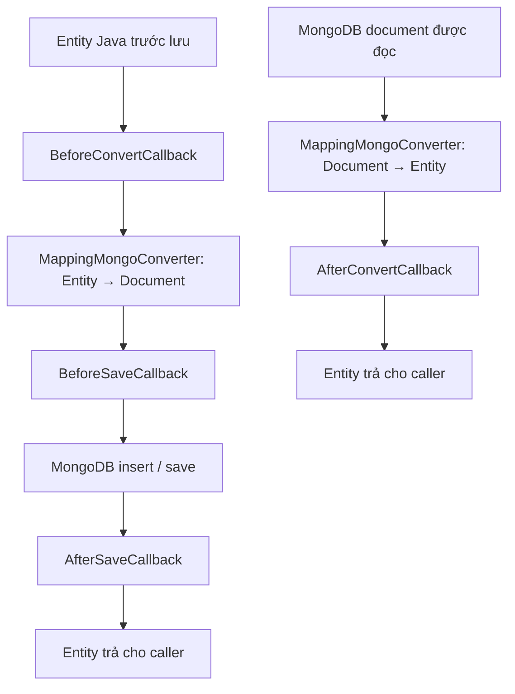
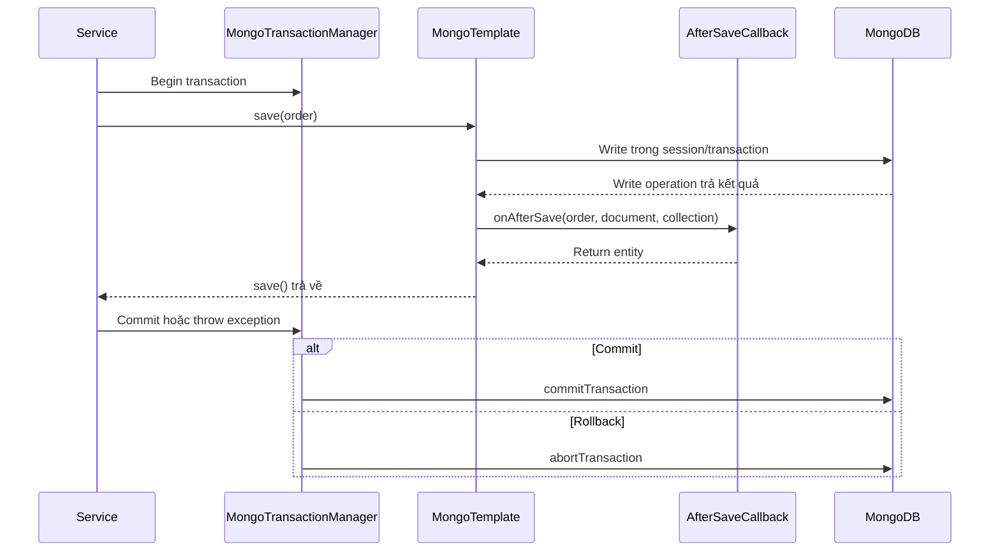

# AfterSaveCallback và AfterConvertCallback

Trong **Spring Data MongoDB**, khi một document được lưu hoặc đọc, framework có thể gọi những **Entity Callback** ở các mốc xác định trong vòng đời ánh xạ. Hai callback ở phần *sau* của chu trình rất dễ bị nhầm:

- **`AfterSaveCallback<T>`** được gọi sau khi một thao tác lưu entity đã đi qua MongoDB. Nó có thể trả về một entity đã được điều chỉnh **để chuyển tiếp cho caller**, nhưng không tự lưu lại những thay đổi bổ sung lên document.
- **`AfterConvertCallback<T>`** được gọi sau khi MongoDB `Document` đã được chuyển thành đối tượng Java khi đọc. Nó thích hợp để hoàn thiện dữ liệu dẫn xuất, biểu diễn hoặc trạng thái tạm thời của entity **trước khi trả về cho tầng gọi**.

Bài thuộc chương **Vòng đời và callback** của module **SPRING_DATA_MONGODB**. Trong module này, bạn kết nối và ánh xạ document, thao tác dữ liệu qua `MongoTemplate` hoặc repository, đồng thời thực hành truy vấn, aggregation, index, transaction, reactive access, kiểm thử và chẩn đoán hiệu năng. Chúng ta sẽ đi sâu vào hai callback, API đồng bộ và reactive, ranh giới transaction, những đường ghi không phát callback, cách kiểm thử và các lỗi triển khai thường gặp.

**Mục tiêu:** biết chính xác callback nào chạy, khi nào, dữ liệu nào có thể sửa, và vì sao không nên dùng `AfterSaveCallback` để gửi email hay bảo đảm một sự kiện “sau commit”.

## 1. Chu trình ghi và đọc dưới góc nhìn callback

Giả sử một HTTP request gọi `MongoRepository.save(order)`. Spring Data ánh xạ entity sang BSON, yêu cầu MongoDB lưu, rồi trả kết quả cho service. Khi có EntityCallbacks phù hợp, khung cơ bản:



Hai nhánh có ý nghĩa khác nhau:

1. Ở nhánh **ghi**, `AfterSaveCallback` nhìn thấy entity đã đi qua lệnh lưu. Những thay đổi trên entity **tại thời điểm này** không còn nằm trong BSON đã gửi, trừ khi chính bạn thực hiện **một lệnh ghi khác**.
2. Ở nhánh **đọc**, `AfterConvertCallback` nhận entity vừa được materialize từ `Document`, có thể thêm các trường `@Transient` trước khi caller sử dụng.
3. Với transaction, “lệnh save hoàn tất” **không đồng nghĩa “toàn transaction đã commit”**.
4. Callback không đồng nghĩa MongoDB **Change Stream**. Change stream quan sát các thay đổi từ database, còn Entity Callback chạy trong đường thực thi của **Spring Data entity mapping**.

## 2. So sánh nhanh hai callback

| Khía cạnh | `AfterSaveCallback<T>` | `AfterConvertCallback<T>` |
| --- | --- | --- |
| Thời điểm | Sau thao tác lưu entity | Sau khi đọc BSON và ánh xạ thành entity |
| Hướng dữ liệu | Java → MongoDB | MongoDB → Java |
| Input chính | Entity, `Document` đã dùng khi lưu, collection | Entity mới đọc, `Document` nguồn, collection |
| Phương thức sync | `onAfterSave(T, Document, String)` | `onAfterConvert(T, Document, String)` |
| Return sync | `T`: cùng hoặc entity mới | `T`: cùng hoặc entity mới |
| Return reactive | `Publisher<T>` | `Publisher<T>` |
| Phù hợp | Điều chỉnh trạng thái không lưu của entity trả về; quan sát nhẹ | Dựng field dẫn xuất `@Transient`; hoàn thiện view in-memory |
| Không phù hợp | Gửi event “sau commit”; sửa field để mong DB đã cập nhật | Ghi DB ngầm, N+1 lookup, nhét dữ liệu bảo mật vào entity |
| Có áp dụng cho raw driver? | Không theo cơ chế EntityCallback Spring | Không theo cơ chế EntityCallback Spring |
| Nếu throw exception | Caller có thể thấy save lỗi dù DB đã ghi | Caller có thể thấy read lỗi dù query đã lấy BSON |

**Câu chốt:** cả hai callback có thể thay **đối tượng Java kết quả**; chỉ riêng việc chúng chạy không tạo thêm một database write.

## 3. Các interface và package chính xác

Spring Data MongoDB cung cấp các interface trong package `org.springframework.data.mongodb.core.mapping.event`.

```java
import org.bson.Document;
import org.springframework.data.mongodb.core.mapping.event.AfterSaveCallback;
import org.springframework.data.mongodb.core.mapping.event.AfterConvertCallback;

// Signatures cốt lõi:
public interface AfterSaveCallback<T> {
    T onAfterSave(T entity, Document document, String collection);
}

public interface AfterConvertCallback<T> {
    T onAfterConvert(T entity, Document document, String collection);
}
```

Đây là **minh họa chữ ký rút gọn**, không phải source code đầy đủ của Spring Data (các interface thật kế thừa `EntityCallback<T>`).

- `entity`: đối tượng Java đúng kiểu domain đang được lưu hoặc đã được convert.
- `document`: BSON `org.bson.Document` mà Spring Data đã tạo để lưu hoặc nhận từ MongoDB.
- `collection`: tên collection thực tế được dùng trong thao tác.
- Giá trị trả về: entity gốc hoặc entity mới **cùng kiểu T**.

Các interface trên được giới thiệu trong dòng Spring Data MongoDB **3.0**. Khi dùng dự án cũ hơn, cần đối chiếu API, không tự suy rằng EntityCallback đã tồn tại ở mọi version. `@Component` hoặc khai báo bean làm callback được Spring phát hiện trong `ApplicationContext`.

## 4. Entity ví dụ: Order có các field tạm thời

Ta dùng collection `orders` với hai field nghiệp vụ quan trọng và hai field chỉ phục vụ quan sát/hiển thị.

```java
import org.bson.types.ObjectId;
import org.springframework.data.annotation.Id;
import org.springframework.data.annotation.Transient;
import org.springframework.data.annotation.Version;
import org.springframework.data.mongodb.core.mapping.Document;
import org.springframework.data.mongodb.core.mapping.Field;

@Document(collection = "orders")
public class OrderDocument {
    @Id
    private ObjectId id;

    @Field("tenant_id")
    private String tenantId;

    @Field("order_key")
    private String orderKey;

    private String status;

    @Field("total_vnd")
    private long totalVnd;

    @Version
    private Long version;

    @Transient
    private String displayLabel;

    @Transient
    private boolean afterSaveInvoked;

    public OrderDocument() {}

    public OrderDocument(
            ObjectId id, String tenantId, String orderKey,
            String status, long totalVnd) {
        this.id = id;
        this.tenantId = tenantId;
        this.orderKey = orderKey;
        this.status = status;
        this.totalVnd = totalVnd;
    }

    public ObjectId getId() { return id; }
    public String getTenantId() { return tenantId; }
    public String getOrderKey() { return orderKey; }
    public String getStatus() { return status; }
    public long getTotalVnd() { return totalVnd; }
    public Long getVersion() { return version; }
    public String getDisplayLabel() { return displayLabel; }
    public boolean isAfterSaveInvoked() { return afterSaveInvoked; }

    public void setStatus(String value) { this.status = value; }
    public void setDisplayLabel(String value) { this.displayLabel = value; }
    public void setAfterSaveInvoked(boolean value) {
        this.afterSaveInvoked = value;
    }
}
```

Các property `tenantId`, `orderKey` và `totalVnd` được ánh xạ sang BSON `tenant_id`, `order_key`, `total_vnd` bằng `@Field`. Hai property `displayLabel` và `afterSaveInvoked` có `@Transient` nên **không được persist** thành BSON field qua mapping thông thường.

`@Version` giúp phát hiện lost update khi dùng những thao tác save được Spring Data hỗ trợ, nhưng không phải mục tiêu của callback. Trong ví dụ, version tồn tại để minh họa rằng `AfterSaveCallback` cũng không được tự ý sửa metadata version như một cơ chế cập nhật DB.

Một document thực tế sau insert có thể có hình dạng:

```javascript
{
  _id: ObjectId("674000000000000000009001"),
  tenant_id: "T1",
  order_key: "ORD-101",
  status: "NEW",
  total_vnd: NumberLong("150000"),
  version: NumberLong("0")
}
```

Không có `displayLabel` và `afterSaveInvoked` trong BSON.

## 5. Viết AfterSaveCallback đồng bộ đúng cách

Một ví dụ đơn giản cho thấy callback được gọi và có thể điều chỉnh **kết quả Java**:

```java
import org.bson.Document;
import org.springframework.data.mongodb.core.mapping.event.AfterSaveCallback;
import org.springframework.stereotype.Component;

@Component
public class OrderAfterSaveCallback
        implements AfterSaveCallback<OrderDocument> {

    @Override
    public OrderDocument onAfterSave(
            OrderDocument entity,
            Document document,
            String collection) {

        if (!"orders".equals(collection)) {
            return entity;
        }

        // Chỉ cập nhật trạng thái tạm của đối tượng Java.
        entity.setAfterSaveInvoked(true);
        return entity;
    }
}
```

Đây là hành vi **có chủ đích chỉ để minh họa lifecycle**, không phải business field nên đưa vào production. Trong một ứng dụng thực, callback có thể áp dụng một biến đổi nhẹ cho entity được trả về, ví dụ dựng token hiển thị không nhạy cảm, nhưng cần cân nhắc đặt ở DTO mapper/service thay vì biến entity thành view model.

Những điểm bắt buộc ghi nhớ:

- `@Component` làm bean xuất hiện trong Spring context và được infrastructure phát hiện.
- Kiểu generic `OrderDocument` giúp callback được lọc theo kiểu entity thay vì áp dụng cho mọi collection.
- Return `entity` (hoặc một instance mới hợp lệ) là bắt buộc theo contract.
- Không return `null`.
- Không gọi `mongoTemplate.save(entity)` trong chính callback này: rất dễ gây **đệ quy callback → save → callback**.

## 6. Viết AfterConvertCallback đồng bộ đúng cách

Bây giờ thêm `displayLabel` sau khi đọc BSON:

```java
import org.bson.Document;
import org.springframework.data.mongodb.core.mapping.event.AfterConvertCallback;
import org.springframework.stereotype.Component;

@Component
public class OrderAfterConvertCallback
        implements AfterConvertCallback<OrderDocument> {

    @Override
    public OrderDocument onAfterConvert(
            OrderDocument entity,
            Document document,
            String collection) {

        if (!"orders".equals(collection)) {
            return entity;
        }

        String label = entity.getOrderKey()
            + " / " + entity.getStatus();

        entity.setDisplayLabel(label);
        return entity;
    }
}
```

Khi `MongoTemplate.findById` materialize `OrderDocument` từ BSON, callback xây `displayLabel="ORD-101 / NEW"` trước khi trả entity cho caller.

`displayLabel` là **dữ liệu dẫn xuất**. Nó:

1. Không cần lưu xuống MongoDB vì có thể được tạo từ `orderKey` và `status`.
2. Có thể thay đổi khi `status` thay đổi trong bộ nhớ; callback **không tự chạy lại** sau khi setter được gọi.
3. Có thể được tính tại DTO mapper nếu bạn không muốn tạo ra field tạm trong mọi lần đọc entity.
4. Không nên kéo theo remote API lookup hoặc thêm dữ liệu của tenant khác.

Nếu ứng dụng trả entity trực tiếp ra REST, phải kiểm tra Jackson serialization: `@Transient` của Spring Data có nghĩa là **không persist trong MongoDB**, không có nghĩa Jackson sẽ tự bỏ field khỏi JSON. Dùng DTO hoặc `@JsonIgnore` theo contract API.

## 7. Document truyền cho callback dùng để làm gì?

`Document` là biểu diễn BSON ở ranh giới mapping:

```java
@Override
public OrderDocument onAfterConvert(
        OrderDocument entity,
        Document document,
        String collection) {

    // Đọc BSON field thực tế để chẩn đoán.
    String persistedStatus = document.getString("status");

    // Không ghi document.put(...) với hy vọng DB tự đổi.
    entity.setDisplayLabel(
        entity.getOrderKey() + " / " + persistedStatus
    );
    return entity;
}
```

Đối với `AfterSaveCallback`, `document` đã được dùng trong thao tác lưu. Đối với `AfterConvertCallback`, `document` là nguồn dữ liệu vừa được chuyển thành Java object.

**Đừng hiểu `Document` là một live MongoDB document.** Nó chỉ là đối tượng Java chứa dữ liệu BSON. `document.put("status","PAID")` sau save **không tự update MongoDB**. Nếu sửa `Document` sau convert, không có lệnh ghi nào xảy ra. Để sửa dữ liệu bền vững, dùng `BeforeConvertCallback`, `BeforeSaveCallback` hoặc một thao tác update/save được gọi có chủ đích ở tầng service.

Nên xem `Document` ở hai callbacks after như **read-only metadata/context**. Việc sửa nó dễ làm trạng thái entity/DB lệch nhau hoặc làm người đọc hiểu sai ngữ nghĩa.

## 8. Quan sát hành vi trên MongoTemplate

Với hai callback được đăng ký, một service có thể:

```java
import org.bson.types.ObjectId;
import org.springframework.data.mongodb.core.MongoTemplate;

public class OrderExample {
    private final MongoTemplate template;

    public OrderExample(MongoTemplate template) {
        this.template = template;
    }

    public void demo() {
        ObjectId id = new ObjectId();
        OrderDocument entity = new OrderDocument(
            id, "T1", "ORD-101", "NEW", 150_000L
        );

        OrderDocument saved = template.insert(entity);
        // Sau insert: AfterSaveCallback đã chạy.
        System.out.println(saved.isAfterSaveInvoked());

        OrderDocument found =
            template.findById(id, OrderDocument.class);

        // Sau đọc: AfterConvertCallback đã chạy.
        System.out.println(found.getDisplayLabel());
    }
}
```

Ở đây `template.insert` đi theo đường lifecycle của Spring Data; entity trả về đã qua `AfterSaveCallback`.

Khi đọc lại, `found` được materialize thành **một entity Java mới** qua converter, nên `afterSaveInvoked` (là `@Transient`) mặc định `false` trên object được đọc. Trong khi đó `displayLabel` được tạo bởi `AfterConvertCallback`.

Đừng biến các dòng `System.out.println` này thành logging production; dùng structured logging và tránh PII/sensitive fields nếu cần quan sát callbacks.

## 9. Repository và MongoTemplate có thể gọi callback ở đâu?

Các thao tác thường gặp:

| Thao tác | AfterSave? | AfterConvert? | Ghi chú |
| --- | --- | --- | --- |
| `MongoTemplate.insert(entity)` | **Có** với entity được mapping | Không | Đường ghi entity |
| `MongoTemplate.save(entity)` | **Có** với entity được mapping | Không | Có thể insert hoặc save existing |
| `MongoRepository.save(entity)` | **Có** khi đi qua Spring Data save | Không | Spring Data repository dùng mapping infrastructure |
| `MongoRepository.findById(id)` | Không | **Có** khi materialize entity | Đường đọc |
| `MongoTemplate.find(..., Entity.class)` | Không | **Có** với entity được mapping | Có thể chạy cho mỗi entity kết quả |
| `MongoTemplate.findById(..., Entity.class)` | Không | **Có** | Ví dụ kiểm thử ở bài |
| `MongoTemplate.updateFirst(...)` | **Không theo đường save entity** | Không | Update operator, không tạo entity saved result |
| `MongoTemplate.updateMulti(...)` | **Không theo đường save entity** | Không | Multi-document update |
| `MongoTemplate.remove(query)` | Không | Không | Không có entity save/load ở đường này |
| Native `MongoCollection.updateOne/insertOne` | Không | Không | Bỏ qua Spring Data callback infrastructure |
| Native `MongoCollection.find(Document.class)` | Không | Không | Trả raw Document bằng native driver |
| `BulkOperations` | Không dựa vào callback từng entity như `save` | Không | Có lifecycle semantics riêng; không tự suy rằng callback chạy |

Với `findAndModify`, `findAndRemove`, aggregation mapping, projections và những overload đặc biệt, callback có chạy hay không tùy **đường mapping cụ thể** của Spring Data và loại kết quả. Không nên áp quy tắc mù cho mọi dạng query; cần kiểm thử chính overload/version mà hệ thống sử dụng.

**Quy tắc quan trọng:** callback không phải một MongoDB trigger toàn cục. Những writers ngoài Spring Data vẫn có thể thay document mà callback Java của ứng dụng **không được gọi**.

## 10. Vì sao save và updateFirst không giống nhau?

Một lệnh `save` đi qua entity mapping:

```java
OrderDocument order = template.findById(
    id, OrderDocument.class
);

order.setStatus("PAID");
template.save(order);
// Có thể phát AfterSaveCallback theo đường save.
```

Một update operator đi thẳng tới field được chỉ định:

```java
import org.springframework.data.mongodb.core.query.Criteria;
import org.springframework.data.mongodb.core.query.Query;
import org.springframework.data.mongodb.core.query.Update;

template.updateFirst(
    Query.query(Criteria.where("id").is(id)),
    new Update().set("status", "PAID"),
    OrderDocument.class
);
// Không diễn ra một vòng save entity như trên.
```

`updateFirst` có thể tự tăng `@Version` trên đường hỗ trợ nếu update không ghi rõ version, nhưng việc đó **không làm `AfterSaveCallback` chạy như `save(entity)`**.

Nếu hệ thống cần một invariant phải áp dụng cho **mọi write** (ví dụ chặn số lượng âm hoặc unique business key), **không đặt duy nhất trong AfterSaveCallback**. Hãy bảo vệ bằng validation ở service, MongoDB schema/unique index, conditional update, transaction hoặc cơ chế cần thiết ở tầng dữ liệu.

## 11. AfterSaveCallback không phải after transaction commit

Đây là một trong những hiểu nhầm nguy hiểm nhất.



**`AfterSaveCallback` được gọi trong đường save, trước khi transaction ngoài cùng kết thúc.** Nếu service gọi `save` rồi ném exception, transaction có thể **rollback** dù callback đã chạy.

Ví dụ:

```java
import org.springframework.stereotype.Service;
import org.springframework.transaction.annotation.Transactional;

@Service
public class OrderTransactionExample {
    private final MongoTemplate template;

    public OrderTransactionExample(MongoTemplate template) {
        this.template = template;
    }

    @Transactional(transactionManager = "mongoTransactionManager")
    public void saveThenAbort(OrderDocument order) {
        template.save(order); // Callback after-save có thể đã chạy.
        throw new IllegalStateException("Hủy nghiệp vụ");
        // Spring rollback nếu exception được propagate
        // qua transaction proxy đúng cấu hình.
    }
}
```

Vì vậy **không gửi email “đơn đã được chốt”, không publish Kafka event và không xác nhận business commit trong `AfterSaveCallback`**. Callback đã chạy không phải bằng chứng transaction được commit thành công.

## 12. Nếu cần hành động sau commit, chọn cơ chế khác

Có vài lựa chọn, tùy độ tin cậy:

1. **Thông báo nội bộ trong cùng process**: một `@TransactionalEventListener(phase = AFTER_COMMIT)` được cấu hình đúng transaction manager, với lưu ý đây không phải cơ chế delivery bền vững và không nên thực hiện network call blocking trên event-loop.
2. **Transactional outbox**: lưu một outbox record **trong cùng MongoDB transaction** với business data, worker đọc và publish sự kiện sau khi commit.
3. **MongoDB Change Streams**: quan sát thay đổi đã được ghi nhận bởi MongoDB theo deployment phù hợp, có resume token và consumer idempotency.
4. **Service orchestration**: thực hiện hành động sau khi service đã biết kết quả transaction, nhưng vẫn cần xử lý lỗi mạng, restart process và duplicate delivery.

Ví dụ conceptual:

```text
@Transactional:
  save(order)
  save(outboxEvent)
  COMMIT

Outbox worker:
  đọc outbox đã commit
  gửi message ra broker
  đánh dấu/persist trạng thái xử lý
  retry có idempotency key
```

**Không có lựa chọn nào biến callback thành transaction commit hook.** Với hệ thống cần “ít nhất một lần” delivery và tránh mất sự kiện, outbox/consumer idempotency là hướng thường phù hợp hơn callback gửi network request trực tiếp.

## 13. Ném exception trong AfterSaveCallback gây điều gì?

Xét callback sai:

```java
@Component
class DangerousAfterSave
        implements AfterSaveCallback<OrderDocument> {

    @Override
    public OrderDocument onAfterSave(
            OrderDocument entity, Document document,
            String collection) {

        // Lệnh lưu có thể đã thành công.
        if ("ORD-FAIL".equals(entity.getOrderKey())) {
            throw new IllegalStateException(
                "Callback gặp lỗi sau khi save"
            );
        }
        return entity;
    }
}
```

Ở chế độ **không có transaction**, lệnh save có thể đã ghi thành công nhưng caller nhận exception từ callback. Caller retry toàn `save`/request một cách mù quáng có thể tạo duplicate nghiệp vụ hoặc ghi lại field không mong muốn.

Ở chế độ **có transaction**, nếu exception propagate qua transaction boundary đúng cấu hình, transaction có thể rollback những ghi chưa commit. Nhưng **không nên dựa vào việc callback ném lỗi làm một chính sách consistency**; việc callback được gọi ở giai đoạn sau và side effects trước đó vẫn cần đối soát.

Quy tắc thiết kế:

- Giữ `AfterSaveCallback` **nhẹ, xác định, không lỗi ngoại cảnh** nếu có thể.
- Tránh remote API/DB writes phụ, không ném lỗi vì hệ thống metrics/logging tạm thời không sẵn sàng.
- Nếu callback có thể lỗi, phải xác định rõ semantics của `save` kết quả và chiến lược retry.
- Không catch exception rồi trả thành công khi business invariant thực tế chưa đạt.

## 14. AfterConvertCallback có thể làm một truy vấn đọc thất bại

Một `findById` có thể đọc BSON thành công nhưng callback sau convert ném exception:

```java
@Component
class StrictAfterConvert
        implements AfterConvertCallback<OrderDocument> {

    @Override
    public OrderDocument onAfterConvert(
            OrderDocument entity, Document document,
            String collection) {

        if (entity.getOrderKey() == null) {
            throw new IllegalStateException(
                "Thiếu orderKey khi tạo view"
            );
        }
        return entity;
    }
}
```

Người gọi thấy truy vấn lỗi, nhưng **không có nghĩa MongoDB không tìm thấy document**. Đây là lỗi xử lý object sau khi đọc, không phải network/query failure.

Nếu cần **validate dữ liệu lưu trữ**, nên có MongoDB schema validation, migration hoặc validation có chủ đích; không để mọi read thất bại vì một field hiển thị có thể lấy fallback an toàn.

Một callback chỉ để dựng label có thể viết an toàn hơn:

```java
String key = entity.getOrderKey() == null
    ? "(unknown)"
    : entity.getOrderKey();

String status = entity.getStatus() == null
    ? "(unknown)"
    : entity.getStatus();

entity.setDisplayLabel(key + " / " + status);
return entity;
```

Việc dùng fallback cho view **không thay thế** việc sửa dữ liệu sai schema; nó chỉ tránh làm đọc bị hỏng bởi dữ liệu hiển thị có thể suy luận được.

## 15. @Transient, JsonIgnore và thông tin nhạy cảm

`@Transient` của Spring Data làm một field bị **bỏ qua khi mapping MongoDB**, còn serialization sang JSON là một bước khác.

Ví dụ:

```java
@Transient
private String displayLabel;
```

Nếu có getter công khai, serializer có thể xuất `displayLabel` ra HTTP response. Nếu bạn muốn một property **không được lộ cho client**, dùng DTO allowlist hoặc annotation serializer chuyên biệt:

```java
import com.fasterxml.jackson.annotation.JsonIgnore;
import org.springframework.data.annotation.Transient;

@Transient
@JsonIgnore
private String internalDebugHint;
```

Đừng sử dụng `AfterConvertCallback` để gắn token, credential, role hoặc tenant-private data vào entity rồi trả entity trực tiếp ra API. Dữ liệu dựng sau convert có thể vô tình lộ trong logging, serialization hoặc caching.

Nên để **authorization** xảy ra trong query/service/controller chính, và DTO mapping quyết định những trường được phép trả về. Callback không phải cơ chế xác thực.

## 16. Immutable entity: trả instance mới, đừng tìm cách sửa field final

Entity immutable là lựa chọn tốt trong Java, nhưng callback không thể gọi setter.

Một mô hình:

```java
import org.springframework.data.annotation.Id;
import org.springframework.data.annotation.Transient;
import org.springframework.data.mongodb.core.mapping.Document;

@Document("order_summaries")
public record OrderSummary(
    @Id String id,
    String orderKey,
    String status,
    @Transient String displayLabel
) {
    public OrderSummary withDisplayLabel(String label) {
        return new OrderSummary(id, orderKey, status, label);
    }
}
```

Callback trả instance mới:

```java
@Component
class SummaryAfterConvert
        implements AfterConvertCallback<OrderSummary> {

    @Override
    public OrderSummary onAfterConvert(
            OrderSummary entity, Document document,
            String collection) {

        return entity.withDisplayLabel(
            entity.orderKey() + " / " + entity.status()
        );
    }
}
```

Điều này minh họa ý nghĩa contract **“return same or modified instance”**. Khi áp dụng vào code thật, kiểm tra khả năng mapping immutable records, tên constructor parameters và @Transient property trên Spring Data version đang dùng.

**Không return entity mới mà bỏ mất `id`, `version` hoặc field quan trọng**. Sau convert, caller phải nhận một đối tượng hợp lệ cho những thao tác tiếp theo; việc tạo một instance thiếu metadata có thể gây insert nhầm, optimistic locking lỗi hoặc mất dữ liệu khi save lại.

## 17. Nhiều callbacks cùng kiểu: điều khiển thứ tự

Khi có nhiều `AfterConvertCallback<OrderDocument>`, callback sau có thể nhìn thấy entity đã được callback trước sửa. Dùng `@Order` hoặc `Ordered` để thiết lập thứ tự khi thực sự cần.

```java
import org.springframework.core.annotation.Order;
import org.springframework.stereotype.Component;

@Component
@Order(100)
class NormalizeAfterConvert
        implements AfterConvertCallback<OrderDocument> {

    @Override
    public OrderDocument onAfterConvert(
            OrderDocument entity, Document document,
            String collection) {

        // Ví dụ chỉ chuẩn hóa view state,
        // không thay business field cần persist.
        return entity;
    }
}

@Component
@Order(200)
class LabelAfterConvert
        implements AfterConvertCallback<OrderDocument> {

    @Override
    public OrderDocument onAfterConvert(
            OrderDocument entity, Document document,
            String collection) {

        entity.setDisplayLabel(
            entity.getOrderKey() + " / " + entity.getStatus()
        );
        return entity;
    }
}
```

Giá trị order **nhỏ hơn** thường có độ ưu tiên **cao hơn**. Không dựa vào thứ tự đăng ký bean tình cờ hay tên class alphabetically.

Nếu hai callbacks cùng gắn `displayLabel`, callback chạy sau có thể ghi đè giá trị trước. Tránh để nhiều lớp cùng sở hữu một derived field; nếu có dependency thực, đặt thứ tự tường minh và viết test kiểm tra.

Spring Data EntityCallback generic type giúp tránh xử lý không liên quan; callback lambda không luôn cung cấp thông tin generic type rõ như class, nên với ứng dụng nhiều entity, ưu tiên class bean có kiểu cụ thể để framework lọc hiệu quả.

## 18. Phân biệt Entity Callback với ApplicationEvent / MongoMappingEvent

Trước EntityCallbacks, Spring Data MongoDB hỗ trợ các mapping events và `AbstractMongoEventListener`:

```java
import org.springframework.data.mongodb.core.mapping.event.AfterSaveEvent;
import org.springframework.data.mongodb.core.mapping.event.AbstractMongoEventListener;

public class OrderSaveEventListener
        extends AbstractMongoEventListener<OrderDocument> {

    @Override
    public void onAfterSave(AfterSaveEvent<OrderDocument> event) {
        // Quan sát sự kiện mapping, không thay entity
        // bằng cách return một instance mới.
    }
}
```

So sánh:

| Tiêu chí | Entity Callback | MongoMappingEvent listener |
| --- | --- | --- |
| Interface | `AfterSaveCallback<T>`, `AfterConvertCallback<T>` | `AbstractMongoEventListener<T>` hoặc listener của event |
| Cách tác động entity | Return entity đã thay hoặc instance mới | Listener xử lý event; không có contract return entity thay thế |
| Thứ tự | Được gọi có thứ tự theo EntityCallbacks infrastructure | Phụ thuộc `ApplicationEventMulticaster`; async multicaster có thể ảnh hưởng thứ tự |
| Reactive | Có interface `ReactiveAfter...Callback` riêng | Event application không thay Publisher flow |
| Tác vụ hợp lý | Biến đổi có kiểm soát trong mapping lifecycle | Quan sát event và tương thích hệ thống cũ |
| Sau commit transaction? | Không tự bảo đảm | Không tự bảo đảm |

Spring Data khuyến nghị EntityCallback làm điểm mở rộng **biến đổi entity** vì nó xác định mốc và có thể trả entity đã thay. Application event listener có thể được multicaster chạy bất đồng bộ tùy cấu hình; không dùng nó để thay dữ liệu entity mà converter đã xử lý rồi.

Đừng đăng ký **cùng logic** ở cả `AfterSaveCallback` lẫn `AbstractMongoEventListener.onAfterSave` nếu không muốn chạy hai lần.

## 19. So với BeforeConvertCallback và BeforeSaveCallback

Một vấn đề thường gặp: “Tôi sửa `status` trong `AfterSaveCallback` mà MongoDB vẫn giữ status cũ”. Đây là điều đúng theo lifecycle.

| Điểm mở rộng | Thời điểm | Muốn thay dữ liệu bền vững thì sao? |
| --- | --- | --- |
| `BeforeConvertCallback` | Trước khi entity chuyển thành Document | Sửa entity để converter tạo BSON mới |
| `BeforeSaveCallback` | Sau convert, trước MongoDB write | Có thể chỉnh BSON `Document` sẽ được lưu |
| `AfterSaveCallback` | Sau MongoDB save | Chỉ chỉnh entity kết quả; **không tự lưu lại** |
| `AfterConvertCallback` | Sau khi BSON thành entity | Chỉ chỉnh entity đọc ra; **không tự update DB** |

Ví dụ quy tắc normalization trước convert:

```java
@Component
class NormalizeOrderBeforeConvert
        implements org.springframework.data.mongodb.core.mapping.event
            .BeforeConvertCallback<OrderDocument> {

    @Override
    public OrderDocument onBeforeConvert(
            OrderDocument entity, String collection) {

        if (entity.getStatus() != null) {
            entity.setStatus(
                entity.getStatus().trim().toUpperCase(
                    java.util.Locale.ROOT
                )
            );
        }
        return entity;
    }
}
```

Đây là logic **before** hợp lý hơn `AfterSaveCallback` nếu muốn thay nội dung BSON được persist. Tuy nhiên, invariant correctness-critical phải được bảo vệ ở tất cả đường ghi (bao gồm update operators và native writers), không chỉ callback.

`@CreatedDate`/`@LastModifiedDate` của Spring Data auditing được hỗ trợ bởi auditing callbacks chạy **trước convert**, phù hợp vì timestamp cần được lưu. `AfterSaveCallback` không phải nơi nên tự set `createdAt` với kỳ vọng DB đã có giá trị mới.

## 20. Tách nghiệp vụ khỏi callback: tránh coupling khó kiểm thử

Một callback có thể chạy với nhiều code paths:

```java
repository.findById(id);
template.findAll(OrderDocument.class);
repository.save(entity);
template.insert(entity);
```

Nếu callback **đọc configuration ngoài, gọi HTTP, ghi metrics nặng hoặc tạo side effect**, mọi đường đọc/ghi này bị phụ thuộc vào service khác. Những hệ quả:

- Read path bị lỗi vì một API enrich không sẵn sàng.
- Test repository đơn giản cần khởi tạo thêm rất nhiều dependencies.
- Bulk read của 1.000 documents kích hoạt 1.000 external calls.
- Transaction save đã thành công nhưng callback after-save throw làm caller nghĩ lưu thất bại.
- Khi bật reactive infrastructure, callback sync có thể không chạy nên hành vi giữa hai APIs khác nhau.

**Thiết kế dễ kiểm soát hơn:** đặt business orchestration ở service, persistence ở repository/template, và projection/enrichment không liên quan DB ở một mapper rõ ràng. Callback chỉ nên dùng khi logic thực sự **gắn với lifecycle mapping cho mọi entity cùng kiểu**.

## 21. AfterConvert và bài toán N+1

Giả sử `AfterConvertCallback<OrderDocument>` làm:

```java
// SAI: một database query mới cho mỗi order được đọc.
@Override
public OrderDocument onAfterConvert(
        OrderDocument entity, Document source,
        String collection) {

    Customer customer = mongoTemplate.findById(
        entity.getId(), Customer.class
    );

    entity.setDisplayLabel(customer.getName());
    return entity;
}
```

Đây là mẫu minh họa anti-pattern (lookup field ID trong thực tế còn phải đúng `customerId`, không dùng order ID). Khi `findAll` trả 1.000 orders, callback có thể thực hiện thêm 1.000 queries. Nếu query callback lại materialize cùng kiểu entity, có thể tạo **đệ quy callback đọc**.

Thay bằng:

- Đọc tập dữ liệu cần thiết bằng **một query/batch** ở service.
- Dùng `$lookup` hoặc aggregation/projection phù hợp khi khối lượng/cấu trúc dữ liệu cho phép.
- Dùng domain DTO mapper với một cache/request-scoped map có giới hạn và kiểm tra tenant.
- Chỉ dùng callback cho derived field có thể tính **từ chính entity/document hiện tại** mà không cần I/O ngoài.

Với hệ thống đa tenant, join/enrichment phải bảo đảm cùng tenant; một callback chạy trên tất cả kết quả không được bỏ qua quy tắc phân quyền.

## 22. Callback và repository projections / aggregation

Một derived repository query có thể trả:

- Domain entity `OrderDocument`.
- Interface-based projection.
- DTO/record projection.
- Raw `Document`.
- Aggregation result type khác.

Không nên tuyên bố rằng `AfterConvertCallback<OrderDocument>` chạy cho **mọi** loại kết quả. Generic callback được áp dụng khi đường xử lý **materialize một entity phù hợp** bằng Spring Data infrastructure. Những raw BSON/DTO pipelines có thể đi qua nhánh conversion khác và không gọi callback như kỳ vọng.

Ví dụ:

```java
List<OrderDocument> entities =
    mongoTemplate.find(
        Query.query(Criteria.where("status").is("NEW")),
        OrderDocument.class
    );
```

Ở ví dụ này, Spring Data ánh xạ domain type cụ thể; `AfterConvertCallback<OrderDocument>` có thể làm `displayLabel` được tạo cho các entity trả về.

```java
List<Document> raw =
    mongoTemplate.getCollection("orders")
        .find()
        .into(new java.util.ArrayList<>());
```

Ở ví dụ native driver này, không có bước mapping thành `OrderDocument` qua `MongoTemplate`, nên callback trên `OrderDocument` **không chạy**.

Khi đổi repository method sang projection tối ưu hiệu năng, cần kiểm tra lại derived fields trước đây từng được callback thêm.

## 23. Native drivers, MongoTemplate partial updates và BulkOperations

Một ứng dụng thường có nhiều writers:

```java
// Đường Spring Data entity save:
template.save(order);

// Đường Spring Data update operator:
template.updateFirst(query, update, OrderDocument.class);

// Đường native MongoDB driver:
template.getCollection("orders").updateOne(
    new Document("_id", order.getId()),
    new Document("$set", new Document("status", "PAID"))
);
```

`AfterSaveCallback` không phải một rule tự động áp cho cả ba dòng trên. Nếu cần enforcement chung như `status` không được thay sai quy tắc, dùng:

1. Service validation và authorization.
2. Atomic query conditions (ví dụ `status="NEW"` trong filter trước khi set `PAID`).
3. MongoDB schema validation hoặc unique index khi phù hợp.
4. Optimistic locking/version khi có lost update.
5. Integration tests chạy qua mọi đường ghi còn được sử dụng.

`BulkOperations` cũng thường không có lifecycle callbacks giống `save(entity)` cho từng object. Đừng dùng callback để cấp `orderKey`, `tenantId` hay audit bắt buộc nếu bạn còn bulk/native writers không qua callback đó.

## 24. AfterSaveCallback có ảnh hưởng tới optimistic locking không?

`@Version` của Spring Data hỗ trợ optimistic locking trên các đường entity save được hỗ trợ:

```java
OrderDocument a = repository.findById(id).orElseThrow();
OrderDocument b = repository.findById(id).orElseThrow();

a.setStatus("PAID");
repository.save(a); // Version thay đổi.

b.setStatus("CANCELLED");
repository.save(b); // Có thể OptimisticLockingFailureException.
```

Nếu save thứ hai không match expected version, framework ném exception; không nên hiểu `AfterSaveCallback` là điểm “sửa” xung đột bằng cách tự ghi lại.

Trong `AfterSaveCallback`:

- Không tự sửa `@Version` của entity để “đánh lừa” optimistic locking.
- Không gọi save lại từ callback vì có thể tái nhập lifecycle và tạo hiệu ứng không rõ.
- Không coi sau save là sau commit.
- Không dùng callback để báo 200/OK trước khi transaction/HTTP response thực sự hoàn tất.

Khi cần thay đổi status theo workflow, ưu tiên conditional `updateFirst` hoặc service orchestration cùng optimistic locking/transaction tương ứng.

## 25. Reactive variants: hai interface khác, Publisher khác

Spring Data MongoDB có các phiên bản reactive:

```java
import org.bson.Document;
import org.reactivestreams.Publisher;
import org.springframework.data.mongodb.core.mapping.event.ReactiveAfterSaveCallback;
import org.springframework.data.mongodb.core.mapping.event.ReactiveAfterConvertCallback;

// Chữ ký rút gọn:
Publisher<T> onAfterSave(T entity, Document document, String collection);
Publisher<T> onAfterConvert(T entity, Document document, String collection);
```

Chúng khác với phiên bản đồng bộ ở **giá trị trả về**: reactive callback phải trả `Publisher<T>`, thông thường là `Mono<T>` của Reactor.

**Quan trọng:** `MongoTemplate` đồng bộ xem xét các callback đồng bộ; `ReactiveMongoTemplate` và reactive repositories xem xét **reactive callbacks**. Chỉ đăng ký `AfterSaveCallback<OrderDocument>` mà dùng `ReactiveMongoTemplate.insert(...)` thì không được mặc định callback sync sẽ chạy.

Nếu ứng dụng dùng cả hai loại client, cần có hai callback adapters riêng hoặc một **hàm biến đổi thuần** dùng chung; không tự ép reactive service gọi sync callbacks.

## 26. Viết ReactiveAfterSaveCallback không block

```java
import org.bson.Document;
import org.reactivestreams.Publisher;
import org.springframework.data.mongodb.core.mapping.event.ReactiveAfterSaveCallback;
import org.springframework.stereotype.Component;
import reactor.core.publisher.Mono;

@Component
public class ReactiveOrderAfterSave
        implements ReactiveAfterSaveCallback<OrderDocument> {

    @Override
    public Publisher<OrderDocument> onAfterSave(
            OrderDocument entity, Document document,
            String collection) {

        return Mono.fromSupplier(() -> {
            if ("orders".equals(collection)) {
                entity.setAfterSaveInvoked(true);
            }
            return entity;
        });
    }
}
```

`Mono.fromSupplier` hoãn bước xử lý nhẹ đến subscription tương ứng. Với dữ liệu đã có sẵn và hàm biến đổi thuần, `Mono.just(entity)` cũng có thể phù hợp. Dù cách nào, **không gọi `subscribe()` hoặc `block()` trong callback**.

Trong reactive API:

- Return Publisher phát **một entity** cần trả về.
- Không return `Mono.empty()` nếu caller phải nhận entity đã save/load.
- Không nuốt `onError`; lỗi callback có thể khiến cả `save`/`find` publisher trả lỗi.
- Không dùng `doOnNext` để chạy một write DB khác như side effect tách rời.
- Không dùng scheduler tùy tiện để che blocking MongoTemplate; thay dependency bằng reactive API hoặc tách boundary rõ.

## 27. Viết ReactiveAfterConvertCallback sau đọc

```java
import org.bson.Document;
import org.reactivestreams.Publisher;
import org.springframework.data.mongodb.core.mapping.event.ReactiveAfterConvertCallback;
import org.springframework.stereotype.Component;
import reactor.core.publisher.Mono;

@Component
public class ReactiveOrderAfterConvert
        implements ReactiveAfterConvertCallback<OrderDocument> {

    @Override
    public Publisher<OrderDocument> onAfterConvert(
            OrderDocument entity, Document document,
            String collection) {

        return Mono.fromSupplier(() -> {
            if ("orders".equals(collection)) {
                entity.setDisplayLabel(
                    entity.getOrderKey()
                        + " / " + entity.getStatus()
                );
            }
            return entity;
        });
    }
}
```

Khi `ReactiveMongoTemplate.findById(...)` được subscribe và BSON được materialize thành `OrderDocument`, reactive callback trở thành một bước trong Publisher chain. Caller có thể:

```java
Mono<OrderDocument> found =
    reactiveMongoTemplate.findById(id, OrderDocument.class);

return found.map(order -> new OrderDto(
    order.getId().toHexString(),
    order.getDisplayLabel()
));
```

`OrderDto` chỉ là DTO ví dụ có thể định nghĩa bằng `record OrderDto(String id, String label) {}`. `found` không chạy truy vấn cho tới khi có subscription. Không `block()` trong WebFlux handler.

## 28. Nếu reactive callback cần I/O, phải compose thay vì subscribe

Có trường hợp cần một asynchronous enrichment thật sự. Về mặt API, reactive callback cho phép trả `Publisher<T>` được nối vào reactive pipeline:

```java
@Override
public Publisher<OrderDocument> onAfterConvert(
        OrderDocument entity, Document document,
        String collection) {

    return reactiveConfigService.lookupDisplaySetting(
            entity.getTenantId()
        )
        .map(setting -> {
            entity.setDisplayLabel(
                setting.format(entity.getOrderKey(),
                    entity.getStatus())
            );
            return entity;
        });
}
```

Ở đây `reactiveConfigService` là một **reactive dependency minh họa**, không phải API Spring Data có sẵn. Việc compose bằng `map` sẽ giữ lỗi/hoàn tất trong Publisher chain, khác với `subscribe()` thủ công.

**Nhưng vẫn có rủi ro hiệu năng:** khi đọc 1.000 orders, callback này có thể gọi 1.000 remote/config lookups. Hãy ưu tiên dựng label thuần, batch enrichment ở service, hoặc cache/refresh có giới hạn. Đừng đưa một remote call có độ trễ lớn vào mọi lần read chỉ vì callback reactive cho phép Publisher.

## 29. Reactive callback không chạy trước subscription

```java
Mono<OrderDocument> savePublisher =
    reactiveMongoTemplate.insert(order);

// Chưa có subscription: chưa thể khẳng định save
// hoặc ReactiveAfterSaveCallback đã chạy.

Mono<OrderDocument> observable =
    savePublisher.doOnNext(saved ->
        log.debug("After save flag={}",
            saved.isAfterSaveInvoked())
    );

// WebFlux / StepVerifier / managed job sẽ subscribe.
```

Một request WebFlux phải **return `Mono`/`Flux`** thay vì tự `subscribe()` rồi trả thành công:

```java
// ĐÚNG:
@PostMapping("/orders")
Mono<OrderDocument> create(@RequestBody OrderDocument input) {
    return reactiveMongoTemplate.insert(input);
}
```

Ví dụ controller tập trung vào subscription contract; production phải validate payload, lấy tenant từ authentication và trả DTO thay vì entity nguyên dạng.

**Nếu reactive after-save callback ném lỗi sau khi MongoDB đã ghi**, caller có thể nhận `onError` dù write đã áp dụng; xử lý idempotency và outbox theo nguyên tắc tương tự đường sync.

## 30. Callback ordering trong pipeline reactive

Nếu có nhiều reactive callbacks cùng loại, Spring Data có thể xếp chúng theo `@Order`/`Ordered`. Mỗi callback trả một Publisher mà framework tiếp tục compose theo thứ tự.

Điều cần tránh:

```java
// SAI: tạo side subscription làm mất thứ tự.
public Publisher<OrderDocument> onAfterSave(
        OrderDocument entity, Document document,
        String collection) {

    reactiveAuditRepository.save(
        buildAudit(entity)
    ).subscribe();

    return Mono.just(entity);
}
```

Điều này tạo audit write **tách rời**, có thể chạy ngoài reactive transaction, thất bại sau khi caller đã nhận thành công, hoặc gây side effect lặp khi resubscribe.

Ngay cả khi sửa thành:

```java
return reactiveAuditRepository.save(buildAudit(entity))
    .thenReturn(entity);
```

thì bạn vẫn phải xem xét: **write order đã xảy ra trước callback**, audit write lỗi có thể khiến caller thấy lỗi sau khi order lưu, và callback có thể chạy khi transaction chưa commit. Khi audit là invariant nghiệp vụ, đưa cả hai writes vào một **service-level reactive transaction** có chuẩn bị collection/index, thay vì giấu audit ở callback.

## 31. Đăng ký callbacks và hiệu lực theo entity type

Các callback beans thường được phát hiện qua component scan:

```java
@Component
class OrderAfterSaveCallback
        implements AfterSaveCallback<OrderDocument> {
    // ...
}
```

Hoặc cấu hình bean tường minh:

```java
import org.springframework.context.annotation.Bean;
import org.springframework.context.annotation.Configuration;

@Configuration
class OrderCallbackConfig {

    @Bean
    AfterConvertCallback<OrderDocument> orderViewCallback() {
        return (entity, document, collection) -> {
            entity.setDisplayLabel(
                entity.getOrderKey() + " / " + entity.getStatus()
            );
            return entity;
        };
    }
}
```

Nếu đã đăng ký `OrderAfterConvertCallback` ở mục 6, **không đăng ký thêm bean tương đương từ mục 31** trong cùng context: hai callbacks sẽ chạy, có thể sửa cùng field hai lần. Hai đoạn là hai **phương án độc lập**.

Nếu ứng dụng có nhiều `MongoTemplate`/`MongoConverter` hoặc tự tạo template ngoài Spring context, cần xác minh callback registry thực tế được tích hợp vào đúng template. Một bean có mặt trong project **không bảo đảm** custom template được tạo thủ công đang sử dụng nó.

## 32. Testing sync: xác minh AfterSave chỉ đổi kết quả Java

Một integration test với MongoDB thực tế (ví dụ Testcontainers hoặc test database cô lập) có thể xác minh:

- Sau `insert`, callback after-save đã chạy.
- Field `@Transient` của callback **không nằm trong MongoDB document**.
- Sau `findById`, after-convert tính lại label từ các field BSON.
- Metadata version/ID không mất.

Ví dụ Spring Boot MongoDB test slice:

```java
import static org.assertj.core.api.Assertions.assertThat;

import org.bson.Document;
import org.bson.types.ObjectId;
import org.junit.jupiter.api.Test;
import org.springframework.beans.factory.annotation.Autowired;
import org.springframework.boot.test.autoconfigure.data.mongo.DataMongoTest;
import org.springframework.context.annotation.Import;
import org.springframework.data.mongodb.core.MongoTemplate;

@DataMongoTest
@Import({
    OrderAfterSaveCallback.class,
    OrderAfterConvertCallback.class
})
class OrderLifecycleCallbacksTest {
    @Autowired MongoTemplate template;

    @Test
    void afterSaveDecoratesJavaResultNotBsonDocument() {
        ObjectId id = new ObjectId();

        OrderDocument saved = template.insert(
            new OrderDocument(
                id, "test-T1", "ORD-101",
                "NEW", 150_000L
            )
        );

        assertThat(saved.isAfterSaveInvoked()).isTrue();

        Document raw = template.getCollection("orders")
            .find(new Document("_id", id)).first();

        assertThat(raw).isNotNull();
        assertThat(raw.getString("status")).isEqualTo("NEW");
        assertThat(raw.containsKey("afterSaveInvoked"))
            .isFalse();
        assertThat(raw.containsKey("displayLabel"))
            .isFalse();
    }

    @Test
    void afterConvertAddsTransientLabelOnFind() {
        ObjectId id = new ObjectId();

        template.insert(new OrderDocument(
            id, "test-T1", "ORD-202", "PAID", 90_000L
        ));

        OrderDocument loaded =
            template.findById(id, OrderDocument.class);

        assertThat(loaded).isNotNull();
        assertThat(loaded.getDisplayLabel())
            .isEqualTo("ORD-202 / PAID");

        // Flag tạm được set trong AfterSaveCallback
        // không tự được persist và không được sinh trong find.
        assertThat(loaded.isAfterSaveInvoked()).isFalse();
    }
}
```

Điều kiện: test dùng MongoDB thực và bean callbacks đã được import. `@DataMongoTest` chỉ tự cấu hình những thành phần phù hợp slice; `@Import` làm scope callback rõ ràng. Không chạy test trên production; test dùng ObjectId riêng cho từng case.

**Lưu ý:** nếu có callbacks khác được scan tự động, chúng có thể ảnh hưởng kết quả. Duy trì context test tối giản để phép thử chứng minh đúng behavior mục tiêu.

## 33. Testing sync: callback có thể trả entity khác

Một unit test không cần database có thể kiểm tra callback thuần:

```java
import static org.assertj.core.api.Assertions.assertThat;

import org.bson.Document;
import org.bson.types.ObjectId;
import org.junit.jupiter.api.Test;

class AfterConvertUnitTest {

    @Test
    void derivesLabelWithoutChangingPersistedFields() {
        OrderDocument order = new OrderDocument(
            new ObjectId(), "test-T1",
            "ORD-303", "NEW", 15_000L
        );

        OrderAfterConvertCallback callback =
            new OrderAfterConvertCallback();

        OrderDocument result = callback.onAfterConvert(
            order, new Document("status", "NEW"), "orders"
        );

        assertThat(result.getDisplayLabel())
            .isEqualTo("ORD-303 / NEW");
        assertThat(result.getStatus()).isEqualTo("NEW");
        assertThat(result.getTotalVnd()).isEqualTo(15_000L);
    }
}
```

Unit test này chứng minh **logic của callback**, nhưng **không chứng minh Spring Data đã hook callback vào `find`**. Integration test ở mục trước kiểm tra đường mapping thật.

Với immutable return-value callbacks, unit test nên xác minh instance mới vẫn giữ `id`, `version`, tenant, các field nghiệp vụ; nếu có `@Order` nhiều callbacks, integration test cần kiểm tra thứ tự áp dụng.

## 34. Testing reactive với StepVerifier

Reactive test phải **subscribe** qua `StepVerifier` thay vì `block()` trên WebFlux request thread.

```java
import static org.assertj.core.api.Assertions.assertThat;

import org.bson.Document;
import org.bson.types.ObjectId;
import org.junit.jupiter.api.Test;
import reactor.test.StepVerifier;

class ReactiveAfterConvertUnitTest {

    @Test
    void emitsDecoratedEntity() {
        OrderDocument order = new OrderDocument(
            new ObjectId(), "test-T1",
            "ORD-404", "NEW", 20_000L
        );

        ReactiveOrderAfterConvert callback =
            new ReactiveOrderAfterConvert();

        StepVerifier.create(
            callback.onAfterConvert(
                order,
                new Document("status", "NEW"),
                "orders"
            )
        )
        .assertNext(result ->
            assertThat(result.getDisplayLabel())
                .isEqualTo("ORD-404 / NEW")
        )
        .verifyComplete();
    }
}
```

Test này mới kiểm tra **Publisher callback trực tiếp**, chưa chứng minh `ReactiveMongoTemplate` gọi nó. Để kiểm chứng đường thực tế, dùng Spring Boot test context có MongoDB reactive driver và bean reactive callbacks:

```java
import static org.assertj.core.api.Assertions.assertThat;

import org.bson.types.ObjectId;
import org.junit.jupiter.api.Test;
import org.springframework.beans.factory.annotation.Autowired;
import org.springframework.boot.test.context.SpringBootTest;
import org.springframework.context.annotation.Import;
import org.springframework.data.mongodb.core.ReactiveMongoTemplate;
import reactor.test.StepVerifier;

@SpringBootTest
@Import({
    ReactiveOrderAfterSave.class,
    ReactiveOrderAfterConvert.class
})
class ReactiveOrderCallbacksIntegrationTest {
    @Autowired ReactiveMongoTemplate template;

    @Test
    void reactiveSaveAndReadInvokeCorrectCallbacks() {
        ObjectId id = new ObjectId();

        StepVerifier.create(template.insert(
            new OrderDocument(
                id, "test-T1", "ORD-505",
                "NEW", 50_000L
            )
        ))
            .assertNext(saved ->
                assertThat(saved.isAfterSaveInvoked())
                    .isTrue()
            )
            .verifyComplete();

        StepVerifier.create(
            template.findById(id, OrderDocument.class)
        )
            .assertNext(found -> {
                assertThat(found.getDisplayLabel())
                    .isEqualTo("ORD-505 / NEW");
                assertThat(found.isAfterSaveInvoked())
                    .isFalse();
            })
            .verifyComplete();
    }
}
```

Test integration cần MongoDB **dành riêng cho test**, cấu hình reactive auto-configuration đúng version và callback bean không bị đăng ký trùng với component scan. Nếu đã dùng `@Component` cho reactive callbacks, `@Import` có thể không cần thiết, nhưng hãy kiểm tra registration trong test context.

## 35. Kiểm thử ranh giới transaction và after-commit

Để chứng minh `AfterSaveCallback` **không phải** after-commit, một test trên replica set MongoDB có transaction manager có thể dùng:

1. Đăng ký callback đồng bộ đếm số lần gọi bằng một **thread-safe counter** dành riêng cho test.
2. Vào một method `@Transactional`, gọi `template.save(order)`, callback sẽ tăng counter.
3. Ném một `RuntimeException` làm transaction rollback.
4. Sau khi transaction kết thúc, đọc MongoDB bằng session mới: **không thấy order** nếu trước đó chưa tồn tại.
5. Counter của callback **vẫn đã tăng**, chứng tỏ callback chạy trước rollback.
6. Đọc từ một operation khác để kiểm tra không có outbox record nào commit.

Khung service:

```java
@Service
class RollbackExampleService {
    private final MongoTemplate template;

    RollbackExampleService(MongoTemplate template) {
        this.template = template;
    }

    @Transactional(transactionManager = "mongoTransactionManager")
    public void saveThenFail(OrderDocument order) {
        template.insert(order);
        throw new IllegalStateException("rollback-for-test");
    }
}
```

**Đây không phải test tự chạy độc lập.** Cần `MongoTransactionManager`, replica set thực, Spring proxy, counter callback được inject và assertions trước/sau. Không chạy transaction test trên standalone mongod rồi suy từ lỗi rằng callback không hoạt động.

Nếu callback thực hiện side effect ngoài DB như gửi HTTP, side effect ấy **không được rollback** cùng MongoDB transaction; đó là điều cần kiểm chứng và tránh ở production.

## 36. Kiểm thử các đường ghi bỏ qua callback

Một test quan trọng: callback không phải invariant toàn database.

```java
// Spring Data entity save:
template.save(order); // Có thể gọi AfterSaveCallback.

// Native update:
template.getCollection("orders").updateOne(
    new Document("_id", order.getId()),
    new Document("$set",
        new Document("status", "PAID"))
);

// MongoTemplate update operator:
template.updateFirst(
    Query.query(Criteria.where("id").is(order.getId())),
    new Update().set("status", "CANCELLED"),
    OrderDocument.class
);
```

Nếu callback chỉ viết log/flag, không có vấn đề. Nhưng nếu bạn nghĩ callback đảm bảo một event bắt buộc hoặc cấm trạng thái `CANCELLED`, đường native/update ở trên cho thấy **quy tắc bị bypass**.

Cần integration tests cho tất cả writers: synchronous template, reactive template, repository, bulk, migration scripts và consumers. Khi business invariant là quan trọng, thiết kế ở **database/service boundary**, không chỉ tại Entity Callback.

## 37. Chẩn đoán callback không chạy

Khi `AfterSaveCallback` hoặc `AfterConvertCallback` không có tác dụng, kiểm tra theo thứ tự:

1. **Bean registration**: callback class có `@Component` và nằm trong component scan, hoặc có `@Bean`?
2. **Đúng generic type**: `AfterConvertCallback<OrderDocument>` không tự chạy cho `OrderDto` hay `Document` raw.
3. **Đúng API model**: code gọi `MongoTemplate`/repository sync hay `ReactiveMongoTemplate`/reactive repository?
4. **Đúng operation**: `save`/`insert`/`find` hay `updateFirst`/bulk/native driver?
5. **Có subscription?** Reactive publisher chưa subscribe → operation/callback có thể chưa thực thi.
6. **Custom template**: template do Spring quản lý có callback registry đúng chưa?
7. **Collection name**: callback có return sớm khi `collection != "orders"` trong khi thao tác dùng collection override khác?
8. **Exception trước callback**: MongoDB insert lỗi duplicate key/validation nên không đến bước after-save.
9. **Projection type**: query trả DTO/raw Document thay entity domain?
10. **Multiple callbacks/order**: callback sau có ghi đè field của callback trước?
11. **@Transient và JSON**: field Java được thay nhưng không persist; hoặc API serializer bỏ field?
12. **Test slice configuration**: `@DataMongoTest` có import callback beans cần thiết?
13. **Reactive errors**: inner publisher có emit `Mono.empty()`, error hoặc bị cancel?
14. **Transaction state**: callback chạy rồi rollback, nên document không xuất hiện khi query sau commit?

Không sửa bằng cách tự gọi `callback.onAfterConvert(...)` trong business service; điều đó che cấu hình sai và khiến logic chạy hai lần khi framework được sửa đúng.

## 38. Bảng lỗi thường gặp và hướng sửa

| Sai lầm | Hậu quả | Hướng sửa |
| --- | --- | --- |
| Sửa field persist trong `AfterSaveCallback` rồi mong DB đổi | Java và BSON không đồng nhất | Dùng before callback hoặc write rõ ràng |
| Xem `AfterSaveCallback` là after-commit | Publish event cho transaction bị rollback | Transactional outbox/after-commit policy |
| Gửi email/HTTP call từ callback after-save | Side effect không rollback, dễ lặp | Orchestration ngoài callback |
| Throw exception sau successful save | Caller thấy lỗi dù DB có thể đã ghi | Callback nhẹ, idempotency/reconciliation |
| `AfterConvertCallback` query remote service cho mọi document | N+1, latency, read failure | Batch ở service/DTO mapping |
| Sửa `Document` after-convert và tưởng MongoDB đã update | Không có lệnh update nào | Explicit save/update |
| Không return entity hợp lệ | Chain lỗi hoặc mất metadata | Return same hoặc new instance đầy đủ |
| Trộn synchronous callback với reactive API | Callback không được gọi | Dùng `ReactiveAfter...Callback` |
| Gọi `block()`/`subscribe()` trong reactive callback | Blocking/detached side effects | Compose Publisher |
| Đặt invariant unique chỉ trong callback | Bulk/native writers bypass | MongoDB unique index |
| Dùng callback để kiểm tra tenant auth | Rò rỉ dữ liệu hoặc kiểm tra quá muộn | Query scoped + service authorization |
| Tin `@Transient` loại field khỏi JSON | Có thể lộ view/debug field | DTO/`@JsonIgnore` |
| Đăng ký callback trùng `@Component` và `@Bean` | Chạy hai lần | Một registration có chủ đích |
| Thiếu thứ tự khi nhiều callbacks sửa cùng field | Kết quả khó dự đoán | `@Order` và test |
| Unit test trực tiếp callback rồi coi là integration | Không chứng minh template thực sự gọi | MongoDB test readback qua template |
| Đổi repository sang native driver nhưng vẫn mong callback | Lifecycle hook bị bỏ qua | Đặt rule đúng layer |
| Reactive publisher chưa subscribe | Không có save/load/callback | WebFlux return Mono/StepVerifier |

## 39. Checklist review code production

- [ ] Entity và callbacks có kiểu generic chính xác, Spring context đăng ký đúng.
- [ ] `AfterSaveCallback` chỉ điều chỉnh kết quả Java/quan sát nhẹ; không giả định DB được ghi lại.
- [ ] `AfterConvertCallback` dựng field tạm deterministic, không có N+1/remote calls ngầm.
- [ ] Không gửi email/Kafka/webhook trực tiếp ở after-save với kỳ vọng sau commit.
- [ ] Mọi business invariant đúng trên cả `save`, update operators, bulk và native writers.
- [ ] Nếu callback throw lỗi, caller hiểu khả năng save đã được thực hiện và có idempotency policy.
- [ ] Không lộ tenant, token, internal field khi dùng `@Transient`/JSON.
- [ ] Không tự sửa `id`/`@Version` trong after callbacks.
- [ ] Nếu có immutable entities, callback trả instance hợp lệ giữ metadata.
- [ ] Callback ordering được xác định khi có dependency giữa nhiều callbacks.
- [ ] Đồng bộ dùng `After...Callback`, reactive dùng `ReactiveAfter...Callback`.
- [ ] Reactive callback không `block()`/`subscribe()` thủ công, trả Publisher đầy đủ.
- [ ] Không dựa vào callback để thực hiện side effect cần transaction commit.
- [ ] Có integration tests cho `insert/save/find`, raw BSON, các đường bỏ qua callback.
- [ ] Transaction test chạy trên replica set test và chứng minh rollback/after-save timing.
- [ ] Logging/metrics callback có latency và error budget, không ghi BSON/PII nhạy cảm.
- [ ] Test lại khi đổi API Spring Data version, query projection hoặc custom MongoTemplate.

## 40. Câu hỏi tự đánh giá

**1.** `AfterSaveCallback` chạy trước hay sau MongoDB save?  
**Đáp án:** sau thao tác save của Spring Data, nhưng **không đồng nghĩa sau transaction commit**.

**2.** Sửa `entity.setStatus("PAID")` bên trong `AfterSaveCallback` có tự lưu status mới không?  
**Đáp án:** không. Nó thay entity Java ở bước sau, không tự chạy thêm lệnh update.

**3.** `AfterConvertCallback` nhận entity ở trạng thái nào?  
**Đáp án:** entity đã được materialize từ BSON Document, trước khi được trả tới caller của đường đọc phù hợp.

**4.** Hai callback có thể trả instance mới thay vì entity gốc không?  
**Đáp án:** có, phải trả entity hợp lệ cùng kiểu và giữ metadata cần thiết.

**5.** `Document` trong hai callback có phải live object đại diện MongoDB document trên server không?  
**Đáp án:** không. Sửa `Document` trong memory không tự persist.

**6.** Callback nào phù hợp hơn để chuẩn hóa field cần ghi xuống database?  
**Đáp án:** `BeforeConvertCallback` hoặc `BeforeSaveCallback`, tùy muốn sửa entity hay BSON.

**7.** Khi transaction rollback sau khi `save` đã gọi `AfterSaveCallback`, callback có “bị rollback” không?  
**Đáp án:** không. Callback Java/side effects của nó đã xảy ra; chỉ những DB writes thuộc transaction được rollback.

**8.** `MongoCollection.updateOne` native driver có kích hoạt `AfterSaveCallback<OrderDocument>` không?  
**Đáp án:** không; nó bỏ qua Spring Data entity callback infrastructure.

**9.** `AfterConvertCallback` có phù hợp để gọi external API cho mọi document từ `findAll` không?  
**Đáp án:** thường không, vì tạo N+1 và phụ thuộc độ trễ/độ sẵn sàng của external service.

**10.** Sync callback và reactive callback có thể dùng thay nhau không?  
**Đáp án:** không mặc định; Spring Data có interface riêng cho hai đường API.

**11.** Reactive `AfterSaveCallback` trả kiểu gì?  
**Đáp án:** `Publisher<T>`, thường là `Mono<T>`.

**12.** Có nên `subscribe()` trong reactive after-save để ghi audit không?  
**Đáp án:** không. Nó tạo side subscription và có thể mất transaction/error context.

**13.** `@Transient` có tự ẩn field khỏi JSON response không?  
**Đáp án:** không bảo đảm; dùng DTO hoặc serializer annotation phù hợp.

**14.** `@Order(100)` và `@Order(200)`, callback nào thường chạy trước?  
**Đáp án:** callback có order **100**.

**15.** Unit test gọi thẳng `callback.onAfterConvert` chứng minh điều gì?  
**Đáp án:** chỉ chứng minh logic callback; để chứng minh wiring, test `MongoTemplate.findById` trên MongoDB thật.

## 41. Bài thực hành

**Bài thực hành A — Đồng bộ:** tạo MongoDB test, định nghĩa `OrderDocument` có `@Transient displayLabel` và `afterSaveInvoked`. Đăng ký hai callback, chèn một order bằng `MongoTemplate.insert`. Xác nhận entity trả về có `afterSaveInvoked=true` nhưng BSON không lưu flag. Đọc lại bằng `findById` để kiểm tra `displayLabel` được tính và flag cũ không tồn tại. Dùng native `getCollection("orders").find(...)` để đối chiếu raw BSON. Thay `status` bằng `updateFirst` và kiểm tra callback after-save không chạy như entity `save`.

**Bài thực hành B — Transaction:** trên replica set test, mở một service method có `@Transactional`, gọi `save` và ném runtime exception. Dùng callback counter để chứng minh `AfterSaveCallback` đã chạy nhưng document không commit. Sau đó thiết kế transactional outbox cho sự kiện `ORDER_CREATED`; không publish từ callback.

**Bài thực hành C — Reactive:** đăng ký `ReactiveAfterSaveCallback` và `ReactiveAfterConvertCallback`, dùng `ReactiveMongoTemplate`, kiểm tra bằng `StepVerifier`. Không gọi `block()` trong controller. Thêm một callback cố ý return error để quan sát error đi tới subscriber. Dùng một `Mono` không subscribe để xác minh save/callback chưa chạy; sau đó mới subscribe và kiểm tra database.

**Bài thực hành D — N+1 và projection:** đọc 1.000 orders trên database test, so sánh callback chỉ tính label trong memory với callback gọi thêm query. Đo số MongoDB commands và latency, rồi thiết kế cách batch enrichment ở service. Chuyển query sang DTO projection và xác minh callback được áp dụng hay không ở đường mapping mới.

## 42. Tài liệu tham khảo và tổng kết

**Tài liệu chính thức:**

- [Spring Data MongoDB — Lifecycle Events and Entity Callbacks](https://docs.spring.io/spring-data/mongodb/reference/mongodb/lifecycle-events.html).
- [Spring Data MongoDB — AfterSaveCallback API](https://docs.spring.io/spring-data/mongodb/docs/current/api/org/springframework/data/mongodb/core/mapping/event/AfterSaveCallback.html).
- [Spring Data MongoDB — AfterConvertCallback API](https://docs.spring.io/spring-data/mongodb/docs/current/api/org/springframework/data/mongodb/core/mapping/event/AfterConvertCallback.html).
- [Spring Data MongoDB — ReactiveAfterSaveCallback API](https://docs.spring.io/spring-data/mongodb/docs/current/api/org/springframework/data/mongodb/core/mapping/event/ReactiveAfterSaveCallback.html).
- [Spring Data MongoDB — ReactiveAfterConvertCallback API](https://docs.spring.io/spring-data/mongodb/docs/current/api/org/springframework/data/mongodb/core/mapping/event/ReactiveAfterConvertCallback.html).
- [Spring Data MongoDB — MongoTemplate CRUD Operations](https://docs.spring.io/spring-data/mongodb/reference/mongodb/template-crud-operations.html).
- [Spring Data MongoDB — Sessions and Transactions](https://docs.spring.io/spring-data/mongodb/reference/mongodb/client-session-transactions.html).
- [Spring Framework — Transaction-bound Events](https://docs.spring.io/spring-framework/reference/data-access/transaction/event.html).
- [Project Reactor — Testing](https://projectreactor.io/docs/core/release/reference/testing.html).

**Kết luận:** trong Spring Data MongoDB, **`AfterSaveCallback` chạy sau đường lưu entity còn `AfterConvertCallback` chạy sau khi đọc BSON thành entity**. Cả hai có thể thay **đối tượng Java được trả về**, nhưng không tự ghi thêm dữ liệu xuống MongoDB; muốn thay document sẽ persist phải chọn before callbacks hoặc thao tác ghi tường minh. `AfterSaveCallback` **không phải after-commit hook**, nên không thích hợp cho email, Kafka hay business event cần tính bền vững; dùng transaction/outbox hoặc cơ chế được thiết kế cho after-commit. Với reactive API phải dùng `ReactiveAfterSaveCallback`/`ReactiveAfterConvertCallback` và compose Publisher, không `subscribe()`/`block()` trong callback. Luôn kiểm chứng qua MongoDB thật, kiểm tra các đường update/native/bulk bypass, giới hạn N+1, bảo vệ tenant và không để `@Transient` đánh lừa về khả năng persist hay JSON serialization.

