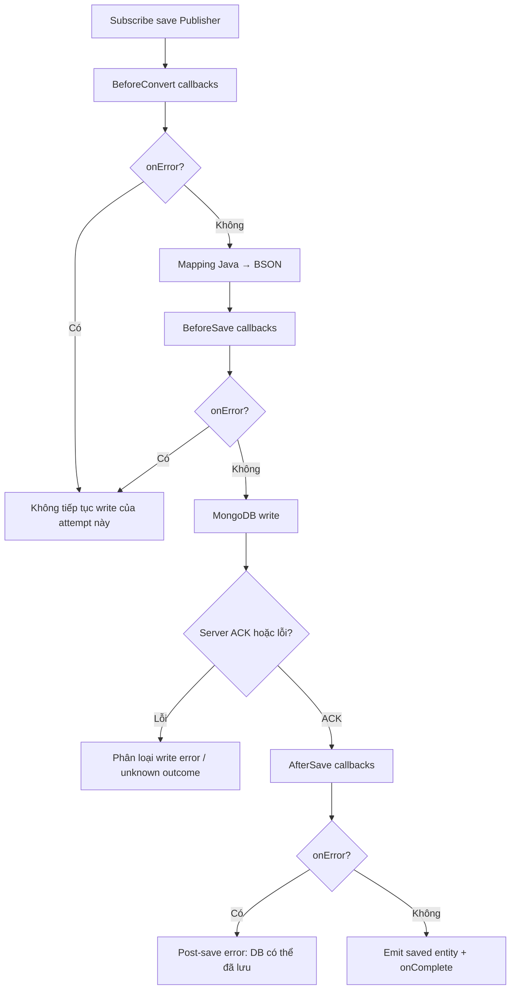
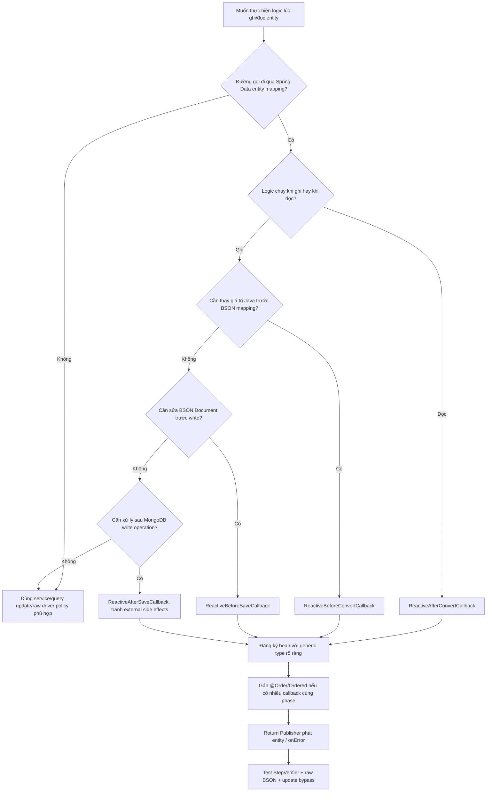

# Callback reactive và thứ tự thực thi

Trong ứng dụng **Spring Data MongoDB Reactive**, một thao tác `repository.insert(order)` không chỉ đơn giản biến entity thành BSON rồi gửi lên MongoDB. Tùy cấu hình, quá trình ghi và đọc còn đi qua **entity callbacks** để chuẩn hóa dữ liệu, bổ sung trường mặc định, kiểm tra ràng buộc, đánh dấu auditing hoặc chuẩn bị dữ liệu sau khi đọc. Nếu đăng ký nhiều callback cho cùng một entity, **thứ tự thực thi** quyết định callback nào nhìn thấy thay đổi của callback trước.

Hãy hình dung một lệnh tạo đơn hàng cần:

1. Chuẩn hóa mã ngoài `externalId` trước khi ghi.
2. Kiểm tra mã đã chuẩn hóa đáp ứng hợp đồng nghiệp vụ.
3. Bổ sung `schemaVersion` vào BSON document.
4. Lưu document lên MongoDB.
5. Ghi nhận thông tin observability khi save thành công.

Những bước đó không cùng một loại callback. Một phần phải chạy **trước khi chuyển entity thành `org.bson.Document`**, một phần chạy **sau khi đã chuyển**, và phần cuối chỉ được thực hiện **sau thao tác lưu**. Gắn hết vào một `ReactiveBeforeSaveCallback` có thể khiến entity và BSON khác nhau hoặc validation chạy sai thời điểm.

Bài thuộc chương **Vòng đời và callback** của module **SPRING_DATA_MONGODB**, nơi bạn học cách kết nối, ánh xạ document và thao tác MongoDB bằng repository hoặc template, thiết kế truy vấn, index, transaction, reactive access, kiểm thử và chẩn đoán lỗi dữ liệu. Mục tiêu trực tiếp là nắm chắc **Reactive EntityCallback và thứ tự thực thi tại từng điểm trong vòng đời mapping/ghi/đọc**, không nhầm chúng với Spring application events hay reactor operator.

Sau bài này, bạn có thể:

- Giải thích các mốc **before convert → trước save → database write → after save** và **database read → after convert**.
- Triển khai đúng `ReactiveBeforeConvertCallback<T>`, `ReactiveBeforeSaveCallback<T>`, `ReactiveAfterSaveCallback<T>`, `ReactiveAfterConvertCallback<T>`.
- Chọn `@Order` hoặc `Ordered` để xác định thứ tự **nhiều callback cùng giai đoạn**, hiểu chiều ưu tiên và thứ tự auditing.
- Phân biệt **entity Java**, **BSON `Document`**, dữ liệu thực sự được persist và entity trả về cho caller.
- Giải thích vì sao callback reactive trả `Publisher<T>` và chỉ có tác dụng khi luồng được subscribe đúng cách.
- Xử lý trường hợp publisher rỗng/lỗi, lỗi sau khi đã ghi, retry, cancellation và subscription lặp.
- Nhận diện các đường ghi **không đi qua entity callbacks**, chẳng hạn query update và thao tác raw driver.
- Viết kiểm thử `StepVerifier` để chứng minh callback order, BSON sau ghi, read-only enrichment và lỗi chặn ghi.

## 1. Bức tranh vòng đời: các checkpoint không hoán đổi được

### 1.1. Đường ghi entity

Với những thao tác lưu entity được Spring Data MongoDB hỗ trợ, trình tự khái niệm là:

```text
Caller subscribe Mono/Flux
        │
        ▼
Entity Java (OrderDocument)
        │
        ▼
ReactiveBeforeConvertCallback<T>
        │  trả entity đã chuẩn hóa/chỉnh sửa
        ▼
MappingMongoConverter
        │  Java object → org.bson.Document
        ▼
ReactiveBeforeSaveCallback<T>
        │  có thể thay đổi BSON Document sẽ được ghi
        ▼
MongoDB write / acknowledgment theo write concern
        │
        ▼
ReactiveAfterSaveCallback<T>
        │  trả entity cho downstream, có thể enrich in-memory
        ▼
Subscriber nhận onNext(savedEntity), onComplete
```

Đây là **thứ tự các giai đoạn**, không phải lời hứa mọi API đều phát tất cả callbacks. Ví dụ `ReactiveMongoTemplate.updateFirst(...)` dùng update operators trên BSON chứ không đi qua toàn bộ chu trình “entity → Document → save” của `insert/save`.

### 1.2. Đường đọc entity

```text
MongoDB read trả BSON Document
        │
        ▼
MappingMongoConverter
        │  org.bson.Document → Java entity
        ▼
ReactiveAfterConvertCallback<T>
        │  có thể enrich entity trước khi phát cho subscriber
        ▼
Mono<T> / Flux<T> emit entity
```

**Lưu ý về `afterLoad`:** trong Spring Data MongoDB còn có **lifecycle application event** `AfterLoadEvent` xảy ra sau khi BSON `Document` được tải về, trước khi mapping thành entity. Đây **không phải** lời mời tự khai báo một interface `ReactiveAfterLoadCallback` trong nhóm reactive entity callbacks nêu ở trên. Hai cơ chế cần được phân biệt rõ; API entity callbacks của MongoDB liệt kê `ReactiveAfterConvertCallback` cho điểm sau chuyển đổi ở đường đọc.

### 1.3. Bảng so sánh nhanh

| Giai đoạn | Reactive EntityCallback | Input chính | Việc nên làm |
| --- | --- | --- | --- |
| Trước mapping khi ghi | `ReactiveBeforeConvertCallback<T>` | Java entity, collection name | Chuẩn hóa entity, bổ sung default field/auditing trước BSON |
| Sau mapping, trước ghi | `ReactiveBeforeSaveCallback<T>` | Java entity, BSON Document, collection | Chỉnh **BSON Document được ghi**, bổ sung metadata storage |
| Sau ghi | `ReactiveAfterSaveCallback<T>` | Java entity, BSON Document, collection | Observability, chuẩn bị entity trả về; không nghĩ là chưa ghi |
| Sau BSON → entity khi đọc | `ReactiveAfterConvertCallback<T>` | Java entity, BSON Document, collection | Tính field `@Transient`/enrich view in-memory |

Mỗi callback trả một `Publisher<T>` để pipeline tiếp tục nhận entity đã được trả về; với những ví dụ đồng bộ không blocking, thường trả `Mono.just(entity)`. Nếu có công việc reactive thật, trả publisher biểu diễn công việc đó và phát **đúng một entity** sau khi hoàn thành.

## 2. Phân biệt Reactive EntityCallback và lifecycle ApplicationEvent

Spring Data MongoDB có hai họ điểm mở rộng với tên gần giống nhau:

**Họ 1 — EntityCallback:** `ReactiveBeforeConvertCallback`, `ReactiveBeforeSaveCallback`, `ReactiveAfterSaveCallback`, `ReactiveAfterConvertCallback`. Chúng là điểm mở rộng mapping/lifecycle được tích hợp vào chuỗi xử lý. Có thể trả entity đã chỉnh sửa; nhiều callback được gọi tuần tự theo thứ tự xác định.

**Họ 2 — Mapping lifecycle event:** `BeforeConvertEvent`, `BeforeSaveEvent`, `AfterSaveEvent`, `AfterLoadEvent`, `AfterConvertEvent` được công bố qua Spring `ApplicationEvent`. Listener thường kế thừa `AbstractMongoEventListener<T>`; hành vi phụ thuộc `ApplicationEventMulticaster`. Nếu dùng asynchronous multicaster, listener có thể chạy trong luồng khác và **không được bảo đảm thứ tự hoặc thời điểm hoàn tất trước bước tiếp theo**.

| Tiêu chí | Reactive EntityCallback | Mapping ApplicationEvent |
| --- | --- | --- |
| Điểm sử dụng | Reactive entity mapping pipeline | Event publishing/listener |
| Hợp đồng return | `Publisher<T>` trả entity đã xử lý | Event listener thường không trả entity cho pipeline |
| Thứ tự xử lý | Có thứ tự tại checkpoint, hỗ trợ `@Order`/`Ordered` | Phụ thuộc multicaster và listener; async không bảo đảm như callback |
| Chỉnh sửa entity immutable | Có thể trả **instance mới** đúng kiểu | Mutation qua event khó an toàn/khó phối hợp hơn |
| Trước/sau BSON mapping | Các reactive callback được hỗ trợ cụ thể | Có cả `AfterLoadEvent` |
| Mục tiêu phù hợp | Defaulting/validation/enrichment cần nằm đúng chuỗi ghi/đọc | Quan sát, tích hợp sự kiện trong Spring context |

Theo tài liệu Spring Data MongoDB, các store-specific application events **được phát trước khi gọi entity callbacks tương ứng**. Tuy vậy, điều này **không đồng nghĩa listener async đã xử lý xong trước callback**. Khi tính đúng đắn của dữ liệu phụ thuộc một bước bắt buộc hoàn tất, ưu tiên **EntityCallback** hoặc service composition với Publisher được chờ, không dựa vào thời gian chạy của một async event listener.

**Phân biệt tiếp:** `@EventListener` nhận domain event ứng dụng và `ReactiveMongoRepository` lưu entity không tự biến tất cả sự kiện ứng dụng thành MongoDB lifecycle callbacks. Không dựa vào tên “listener” để suy ra được gọi bởi thao tác nào.

## 3. API và chữ ký chính xác của các reactive callbacks

Các interface quan trọng thuộc package `org.springframework.data.mongodb.core.mapping.event`. Phần dưới dùng `reactor.core.publisher.Mono` làm implementation của `org.reactivestreams.Publisher`.

### 3.1. `ReactiveBeforeConvertCallback<T>`

```java
import org.reactivestreams.Publisher;
import org.springframework.data.mongodb.core.mapping.event.ReactiveBeforeConvertCallback;
import reactor.core.publisher.Mono;

public final class NormalizeOrderBeforeConvert
        implements ReactiveBeforeConvertCallback<OrderDocument> {

    @Override
    public Publisher<OrderDocument> onBeforeConvert(
            OrderDocument entity, String collection) {
        entity.normalizeExternalId();
        return Mono.just(entity);
    }
}
```

Điểm này chạy **trước** Spring Data map entity thành BSON. Thay đổi ở Java entity như `createdAt`, `externalId`, `status` có cơ hội được converter đưa vào document.

Đối với entity immutable (record/constructor-based), callback có thể trả **entity mới** với các giá trị đã chuẩn hóa, thay vì mutate instance.

### 3.2. `ReactiveBeforeSaveCallback<T>`

```java
import org.bson.Document;
import org.reactivestreams.Publisher;
import org.springframework.data.mongodb.core.mapping.event.ReactiveBeforeSaveCallback;
import reactor.core.publisher.Mono;

public final class StampBeforeSave
        implements ReactiveBeforeSaveCallback<OrderDocument> {

    @Override
    public Publisher<OrderDocument> onBeforeSave(
            OrderDocument entity,
            Document document,
            String collection) {
        document.put("schemaVersion", 1);
        return Mono.just(entity);
    }
}
```

Đây là checkpoint **sau khi mapping**. `Document` truyền vào là bản BSON mapping đang chuẩn bị ghi; việc thêm `schemaVersion` vào nó được phản ánh trong dữ liệu persist khi write thành công. Nếu chỉ mutate field Java **sau mapping** mà không chỉnh BSON Document tương ứng, bạn không nên mặc định converter sẽ map lại entity cho trường đó trước khi ghi.

### 3.3. `ReactiveAfterSaveCallback<T>`

```java
import org.bson.Document;
import org.reactivestreams.Publisher;
import org.springframework.data.mongodb.core.mapping.event.ReactiveAfterSaveCallback;
import reactor.core.publisher.Mono;

public final class ObserveAfterSave
        implements ReactiveAfterSaveCallback<OrderDocument> {

    @Override
    public Publisher<OrderDocument> onAfterSave(
            OrderDocument entity,
            Document document,
            String collection) {
        // Không coi đây là thời điểm "trước khi lưu".
        // Không phát một write nghiệp vụ thứ hai ngoài ý muốn.
        return Mono.just(entity);
    }
}
```

Callback này chạy **sau** thao tác save vào MongoDB. Một thay đổi của entity Java ở đây có thể ảnh hưởng object **trả về cho downstream**, nhưng **không tự lưu ngược một lần nữa**. Nếu callback này phát `onError`, upstream write **có thể đã thành công**, nên caller không thể chỉ nhìn exception để kết luận document chưa được lưu.

### 3.4. `ReactiveAfterConvertCallback<T>`

```java
import org.bson.Document;
import org.reactivestreams.Publisher;
import org.springframework.data.mongodb.core.mapping.event.ReactiveAfterConvertCallback;
import reactor.core.publisher.Mono;

public final class EnrichAfterConvert
        implements ReactiveAfterConvertCallback<OrderDocument> {

    @Override
    public Publisher<OrderDocument> onAfterConvert(
            OrderDocument entity,
            Document document,
            String collection) {
        entity.setDisplayLabel(
            entity.getStatus() + ":" + entity.getExternalId()
        );
        return Mono.just(entity);
    }
}
```

`setDisplayLabel` trong ví dụ giả định là một setter trên field Java `@Transient`. Đây là thay đổi **trên entity đã được đọc**, không phải MongoDB `$set`. Nếu muốn thay đổi dữ liệu lưu, phải gọi một write hợp lệ và kiểm soát vòng đời riêng.

### 3.5. Callback nào có thể là bất đồng bộ?

Chữ ký nhận `Publisher<T>` nên có thể trả:

```java
@Override
public Publisher<OrderDocument> onBeforeConvert(
        OrderDocument entity, String collection) {
    return reactivePolicyService.validate(entity)
        .thenReturn(entity);
}
```

`reactivePolicyService.validate(entity)` là ví dụ về một service **thực sự non-blocking**, trả `Mono<Void>` và phát error khi không đạt. Không gọi `.block()` trong callback. Cũng không gọi `.subscribe()` rồi trả `Mono.just(entity)`: nếu làm vậy, pipeline ghi **không chờ** validation hoàn tất.

## 4. Hai tầng thứ tự: thứ tự giai đoạn và thứ tự callback trong một giai đoạn

Đây là phần quan trọng nhất của chủ đề. Có **hai quan hệ thứ tự độc lập**:

1. **Thứ tự giữa các giai đoạn** do Spring Data MongoDB xác định: before convert → conversion → before save → write → after save, hoặc read → conversion → after convert.
2. **Thứ tự giữa nhiều bean cùng triển khai một callback interface** do `@Order` hoặc `Ordered` quy định.

Một bean `ReactiveBeforeSaveCallback` có `@Order(-1000)` **không thể chạy trước** một bean `ReactiveBeforeConvertCallback` có `@Order(500)` trong luồng ghi thông thường: giá trị order chỉ được so sánh **giữa những callbacks cùng checkpoint**, không đảo ngược các checkpoint.

### 4.1. Số nhỏ có ưu tiên chạy trước

Ví dụ có ba bean cùng triển khai `ReactiveBeforeConvertCallback<OrderDocument>`:

| Bean | Cấu hình | Thứ tự trong before convert |
| --- | --- | --- |
| `NormalizeIdCallback` | `@Order(10)` | Trước |
| `ValidateNormalizedIdCallback` | `@Order(20)` | Sau normalize |
| `TraceDefaultCallback` | Không khai báo order | Thường ở cuối, precedence thấp nhất |

Spring dùng cơ chế `Ordered`: **giá trị số nhỏ hơn được thực thi sớm hơn**. `Ordered.HIGHEST_PRECEDENCE` biểu diễn ưu tiên cao nhất, `Ordered.LOWEST_PRECEDENCE` biểu diễn thấp nhất.

```java
import org.springframework.core.annotation.Order;
import org.springframework.stereotype.Component;

@Component
@Order(10)
class NormalizeIdCallback
        implements ReactiveBeforeConvertCallback<OrderDocument> {
    // ...
}

@Component
@Order(20)
class ValidateNormalizedIdCallback
        implements ReactiveBeforeConvertCallback<OrderDocument> {
    // ...
}
```

**Đừng dựa vào thứ tự đăng ký bean hoặc thứ tự tên file Java**. Khi hai callback có **cùng order** và tính đúng đắn phụ thuộc callback nào trước, thiết kế chưa đủ rõ: hãy gán hai thứ tự khác nhau hoặc hợp nhất hai bước bắt buộc thành một callback/pipeline.

### 4.2. `Ordered` tương đương một cách khai báo khác

```java
import org.springframework.core.Ordered;

@Component
public class NormalizeIdCallback
        implements ReactiveBeforeConvertCallback<OrderDocument>,
                   Ordered {

    @Override
    public int getOrder() {
        return 10;
    }

    @Override
    public Publisher<OrderDocument> onBeforeConvert(
            OrderDocument entity, String collection) {
        entity.normalizeExternalId();
        return Mono.just(entity);
    }
}
```

Đây là **phương án thay thế** cho `@Order(10)`, không phải khuyến nghị khai báo cùng một class hai lần. Khi một project dùng cả annotation và `Ordered`, cần thống nhất quy ước và kiểm tra giá trị thực tế mà Spring dùng khi sort.

### 4.3. Auditing có vị trí trong thứ tự before convert

Khi Spring Data MongoDB reactive auditing được bật, `ReactiveAuditingEntityCallback` tham gia checkpoint **before convert** và tài liệu của Spring Data ghi order mặc định của auditing callback là **100**. Vì vậy:

```text
@Order(50)  custom before convert   ─┐
                                     ├─ cùng giai đoạn before convert
Auditing callback (order 100)      ──┤
                                     │
@Order(150) custom before convert  ──┘
     ↓
mapping Java → BSON
     ↓
beforeSave callbacks theo order riêng của chúng
```

Ví dụ này giả định auditing **đã được enable và bean auditing được đăng ký**; nếu không bật, không có bước auditing tương ứng. Thứ tự này cho phép một callback custom ở 50 chuẩn hóa dữ liệu trước auditing, callback ở 150 đọc entity sau auditing. Nhưng không dùng cùng order 100 để phụ thuộc vào một thứ tự không được nêu rõ.

**Lưu ý:** order của `ReactiveAuditingEntityCallback` có thể thay đổi giữa các phiên bản hoặc customization. Với project thực tế, kiểm tra Spring Data version đang dùng và xác nhận bằng integration test.

### 4.4. Order áp dụng cho cùng phase, không phải toàn bộ hệ thống

Giả sử:

```text
ReactiveBeforeConvertCallback A   order = 100
ReactiveBeforeConvertCallback B   order = 200
ReactiveBeforeSaveCallback C      order = 1
ReactiveBeforeSaveCallback D      order = 999
ReactiveAfterSaveCallback E       order = -100
```

Khi ghi thành công:

```text
A → B → MappingMongoConverter → C → D → MongoDB write → E
```

Không có chuyện callback E chạy đầu tiên chỉ vì `-100` nhỏ nhất. Thứ tự số chỉ giải quyết *bên trong từng loại callback*.

### 4.5. Callback phải phát đúng kết quả để chuỗi tiếp tục

Mỗi callback `Reactive...Callback<T>` có hợp đồng trả `Publisher<T>`. Trong ví dụ normal case, publisher cần phát **một entity hợp lệ**, có thể là instance được thay đổi:

```java
return Mono.just(entity);
```

Nếu callback trả `Mono.error(...)`, chuỗi dừng bằng lỗi tại checkpoint đó. Nếu callback trả `Mono.empty()`, pipeline không còn entity tiếp theo để tiếp tục theo lộ trình thông thường; **không coi đây là cách “bỏ qua callback nhưng vẫn lưu”**.

Với callback bất đồng bộ, Spring Data lấy publisher của callback và tích hợp trong chuỗi; thứ tự được bảo đảm bởi composition đó, **không phải** bởi việc gọi `subscribe()` tự phát.

## 5. Ví dụ end-to-end: entity, các callback và thứ tự dễ kiểm chứng

Ví dụ sau thiết kế cho **Spring Boot + Spring Data MongoDB Reactive + Reactor**. Tất cả class code đặt trong cùng package `com.example.mongo.lifecycle` và có thể được chuyển thành các file Java riêng khi dùng trong dự án.

### 5.1. Entity: field được lưu và field chỉ dùng lúc đọc

```java
package com.example.mongo.lifecycle;

import java.math.BigDecimal;
import java.time.Instant;
import java.util.Locale;
import org.bson.types.ObjectId;
import org.springframework.data.annotation.Id;
import org.springframework.data.annotation.Transient;
import org.springframework.data.mongodb.core.mapping.Document;
import org.springframework.data.mongodb.core.mapping.Field;
import org.springframework.data.mongodb.core.mapping.FieldType;

@Document(collection = "orders_lifecycle_lab")
public class OrderDocument {

    @Id
    private ObjectId id;

    private String tenantId;
    private String externalId;
    private String status;
    private Instant createdAt;

    @Field(targetType = FieldType.DECIMAL128)
    private BigDecimal totalAmount;

    @Transient
    private String displayLabel;

    protected OrderDocument() {}

    public OrderDocument(
            String tenantId,
            String externalId,
            String status,
            BigDecimal totalAmount) {
        this.tenantId = tenantId;
        this.externalId = externalId;
        this.status = status;
        this.totalAmount = totalAmount;
    }

    public void normalizeExternalId() {
        if (externalId != null) {
            externalId = externalId.strip()
                .toUpperCase(Locale.ROOT);
        }
    }

    public void setCreatedAt(Instant value) {
        this.createdAt = value;
    }

    public void setDisplayLabel(String value) {
        this.displayLabel = value;
    }

    public ObjectId getId() { return id; }
    public String getTenantId() { return tenantId; }
    public String getExternalId() { return externalId; }
    public String getStatus() { return status; }
    public Instant getCreatedAt() { return createdAt; }
    public BigDecimal getTotalAmount() { return totalAmount; }
    public String getDisplayLabel() { return displayLabel; }
}
```

`@Transient` của **Spring Data** bảo đảm `displayLabel` không phải field persist. Nó khác một field Java bình thường được mapping. Khi `ReactiveAfterConvertCallback` tính label, MongoDB **không tự có field này**.

`@Field(targetType = FieldType.DECIMAL128)` định hướng lưu BigDecimal dưới BSON Decimal128; cần kiểm tra raw BSON trong integration test, không suy ra dữ liệu sẽ đúng kiểu chỉ từ Java object.

### 5.2. Ghi lại các mốc thực thi trong lab

```java
package com.example.mongo.lifecycle;

import java.util.List;
import java.util.concurrent.CopyOnWriteArrayList;
import org.springframework.stereotype.Component;

@Component
public class CallbackTrace {
    private final CopyOnWriteArrayList<String> events =
        new CopyOnWriteArrayList<>();

    public void record(String event) {
        events.add(event);
    }

    public List<String> snapshot() {
        return List.copyOf(events);
    }

    public void clear() {
        events.clear();
    }
}
```

**Chỉ dùng trace này trong lab/test.** Một singleton list ghi mọi callback ở production sẽ trộn request của nhiều tenant và tăng bộ nhớ vô hạn. Với production, dùng logging/tracing/metrics đúng scope, redact thông tin nhạy cảm và không biến callback thành nơi lưu trạng thái xử lý request.

### 5.3. Callback thứ nhất — chuẩn hóa trước convert

```java
package com.example.mongo.lifecycle;

import java.time.Instant;
import org.reactivestreams.Publisher;
import org.springframework.core.annotation.Order;
import org.springframework.data.mongodb.core.mapping.event.ReactiveBeforeConvertCallback;
import org.springframework.stereotype.Component;
import reactor.core.publisher.Mono;

@Component
@Order(50)
public class NormalizeBeforeConvert
        implements ReactiveBeforeConvertCallback<OrderDocument> {

    private final CallbackTrace trace;

    public NormalizeBeforeConvert(CallbackTrace trace) {
        this.trace = trace;
    }

    @Override
    public Publisher<OrderDocument> onBeforeConvert(
            OrderDocument entity, String collection) {

        return Mono.fromSupplier(() -> {
            entity.normalizeExternalId();
            if (entity.getCreatedAt() == null) {
                entity.setCreatedAt(Instant.now());
            }
            trace.record("beforeConvert.50");
            return entity;
        });
    }
}
```

`Mono.fromSupplier` trì hoãn việc sửa field đến lúc callback publisher được subscribe. Đặt default `createdAt` chỉ khi thiếu để tránh thay đổi timestamp không chủ đích khi lưu lại entity. Normalization phải **idempotent** để việc subscribe/retry có chủ đích không tạo mỗi lần một externalId khác.

### 5.4. Callback thứ hai — kiểm tra sau normalize, vẫn trước convert

```java
package com.example.mongo.lifecycle;

import org.reactivestreams.Publisher;
import org.springframework.core.annotation.Order;
import org.springframework.data.mongodb.core.mapping.event.ReactiveBeforeConvertCallback;
import org.springframework.stereotype.Component;
import reactor.core.publisher.Mono;

@Component
@Order(150)
public class ValidateBeforeConvert
        implements ReactiveBeforeConvertCallback<OrderDocument> {

    private final CallbackTrace trace;

    public ValidateBeforeConvert(CallbackTrace trace) {
        this.trace = trace;
    }

    @Override
    public Publisher<OrderDocument> onBeforeConvert(
            OrderDocument entity, String collection) {
        return Mono.defer(() -> {
            trace.record("beforeConvert.150");
            if (entity.getTenantId() == null
                    || entity.getTenantId().isBlank()
                    || entity.getExternalId() == null
                    || entity.getExternalId().isBlank()
                    || entity.getTotalAmount() == null
                    || entity.getTotalAmount().signum() < 0) {
                return Mono.error(
                    new IllegalArgumentException(
                        "Order không đạt ràng buộc trước mapping"
                    )
                );
            }
            return Mono.just(entity);
        });
    }
}
```

Do `@Order(50)` chạy trước `@Order(150)` trong cùng phase, callback validate nhìn thấy `externalId` đã được chuẩn hóa. Ví dụ kiểm tra field cục bộ; không xem `tenantId` hợp lệ về mặt định dạng là đã **được phân quyền**. Tenant phải được lấy từ authentication context và kiểm soát tại service.

### 5.5. Callback before save thứ nhất — sửa BSON Document

```java
package com.example.mongo.lifecycle;

import org.bson.Document;
import org.reactivestreams.Publisher;
import org.springframework.core.annotation.Order;
import org.springframework.data.mongodb.core.mapping.event.ReactiveBeforeSaveCallback;
import org.springframework.stereotype.Component;
import reactor.core.publisher.Mono;

@Component
@Order(20)
public class StampBeforeSave
        implements ReactiveBeforeSaveCallback<OrderDocument> {

    private final CallbackTrace trace;

    public StampBeforeSave(CallbackTrace trace) {
        this.trace = trace;
    }

    @Override
    public Publisher<OrderDocument> onBeforeSave(
            OrderDocument entity,
            Document document,
            String collection) {
        return Mono.fromSupplier(() -> {
            document.put("schemaVersion", 1);
            trace.record("beforeSave.20");
            return entity;
        });
    }
}
```

Ở checkpoint này, entity đã được chuyển thành `Document`. `schemaVersion` trong ví dụ **không có field tương ứng trong entity** nhưng vẫn được ghi vào BSON vì callback chỉnh `Document`. Khi đọc lại entity, mapping có thể bỏ qua field không khai báo; test raw document là cách thấy nó thật sự đã persist.

### 5.6. Callback before save thứ hai — xác nhận dữ liệu từ callback trước

```java
package com.example.mongo.lifecycle;

import org.bson.Document;
import org.reactivestreams.Publisher;
import org.springframework.core.annotation.Order;
import org.springframework.data.mongodb.core.mapping.event.ReactiveBeforeSaveCallback;
import org.springframework.stereotype.Component;
import reactor.core.publisher.Mono;

@Component
@Order(80)
public class CheckStampedDocumentBeforeSave
        implements ReactiveBeforeSaveCallback<OrderDocument> {

    private final CallbackTrace trace;

    public CheckStampedDocumentBeforeSave(CallbackTrace trace) {
        this.trace = trace;
    }

    @Override
    public Publisher<OrderDocument> onBeforeSave(
            OrderDocument entity,
            Document document,
            String collection) {
        return Mono.defer(() -> {
            trace.record("beforeSave.80");
            if (!Integer.valueOf(1).equals(
                    document.get("schemaVersion"))) {
                return Mono.error(
                    new IllegalStateException(
                        "schemaVersion chưa được stamp"
                    )
                );
            }
            return Mono.just(entity);
        });
    }
}
```

`@Order(20)` chạy trước `@Order(80)` trong **cùng phase before save**. Nếu cố đổi thứ tự cho callback kiểm tra lên trước callback stamp, test phải thất bại trước write; đây là bằng chứng thứ tự có ý nghĩa đối với tính đúng đắn.

### 5.7. Callback after save — quan sát sau write

```java
package com.example.mongo.lifecycle;

import org.bson.Document;
import org.reactivestreams.Publisher;
import org.springframework.core.annotation.Order;
import org.springframework.data.mongodb.core.mapping.event.ReactiveAfterSaveCallback;
import org.springframework.stereotype.Component;
import reactor.core.publisher.Mono;

@Component
@Order(50)
public class TraceAfterSave
        implements ReactiveAfterSaveCallback<OrderDocument> {

    private final CallbackTrace trace;

    public TraceAfterSave(CallbackTrace trace) {
        this.trace = trace;
    }

    @Override
    public Publisher<OrderDocument> onAfterSave(
            OrderDocument entity,
            Document document,
            String collection) {
        return Mono.fromSupplier(() -> {
            trace.record("afterSave.50");
            return entity;
        });
    }
}
```

Sau khi callback này phát entity, downstream có thể nhận kết quả từ `template.insert/save`. **Không đặt thao tác gửi email, charge thẻ hoặc cập nhật hệ thống bên ngoài không idempotent ngay trong after save** nếu pipeline có khả năng retry: MongoDB write và side effect bên ngoài không cùng một transaction.

### 5.8. Callback after convert — enrich entity vừa đọc

```java
package com.example.mongo.lifecycle;

import org.bson.Document;
import org.reactivestreams.Publisher;
import org.springframework.core.annotation.Order;
import org.springframework.data.mongodb.core.mapping.event.ReactiveAfterConvertCallback;
import org.springframework.stereotype.Component;
import reactor.core.publisher.Mono;

@Component
@Order(50)
public class LabelAfterConvert
        implements ReactiveAfterConvertCallback<OrderDocument> {

    private final CallbackTrace trace;

    public LabelAfterConvert(CallbackTrace trace) {
        this.trace = trace;
    }

    @Override
    public Publisher<OrderDocument> onAfterConvert(
            OrderDocument entity,
            Document document,
            String collection) {
        return Mono.fromSupplier(() -> {
            entity.setDisplayLabel(
                entity.getStatus() + ":" + entity.getExternalId()
            );
            trace.record("afterConvert.50");
            return entity;
        });
    }
}
```

Vì `displayLabel` là field `@Transient`, nó có thể có trên object trả về sau `findById/findOne` nhưng không có trong BSON. **Không** tạo ý nghĩa “đọc entity sẽ cập nhật database”: callback after convert chỉ điều chỉnh representation trong pipeline đọc.

### 5.9. Dấu vết kỳ vọng

Với một `ReactiveMongoTemplate.insert(...)` được subscribe một lần, không bật thêm callback auditing/validation khác, trace mong đợi:

```text
beforeConvert.50
beforeConvert.150
beforeSave.20
beforeSave.80
afterSave.50
```

Sau khi **đọc entity** qua `ReactiveMongoTemplate.findOne(...)`, trace có thêm:

```text
afterConvert.50
```

Nếu đã bật các callback khác (auditing, validation, custom extensions), trace thực tế có thể có thêm những bước. Đây là **thứ tự của các callback do lab định nghĩa**, không phải tuyên bố chỉ có năm/sáu checkpoint trên mọi phiên bản.

### 5.10. Vì sao không ghi trace trong constructor?

Constructor được Spring Data dùng khi materialize entity, nhưng **không đại diện một lifecycle callback cụ thể**. Khi đổi mapping constructor hoặc dùng object immutable, constructor có thể được gọi ở thời điểm khác. Muốn quan sát đúng checkpoint, ghi trace từ `onBeforeConvert/onBeforeSave/onAfterSave/onAfterConvert` rồi assert trong test.

## 6. Callback registration và phạm vi theo domain type

### 6.1. Spring cần biết callback là bean của application context

Trong ví dụ trên, mỗi class được đánh dấu:

```java
@Component
@Order(50)
public class NormalizeBeforeConvert
        implements ReactiveBeforeConvertCallback<OrderDocument> {
    // ...
}
```

Một class chỉ `implements ReactiveBeforeConvertCallback<T>` nhưng **không được đăng ký thành Spring bean** sẽ không tự được Spring Data gọi. Có thể đăng ký qua `@Component`/component scan hoặc `@Bean` trong `@Configuration`.

Ví dụ `@Bean`:

```java
import org.springframework.context.annotation.Bean;
import org.springframework.context.annotation.Configuration;

@Configuration
class OrderCallbackConfiguration {

    @Bean
    ReactiveBeforeConvertCallback<OrderDocument> customCallback() {
        return new DefaultingBeforeConvertCallback();
    }
}
```

`DefaultingBeforeConvertCallback` ở đây là class minh họa mà project phải tự định nghĩa; snippet minh họa phương án bean registration, **không dùng đồng thời với một `@Component` trùng tác dụng**. Nếu đăng ký hai bean tương đương, chúng có thể chạy cả hai lần.

### 6.2. Vì sao generic `<OrderDocument>` quan trọng?

`ReactiveBeforeSaveCallback<OrderDocument>` chỉ dành cho những entity thuộc phạm vi type phù hợp. Nếu triển khai callback không có generic type rõ ràng, dùng raw type hoặc bean lambda thiếu thông tin type, cơ chế lọc type có thể kém hiệu quả hoặc callback ảnh hưởng cả những entity không dự định.

Ví dụ không nên lạm dụng:

```java
@Bean
ReactiveBeforeConvertCallback rawCallback() {
    return (entity, collection) -> Mono.just(entity);
}
```

Đây là raw type không mô tả domain class. Với nhiều collection và hàng trăm entity, callback nên khai báo **type cụ thể**, tránh xử lý document của collection khác hoặc kiểm tra type tại runtime không cần thiết.

Nếu phải viết callback dùng chung, thiết kế một class generic có type filtering và contract rõ ràng; không để một callback mặc định gắn field `schemaVersion` vào tất cả BSON document mà không xét domain.

### 6.3. Collection name là tham số ngữ cảnh, không phải nguồn quyền

Các callback nhận `String collection` là tên collection thực tế mà thao tác gắn với entity. Nó có thể hữu ích để logging/logic dành riêng collection, nhưng:

- Không coi tên collection như “người dùng đã được xác thực”.
- Không lấy tenant từ tên collection rồi mặc định được phép thay tenant của entity.
- Không đọc request-scoped `ThreadLocal` ở callback reactive mà cho rằng luôn có dữ liệu đúng qua mọi async boundary.
- Nếu ứng dụng có dynamic collection hoặc nhiều tenant, test phải xác nhận callback nhận tên collection nào và từng path ghi có dùng đúng collection không.

**Tenant scoping và authorization thuộc service/boundary**, không thay thế bởi việc callback kiểm tra `tenantId != null`.

## 7. Reactive auditing và validation trong chuỗi callback

### 7.1. Auditing trước khi chuyển Java entity thành BSON

Spring Data hỗ trợ các metadata auditing như `@CreatedDate`, `@LastModifiedDate`, `@CreatedBy` và `@LastModifiedBy` khi auditing được cấu hình phù hợp.

Ví dụ entity:

```java
import java.time.Instant;
import org.springframework.data.annotation.CreatedDate;
import org.springframework.data.annotation.LastModifiedDate;

@CreatedDate
private Instant createdAt;

@LastModifiedDate
private Instant updatedAt;
```

Khai báo metadata riêng **không bảo đảm** trường được điền nếu chưa bật reactive auditing và chuẩn bị infrastructure liên quan. Trong cấu hình hỗ trợ, có thể bật qua `@EnableReactiveMongoAuditing`:

```java
import org.springframework.context.annotation.Configuration;
import org.springframework.data.mongodb.config.EnableReactiveMongoAuditing;

@Configuration
@EnableReactiveMongoAuditing
class MongoReactiveAuditingConfig {}
```

Ví dụ đoạn khai báo audit là **phương án mở rộng** của entity lab; nếu dùng `@CreatedDate` để set `createdAt`, cân nhắc bỏ logic mặc định tự set `createdAt` trong `NormalizeBeforeConvert`, tránh hai nơi cùng chịu trách nhiệm. Trong một project thật, nêu rõ code nào là nguồn chuẩn của audit field.

### 7.2. Mốc order 100 của `ReactiveAuditingEntityCallback`

Spring Data MongoDB ghi nhận auditing callback ở checkpoint `beforeConvert`, mặc định order **100** trong tài liệu phiên bản hiện hành. Vì vậy một callback `@Order(50)` có thể chạy trước audit, còn `@Order(150)` chạy sau audit khi cùng type.

Nhưng audit có thể phụ thuộc các config như reactive auditor context hoặc `DateTimeProvider`. Nếu auditorId đến từ security context, cần tích hợp đúng reactive context, không đọc ThreadLocal không tương thích.

### 7.3. Bean Validation cần cấu hình callback riêng

Jakarta Bean Validation annotations như `@NotBlank`, `@NotNull` không tự chạy trên mọi đường ghi chỉ vì entity có `@Document`. Với Spring Data MongoDB reactive có thể đăng ký `ReactiveValidatingEntityCallback`:

```java
import jakarta.validation.Validator;
import org.springframework.context.annotation.Bean;
import org.springframework.context.annotation.Configuration;
import org.springframework.data.mongodb.core.mapping.event.ReactiveValidatingEntityCallback;

@Configuration
class MongoValidationConfig {

    @Bean
    ReactiveValidatingEntityCallback validatingEntityCallback(
            Validator validator) {
        return new ReactiveValidatingEntityCallback(validator);
    }
}
```

Callback validation hoạt động tại checkpoint của interface tương ứng theo phiên bản Spring Data; đừng tự giả định nó chạy trước/sau mọi callback custom nếu chưa xem order và viết test. Đặc biệt, một rule trên Java field **đã chuẩn hóa tại `beforeConvert`** cần được kiểm tra ở điểm mà field mới đã có giá trị cuối dự kiến.

### 7.4. Validator Java không thay MongoDB collection validation

Reactive EntityCallback chỉ chạy qua **những thao tác đi qua mapping pipeline của Spring Data**, không chặn mọi client khác dùng raw driver/`mongosh`. Một MongoDB `$jsonSchema` với `validationAction:"error"` là cơ chế ở **database server**, kiểm tra BSON theo schema ở collection (trừ những trường hợp/chế độ được phép bỏ qua).

Nên phân biệt:

| Ràng buộc | Điểm kiểm tra |
| --- | --- |
| DTO của HTTP request không blank | `@Valid` tại WebFlux boundary |
| Entity cần mặc định và normalization | `ReactiveBeforeConvertCallback` |
| Entity cần Jakarta Bean Validation | `ReactiveValidatingEntityCallback` có cấu hình |
| BSON phải là Decimal128/Date/status enum | MongoDB `$jsonSchema` phía server |
| Đơn của tenant khác không được truy cập | Authorization và scoped query/update |
| Trạng thái phải chuyển NEW → PAID có điều kiện | Service + conditional update/transaction |

Không dùng một callback làm công cụ “vá” mọi loại invariant. Callback có thể thích hợp để normalize hoặc validate field, nhưng uniqueness phải được bảo vệ bằng index/transaction khi cần, còn quyền truy cập cần security context và điều kiện truy vấn.

## 8. Subscription, tín hiệu Reactor và các lỗi thường gặp về timing

### 8.1. Tạo Publisher chưa bảo đảm callback đã chạy

```java
OrderDocument input = new OrderDocument(
    trustedTenantId,
    " ext-100 ",
    "NEW",
    new BigDecimal("100.00")
);

Mono<OrderDocument> savePublisher =
    reactiveMongoTemplate.insert(input);

// Đến đây chỉ có Publisher: chưa có bằng chứng
// MongoDB write và các callback đã hoàn tất.
```

Reactive repository/template mô tả công việc bằng Publisher. Với luồng cold thông thường, việc thực hiện và callback liên quan được kích hoạt khi có **subscription**. Trong WebFlux, framework thường subscribe cho Publisher mà controller trả về. Trong test, dùng `StepVerifier` để đăng ký và kiểm tra các signal.

Nếu chỉ tạo Publisher rồi **không subscribe**, đừng mong trace được ghi, dữ liệu xuất hiện trên MongoDB hay after-save callback tự chạy.

### 8.2. Không gọi `subscribe()` bên trong callback

Sai:

```java
@Override
public Publisher<OrderDocument> onBeforeConvert(
        OrderDocument entity, String collection) {
    reactivePolicyService.validate(entity)
        .subscribe(); // Fire-and-forget: lỗi race.

    return Mono.just(entity);
}
```

Write có thể đi tiếp **trước khi validation kết thúc**. Lỗi của validation không còn liên kết đúng với lỗi của save; cancellation/transaction context cũng bị tách ra.

Đúng:

```java
@Override
public Publisher<OrderDocument> onBeforeConvert(
        OrderDocument entity, String collection) {

    return reactivePolicyService.validate(entity)
        .thenReturn(entity);
}
```

Ở đây `reactivePolicyService.validate` là method của ứng dụng trả `Mono<Void>`. Nếu nó phát `onError`, callback phát lỗi và phần ghi sau checkpoint **không được tiếp tục bình thường**.

### 8.3. Không dùng `block()` để gọi repository khác trong callback

Sai:

```java
@Override
public Publisher<OrderDocument> onBeforeConvert(
        OrderDocument entity, String collection) {
    boolean exists = otherReactiveRepository
        .existsByExternalId(entity.getExternalId())
        .block(); // Blocking và phá reactive chain.
    return Mono.just(entity);
}
```

Đúng hơn về mặt composition:

```java
return otherReactiveRepository
    .existsByTenantIdAndExternalId(
        entity.getTenantId(), entity.getExternalId()
    )
    .flatMap(exists -> {
        if (exists) {
            return Mono.error(
                new IllegalStateException("External ID trùng")
            );
        }
        return Mono.just(entity);
    });
```

**Nhưng lưu ý về nghiệp vụ:** đoạn đúng hơn về Reactor **vẫn không bảo đảm uniqueness khi ghi đồng thời**. Hai request có thể cùng thấy `exists=false` và cùng insert. Unique index trên `(tenantId,externalId)` mới là ràng buộc database phù hợp. Hơn nữa, gọi query trong mọi callback có thể tạo **N+1**, tăng latency và nguy cơ recursion nếu callback đụng cùng entity/collection. Ưu tiên unique index, validation cục bộ và service layer.

### 8.4. Không phát `Mono.empty()` như thể đã “cho qua” validation

```java
// Sai ý nghĩa nếu bạn muốn tiếp tục save bình thường.
return Mono.empty();
```

Callback phải cung cấp entity cho bước tiếp theo. Một Publisher rỗng có thể làm đoạn chain **không còn entity** để persist hoặc trả cho downstream. Nếu muốn **ngăn ghi vì dữ liệu sai**, phát lỗi có ý nghĩa:

```java
return Mono.error(
    new IllegalArgumentException("Mã đơn không hợp lệ")
);
```

Nếu muốn cho phép ghi, trả `Mono.just(entity)` hoặc một Publisher phát entity đã chỉnh sửa.

### 8.5. Đăng ký hai subscription có thể tạo hai lần callback và write

```java
Mono<OrderDocument> save = repository.insert(order);

// KHÔNG NÊN trong WebFlux service:
save.subscribe();
return save;  // WebFlux subscribe lần hai.
```

Điều này có thể kích hoạt callbacks nhiều lần và gửi write lần thứ hai. Nếu document có ID/unique key, có thể thấy duplicate key; nếu callback làm side effect hoặc tạo timestamp/ngẫu nhiên, dễ có kết quả không nhất quán.

**Không cố tự khắc phục bằng `cache()` cho mọi write**. `cache()` có thể thay semantics từ mỗi subscription thành chia sẻ một kết quả và khiến lifecycle khó kiểm soát trong các ngữ cảnh khác. Với write có tác dụng nghiệp vụ, hãy định nghĩa idempotency, unique key và quyền sở hữu subscription đúng cách.

### 8.6. `flatMap` có thể đồng thời giữa các entity, dù callback trong mỗi entity có thứ tự

Ví dụ service:

```java
Flux<OrderDocument> saved = Flux.fromIterable(commands)
    .flatMap(command -> repository.insert(command), 8);
```

Từng entity đi qua beforeConvert → beforeSave → write → afterSave theo pipeline, nhưng **hai entity khác nhau có thể tiến hành đồng thời**. Trace toàn cục có thể xen kẽ:

```text
order-A beforeConvert
order-B beforeConvert
order-A beforeSave
order-B beforeSave
order-B afterSave
order-A afterSave
```

Đây **không phải vi phạm thứ tự callback**. Lời bảo đảm áp dụng cho **mỗi entity/operation**, không yêu cầu tất cả operation trên hệ thống chạy tuần tự.

Nếu nghiệp vụ đòi thứ tự giữa nhiều command, cần sequencing rõ ràng như `concatMap` hoặc thiết kế ghi có khóa điều kiện/transaction; đừng lấy `@Order` làm khóa phân tán.

### 8.7. Không dùng shared mutable state để lưu dữ liệu giữa callbacks

Sai:

```java
@Component
class DangerousCallback
        implements ReactiveBeforeConvertCallback<OrderDocument> {
    private String lastTenantId;

    @Override
    public Publisher<OrderDocument> onBeforeConvert(
            OrderDocument entity, String collection) {
        lastTenantId = entity.getTenantId();
        return Mono.just(entity);
    }
}
```

Callback bean thường là **singleton**, nên request đồng thời có thể ghi đè `lastTenantId`. Truyền dữ liệu qua **entity/Document/publisher context** phù hợp, không dùng field instance mutable của callback để giữ trạng thái theo từng request. Riêng `CallbackTrace` ở lab chỉ là công cụ kiểm thử và không được dùng trong runtime production.

## 9. Điểm có thể sửa dữ liệu và điểm chỉ nên quan sát

### 9.1. Before convert: thay đổi Java entity sẽ được converter nhìn thấy

Phù hợp với:

- Normalize mã khách hàng/mã đơn theo chính sách rõ ràng.
- Điền timestamp mặc định nếu không có auditing.
- Gán dữ liệu dẫn xuất **bền vững** từ các field cùng entity.
- Kiểm tra ràng buộc cục bộ trước khi BSON được dựng.
- Trả **instance immutable mới** thay vì mutate entity cũ.

Ví dụ immutable:

```java
public record OrderInput(
    String tenantId,
    String externalId,
    BigDecimal totalAmount
) {}

public Publisher<OrderInput> onBeforeConvert(
        OrderInput order, String collection) {
    return Mono.just(new OrderInput(
        order.tenantId(),
        order.externalId().strip().toUpperCase(Locale.ROOT),
        order.totalAmount()
    ));
}
```

Đoạn record minh họa ý tưởng **return instance mới**; muốn dùng làm MongoDB entity immutable thật còn phải cấu hình ID, mapping constructor và quy tắc chuyển đổi thích hợp. Không xem ví dụ này là entity CRUD production hoàn chỉnh.

### 9.2. Before save: thao tác trên BSON Document

Phù hợp với:

- Thêm `schemaVersion` hoặc metadata storage do server app quản lý.
- Loại bỏ một field BSON nội bộ không được phép persist.
- Chuẩn hóa một representation BSON cụ thể sau converter.
- Kiểm tra một invariant trên **Document cuối** trước khi gửi write.

Ví dụ:

```java
document.put("schemaVersion", 1);
document.remove("temporaryImportedValue");
return Mono.just(entity);
```

**Không sửa `_id`, `tenantId` hoặc field bảo mật tùy tiện** ở callback. Trong một hệ thống có unique index, sharding hoặc tenant scoping, sửa dữ liệu sau mapping có thể khiến filter/ID ứng dụng và BSON được ghi không nhất quán.

Và đừng viết:

```java
// Rủi ro: entity đã mapping thành document trước đó.
entity.setCreatedAt(Instant.now());
return Mono.just(entity);
```

rồi mặc định BSON sẽ có giá trị `createdAt` mới. Nếu muốn timestamp được persist, đặt ở **before convert** hoặc sửa trực tiếp field BSON có chủ đích ở **before save**, đồng thời bảo đảm entity/result được đồng bộ theo hợp đồng.

### 9.3. After save: side effect không tự được transaction bảo vệ

Một trace/log sau save có thể hữu ích, nhưng `ReactiveAfterSaveCallback` không phải nơi an toàn để tự động:

```java
paymentGateway.charge(card);
messageBroker.publish(orderCreated);
```

MongoDB save có thể thành công rồi callback sau save lỗi. Retry ở service có thể **lưu/charge/phát sự kiện thêm lần nữa**. Đối với workflow quan trọng, thường dùng outbox/idempotency, transactional coordination khi được hỗ trợ và một xử lý lỗi riêng cho side effect.

### 9.4. After convert: enrich DTO/read model, không phải migration data

Nếu muốn một label hiển thị:

```java
entity.setDisplayLabel(
    entity.getStatus() + ":" + entity.getExternalId()
);
return Mono.just(entity);
```

đây là ví dụ phù hợp cho field `@Transient`. Nhưng nếu bạn muốn **sửa document cũ trên database** khi đọc, không nên âm thầm write trong afterConvert: hành vi đọc sẽ gây side effect và có thể lặp/recursive. Hãy dùng migration/service ghi có kiểm soát.

### 9.5. Dữ liệu nhạy cảm và mã hóa

Một callback có thể là nơi áp dụng chuyển đổi dữ liệu nhạy cảm, nhưng cần cân nhắc:

- Mã hóa trước khi lưu cần đảm bảo **BSON thực tế** được mã hóa.
- Giải mã khi đọc phải có quyền và khóa phù hợp.
- Không log dữ liệu thô trước khi mã hóa hoặc sau khi giải mã.
- Query/index trên field mã hóa có những hạn chế và cơ chế riêng.
- `afterConvert` trả entity đã giải mã **không** thay quyền truy cập vào collection.

Trong ứng dụng nghiêm túc, có thể phù hợp hơn dùng **custom converters, MongoDB Client-Side Field Level Encryption / Queryable Encryption** hoặc lớp chuyên biệt thay vì callback tùy hứng. Lựa chọn phụ thuộc thiết kế bảo mật và khả năng truy vấn.

## 10. Khi nào callback không chạy?

Không phải mọi thao tác `ReactiveMongoTemplate` hoặc MongoDB write đều tạo entity đầy đủ và đi qua chuỗi lifecycle callbacks.

| Đường truy cập | Có thể kích hoạt entity callbacks đã nêu? | Ghi chú |
| --- | --- | --- |
| `ReactiveMongoTemplate.insert(entity)` | **Có** chuỗi ghi entity | Before convert, before save, after save khi thành công |
| `ReactiveMongoTemplate.save(entity)` | **Có** chuỗi ghi entity | Xét semantics save/upsert/version theo API |
| `ReactiveMongoRepository.insert/save(entity)` | **Có** qua reactive mapping infrastructure | Đăng ký bean callback đúng context |
| `ReactiveMongoTemplate.findOne/find(..., Entity.class)` | **Có** callback đọc sau convert | Khi mapping BSON thành entity |
| `ReactiveMongoRepository.findById/findBy...` | **Có** callback đọc theo mapping | Phụ thuộc type và path thực |
| `ReactiveMongoTemplate.updateFirst(query, update, Entity.class)` | **Không chạy toàn chuỗi save entity** | Update BSON trực tiếp; không gọi beforeConvert/beforeSave trên entity đầy đủ |
| `ReactiveMongoTemplate.updateMulti(...)` | **Không** coi là save entity | Các update operators trên server |
| Repository update method dùng `@Update` | **Không** giả định callbacks save entity | Tìm hiểu mapping/update path của phiên bản |
| Raw Reactive MongoDB Java Driver | **Không gọi callback Spring Data** | Không đi qua Spring mapping/template |
| `mongosh`/dịch vụ Python | **Không gọi callback Java** | Database validator/unique index là lớp riêng |
| Aggregation xuất BSON scalar/DTO khác type | **Không giả định callbacks của `OrderDocument`** | Phụ thuộc output mapping/domain type thực |
| Inner embedded object không phải root | **Không được mặc định callback riêng** | Root-level mapping/event và type filtering có giới hạn |

**Cần phân biệt lifecycle events và entity callbacks khi nói “root-level”**: tài liệu Spring Data nêu store-specific lifecycle events chủ yếu được phát cho root-level types. EntityCallback gắn với **domain type** và đường mapping; không mặc nhiên gọi callback độc lập cho mọi nested object bên trong một root document.

### 10.1. Query update có thể bỏ qua các rule chỉ đặt trong before convert

Giả sử trước convert bạn ép externalId thành uppercase:

```java
entity.normalizeExternalId();
```

Nhưng một code khác chạy:

```java
Query query = Query.query(
    Criteria.where("tenantId").is(tenantId)
        .and("externalId").is("EXT-100")
);

Update change = new Update()
    .set("externalId", "  ext-200  ");

reactiveMongoTemplate.updateFirst(
    query, change, OrderDocument.class
);
```

Update operator này **không dựng entity rồi gọi beforeConvert** như một thao tác `save(entity)`. Nếu API cho phép, BSON có thể bị đổi thành giá trị chưa normalize. Giải pháp: validate/normalize ở **service command**, áp dụng constraints phía MongoDB phù hợp và thiết kế update rõ ràng; không dùng callback là hàng rào bảo vệ duy nhất.

### 10.2. Raw driver không bị callback intercept

```java
Mono<InsertOneResult> rawWrite = reactiveMongoTemplate
    .getCollection("orders_lifecycle_lab")
    .flatMap(collection ->
        Mono.from(collection.insertOne(rawBsonDocument))
    );
```

Trong ví dụ, `rawBsonDocument` là một `org.bson.Document`, `InsertOneResult` thuộc `com.mongodb.client.result`, còn `Mono` thuộc Reactor. Ở API Spring Data MongoDB reactive, `getCollection(String)` trả `Mono<MongoCollection<Document>>`; cần `flatMap` rồi `Mono.from(...)` để dùng Publisher của raw reactive driver. Đây **không phải `ReactiveMongoTemplate.insert(OrderDocument)`**. Không được mặc định các `ReactiveBeforeSaveCallback<OrderDocument>` chạy trên `org.bson.Document` do caller tự tạo.

Nếu cần schema/type invariant đối với **mọi producer**, dùng database validator, unique indexes và quyền truy cập phù hợp; callbacks Spring Data chỉ bao phủ những đường truy cập qua infrastructure tương ứng.

## 11. Lỗi trước và sau ghi: cùng exception nhưng hậu quả khác nhau

Thứ tự callback quyết định **lệnh ghi đã tới database hay chưa tại thời điểm lỗi**.

### 11.1. Lỗi trong before convert

```java
@Override
public Publisher<OrderDocument> onBeforeConvert(
        OrderDocument entity, String collection) {
    if (entity.getExternalId() == null
            || entity.getExternalId().isBlank()) {
        return Mono.error(
            new IllegalArgumentException("externalId bắt buộc")
        );
    }
    return Mono.just(entity);
}
```

Với một `insert(entity)` bình thường, khi callback **trước mapping** phát lỗi, pipeline không tiếp tục qua before save và database insert. Vì vậy đây là lỗi trước write của attempt, có thể trả 4xx nếu được phân loại là dữ liệu input sai.

### 11.2. Lỗi trong before save

```java
@Override
public Publisher<OrderDocument> onBeforeSave(
        OrderDocument entity,
        Document document,
        String collection) {
    if (!document.containsKey("schemaVersion")) {
        return Mono.error(
            new IllegalStateException("Thiếu schemaVersion")
        );
    }
    return Mono.just(entity);
}
```

Lúc này entity đã map thành BSON nhưng **write MongoDB của chuỗi save chưa diễn ra**. Với pipeline thông thường, lỗi ở đây ngăn lệnh save tiếp theo. Nhưng các side effect khác bên ngoài nếu bạn đã cố tình thực hiện trong callback trước đó **không tự rollback**.

### 11.3. Lỗi trong after save

```java
@Override
public Publisher<OrderDocument> onAfterSave(
        OrderDocument entity,
        Document document,
        String collection) {
    return Mono.error(
        new IllegalStateException("Post-save processing failed")
    );
}
```

`ReactiveAfterSaveCallback` chạy **sau khi MongoDB save xử lý xong** theo pipeline. Subscriber có thể nhận `onError` **dù document đã persist**. Cực kỳ nguy hiểm nếu service viết:

```java
// KHÔNG NÊN: mọi error được hiểu là chưa ghi.
repository.insert(order).retry(3);
```

Một callback after save lỗi có thể khiến operation được subscribe lại trong một lần thử mới, gây duplicate key, ghi đè hoặc tác dụng phụ lặp. Phải phân biệt:

- Lỗi **before write** rõ ràng.
- Lỗi **database write** do MongoDB trả về (validation, duplicate key, write concern...).
- Lỗi **sau write** ở after save.
- Lỗi transport/timeout mà kết quả cuối không rõ.

Việc “MongoDB write có thể đã thành công” ở after save là rủi ro đã biết; với quy trình quan trọng, dùng **idempotency key, unique index và đối soát** thay vì retry mù.

### 11.4. Lỗi trong after convert

```java
@Override
public Publisher<OrderDocument> onAfterConvert(
        OrderDocument entity,
        Document document,
        String collection) {
    return Mono.error(
        new IllegalStateException("Cannot enrich order view")
    );
}
```

Đây là lỗi khi **đọc**, sau khi BSON đã được lấy và convert thành entity. Nó không có nghĩa BSON không tồn tại hay database vừa rollback document. Nếu client cần bản ghi nhưng callback đọc bị lỗi, việc chuyển mọi lỗi thành `Mono.empty()`/404 là sai.

### 11.5. Một sơ đồ để phân loại



## 12. Callback và transaction reactive

### 12.1. Transaction context phải nằm trong cùng Publisher chain

Trong ứng dụng reactive, transaction có thể dùng `ReactiveMongoTransactionManager` và `TransactionalOperator` (khi deployment MongoDB hỗ trợ transactions). Một đoạn service:

```java
import org.springframework.transaction.reactive.TransactionalOperator;
import reactor.core.publisher.Mono;

public Mono<OrderDocument> createInTransaction(
        ReactiveMongoTemplate template,
        OrderDocument order,
        TransactionalOperator transactionOperator) {

    Mono<OrderDocument> operation = template.insert(order);
    return operation.as(transactionOperator::transactional);
}
```

Đây chỉ là mô tả cấu trúc; cần cấu hình reactive transaction manager, session và replica set/sharded cluster được hỗ trợ. Callback không được tự `subscribe()` ở ngoài chain vì subscription riêng có thể **không tham gia cùng transaction**.

### 12.2. After save bên trong transaction có thể xảy ra trước commit cuối

Đối với một thao tác `save` thực hiện **trong transaction**, checkpoint after save là **sau write operation của thao tác đó**. Nó **không đồng nghĩa transaction nhiều thao tác đã commit bền vững**.

Ví dụ:

```text
Begin transaction
  Insert Order
  → afterSave(Order) chạy
  Insert Audit
  → afterSave(Audit) chạy
Commit transaction
```

Nếu bước insert audit hoặc commit lỗi và transaction abort, việc afterSave(Order) đã chạy **không chứng minh order đã được commit cuối**. Nếu afterSave gửi email hoặc charge thanh toán, side effect ngoài database đó không được transaction rollback.

### 12.3. Transaction callback có thể retry

Khi transaction bị lỗi tạm thời và framework/driver retry theo policy, logic nằm trong transaction callback có thể được **gọi lại**. Giữ quy tắc:

- Callback entity nên **idempotent**, không tự sinh lệnh nghiệp vụ mới mỗi lần chạy.
- Không tạo HTTP request/publish message độc lập trong callback trước hoặc sau save mà thiếu idempotency.
- Dùng unique command ID, transaction/outbox và logic đối soát khi kết quả commit không rõ.
- Phân biệt `TransientTransactionError` với `UnknownTransactionCommitResult`; retry toàn transaction khi phù hợp khác với retry commit của cùng transaction.
- Không dùng `@Order` như cơ chế bảo đảm thứ tự commit giữa các transaction đồng thời.

### 12.4. Cancellation không đồng nghĩa rollback

Trong WebFlux, khi HTTP client ngắt kết nối, subscription có thể bị cancel. Một callback hoặc MongoDB write đã được gửi trước cancellation **có thể vẫn đã thực hiện**. Reactor cancellation không bảo đảm MongoDB đã rollback. Nếu request có side effect quan trọng, dùng command ID có thể đối soát và trả trạng thái không xác định khi cần.

### 12.5. Tài nguyên và throughput

Một callback phải gọi một reactive service ngoài MongoDB cho **mỗi** entity sẽ làm:

- Tăng thời gian ghi và có thể kéo dài transaction.
- Tạo N+1 I/O khi lưu nhiều entity.
- Tăng nguy cơ deadlock logic hoặc recursion nếu gọi repository cho cùng entity.
- Làm hệ thống phụ thuộc service thứ hai để hoàn thành một write đơn giản.
- Khi callback được gọi cho nhiều entity đồng thời, tạo load ngoài dự kiến lên downstream.

Đưa business orchestration ra **service layer** nếu bước đó cần network, quyền truy cập hoặc điều phối transaction phức tạp. Callback nên giữ công việc cục bộ, deterministic và giới hạn rõ ràng.

## 13. Thực hành `mongosh`: quan sát BSON thực và giới hạn của callback Java

`mongosh` không kích hoạt các reactive entity callbacks Java; đây là một công cụ để kiểm tra **dữ liệu thực sự nằm trên MongoDB** và chứng minh raw driver/script có thể ghi dữ liệu bỏ qua lifecycle callback Spring Data.

Bài thực hành dùng database `spring_data_training` và một **collection riêng với tên ngẫu nhiên**. Không chạy trên production; không thay đổi schema/index hoặc xóa dữ liệu của collection chia sẻ.

### 13.1. Khởi tạo collection riêng

```javascript
use spring_data_training

const labName =
  "lifecycle_callbacks_005_" + new ObjectId().toHexString();

db.createCollection(labName);

const lab = db.getCollection(labName);
const tenant = "test-" + new ObjectId().toHexString();

printjson({
  collection: labName,
  tenant: tenant
});
```

Giữ `labName`, `lab` và `tenant` trong **cùng phiên `mongosh`**.

### 13.2. Ghi raw document chưa chuẩn hóa

```javascript
const id = new ObjectId();

const raw = {
  _id: id,
  tenantId: tenant,
  externalId: "  ext-001  ",
  status: "NEW",
  createdAt: ISODate("2026-11-20T09:00:00Z"),
  totalAmount: NumberDecimal("100.00")
};

const inserted = lab.insertOne(raw);
printjson(inserted);
printjson(lab.findOne({ _id: id }));
```

Kết quả raw:

- `externalId` vẫn có khoảng trắng và chữ thường.
- Không có `schemaVersion` do `StampBeforeSave` thêm.
- Không có `displayLabel` (đây là field Java `@Transient` khi đọc).

Không có callback Java nào chạy vì `mongosh` **không đi qua `ReactiveMongoTemplate.insert(OrderDocument)`**. Nếu muốn ràng buộc schema áp dụng cho mọi producer, phải có MongoDB collection validator/unique index tương ứng.

### 13.3. Update BSON không kích hoạt before convert

```javascript
lab.updateOne(
  { _id: id, tenantId: tenant },
  {
    $set: {
      externalId: "  ext-002  ",
      status: "PAID"
    }
  }
);

printjson(lab.findOne({ _id: id }));
```

`externalId` không được normalize. Đây là ví dụ raw script, nhưng `ReactiveMongoTemplate.updateFirst(...)` sử dụng update operators cũng **không tự chạy lại toàn chuỗi callbacks của `save(entity)`**. Một doanh nghiệp không nên đặt normalization bắt buộc **chỉ** ở callback rồi cho phép mọi loại query update không kiểm tra.

### 13.4. Cùng điều kiện vẫn có thể được query

```javascript
const byTenant = lab.find({
  tenantId: tenant
}).toArray();

print(byTenant.length);
// Dự kiến: 1.

printjson({
  amountType: typeof byTenant[0].totalAmount,
  rawSchemaVersion: byTenant[0].schemaVersion,
  rawDisplayLabel: byTenant[0].displayLabel
});
```

Trong `mongosh`, `typeof` với BSON Decimal128 wrapper không phải cách tốt nhất để khẳng định BSON type, vì JavaScript có thể biểu diễn wrapper dưới dạng object. Để kiểm tra server-side BSON type:

```javascript
printjson(lab.aggregate([
  { $match: { _id: id } },
  {
    $project: {
      _id: 0,
      amountType: { $type: "$totalAmount" },
      externalId: 1
    }
  }
]).toArray());
// amountType dự kiến: "decimal".
```

### 13.5. Một bộ dữ liệu để kiểm tra đọc nhiều entity

```javascript
lab.insertMany([
  {
    tenantId: tenant,
    externalId: "EXT-003",
    status: "NEW",
    createdAt: ISODate("2026-11-20T10:00:00Z"),
    totalAmount: NumberDecimal("50.00")
  },
  {
    tenantId: tenant,
    externalId: "EXT-004",
    status: "PAID",
    createdAt: ISODate("2026-11-20T11:00:00Z"),
    totalAmount: NumberDecimal("200.00")
  }
]);

print(lab.countDocuments({ tenantId: tenant }));
// Dự kiến: 3.
```

Khi một reactive query Java trả `Flux<OrderDocument>` với ba phần tử, `ReactiveAfterConvertCallback<OrderDocument>` có thể được gọi cho **mỗi root entity được materialize**. Không mặc định một `Flux` chứa ba document sẽ dẫn tới đúng **một** afterConvert callback.

### 13.6. Cleanup an toàn

```javascript
printjson({
  collection: labName,
  docs: lab.countDocuments({})
});

// Chỉ chạy sau khi xác minh collection có tên ngẫu nhiên
// được tạo riêng ở mục 13.1 của phiên thực hành này.
lab.drop();
```

`drop()` xóa toàn collection, nên **chỉ dùng ở đây vì collection đã được tạo riêng cho phiên**. Với integration test Java ở mục 14, entity gắn một collection `orders_lifecycle_lab` cố định; test dùng **tenant marker ngẫu nhiên và cleanup theo tenant**, không drop cả collection đang dùng chung.

## 14. Kiểm thử thứ tự callback bằng `StepVerifier`

### 14.1. Tại sao cần integration test thay vì chỉ đọc `@Order`?

Annotation cho biết thứ tự *mong muốn* nhưng không tự chứng minh:

- Bean callback đã được đăng ký trong application context test.
- Phương thức đang chạy qua **reactive mapping** thay vì raw driver/update operator.
- Mỗi Publisher thật sự được subscribe.
- `BeforeConvert` nhìn thấy entity nào, `BeforeSave` nhận BSON Document nào.
- After save xảy ra trước kết quả trả về, after convert chỉ chạy khi đọc.
- Các callback khác (auditing/validation) có được bật và chèn thêm mốc vào pipeline.

Vì vậy, cần test với **MongoDB thực hoặc Testcontainers MongoDB** và `reactor.test.StepVerifier`. Chỉ mock một interface callback rồi gọi thẳng method không thể xác minh pipeline thực tế.

### 14.2. Cấu hình test slice

Ví dụ dùng Spring Boot hỗ trợ `@DataMongoTest` và `ReactiveMongoTemplate`. Vì các bean callback lab là `@Component` thông thường, một data-test slice có thể không tự scan tất cả chúng; dùng `@Import` để **đăng ký rõ**:

```java
package com.example.mongo.lifecycle;

import org.junit.jupiter.api.AfterEach;
import org.junit.jupiter.api.BeforeEach;
import org.junit.jupiter.api.Test;
import org.springframework.beans.factory.annotation.Autowired;
import org.springframework.boot.test.autoconfigure.data.mongo.DataMongoTest;
import org.springframework.context.annotation.Import;
import org.springframework.data.mongodb.core.ReactiveMongoTemplate;
import reactor.test.StepVerifier;

@DataMongoTest
@Import({
    CallbackTrace.class,
    NormalizeBeforeConvert.class,
    ValidateBeforeConvert.class,
    StampBeforeSave.class,
    CheckStampedDocumentBeforeSave.class,
    TraceAfterSave.class,
    LabelAfterConvert.class
})
class ReactiveOrderLifecycleTest {

    @Autowired
    private ReactiveMongoTemplate template;

    @Autowired
    private CallbackTrace trace;

    private String tenant;

    @BeforeEach
    void init() {
        tenant = "callback-test-" +
            java.util.UUID.randomUUID();
        trace.clear();
    }

    @AfterEach
    void cleanup() {
        var query = Query.query(
            Criteria.where("tenantId").is(tenant)
        );
        StepVerifier.create(
            template.remove(query, OrderDocument.class)
        )
        .expectNextCount(1)
        .verifyComplete();
    }

    // Các test cases được triển khai bên dưới.
}
```

Cần thêm import `org.springframework.data.mongodb.core.query.Criteria` và `Query` khi đặt code trên trong một file Java thực. Trong bài, các phương thức test bên dưới thuộc cùng class `ReactiveOrderLifecycleTest`; đoạn code được tách ra để đọc từng case dễ hơn.

Lưu ý:

- Test phải dùng **database test cô lập**, không production.
- `@Import` trong ví dụ đăng ký các bean callback cần kiểm tra rõ ràng; không bật auditing/validation bổ sung ngoài phạm vi case trừ khi test dành riêng cho chúng.
- `tenant` được gán UUID để cleanup chính xác document của từng test.
- `@AfterEach` dùng query remove (không save entity), vì vậy không kỳ vọng beforeConvert/afterSave chạy lúc cleanup.
- Nếu test chạy song song và dùng singleton `CallbackTrace`, các trace có thể bị xen kẽ; chạy class test tuần tự hoặc dùng cơ chế trace theo command/test identity.

### 14.3. Case 1 — Ghi một entity và kiểm tra đủ thứ tự

Đặt method sau **trong class `ReactiveOrderLifecycleTest` ở mục 14.2**, bổ sung các import Java/JUnit cần thiết:

```java
import static org.junit.jupiter.api.Assertions.*;
import java.math.BigDecimal;
import java.util.List;
import java.util.concurrent.atomic.AtomicReference;
import org.bson.Document;
import org.bson.types.ObjectId;
import org.springframework.data.mongodb.core.query.Criteria;
import org.springframework.data.mongodb.core.query.Query;
import reactor.core.publisher.Mono;

@Test
void insertRunsReactiveCallbacksInExpectedOrder() {
    OrderDocument order = new OrderDocument(
        tenant, " ext-100 ", "NEW",
        new BigDecimal("100.00")
    );

    Mono<OrderDocument> operation = template.insert(order);

    // Chưa subscribe: callback chưa phải đã hoàn tất.
    assertTrue(trace.snapshot().isEmpty());

    AtomicReference<ObjectId> savedId = new AtomicReference<>();

    StepVerifier.create(operation)
        .assertNext(saved -> {
            savedId.set(saved.getId());
            assertNotNull(saved.getId());
            assertEquals("EXT-100", saved.getExternalId());
            assertNotNull(saved.getCreatedAt());
        })
        .verifyComplete();

    assertEquals(
        List.of(
            "beforeConvert.50",
            "beforeConvert.150",
            "beforeSave.20",
            "beforeSave.80",
            "afterSave.50"
        ),
        trace.snapshot()
    );

    // Đọc raw BSON: KHÔNG chạy afterConvert callback Java.
    Mono<Document> rawPublisher = template
        .getCollection("orders_lifecycle_lab")
        .flatMap(collection ->
            Mono.from(
                collection.find(
                    new Document("_id", savedId.get())
                ).first()
            )
        );

    StepVerifier.create(rawPublisher)
        .assertNext(raw -> {
            assertEquals("EXT-100", raw.getString("externalId"));
            assertEquals(1, raw.getInteger("schemaVersion"));
            assertFalse(raw.containsKey("displayLabel"));
        })
        .verifyComplete();

    // Raw read không chạy thêm callback của Spring Data entity.
    assertEquals(5, trace.snapshot().size());
}
```

Kết quả khẳng định ba điều độc lập:

1. `NormalizeBeforeConvert` chạy **trước** `ValidateBeforeConvert`.
2. Hai callback before save chạy theo `20 → 80` và `schemaVersion` thực sự có trong **BSON được lưu**.
3. `afterSave` chạy sau giai đoạn ghi; raw driver đọc document **không kích hoạt `afterConvert`**.

### 14.4. Case 2 — Đọc entity và kiểm tra `afterConvert`

```java
@Test
void readTriggersAfterConvertAndTransientLabel() {
    OrderDocument input = new OrderDocument(
        tenant, " ext-200 ", "PAID",
        new BigDecimal("250.00")
    );

    AtomicReference<ObjectId> id = new AtomicReference<>();

    StepVerifier.create(template.insert(input))
        .assertNext(saved -> id.set(saved.getId()))
        .verifyComplete();

    trace.clear();

    Query query = Query.query(
        Criteria.where("_id").is(id.get())
            .and("tenantId").is(tenant)
    );

    StepVerifier.create(
        template.findOne(query, OrderDocument.class)
    )
    .assertNext(loaded -> {
        assertEquals("EXT-200", loaded.getExternalId());
        assertEquals("PAID:EXT-200", loaded.getDisplayLabel());
    })
    .verifyComplete();

    assertEquals(
        List.of("afterConvert.50"),
        trace.snapshot()
    );

    StepVerifier.create(
        template.getCollection("orders_lifecycle_lab")
            .flatMap(collection -> Mono.from(
                collection.find(
                    new Document("_id", id.get())
                ).first()
            ))
    )
    .assertNext(raw -> {
        assertFalse(raw.containsKey("displayLabel"));
        assertEquals(1, raw.getInteger("schemaVersion"));
    })
    .verifyComplete();
}
```

Kết quả:

- Callback read làm `displayLabel` xuất hiện trên Java entity.
- BSON document **không có `displayLabel`** vì field `@Transient`.
- Một thao tác `findOne` bình thường **không chạy lại beforeConvert/beforeSave/afterSave**.

### 14.5. Case 3 — Lỗi before convert ngăn write

```java
@Test
void invalidEntityStopsBeforeBsonWrite() {
    OrderDocument invalid = new OrderDocument(
        tenant, "   ", "NEW",
        new BigDecimal("10.00")
    );

    StepVerifier.create(template.insert(invalid))
        .expectError(IllegalArgumentException.class)
        .verify();

    assertEquals(
        List.of(
            "beforeConvert.50",
            "beforeConvert.150"
        ),
        trace.snapshot()
    );

    Query query = Query.query(
        Criteria.where("tenantId").is(tenant)
    );

    StepVerifier.create(
        template.count(query, OrderDocument.class)
    )
    .expectNext(0L)
    .verifyComplete();
}
```

Lỗi xảy ra ở callback thứ hai trong giai đoạn before convert, nên **không có** `beforeSave` hay `afterSave`. Kết quả count bằng 0 chỉ nói về collection test và tenant này, được kiểm soát bởi setup ban đầu.

### 14.6. Case 4 — Query update không chạy save callbacks

```java
import org.springframework.data.mongodb.core.query.Update;

@Test
void queryUpdateDoesNotRunEntitySaveCallbacks() {
    AtomicReference<ObjectId> id = new AtomicReference<>();

    StepVerifier.create(
        template.insert(new OrderDocument(
            tenant, " ext-300 ", "NEW",
            new BigDecimal("10.00")
        ))
    )
    .assertNext(saved -> id.set(saved.getId()))
    .verifyComplete();

    trace.clear();

    Query scoped = Query.query(
        Criteria.where("_id").is(id.get())
            .and("tenantId").is(tenant)
    );

    StepVerifier.create(
        template.updateFirst(
            scoped,
            new Update().set(
                "externalId", "  not-normalized  "
            ),
            OrderDocument.class
        )
    )
    .assertNext(result -> {
        assertEquals(1L, result.getMatchedCount());
    })
    .verifyComplete();

    assertTrue(
        trace.snapshot().isEmpty(),
        "Query update không đi qua entity save callbacks"
    );

    StepVerifier.create(
        template.getCollection("orders_lifecycle_lab")
            .flatMap(collection -> Mono.from(
                collection.find(
                    new Document("_id", id.get())
                ).first()
            ))
    )
    .assertNext(raw ->
        assertEquals(
            "  not-normalized  ",
            raw.getString("externalId")
        )
    )
    .verifyComplete();
}
```

Test này chứng minh **normalization ở before convert không bao phủ query updates**. Để giữ invariant dữ liệu, API update phải tự normalize/validate hoặc dùng MongoDB validator/logic cập nhật phù hợp.

### 14.7. Case 5 — Hai subscriptions không phải một giao dịch duy nhất

Không cần cố ghi trùng vào database để kiểm tra signal; có thể dùng `StepVerifier` và `AtomicInteger`:

```java
import java.util.concurrent.atomic.AtomicInteger;
import org.junit.jupiter.api.Test;
import reactor.core.publisher.Mono;
import reactor.test.StepVerifier;

@Test
void coldPublisherCanExecuteOncePerSubscription() {
    AtomicInteger calls = new AtomicInteger();

    Mono<String> source = Mono.fromSupplier(() -> {
        calls.incrementAndGet();
        return "value";
    });

    assertEquals(0, calls.get());

    StepVerifier.create(source)
        .expectNext("value")
        .verifyComplete();

    StepVerifier.create(source)
        .expectNext("value")
        .verifyComplete();

    assertEquals(2, calls.get());
}
```

Đây là **unit test Reactor** về cold publisher, không phải integration test riêng của MongoDB. Nó giải thích vì sao callback code có side effect có thể chạy lại khi một save publisher được subscribe hai lần.

### 14.8. Case 6 — After-save error sau khi MongoDB đã ghi

Để kiểm chứng rủi ro này trên **MongoDB test**, có thể thêm một bean callback chỉ dành cho test với một cờ điều khiển:

```java
package com.example.mongo.lifecycle;

import java.util.concurrent.atomic.AtomicBoolean;
import org.bson.Document;
import org.reactivestreams.Publisher;
import org.springframework.core.annotation.Order;
import org.springframework.data.mongodb.core.mapping.event.ReactiveAfterSaveCallback;
import reactor.core.publisher.Mono;

@Order(90)
public class TestFailAfterSave
        implements ReactiveAfterSaveCallback<OrderDocument> {

    private final AtomicBoolean enabled =
        new AtomicBoolean(false);

    public void failNext() {
        enabled.set(true);
    }

    @Override
    public Publisher<OrderDocument> onAfterSave(
            OrderDocument entity,
            Document document,
            String collection) {
        return Mono.defer(() ->
            enabled.getAndSet(false)
                ? Mono.error(new IllegalStateException(
                    "Post-save failure for test"
                ))
                : Mono.just(entity)
        );
    }
}
```

Trong một **test class khác** hoặc context test đăng ký bean này bằng `@Import(TestFailAfterSave.class)` và inject nó:

```java
// Giả định đã @Autowired TestFailAfterSave failAfterSave.
// Database test đã có các callback trong mục 5.
OrderDocument input = new OrderDocument(
    tenant, " ext-post-save ", "NEW",
    new BigDecimal("10.00")
);

failAfterSave.failNext();

StepVerifier.create(template.insert(input))
    .expectError(IllegalStateException.class)
    .verify();

// Lỗi ở afterSave không đồng nghĩa database chưa ghi.
StepVerifier.create(
    template.getCollection("orders_lifecycle_lab")
        .flatMap(collection -> Mono.from(
            collection.find(
                new Document("tenantId", tenant)
                    .append("externalId", "EXT-POST-SAVE")
            ).first()
        ))
)
.assertNext(raw ->
    assertEquals("EXT-POST-SAVE", raw.getString("externalId"))
)
.verifyComplete();
```

**Tách context test:** `TestFailAfterSave` không được đăng ký trong các case 14.3–14.6 trừ khi bạn muốn kiểm tra lỗi đó. Cờ `AtomicBoolean` là công cụ test, không dùng trong callback production. Test chạy trên MongoDB test thật, chưa được thực thi khi soạn bài.

### 14.9. Bài học của bộ test

| Test | Bằng chứng thu được |
| --- | --- |
| Insert + trace | Các callback cùng phase chạy đúng order; phase ghi đúng trình tự |
| Raw BSON sau insert | Before save sửa Document thực sự được persist |
| Find mapped entity | After convert enrich entity, `@Transient` không persist |
| Invalid before convert | Error chặn chuỗi trước DB write |
| Query update | Update operator không đi qua entity save callbacks |
| Two subscriptions | Publisher cold có thể thực thi code hai lần |
| Fail after save | Database đã có document dù subscriber nhận error |

Khi sau này bật auditing/Bean Validation callback, bổ sung test với những bean đó để xác nhận thứ tự **trong cấu hình production thực**, thay vì dùng thứ tự giả định từ lab không bật auditing.

## 15. Chẩn đoán lỗi callback reactive

| Hiện tượng | Nguyên nhân thường gặp | Hướng xử lý |
| --- | --- | --- |
| `onBeforeConvert` không được gọi | Chưa register callback bean hoặc đang dùng raw driver | Kiểm tra `@Component/@Bean`, đường gọi thật và subscription |
| Callback class có nhưng test không thấy | `@DataMongoTest` không import ordinary bean | Dùng `@Import` cho callback cần test |
| Gọi `insert` nhưng log callback không xuất hiện | Publisher chưa subscribe/đã bị cancel trước checkpoint | Kiểm tra `StepVerifier`/framework subscriber |
| `@Order(200)` của beforeConvert chạy trước `@Order(1)` của beforeSave | Nhầm order giữa **hai phase khác nhau** | Hiểu phase trước; order chỉ so trong cùng callback type |
| Hai callback cùng `@Order(100)` chạy không như mong đợi | Không có thứ tự tie-break được bảo đảm cho logic | Gán order khác hoặc gộp logic phụ thuộc |
| Auditing ghi timestamp khác callback custom | Hai bên cùng sửa audit field; thứ tự không rõ | Chọn nguồn chuẩn, kiểm tra order auditing 100 và test |
| `@CreatedDate` không được set | Chưa bật reactive auditing/cấu hình provider | Bật auditing đúng version và verify integration |
| Field Java sửa trong beforeSave không được persist | BSON Document đã được dựng | Chuyển mutation sang beforeConvert hoặc sửa Document đúng cách |
| `schemaVersion` nằm trên MongoDB nhưng entity không có | Thêm trực tiếp vào BSON; entity không khai báo field | Kiểm tra raw BSON; khai báo field nếu ứng dụng cần đọc |
| AfterSave thay entity nhưng database không đổi | Callback chạy **sau write** | Muốn persist phải thiết kế write riêng có kiểm soát |
| AfterConvert sửa label nhưng lần đọc raw không thấy | Field `@Transient` chỉ tồn tại in-memory | Phân biệt view enrichment với storage |
| Test fail do thứ tự trace bị xen kẽ | Callback singleton dùng trace chung, test parallel | Trace theo identity, chạy tuần tự trong lab |
| Callback dùng `ThreadLocal` lấy tenant không đúng | Reactive execution có thể đổi thread/context | Truyền tenant ở service hoặc dùng Reactor Context đúng chuẩn |
| Validation chạy sau normalize khi muốn chạy trước | Order bean đang như vậy | Thiết kế/kiểm thử thứ tự; đừng đoán |
| `Mono.empty()` làm save không ra kết quả | Callback không phát entity | Trả `Mono.just(entity)` hoặc error có chủ đích |
| Callback gọi `subscribe()` và lỗi không chặn ghi | Fire-and-forget không được chờ trong chain | Return publisher kết hợp `flatMap/thenReturn` |
| Callback gọi `block()` gây treo/chậm | Blocking trong reactive processing thread | Chuyển thành publisher non-blocking hoặc orchestration riêng |
| Lỗi DB bị biến thành empty vì `onErrorResume` quá rộng | Error bị nuốt | Phân loại lỗi; giữ `onError` riêng khỏi empty |
| AfterSave phát error nhưng document tồn tại | Lỗi xảy ra **sau khi write đã xử lý** | Đối soát theo business key, tránh retry tạo trùng |
| Retry `insert` chạy callback hai lần | Subscription mới hoặc business retry mù | Command idempotency/unique guard và reconciliation |
| Raw `updateFirst` lưu externalId chưa normalize | Query update không đi qua beforeConvert của entity | Validate ở command/service, DB invariant |
| Embedded object không có callback riêng | Không có root mapping event/callback đúng type/path | Test root-level behavior; thiết kế parent callback hoặc converter |
| `@Query` projection/aggregation không chạy callback dự kiến | Query output không map đúng domain type | Xác minh mapping và result type |
| AfterLoad event async hoàn tất sai thứ tự | Dùng `ApplicationEventMulticaster` async | Dùng EntityCallback cho thao tác cần bảo đảm tuần tự |
| Callback log quá nhiều, performance giảm | Gọi trên mỗi entity trong query nhiều kết quả | Giảm I/O trong callback, sampling/metrics, benchmark |
| `getCollection(...).insertOne` không có callback | Raw reactive driver, không qua entity mapping | Dùng template entity API hoặc server-side validation |

### 15.1. Debug khi callback không được gọi

Thực hiện theo thứ tự:

1. Xác nhận code dùng **`ReactiveMongoTemplate`/`ReactiveMongoRepository`** chứ không phải `MongoTemplate` imperative hoặc raw driver.
2. Kiểm tra method có xử lý **entity đúng type** và đúng lifecycle checkpoint không.
3. Kiểm tra bean được đăng ký trong Spring context, có đúng generic type hay không.
4. Kiểm tra Publisher được **subscribe** và không bị cancel trước điểm gọi.
5. Kiểm tra thao tác là `insert/save` hay `updateFirst/updateMulti` — những đường này không tương đương.
6. Dùng `StepVerifier` và trace theo entity ID/command ID trên môi trường test.
7. Nếu auditing/validation callback được bật, xác nhận chúng không gây lỗi trước khi callback của bạn chạy.

### 15.2. Debug khi callback chạy “sai thứ tự”

Vẽ:

```text
before convert: normalize(50) → audit(100) → validate(150)
                                 ↓ mapping
before save: stamp(20) → check(80)
                                 ↓ write
after save: trace(50)
                                 ↓ result
read path: document → mapping → label(50)
```

Đầu tiên xác định **phase**. Sau đó mới đọc `@Order` của **những bean trong cùng phase**. Không so order của afterSave với beforeConvert. Đừng suy ra thứ tự từ log global khi nhiều document đang được xử lý song song.

### 15.3. Debug khi dữ liệu trên DB khác entity

Một entity có `createdAt = T2` nhưng BSON có `createdAt = T1` có thể do callback:

- Before convert trả **instance mới** nhưng caller tiếp tục xem instance cũ.
- Before save mutate entity Java sau khi Document đã được convert.
- Custom converter ghi BSON khác kiểu/value Java.
- After save hoặc after convert enrich in-memory mà không persist.
- Raw query update thay field BSON mà không đi qua entity callback.
- Một write khác cạnh tranh hoặc transaction chưa commit theo giả định.

Đọc BSON bằng **raw reactive driver** hoặc `mongosh` và kiểm tra cả entity trả về, trace và request scope. Không chỉ nhìn entity đã được converter/afterConvert biến đổi rồi kết luận document trên server giống hệt.

## 16. Lưu ý thiết kế, bảo mật và vận hành

### 16.1. Callback nên deterministic và idempotent

Các bước như `strip()`/uppercase với `Locale.ROOT`, set default khi thiếu và stamp một schemaVersion cố định thường dễ kiểm chứng. Tránh callback:

```java
entity.setExternalId(UUID.randomUUID().toString());
```

ở mọi lần `beforeConvert` nếu nghiệp vụ cần một identity ổn định qua retry. Nếu phải sinh ID, hãy xác định lần đầu sinh ở service/boundary, gắn idempotency key và có unique constraint theo nghiệp vụ.

### 16.2. Không sửa tenant hoặc điều kiện quyền trong callback

Một callback không nên lấy `tenantId` từ client rồi mặc định “đúng định dạng = được phép”. Tenant phải đến từ **authentication/authorization** và được dùng ở filter query/update.

Ví dụ:

```java
Query query = Query.query(
    Criteria.where("_id").is(orderId)
        .and("tenantId").is(trustedTenantId)
);
```

Callback không tự làm query scope; service phải đảm bảo không có đường `findById(id)`/`deleteById(id)` không-scoped do user tùy ý gọi.

### 16.3. Không dùng callback làm cơ chế exactly-once

`onAfterSave` có thể bị gọi nhiều lần bởi nhiều save operations, retry/application restarts và transaction callback được chạy lại. Nó **không phải nơi duy nhất đáng tin** để tạo sự kiện có guarantee exactly once cho hệ thống ngoài.

Nếu cần phát event sau DB write:

- Thiết kế outbox/bản ghi event có business/event ID ổn định.
- Ghi event cùng transaction với thay đổi nghiệp vụ khi deployment hỗ trợ và phù hợp.
- Publisher gửi event có retry, consumer deduplicate.
- Đối soát khi commit/ACK không rõ.

Chỉ nhìn method name `onAfterSave` chưa đủ để khẳng định end-to-end event đã được giao đúng một lần.

### 16.4. Performance khi đọc nhiều document

Với `Flux<OrderDocument>` trả 100.000 document, một `ReactiveAfterConvertCallback` có thể chạy cho **mỗi** entity phù hợp. Nếu callback gọi thêm một MongoDB query:

```text
1 find query + 100.000 secondary lookups
```

hệ thống có thể rơi vào pattern N+1 và quá tải connection pool. Cân nhắc:

- Query projection hoặc aggregate/batch enrichment.
- Giới hạn page size và cursor batch size.
- Caching với chính sách dữ liệu/chủ sở hữu phù hợp.
- Không block trong callback.
- Đưa tính toán UI-only sang DTO mapping ở service nếu không cần callback trên mọi loại read.

### 16.5. Observability đúng scope

Nếu muốn log:

```text
callback phase
entity type
collection
command ID (đã sanitize)
elapsed duration
success/error
correlation/trace ID
```

đừng log raw `org.bson.Document` chứa dữ liệu khách hàng, access token, mật khẩu hoặc số thẻ. Với nhiều tenant, redact/ẩn thông tin theo chính sách. Các số đo callback nên được **gắn tag có cardinality kiểm soát**, không đặt mỗi externalId mới thành một metric label.

### 16.6. Callback không thay MongoDB write concern

Một callback beforeSave trả entity thành công **không chứng minh MongoDB đã lưu**; nó chỉ cho phép pipeline tiếp tục. Một afterSave trả entity cho downstream cũng cần được hiểu trong phạm vi write concern và transaction đang áp dụng. Cấu hình `w:1`, `w:"majority"`, retryable writes, transaction commit và lỗi timeout có semantics riêng.

Với write có tác dụng quan trọng, không đánh dấu nghiệp vụ hoàn tất chỉ từ việc callback đã chạy; hãy dựa vào outcome ghi/commit theo hợp đồng và đối soát khi không rõ.

## 17. Quy trình quyết định callback nào nên dùng



### 17.1. Checklist review code callback

1. **Phase:** callback dùng đúng beforeConvert/beforeSave/afterSave/afterConvert?
2. **Domain type:** generic `<OrderDocument>` có cụ thể và đúng không?
3. **Registration:** bean được scan/import và không bị đăng ký trùng?
4. **Ordering:** nếu nhiều callback cùng phase, đã có `@Order` rõ ràng chưa?
5. **Auditing:** thứ tự tương đối với `ReactiveAuditingEntityCallback` có đúng nhu cầu không?
6. **Validation:** validation chạy sau normalization hay trước, có test không?
7. **Publisher:** trả một entity hoặc lỗi, không trả empty như cách “bỏ qua”?
8. **No block:** có `block()` hoặc gọi API blocking ở callback không?
9. **No fire-and-forget:** có `subscribe()` nội bộ làm mất sequencing/context không?
10. **Idempotency:** callback có side effect/random identity dễ lặp khi retry không?
11. **BSON:** thay đổi beforeSave có nằm trên `Document` thực persist không?
12. **Read enrichment:** field `@Transient` có bị hiểu nhầm là đã lưu không?
13. **Path coverage:** query update/raw driver/bulk/aggregation có bypass callback không?
14. **Transaction:** callback afterSave có thể trước commit cuối không?
15. **Failure:** lỗi post-save có đang bị hiểu nhầm là chưa ghi không?
16. **Security:** tenant và quyền truy cập có được xác nhận ở service/filter không?
17. **Concurrency:** có shared mutable state hoặc trace không scoped không?
18. **Performance:** có N+1, network I/O hoặc log quá nhiều mỗi entity không?
19. **Test:** có StepVerifier xác nhận thứ tự từng phase và raw BSON không?
20. **Version:** API/signature và auditing settings có được đối chiếu theo Spring Data version thực tế không?

## 18. Bài tập thực hành

**Bài 1 — Vẽ lại vòng đời ghi.** Với `ReactiveMongoTemplate.insert(order)`, hãy sắp xếp: beforeSave, beforeConvert, mapping Java → BSON, afterSave, MongoDB write. Chỉ ra checkpoint nào còn entity Java và checkpoint nào đã có `org.bson.Document`.

**Bài 2 — Vòng đời đọc.** Khi repository trả `Mono<OrderDocument>` từ MongoDB, giải thích thứ tự BSON read, converter, afterConvert. `AfterLoadEvent` khác `ReactiveAfterConvertCallback` ở đâu? Vì sao không nên tự đặt interface `ReactiveAfterLoadCallback`?

**Bài 3 — Hai tầng order.** Có `BeforeConvert A @Order(100)`, `BeforeConvert B @Order(200)`, `BeforeSave C @Order(1)` và `AfterSave D @Order(-100)`. Viết thứ tự thực tế. Giải thích tại sao D không chạy đầu tiên.

**Bài 4 — Normalize trước validate.** Tạo hai `ReactiveBeforeConvertCallback<OrderDocument>`: callback 10 chuyển externalId thành uppercase/trim, callback 20 kiểm tra externalId. Dùng `StepVerifier` chứng minh callback validate nhìn giá trị đã chuẩn hóa.

**Bài 5 — Same-order race.** Hai callback cùng `@Order(100)`, một set `createdAt` và một validate không-null. Vì sao dựa vào thứ tự đăng ký bean không an toàn? Đề xuất order cụ thể hoặc một callback kết hợp.

**Bài 6 — Reactive auditing.** Bật `@EnableReactiveMongoAuditing`, khai báo `@CreatedDate`/`@LastModifiedDate`. Đặt callback custom `@Order(50)` và `@Order(150)`. Quan sát timestamp tại hai điểm và đối chiếu order của auditing callback trong phiên bản sử dụng.

**Bài 7 — Sửa Java quá muộn.** Trong `ReactiveBeforeSaveCallback`, chỉ gọi `entity.setCreatedAt(now)` rồi trả entity. Tại sao BSON không nhất thiết có timestamp mới? Hãy sửa bằng beforeConvert hoặc chỉnh đúng `Document`.

**Bài 8 — Stamp schemaVersion.** Viết `ReactiveBeforeSaveCallback` thêm `schemaVersion:1` vào `Document`; dùng raw MongoDB driver đọc BSON sau insert và assert field tồn tại.

**Bài 9 — Check stamp theo order.** Tạo hai `ReactiveBeforeSaveCallback`: stamp ở order 20 và validate ở order 80. Test khi đảo order validate lên 10 sẽ phát lỗi trước write. Vì sao đây là bằng chứng khác với chỉ xem log?

**Bài 10 — After save không persist lần nữa.** Một afterSave callback sửa `status` trong entity Java sau save. Đọc raw BSON và chỉ ra điều gì thay đổi ở entity trả về, điều gì không thay đổi trên database.

**Bài 11 — @Transient enrichment.** Viết afterConvert tính `displayLabel` từ status/externalId. Assert label xuất hiện trên entity sau `findOne` nhưng không xuất hiện trong raw BSON. Vì sao không dùng afterConvert như migration data?

**Bài 12 — Publisher chưa subscribe.** Gọi `Mono<OrderDocument> result = template.insert(order)` rồi không subscribe. Kiểm tra trace và số document. Sau đó dùng `StepVerifier.create(result).verifyComplete()` với assertion phù hợp để kích hoạt và chứng minh việc lưu.

**Bài 13 — Callback Publisher rỗng.** Một `onBeforeConvert` trả `Mono.empty()` vì order không hợp lệ. Giải thích tại sao đây không phải cách chuẩn để yêu cầu “skip validation nhưng vẫn save”. Viết lại để phát `Mono.error` có ý nghĩa.

**Bài 14 — Fire-and-forget.** Callback gọi `reactivePolicyService.validate(order).subscribe()` rồi trả `Mono.just(order)`. Hãy mô tả race condition và sửa thành pipeline `validate(...).thenReturn(order)`.

**Bài 15 — Blocking I/O.** Một callback gọi `repository.findById(id).block()` trên luồng WebFlux. Phân tích nguy cơ nghẽn luồng, deadlock và mất transaction/reactive context. Viết lại bằng composition không blocking và nêu khi nào nên di chuyển lookup lên service.

**Bài 16 — Hai subscriptions.** Tạo `Mono<OrderDocument> save = repository.insert(order)`. Nếu cả service và controller subscribe publisher này, những callback nào có thể chạy hai lần? Tại sao `cache()` không tự biến operation thành idempotent?

**Bài 17 — Nhiều entity cùng lúc.** Lưu 100 orders bằng `Flux.flatMap(...,8)`. Trong một entity, thứ tự callbacks có thay đổi không? Trace global có thể bị interleave thế nào? Khi nào nên dùng `concatMap`?

**Bài 18 — Update operator bypass.** Tạo order có externalId được normalize ở beforeConvert. Chạy `ReactiveMongoTemplate.updateFirst` set externalId thành chữ thường/khoảng trắng. Đọc BSON: callback beforeConvert có chạy không? Đề xuất bảo vệ invariant ngoài callback.

**Bài 19 — Raw driver.** Dùng `ReactiveMongoTemplate.getCollection(...).flatMap(c -> Mono.from(c.insertOne(rawDoc)))` ghi một document. Kiểm tra `schemaVersion` có được bổ sung bởi beforeSave callback Java không. Vì sao? MongoDB `$jsonSchema` có thể giúp những gì?

**Bài 20 — Callback lỗi before save.** Tạo callback yêu cầu `schemaVersion` nhưng không có callback stamp. Khi insert, trace chạy đến đâu, MongoDB có được gửi write tiếp theo không? Chứng minh bằng `StepVerifier` và query raw.

**Bài 21 — Lỗi sau save.** Thêm callback `ReactiveAfterSaveCallback` phát `Mono.error` trong test. Dù service nhận error, raw BSON vẫn có order. Vì sao retry `repository.insert(order).retry(3)` là nguy hiểm? Thiết kế recovery theo command ID.

**Bài 22 — After save và transaction.** Transaction gồm insert order, insert audit rồi commit. Sau khi callback afterSave order chạy, transaction có chắc đã commit không? Nếu audit insert lỗi và transaction abort, email đã phát từ callback có tự rollback không?

**Bài 23 — Root và embedded object.** Một `OrderDocument` có `List<OrderLine>`. Tạo callback cho `OrderLine` rồi insert `OrderDocument`. Có thể giả định callback `OrderLine` được gọi cho mọi phần tử embedded không? Test đúng đường mapping/root-level và đề xuất dùng parent callback nếu cần.

**Bài 24 — Bean registration.** Một callback `@Component` không nằm trong component scan; một callback khác chỉ khai báo class nhưng không có `@Bean`. Cả hai không chạy trong integration test. Sửa registration bằng `@Import`/`@Bean` và xác nhận Spring context chứa bean phù hợp.

**Bài 25 — Generic typing.** So sánh `ReactiveBeforeSaveCallback<OrderDocument>` với một lambda raw type được đăng ký làm bean. Giải thích lợi ích type filtering và rủi ro callback chạy trên entity ngoài dự định.

**Bài 26 — Concurrency/shared mutable state.** Callback singleton lưu `lastTenantId` vào instance field. Hai request T1/T2 chạy đồng thời. Mô tả rò rỉ/race có thể xảy ra; đề xuất dùng dữ liệu trên entity/Document hoặc context phù hợp.

**Bài 27 — Auditing và validation.** Khi vừa bật `ReactiveAuditingEntityCallback` vừa bật `ReactiveValidatingEntityCallback`, cần kiểm tra thứ tự nào để validation nhìn đủ field? Viết một test kiểm chứng cấu hình thực của phiên bản ứng dụng thay vì dự đoán.

**Bài 28 — Read performance.** Một `Flux<OrderDocument>` phát 100.000 document, mỗi afterConvert callback gọi API khác. Ước lượng số call downstream và đề xuất batch/query projection/enrichment ở service để tránh N+1.

**Bài 29 — Mapping immutable.** Với một Java record entity không có setter, viết beforeConvert callback trả **instance mới**. Những field nào phải được giữ (ID, tenant, version)? Vì sao mutate event listener trên immutable type không phải lựa chọn tốt?

**Bài 30 — Thiết kế callback hoàn chỉnh.** Với order nhiều tenant cần normalization, auditing, BSON schemaVersion, read label, validation, unique externalId và outbox event, lập bảng phân công **beforeConvert / beforeSave / afterConvert / service / unique index / transaction-outbox**. Nêu dữ liệu nào không nên đưa vào callback và viết plan test với `StepVerifier`.

### Gợi ý đối chiếu nhanh

- **Bài 1:** beforeConvert → conversion → beforeSave → MongoDB write → afterSave.
- **Bài 3:** A → B → conversion → C → write → D; `@Order` không đảo checkpoint.
- **Bài 7:** trước mapping mới thích hợp để sửa Java entity muốn persist; sau mapping nên sửa BSON document với chủ đích.
- **Bài 11:** `@Transient` không nằm trong persisted BSON, afterConvert không tự write.
- **Bài 14:** phải **return** Publisher validation để pipeline chờ; `subscribe()` riêng không bảo đảm thứ tự.
- **Bài 16:** subscription mới có thể kích hoạt lại callback và write; cần idempotency bên ngoài việc cache Reactor.
- **Bài 18:** `updateFirst` query operators không phải `save(entity)`, không chạy save callbacks trên toàn entity.
- **Bài 21:** afterSave error là lỗi **sau** khi đã xử lý write, không phải bằng chứng chưa persist.
- **Bài 22:** afterSave trong transaction không đồng nghĩa đã commit cả transaction; side effect ngoài DB không rollback theo.
- **Bài 27:** kiểm tra order bằng integration test của đúng version/config thay vì phụ thuộc thứ tự bean ngẫu nhiên.

## 19. Tổng kết

**Reactive EntityCallbacks** trong Spring Data MongoDB là các checkpoint có thứ tự trong vòng đời mapping. Khi **ghi entity**, chuỗi cốt lõi là:

```text
ReactiveBeforeConvertCallback
    → Java/BSON conversion
    → ReactiveBeforeSaveCallback
    → MongoDB write
    → ReactiveAfterSaveCallback
```

Khi **đọc entity**, sau khi MongoDB trả BSON và converter dựng Java object, `ReactiveAfterConvertCallback` có thể bổ sung dữ liệu trình bày hoặc sửa object trả về. `AfterLoadEvent` thuộc họ lifecycle application events, **không phải** một reactive entity callback cùng tên.

Thứ tự có **hai tầng**: các phase có trình tự cố định; trong **cùng phase**, các callback bean được sắp theo `@Order`/`Ordered`, **số nhỏ trước**. Khi bật reactive auditing, `ReactiveAuditingEntityCallback` tham gia beforeConvert (order mặc định được tài liệu Spring Data nêu là 100), nhưng cần kiểm tra cấu hình/phiên bản ứng dụng.

Vì callback reactive trả `Publisher<T>`, công việc có hiệu lực trong **subscription và composition**. Không dùng `subscribe()` hoặc `block()` bên trong callback, không trả `Mono.empty()` như một lời khuyên “cho qua”, và không tự tin write đã rollback khi Reactor timeout/cancel hoặc afterSave phát error.

Một callback tốt thường **ngắn, deterministic, idempotent, có generic domain type rõ ràng và được kiểm thử ở đúng checkpoint**. Các ràng buộc uniqueness, authorization, transaction commit và side effect ngoài MongoDB vẫn cần unique index, service/security, transaction hoặc outbox phù hợp. Đặc biệt, **query update, raw driver và script bên ngoài không chạy toàn chuỗi save entity callbacks**.

**Điều cần ghi nhớ:** chọn callback theo **thời điểm muốn thay đổi dữ liệu**, dùng `@Order` chỉ để điều phối **những callback cùng checkpoint**, và dùng `StepVerifier` kết hợp **đọc raw BSON** để chứng minh thứ tự và kết quả thực sự được lưu — không suy luận từ tên method hoặc annotation đơn lẻ.

### Tài liệu đối chiếu API

- Spring Data MongoDB Reference — Lifecycle Events và Entity Callbacks: https://docs.spring.io/spring-data/mongodb/reference/mongodb/lifecycle-events.html
- Spring Data MongoDB API — ReactiveBeforeSaveCallback: https://docs.spring.io/spring-data/mongodb/reference/api/java/org/springframework/data/mongodb/core/mapping/event/ReactiveBeforeSaveCallback.html
- Spring Data MongoDB API — ReactiveMongoTemplate: https://docs.spring.io/spring-data/mongodb/reference/api/java/org/springframework/data/mongodb/core/ReactiveMongoTemplate.html

Các link giúp xác minh interface signatures, order auditing và API theo **phiên bản Spring Data MongoDB thực tế** của dự án. Khi dùng một phiên bản khác, kiểm tra Javadoc/reference của chính phiên bản đó trước khi sao chép ví dụ.


