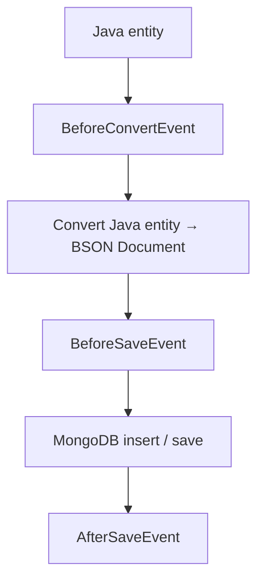
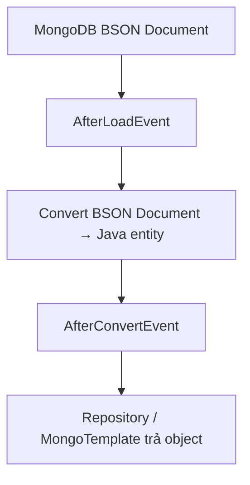
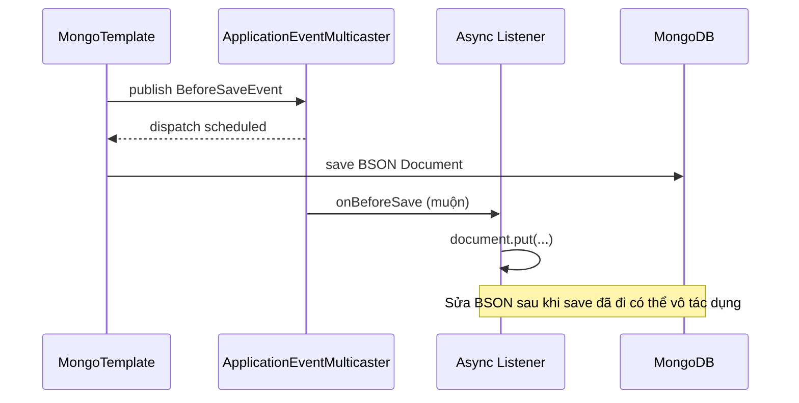
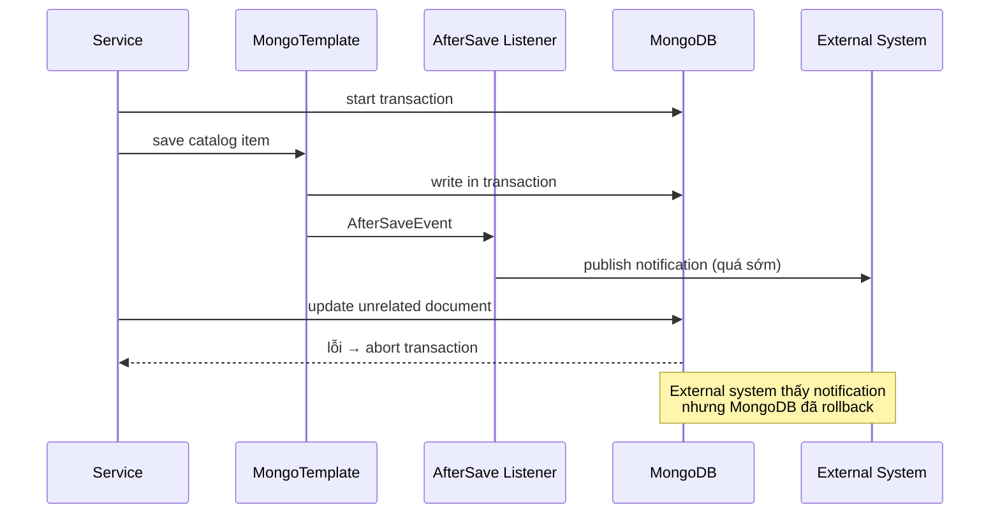

# `AbstractMongoEventListener` và các lifecycle event

Trong **Spring Data MongoDB**, một entity không chỉ đi thẳng từ object Java tới MongoDB Server. Trước khi lưu, dữ liệu được kiểm tra, chuyển đổi thành BSON `Document`, có thể nhận ID, phiên bản và metadata; sau khi đọc, BSON lại được ánh xạ về Java object. Trong quá trình đó, Spring Data có thể phát các **lifecycle event** cho phép ứng dụng quan sát hoặc xử lý một số thời điểm nhất định.

API trung tâm của bài là **`AbstractMongoEventListener<T>`**: một lớp nền để lắng nghe các `MongoMappingEvent` như `BeforeConvertEvent`, `BeforeSaveEvent`, `AfterSaveEvent`, `AfterLoadEvent`, `AfterConvertEvent`, `BeforeDeleteEvent` và `AfterDeleteEvent`.

Điểm quan trọng là **event listener không phải một transaction hook, cũng không phải giải pháp mặc định để thực thi mọi business rule**. Sự kiện có thể được phát đồng bộ hoặc được ứng dụng cấu hình xử lý bất đồng bộ; không phải mọi câu lệnh `$set`, `$inc` hoặc bulk update đều đi qua việc chuyển đổi entity và phát đủ vòng đời. Với các phép biến đổi dữ liệu cần thứ tự và tính quyết định, **`EntityCallback`** thường là lựa chọn phù hợp hơn.

Bài thuộc chương **Vòng đời và callback** trong module `SPRING_DATA_MONGODB`. Trong phạm vi module, người học sử dụng Spring Data MongoDB để kết nối, ánh xạ document, thao tác qua `MongoTemplate` hoặc repository và thực hành truy vấn, aggregation, index, transaction, reactive access, kiểm thử, chẩn đoán hiệu năng. Ở đây, ta tập trung vào **lifecycle event của MongoDB mapping**, phân biệt rõ thời điểm xảy ra và các giới hạn khi ứng dụng chạy thực tế.

Sau bài này, bạn có thể:

1. Nhận biết các sự kiện **trước/sau convert, save, load, delete** và phân biệt Java entity với BSON `Document`.
2. Viết `@Component` kế thừa `AbstractMongoEventListener<CatalogItem>`, override đúng các handler.
3. Phân biệt `onBeforeConvert` và `onBeforeSave`, cũng như `onAfterLoad` và `onAfterConvert`.
4. Hiểu các trường hợp **listener không chạy** hoặc xử lý theo thứ tự không xác định khi application event multicaster dùng executor bất đồng bộ.
5. Chọn giữa `MongoMappingEvent`, `EntityCallback`, MongoDB transaction, domain event và change stream theo yêu cầu.
6. Tổ chức normalization, logging, audit hoặc mở rộng document mà không vi phạm dữ liệu tenant hay tạo vòng lặp save.
7. Viết integration test với MongoDB test instance và biết cách chẩn đoán event được phát sai hoặc không phát.

## 1. Lifecycle event nằm ở đâu trong đường ghi/đọc?

Khi ứng dụng dùng các thao tác **entity-mapping** của Spring Data MongoDB, có thể hình dung đường ghi cơ bản:



Đường đọc cơ bản:



Hai sơ đồ trên chỉ diễn tả **các `MongoMappingEvent` chính**, không cam kết vị trí tương đối chính xác với tất cả `EntityCallback`, auditing, ID/version generation hay implementation detail ở mọi version Spring Data. Việc có một event cũng **không có nghĩa MongoDB Server tự phát event**: đây là event do **tầng mapping của ứng dụng Spring** phát trong quá trình vận hành.

### 1.1. Bảy event chính

| Event | Handler trong `AbstractMongoEventListener<T>` | Dữ liệu hữu ích | Thời điểm |
| --- | --- | --- | --- |
| `BeforeConvertEvent<T>` | `onBeforeConvert(...)` | Entity Java | Trước chuyển entity thành BSON |
| `BeforeSaveEvent<T>` | `onBeforeSave(...)` | Entity Java + BSON `Document` | Sau bước mapping, trước lệnh ghi |
| `AfterSaveEvent<T>` | `onAfterSave(...)` | Entity Java + BSON `Document` | Sau thao tác save được thực hiện |
| `AfterLoadEvent<T>` | `onAfterLoad(...)` | BSON `Document` | Sau khi load từ MongoDB, trước mapping thành entity |
| `AfterConvertEvent<T>` | `onAfterConvert(...)` | Entity Java + BSON `Document` | Sau khi ánh xạ entity từ BSON |
| `BeforeDeleteEvent<T>` | `onBeforeDelete(...)` | BSON document mô tả delete/query | Trước thao tác delete |
| `AfterDeleteEvent<T>` | `onAfterDelete(...)` | BSON document mô tả delete/query | Sau thao tác delete |

**Cảnh báo:** trong hai delete event, `Document` thường biểu diễn **tiêu chí xóa** chứ không phải một bản sao đầy đủ của từng document bị xóa. Không suy từ `BeforeDeleteEvent.getDocument()` rằng đã nhận được đầy đủ entity với các field cần audit.

### 1.2. Java event khác MongoDB change stream

| Java lifecycle event | MongoDB change stream |
| --- | --- |
| Được Spring Data phát tại application process khi chạy một đường mapping được hỗ trợ | Do server cung cấp từ các thay đổi đã ghi vào MongoDB |
| Thích hợp quan sát hoặc can thiệp ở một số bước trước/sau mapping | Thích hợp phát hiện dữ liệu thay đổi từ **nhiều nguồn ghi** |
| Không bao phủ mọi lệnh raw driver hay direct `$inc` | Có thể thấy thay đổi do app khác/driver khác thực hiện theo điều kiện change stream |
| Không phải queue bền vững để phát lại sau restart | Có resume token và giới hạn retention/oplog, vẫn cần vận hành và xử lý duplicate |
| Có thể phát trước transaction commit thật | Quan sát change event sau khi thay đổi đã được commit theo semantics server |

Nếu bài toán là “mỗi thay đổi từ bất kỳ service nào cũng phải được phát hiện”, lifecycle listener của một Spring Boot process **không đủ**. Khi đó hãy đánh giá change stream, transactional outbox hoặc một pipeline CDC phù hợp.

## 2. Khai báo một entity để làm ví dụ xuyên suốt

Giả sử ứng dụng quản lý sản phẩm trong collection `catalogItems`; mỗi document thuộc một tenant. Yêu cầu:

- Trước khi chuyển entity sang BSON, chuẩn hóa `name` bằng cách trim.
- Lưu thêm một field `searchName` ở BSON để phục vụ một cách tìm kiếm đã được thiết kế.
- Quan sát ID/collection sau save và sau load, nhưng không log dữ liệu nhạy cảm.
- Không cho listener tự ý chỉnh `tenantId`, quyền truy cập hoặc gửi email trước commit.

Document ví dụ:

```javascript
{
  _id: "ITEM-101",
  tenantId: "T-A",
  sku: "BOOK-01",
  name: "Sách MongoDB",
  searchName: "sách mongodb",
  createdAt: ISODate("2026-11-20T00:00:00Z"),
  active: true
}
```

Entity:

```java
import java.time.Instant;
import org.springframework.data.mongodb.core.mapping.Document;
import org.springframework.data.mongodb.core.mapping.MongoId;

@Document(collection = "catalogItems")
public class CatalogItem {
    @MongoId
    private String id;

    private String tenantId;
    private String sku;
    private String name;
    private Instant createdAt;
    private boolean active;

    protected CatalogItem() {}

    public CatalogItem(
            String id, String tenantId, String sku,
            String name, boolean active
    ) {
        this.id = id;
        this.tenantId = tenantId;
        this.sku = sku;
        this.name = name;
        this.active = active;
    }

    public String getId() { return id; }
    public String getTenantId() { return tenantId; }
    public String getSku() { return sku; }
    public String getName() { return name; }
    public Instant getCreatedAt() { return createdAt; }
    public boolean isActive() { return active; }

    public void setName(String name) { this.name = name; }
    public void setCreatedAt(Instant createdAt) {
        this.createdAt = createdAt;
    }
    public void setActive(boolean active) { this.active = active; }
}
```

Đoạn class không có property `searchName` theo chủ đích: handler `onBeforeSave` sẽ minh họa thay đổi **raw BSON `Document`**. Field được bổ sung ở BSON không nhất thiết xuất hiện ở entity khi đọc lại. Với dữ liệu production, nên quyết định rõ `searchName` có là field nghiệp vụ được mapping hay chỉ là trường dành cho index/tìm kiếm.

### 2.1. Repository và `MongoTemplate`

```java
import java.util.Optional;
import org.springframework.data.mongodb.repository.MongoRepository;

public interface CatalogItemRepository
        extends MongoRepository<CatalogItem, String> {

    Optional<CatalogItem> findByIdAndTenantId(
            String id, String tenantId);
}
```

Những event được mô tả có thể xuất hiện trong các đường entity-mapping của `MongoTemplate`, và repository thường ủy quyền qua các lớp persistence Spring Data tương ứng. **Không áp dụng khẳng định này cho mọi đường raw driver/aggregation update/bulk write**; mỗi thao tác cần xác minh bằng integration test.

## 3. Viết listener đầu tiên bằng `AbstractMongoEventListener`

Một Spring bean kế thừa `AbstractMongoEventListener<CatalogItem>`:

```java
import java.time.Instant;
import java.util.Locale;
import org.bson.Document;
import org.springframework.data.mongodb.core.mapping.event.AbstractMongoEventListener;
import org.springframework.data.mongodb.core.mapping.event.AfterConvertEvent;
import org.springframework.data.mongodb.core.mapping.event.AfterLoadEvent;
import org.springframework.data.mongodb.core.mapping.event.AfterSaveEvent;
import org.springframework.data.mongodb.core.mapping.event.BeforeConvertEvent;
import org.springframework.data.mongodb.core.mapping.event.BeforeSaveEvent;
import org.springframework.stereotype.Component;

@Component
public class CatalogItemLifecycleListener
        extends AbstractMongoEventListener<CatalogItem> {

    @Override
    public void onBeforeConvert(BeforeConvertEvent<CatalogItem> event) {
        CatalogItem item = event.getSource();
        if (item.getName() != null) {
            item.setName(item.getName().trim());
        }
        if (item.getCreatedAt() == null) {
            item.setCreatedAt(Instant.now());
        }
    }

    @Override
    public void onBeforeSave(BeforeSaveEvent<CatalogItem> event) {
        CatalogItem item = event.getSource();
        Document bson = event.getDocument();

        if (item.getName() != null) {
            bson.put("searchName",
                    item.getName().toLowerCase(Locale.ROOT));
        }
    }

    @Override
    public void onAfterSave(AfterSaveEvent<CatalogItem> event) {
        CatalogItem item = event.getSource();
        // Ví dụ quan sát, không tạo thêm write.
        logAfterSave(item.getId(), event.getCollectionName());
    }

    @Override
    public void onAfterLoad(AfterLoadEvent<CatalogItem> event) {
        // Ở đây entity CatalogItem chưa được chuyển đổi xong.
        Document bson = event.getDocument();
        logAfterLoad(bson.get("_id"));
    }

    @Override
    public void onAfterConvert(AfterConvertEvent<CatalogItem> event) {
        CatalogItem item = event.getSource();
        logAfterConvert(item.getId());
    }

    private void logAfterSave(String id, String collection) {
        // Trong code thật: dùng SLF4J và redaction theo policy.
        // Không log raw document, credentials hoặc tenant nhạy cảm.
    }

    private void logAfterLoad(Object id) {}
    private void logAfterConvert(String id) {}
}
```

Ví dụ dùng `@Component` để Spring đăng ký listener qua application context. Không bắt buộc tự gọi `addApplicationListener(...)` nếu component scan đã nhận bean này. Các method `log...` rỗng chỉ để giữ ví dụ tập trung vào **lifecycle events**; production nên dùng logger/metrics cụ thể và hạn chế cardinality của label.

**Vì sao `onBeforeConvert` sửa Java object còn `onBeforeSave` sửa BSON?** Vì lúc `BeforeConvertEvent` phát, mapping sang `Document` chưa diễn ra; còn `BeforeSaveEvent` đã có `Document` chuẩn bị ghi. Nếu muốn một giá trị được converter ánh xạ như một field Java bình thường, nên sửa trước convert hoặc dùng `BeforeConvertCallback`. Nếu cần thêm field vào BSON ngay trước save, `BeforeSaveEvent.getDocument()` cho phép thao tác trên cấu trúc đã được convert, nhưng đòi hỏi kiểm soát đồng bộ/event ordering.

## 4. Hiểu chính xác từng thời điểm trong đường ghi

### 4.1. `BeforeConvertEvent<T>`: trước khi chuyển thành BSON

`BeforeConvertEvent` chứa **Java entity** qua `getSource()`. Đây là điểm quan sát/biến đổi object trước khi các field được mapping sang BSON.

Ví dụ:

```java
@Override
public void onBeforeConvert(BeforeConvertEvent<CatalogItem> event) {
    CatalogItem item = event.getSource();

    if (item.getName() != null) {
        item.setName(item.getName().trim());
    }
    if (item.getCreatedAt() == null) {
        item.setCreatedAt(Instant.now());
    }
}
```

Sau đó, converter lấy giá trị đã được chuẩn hóa để tạo BSON. Ví dụ `name = "  Sách MongoDB  "` được đổi thành `"Sách MongoDB"` trước khi mapping.

**Giới hạn:** handler đang trực tiếp đổi mutable entity object. Nếu cùng một instance entity được dùng lại ở nơi khác, việc thay đổi có thể ảnh hưởng logic phía gọi. Với immutable entity hoặc record, listener không thể dùng setter; **EntityCallback** có khả năng trả về entity thay thế là mô hình phù hợp hơn.

### 4.2. `BeforeSaveEvent<T>`: trước khi gửi document đi ghi

`BeforeSaveEvent` cung cấp đồng thời:

- `event.getSource()`: entity Java được lưu.
- `event.getDocument()`: BSON `Document` đã được tạo từ entity và chuẩn bị gửi cho MongoDB.

Ví dụ thêm field phụ trợ:

```java
@Override
public void onBeforeSave(BeforeSaveEvent<CatalogItem> event) {
    CatalogItem item = event.getSource();
    Document bson = event.getDocument();

    if (item.getName() != null) {
        bson.put("searchName",
                item.getName().trim().toLowerCase(Locale.ROOT));
    } else {
        bson.remove("searchName");
    }
}
```

Nếu muốn `searchName` đi theo mọi lần save, phải thống nhất hành vi khi `name` null/trống. Ví dụ này xóa field phụ trợ trong BSON khi không có tên; nếu dùng `updateFirst` sửa name trực tiếp, listener này có thể **không được gọi**, khiến `searchName` bị lỗi thời.

**Không dùng `BeforeSaveEvent` để sửa entity rồi hy vọng converter map lại lần nữa.** Sau convert, BSON đã hình thành; nếu sửa entity mà không sửa `Document`, thay đổi có thể không đi vào lệnh ghi. Ngược lại, nếu sửa raw `Document` nhưng entity không có property tương ứng, kết quả `repository.save(...)` trả về có thể không phản ánh field được thêm vào BSON.

### 4.3. `AfterSaveEvent<T>`: sau thao tác save, chưa chắc sau commit

`AfterSaveEvent` xuất hiện sau khi thao tác save ở tầng mapping hoàn thành; có thể chứa object và `Document` tương ứng.

```java
@Override
public void onAfterSave(AfterSaveEvent<CatalogItem> event) {
    CatalogItem item = event.getSource();
    auditLogger.debug("Saved catalog item id={}", item.getId());
}
```

Đoạn này giả định `auditLogger` là logger đã cấu hình và ID không thuộc dữ liệu cấm log. Không log toàn document hoặc thông tin bí mật.

**Cạm bẫy giao dịch:** nếu `save` xảy ra **bên trong transaction**, `AfterSaveEvent` không đồng nghĩa toàn transaction đã commit. Transaction có thể tiếp tục thực hiện lệnh khác và sau đó rollback. Nếu listener gửi email hoặc publish “ITEM_CREATED” tại đây, người nhận có thể nhận một event về document **chưa từng commit**.

### 4.4. `AfterSaveEvent` không phải MongoDB Change Stream

`AfterSaveEvent` chỉ liên quan tới **đường ghi qua ứng dụng Spring phát mapping event**. Nếu một job Python, raw MongoDB Driver hoặc `mongosh` cập nhật document, Spring listener trong một service khác **không tự nhận** event.

Để nhận thay đổi từ server ngoài phạm vi một tiến trình, sử dụng MongoDB change stream hoặc cơ chế CDC/outbox có bảo đảm phù hợp. Lifecycle event không có offset/resume token, không phải message queue và không có exactly-once delivery.

## 5. Đường đọc: `AfterLoadEvent` khác `AfterConvertEvent`

### 5.1. `AfterLoadEvent<T>`: mới có BSON từ MongoDB

`AfterLoadEvent` được phát sau khi tầng đọc nhận một document, **trước khi chuyển nó thành entity**.

```java
@Override
public void onAfterLoad(AfterLoadEvent<CatalogItem> event) {
    Document bson = event.getDocument();

    Object storedId = bson.get("_id");
    Object storedName = bson.get("name");
    // Kiểm tra kiểu BSON hoặc metric có giới hạn;
    // chưa có CatalogItem hoàn chỉnh tại đây.
}
```

Đây là thời điểm hữu ích để quan sát dữ liệu legacy hoặc raw representation trong một test migration. Tuy nhiên, không dùng listener để sửa BSON một cách không kiểm soát, đặc biệt khi có nhiều converter, custom read converters hoặc event xử lý bất đồng bộ.

### 5.2. `AfterConvertEvent<T>`: entity đã được tạo

`AfterConvertEvent` chứa entity Java đã được converter ánh xạ:

```java
@Override
public void onAfterConvert(AfterConvertEvent<CatalogItem> event) {
    CatalogItem entity = event.getSource();
    if (entity.getSku() == null || entity.getSku().isBlank()) {
        // Quan sát/ghi metric dữ liệu legacy không hợp lệ.
        // Đừng tự save entity bên trong callback này.
    }
}
```

Không nên gắn các side effect kéo dài hoặc tạo vòng ghi trong `onAfterConvert`. Một hành động `repository.findById(...)` đơn giản có thể gọi listener, do đó nếu listener lại `repository.save(entity)`, mỗi lần read có thể trở thành write khó kiểm soát và gây xung đột/version drift.

### 5.3. Hai event này không tự cam kết projection có đủ mọi field

Một query có projection có thể chỉ đọc `_id` và `sku`, nên BSON được load là **một phần** document. Không dùng `onAfterLoad` để đoán các field không có trong BSON là null thật trong database.

Tương tự, entity được ánh xạ từ projection có thể thiếu nhiều field. Nếu listener `onAfterConvert` tự lưu entity này, có nguy cơ ghi đè dữ liệu chưa tải. **Đọc projection chỉ để đọc; không tự save lại đối tượng thiếu dữ liệu**.

### 5.4. Event được phát theo kiểu entity nào?

Đặt generic `AbstractMongoEventListener<CatalogItem>` giúp thu hẹp listener theo entity đích trong mô hình Spring Data thông thường. Tuy nhiên, không mọi đường query/projection đều tạo `CatalogItem` nguyên bản; projection interface, aggregation kết quả custom DTO, native `Document` và raw driver có thể đi đường mapping khác.

Hãy kiểm thử **đúng API đọc** của ứng dụng: `repository.find...`, `MongoTemplate.find(...)`, aggregation DTO, `findAndModify(...)` hay reactive tương đương. Đừng cho rằng listener của root entity sẽ luôn chạy cho mọi kết quả BSON có hình dạng gần giống entity.

## 6. Delete lifecycle: tiêu chí xóa không phải document đã bị xóa

`BeforeDeleteEvent` và `AfterDeleteEvent` thường được phát trên đường delete qua `MongoTemplate`/repository tương ứng.

### 6.1. Listener quan sát điều kiện delete

```java
import org.bson.Document;
import org.springframework.data.mongodb.core.mapping.event.AfterDeleteEvent;
import org.springframework.data.mongodb.core.mapping.event.BeforeDeleteEvent;

@Override
public void onBeforeDelete(BeforeDeleteEvent<CatalogItem> event) {
    Document filterDocument = event.getDocument();
    // Ví dụ filter {_id: "..."} hoặc filter nhiều field.
    // Không coi đây là snapshot của document sắp bị xóa.
}

@Override
public void onAfterDelete(AfterDeleteEvent<CatalogItem> event) {
    Document filterDocument = event.getDocument();
    // Quan sát request delete theo metadata được cung cấp,
    // không suy ra số document bị xóa hay dữ liệu từng document.
}
```

Hai method trên minh họa phần được thêm **vào một subclass `AbstractMongoEventListener<CatalogItem>`**; các import ở đầu file Java và tên class phải được sắp xếp lại nếu copy vào dự án.

### 6.2. `deleteMany` xóa 100 document nhưng không tạo 100 snapshot event

Giả sử:

```javascript
db.catalogItems.deleteMany({
  tenantId: "T-A",
  active: false
});
```

Một lệnh xóa theo query có thể xóa nhiều document. Nếu ứng dụng có một `BeforeDeleteEvent` đại diện cho **bộ lọc xóa**, nó không có cách mặc định để cung cấp toàn bộ danh sách document đã bị xóa, cũng không đảm bảo một callback cho từng entity.

Vì vậy, **không dùng delete lifecycle event làm cơ chế lưu đầy đủ nội dung từng document bị xóa**. Nếu cần lưu audit từng record, hãy thiết kế workflow rõ: đọc/ghi audit trong transaction hoặc dùng change stream **pre-images** trên deployment được hỗ trợ, với retention và quyền truy cập phù hợp.

### 6.3. `onAfterDelete` chưa chắc transaction đã commit

Nếu delete nằm trong một transaction và lệnh khác sau đó ném exception, transaction có thể rollback. Gọi API bên ngoài trong `onAfterDelete` để “xóa search index ngay” có thể làm hệ thống tìm kiếm mất document trong khi MongoDB đã rollback xóa.

Thích hợp hơn là transactional outbox hoặc một event được phát **sau commit** theo cơ chế đã xác minh. Không nhầm `AfterDeleteEvent` với Spring `@TransactionalEventListener(phase=AFTER_COMMIT)`: chúng có vòng đời khác nhau.

## 7. Tổng hợp thứ tự sự kiện: đo trên một vòng insert, read, delete

Giả sử service chạy tuần tự:

```java
CatalogItem created = repository.insert(
        new CatalogItem(
                "ITEM-101", "T-A", "BOOK-01",
                "  Sách MongoDB  ", true));

CatalogItem loaded = repository.findById("ITEM-101")
        .orElseThrow();

repository.delete(loaded);
```

Trên đường entity-mapping thông dụng và listener đăng ký đúng, bảng theo dõi khái niệm có thể là:

| Thao tác | Các event dự kiến | Ghi chú |
| --- | --- | --- |
| `insert(entity)` | BeforeConvert → BeforeSave → AfterSave | Có thể có thêm EntityCallbacks/ID/auditing theo cấu hình |
| `findById(...)` | AfterLoad → AfterConvert | Event đọc liên quan dữ liệu BSON và entity |
| `delete(entity)` | BeforeDelete → AfterDelete | Không nhất thiết có full entity snapshot trong delete event |

**Đây không phải hợp đồng “mỗi method phải phát đúng N event” cho mọi phiên bản/overload.** Các API đặc biệt, projection, raw driver, asynchronous event publication và sự kiện cho document referenced có thể thay đổi những gì quan sát được.

### 7.1. Ghi lại timeline bằng listener test

Trong test, có thể dùng một listener chỉ ghi tên event vào queue/thread-safe list, rồi thực hiện thao tác qua repository/template. Nếu application event multicaster dùng executor bất đồng bộ, **thứ tự event log có thể thay đổi** hoặc event chưa được xử lý lúc assertion chạy.

Đối với test thứ tự đồng bộ, cấu hình multicaster test synchronous hoặc dùng EntityCallback khi yêu cầu về thứ tự là một phần correctness của nghiệp vụ; không đặt `Thread.sleep(100)` rồi hy vọng mọi event chắc chắn đã đến.

### 7.2. Listener của child embedded có chạy không?

Lifecycle events tập trung vào **root document** được Spring Data mapping. Các object embedded trong một root thường **không có event độc lập cho từng child**. Document reference (chẳng hạn `@DBRef`) có thể đi theo đường mapping/lifecycle riêng khi thực sự được load; cần test nếu ứng dụng phụ thuộc vào chúng.

Ví dụ `Order` chứa `List<OrderLine>` embedded: lưu một `Order` không có nghĩa sẽ có một `BeforeSaveEvent<OrderLine>` cho mọi dòng hàng. Nếu cần validate hoặc chuẩn hóa từng child, hãy xử lý trong callback của **root Order**, validation ở domain service hoặc converter phù hợp.

## 8. `MongoMappingEvent` khác `EntityCallback` như thế nào?

Spring Data có **hai cơ chế lifecycle** thường bị nhầm là một:

1. **Application events:** `BeforeConvertEvent`, `BeforeSaveEvent`,... được phát tới các `ApplicationListener` như `AbstractMongoEventListener`.
2. **Entity callbacks:** `BeforeConvertCallback`, `BeforeSaveCallback`, `AfterConvertCallback` và các callback khác được Spring Data gọi theo hợp đồng riêng, có thể **trả lại entity mới** và hỗ trợ ordered/imperative/reactive execution.

| Tiêu chí | `AbstractMongoEventListener` | `EntityCallback` |
| --- | --- | --- |
| Cơ chế | Spring `ApplicationEvent`/`ApplicationListener` | Spring Data `EntityCallbacks` |
| Đầu vào | Một `MongoMappingEvent<T>` | Entity + tham số theo phase |
| Giá trị trả về | Handler thường `void` | Trả entity, hoặc `Publisher<T>` reactive |
| Sửa immutable entity | Không thuận tiện | **Phù hợp hơn** nhờ entity thay thế |
| Thứ tự xử lý | Phụ thuộc application event multicaster và listener setup | Có cơ chế ordering rõ hơn qua `Ordered`/`@Order` |
| Multicaster async | Có thể làm event xử lý bất đồng bộ | Callback được gọi trong lifecycle mapping, có semantics đồng bộ hoặc reactive phù hợp |
| Mục tiêu khuyến nghị | Quan sát, log, thống kê, tích hợp nhẹ | Chuyển đổi/chuẩn hóa dữ liệu trước mapping/save theo hợp đồng |
| Hỗ trợ Reactor | Không được xem là reactive publisher context | Có `ReactiveBeforeConvertCallback`, `ReactiveBeforeSaveCallback`,... |

**Lựa chọn thực hành:** nếu correctness phụ thuộc việc trim tên, đặt trường mặc định, chuẩn hóa field hoặc mã hóa trước khi save, hãy ưu tiên **EntityCallback hoặc domain service**. Nếu chỉ cần quan sát sự kiện hoặc báo metric, `AbstractMongoEventListener` có thể phù hợp, miễn không kỳ vọng event là hàng đợi đáng tin.

### 8.1. Viết `BeforeConvertCallback` tương đương

```java
import java.time.Instant;
import org.springframework.core.Ordered;
import org.springframework.data.mongodb.core.mapping.event.BeforeConvertCallback;
import org.springframework.stereotype.Component;

@Component
public class CatalogItemNormalizationCallback
        implements BeforeConvertCallback<CatalogItem>, Ordered {

    @Override
    public CatalogItem onBeforeConvert(
            CatalogItem entity, String collection
    ) {
        if (entity.getName() != null) {
            entity.setName(entity.getName().trim());
        }
        if (entity.getCreatedAt() == null) {
            entity.setCreatedAt(Instant.now());
        }
        return entity;
    }

    @Override
    public int getOrder() {
        return 100;
    }
}
```

Nếu đang dùng callback trên, **không nên đồng thời giữ listener `onBeforeConvert` làm đúng cùng tác vụ** mà không kiểm tra mục đích. Chạy normalization hai lần có thể vô hại với `trim()`, nhưng một tác vụ như sinh UUID mới, gán timestamp hoặc hash mật khẩu có thể **không idempotent**.

### 8.2. `BeforeSaveCallback` và sửa BSON một cách có kiểm soát

```java
import java.util.Locale;
import org.bson.Document;
import org.springframework.data.mongodb.core.mapping.event.BeforeSaveCallback;
import org.springframework.stereotype.Component;

@Component
public class CatalogItemBsonCallback
        implements BeforeSaveCallback<CatalogItem> {

    @Override
    public CatalogItem onBeforeSave(
            CatalogItem entity,
            Document document,
            String collection
    ) {
        if (entity.getName() != null) {
            document.put("searchName",
                    entity.getName().toLowerCase(Locale.ROOT));
        } else {
            document.remove("searchName");
        }
        return entity;
    }
}
```

`BeforeSaveCallback` có access tới `Document` và trả entity. Trong ví dụ này, nó tạo cùng kết quả như `onBeforeSave` trước đó, nhưng chạy trong cơ chế callback thích hợp hơn cho **biến đổi trước persistence**. Vẫn cần test với version framework và những custom converter liên quan.

### 8.3. Ví dụ reactive callback

```java
import java.util.Locale;
import org.springframework.data.mongodb.core.mapping.event.ReactiveBeforeConvertCallback;
import org.springframework.stereotype.Component;
import reactor.core.publisher.Mono;

@Component
public class ReactiveCatalogNormalizer
        implements ReactiveBeforeConvertCallback<CatalogItem> {

    @Override
    public Mono<CatalogItem> onBeforeConvert(
            CatalogItem entity, String collection
    ) {
        return Mono.fromSupplier(() -> {
            if (entity.getName() != null) {
                entity.setName(entity.getName().trim());
            }
            return entity;
        });
    }
}
```

Trong ứng dụng có cả blocking và reactive MongoDB, cần xác định callback nào được đăng ký và gọi theo stack đang dùng. **Không lấy ví dụ reactive làm lý do đưa `block()` vào callback** để lấy dữ liệu bên ngoài: nếu bắt buộc gọi I/O, chọn reactive API phù hợp, tránh tăng độ phức tạp trong persistence lifecycle.

### 8.4. Callbacks dùng để biến đổi, validation ở đâu?

Có thể kiểm tra dữ liệu trong callback, nhưng không nên dồn toàn bộ business rule vào một callback chạy trên **mọi lần save**:

```java
if (!authorizedUserCanChangePrice(...)) {
    throw new DomainValidationException(...);
}
```

Đoạn này phụ thuộc security/user context; persistence lifecycle không nhất thiết có đầy đủ thông tin request hay operation intent. Các quy tắc phân quyền, hạn mức, trạng thái đơn hàng nên được thực thi ở **application/domain service và điều kiện ghi nguyên tử**; callback chỉ nên bổ trợ những quy tắc thực sự phổ quát cho entity.

## 9. Event multicaster và thứ tự thực thi: rủi ro bất đồng bộ

Spring `ApplicationEventPublisher` có thể được cấu hình với một `ApplicationEventMulticaster`. Theo cấu hình mặc định thông dụng, event được phân phối đồng bộ trong thread gọi. Nhưng nếu ứng dụng cấu hình `TaskExecutor` cho multicaster, listener có thể được chạy **bất đồng bộ**.

### 9.1. Vì sao thay đổi entity trong async listener nguy hiểm?



Nếu `onBeforeSave` chạy quá muộn, thay đổi `Document` không còn tác dụng với lệnh ghi. Không dựa vào tính may rủi của thread scheduling để lưu field quan trọng.

### 9.2. Callback có thứ tự rõ hơn cho yêu cầu correctness

Đối với một normalization bắt buộc có trước save:

```java
import org.springframework.core.annotation.Order;

@Component
@Order(100)
class NormalizeBeforeConvert
        implements BeforeConvertCallback<CatalogItem> {
    @Override
    public CatalogItem onBeforeConvert(
            CatalogItem entity, String collection
    ) {
        // Trả entity đã chuẩn hóa.
        return entity;
    }
}
```

Với nhiều callback cùng phase, Spring Data hỗ trợ `Ordered`/`@Order` để điều phối. Cần hiểu thứ tự với auditing callbacks hoặc những callback built-in khác; không giả định thứ tự nếu chưa xác minh. Đồng thời, **EntityCallback API không biến hai lần save trên hai transaction thành một đơn vị atomic**.

### 9.3. Có nên cấu hình event multicaster async chỉ để gửi email?

Ngay cả khi listener chạy async, các vấn đề còn đó:

- Process có thể tắt trước khi task được chạy.
- Executor queue có thể đầy và từ chối task.
- Handler có thể chạy sau khi transaction rollback.
- Event không được lưu bền vững hoặc tự retry có kiểm soát.
- Async listener có thể không mang thread-bound transaction/security context như request gốc.

Với email/tích hợp quan trọng, hãy dùng **outbox được ghi trong cùng transaction** rồi có worker sau commit xử lý; hoặc dùng message broker có cơ chế retry/DLQ phù hợp. Đừng coi việc gắn `@Async` lên listener là giải pháp bảo đảm delivery.

### 9.4. Listener exception có rollback operation không?

Với event publication đồng bộ, exception ném từ một listener **có thể truyền về caller** và làm gián đoạn một đường ghi. Tuy nhiên kết quả cụ thể còn phụ thuộc event phase, transaction đang mở và cách multicaster dispatch.

Ví dụ:

- Exception trong `onBeforeSave` đồng bộ có thể ngăn một lệnh save tiếp tục.
- Exception trong `onAfterSave` có thể xuất hiện **sau khi MongoDB đã áp dụng lệnh ghi ngoài transaction**, nên client thấy lỗi nhưng document vẫn tồn tại.
- Nếu save nằm trong một Spring-managed transaction, exception có thể khiến transaction rollback, nhưng không nên suy từ tên “AfterSave” là transaction đã commit.
- Với async listener, exception thường không truyền trực tiếp về request đã publish theo cùng cách như synchronous listener.

**Không thiết kế business invariant dựa trên một event listener ném exception ở phase “after”**. Kiểm tra trước khi ghi hoặc dùng transaction/domain validation.

## 10. Spring Data MongoDB auditing và lifecycle event

Spring Data hỗ trợ auditing như `@CreatedDate`, `@LastModifiedDate`, `@CreatedBy` hoặc `@LastModifiedBy` khi được cấu hình. Điều này liên quan đến lifecycle vì auditing cũng cần cập nhật metadata trong quá trình persistence.

### 10.1. Ví dụ auditing tự động

```java
import java.time.Instant;
import org.springframework.data.annotation.CreatedDate;
import org.springframework.data.annotation.LastModifiedDate;
import org.springframework.data.mongodb.core.mapping.Document;
import org.springframework.data.mongodb.core.mapping.MongoId;

@Document("auditedCatalog")
class AuditedCatalogItem {
    @MongoId String id;
    String tenantId;
    String name;

    @CreatedDate
    Instant createdAt;

    @LastModifiedDate
    Instant updatedAt;
}
```

Kích hoạt auditing khi ứng dụng yêu cầu:

```java
import org.springframework.context.annotation.Configuration;
import org.springframework.data.mongodb.config.EnableMongoAuditing;

@Configuration
@EnableMongoAuditing
class MongoAuditingConfig {}
```

Sau khi bật và cấu hình thời gian/auditor phù hợp, Spring Data có thể tự điền metadata auditing cho các đường save entity. **Không kết luận từ annotation rằng mọi raw update `$set` hay `bulkOps` tự cập nhật `updatedAt`**. Các đường ghi bypass entity lifecycle cần quy tắc riêng.

### 10.2. Tránh cập nhật cùng một field bằng nhiều cơ chế

Giả sử entity có `@CreatedDate`, nhưng listener cũng:

```java
if (item.getCreatedAt() == null) {
    item.setCreatedAt(Instant.now());
}
```

Có thể xuất hiện **hai nguồn sự thật** về timestamp. Tùy callback ordering và điểm mapping, một cơ chế có thể ghi đè cơ chế khác hoặc tạo dữ liệu bất nhất. Hãy chọn **một cơ chế chính** cho `createdAt` và `updatedAt`; sử dụng auditing nếu phù hợp thay vì mỗi listener tự làm.

### 10.3. Auditing không thay thế update điều kiện hoặc version

Timestamp auditing giúp trả lời “ai/khi nào đã sửa?” theo phạm vi hệ thống, còn **optimistic locking** cần `@Version` để kiểm tra snapshot cũ trên các đường save hỗ trợ. Không dùng `updatedAt` như phép so sánh cạnh tranh mặc định; clock/độ phân giải có thể gây sai lệch.

Nếu một batch job hoặc native driver thay document mà không điều chỉnh auditing/version, các callback của Spring trong service khác **không thể tự đồng bộ dữ liệu**. Cần thống nhất schema/writer policy.

## 11. Các đường thao tác nào phát lifecycle event?

Một quan niệm sai là “cứ collection MongoDB thay đổi thì tất cả Spring lifecycle listeners tự chạy”. Thực tế, sự kiện gắn với **đường mã Spring Data** đang thực hiện mapping entity.

| Thao tác | Lifecycle event có thể liên quan | Không nên giả định |
| --- | --- | --- |
| `repository.insert(entity)` | BeforeConvert, BeforeSave, AfterSave | Mọi implementation repository khác nhau luôn phát đúng số event |
| `repository.save(entity)` | BeforeConvert, BeforeSave, AfterSave | Sau save tức là transaction đã commit |
| `MongoTemplate.insert/save` | Mapping event quanh convert/save | Trùng semantics với raw Java Driver insertOne |
| `repository.findById/find...` | AfterLoad, AfterConvert | Entity sẽ luôn có mọi field khi projection hạn chế |
| `MongoTemplate.find/findOne` | AfterLoad, AfterConvert cho kết quả được mapping | Query trả raw `Document` luôn có event generic entity |
| `MongoTemplate.remove`/repository delete | BeforeDelete, AfterDelete | Một event cho từng document bị xóa |
| `MongoTemplate.updateFirst/updateMulti` | Update operator trực tiếp; không đi qua toàn bộ entity save lifecycle | `onBeforeConvert/onBeforeSave` sẽ tự chạy để sửa fields |
| `MongoTemplate.bulkOps(...)` | Bulk operations có đường riêng | Callback/auditing/version handling giống hệt `save` |
| `findAndModify` | Có thể mapping document trả về để phát read-related events tùy API/version | Tự phát `BeforeSaveEvent` của entity khi chỉ dùng `$set` |
| Aggregation pipeline trả custom DTO | Mapping/convert theo kết quả và target type | Listener root entity luôn nhận event |
| Java Driver `MongoCollection.insertOne/updateOne` | Không tự phát Spring mapping lifecycle event | Spring listener bên cạnh sẽ nhận callback |
| `mongosh`/service khác ghi DB | Không có Spring event trong process này | Event listener là CDC toàn hệ thống |

Bảng là **định hướng thiết kế**, không phải đặc tả exhaustively theo từng overload và phiên bản. Với một API trọng yếu, hãy chạy integration test xác nhận rõ event nào thực sự xuất hiện.

### 11.1. Vì sao `updateFirst` thường bypass `BeforeSaveEvent`?

Giả sử:

```java
Query query = Query.query(
        Criteria.where("_id").is("ITEM-101")
                .and("tenantId").is("T-A"));

Update update = new Update()
        .set("name", "  Tên được cập nhật bằng $set  ");

template.updateFirst(query, update, CatalogItem.class);
```

Đây là **update operator** gửi thẳng xuống MongoDB, không phải tải một `CatalogItem`, gọi setter, convert toàn object rồi save. Vì vậy normalization trong `onBeforeConvert` và tạo `searchName` trong `onBeforeSave` **có thể không xảy ra**. Document cuối có thể có `name` mới nhưng `searchName` vẫn là giá trị cũ.

Nếu ứng dụng cho phép đổi `name` qua nhiều đường, có các lựa chọn:

1. Chuẩn hóa command ở service trước khi xây `Update`; đồng thời cập nhật `name` **và** `searchName` trong cùng atomic update.
2. Chỉ cho phép thao tác này qua một đường entity save có kiểm soát, nếu phù hợp với concurrency/độ lớn document.
3. Thiết kế một field chuẩn hóa và index/schema đủ rõ, dùng DB update pipeline/converter phù hợp.
4. Dùng job kiểm tra repair dữ liệu cũ nếu có nhiều writer legacy, nhưng không coi repair job là thay thế cho logic ghi đúng.

### 11.2. Raw driver cố tình không qua listener

```java
import com.mongodb.client.MongoCollection;
import org.bson.Document;

MongoCollection<Document> collection =
        template.getCollection("catalogItems");

collection.updateOne(
        new Document("_id", "ITEM-101"),
        new Document("$set", new Document("active", false)));
```

Lệnh này làm thay đổi MongoDB document nhưng **không do MongoTemplate thực hiện bước convert/save entity**. Do đó nó không phát chuỗi lifecycle event dành cho `CatalogItem`. Ngay cả khi gọi đoạn code trong một `@Transactional`, raw driver operation cũng không tự tham gia Spring session nếu không truyền `ClientSession` đúng; sự khác biệt giữa **transaction boundary** và **mapping lifecycle** phải được xử lý riêng.

### 11.3. Collection creation, index, count và metadata

`ensureIndex(...)`, `getIndexInfo()`, `collectionExists(...)` hoặc những thao tác metadata không phải **entity save/load/delete**. Không mong đợi `BeforeSaveEvent<CatalogItem>` mỗi khi tạo index mới cho collection.

Đối với `count(...)` hoặc `exists(...)`, MongoDB có thể trả số/boolean mà không ánh xạ một document thành entity; chúng không tương đương `findById(...)` về lifecycle.

### 11.4. `ReactiveMongoTemplate` và event listeners

Spring Data MongoDB có stack reactive và lifecycle callback reactive riêng. Nếu ứng dụng dùng `ReactiveMongoTemplate`/`ReactiveMongoRepository`, cần kiểm chứng **trên API/phiên bản cụ thể** event nào được phát và callback nào được gọi. Không áp dụng đồng nhất thứ tự, threading hoặc Spring transaction context của listener imperative lên reactive pipeline.

Với phép biến đổi **bắt buộc** trong reactive persistence, ưu tiên `ReactiveBeforeConvertCallback`/`ReactiveBeforeSaveCallback` phù hợp, và trả `Publisher` thay vì gọi `block()`. Không truy cập blocking repository trong listener phát từ event loop.

## 12. Transaction, auditing và thông điệp sau commit

Một listener có tên `onAfterSave` chỉ nói **thao tác save đã chạy tới phase ấy**. Nó **không phải** callback của `commitTransaction`. Điều này đặc biệt quan trọng khi một transaction lưu nhiều document:



### 12.1. Đừng gửi webhook/email từ `AfterSaveEvent`

Đoạn anti-pattern:

```java
@Override
public void onAfterSave(AfterSaveEvent<CatalogItem> event) {
    externalWebhook.send("CATALOG_UPDATED", event.getSource());
}
```

Nếu `externalWebhook.send` thành công rồi transaction abort, không thể rollback webhook. Nếu event listener retry, webhook cũng có thể bị gửi hai lần. Tương tự với publish Kafka/RabbitMQ trực tiếp hoặc gửi email.

### 12.2. Outbox được ghi cùng transaction

Một mô hình an toàn hơn:

```text
Transaction:
  save CatalogItem
  insert OutboxMessage(operationId, "CATALOG_UPDATED", payload)
  commit transaction

Dispatcher sau commit:
  đọc OutboxMessage chưa gửi
  gửi message/email
  ghi trạng thái giao hàng
  retry có giới hạn và idempotent consumer
```

Nếu ứng dụng không cần một outbox đầy đủ, có thể dùng application event được xử lý ở `AFTER_COMMIT` **qua transaction synchronization phù hợp** cho các thao tác best-effort. Nhưng **AFTER_COMMIT không tự tạo durable delivery**: process có thể chết ngay sau commit trước khi callback chạy. Với bảo đảm cao, outbox thường phù hợp hơn.

### 12.3. `@TransactionalEventListener` không tự chuyển mapping event thành after-commit

Ví dụ:

```java
import org.springframework.transaction.event.TransactionPhase;
import org.springframework.transaction.event.TransactionalEventListener;

@TransactionalEventListener(phase = TransactionPhase.AFTER_COMMIT)
public void afterBusinessCommit(CatalogPublishedEvent event) {
    // Chạy sau khi transaction mà application event gắn với đã commit,
    // nếu đúng transaction manager/context và cấu hình event.
}
```

Đây là **listener cho một domain/application event** `CatalogPublishedEvent` được publish ở nơi có transaction context phù hợp. Nó không thay thế `AbstractMongoEventListener` và không nên coi mọi `MongoMappingEvent` đều tự được chuyển thành event sau commit. Với **reactive transaction**, sự gắn kết transaction context khác thread-bound transaction, cần cơ chế reactive-aware event publication theo Spring version.

### 12.4. Callback lỗi có thể ảnh hưởng transaction

Một `BeforeSaveCallback` ném `DomainValidationException` hoặc listener synchronous ném exception có thể làm service thất bại. Khi Spring transaction đang mở, exception được truyền qua transaction interceptor có thể dẫn đến rollback theo chính sách.

Nhưng nếu exception xảy ra ở `AfterSaveEvent` **ngoài transaction**, thay đổi có thể đã được server áp dụng. Không xây logic “throw ở after event để rollback một lệnh đã xong” như cơ chế chính.

### 12.5. Listener và `@Version`

Một entity có `@Version` sử dụng optimistic locking theo các đường save hỗ trợ. Nếu listener trong `onAfterConvert` tự `save` lại entity mỗi lần read, version có thể tăng hoặc các thao tác đọc cạnh tranh với cập nhật khác.

Tương tự, nếu listener chỉnh raw BSON `version` trong `onBeforeSave`, bạn có thể phá điều kiện CAS hoặc khiến object và database khác nhau. Hãy để Spring Data quản lý `@Version`; business updates cần version CAS phải được thiết kế rõ trong repository/template service.

## 13. Tenant, dữ liệu nhạy cảm và các nguyên tắc an toàn

### 13.1. `tenantId` trong listener không tự thực thi phân quyền

`CatalogItem.tenantId` là một field dữ liệu. Nếu client tự gửi `tenantId = "T-B"`, listener `onBeforeConvert` không có quyền tự giả định tenant đó hợp lệ.

Sử dụng security context trong tầng application service để:

- Xác thực tenant/user hiện tại.
- Giới hạn `findByIdAndTenantId(...)`, update/delete query theo tenant.
- Kiểm tra quyền thay đổi sản phẩm hoặc thuộc tính nhạy cảm.
- Chống việc đổi owner/tenant bằng một `save` object được map từ payload.

Lifecycle event chỉ là **điểm mở rộng mapping**, không phải authorization boundary.

### 13.2. Không log toàn bộ `Document`

```java
// Không nên ở production:
logger.info("BeforeSave: {}", event.getDocument());
```

Trong tài liệu thật có thể có email, số điện thoại, access token, API secret hoặc nội dung cá nhân. Ghi toàn `Document` vào log khiến dữ liệu bị nhân bản sang hệ thống logging và tăng nguy cơ vi phạm retention/access policies.

Log có kiểm soát: loại event, tên collection, operation type và trace ID an toàn; khi cần document ID, xác định chính sách bảo mật/PII và giới hạn cardinality. Không đưa raw tenant ID hoặc full document vào metrics labels.

### 13.3. Không mã hóa hoặc hash bí mật bằng listener event bất đồng bộ

Nếu một field bắt buộc phải hash/mã hóa **trước ghi**, dùng domain service/`EntityCallback` có hợp đồng đồng bộ hoặc reactive phù hợp. Async `BeforeSaveEvent` có thể đến muộn hơn lệnh save, tạo nguy cơ dữ liệu thô đi xuống MongoDB.

Đối với password, hãy dùng thành phần security/crypto đã được kiểm định và quy trình thay đổi mật khẩu rõ, không cài mã hash tùy ý trong listener để “mọi save đều tự an toàn”.

### 13.4. Một listener có thể được kích hoạt từ nhiều use case

`CatalogItemLifecycleListener` có thể chạy khi:

- UI admin tạo item.
- Job import dữ liệu.
- API nội bộ thực hiện save.
- Test fixture insert item qua repository.

Vì vậy listener phải tránh ngầm giả định có HTTP request, user session hoặc UI context. Nếu cần behavior riêng cho một command “publish catalog”, hãy xử lý ở application service của command đó, không đặt vào `onAfterSave` chung cho mọi đường save.

## 14. Kiểm thử tích hợp lifecycle event trên MongoDB thật

Unit test trực tiếp gọi `listener.onBeforeSave(event)` có thể kiểm tra một nhánh Java thuần, nhưng **không chứng minh** Spring đã đăng ký listener và phát event ở đúng thời điểm khi repository/template chạy. Vì thế nên có integration test dùng **MongoDB Server test riêng**.

Với Spring Boot 3.x, một lựa chọn là `@DataMongoTest`, kèm MongoDB test instance (ví dụ Testcontainers). Khác với transaction nhiều document, những test insert/find/remove thông thường có thể chạy trên một MongoDB test instance không nhất thiết phải là replica set; nếu kiểm thử transaction thì topology phải hỗ trợ transaction.

### 14.1. Event recorder để ghi timeline

```java
import java.util.List;
import java.util.concurrent.CopyOnWriteArrayList;
import org.springframework.data.mongodb.core.mapping.event.AbstractMongoEventListener;
import org.springframework.data.mongodb.core.mapping.event.AfterConvertEvent;
import org.springframework.data.mongodb.core.mapping.event.AfterDeleteEvent;
import org.springframework.data.mongodb.core.mapping.event.AfterLoadEvent;
import org.springframework.data.mongodb.core.mapping.event.AfterSaveEvent;
import org.springframework.data.mongodb.core.mapping.event.BeforeConvertEvent;
import org.springframework.data.mongodb.core.mapping.event.BeforeDeleteEvent;
import org.springframework.data.mongodb.core.mapping.event.BeforeSaveEvent;

public class RecordingCatalogListener
        extends AbstractMongoEventListener<CatalogItem> {

    private final CopyOnWriteArrayList<String> phases =
            new CopyOnWriteArrayList<>();

    @Override
    public void onBeforeConvert(BeforeConvertEvent<CatalogItem> e) {
        phases.add("beforeConvert");
    }

    @Override
    public void onBeforeSave(BeforeSaveEvent<CatalogItem> e) {
        phases.add("beforeSave");
    }

    @Override
    public void onAfterSave(AfterSaveEvent<CatalogItem> e) {
        phases.add("afterSave");
    }

    @Override
    public void onAfterLoad(AfterLoadEvent<CatalogItem> e) {
        phases.add("afterLoad");
    }

    @Override
    public void onAfterConvert(AfterConvertEvent<CatalogItem> e) {
        phases.add("afterConvert");
    }

    @Override
    public void onBeforeDelete(BeforeDeleteEvent<CatalogItem> e) {
        phases.add("beforeDelete");
    }

    @Override
    public void onAfterDelete(AfterDeleteEvent<CatalogItem> e) {
        phases.add("afterDelete");
    }

    public List<String> snapshot() {
        return List.copyOf(phases);
    }

    public void reset() {
        phases.clear();
    }
}
```

`CopyOnWriteArrayList` giúp test tránh lỗi cấu trúc bộ nhớ nếu event chạy qua một thread khác, nhưng **không tự bảo đảm event đã xử lý xong** hoặc thứ tự của async multicaster. Các assertion thứ tự ở các mục sau giả định **multicaster đồng bộ trong môi trường test**.

### 14.2. Khai báo Spring test slice và import listener

```java
import static org.assertj.core.api.Assertions.assertThat;

import org.bson.Document;
import org.junit.jupiter.api.BeforeEach;
import org.junit.jupiter.api.Test;
import org.springframework.beans.factory.annotation.Autowired;
import org.springframework.boot.test.autoconfigure.data.mongo.DataMongoTest;
import org.springframework.context.annotation.Import;
import org.springframework.data.mongodb.core.MongoTemplate;
import org.springframework.data.mongodb.core.query.Criteria;
import org.springframework.data.mongodb.core.query.Query;
import org.springframework.data.mongodb.core.query.Update;

@DataMongoTest
@Import({
        CatalogItemLifecycleListener.class,
        RecordingCatalogListener.class
})
class CatalogItemLifecycleIntegrationTest {

    @Autowired MongoTemplate template;
    @Autowired RecordingCatalogListener recorder;

    private CatalogItem item(String name) {
        return new CatalogItem(
                "ITEM-TEST", "T-A", "BOOK-01",
                name, true);
    }

    @BeforeEach
    void clean() {
        // Chỉ chạy trên database test được cô lập.
        template.remove(new Query(), CatalogItem.class);
        recorder.reset();
    }

    // Các test phía dưới đặt trong class này.
}
```

`@Import` bảo đảm hai bean listener được đăng ký trong Spring test slice; component scanning của `@DataMongoTest` có thể khác component scan ứng dụng đầy đủ. Dự án phải cấu hình URI MongoDB test riêng, không sử dụng production credentials. `template.remove(new Query(), ...)` **xóa toàn bộ document trong collection**: tuyệt đối không chạy setup này trên database chung hoặc production.

### 14.3. Test thứ tự khi insert và dữ liệu BSON được thay đổi

```java
@Test
void insertInvokesBeforeConvertBeforeSaveAndAfterSave() {
    CatalogItem saved = template.insert(
            item("  Sách MongoDB  "));

    assertThat(saved.getName()).isEqualTo("Sách MongoDB");
    assertThat(saved.getCreatedAt()).isNotNull();

    assertThat(recorder.snapshot()).containsExactly(
            "beforeConvert",
            "beforeSave",
            "afterSave");

    // Đọc raw qua driver: không kích hoạt mapping event đọc.
    Document stored = template.getCollection("catalogItems")
            .find(new Document("_id", "ITEM-TEST"))
            .first();

    assertThat(stored).isNotNull();
    assertThat(stored.getString("name"))
            .isEqualTo("Sách MongoDB");
    assertThat(stored.getString("searchName"))
            .isEqualTo("sách mongodb");
}
```

Test đồng thời chứng minh hai điều khác nhau: **`onBeforeConvert` thay đổi entity trước mapping** và **`onBeforeSave` thay đổi raw BSON trước khi driver save**. Việc query raw `Document` giúp đọc đúng trường `searchName` dù entity Java không khai báo property này.

### 14.4. Test `AfterLoad` và `AfterConvert`

```java
@Test
void findInvokesAfterLoadAndAfterConvert() {
    template.insert(item("Sách MongoDB"));
    recorder.reset();

    CatalogItem loaded = template.findById(
            "ITEM-TEST", CatalogItem.class);

    assertThat(loaded).isNotNull();
    assertThat(loaded.getId()).isEqualTo("ITEM-TEST");

    assertThat(recorder.snapshot()).containsExactly(
            "afterLoad",
            "afterConvert");
}
```

`AfterLoadEvent` xảy ra trước khi entity được tạo từ BSON, `AfterConvertEvent` sau khi converter đã tạo entity. Nếu thêm `@DBRef` hoặc converter tùy biến, các thao tác phụ có thể phát event khác; vì vậy cần làm fixture đơn giản để xác nhận timeline cơ bản trước.

### 14.5. Test delete event không yêu cầu full entity

```java
@Test
void removeByQueryInvokesDeleteEvents() {
    template.insert(item("Sách MongoDB"));
    recorder.reset();

    Query filter = Query.query(
            Criteria.where("_id").is("ITEM-TEST")
                    .and("tenantId").is("T-A"));

    template.remove(filter, CatalogItem.class);

    assertThat(recorder.snapshot()).containsExactly(
            "beforeDelete",
            "afterDelete");
    assertThat(template.getCollection("catalogItems")
            .find(new Document("_id", "ITEM-TEST"))
            .first()).isNull();
}
```

Test xác nhận có lifecycle event ở đường `MongoTemplate.remove`, **không chứng minh** `BeforeDeleteEvent` nhận đủ field của document bị xóa. Đừng viết một audit system yêu cầu `name/sku` đầy đủ bằng việc chỉ lấy `event.getDocument()` của delete event.

### 14.6. Test `updateFirst` không thực hiện normalization của entity save

```java
@Test
void directUpdateBypassesEntityBeforeSaveNormalization() {
    template.insert(item("Sách MongoDB"));
    recorder.reset();

    template.updateFirst(
            Query.query(Criteria.where("_id").is("ITEM-TEST")),
            new Update().set(
                    "name", "  Tên mới qua updateFirst  "),
            CatalogItem.class);

    Document stored = template.getCollection("catalogItems")
            .find(new Document("_id", "ITEM-TEST"))
            .first();

    assertThat(stored).isNotNull();
    assertThat(stored.getString("name"))
            .isEqualTo("  Tên mới qua updateFirst  ");
    assertThat(stored.getString("searchName"))
            .isEqualTo("sách mongodb");

    assertThat(recorder.snapshot())
            .doesNotContain("beforeConvert", "beforeSave", "afterSave");
}
```

**Điểm học thuật:** đường `updateFirst` sửa trực tiếp field `name` nhưng không dùng `CatalogItem#setName` hay bước convert toàn entity, nên `searchName` dễ bị cũ. Nếu ứng dụng muốn `searchName` luôn nhất quán, service tạo `Update` phải cập nhật hai field cùng lúc hoặc thiết kế lại đường ghi.

### 14.7. Cảnh báo về test chạy song song

Các test trên có `@BeforeEach` xóa toàn collection test. Nếu hai test class cùng dùng một database và chạy song song, test A có thể xóa fixture của test B. Hãy dùng **database riêng theo suite**, kiểm soát song song, hoặc dọn document theo ID test duy nhất trong môi trường phù hợp.

Không khẳng định test đồng bộ mặc định sẽ hoạt động nguyên trạng khi ứng dụng cấu hình `ApplicationEventMulticaster` bất đồng bộ. Khi muốn test thứ tự event, cần cấu hình test multicaster đồng bộ; khi muốn test async, dùng cơ chế await/coordination chính thức, không dựa vào `sleep()`.

## 15. Kiểm thử event listener như một unit độc lập

Ngoài integration test, những phép biến đổi đơn giản có thể được unit test mà không cần server:

```java
import static org.assertj.core.api.Assertions.assertThat;

import org.bson.Document;
import org.junit.jupiter.api.Test;
import org.springframework.data.mongodb.core.mapping.event.BeforeSaveEvent;

@Test
void beforeSaveAddsNormalizedSearchNameToBson() {
    CatalogItemLifecycleListener listener =
            new CatalogItemLifecycleListener();
    CatalogItem item = new CatalogItem(
            "I-1", "T-A", "BK-1", "Sách MongoDB", true);
    Document raw = new Document("name", "Sách MongoDB");

    listener.onBeforeSave(new BeforeSaveEvent<>(
            item, raw, "catalogItems"));

    assertThat(raw.getString("searchName"))
            .isEqualTo("sách mongodb");
}
```

Test trực tiếp trên handler sẽ kiểm tra **logic BSON transformation**, nhưng không chứng minh Spring context đã đăng ký listener, event thực sự phát ở đúng phase, hoặc thay đổi BSON được persisted. Vì thế dùng **cả unit test lẫn integration test** theo mức rủi ro của chức năng.

### 15.1. Khi test order giữa nhiều callback

Nếu có nhiều `BeforeConvertCallback<CatalogItem>`, hãy khai báo `@Order`/`Ordered` nhất quán và viết test cho dữ liệu cuối:

```text
Callback A: trim name
Callback B: tạo searchName từ name đã trim
MongoDB: stored.name và stored.searchName cùng chuẩn hóa
```

Đừng chỉ assert danh sách callback được gọi mà bỏ qua thứ tự ảnh hưởng đến **giá trị thật trên server**.

### 15.2. Khi test delete auditing

Nếu nghiệp vụ cần đầy đủ dữ liệu từng document trước khi xóa, hãy viết test **xóa nhiều document** và kiểm tra từng audit entry đúng nội dung. Nếu chỉ dựa trên `BeforeDeleteEvent.getDocument()`, test này thường bộc lộ thiếu dữ liệu. Dùng workflow đọc/ghi audit trong transaction hoặc cơ chế server phù hợp thay vì lắp vá event.

## 16. Chẩn đoán khi lifecycle event không chạy hoặc chạy sai

| Triệu chứng | Nguyên nhân đáng kiểm tra | Cách khắc phục |
| --- | --- | --- |
| `onBeforeSave` không chạy khi insert | Listener không được đăng ký bean, sai generic entity, đường ghi không qua entity mapping | Kiểm tra `@Component`/`@Import`, target class, test `MongoTemplate.insert` |
| `onBeforeConvert` không chạy khi `updateFirst` | `updateFirst` dùng update operator, không convert entity đầy đủ | Chuẩn hóa trong service tạo `Update` hoặc dùng callback ở đường save phù hợp |
| `onAfterLoad` không chạy cho raw `MongoCollection.find` | Raw driver không phát Spring mapping event | Dùng `MongoTemplate.find` khi cần mapping hoặc xử lý driver riêng |
| `onAfterConvert` không chạy cho aggregation DTO | Kết quả ánh xạ sang type khác với listener root entity | Test đúng target mapping, listener generic phù hợp |
| `searchName` không được lưu | Listener async đến sau save, callback bị override, sai BSON field | Dùng `BeforeSaveCallback` đồng bộ, đọc raw BSON/test |
| Sau update `name` thì `searchName` vẫn cũ | Direct `$set` không qua listener | Update hai field trong cùng câu lệnh hoặc thiết kế khác |
| `onBeforeSave` sửa entity nhưng BSON không đổi | Entity đã được convert thành `Document` | Sửa BSON trực tiếp ở phase này hoặc chuyển logic sang `BeforeConvertCallback` |
| `onBeforeConvert` gọi lại liên tục | Handler tự gọi `repository.save` hoặc tạo vòng persistence | Không save lại entity từ mapping listener |
| `onAfterSave` gửi notification nhưng transaction rollback | Event đến trước transaction commit | Dùng transactional outbox/after-commit mechanism |
| `onAfterDelete` không có `name/sku` của entity xóa | Event chứa delete/query document, không phải snapshot đầy đủ | Thiết kế audit workflow riêng |
| Delete 100 document nhưng chỉ thấy vài event | Delete theo query không phát một event cho mỗi record | Không dùng mapping event làm per-document CDC |
| Audit timestamp có giá trị bất ngờ | Auditing callback và listener cùng sửa field | Chọn một nguồn quy tắc, kiểm tra ordering |
| Listener chạy hai lần với cùng sự kiện | Bean trùng đăng ký hoặc có nhiều listener/cơ chế event | Kiểm tra Spring context, component scan và `@Import` |
| Event order không ổn định | `ApplicationEventMulticaster` chạy async | Không phụ thuộc thứ tự; dùng EntityCallback cho mutation bắt buộc |
| Listener throw exception nhưng DB vẫn đã ghi | Exception xảy ra sau save, ngoài transaction | Chuyển validation sang before phase/service |
| Listener đọc field null từ projection | Query chỉ load một phần document | Không suy null/missing là giá trị thực trong database |
| Listener không chạy với embedded child | Mapping event chủ yếu cho root entity | Xử lý child trong root callback/domain service |
| Tenant bị cập nhật sai qua save | Entity map trực tiếp từ payload mà không kiểm tra quyền | Security ở service, query theo tenant, không dựa listener |
| Callback reactive không chạy như mong đợi | Dùng callback imperative hoặc reactive stack không tương ứng | Chọn đúng `ReactiveBeforeConvertCallback` và test subscription |
| Job ngoài Spring cập nhật không có event | Event chỉ ở JVM/đường persistence Spring | Change stream/outbox hoặc xử lý job riêng |

### 16.1. Quy trình debug một trường `searchName` bị sai

1. Kiểm tra raw MongoDB document có `name` và `searchName` là những giá trị nào.
2. Kiểm tra request tạo/sửa dữ liệu dùng **repository.save/insert**, `MongoTemplate.updateFirst`, bulk ops hay raw driver.
3. Nếu dùng save entity, xác minh `CatalogItemLifecycleListener` thực sự là Spring bean và generic target đúng.
4. Đặt kiểm thử `BeforeConvertEvent`: name có được trim trước mapping không?
5. Đặt kiểm thử `BeforeSaveEvent`: BSON `Document` có được bổ sung `searchName` không?
6. Kiểm tra multicaster có cấu hình async khiến handler chạy muộn không.
7. Đọc raw BSON **sau insert**, thay vì chỉ xem object Java do repository trả về.
8. Nếu dùng direct update, thiết kế một `Update` sửa cả `name` và `searchName` hoặc chuyển sang đường cập nhật phù hợp.
9. Chạy regression tests trên cả insert, save, update, bulk path mà ứng dụng thực sự sử dụng.

Quy trình này giúp xác định **event không được phát**, **event phát nhưng mutation quá muộn**, hoặc **event thành công nhưng đường ghi khác không giữ invariant**. Không giải quyết bằng cách thêm nhiều listener cùng sửa một field.

### 16.2. Quy trình debug listener bị gọi “hai lần”

Có nhiều khả năng:

- Người dùng thực sự gọi `save` hai lần, ví dụ một lần trong service và một lần trong callback.
- Spring bean listener được đăng ký qua cả component scan và manual `addApplicationListener(...)`.
- Có hai Spring application contexts hoặc hai bean khác nhau cùng xử lý một event.
- Một transaction/workflow retry **toàn method**, tạo thêm mapping event.
- Một operation đọc reference lồng gây thêm mapping event cho root/reference khác.

Để debug, ghi **event type**, loại entity, request correlation ID và call stack ở test/staging một cách có kiểm soát. Không dùng mỗi `_id` làm chìa khóa để kết luận event bị duplicate, bởi một entity có thể được save nhiều lần hợp lệ.

### 16.3. Khi event listener ném exception

Phân loại rõ:

```text
BeforeConvert / BeforeSave (đồng bộ)
    ↓
Lỗi có thể ngăn thao tác save.

AfterSave (ngoài transaction)
    ↓
DB đã ghi; exception ở listener không tự undo write.

AfterSave (trong transaction, sync)
    ↓
Lỗi có thể khiến transaction bị rollback theo flow gọi.

AfterSave (multicaster async)
    ↓
Lỗi có thể xuất hiện ở executor riêng;
request gốc không nhất thiết nhận được exception.
```

Không gộp tất cả lỗi của listener vào một handler “retry save” vì một số lệnh đã ghi thành công, còn một số lệnh chưa ghi. Khi kết quả save không rõ (network hoặc transaction commit), cần idempotency/reconciliation phù hợp.

## 17. Bài tập tình huống: normalize, audit và cập nhật trực tiếp

Một ứng dụng quản lý `customerProfiles` có:

```javascript
{
  _id: "CUSTOMER-101",
  tenantId: "T-A",
  displayName: "  Nguyễn Văn A  ",
  searchName: "nguyễn văn a",
  preferredLanguage: "vi",
  createdAt: ISODate("2026-11-20T00:00:00Z")
}
```

Yêu cầu:

- Trim `displayName` trước khi lưu.
- Sinh `searchName` là bản lowercase để phục vụ index/query đã thiết kế.
- Đảm bảo `createdAt` chỉ được đặt một lần.
- Một endpoint dùng `MongoTemplate.updateFirst` sửa `displayName`.
- Khi xóa hồ sơ, phải lưu đủ snapshot cũ phục vụ audit theo chính sách và phải tôn trọng tenant.

### 17.1. Bài 1 — Chọn event hoặc callback nào?

| Việc cần làm | Gợi ý |
| --- | --- |
| Trim `displayName` ở Java entity | `BeforeConvertCallback` hoặc service validation/normalization |
| Thêm `searchName` vào BSON trước save | `BeforeSaveCallback` hoặc mapping field chính thức |
| Quan sát entity sau khi map từ BSON | `AfterConvertEvent` |
| Đặt `createdAt` tự động theo audit | `@CreatedDate` + Mongo auditing khi phù hợp |
| Theo dõi số lần entity được lưu | `AfterSaveEvent` best-effort/metrics, không coi là server CDC |
| Audit **mọi document** bị xóa | Transactional workflow/CDC, không chỉ `BeforeDeleteEvent` |

**Đáp án quan trọng:** không dùng `BeforeDeleteEvent` thay thế một audit store đầy đủ cho `deleteMany`; event có thể chỉ cho query tiêu chí xóa.

### 17.2. Bài 2 — Đọc output của hai thao tác

Giả sử entity mới có `displayName = "  Nguyễn Văn A  "`:

```java
repository.insert(customer);
```

Nếu callback chuẩn hóa chạy đồng bộ, BSON lưu:

```javascript
{
  displayName: "Nguyễn Văn A",
  searchName: "nguyễn văn a"
}
```

Tiếp theo:

```java
template.updateFirst(
        Query.query(Criteria.where("_id").is("CUSTOMER-101")
                .and("tenantId").is("T-A")),
        new Update().set(
                "displayName", "  Tên khác  "),
        CustomerProfile.class);
```

**Câu hỏi:** `searchName` sẽ tự đổi thành `"tên khác"` vì `BeforeSaveEvent` hay không?

**Trả lời:** không được mặc định như vậy. `updateFirst` có thể không đi qua convert/save lifecycle của entity. Để giữ invariant, phải thay đổi cùng lúc cả `displayName` và `searchName` trong command update, hoặc chọn một đường ghi có normalization phù hợp.

### 17.3. Bài 3 — Email sau `onAfterSave` có an toàn không?

Giả sử transaction lưu profile, rồi ghi một entity khác và bị lỗi. Email được gửi trong `onAfterSave` của profile trước khi transaction kết thúc. **Kết quả:** email đã gửi dù profile có thể rollback.

**Hướng sửa:** ghi outbox message cùng transaction rồi dispatch sau commit; hoặc chấp nhận best-effort với cơ chế after-commit được thiết kế rõ, không coi mapping event là message queue.

### 17.4. Bài 4 — Listener và immutable entity

Nếu `CustomerProfile` là record immutable:

```java
public record CustomerProfile(
        String id,
        String tenantId,
        String displayName
) {}
```

`onBeforeConvert` không có setter để sửa tên. `BeforeConvertCallback<CustomerProfile>` có thể **trả một record mới**:

```java
@Override
public CustomerProfile onBeforeConvert(
        CustomerProfile entity, String collection
) {
    return new CustomerProfile(
            entity.id(),
            entity.tenantId(),
            entity.displayName() == null
                    ? null
                    : entity.displayName().trim());
}
```

Đoạn này được đặt trong class `implements BeforeConvertCallback<CustomerProfile>`. Thay vì cố mutate record, callback trả object mới theo hợp đồng.

### 17.5. Bài 5 — Có cần event cho `@DBRef`/embedded object?

Một document root chứa 10 embedded address. Bạn muốn validate tất cả address trước save. **Không nên** chờ 10 `BeforeConvertEvent<Address>` riêng. Thực hiện validation trên root entity với nested properties hoặc trong domain service. Với referenced documents được load riêng qua `@DBRef`, event có thể phụ thuộc đường load/version, nên cần test khi ứng dụng dựa vào hành vi đó.

### 17.6. Câu hỏi tự kiểm tra

1. **`BeforeConvertEvent` nhận Java object hay raw BSON?** Java entity.
2. **`BeforeSaveEvent` có raw `Document` không?** Có.
3. **Sửa entity trong `onBeforeSave` có chắc chuyển sang BSON không?** Không, vì mapping đã diễn ra.
4. **`AfterLoadEvent` xảy ra trước hay sau convert?** Trước convert.
5. **`AfterConvertEvent` có entity hoàn chỉnh theo query không?** Có entity đã mapping, nhưng projection có thể thiếu field.
6. **`BeforeDeleteEvent` có toàn bộ entity sắp xóa không?** Không nên giả định; thường là delete/query document.
7. **`AfterSaveEvent` có nghĩa transaction commit không?** Không.
8. **`updateFirst` có chắc phát `BeforeSaveEvent` không?** Không; đường update operator khác save entity.
9. **Raw driver insert có gọi Spring `AbstractMongoEventListener` không?** Không tự gọi.
10. **Muốn transform immutable entity trước persistence nên dùng gì?** `EntityCallback` trả entity mới hoặc domain mapper phù hợp.
11. **Async multicaster có thể làm mutation trong `BeforeSaveEvent` tới muộn không?** Có.
12. **Lifecycle events có thay thế change stream được không?** Không.
13. **Auditing và listener cùng sửa `createdAt` có rủi ro gì?** Hai nguồn sự thật, ordering không rõ.
14. **Có nên dùng `onAfterConvert` để tự save entity vừa đọc không?** Không, dễ tạo read→write loop và lost updates.
15. **Có nên đặt quyền tenant trong listener thay cho service?** Không.

## 18. Checklist khi dùng lifecycle event trong production

### 18.1. Chọn đúng cơ chế

1. **Đã xác định rõ mục tiêu là quan sát hay biến đổi dữ liệu chưa?** Quan sát dùng event có thể hợp lý; biến đổi bắt buộc nên dùng callback/service.
2. **Đã phân biệt `MongoMappingEvent` với `EntityCallback` chưa?** Một bên là application event, bên kia có hợp đồng trả entity và ordering.
3. **Đã chọn đúng phase chưa?** Trước convert có entity, trước save có BSON, sau load chưa map entity, sau convert đã map.
4. **Xử lý mutable và immutable entity đã phù hợp chưa?** Record immutable nên dùng callback trả entity mới.
5. **Listener có được đăng ký đúng một lần không?** Kiểm tra component scan/`@Import`, generic entity type và những bean listener khác.

### 18.2. Đường ghi/đọc

6. **Đã xác định những API nào đi qua lifecycle chưa?** `save`/`insert` khác `updateFirst`, bulk ops, raw driver.
7. **Mọi đường thay đổi một field phụ trợ có giữ invariant không?** `searchName` có thể cũ nếu update trực tiếp chỉ thay `name`.
8. **Có tránh sửa Java entity sau phase convert rồi trông chờ BSON tự thay không?** Dùng callback/phase phù hợp.
9. **Có tránh sửa raw BSON type/`_id`/`version` một cách tùy tiện không?** Để framework xử lý identity/optimistic locking.
10. **Có test query projection không?** Entity chỉ được tải một phần không nên bị save lại trong listener.
11. **Có biết delete event chứa query document, không nhất thiết full entity không?** Không dùng làm per-document deletion audit.
12. **Có tránh save entity ngay trong `onAfterConvert` không?** Không tạo read→write loop.
13. **Có xác nhận embedded object/root event behavior trên schema thật chưa?** Không giả định mọi child có event riêng.

### 18.3. Đồng thời, giao dịch và bảo mật

14. **Multicaster có async không?** Không dùng event async để mutation cần xảy ra trước save.
15. **Có nhiều callback cùng phase không?** Chọn `@Order`/`Ordered` và test giá trị cuối.
16. **Có auditing ở entity không?** Tránh hai nơi cùng đặt `createdAt`/`updatedAt`.
17. **Có xử lý transaction rollback không?** `AfterSaveEvent` không phải after-commit.
18. **Có external side effect trong listener không?** Dùng outbox/CDC/after-commit tùy bảo đảm.
19. **Tenant/user đã được xác thực ở domain/application service chưa?** Không dùng listener như tầng authorization chính.
20. **Có che dữ liệu nhạy cảm trong event logging không?** Không log nguyên `Document`, hạn chế PII/metric labels.
21. **Có version CAS/idempotency khi retry không?** Listener không tự ngăn lost update hay duplicate side effect.

### 18.4. Kiểm thử và vận hành

22. **Có integration test trên MongoDB test riêng không?** Kiểm tra insert/read/delete thực sự phát event.
23. **Có đọc lại raw BSON sau `BeforeSaveEvent` không?** Đừng chỉ assert Java object.
24. **Có test direct update/bulk path không?** Chứng minh những đường không qua entity listener vẫn giữ consistency.
25. **Có test async/event ordering đúng cách không?** Không phụ thuộc `Thread.sleep`.
26. **Có xác minh failure behavior trước và sau save không?** Không coi mọi exception đều rollback.
27. **Có phân biệt lifecycle event với change stream không?** Nếu cần nhận thay đổi từ mọi nguồn ghi, dùng công cụ phù hợp.
28. **Có theo dõi event handler latency/exception rate không?** Một listener đồng bộ chậm có thể làm chậm mọi thao tác lưu.
29. **Có kế hoạch migrate dữ liệu cũ thiếu field phụ trợ không?** Listener chỉ tác động đến những thao tác đi qua lifecycle của ứng dụng hiện tại.
30. **Có tránh coi status “listener chạy” là đủ chứng minh nghiệp vụ thành công không?** Phải kiểm tra MongoDB state và transaction outcome.

**Quy tắc ghi nhớ:** `AbstractMongoEventListener` quan sát các sự kiện mapping quanh **convert, save, load, delete**. `BeforeConvertEvent` làm việc với **Java entity**, `BeforeSaveEvent` với **BSON `Document`**, `AfterLoadEvent` với **BSON trước mapping**, `AfterConvertEvent` với **entity sau mapping**; delete events thường liên quan **điều kiện xóa** chứ không phải full snapshot. Event không nhất thiết đồng bộ, không tự bao phủ `updateFirst`/bulk/raw driver, và `AfterSaveEvent` **không đồng nghĩa commit**. Nếu correctness phụ thuộc một biến đổi trước persistence, ưu tiên **`EntityCallback`/service** và xác minh bằng integration test.

### Tài liệu tham khảo chính thức

- [Spring Data MongoDB — Lifecycle Events](https://docs.spring.io/spring-data/mongodb/reference/mongodb/lifecycle-events.html): `AbstractMongoEventListener`, `MongoMappingEvent`, các sự kiện trước/sau save/load/convert/delete và event multicaster.
- [Spring Data MongoDB — Entity Callbacks](https://docs.spring.io/spring-data/mongodb/reference/mongodb/entity-callbacks.html): `BeforeConvertCallback`, `BeforeSaveCallback`, `AfterConvertCallback` và reactive counterparts.
- [Spring Data MongoDB — Auditing](https://docs.spring.io/spring-data/mongodb/reference/mongodb/auditing.html): `@CreatedDate`, `@LastModifiedDate` và auditing infrastructure.
- [Spring Data MongoDB — Template CRUD Operations](https://docs.spring.io/spring-data/mongodb/reference/mongodb/template-crud-operations.html): `MongoTemplate.insert/save/updateFirst/remove` và các đường ghi.
- [Spring Data MongoDB — `AbstractMongoEventListener` API](https://docs.spring.io/spring-data/mongodb/docs/current/api/org/springframework/data/mongodb/core/mapping/event/AbstractMongoEventListener.html): chữ ký và ý nghĩa các handler.
- [Spring Data MongoDB — `BeforeSaveEvent` API](https://docs.spring.io/spring-data/mongodb/docs/current/api/org/springframework/data/mongodb/core/mapping/event/BeforeSaveEvent.html): truy cập entity và BSON document.
- [Spring Data MongoDB — `BeforeConvertCallback` API](https://docs.spring.io/spring-data/mongodb/docs/current/api/org/springframework/data/mongodb/core/mapping/event/BeforeConvertCallback.html): thay đổi entity trước conversion.
- [Spring Data MongoDB — `ReactiveBeforeConvertCallback` API](https://docs.spring.io/spring-data/mongodb/docs/current/api/org/springframework/data/mongodb/core/mapping/event/ReactiveBeforeConvertCallback.html): callback trong stack reactive.
- [Spring Framework — Application Events](https://docs.spring.io/spring-framework/reference/core/beans/context-introduction.html#context-functionality-events): event listener, publication và multicaster.
- [Spring Framework — Transaction-bound Events](https://docs.spring.io/spring-framework/reference/data-access/transaction/event.html): `@TransactionalEventListener` và các phase commit/rollback.
- [MongoDB Manual — Change Streams](https://www.mongodb.com/docs/manual/changeStreams/): quan sát thay đổi trên server, resume và các giới hạn.
- [MongoDB Manual — Write Operations Atomicity](https://www.mongodb.com/docs/manual/core/write-operations-atomicity/): atomic update và thiết kế điều kiện ghi.
