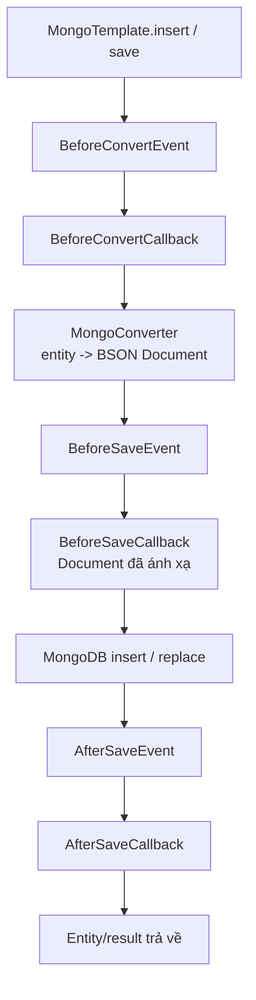
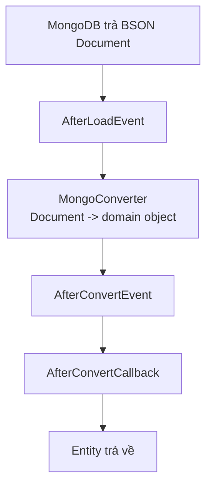
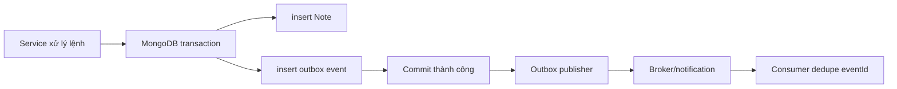

# Phân biệt EntityCallback với ApplicationEvent

## 1. Tại sao Spring Data MongoDB có hai cơ chế can thiệp vòng đời?

Khi sử dụng **Spring Data MongoDB**, ta thường cần thực hiện một thao tác khi một entity được chuyển đổi, lưu hoặc đọc: chuẩn hóa dữ liệu, kiểm tra điều kiện, bổ sung field kỹ thuật, ghi log hoặc phát tín hiệu cho hệ thống khác. Hai cơ chế dễ bị nhầm là:

- **`EntityCallback<T>`**: điểm mở rộng trong **luồng xử lý entity** của Spring Data; callback có thể trả lại **entity mới/đã chỉnh sửa**, và các callback tương ứng được gọi theo thứ tự xác định.
- **`ApplicationEvent`** của Spring (đặc biệt `MongoMappingEvent` như `BeforeConvertEvent`, `BeforeSaveEvent`, `AfterSaveEvent`): một **sự kiện được publish** qua `ApplicationContext`/`ApplicationEventMulticaster` cho listener quan sát hoặc phản ứng.

Ví dụ: người dùng tạo ghi chú với tiêu đề `"  MongoDB   cơ bản  "`. Trước khi lưu, ứng dụng muốn chuẩn hóa tiêu đề và tạo `normalizedTitle`. Sau khi lưu, ứng dụng muốn quan sát ID, loại dữ liệu và thời gian xử lý.

**Phân chia hợp lý:** dùng `BeforeConvertCallback<Note>` để tạo entity chuẩn hóa rồi đưa vào converter; dùng `AbstractMongoEventListener<Note>` để thu thập thông tin quan sát. **Không** dựa vào một event listener chạy nền để chỉnh entity kịp trước khi MongoDB ghi.

### Mục tiêu bài học

Sau bài này, bạn có thể:

1. Giải thích **EntityCallback và ApplicationEvent khác nhau về hợp đồng trả kết quả, thứ tự, thread/reactive context và mục đích**.
2. Chọn đúng `BeforeConvertCallback`, `BeforeSaveCallback`, `AfterSaveCallback` hoặc `AfterConvertCallback`.
3. Viết `AbstractMongoEventListener`/`ApplicationListener` để quan sát `MongoMappingEvent` đúng cách.
4. Hiểu event có thể chạy bất đồng bộ, callback trả entity mới hỗ trợ immutable class/record, và `BeforeSave` phải thao tác đúng BSON `Document`.
5. Biết khi nào cả hai cơ chế **không chạy**, cách kết hợp auditing/validation, transaction, reactive access và kiểm thử tích hợp.

## 2. So sánh tổng quan

| Tiêu chí | `EntityCallback` | `ApplicationEvent` / `MongoMappingEvent` |
| --- | --- | --- |
| Bản chất | Hook tích hợp vào entity mapping/persistence pipeline | Notification qua Spring application event infrastructure |
| Đăng ký | Bean implement callback interface; ví dụ `BeforeConvertCallback<Note>` | `ApplicationListener<...>`, `@EventListener` hoặc `AbstractMongoEventListener<Note>` |
| Trả về entity thay thế | **Có**: callback trả `T` hoặc reactive `Publisher<T>` | **Không có hợp đồng trả entity mới** cho publisher |
| Chỉnh immutable entity | Thuận lợi: tạo bản sao rồi **return** | Không thích hợp để thay object gốc từ listener |
| Thứ tự xử lý cùng stage | Được sắp bằng `@Order`/`Ordered`; callback chạy trong chain xác định | Phụ thuộc multicaster/executor; async có thể phá kỳ vọng thứ tự |
| Hỗ trợ reactive | Có các interface `Reactive...Callback` riêng | Sự kiện Spring không tự trở thành một reactive composition chờ kết quả listener |
| Chạy khi nào | Các điểm trước/sau chuyển đổi, ghi, đọc do Spring Data gọi | Khi Spring Data publish sự kiện tương ứng |
| Truy cập BSON | `BeforeSaveCallback`/`AfterConvertCallback` nhận `org.bson.Document` khi thích hợp | Ví dụ `BeforeSaveEvent` cũng chứa `Document` |
| Tác vụ nên làm | Chuẩn hóa, bảo đảm dữ liệu trước khi mapping; validation | Quan sát, metric/log/notification không ảnh hưởng tính đúng của write |
| Có cam kết sau DB commit? | **Không** chỉ vì tên `AfterSave` | **Không** chỉ vì tên `AfterSaveEvent` |
| Là event nghiệp vụ đáng tin cậy? | Không | Không; muốn publish bền vững cân nhắc outbox |

**Quy tắc quyết định:** Nếu logic **phải hoàn tất trước khi entity được persist hoặc phải có khả năng trả bản thể mới**, hãy chọn `EntityCallback`. Nếu logic chỉ **nghe một tín hiệu**, không điều khiển kết quả mapping, có thể chọn `ApplicationEvent`. Với yêu cầu side effect bên ngoài chắc chắn **sau commit**, hai cơ chế này **đều không đủ khi dùng riêng**.

### 2.1. Hai khái niệm “event” khác nhau

Trong Spring, `ApplicationEvent` là hệ thống tổng quát. Spring Data MongoDB phát các **mapping lifecycle events** (ví dụ `BeforeSaveEvent<Note>`) qua cơ chế đó. Một hệ thống cũng có thể tự publish **domain event** như `OrderPaid`. Chúng có thể cùng dùng `ApplicationEventPublisher` nhưng **không cùng hợp đồng**:

- `BeforeSaveEvent` gắn với **mapping lifecycle**; không chứng minh giao dịch nghiệp vụ đã commit.
- `OrderPaid` là sự kiện **nghiệp vụ do ứng dụng định nghĩa**; muốn phát đúng theo transaction cần giải quyết thời điểm publish, transaction phase và độ bền.
- Cả hai không tự cung cấp “exactly once” qua message broker hay HTTP.

## 3. Dòng thời gian lưu và đọc entity

Với một thao tác `MongoTemplate.insert(note)` hoặc `save(note)` có đường mapping tương ứng, hình dung quy trình ở mức khái niệm:



Khi đọc một root entity:



Theo tài liệu Spring Data MongoDB, các **store-specific `ApplicationEvent` được publish trước callback cùng lifecycle checkpoint** khi có callback. Tuy nhiên, nếu `ApplicationEventMulticaster` dùng executor bất đồng bộ, **listener có thể thực thi muộn**; không suy ra toàn bộ listener đã hoàn tất khi callback bắt đầu.

**Hình trên là luồng khái niệm**, không phải cam kết event listener luôn chạy tuần tự hay thứ tự tuyệt đối giữa mọi interceptor tùy biến của dự án. Tên API và các điểm gọi có thể khác ở từng Spring Data release và đường thao tác.

### 3.1. Những điểm EntityCallback được hỗ trợ trong MongoDB

| Callback interface | Method / tham số chính | Tác dụng |
| --- | --- | --- |
| `BeforeConvertCallback<T>` | `onBeforeConvert(T, String collection)` | Trước khi entity thành BSON Document; return entity mới được persist |
| `BeforeSaveCallback<T>` | `onBeforeSave(T, Document, String collection)` | Sau convert, trước lệnh ghi; **Document** là vật liệu thực tế để lưu |
| `AfterSaveCallback<T>` | `onAfterSave(T, Document, String collection)` | Sau thao tác ghi; có thể thay entity trả về, **không ghi lại** thay đổi |
| `AfterConvertCallback<T>` | `onAfterConvert(T, Document, String collection)` | Sau chuyển BSON thành entity; có thể thay entity trả về khi đọc |
| `ReactiveBeforeConvertCallback<T>` | `Publisher<T> onBeforeConvert(T, String)` | Bản reactive của BeforeConvert |
| `ReactiveBeforeSaveCallback<T>` | `Publisher<T> onBeforeSave(T, Document, String)` | Bản reactive của BeforeSave |
| `ReactiveAfterSaveCallback<T>` | `Publisher<T> onAfterSave(T, Document, String)` | Bản reactive của AfterSave |
| `ReactiveAfterConvertCallback<T>` | `Publisher<T> onAfterConvert(T, Document, String)` | Bản reactive của AfterConvert |

Các interface Mongo-specific nằm trong package `org.springframework.data.mongodb.core.mapping.event`. `org.springframework.data.mapping.callback.EntityCallback` là abstraction chung của Spring Data Commons, còn những phương thức lifecycle cụ thể là interface của MongoDB module.

### 3.2. Những loại MongoDB mapping events thường gặp

| Event | Khi publish | Ví dụ listener |
| --- | --- | --- |
| `BeforeConvertEvent<T>` | Trước khi chuyển entity sang BSON | `onBeforeConvert(BeforeConvertEvent<T>)` |
| `BeforeSaveEvent<T>` | Trước khi ghi Document vào MongoDB | `onBeforeSave(BeforeSaveEvent<T>)` |
| `AfterSaveEvent<T>` | Sau thao tác ghi vào MongoDB | `onAfterSave(AfterSaveEvent<T>)` |
| `AfterLoadEvent<T>` | Sau khi đọc BSON, trước mapping sang entity | `onAfterLoad(AfterLoadEvent<T>)` |
| `AfterConvertEvent<T>` | Sau khi BSON được chuyển thành entity | `onAfterConvert(AfterConvertEvent<T>)` |
| `BeforeDeleteEvent<T>`/`AfterDeleteEvent<T>` | Các điểm xóa qua mapping APIs phù hợp | `onBeforeDelete(...)`/`onAfterDelete(...)` |

Danh sách event **không tương đương** danh sách `EntityCallback`: ví dụ MongoDB có các mapping event liên quan đến delete và `AfterLoad` nhưng không nên suy ra có sẵn interface `BeforeDeleteCallback` hoặc `AfterLoadCallback` tương ứng trong bảng các callback chính.

## 4. Điểm khác biệt quyết định: callback trả entity, event chỉ thông báo

### 4.1. Immutable entity không nên bị “đổi tại chỗ”

Với Java `record` hoặc immutable class, không thể viết:

```java
// Không biên dịch được với record bất biến:
note.setNormalizedTitle("mongo-db");
```

Thay vì ép thay đổi object trong listener, `BeforeConvertCallback` có thể tạo một bản sao và **return** object mới:

```java
@Override
public Note onBeforeConvert(Note source, String collection) {
    return new Note(
        source.id(),
        source.tenantId(),
        source.title().strip(),
        normalize(source.title()),
        source.createdAt()
    );
}
```

Spring Data dùng giá trị callback trả về làm entity cho bước mapping tiếp theo. Đây là lý do `EntityCallback` được giới thiệu trong Spring Data Commons 2.2 để cung cấp **hợp đồng sửa entity có thứ tự**, không dựa vào mutation ngẫu nhiên của event listener.

### 4.2. Vì sao `BeforeSaveCallback` khác `BeforeConvertCallback`?

`BeforeConvertCallback` chạy khi entity **chưa chuyển** sang BSON. Sửa entity trước đó có thể ảnh hưởng các persistent property được ánh xạ.

`BeforeSaveCallback` chạy **sau khi** `MongoConverter` đã tạo `org.bson.Document`. Vì vậy, nếu thay `entity.title` lúc này mà không sửa BSON `Document`, lệnh ghi có thể **vẫn dùng giá trị Document cũ**. [Javadoc chính thức của `BeforeSaveCallback`](https://docs.spring.io/spring-data/mongodb/docs/current/api/org/springframework/data/mongodb/core/mapping/event/BeforeSaveCallback.html) nhấn mạnh: ở điểm này, **thay đổi persistent property trên domain object không được dùng để lưu**; muốn sửa field persisted, thao tác trên `Document` hoặc chuyển logic lên `BeforeConvertCallback`.

Ví dụ:

```java
@Override
public Note onBeforeSave(
        Note entity, org.bson.Document document, String collection) {

    // Thao tác vào dữ liệu sẽ được gửi tới MongoDB:
    document.put("source_system", "article-api");

    // Có thể trả cùng entity hoặc instance thích hợp cho pipeline.
    return entity;
}
```

Mã này thêm field BSON `source_system`. Nếu `Note` không có property đó, entity đọc lại sẽ **không tự có** getter cho field này; muốn dùng field trong domain, cần bổ sung mapping hoặc dùng DTO/projection phù hợp.

### 4.3. ApplicationEvent có thể có tham chiếu mutable — nhưng không có contract thay entity

`BeforeConvertEvent<Note>` hoặc `BeforeSaveEvent<Note>` có thể mang tham chiếu entity/Document. Với entity mutable, listener **có thể** thay đổi object đang được chia sẻ khi chạy đồng bộ. Tuy nhiên, đây không phải hợp đồng trả bản thể mới; với immutable entity không có chỗ đưa instance mới vào chain, còn với **async event listener**, mutation có thể xảy ra **sau** bước convert/ghi.

**Đừng viết logic bắt buộc cho correctness dựa trên việc listener mutate entity trước khi MongoDB ghi.** Sử dụng callback và kiểm thử kết quả persisted.

## 5. Ví dụ hoàn chỉnh: immutable `Note` và `BeforeConvertCallback`

Mục này dùng Java 17+, Spring Boot 3.x và `spring-boot-starter-data-mongodb`. Yêu cầu: khi insert ghi chú, chuẩn hóa khoảng trắng tiêu đề, điền `normalizedTitle` theo cùng một quy tắc, và chỉ đặt `createdAt` nếu người gọi chưa cung cấp. Ghi chú là **record bất biến**: callback phải trả **record mới**.

### 5.1. Entity và tên field BSON

```java
package com.example.notes;

import java.time.Instant;
import org.springframework.data.annotation.Id;
import org.springframework.data.mongodb.core.mapping.Document;
import org.springframework.data.mongodb.core.mapping.Field;

@Document(collection = "notes")
public record Note(
    @Id String id,
    @Field("tenant_id") String tenantId,
    String title,
    @Field("normalized_title") String normalizedTitle,
    @Field("created_at") Instant createdAt
) {}
```

Ví dụ ứng dụng cấp ID cố định trước khi gọi insert (như `"NOTE-001"`), không phụ thuộc callback để sinh ID. Điều này giúp đơn giản hóa ví dụ và tránh nhầm việc mapping ID với chuẩn hóa title. `tenantId` phải lấy từ ngữ cảnh đã xác thực; kiểm tra quyền tenant không được giao hết cho lifecycle callback.

### 5.2. Clock dùng để kiểm thử được

```java
package com.example.notes;

import java.time.Clock;
import org.springframework.context.annotation.Bean;
import org.springframework.context.annotation.Configuration;

@Configuration
public class NoteClockConfig {

    @Bean
    public Clock noteClock() {
        return Clock.systemUTC();
    }
}
```

Thay vì gọi `Instant.now()` tại nhiều vị trí khó kiểm thử, callback nhận `Clock` qua constructor injection.

### 5.3. Callback chuẩn hóa chạy trước converter

```java
package com.example.notes;

import java.time.Clock;
import java.time.Instant;
import java.util.Locale;
import org.springframework.core.annotation.Order;
import org.springframework.data.mongodb.core.mapping.event.BeforeConvertCallback;
import org.springframework.stereotype.Component;

@Component
@Order(200)
public final class NoteNormalizationCallback
        implements BeforeConvertCallback<Note> {

    private final Clock clock;

    public NoteNormalizationCallback(Clock clock) {
        this.clock = clock;
    }

    @Override
    public Note onBeforeConvert(Note source, String collection) {
        if (source.tenantId() == null
                || source.tenantId().isBlank()) {
            throw new IllegalArgumentException("Thiếu tenant");
        }
        if (source.title() == null) {
            throw new IllegalArgumentException("Thiếu tiêu đề");
        }

        String cleaned = source.title()
            .strip()
            .replaceAll("\\s+", " ");

        if (cleaned.isBlank()) {
            throw new IllegalArgumentException("Tiêu đề rỗng");
        }

        String normalized = cleaned.toLowerCase(Locale.ROOT);
        Instant created = source.createdAt() == null
            ? clock.instant()
            : source.createdAt();

        // Trả record mới, KHÔNG mutate source.
        return new Note(
            source.id(),
            source.tenantId(),
            cleaned,
            normalized,
            created
        );
    }
}
```

Điểm cần hiểu:

1. `onBeforeConvert` chạy **trước MongoConverter**, nên title đã chuẩn hóa sẽ xuất hiện ở BSON Document được tạo.
2. Record `Note` bất biến, nhưng callback trả **instance mới**; Spring Data dùng instance mới trong pipeline.
3. `createdAt` đã có thì **giữ nguyên**, không tự thay timestamp mỗi lần `save`. Đây là đặc tính quan trọng khi retry hoặc update.
4. `@Order(200)` đặt thứ tự tương đối giữa các callback **cùng lifecycle stage**; không có nghĩa mọi event listener khác đều chạy xong trước nó.
5. Chỉ số `200` là ví dụ. Khi bật MongoDB auditing (callback thường có order `100`), cần kiểm tra thứ tự và tránh ghi đè timestamp/auditor do callback khác tạo ra.

Với tiêu đề `"  MongoDB    và Spring  "`, kết quả persisted dự kiến:

```javascript
{
  _id: "NOTE-001",
  tenant_id: "SHOP-A",
  title: "MongoDB và Spring",
  normalized_title: "mongodb và spring",
  created_at: ISODate("2026-11-20T08:00:00Z")
}
```

Giá trị `created_at` là thời điểm minh họa với một `Clock` đã được cố định cho test; trong ứng dụng thật, `Clock.systemUTC()` sẽ dùng thời gian đang chạy.

### 5.4. Callback không tự chống duplicate hoặc kiểm soát mọi đường ghi

Hai request khác nhau có thể cùng chuẩn hóa về `normalizedTitle = "mongodb và spring"`. Nếu nghiệp vụ yêu cầu duy nhất `(tenant_id, normalized_title)`, **cần unique index** và xử lý `DuplicateKeyException`, không chỉ dùng callback:

```javascript
db.notes.createIndex(
  { tenant_id: 1, normalized_title: 1 },
  {
    unique: true,
    name: "notes_tenant_normalized_title_unique"
  }
)
```

Callback bảo đảm chuẩn hóa trên **đường lưu entity có chạy callback**; nó không thay thế database constraint hoặc schema validation. Index cần được tạo ở migration trước khi xử lý request đồng thời.

## 6. `BeforeSaveCallback`: phân biệt entity object với BSON Document

Giả sử muốn thêm field lưu trữ `source_system` vào BSON mà không đưa field này vào domain `Note`. Một callback trước save có thể thao tác trên `Document` đã được converter tạo:

```java
package com.example.notes;

import org.bson.Document;
import org.springframework.core.annotation.Order;
import org.springframework.data.mongodb.core.mapping.event.BeforeSaveCallback;
import org.springframework.stereotype.Component;

@Component
@Order(300)
public final class NoteBsonMarkerCallback
        implements BeforeSaveCallback<Note> {

    @Override
    public Note onBeforeSave(
            Note entity, Document document, String collection) {

        if (!"notes".equals(collection)) {
            return entity;
        }

        document.put("source_system", "note-api");
        return entity;
    }
}
```

Sau khi `MongoTemplate.insert(...)` chạy, BSON document có thêm:

```javascript
{
  _id: "NOTE-001",
  title: "MongoDB và Spring",
  normalized_title: "mongodb và spring",
  source_system: "note-api",
  // ... tenant_id, created_at ...
}
```

`source_system` không phải một property trong `Note`; khi đọc thành `Note`, custom field có thể bị bỏ qua theo mapping thông thường. Nếu API cần sử dụng field này như dữ liệu bền vững, hãy đưa nó vào schema/entity hoặc dùng projection. Đừng lạm dụng callback để lưu một loạt field “ẩn” không được quản lý.

### Sai lầm phổ biến: đổi entity ở `BeforeSave`

```java
// Minh họa tư duy SAI: sửa object sau khi Document đã tạo.
public Note onBeforeSave(Note entity, Document document, String collection) {
    Note changed = new Note(
        entity.id(), entity.tenantId(),
        "Tiêu đề mới", "tiêu đề mới", entity.createdAt());

    return changed;
}
```

Việc trả `changed` không bảo đảm `"Tiêu đề mới"` được lưu, vì **BSON Document đã được tạo từ entity cũ**. Javadoc yêu cầu sửa **Document** để ảnh hưởng nội dung persisted tại checkpoint này. Nếu cần thay persistent domain property và đồng bộ với object return, đặt logic ở `BeforeConvertCallback`.

### `AfterSaveCallback` cũng không phải một lần save thứ hai

`AfterSaveCallback` có thể trả một entity đã thay đổi cho caller, nhưng thao tác MongoDB chính **đã được gửi/hoàn tất** theo checkpoint đó. Sửa entity trong `AfterSaveCallback` **không tự ghi** sửa đổi mới xuống collection.

```java
import org.bson.Document;
import org.springframework.data.mongodb.core.mapping.event.AfterSaveCallback;

public final class NoteAfterSaveObserver
        implements AfterSaveCallback<Note> {

    @Override
    public Note onAfterSave(
            Note entity, Document document, String collection) {
        // Hạn chế quan sát/định hình giá trị trả về.
        // Không giả định mọi sửa đổi object ở đây đã persisted.
        return entity;
    }
}
```

Class cuối chỉ mô tả callback; để Spring tự phát hiện cần đăng ký thành bean (`@Component` hoặc `@Bean`). Trong ví dụ chính không cần đăng ký thêm callback chỉ trả nguyên entity; nó được đưa vào để diễn giải lifecycle.

## 7. `ApplicationEvent`: lắng nghe `MongoMappingEvent` đúng cách

Spring Data MongoDB cung cấp `AbstractMongoEventListener<T>`, một adapter cho `ApplicationListener<MongoMappingEvent<?>>` với các method đã định kiểu theo checkpoint.

### 7.1. Listener quan sát thay vì chỉnh dữ liệu

```java
package com.example.notes;

import org.slf4j.Logger;
import org.slf4j.LoggerFactory;
import org.springframework.data.mongodb.core.mapping.event.AbstractMongoEventListener;
import org.springframework.data.mongodb.core.mapping.event.BeforeConvertEvent;
import org.springframework.data.mongodb.core.mapping.event.BeforeSaveEvent;
import org.springframework.data.mongodb.core.mapping.event.AfterSaveEvent;
import org.springframework.stereotype.Component;

@Component
public final class NoteLifecycleObserver
        extends AbstractMongoEventListener<Note> {

    private static final Logger log =
        LoggerFactory.getLogger(NoteLifecycleObserver.class);

    @Override
    public void onBeforeConvert(BeforeConvertEvent<Note> event) {
        log.debug("BeforeConvert noteId={}",
            event.getSource().id());
    }

    @Override
    public void onBeforeSave(BeforeSaveEvent<Note> event) {
        log.debug("BeforeSave noteId={}",
            event.getSource().id());
    }

    @Override
    public void onAfterSave(AfterSaveEvent<Note> event) {
        log.debug("AfterSave noteId={}",
            event.getSource().id());
    }
}
```

Mã trên minh họa **quan sát** và log **ID kỹ thuật**. Trong hệ thống thật, cần tuân thủ chính sách log/PII, và tránh ghi nội dung ghi chú, token hoặc thông tin nhạy cảm ra log chỉ vì event mang entity. `onAfterSave` chỉ có nghĩa sự kiện được phát ở checkpoint **sau thao tác save**, không phải khi transaction đã commit và cũng không đồng nghĩa message đã được phát ra bên ngoài.

### 7.2. Vì sao nên dùng adapter?

`AbstractMongoEventListener<Note>` giúp tránh tự kiểm tra `instanceof` đối với tất cả event types trong một `ApplicationListener<MongoMappingEvent<?>>`. Nếu có nhu cầu hệ thống chung, vẫn có thể dùng Spring `@EventListener` hoặc `ApplicationListener`, nhưng phải hiểu filter type, thứ tự và executor của `ApplicationEventMulticaster`.

Với ứng dụng có nhiều entity khác nhau, dùng listener typed theo root entity giúp hạn chế chi phí và giảm nguy cơ xử lý nhầm dữ liệu ngoài phạm vi. Nếu listener có ý nghĩa audit toàn hệ thống, thiết kế audit độc lập thay vì dựa vào một chuỗi event không bền vững.

### 7.3. Event listener có thể mutate Document — vì sao vẫn không nên dùng cho correctness?

`BeforeSaveEvent<Note>` có thể mang entity và BSON Document. Nếu listener được dispatch đồng bộ, thay đổi Document trước khi driver ghi **có thể** ảnh hưởng dữ liệu. Nhưng nếu multicaster có `TaskExecutor` bất đồng bộ, listener không còn là điểm chặn chắc chắn: luồng ghi có thể tiếp tục trước khi listener sửa Document. Với immutable type, listener cũng không có contract trả entity mới.

**Thực hành:** logic tạo field bắt buộc nên ở `BeforeConvertCallback`/`BeforeSaveCallback`; event listener quan sát là công việc riêng, có thể chạy chậm hoặc thậm chí bị bỏ qua theo cấu hình event publishing. Không dùng listener làm công cụ bảo vệ invariant duy nhất.

### 7.4. Listener có thể xử lý các sự kiện xóa

MongoDB có `BeforeDeleteEvent` và `AfterDeleteEvent`, tùy đường thao tác thông qua mapping/template. Điều này **không** có nghĩa mọi direct driver delete, TTL deletion hoặc bulk query update sẽ phát một event cho từng entity đầy đủ:

```java
// Adapter có thể override thêm:
// onBeforeDelete(BeforeDeleteEvent<Note> event)
// onAfterDelete(AfterDeleteEvent<Note> event)
```

Đặc biệt, TTL deletion được MongoDB chạy nền — không đi qua `MongoTemplate` trong process ứng dụng — nên không kích hoạt entity callbacks hay Spring application lifecycle events của ứng dụng cho từng document bị xóa.

## 8. Thứ tự, `@Order`, multicaster và thread

### 8.1. `EntityCallback` được gọi tuần tự theo order

Nếu hai callback cùng implement `BeforeConvertCallback<Note>`:

```java
@Component
@Order(50)
class FirstNoteCallback implements BeforeConvertCallback<Note> {
    @Override
    public Note onBeforeConvert(Note note, String collection) {
        return note; // Ví dụ có thể validate trước callback sau.
    }
}

@Component
@Order(200)
class SecondNoteCallback implements BeforeConvertCallback<Note> {
    @Override
    public Note onBeforeConvert(Note note, String collection) {
        return note;
    }
}
```

Ví dụ là các bean giả định, không cần đăng ký cùng callback của mục 5 khi chạy production. Với `@Order`, **số nhỏ có precedence cao**; đối với callback trước convert, Spring áp dụng các callback theo thứ tự thích hợp và truyền entity kết quả vào bước tiếp theo. Callback không khai báo thứ tự thường chạy với precedence thấp hơn; khi nhiều callback có cùng order, không nên phụ thuộc vào một thứ tự ngẫu nhiên.

Sử dụng `@Order` cho **trình tự thực sự có ý nghĩa**: validate dữ liệu đầu vào, enrich default, rồi chuẩn hóa hoặc audit theo chính sách. Nhưng càng nhiều callback phụ thuộc chéo, hệ thống càng khó hiểu; logic nghiệp vụ phức tạp nên nằm ở service chuyên trách.

### 8.2. `ApplicationEventMulticaster` có thể dispatch bất đồng bộ

Spring `SimpleApplicationEventMulticaster` theo cấu hình mặc định thường gọi listener **trên thread phát event**. Nhưng có thể cấu hình executor:

```java
import java.util.concurrent.Executor;
import org.springframework.context.annotation.Bean;
import org.springframework.context.annotation.Configuration;
import org.springframework.context.event.ApplicationEventMulticaster;
import org.springframework.context.event.SimpleApplicationEventMulticaster;
import org.springframework.core.task.SimpleAsyncTaskExecutor;

@Configuration
class AsyncEventConfig {

    @Bean(name = "applicationEventMulticaster")
    ApplicationEventMulticaster applicationEventMulticaster() {
        SimpleApplicationEventMulticaster m =
            new SimpleApplicationEventMulticaster();
        m.setTaskExecutor(
            new SimpleAsyncTaskExecutor("app-event-"));
        return m;
    }
}
```

**Đây là ví dụ thay đổi cơ chế dispatch trên toàn ApplicationContext**, không phải cấu hình khuyến nghị để copy vào mọi dự án. Nó có thể ảnh hưởng các listener khác, lifecycle/bảo mật/tracing, đường bắt exception và thứ tự quan sát. Với Spring Framework mới, một số listener có yêu cầu thực thi đồng bộ riêng; cần kiểm tra hợp đồng `supportsAsyncExecution` và phiên bản framework.

Khi event được dispatch bất đồng bộ:

- Không có bảo đảm listener đã sửa entity/Document **trước** khi template tiếp tục.
- Thread xử lý event không mặc nhiên có transaction context/thread-local hoặc Reactor context của caller.
- Lỗi trong listener bất đồng bộ không nhất thiết làm thao tác MongoDB phía caller rollback.
- Listener có thể xử lý event **sau** khi caller nhận response hoặc transaction đã abort.

Vì thế **sự kiện không phải hook chặn để bảo đảm tính đúng của document persisted**.

## 9. Reactive: dùng các interface `Reactive...Callback`, không dùng listener đồng bộ để thay thế

Trong ứng dụng Spring WebFlux sử dụng `ReactiveMongoTemplate`, callback tương ứng có prefix `Reactive` và trả **`Publisher<T>`**, thường là `Mono<T>`. Callback chạy khi có **subscription** và có thể nối công việc không blocking theo thứ tự trong reactive persistence chain.

### 9.1. Ví dụ `ReactiveBeforeConvertCallback<Note>`

```java
package com.example.notes;

import java.time.Clock;
import java.time.Instant;
import java.util.Locale;
import org.reactivestreams.Publisher;
import org.springframework.core.annotation.Order;
import org.springframework.data.mongodb.core.mapping.event.ReactiveBeforeConvertCallback;
import org.springframework.stereotype.Component;
import reactor.core.publisher.Mono;

@Component
@Order(200)
public final class ReactiveNoteNormalizationCallback
        implements ReactiveBeforeConvertCallback<Note> {

    private final Clock clock;

    public ReactiveNoteNormalizationCallback(Clock clock) {
        this.clock = clock;
    }

    @Override
    public Publisher<Note> onBeforeConvert(
            Note source, String collection) {

        return Mono.fromSupplier(() -> {
            if (source.title() == null
                    || source.title().isBlank()
                    || source.tenantId() == null
                    || source.tenantId().isBlank()) {
                throw new IllegalArgumentException(
                    "Thiếu thông tin ghi chú");
            }

            String cleaned = source.title()
                .strip()
                .replaceAll("\\s+", " ");

            Instant created = source.createdAt() == null
                ? clock.instant()
                : source.createdAt();

            return new Note(
                source.id(),
                source.tenantId(),
                cleaned,
                cleaned.toLowerCase(Locale.ROOT),
                created
            );
        });
    }
}
```

Với reactive driver, `ReactiveMongoTemplate.insert(note)` trả `Mono<Note>` và operation/callback được kích hoạt khi subscribe. `Mono.fromSupplier` giúp phần tính toán/validation chạy trong luồng publisher, không chạy từ lúc dựng `Mono`.

Nếu gọi callback `onBeforeConvert(...)` trong một unit test và **không subscribe**, code nằm trong supplier chưa chạy; cần dùng `StepVerifier` hoặc subscribe qua operator test. Trong production, **không** gọi `block()` trong callback chỉ để đồng bộ hóa một phép xử lý reactive.

### 9.2. Hai hệ callback tách theo API

| Đường thao tác | Callback được áp dụng |
| --- | --- |
| `MongoTemplate.insert(note)` | Các `BeforeConvertCallback<Note>` / `BeforeSaveCallback<Note>` đồng bộ phù hợp |
| `ReactiveMongoTemplate.insert(note)` | Các `ReactiveBeforeConvertCallback<Note>` / `ReactiveBeforeSaveCallback<Note>` phù hợp |
| Spring Data reactive mapping/read | Các reactive after-* callbacks tương ứng |
| Gọi native driver trực tiếp không qua template mapping | Không tự dùng các Spring Data callback bean |

**Đăng ký `BeforeConvertCallback<Note>` không tự bảo đảm reactive template gọi nó.** Spring Data phân tách callback theo loại API. Nếu dự án có cả imperative và reactive, có thể đăng ký **cả hai**, dùng chung một **pure normalization function** để tránh khác biệt nghiệp vụ giữa hai đường. Xem [Lifecycle Events — Spring Data MongoDB](https://docs.spring.io/spring-data/mongodb/reference/mongodb/lifecycle-events.html).

### 9.3. Reactive `BeforeSaveCallback` phải trả Publisher của entity

```java
package com.example.notes;

import org.bson.Document;
import org.reactivestreams.Publisher;
import org.springframework.data.mongodb.core.mapping.event.ReactiveBeforeSaveCallback;
import org.springframework.stereotype.Component;
import reactor.core.publisher.Mono;

@Component
public final class ReactiveNoteBsonMarkerCallback
        implements ReactiveBeforeSaveCallback<Note> {

    @Override
    public Publisher<Note> onBeforeSave(
            Note note, Document document, String collection) {

        return Mono.fromSupplier(() -> {
            document.put("source_system", "note-api");
            return note;
        });
    }
}
```

Reactive callback **phải phát entity** mà Spring Data tiếp tục xử lý. Nếu trả `Mono.empty()` một cách vô tình, downstream có thể không có entity để tiếp tục, dẫn tới hành vi không mong đợi. Nếu validation lỗi, nên phát `Mono.error(...)` thay vì “nuốt lỗi bằng empty”. Với `BeforeSave`, nội dung persist vẫn được lấy từ **BSON Document** đã ánh xạ.

### 9.4. Reactive mapping events không phải reactive middleware có thứ tự

Các mapping lifecycle `ApplicationEvent` vẫn đi qua Spring event infrastructure; **không** phải một chuỗi `Publisher<T>` được Spring Data chờ hoàn tất theo đúng thứ tự business callback. Khi listener bất đồng bộ, không được dựa vào transaction `Reactor Context` của caller sẽ tự có trong listener thread.

Ví dụ nguy hiểm:

```java
// KHÔNG NÊN: tạo subscription mới để chỉnh entity.
@EventListener
public void beforeSave(BeforeSaveEvent<Note> event) {
    reactiveMongoTemplate.save(event.getSource())
        .subscribe();
}
```

Đoạn trên có thể **tạo vòng lặp lifecycle** (save lại kích hoạt event), tách khỏi transaction caller, tạo ghi lặp và race. Nếu yêu cầu nghiệp vụ cần thêm write, hãy đặt nó ở service/transaction hoặc outbox; không mở một subscription “fire-and-forget” trong mapping event.

## 10. Auditing, validation và thứ tự callback hệ thống

Spring Data MongoDB dùng `EntityCallback` cho một số khả năng sẵn có như auditing và Bean Validation. Điều này quan trọng khi bạn thêm callback tự viết: một entity có thể trải qua **nhiều callback cùng stage**.

### 10.1. Auditing có thể dùng `BeforeConvertCallback`

Spring Data hỗ trợ `@CreatedDate`, `@LastModifiedDate`, `@CreatedBy`, `@LastModifiedBy` với cấu hình auditing. Ví dụ:

```java
import java.time.Instant;
import org.springframework.data.annotation.CreatedDate;
import org.springframework.data.annotation.LastModifiedDate;
import org.springframework.data.mongodb.core.mapping.Document;

@Document(collection = "audit_notes")
public class AuditNote {

    @CreatedDate
    private Instant createdAt;

    @LastModifiedDate
    private Instant updatedAt;

    // ... id, title, constructor, getter ...
}
```

Cấu hình imperative:

```java
import org.springframework.context.annotation.Configuration;
import org.springframework.data.mongodb.config.EnableMongoAuditing;

@Configuration
@EnableMongoAuditing
public class MongoAuditingConfig {}
```

Đối với reactive:

```java
import org.springframework.context.annotation.Configuration;
import org.springframework.data.mongodb.config.EnableReactiveMongoAuditing;

@Configuration
@EnableReactiveMongoAuditing
public class ReactiveMongoAuditingConfig {}
```

Auditing callback thường có `Ordered` order **100**, chạy ở giai đoạn `BeforeConvert`. Nếu callback tùy biến tạo một **instance mới nhưng quên copy field audit vừa được điền**, có thể vô tình mất timestamp/auditor. Trong ví dụ `NoteNormalizationCallback`, ta **giữ** `createdAt` đã có. Với entity immutable có auditing, cần kiểm tra field copy và version tương thích của Spring Data.

Không cần viết lại toàn bộ auditing nếu annotation chính thức đáp ứng yêu cầu. Chỉ thêm callback khi cần quy tắc riêng, và kiểm thử tương tác với `@CreatedDate`/`@LastModifiedDate` để tránh timestamp bị ghi đè do thứ tự.

### 10.2. Validation là một callback trước save

Spring Data MongoDB hỗ trợ đăng ký `ValidatingEntityCallback` với Jakarta Validation:

```java
import jakarta.validation.Validator;
import org.springframework.context.annotation.Bean;
import org.springframework.context.annotation.Configuration;
import org.springframework.data.mongodb.core.mapping.event.ValidatingEntityCallback;

@Configuration
class NoteValidationConfig {

    @Bean
    ValidatingEntityCallback validatingEntityCallback(
            Validator validator) {
        return new ValidatingEntityCallback(validator);
    }
}
```

Với reactive, dùng `ReactiveValidatingEntityCallback` khi phiên bản dependency hỗ trợ và có `Validator` phù hợp. Ví dụ validation không thay thế schema validation, unique index hoặc kiểm tra quyền user: chúng bảo vệ các **lớp khác nhau** của hệ thống.

**Lưu ý:** Nếu dự án còn dùng `ValidatingMongoEventListener` lịch sử và cũng đăng ký `ValidatingEntityCallback`, validation có thể chạy **hai lần**. Kiểm tra cấu hình hiện hữu trước khi chuyển từ listener sang callback, tránh bất ngờ về hiệu năng hoặc thông báo lỗi trùng.

### 10.3. Thứ tự callback và validation có thể thay đổi ý nghĩa

Ví dụ `Note` có title chứa nhiều khoảng trắng; nếu một callback validate `title.length() <= 20` **trước** khi callback normalize, request có thể bị từ chối dù title sau normalize dài 18 ký tự. Nếu muốn validation dựa trên bản đã chuẩn hóa, phải chọn đúng stage/order và test. Đừng coi `@Order` là cách vá lỗi của một thiết kế callback chồng chéo phức tạp; chuẩn hóa/validation quan trọng nên được tổ chức rõ ràng.

## 11. Những trường hợp lifecycle hook không chạy

**Đây là giới hạn phổ biến nhất khi coi callbacks là validation bắt buộc cho mọi write.** Mapping lifecycle hooks gắn với **đường chuyển đổi entity của Spring Data**, không phải mọi lệnh MongoDB trên server.

### 11.1. `updateFirst`, `updateMulti` và update pipeline

```java
mongoTemplate.updateFirst(
    Query.query(Criteria.where("id").is("NOTE-001")),
    new Update().set("title", "  chưa chuẩn hóa  "),
    Note.class
);
```

Đường này tạo **update command** theo query/`UpdateDefinition`, không đưa entity `Note` qua toàn bộ `BeforeConvertCallback`/`BeforeSaveCallback` như `insert(note)`. Nó có thể ghi trực tiếp một title chưa được chuẩn hóa.

Tương tự, `updateMulti`, các lệnh update trực tiếp, bulk update và aggregation update không nên được giả định chạy **cùng callback cho từng entity**. Nếu cần bảo vệ chuẩn hóa trên mọi đường update, phải chuyển quy tắc vào service tạo `Update`, server-side validator/constraint hoặc thiết kế API ghi có kiểm soát.

### 11.2. Bulk operations và native driver

```java
mongoTemplate.bulkOps(
    org.springframework.data.mongodb.core.BulkOperations.BulkMode.UNORDERED,
    Note.class
).updateOne(
    Query.query(Criteria.where("id").is("NOTE-001")),
    new Update().set("title", "unprocessed")
).execute();
```

Bulk operations dùng lệnh ở mức thấp và có semantics riêng về mapping/optimistic locking; **không dựa vào per-entity lifecycle callbacks hay per-entity events** trên mỗi updated document. Tương tự, một `MongoCollection.insertOne(Document)` gọi trực tiếp qua Java driver bypass lớp mapping và các callback Spring Data.

Vì vậy, một quy tắc thật sự bất biến về dữ liệu, đặc biệt liên quan tiền, tenant, quyền truy cập hoặc unique business key, cần được bảo vệ ở **schema/index/conditional update/transaction** và service, không chỉ callback.

### 11.3. Root entity, embedded objects và `@DBRef`

Spring Data MongoDB lưu ý **mapping lifecycle events chỉ được phát cho root-level types**. Một embedded object được lưu **bên trong document cha** không tự nhận event riêng như root entity; một số reference `@DBRef` có đường loading riêng, tùy hoạt động và version.

```java
@Document("orders")
class OrderDocument {
    @Id String id;
    Address shippingAddress;  // embedded object
}

class Address {
    String city;
}
```

Không đặt `AbstractMongoEventListener<Address>` rồi giả định mọi lần save `OrderDocument` sẽ phát `BeforeSaveEvent<Address>`. Với `EntityCallback<Address>` cũng không nên mặc định nó được gọi cho mọi nested property; callback được kích hoạt ở checkpoint của **aggregate đang được xử lý**. Nếu cần chuẩn hóa địa chỉ, thực hiện trong callback của **root `OrderDocument`** hoặc converter/service phù hợp.

### 11.4. TTL deletion, shell và hệ thống khác

MongoDB TTL monitor, lệnh chạy từ `mongosh`, bulk import hay một service Node.js khác không chạy trong ApplicationContext Java của bạn. Chúng **không** gọi `EntityCallback<Note>` hoặc `ApplicationListener<BeforeSaveEvent<Note>>` trong ứng dụng Spring. Điều này khiến callback không thích hợp làm cơ chế bảo vệ xuyên mọi client.

### 11.5. Tắt lifecycle events và chi phí đọc

Lifecycle events phát trên đường đọc/ghi có chi phí, đặc biệt khi đọc result set lớn. Tài liệu Spring Data MongoDB cho phép **vô hiệu event publishing** trên template theo API cấu hình của phiên bản. Nếu dự án đã tắt mapping events để giảm overhead, listener sẽ không chạy — không lấy việc event vắng mặt làm bằng chứng MongoDB không load/save entity.

**EntityCallback và event publishing là hai cơ chế riêng**; hãy kiểm tra cấu hình/cách template được xây trong release thực tế khi muốn tắt/chỉ bật một trong hai. Không tự gọi cách tắt event ở một version khác mà không đọc API của bản đang dùng.

## 12. Transaction, rollback và sự thật về “AfterSave”

Tên `AfterSaveCallback` hoặc `AfterSaveEvent` dễ khiến ta nghĩ “MongoDB đã commit xong”. **Không đúng** khi ứng dụng có transaction nhiều document: save có thể thành công **bên trong một transaction chưa commit**, rồi transaction sau đó **rollback** vì một thao tác khác lỗi.

### 12.1. Dòng thời gian minh họa

```text
@Transactional
   |
   |--> MongoTemplate.insert(note) -> MongoDB nhận write trong transaction
   |       |--> AfterSaveEvent được publish
   |       |--> AfterSaveCallback được gọi
   |
   |--> MongoTemplate.updateFirst(otherDocument) -> lỗi
   |
   +--> transaction rollback

Kết quả: note KHÔNG tồn tại sau rollback,
nhưng listener AfterSave có thể đã ghi log/gọi dịch vụ ngoài.
```

Điều này không chứng minh Spring Data callback “sai”: nó đúng **checkpoint thao tác persistence**, nhưng không có hợp đồng **after database commit**.

### 12.2. Không gửi email hoặc trừ tiền ngay trong `AfterSaveEvent`

Ví dụ không an toàn:

```java
@Component
class DangerousNoteEventListener
        extends AbstractMongoEventListener<Note> {

    @Override
    public void onAfterSave(AfterSaveEvent<Note> event) {
        // KHÔNG NÊN: side effect bên ngoài không rollback cùng MongoDB.
        // paymentClient.charge(...);
        // emailClient.send(...);
    }
}
```

Giả sử MongoDB transaction abort sau callback: email đã gửi không thể rollback bằng transaction MongoDB. Ngoài ra, nếu listener chạy async, event có thể được xử lý muộn hoặc lỗi không được truyền về caller.

**Thiết kế thay thế:** Nếu cần sự kiện phải được phát đáng tin cậy sau khi dữ liệu nghiệp vụ commit, dùng **transactional outbox**: lưu entity và outbox record **cùng MongoDB transaction**, rồi worker publish ngoài transaction. Phía nhận dùng event ID/idempotency key để chống xử lý lại.



Đối với tác vụ chỉ để **quan sát best-effort** (metric/log được phép mất), một `AfterSaveEvent` có thể phù hợp. Nhưng hãy ghi rõ đây không phải record audit pháp lý hay bằng chứng nghiệp vụ duy nhất.

### 12.3. `@TransactionalEventListener(AFTER_COMMIT)` có thay thế outbox không?

Spring Framework cung cấp `@TransactionalEventListener` để gắn xử lý event với transaction phase, ví dụ `AFTER_COMMIT` cho imperative transaction. Tuy nhiên:

- Event phải được publish **khi transaction context phù hợp đang hoạt động**; mặc định không có transaction thì listener có thể không được gọi (trừ cấu hình fallback).
- Với reactive transaction dùng **Reactor Context**, việc phát event và chuyển thông tin transaction cho listener khác imperative thread-bound; cần sử dụng cơ chế tương thích như `TransactionalEventPublisher` theo Spring Framework release.
- Callback `AfterSaveCallback` bản thân nó **không tự biến thành @TransactionalEventListener(AFTER_COMMIT)**.
- Dù listener chạy sau commit, nếu process crash **sau commit nhưng trước khi xử lý event**, sự kiện application in-memory vẫn có thể mất. `@TransactionalEventListener` không thay thế outbox khi cần phát chắc chắn sau crash.

Nên chọn:

| Yêu cầu | Công cụ phù hợp |
| --- | --- |
| Biến đổi entity trước khi lưu | `EntityCallback` |
| Quan sát sự kiện mapping best-effort | `ApplicationEvent` / `AbstractMongoEventListener` |
| Chạy một listener in-process sau transaction commit khi hạ tầng hỗ trợ | `@TransactionalEventListener(AFTER_COMMIT)` với context đúng |
| Phát event nghiệp vụ bền vững qua crash, queue retry | Transactional outbox + consumer idempotent |
| Chống hai thao tác cùng request | Unique index, conditional update/transaction và idempotency ledger |

### 12.4. Exception propagation và rollback

Nếu `BeforeConvertCallback` ném `IllegalArgumentException` trước khi lưu, đường `insert/save` thông thường dừng và không gửi lệnh ghi cho entity đó. Với callback chạy trong transaction, exception đi lên có thể khiến transaction rollback theo chính sách Spring. Tuy nhiên, nếu callback **đã tạo side effect ngoài DB** trước khi ném lỗi, side effect đó không được rollback.

Với một `ApplicationEvent` listener **đồng bộ**, exception có thể truyền ngược về publisher và làm thao tác caller thất bại, tùy multicaster và error handler. Với listener **bất đồng bộ**, exception có thể được xử lý trên thread khác và không chặn write. **Không** xây validation quan trọng dựa trên những khác biệt cấu hình này.

## 13. Thiết kế trách nhiệm và tác dụng phụ trong callback

Callback mạnh vì chạy gần đường persistence. Điều đó cũng dễ tạo code khó kiểm soát nếu nhồi toàn bộ logic nghiệp vụ vào hook.

### 13.1. Callback nên ngắn, xác định và không có I/O chậm

Những việc phù hợp:

- Chuẩn hóa field trước mapping (trim, normalize mã chuẩn, mặc định có điều kiện).
- Kiểm tra vài bất biến của entity và báo lỗi cụ thể.
- Gắn metadata lưu trữ kỹ thuật vào `Document` ở `BeforeSave` khi thật sự cần.
- Điều chỉnh entity trả về để phục vụ mapping/read, trong phạm vi có thể giải thích.

Những việc nên ở service khác:

- Tạo đơn rồi thanh toán, gửi email, gọi service bên ngoài.
- Đọc nhiều collection để quyết định hạn mức dưới cạnh tranh.
- Tự động gọi `MongoTemplate.save` lại trong callback của chính entity đó.
- Chờ HTTP request, khóa phân tán hoặc chạy batch lớn trong callback.
- Thực thi quy tắc phân quyền chỉ dựa vào entity data thay vì ngữ cảnh đã xác thực.

Một callback `BeforeConvertCallback` sẽ chạy khi ghi entity cả trên các request không liên quan; logic “ẩn” có thể gây thay đổi dữ liệu ngoài dự kiến, đặc biệt khi code khác gọi `save` trên entity đã tồn tại.

### 13.2. Tính idempotent khi callback được gọi nhiều lần

Giả sử callback mỗi lần `save` đều thêm `"-processed"` vào title:

```java
// Chống chỉ định: chuẩn hóa không idempotent.
return new Note(
    source.id(), source.tenantId(),
    source.title() + "-processed",
    source.normalizedTitle(), source.createdAt()
);
```

Sau hai lần save, title có thể trở thành `"A-processed-processed"`. Khi có retry, optimistic locking hoặc import, điều này gây drift. Quy tắc tốt thường là một hàm chuẩn hóa sao cho:

\[
N(N(x)) = N(x)
\]

Ví dụ `strip()` và co gọn khoảng trắng có tính chất idempotent. Với `createdAt`, chỉ điền nếu null; với `updatedAt`, một lần save thật có thể cố ý làm mới timestamp nhưng phải phân biệt “cùng request retry” với “lần cập nhật mới”.

### 13.3. Không trộn quy tắc bảo mật với callback chung

Gán `tenantId` từ một bean request-scoped không chắc an toàn khi callback được gọi bởi background job hoặc reactive publisher khác. Một job import không có HTTP request context; một event listener async không có cùng context với thread caller. Đặt kiểm tra phân quyền vào **service boundary**, dùng tenant filter trong query và unique index thích hợp.

Callback có thể hỗ trợ validation của entity, nhưng không thay thế kiểm tra người dùng có quyền ghi/chỉnh document đó hay không.

### 13.4. Callback sau đọc không làm dữ liệu trên MongoDB thay đổi

`AfterConvertCallback<Note>` là checkpoint thích hợp nếu cần trả entity đã bổ sung thuộc tính hiển thị/phái sinh, nhưng nó **không tự update BSON Document**. Nếu dùng callback sau đọc để “sửa dữ liệu cũ”, việc sửa chỉ tồn tại trên entity trả cho caller; muốn migrate dữ liệu thật phải dùng một quy trình ghi riêng và có quản trị.

Ví dụ ý tưởng:

```java
import org.bson.Document;
import org.springframework.data.mongodb.core.mapping.event.AfterConvertCallback;

final class NoteReadNormalizer
        implements AfterConvertCallback<Note> {

    @Override
    public Note onAfterConvert(
            Note entity, Document document, String collection) {
        // Có thể trả entity mới để hiển thị.
        // Không tự có MongoDB UPDATE.
        return entity;
    }
}
```

Đoạn code chỉ minh họa interface; cần đăng ký bean nếu muốn thực sự dùng và tránh trả về entity thay thế làm mất ID, field audit hay version.

## 14. Kiểm thử tích hợp: phân biệt callback và event bằng kết quả thực

Kiểm thử nên chứng minh **BSON persisted đúng** và entity trả về mang kết quả callback, thay vì chỉ mock số lần gọi method. Sử dụng MongoDB test cô lập, `@DataMongoTest` cùng các bean callback/listener cần thiết.

### 14.1. Cấu hình `@DataMongoTest`

```java
package com.example.notes;

import java.time.Clock;
import java.time.Instant;
import java.time.ZoneOffset;
import java.util.concurrent.atomic.AtomicInteger;
import org.bson.Document;
import org.junit.jupiter.api.BeforeEach;
import org.junit.jupiter.api.Test;
import org.springframework.beans.factory.annotation.Autowired;
import org.springframework.boot.test.autoconfigure.data.mongo.DataMongoTest;
import org.springframework.boot.test.context.TestConfiguration;
import org.springframework.context.annotation.Bean;
import org.springframework.context.annotation.Import;
import org.springframework.data.mongodb.core.MongoTemplate;
import org.springframework.data.mongodb.core.mapping.event.AbstractMongoEventListener;
import org.springframework.data.mongodb.core.mapping.event.AfterSaveEvent;
import org.springframework.data.mongodb.core.mapping.event.BeforeConvertEvent;
import org.springframework.data.mongodb.core.query.Criteria;
import org.springframework.data.mongodb.core.query.Query;
import org.springframework.data.mongodb.core.query.Update;

import static org.assertj.core.api.Assertions.assertThat;

@DataMongoTest
@Import({
    NoteNormalizationCallback.class,
    NoteBsonMarkerCallback.class,
    NoteLifecycleIntegrationTest.TestBeans.class
})
class NoteLifecycleIntegrationTest {

    @Autowired
    MongoTemplate template;

    @Autowired
    Probe probe;

    @TestConfiguration
    static class TestBeans {

        @Bean
        Clock clock() {
            return Clock.fixed(
                Instant.parse("2026-11-20T08:00:00Z"),
                ZoneOffset.UTC);
        }

        @Bean
        Probe probe() {
            return new Probe();
        }
    }

    static class Probe extends AbstractMongoEventListener<Note> {
        final AtomicInteger beforeCount = new AtomicInteger();
        final AtomicInteger afterCount = new AtomicInteger();
        volatile String rawTitle;

        @Override
        public void onBeforeConvert(BeforeConvertEvent<Note> event) {
            rawTitle = event.getSource().title();
            beforeCount.incrementAndGet();
        }

        @Override
        public void onAfterSave(AfterSaveEvent<Note> event) {
            afterCount.incrementAndGet();
        }

        void reset() {
            beforeCount.set(0);
            afterCount.set(0);
            rawTitle = null;
        }
    }

    @BeforeEach
    void prepareIsolatedDatabase() {
        // Chỉ dùng trên DB test, tuyệt đối không dùng production!
        template.remove(new Query(), Note.class);
        probe.reset();
    }

    @Test
    void immutableCallbackChangesPersistedData() {
        Note input = new Note(
            "NOTE-001", "SHOP-A",
            "  MongoDB    và Spring  ", null, null);

        Note saved = template.insert(input);

        assertThat(saved.title())
            .isEqualTo("MongoDB và Spring");
        assertThat(saved.normalizedTitle())
            .isEqualTo("mongodb và spring");
        assertThat(saved.createdAt()).isEqualTo(
            Instant.parse("2026-11-20T08:00:00Z"));

        // Đọc Document trực tiếp để kiểm tra field BSON.
        Document stored = template.getCollection("notes")
            .find(new Document("_id", "NOTE-001"))
            .first();

        assertThat(stored).isNotNull();
        assertThat(stored.getString("title"))
            .isEqualTo("MongoDB và Spring");
        assertThat(stored.getString("normalized_title"))
            .isEqualTo("mongodb và spring");
        assertThat(stored.getString("source_system"))
            .isEqualTo("note-api");

        // Với synchronous ApplicationEventMulticaster mặc định.
        assertThat(probe.beforeCount.get()).isEqualTo(1);
        assertThat(probe.afterCount.get()).isEqualTo(1);
        assertThat(probe.rawTitle)
            .isEqualTo("  MongoDB    và Spring  ");
    }

    @Test
    void directUpdateDoesNotRunBeforeConvertPerEntity() {
        template.insert(new Note(
            "NOTE-002", "SHOP-A",
            "First", null, null));
        probe.reset();

        template.updateFirst(
            Query.query(Criteria.where("id").is("NOTE-002")),
            new Update().set("title", "  Changed  "),
            Note.class);

        Document stored = template.getCollection("notes")
            .find(new Document("_id", "NOTE-002"))
            .first();

        assertThat(stored).isNotNull();
        assertThat(stored.getString("title"))
            .isEqualTo("  Changed  ");
        assertThat(stored.getString("normalized_title"))
            .isEqualTo("first");
        assertThat(probe.beforeCount.get()).isZero();
        assertThat(probe.afterCount.get()).isZero();
    }
}
```

**Giới hạn test:** `template.remove(new Query(), Note.class)` xóa mọi document trong collection `notes` của database đang kết nối; chỉ sử dụng trên MongoDB **test riêng**. `@DataMongoTest` không tự bảo đảm có MongoDB cô lập trong mọi cấu hình; hãy sử dụng Testcontainers hoặc cơ sở dữ liệu test độc lập và chỉ định URI rõ ràng.

Test `Probe` giả định Spring `ApplicationEventMulticaster` đang chạy **đồng bộ mặc định**, không đăng ký `AsyncEventConfig` của mục 8. Với event listener bất đồng bộ, assertion rằng listener đã chạy ngay khi `template.insert` return **không ổn định**. Test đó không chứng minh correctness của persistence; assertion trên `Document` mới là điều cần giữ.

### 14.2. Lưu ý cấu hình entity record và Spring Boot version

Spring Data MongoDB hiện đại hỗ trợ mapping Java records. Tuy nhiên, mã trên vẫn cần môi trường build có Java 17+, dependency và compiler tương ứng. Khi dự án dùng Spring Boot/Spring Data phiên bản khác, hãy điều chỉnh imports/Javadoc và kiểm tra dữ liệu BSON thực tế. Đây là ví dụ tự chứa cho **bước viết kiến thức**, không thay cho việc chạy test trong codebase ở STEP QA sau.

## 15. Kiểm thử reactive callback bằng `StepVerifier`

Trong ứng dụng WebFlux, để test một `ReactiveBeforeConvertCallback` độc lập có thể dùng `StepVerifier` mà chưa cần MongoDB:

```java
package com.example.notes;

import java.time.Clock;
import java.time.Instant;
import java.time.ZoneOffset;
import org.junit.jupiter.api.Test;
import reactor.core.publisher.Mono;
import reactor.test.StepVerifier;

import static org.assertj.core.api.Assertions.assertThat;

class ReactiveNoteCallbackUnitTest {

    @Test
    void emitsNormalizedNewRecordOnSubscription() {
        Clock fixed = Clock.fixed(
            Instant.parse("2026-11-20T08:00:00Z"),
            ZoneOffset.UTC);

        ReactiveNoteNormalizationCallback callback =
            new ReactiveNoteNormalizationCallback(fixed);

        Note input = new Note(
            "NOTE-R1", "SHOP-A",
            "  Spring    Data  ", null, null);

        StepVerifier.create(
                Mono.from(callback.onBeforeConvert(input, "notes")))
            .assertNext(normalized -> {
                assertThat(normalized).isNotSameAs(input);
                assertThat(normalized.title())
                    .isEqualTo("Spring Data");
                assertThat(normalized.normalizedTitle())
                    .isEqualTo("spring data");
                assertThat(normalized.createdAt())
                    .isEqualTo(
                        Instant.parse("2026-11-20T08:00:00Z"));
            })
            .verifyComplete();
    }
}
```

Test này chứng minh **hợp đồng return Publisher/new entity** của callback, nhưng **chưa** chứng minh `ReactiveMongoTemplate` tự đăng ký callback và dùng result khi persist. Muốn kiểm tra vòng đời end-to-end:

1. Khởi tạo `@SpringBootTest` hoặc cấu hình test MongoDB reactive phù hợp.
2. Đăng ký `ReactiveNoteNormalizationCallback` và `ReactiveNoteBsonMarkerCallback` làm Spring beans.
3. Gọi `ReactiveMongoTemplate.insert(note)` dưới `StepVerifier`.
4. Dùng reactive template hoặc native query ở **ngoài callback** để đọc BSON.
5. Xác nhận `normalized_title` và `source_system` được lưu; kiểm tra duplicate/invalid input tạo `onError` trước khi ghi.

Không `block()` trong callback/service WebFlux. `block()` ở rìa test setup/teardown có thể chấp nhận khi test được thiết kế phù hợp, nhưng không nên sử dụng làm mẫu triển khai production.

### 15.1. Một publisher có thể được subscribe nhiều lần

```java
Mono<Note> write = reactiveMongoTemplate.insert(note);

// Cả hai lời gọi dưới đây là hai subscription độc lập:
// write.subscribe();
// write.subscribe();
```

Trong hệ thống thực, subscription thứ hai có thể cố ghi lại cùng `_id` và nhận duplicate key; callback có thể được chạy lại cho subscription đó. Vì vậy callback nên **idempotent**, còn chống request lặp phải dùng identity/index và xử lý lỗi theo hợp đồng.

### 15.2. Test gì nếu ứng dụng dùng cả hai loại API?

| Kịch bản | Kết quả mong muốn |
| --- | --- |
| `MongoTemplate.insert(note)` | Sync `BeforeConvertCallback<Note>` chuẩn hóa |
| `ReactiveMongoTemplate.insert(note)` | Reactive `ReactiveBeforeConvertCallback<Note>` chuẩn hóa |
| Chỉ đăng ký sync callback nhưng gọi reactive | Không mặc định dùng callback sync |
| Chỉ đăng ký reactive callback nhưng gọi sync | Không mặc định dùng callback reactive |
| Callback reactive báo `Mono.error` | Ghi entity bị dừng, lỗi đi vào subscriber |
| Callback reactive trả `Mono.empty` | Đây không phải cách chuẩn để “bỏ qua field”; cần xử lý cụ thể |
| Event listener async chậm | Không lấy thời gian hoàn tất listener làm điều kiện persist |

## 16. Di trú từ `AbstractMongoEventListener` sang `EntityCallback`

Một dự án cũ có thể dùng event listener như sau:

```java
@Component
class LegacyNormalizationListener
        extends AbstractMongoEventListener<MutableNote> {

    @Override
    public void onBeforeConvert(
            BeforeConvertEvent<MutableNote> event) {
        // Dự án cũ có thể mutate mutable entity ở đây.
        event.getSource().setTitle(
            event.getSource().getTitle().strip());
    }
}
```

Đây là minh họa với một class `MutableNote` giả định, có getter/setter, không áp dụng cho record `Note` của bài. Mẫu này có thể từng chạy khi multicaster đồng bộ, nhưng có rủi ro nếu event chuyển sang async hoặc chuyển domain sang immutable type.

### 16.1. Hướng thay thế

Chuyển logic cần sửa entity sang callback:

```java
@Component
class NewNormalizationCallback
        implements BeforeConvertCallback<MutableNote> {

    @Override
    public MutableNote onBeforeConvert(
            MutableNote entity, String collection) {

        entity.setTitle(entity.getTitle().strip());
        return entity;
    }
}
```

Với mutable type, callback có thể thay instance hoặc mutate rồi trả lại chính instance; với immutable type, trả bản copy. Dù cách nào, callback là **điểm mở rộng được Spring Data chờ và sử dụng giá trị kết quả**, không dựa vào một event listener khác hoàn tất kịp.

### 16.2. Migration an toàn

1. Kiểm kê tất cả `AbstractMongoEventListener`, `ApplicationListener` và `@EventListener` đang mutate entity/Document.
2. Xác định quy tắc nào bắt buộc ảnh hưởng BSON; chuyển sang `BeforeConvertCallback` hoặc `BeforeSaveCallback` đúng checkpoint.
3. Xác định thứ tự các callback, đặc biệt auditing/validation và callback tự viết.
4. Đối với reactive application, triển khai interface `Reactive...Callback` riêng hoặc dùng shared pure function.
5. Viết test trên MongoDB thật so sánh BSON persist trước/sau, không chỉ so số lần listener chạy.
6. Sau khi logic mới chứng minh đúng, bỏ **listener cũ có nhiệm vụ mutate** để tránh double processing; giữ listener quan sát khi thật sự cần.
7. Kiểm tra những đường update/bulk/native driver bypass callback; xây lớp bảo vệ ở service/database.
8. Quan sát latency và số lần callback/event trên workload đại diện.

**Không** đăng ký cả old listener mutate và new callback normalize rồi mặc định chúng tự phối hợp. Khi cả hai sửa cùng field, thứ tự giữa event/callback có thể gây kết quả kép, đặc biệt với async listener.

## 17. Bảng lỗi thường gặp

| Hiện tượng | Nguyên nhân có thể | Cách xử lý |
| --- | --- | --- |
| `BeforeConvertCallback` không chạy | Class chưa là Spring bean, sai generic type hoặc dùng API khác | Kiểm tra component scan/@Bean, entity root và sync/reactive |
| Reactive callback không chạy | Chỉ đăng ký callback synchronous | Implement `ReactiveBeforeConvertCallback`, test subscribe |
| Sync callback không chạy nhưng reactive chạy | Chỉ có reactive bean | Tạo sync callback khi dùng `MongoTemplate` |
| Field chỉnh ở `BeforeSave` không được lưu | Chỉ sửa entity, không sửa `Document` sau conversion | Sửa BSON Document hoặc chuyển lên BeforeConvert |
| Listener trước save đôi khi chỉnh được, đôi khi không | Multicaster chuyển sang async | Đưa mutation bắt buộc sang EntityCallback |
| Immutable record không đổi sau listener | Event không có hợp đồng return instance mới | Callback trả record mới |
| `@Order` không như dự đoán | Nhiều callback cùng order, hoặc nhầm order giữa event và callback | Đặt order rõ, test lifecycle cụ thể |
| Callback bị gọi hai lần | Hai subscription/save/retry hoặc đăng ký trùng bean | Kiểm tra số lần write, bean registration và tính idempotent |
| Title chưa được chuẩn hóa khi `updateFirst` | Update query bypass lifecycle mapping entity | Chuẩn hóa ở service/UpdateDefinition, dùng schema/index |
| Embedded object không phát event riêng | Lifecycle events chỉ cho root mapping type | Xử lý từ root callback/converter |
| TTL xóa document nhưng listener không chạy | Server tự xóa, không qua Spring template | Dùng monitoring/change stream nếu cần quan sát đúng hệ thống |
| `AfterSaveEvent` đã phát nhưng transaction rollback | Event phát sau write chứ không phải after commit | Dùng outbox hoặc after-commit listener phù hợp |
| Gửi email hai lần sau retry | Listener có side effect, không idempotent | Dùng event ID/dedupe, outbox và reconciliation |
| WebFlux bị chặn | Reactive callback gọi `block()` hoặc blocking I/O | Trả nonblocking Publisher, chuyển I/O về service phù hợp |
| Validation chạy hai lần | `ValidatingMongoEventListener` và `ValidatingEntityCallback` cùng hoạt động | Chọn một đường validation chính |
| Audit timestamp bị mất | Callback trả new object không copy field đã được auditing cập nhật | Giữ field audit và xác minh order |
| Đọc hàng triệu document chậm hơn sau bật listener | Mapping event/callback overhead cao | Profile, giảm logic, tắt event publishing khi phù hợp |
| Listener không thấy transaction context | Event async trên thread khác | Không dựa vào context caller; thiết kế after-commit/outbox |
| Native driver insert không kích hoạt callback | Đi thẳng driver, không dùng Spring mapping pipeline | Thực hiện validation/trình tự ở service và DB |
| Callback gây stack overflow/vòng lặp | Trong callback lại gọi `save` cùng entity | Tránh recursive persistence trong lifecycle hook |

### Hướng điều tra theo lớp

**Bước 1 — Đường API:** đang gọi `MongoTemplate.save` hay `updateFirst`/`bulkOps`/native driver? Có entity được convert không?

**Bước 2 — Bean registration:** bean thực sự implement đúng callback generic và có trong `ApplicationContext` chưa? Có bị bỏ qua vì component scan/test slice không?

**Bước 3 — Checkpoint:** thay entity trước convert hay BSON sau convert? Những field đã map tên `@Field` đúng chưa?

**Bước 4 — Order và event:** synchronous multicaster hay async? Listener quan sát entity ở checkpoint nào? Có cả listener cũ và callback mới không?

**Bước 5 — Reactive:** publisher đã được subscribe chưa? Có `subscribe()` lồng bên trong, `block()` hoặc context bị bypass không?

**Bước 6 — Transaction:** đã commit chưa, hay event phát trước rollback? Có external side effect cần outbox/after-commit?

**Bước 7 — Test dữ liệu thực:** truy vấn raw BSON sau save, kiểm tra đúng tenant, unique index, field mapping và dữ liệu persisted — không chỉ xem log.

## 18. Bài tập thực hành và đáp án

### Bài tập 1. Chọn cơ chế cho immutable entity

**Câu hỏi:** Domain dùng Java `record`; cần sửa `normalizedTitle` trước khi ghi. Dùng `ApplicationListener<BeforeConvertEvent<Note>>` hay `BeforeConvertCallback<Note>`?

**Đáp án:** Dùng `BeforeConvertCallback<Note>` để **return một Note mới** với `normalizedTitle` đã chuẩn hóa. `ApplicationEvent` không có hợp đồng thay instance để converter tiếp tục sử dụng.

### Bài tập 2. `BeforeSave` thay persistent field

**Câu hỏi:** `BeforeSaveCallback` nhận entity title = `"Original"` và BSON `Document` cũng chứa title này. Callback tạo record khác với title = `"Changed"` rồi return, không sửa `Document`. MongoDB có chắc lưu `"Changed"` không?

**Đáp án:** Không. `Document` đã được ánh xạ trước callback; persistence dùng nội dung BSON. Muốn sửa field persisted tại checkpoint này, dùng `document.put("title", "Changed")`, hoặc tốt hơn với persistent domain property, sửa tại `BeforeConvertCallback`.

### Bài tập 3. Kỳ vọng thứ tự

**Câu hỏi:** `@Order(50)` trên callback A, `@Order(200)` trên callback B cùng `BeforeConvert`. Callback nào được ưu tiên?

**Đáp án:** A có precedence cao hơn và chạy trước B trong chain callback phù hợp. Không nên suy ra thứ tự giữa A và một async `ApplicationEvent` listener từ các số order này.

### Bài tập 4. Multicaster bất đồng bộ

**Câu hỏi:** Một listener `onBeforeSave` chỉnh `Document` bằng async executor. Tại sao field đôi khi không được lưu?

**Đáp án:** Thread listener có thể chưa sửa Document khi persistence chain tiếp tục. Event publishing không cung cấp hợp đồng “đợi listener async trả entity/Document đã chuẩn hóa”. Chuyển logic sang `BeforeSaveCallback`.

### Bài tập 5. Event trước callback

**Câu hỏi:** `BeforeConvertEvent` ghi nhận title raw; `BeforeConvertCallback` chuẩn hóa title. Listener có nhất thiết nhìn thấy title đã chuẩn hóa không?

**Đáp án:** Không. Store-specific event được **publish trước callback** cùng checkpoint; trong mô hình synchronous mặc định, listener BeforeConvert có thể thấy raw title. Với event async, không nên phụ thuộc timing giữa listener và callback.

### Bài tập 6. ApplicationEvent sau Save và transaction

**Câu hỏi:** `onAfterSave` đã gửi email nhưng transaction MongoDB sau đó rollback. Vì sao có email mà không có entity?

**Đáp án:** `AfterSaveEvent` là checkpoint sau thao tác persistence, **không phải commit transaction**. Email không thể bị MongoDB rollback. Dùng outbox nếu cần bảo đảm publish đúng sau commit và phục hồi sau crash.

### Bài tập 7. Update trực tiếp

**Câu hỏi:** `mongoTemplate.updateFirst(query, new Update().set("title", raw), Note.class)` có bảo đảm `BeforeConvertCallback<Note>` chuẩn hóa title không?

**Đáp án:** Không. Update command không đi qua toàn bộ entity conversion lifecycle cho từng document. Chuẩn hóa dữ liệu ngay khi tạo `Update`, hoặc bảo vệ bằng validator/constraint phù hợp.

### Bài tập 8. Embedded object

**Câu hỏi:** `Address` nằm embedded trong `OrderDocument`. Một `AbstractMongoEventListener<Address>` có tự được gọi mỗi lần lưu Order không?

**Đáp án:** Không nên giả định vậy. Mapping lifecycle events chủ yếu áp dụng cho **root-level types**, không tự phát riêng cho từng embedded value. Dùng root callback/converter hoặc service để xử lý `Address`.

### Bài tập 9. Reactive chỉ có sync callback

**Câu hỏi:** Dự án chỉ đăng ký `BeforeConvertCallback<Note>` rồi gọi `ReactiveMongoTemplate.insert(note)`. Có đảm bảo callback sync đó được gọi không?

**Đáp án:** Không. Đường reactive dùng `ReactiveBeforeConvertCallback<Note>` tương ứng. Nếu có cả sync và reactive APIs, đăng ký hai adapter dùng chung pure normalization.

### Bài tập 10. Reactive callback không subscribe

**Câu hỏi:** Trong unit test, gọi `callback.onBeforeConvert(note, "notes")` rồi không subscribe Publisher. Code trong `Mono.fromSupplier` có chạy chưa?

**Đáp án:** Chưa. `Mono.fromSupplier` chạy khi có subscription; dùng `StepVerifier.create(Mono.from(...)).verifyComplete()` để xác nhận kết quả.

### Bài tập 11. Validation và auditing

**Câu hỏi:** Vì sao callback clone một entity có `@CreatedDate` phải giữ field auditing đã được điền?

**Đáp án:** Callback auditing có thể đã chạy trước callback của ứng dụng; clone thiếu field sẽ làm mất dữ liệu tạo. Cần thiết kế order hợp lý và test với auditing được bật.

### Bài tập 12. Chống duplicate

**Câu hỏi:** `BeforeConvertCallback` tự tạo `normalizedTitle`. Hai request đồng thời cùng một title sau chuẩn hóa có chắc không lưu trùng không?

**Đáp án:** Không. Callback chỉ chuẩn hóa dữ liệu; unique constraint cần một **unique index** theo đúng business key, ví dụ `(tenant_id, normalized_title)`. Bắt duplicate và xử lý scope/payload ở service.

### Bài tập 13. AfterConvert làm thay đổi storage?

**Câu hỏi:** `AfterConvertCallback` trả entity có title mới. Document MongoDB có tự bị update không?

**Đáp án:** Không. Đây là quá trình **đọc**; chỉ đối tượng trả về thay đổi. Muốn sửa dữ liệu persisted, cần một thao tác ghi có chủ đích, tốt nhất với migration có kiểm soát.

### Bài tập 14. TTL deletion

**Câu hỏi:** Một TTL index xóa note hết hạn trên MongoDB. `AfterDeleteEvent<Note>` trong Spring Boot có nhất thiết xuất hiện không?

**Đáp án:** Không. TTL monitor chạy ở MongoDB server, không qua `MongoTemplate`/`ApplicationContext`. Để quan sát thay đổi ở mức database, cân nhắc change streams hoặc metric/giám sát phù hợp, nhưng đó là một cơ chế khác.

### Bài tập 15. Phân biệt Spring application event và domain event

**Câu hỏi:** Có nên coi `BeforeSaveEvent<Note>` tương đương event `OrderPaid` cần phát cho billing không?

**Đáp án:** Không. `BeforeSaveEvent` là lifecycle event của entity mapping; `OrderPaid` là domain event với ngữ nghĩa nghiệp vụ. Nếu phát domain event cần bền vững sau commit, cân nhắc transaction outbox và consumer dedupe.

## 19. Checklist áp dụng trong dự án Spring Data MongoDB

1. **Xác định mục tiêu:** sửa entity/BSON để persist hay chỉ quan sát một lifecycle event?
2. **Ưu tiên `EntityCallback` cho mutation bắt buộc:** nhất là immutable class/record và xử lý theo thứ tự.
3. **Đúng checkpoint:** persistent fields ở `BeforeConvert`; BSON changes ở `BeforeSave`; return-only changes ở `AfterSave/AfterConvert`.
4. **Hiểu hợp đồng return:** sync trả `T`, reactive trả `Publisher<T>`; đừng trả null/empty một cách vô ý.
5. **Đăng ký bean đúng:** `@Component`/`@Bean`, generic domain type, module và ứng dụng context.
6. **Sắp xếp bằng `@Order` có chủ đích:** đặc biệt khi có auditing, validation và callback tùy biến.
7. **Không dựa vào event listener async để chỉnh persisted data:** event chỉ notify, không chờ return entity.
8. **Nhớ sự kiện có thể được phát trước callback** tại checkpoint tương ứng; không phụ thuộc thứ tự hoàn tất listener async.
9. **Không coi `AfterSaveEvent` là after-commit:** side effects quan trọng cần transaction-aware process/outbox.
10. **Dùng reactive callback khi gọi reactive template:** không suy ra sync callback sẽ được dùng.
11. **Không tự `subscribe()/block()` trong mapping hook:** tránh side effect fire-and-forget và event-loop blocking.
12. **Không tự gọi save lại cùng entity trong callback:** tránh recursion, ghi lặp và deadlock.
13. **Kiểm tra mọi đường ghi:** `updateFirst`, `updateMulti`, bulk, native client và TTL có thể bypass lifecycle.
14. **Không mặc định embedded type có lifecycle event riêng:** xử lý ở root/converter khi cần.
15. **Bảo vệ invariant ở nhiều lớp:** validation, unique index, tenant filter, conditional update, transaction.
16. **Giữ callback đơn giản/idempotent:** normalization không làm drift sau nhiều lần save.
17. **Không log dữ liệu nhạy cảm từ event:** chỉ ghi field cần thiết, correlation ID phù hợp.
18. **Kiểm thử với MongoDB thật:** so persisted `Document` và returned entity, không chỉ kiểm event count.
19. **Với reactive, kiểm thử bằng `StepVerifier` và reactive template thật** khi cần end-to-end.
20. **Đo tác động hiệu năng:** nhiều listener/callback trên result set lớn có chi phí; giảm việc thừa.
21. **Khi di trú, bỏ listener mutate cũ sau khi callback mới được xác minh** để tránh xử lý trùng.
22. **Đối chiếu tài liệu đúng Spring Data/Spring Framework release** trước khi áp dụng chữ ký và cấu hình multicaster.

## 20. Tài liệu tham khảo

Tài liệu gốc từ Spring Data, Spring Framework và MongoDB:

1. **Spring Data MongoDB — Lifecycle Events:** https://docs.spring.io/spring-data/mongodb/reference/mongodb/lifecycle-events.html
2. **Spring Data MongoDB — BeforeConvertCallback API:** https://docs.spring.io/spring-data/mongodb/docs/current/api/org/springframework/data/mongodb/core/mapping/event/BeforeConvertCallback.html
3. **Spring Data MongoDB — BeforeSaveCallback API:** https://docs.spring.io/spring-data/mongodb/docs/current/api/org/springframework/data/mongodb/core/mapping/event/BeforeSaveCallback.html
4. **Spring Data MongoDB — ReactiveBeforeConvertCallback API:** https://docs.spring.io/spring-data/mongodb/docs/current/api/org/springframework/data/mongodb/core/mapping/event/ReactiveBeforeConvertCallback.html
5. **Spring Data MongoDB — ReactiveBeforeSaveCallback API:** https://docs.spring.io/spring-data/mongodb/docs/current/api/org/springframework/data/mongodb/core/mapping/event/ReactiveBeforeSaveCallback.html
6. **Spring Data MongoDB — Auditing:** https://docs.spring.io/spring-data/mongodb/reference/mongodb/auditing.html
7. **Spring Data MongoDB — AbstractMongoEventListener API:** https://docs.spring.io/spring-data/mongodb/docs/current/api/org/springframework/data/mongodb/core/mapping/event/AbstractMongoEventListener.html
8. **Spring Framework — Application Events:** https://docs.spring.io/spring-framework/reference/core/beans/context-introduction.html
9. **Spring Framework — Transaction-Bound Events:** https://docs.spring.io/spring-framework/reference/data-access/transaction/event.html
10. **Spring Data MongoDB — Template CRUD Operations:** https://docs.spring.io/spring-data/mongodb/reference/mongodb/template-crud-operations.html

Các trang `docs/current` có thể mô tả API **mới hơn** dependency trong dự án. Tùy Spring Boot/Spring Data release, cách đăng ký bean, package Validation, annotation và khả năng Reactive API có thể khác. Hãy đối chiếu **đúng phiên bản đang chạy** trước khi mang code mẫu vào production; vòng Content QA chuyên môn của quy trình được thực hiện ở bước sau.

## 21. Kết luận

**`EntityCallback` là hook có hợp đồng trả lại entity cho pipeline mapping/persistence, còn `ApplicationEvent` là cơ chế publish thông báo cho listener.** Khi cần biến đổi dữ liệu trước khi lưu — đặc biệt với entity bất biến — hãy ưu tiên `BeforeConvertCallback`; khi muốn tác động trực tiếp lên BSON đã ánh xạ, dùng `BeforeSaveCallback` và thay đúng `org.bson.Document`. Event listener có thể quan sát các checkpoint như `BeforeSaveEvent`/`AfterSaveEvent` nhưng không bảo đảm mutation được áp dụng đúng hạn khi multicaster bất đồng bộ, cũng không bảo đảm after-commit.

Trong Spring Data MongoDB, callback synchronous và reactive **được tách theo API**, phải đăng ký interface phù hợp; các đường query update, bulk và native driver không tự đi qua cùng per-entity lifecycle. Auditing/validation, transaction và unique index là những lớp độc lập cần phối hợp. Với tác dụng phụ ngoài database phải tồn tại bền vững sau commit, dùng outbox và idempotency thay vì đặt side effect ngay trong mapping listener. Cuối cùng, kiểm chứng bằng **đọc lại BSON persisted**, test callback trên MongoDB thật và chọn hook theo đúng trách nhiệm sẽ giúp hệ thống dễ dự đoán, an toàn và dễ bảo trì hơn.
