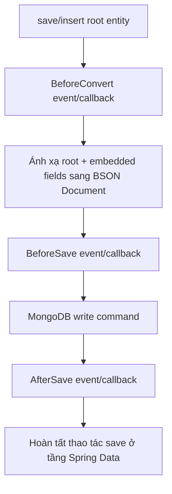
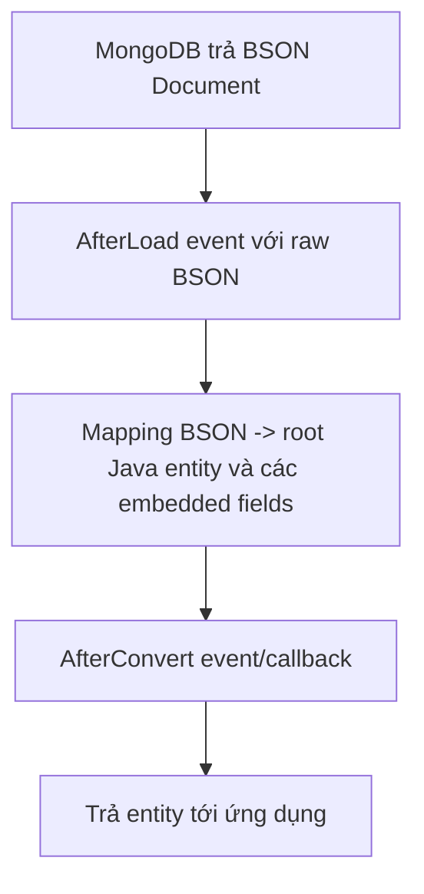

# Phạm vi sự kiện trên document gốc và dữ liệu nhúng

## 1. Một callback không chạy trên từng phần tử của mảng: lỗi thiết kế từ đâu?

Trong ứng dụng thương mại điện tử sử dụng **Spring Data MongoDB**, một đơn hàng có nhiều dòng hàng (*order lines*) lưu nhúng bên trong cùng MongoDB document:

```javascript
{
  _id: "order-101",
  tenantId: "shop-a",
  lines: [
    { lineKey: "line-1", sku: "ab-100", quantity: 2 },
    { lineKey: "line-2", sku: "cd-200", quantity: 3 }
  ],
  totalQuantity: 5
}
```

Nhóm phát triển muốn chuẩn hóa mỗi `sku`, sinh `searchSku`, kiểm tra số lượng hợp lệ và cập nhật `totalQuantity` trước khi ghi. Họ tạo một `BeforeConvertCallback<OrderLine>` rồi mong rằng:

```text
repository.save(order)
  -> callback của OrderLine(line-1)
  -> callback của OrderLine(line-2)
  -> callback của Order
  -> MongoDB
```

**Giả định này không đúng với cơ chế mapping lifecycle thông thường của Spring Data MongoDB.** Lifecycle events/callbacks được tổ chức theo **đối tượng gốc mà thao tác mapping đang xử lý** (*root-level entity*), không tự động duyệt toàn bộ đồ thị object để phát một vòng sự kiện riêng cho mọi embedded object.

Trong ví dụ này, khi gọi `repository.save(order)` với entity gốc `CheckoutOrder`:

- Spring Data ánh xạ `CheckoutOrder` và các field nhúng thành một MongoDB document.
- Lifecycle event/entity callback phù hợp với **CheckoutOrder** có thể được kích hoạt.
- Không được giả định sẽ có `BeforeConvertCallback<OrderLine>` riêng cho từng phần tử của `lines`.
- Nếu muốn chuẩn hóa các dòng hàng, phải thực hiện **rõ ràng từ callback/service của document gốc**, hoặc dùng converter/validation hợp lý.
- Nếu thay vì `save`, hệ thống chạy `$set`/`$push`/`updateMulti` trực tiếp, nhiều write-side callbacks của object gốc còn **không có cơ hội chạy**.

Đây là bài học thuộc chương **Vòng đời và callback** trong module **SPRING_DATA_MONGODB**. Module sử dụng Spring Data MongoDB để kết nối, ánh xạ document, thao tác qua `MongoTemplate`/repository, tổ chức truy vấn, aggregation, index, transaction, reactive access, kiểm thử và chẩn đoán hiệu năng.

**Mục tiêu sau bài học:** phân biệt mapping events với entity callbacks; nắm chính xác **ranh giới document gốc và embedded document**; hiểu các giai đoạn before-convert/before-save/after-load/after-convert; biết ảnh hưởng của `@DBRef`, `@DocumentReference`, update trực tiếp và reactive mapping; đồng thời viết code/test chứng minh logic không bị bỏ sót.

## 2. Document gốc, embedded object và reference khác nhau thế nào?

Trong MongoDB, một BSON document có thể chứa object và array nhúng. Trong Java, các object đó có thể là POJO, record hoặc collection of objects.

### 2.1. Embedded object nằm trong cùng document gốc

```java
@Document("checkout_orders")
public record CheckoutOrder(
    @MongoId(FieldType.STRING) String id,
    String tenantId,
    List<OrderLine> lines,
    int totalQuantity
) {}

public record OrderLine(
    String lineKey,
    String sku,
    int quantity
) {}
```

Khi lưu `CheckoutOrder`, `OrderLine` thường được **chuyển đổi thành cấu trúc BSON nhúng**. Nó không được `MongoTemplate` coi như một root entity được save riêng chỉ vì nó có constructor hoặc record riêng.

### 2.2. Root-level entity là root của thao tác, không phải mọi Java class

```java
template.save(checkoutOrder);
```

Root trong thao tác này là `CheckoutOrder`. Trước/ sau thao tác mapping, Spring Data xét các callbacks/listeners tương ứng với **root**.

```java
template.findById(orderId, CheckoutOrder.class);
```

Root khi đọc cũng là `CheckoutOrder`; phần `lines` được ánh xạ như field nhúng của root.

**Không đồng nhất khái niệm “class có annotation” với “mỗi instance đều được phát event”.** Điều quyết định chủ yếu là **thao tác MongoDB đang ánh xạ/lưu loại root nào** và đường gọi API cụ thể.

### 2.3. Tham chiếu `@DBRef` / `@DocumentReference` là trường hợp khác

```java
@Document("catalog_products")
public record CatalogProduct(
    @MongoId(FieldType.STRING) String id,
    String sku
) {}

@Document("checkout_orders")
public record OrderWithProductRef(
    @MongoId(FieldType.STRING) String id,
    @DBRef CatalogProduct product
) {}
```

`CatalogProduct` là một **document độc lập được tham chiếu**, không phải dữ liệu BSON được copy đầy đủ vào `checkout_orders.product`. Khi document tham chiếu được load/mapped theo cơ chế reference, phạm vi mapping và lifecycle có thể khác với embedded object; cần kiểm tra đường load và loại reference cụ thể.

**Đặc biệt:** `@DBRef` **không tự cascade save**. Gọi `save(orderWithProductRef)` không có nghĩa Spring Data sẽ lưu mọi thay đổi của `CatalogProduct` trước đó rồi phát đầy đủ lifecycle save cho nó. Với `@DocumentReference` cũng không được mặc định có cascade persist.

### 2.4. Bảng so sánh

| Đặc điểm | Embedded `OrderLine` | Root `CheckoutOrder` | `@DBRef` tới `CatalogProduct` |
| --- | --- | --- | --- |
| Lưu trong BSON của root | Có | Là document gốc | Chỉ giữ thông tin tham chiếu |
| Có collection độc lập | Không theo thiết kế ví dụ | Có | Có |
| Khi save root, được map | Có, như field nhúng | Có, như root | Reference được chuyển đổi; không tự save entity đích |
| Có lifecycle callback riêng khi save root? | **Không được tự động gọi** | Có thể có callback phù hợp | Không mặc định có save callback/cascade cho đích |
| Khi đọc | Map cùng root | Được map như root | Có thể có thao tác load đích riêng |
| Cách áp invariant cho embedded data | Root callback/service, converter, DB schema | Callback root/service | Service/transaction quản lý collection riêng |

## 3. Phân biệt Application Events và Entity Callbacks

Spring Data MongoDB có hai nhóm hook dễ nhầm:

1. **Mapping lifecycle events** thông qua Spring `ApplicationEventPublisher`/`AbstractMongoEventListener`.
2. **Entity callbacks** thông qua những interface như `BeforeConvertCallback<T>`, `BeforeSaveCallback<T>`, `AfterConvertCallback<T>`.

Cả hai có thể can thiệp/quan sát vòng đời, nhưng **không phải cùng cơ chế**.

| Tiêu chí | Mapping event/listener | Entity callback |
| --- | --- | --- |
| Cơ chế | Spring application event | `EntityCallback` được Spring Data gọi trực tiếp ở hook |
| Ví dụ | `BeforeConvertEvent<Order>` | `BeforeConvertCallback<Order>` |
| Cách đăng ký | `AbstractMongoEventListener<T>` / listener bean | Bean implement callback interface |
| Tính đồng bộ | Phụ thuộc `ApplicationEventMulticaster`; có thể async nếu cấu hình | Được gọi trong quá trình xử lý; reactive có Publisher tương ứng |
| Thay đổi entity | Event thường tốt cho quan sát; mutate có hạn chế, phụ thuộc giai đoạn | Callback có contract trả entity phù hợp |
| Ranh giới embedded | Chủ yếu root-level mapping events | Callback áp trên entity mục tiêu được thao tác; không tự đệ quy embedded |
| Thứ tự | Cần xem event multicaster và listener ordering | Callback ordering rõ hơn khi cấu hình `Ordered`/`@Order` |
| Bảo đảm domain event sau DB commit | **Không** | **Không** |

### 3.1. Mapping event không phải domain event bền vững

`AfterSaveEvent` hoặc `AfterSaveCallback` cho biết một bước save đã đi qua hook tương ứng, **không** bảo đảm outer transaction đã commit thành công. Một transaction có thể rollback sau khi một callback đã chạy.

Do đó không gửi email, gọi payment gateway hoặc publish event Kafka “không thể thu hồi” từ một mapping event chỉ vì tên có chữ `AfterSave`. Nếu cần phát sự kiện sau commit một cách tin cậy, dùng transaction-aware orchestration và **outbox pattern** hoặc chiến lược phù hợp với nghiệp vụ.

### 3.2. Đừng phụ thuộc vào sự kiện chạy theo thứ tự không được bảo đảm

Nếu ứng dụng cấu hình `ApplicationEventMulticaster` bất đồng bộ, listener có thể chạy trên thread khác; lúc đó không được dùng listener để thiết lập invariant buộc phải hoàn thành **trước khi document lưu**.

Với logic thay đổi root trước mapping, **`BeforeConvertCallback`** thường dễ kiểm soát hơn một asynchronous application event.

## 4. Những giai đoạn lifecycle quan trọng

Quá trình lưu một root entity thông thường có thể hình dung:



Đối với một lần đọc root:



Sơ đồ mô tả **các điểm hook về mặt khái niệm**. Thứ tự chi tiết giữa một số event và callback, những hook được hỗ trợ trên từng API, và tối ưu implementation có thể khác theo phiên bản Spring Data. Đừng dùng sơ đồ này làm cam kết thời gian tuyệt đối đối với listener asynchronous.

### 4.1. Các loại event thường gặp

| Event | Dữ liệu/giai đoạn | Cách dùng phù hợp |
| --- | --- | --- |
| `BeforeConvertEvent<T>` | Trước khi map root Java object sang BSON | Quan sát, validation trước mapping |
| `BeforeSaveEvent<T>` | Sau mapping, trước ghi; có BSON Document | Quan sát BSON cuối, lưu ý khi mutate |
| `AfterSaveEvent<T>` | Sau bước lưu được thực thi | Metric/audit nội bộ không đòi exactly-once |
| `AfterLoadEvent<T>` | BSON Document đã đọc, chưa map thành object | Kiểm tra dữ liệu thô |
| `AfterConvertEvent<T>` | Root entity đã map từ BSON | Quan sát object sau đọc |
| `BeforeDeleteEvent<T>` | Trước lệnh delete trong trường hợp hỗ trợ | Quan sát delete command/filter |
| `AfterDeleteEvent<T>` | Sau lệnh delete trong trường hợp hỗ trợ | Metric, không mặc định có đầy đủ Java entity |

**Lưu ý delete:** không phải lúc nào delete event cũng mang theo một object Java đã được load. Một lệnh delete theo query có thể chỉ có filter BSON; không viết `onBeforeDelete` rồi mặc định event cung cấp đầy đủ `OrderLine` cũ.

### 4.2. Các callback tương ứng

| Callback | Thường dùng để làm gì? |
| --- | --- |
| `BeforeConvertCallback<T>` | Chuẩn hóa/cập nhật root **trước** mapping BSON |
| `BeforeSaveCallback<T>` | Can thiệp ở giai đoạn đã có `Document` chuẩn bị ghi |
| `AfterSaveCallback<T>` | Nhận entity sau save; không mặc định sau transaction commit |
| `AfterConvertCallback<T>` | Chỉnh/kiểm tra root object sau mapping dữ liệu đọc |

`AfterLoadEvent<T>` là **mapping event** trên dữ liệu BSON đọc vào; không nên tự tạo giả định có một interface callback `AfterLoadCallback<T>` chỉ vì tồn tại tên event. Nếu cần xử lý entity sau mapping, `AfterConvertCallback<T>` là hook rõ ràng hơn.

Khi viết code dùng API callback chính xác, đối chiếu phiên bản dependency đang dùng. Không suy diễn rằng mọi event luôn có một interface callback 1-1 với cùng tên/generics.

## 5. Ví dụ domain: root CheckoutOrder và embedded OrderLine

Để theo dõi một ví dụ xuyên suốt, ta định nghĩa object nhúng bất biến:

```java
package example.lifecycle;

public record OrderLine(
    String lineKey,
    String sku,
    int quantity,
    String searchSku
) {}
```

Root document:

```java
package example.lifecycle;

import java.time.Instant;
import java.util.List;
import org.springframework.data.mongodb.core.mapping.Document;
import org.springframework.data.mongodb.core.mapping.FieldType;
import org.springframework.data.mongodb.core.mapping.MongoId;

@Document("checkout_orders")
public record CheckoutOrder(
    @MongoId(FieldType.STRING) String id,
    String tenantId,
    List<OrderLine> lines,
    int totalQuantity,
    Instant updatedAt
) {}
```

Quy tắc nghiệp vụ của ví dụ:

- `tenantId` không rỗng.
- Mỗi `lineKey` không rỗng và không trùng trong cùng đơn hàng.
- `sku` là mã SKU kỹ thuật và không rỗng.
- `quantity` phải dương.
- `searchSku` là SKU được chuẩn hóa để tìm kiếm, không thay giá trị `sku` hiển thị.
- `totalQuantity` bằng tổng `quantity` của tất cả embedded lines.
- `updatedAt` được đặt khi save root bằng callback ví dụ.

**Giới hạn:** đây là quy tắc **trước mapping khi save root**, không phải ràng buộc tự hoạt động cho mọi raw BSON update hay write từ công cụ khác. Nếu cần bảo vệ dữ liệu từ mọi producer, bổ sung MongoDB schema validation và thiết kế write path.

### 5.1. Document BSON sau chuẩn hóa

```javascript
{
  _id: "order-101",
  tenantId: "shop-a",
  lines: [
    {
      lineKey: "line-1",
      sku: "ab-100",
      quantity: 2,
      searchSku: "AB-100"
    },
    {
      lineKey: "line-2",
      sku: "cd-200",
      quantity: 3,
      searchSku: "CD-200"
    }
  ],
  totalQuantity: 5,
  updatedAt: ISODate("2026-11-20T08:30:00Z")
}
```

`searchSku` được sinh rõ ràng bởi logic trên root; MongoDB không biết tự gọi method Java trên từng line.

## 6. Cách đúng: BeforeConvertCallback của root xử lý embedded fields

### 6.1. Implement callback đầy đủ

```java
package example.lifecycle;

import java.time.Clock;
import java.util.HashSet;
import java.util.List;
import java.util.Locale;
import java.util.Set;
import org.springframework.data.mongodb.core.mapping.event.BeforeConvertCallback;
import org.springframework.stereotype.Component;

@Component
public class CheckoutOrderNormalizer
        implements BeforeConvertCallback<CheckoutOrder> {

    private final Clock clock;

    public CheckoutOrderNormalizer(Clock clock) {
        this.clock = clock;
    }

    @Override
    public CheckoutOrder onBeforeConvert(
            CheckoutOrder source,
            String collection) {

        if (!"checkout_orders".equals(collection)) {
            return source;
        }
        if (source.tenantId() == null
                || source.tenantId().isBlank()) {
            throw new IllegalArgumentException(
                "tenantId bắt buộc"
            );
        }
        if (source.lines() == null
                || source.lines().isEmpty()) {
            throw new IllegalArgumentException(
                "Đơn hàng phải có ít nhất một dòng"
            );
        }

        Set<String> seenKeys = new HashSet<>();

        List<OrderLine> normalizedLines = source.lines()
            .stream()
            .map(line -> normalizeLine(line, seenKeys))
            .toList();

        int total = normalizedLines.stream()
            .mapToInt(OrderLine::quantity)
            .reduce(0, Math::addExact);

        return new CheckoutOrder(
            source.id(),
            source.tenantId(),
            List.copyOf(normalizedLines),
            total,
            clock.instant()
        );
    }

    private static OrderLine normalizeLine(
            OrderLine line,
            Set<String> seenKeys) {

        if (line == null
                || line.lineKey() == null
                || line.lineKey().isBlank()
                || !seenKeys.add(line.lineKey())) {
            throw new IllegalArgumentException(
                "lineKey rỗng hoặc trùng"
            );
        }
        if (line.sku() == null
                || line.sku().isBlank()
                || line.quantity() <= 0) {
            throw new IllegalArgumentException(
                "SKU/số lượng không hợp lệ"
            );
        }

        String searchSku =
            line.sku().trim().toUpperCase(Locale.ROOT);

        return new OrderLine(
            line.lineKey(),
            line.sku(),
            line.quantity(),
            searchSku
        );
    }
}
```

Bean `Clock` ví dụ:

```java
import java.time.Clock;
import org.springframework.context.annotation.Bean;
import org.springframework.context.annotation.Configuration;

@Configuration
class TimeConfiguration {

    @Bean
    Clock clock() {
        return Clock.systemUTC();
    }
}
```

### 6.2. Tại sao callback nhận root chứ không phải OrderLine?

Lúc `MongoTemplate.save(checkoutOrder)` ánh xạ root, Spring Data có `CheckoutOrder` làm object lifecycle. Callback `CheckoutOrderNormalizer` **chủ động lặp qua `lines`**:

```java
List<OrderLine> normalizedLines = source.lines()
    .stream()
    .map(line -> normalizeLine(line, seenKeys))
    .toList();
```

Không phải MongoDB framework tự kích hoạt hai callback cho hai `OrderLine`. Nhờ đặt logic tại root, callback còn tính được **invariant tổng thể** `totalQuantity` và kiểm tra duplicate `lineKey`.

### 6.3. Vì sao trả về entity mới thay vì mutate record?

`CheckoutOrder` và `OrderLine` đều là record bất biến. `BeforeConvertCallback<T>` có thể trả **một instance đã điều chỉnh** trước khi converter biến nó thành BSON, nên không cần setter hay reflection.

Mẫu này:

- Dễ kiểm thử với input/output.
- Không chỉnh sửa list mà caller đang giữ.
- Tránh trường hợp sau khi convert mới thay object Java khiến BSON đã tạo không đổi.
- Làm rõ thứ tự: chuẩn hóa **trước mapping**.

Với entity mutable, cũng có thể chỉnh field trước mapping theo contract tương ứng; nhưng hãy tránh dùng cả event listener lẫn callback cùng sửa cùng một field mà không kiểm soát ordering.

### 6.4. Hạn chế của chuẩn hóa SKU

`toUpperCase(Locale.ROOT)` chỉ là một ví dụ phù hợp khi SKU được định nghĩa là mã kỹ thuật (nên được kiểm soát charset/format). **Không áp dụng mù quáng** cho tên người, từ khóa ngôn ngữ hoặc chuỗi Unicode cần collation và normalization theo nghiệp vụ.

Đối với hệ thống đa tenant, trường `searchSku` còn có thể cần index theo `tenantId + searchSku`, nhưng đây là thiết kế query/index riêng, không phải bản chất của lifecycle callback.

## 7. Sai lầm thường gặp: viết callback trên OrderLine

Giả sử developer viết:

```java
package example.lifecycle;

import java.util.concurrent.atomic.AtomicInteger;
import org.springframework.data.mongodb.core.mapping.event.BeforeConvertCallback;
import org.springframework.stereotype.Component;

@Component
public class OrderLineCallbackCounter
        implements BeforeConvertCallback<OrderLine> {

    private final AtomicInteger calls =
        new AtomicInteger();

    @Override
    public OrderLine onBeforeConvert(
            OrderLine entity,
            String collection) {
        calls.incrementAndGet();
        return entity;
    }

    public int calls() {
        return calls.get();
    }

    public void reset() {
        calls.set(0);
    }
}
```

Khi chỉ gọi:

```java
repository.save(new CheckoutOrder(
    "order-101",
    "shop-a",
    List.of(
        new OrderLine("line-1", "ab-100", 2, null),
        new OrderLine("line-2", "cd-200", 3, null)
    ),
    0,
    null
));
```

không nên kỳ vọng `OrderLineCallbackCounter.calls() == 2`. Với `OrderLine` được **nhúng** trong root, callback này **không được tự gọi riêng** cho từng phần tử khi root được save. Trong integration test về đúng scope, kỳ vọng callback dành riêng cho embedded line **không được kích hoạt** từ thao tác save root.

Điều này không có nghĩa mọi callback `OrderLine` trên đời đều “không bao giờ chạy”; nếu `OrderLine` được xử lý như một **root type trong một thao tác độc lập**, hành vi có thể khác. Phân tích phải gắn với **ngữ cảnh mapping root**, không chỉ nhìn tên class.

### 7.1. Đừng dùng @Document trên embedded type để “ép” event

Gắn thêm `@Document` lên `OrderLine` không phải một cách đúng để khiến Spring Data tự save từng line thành document riêng khi chúng vẫn là field nhúng. Nó còn gây hiểu nhầm mô hình dữ liệu và có thể làm các mapping conventions thay đổi theo cấu hình.

Muốn `OrderLine` trở thành root collection độc lập thật sự, phải **thiết kế lại document model**, cách tham chiếu, transaction/invariant và query; không chỉ thêm một annotation.

## 8. Mapping events: listener thấy root, không nhận event cho từng embedded line

### 8.1. AbstractMongoEventListener

```java
package example.lifecycle;

import org.springframework.data.mongodb.core.mapping.event.AbstractMongoEventListener;
import org.springframework.data.mongodb.core.mapping.event.BeforeConvertEvent;
import org.springframework.data.mongodb.core.mapping.event.BeforeSaveEvent;
import org.springframework.data.mongodb.core.mapping.event.AfterConvertEvent;
import org.springframework.stereotype.Component;

@Component
public class CheckoutOrderEventObserver
        extends AbstractMongoEventListener<CheckoutOrder> {

    @Override
    public void onBeforeConvert(
            BeforeConvertEvent<CheckoutOrder> event) {

        CheckoutOrder order = event.getSource();
        // Chỉ quan sát: root order, không phải
        // một event riêng cho từng OrderLine.
    }

    @Override
    public void onBeforeSave(
            BeforeSaveEvent<CheckoutOrder> event) {

        CheckoutOrder order = event.getSource();
        org.bson.Document bson = event.getDocument();

        // bson chứa mảng lines đã map từ root;
        // không có nghĩa Spring đã phát
        // BeforeSaveEvent<OrderLine> cho mỗi phần tử.
    }

    @Override
    public void onAfterConvert(
            AfterConvertEvent<CheckoutOrder> event) {

        CheckoutOrder order = event.getSource();
        // Root đã được tạo từ BSON.
    }
}
```

Listener nên được dùng cho **observation** hoặc những logic được tài liệu API đảm bảo. Đừng dùng một asynchronous event listener để tính `totalQuantity` trước save; ghi có thể đã tiếp diễn trước khi listener hoàn thành.

### 8.2. Bảng scope theo loại field

| Cấu trúc bên trong CheckoutOrder | Có root event khi save CheckoutOrder? | Có event riêng cho field con khi save root? |
| --- | --- | --- |
| `String tenantId` | Có, với root | Không |
| `OrderLine line` nhúng | Có, với root | Không tự động |
| `List<OrderLine> lines` | Có, với root | Không tự động theo từng phần tử |
| `Map<String, OrderLine>` | Có, với root | Không tự động theo từng entry |
| `Address` nhúng nhiều cấp | Có, với root | Không tự động từng cấp |
| `@DBRef CatalogProduct` | Có, với root | Không tự cascade save; load referenced root là đường xử lý riêng |

Việc có một field con kiểu `List` hay `Map` không làm tăng số lần root callback được gọi theo số phần tử. Nếu muốn gắn validation cho mọi node, cần code chủ động.

### 8.3. Vì sao callback là công cụ mạnh hơn khi cần thay root?

`BeforeConvertCallback<CheckoutOrder>` trả entity sau khi normalize, có contract rõ ràng cho tác động vào mapping. `BeforeConvertEvent` là application event và dễ bị ảnh hưởng bởi multicaster asynchronous nếu người dùng tự cấu hình.

Đối với invariant cần chắc chắn trước khi ghi, **callback trực tiếp** hoặc validation ở service thường thích hợp hơn listener quan sát.

## 9. BeforeConvert so với BeforeSave: thời điểm đã tạo BSON

Điểm khác biệt chính:

```text
Root Java entity
    |
    v
BeforeConvertCallback  <- chỉnh root/embedded object trước mapping
    |
    v
MappingMongoConverter   <- tạo BSON Document
    |
    v
BeforeSaveCallback      <- đã có BSON Document
    |
    v
MongoDB write
```

### 9.1. Sửa object Java ở BeforeSave có thể quá muộn

Giả sử `BeforeSaveCallback` nhận source và Document:

```java
public CheckoutOrder onBeforeSave(
        CheckoutOrder entity,
        Document bson,
        String collection) {
    // Tại đây BSON đã được tạo trước hook này.
    return entity;
}
```

Nếu chỉ mutate một object Java trong giai đoạn này rồi mong converter tự chạy lại toàn bộ mapping, logic có thể không ảnh hưởng BSON sắp lưu. Với nghiệp vụ chuẩn hóa object nhúng, lựa chọn rõ nhất thường là **BeforeConvert**.

### 9.2. Sửa BSON Document ở BeforeSave

```java
package example.lifecycle;

import org.bson.Document;
import org.springframework.data.mongodb.core.mapping.event.BeforeSaveCallback;
import org.springframework.stereotype.Component;

@Component
public class CheckoutSchemaTagCallback
        implements BeforeSaveCallback<CheckoutOrder> {

    @Override
    public CheckoutOrder onBeforeSave(
            CheckoutOrder entity,
            Document document,
            String collection) {

        if ("checkout_orders".equals(collection)) {
            document.put("mappingSchemaTag", "checkout-v1");
        }
        return entity;
    }
}
```

Ví dụ trên bổ sung **một field ở BSON root** trước khi ghi. Vì `mappingSchemaTag` chưa có trong Java record, object `CheckoutOrder` trả về từ `save` chưa chắc biểu diễn field đó. Điều này minh họa nguy cơ **khác biệt giữa object in-memory và BSON** nếu chỉnh raw Document.

**Không coi ví dụ này là lời khuyên nên sinh field ngoài schema**; trong production hãy thiết kế field rõ trong entity/schema, có test readback và tương thích dữ liệu. Sửa raw BSON cũng có thể ảnh hưởng cách converter/type aliases vận hành.

### 9.3. Sửa nested BSON field còn cần thận trọng hơn

```java
Document rawOrder = /* BSON Document của root */;

@SuppressWarnings("unchecked")
List<Document> rawLines =
    (List<Document>) rawOrder.get("lines");

for (Document rawLine : rawLines) {
    rawLine.put("searchSku", "SOME-VALUE");
}
```

Đây là **pseudocode về thao tác Document**: `rawOrder` phải do callback/driver cung cấp, `List<Document>` cần kiểm tra null/type thực tế. Nếu nested array chứa những cấu trúc bất thường, cast có thể ném exception; nếu thay raw Document sai, entity Java sẽ không đồng bộ.

Ưu tiên **chuẩn hóa OrderLine trước convert** trừ khi có một yêu cầu thật sự phải chỉnh BSON đã map và có test bảo vệ.

## 10. AfterLoad và AfterConvert: giai đoạn đọc cũng chỉ theo root

Khi `repository.findById(id)` lấy một BSON document root, mapping xảy ra:

```text
BSON document checkout_orders
    -> AfterLoad event nhận raw BSON root
    -> MappingMongoConverter tạo CheckoutOrder
        -> map lines thành List<OrderLine>
    -> AfterConvert hook nhận CheckoutOrder
    -> repository trả CheckoutOrder
```

Không nên mong một `AfterConvertCallback<OrderLine>` được gọi **riêng** cho `line-1` và `line-2` khi chúng chỉ được map như embedded array trong root.

### 10.1. AfterConvertCallback cho root

```java
package example.lifecycle;

import org.bson.Document;
import org.springframework.data.mongodb.core.mapping.event.AfterConvertCallback;
import org.springframework.stereotype.Component;

@Component
public class CheckoutOrderReadValidator
        implements AfterConvertCallback<CheckoutOrder> {

    @Override
    public CheckoutOrder onAfterConvert(
            CheckoutOrder entity,
            Document document,
            String collection) {

        if ("checkout_orders".equals(collection)
                && entity.lines() == null) {
            throw new IllegalStateException(
                "Đơn hàng không có mảng lines"
            );
        }
        return entity;
    }
}
```

Callback này thực hiện một check tối thiểu trên root sau khi map. Nếu dữ liệu legacy chưa có `lines`, lời gọi đọc có thể thất bại. Trong thực tế phải thống nhất **chính sách migration/backward compatibility**, không tùy tiện bật strict read validation trên toàn collection cũ.

### 10.2. Callback đọc không phải nơi phù hợp để ghi lại dữ liệu

Không nên gọi `repository.save(entity)` tự động từ `AfterConvertCallback` mỗi khi đọc để “sửa” dữ liệu cũ:

- Một lần `findAll` có thể gây nhiều write bất ngờ.
- Có thể tạo vòng lặp read → save → read.
- Làm query read-only có side effect.
- Có thể va chạm transaction/session hoặc permission.
- Tạo race nếu người khác đang sửa document.

Migration cần có job/service riêng, idempotent và có giám sát, không “ẩn” trong callback đọc.

## 11. Repository save và MongoTemplate save: khi nào có hook?

### 11.1. Save entity root theo API mapping

```java
CheckoutOrder entity = new CheckoutOrder(
    "order-101",
    "shop-a",
    List.of(
        new OrderLine("line-1", "ab-100", 2, null),
        new OrderLine("line-2", "cd-200", 3, null)
    ),
    0,
    null
);

CheckoutOrder stored = repository.save(entity);
```

Với một repository MongoDB đồng bộ được cấu hình bình thường và callbacks bean đã đăng ký, thao tác save root đi qua các mapping hooks thích hợp. Callback root ở phần 6 biến `searchSku` thành `AB-100`/`CD-200` và tổng thành 5.

### 11.2. MongoTemplate cũng dùng mapping callbacks

```java
CheckoutOrder stored = mongoTemplate.save(entity);
```

`MongoTemplate.save` thực hiện mapping root và các callbacks được hỗ trợ trong vòng đời save. Không cần repository để root callback chạy.

### 11.3. Không viết callback phụ thuộc vào việc caller sử dụng save hay insert

`save` và `insert` có semantics khác nhau về upsert/duplicate ID. Cả hai có thể đi qua các hooks lưu entity, nhưng logic callback **không nên tự đoán document là insert mới** chỉ vì được gọi tại beforeConvert.

Nếu muốn tạo timestamp phân biệt `createdAt`/`updatedAt`, hãy dùng auditing phù hợp, trường version hoặc trạng thái tạo mới có định nghĩa rõ; kiểm thử đường `save` và `insert` theo API/phiên bản.

### 11.4. Bean callback phải thực sự được đăng ký

Chỉ viết class implement interface nhưng không đăng ký trong Spring context sẽ không khiến nó chạy. Khi dùng `@Component`, cần component scanning phù hợp; ở `@DataMongoTest` slice, có thể cần `@Import` class callback và `Clock` test bean.

Đừng kết luận “Spring Data không chạy callback cho root” nếu nguyên nhân thực tế là bean chưa được đăng ký.

## 12. Update operators không tự đi qua BeforeConvert của entity

Đây là nguồn lỗi dữ liệu thường gặp nhất khi chỉ dựa vào callback root để duy trì invariant.

### 12.1. Full save và updateFirst khác nhau

```java
// Ánh xạ root entity và callback tương ứng:
mongoTemplate.save(order);

// Gửi lệnh $set/$inc trực tiếp, không có một
// CheckoutOrder root Java cần before-convert:
mongoTemplate.updateFirst(
    Query.query(Criteria.where("id").is("order-101")),
    new Update().set("lines.0.quantity", 9),
    CheckoutOrder.class
);
```

Trong đường `updateFirst`, Spring Data xây **update BSON** từ `Query`/`Update`, chứ không nhất thiết nạp toàn bộ `CheckoutOrder` để chạy `BeforeConvertCallback<CheckoutOrder>`. Vì vậy cập nhật `lines.0.quantity` có thể để `totalQuantity` cũ không còn chính xác.

### 12.2. $push, $pull, arrayFilters

```java
mongoTemplate.updateFirst(
    Query.query(Criteria.where("id").is(orderId)),
    new Update().push(
        "lines",
        new OrderLine("line-3", "ef-300", 4, null)
    ),
    CheckoutOrder.class
);
```

Spring Data có thể **convert giá trị được đưa vào update**, nhưng không có nghĩa nó kích hoạt **trọn bộ entity callback của root** để tính lại tổng và đi qua từng embedded line. Với `$push`, `searchSku` có thể không được sinh nếu chỉ dựa vào `BeforeConvertCallback<CheckoutOrder>`.

Các thao tác `$pull`, `$set`, `$inc`, positional `$`, `$[]` và `arrayFilters` cũng cần được xem xét theo **chính API update** của chúng.

### 12.3. UpdateMulti và bulkOps

```java
mongoTemplate.updateMulti(
    Query.query(Criteria.where("tenantId").is("shop-a")),
    new Update().set("archived", true),
    CheckoutOrder.class
);

mongoTemplate.bulkOps(
    BulkOperations.BulkMode.ORDERED,
    CheckoutOrder.class
).updateOne(
    Query.query(Criteria.where("id").is(orderId)),
    new Update().inc("totalQuantity", 1)
).execute();
```

Các đường update/bulk này thường tối ưu bằng cách gửi write commands, không dựng toàn bộ root entity cho mỗi document để gọi `BeforeConvertCallback<CheckoutOrder>`. **Không dựa vào entity lifecycle callbacks để bảo vệ toàn bộ field khi ứng dụng có raw/bulk updates.**

### 12.4. findAndModify không phải full save

`findAndModify` thường làm update theo query rồi có thể trả về một entity đã mapping. Kết quả đọc được có thể liên quan đến **read-side conversion callbacks**, nhưng không nên suy diễn **write-side BeforeConvertCallback của root** đã chạy để chỉnh fields trong update command.

Nếu logic bắt buộc trong mọi write path, hãy đặt invariant vào **query/update atomic**, validation tầng DB hoặc một API service được kiểm soát, không chỉ gắn callback.

### 12.5. Raw driver / mongosh không chạy Java callback

```javascript
db.checkout_orders.updateOne(
  { _id: "order-101" },
  { $set: { "lines.0.quantity": 10 } }
);
```

Lệnh này không chạy trong Spring Data JVM nên **không thể gọi** callback Java. Điều tương tự có thể xảy ra với ETL, MongoDB Compass, một microservice khác dùng raw driver, hoặc script migration.

## 13. Thiết kế invariant an toàn nếu có cả save và partial update

### 13.1. Ba chiến lược chính

| Chiến lược | Mạnh ở đâu? | Giới hạn |
| --- | --- | --- |
| Root `BeforeConvertCallback` | Chuẩn hóa đầy đủ embedded graph khi full save | Không bao phủ mọi `$set`/`$push` |
| Service update chuyên biệt | Kiểm soát mọi write path được ứng dụng cho phép | Người khác vẫn có thể ghi raw nếu quyền chưa hạn chế |
| MongoDB JSON Schema validator | Chặn một số dữ liệu sai cấu trúc/kiểu ở server | Không diễn đạt được mọi invariant tổng động xuyên mảng |

Với `totalQuantity` là giá trị suy ra từ các embedded lines, cân nhắc:

- **Không lưu tổng** nếu query có thể tính bằng aggregation với chi phí chấp nhận được.
- Nếu lưu để tăng tốc đọc, phải kiểm soát **đồng bộ khi thêm, xóa, chỉnh quantity**.
- Một update atomically bổ sung line và tăng tổng tương ứng có thể dùng `$push + $inc` trong cùng document khi các điều kiện đúng.
- Nếu một bản ghi có nhiều người cập nhật đồng thời, dùng optimistic locking/version hoặc conditional update để ngăn lost update.

### 13.2. Ví dụ cập nhật cùng document một cách nguyên tử

```java
OrderLine newLine = new OrderLine(
    "line-3", "ef-300", 4, "EF-300"
);

Update update = new Update()
    .push("lines", newLine)
    .inc("totalQuantity", 4);

UpdateResult result = mongoTemplate.updateFirst(
    Query.query(
        Criteria.where("id").is(orderId)
            .and("tenantId").is(authorizedTenantId)
    ),
    update,
    CheckoutOrder.class
);
```

Đoạn trên **chỉ minh họa** việc cập nhật hai field trong cùng document. Nó giả định `newLine` đã được validate/normalize **trước khi đưa vào update**, và giả định không có duplicate `lineKey`. Cần kiểm tra `matchedCount`, idempotency khi retry, giới hạn kích thước document, điều kiện trạng thái và chống thêm line trùng.

Nếu retry cùng `$push + $inc` mà không có điều kiện idempotency, cùng line có thể bị thêm hai lần, tổng tăng hai lần. Callback không tự giải quyết điều đó.

### 13.3. Pipeline update để tính lại tổng

MongoDB hỗ trợ update với aggregation pipeline trong những phiên bản phù hợp. Có thể định nghĩa một quy trình server-side để tính lại derived field:

```javascript
db.checkout_orders.updateOne(
  { _id: "order-101", tenantId: "shop-a" },
  [
    {
      $set: {
        totalQuantity: {
          $sum: "$lines.quantity"
        }
      }
    }
  ]
);
```

Ví dụ này tính lại tổng dựa trên mảng `lines` hiện có khi update. Khi tích hợp thêm logic thay đổi mảng, phải hiểu **thứ tự stages trong pipeline** và tránh race giữa các lệnh độc lập; một pipeline update có thể giúp giữ cập nhật tính toán trong **một thao tác atomic trên một document**.

Không mặc định syntax hoặc operators hỗ trợ giống nhau trên mọi phiên bản MongoDB; test với server thật và BSON type thực tế.

## 14. @DBRef và @DocumentReference: exception không đồng nghĩa cascade

Spring Data MongoDB mapping lifecycle docs nhấn mạnh root-level entity; với những **document references** như `@DBRef`, việc resolve referenced document tạo ra một luồng mapping độc lập có thể có lifecycle behavior của loại đích. Điều này **khác** với việc duyệt embedded list.

### 14.1. Ví dụ một reference

```java
@Document("customers")
public record Customer(
    @MongoId(FieldType.STRING) String id,
    String fullName
) {}

@Document("checkout_orders")
public record OrderWithCustomerRef(
    @MongoId(FieldType.STRING) String id,
    @DBRef Customer customer
) {}
```

Khi đọc `OrderWithCustomerRef`, driver/framework có thể cần đọc collection `customers` riêng (tùy lazy/eager và cơ chế reference). Nhưng:

- Không giả định callback của `Customer` luôn chạy đúng một lần cho mỗi `OrderWithCustomerRef`.
- Không giả định save `OrderWithCustomerRef` sẽ tự **save thay đổi** của `Customer`.
- Không coi reference là embedded; dữ liệu đích có lifecycle riêng.
- Không giữ những thao tác reference load lazy ngoài resource/session scope phù hợp.

### 14.2. @DocumentReference cũng cần kiểm tra riêng

`@DocumentReference` hỗ trợ tham chiếu document bằng cơ chế khác `@DBRef`. Nó cũng không biến referenced root thành embedded object và không tạo cascade persistence tự động. Chi tiết callback và eager/lazy resolution cần kiểm thử theo **phiên bản Spring Data MongoDB**, quan hệ mapping và cấu hình cụ thể.

### 14.3. Ảnh hưởng hiệu năng

Một root document có 200 references có thể tạo thêm database reads khi resolve. Nếu chỉ cần vài field và dữ liệu thay đổi ít, embedded model có thể đơn giản hơn; nếu cần vòng đời độc lập, references có thể phù hợp hơn.

**Không chọn @DBRef chỉ để “được chạy callback riêng”.** Chọn giữa embed và reference dựa vào aggregate boundary, kích thước document, consistency, query pattern, transaction và ownership, rồi mới bố trí callbacks.

## 15. Auditing, @Version và callback ordering

### 15.1. @CreatedDate và @LastModifiedDate thường gắn root

Spring Data có cơ chế auditing cho những entity có field như:

```java
@CreatedDate
private Instant createdAt;

@LastModifiedDate
private Instant updatedAt;
```

Khi auditing được bật và callback thích hợp được đăng ký, những field này có thể được xử lý trong lifecycle của **root entity**. Không nên mặc định auditing sẽ tự cập nhật `lastModifiedAt` của mỗi embedded `OrderLine` trong mảng nếu chỉ gọi `save(root)`.

Nếu cần timestamp ở từng line:

- Xác định một line thực sự có vòng đời độc lập hay không.
- Cập nhật timestamp line ở **root service/callback** hoặc update command theo đúng line đang thay đổi.
- Không đặt lại timestamp của **mọi** line mỗi lần save root nếu nghiệp vụ chỉ muốn line được sửa mới có thời gian mới.

### 15.2. @Version giải quyết bài toán khác

`@Version` dùng cho optimistic locking trên entity được save theo cách hỗ trợ. Nó không tạo callback đệ quy cho embedded data, và không tự bảo vệ raw updates nếu writer không tham gia cùng cơ chế version.

Trong hệ thống nhiều writer, một callback tính lại tổng trước save vẫn có thể chịu race nếu không có version/conditional update. Đừng nhầm **đúng invariant trong bộ nhớ** với **đúng dưới concurrency**.

### 15.3. Callback order và xung đột

Nếu có nhiều `BeforeConvertCallback<CheckoutOrder>`, thứ tự có thể được điều khiển bằng `Ordered` hoặc `@Order` theo API Spring. Ví dụ:

```java
@Component
@Order(100)
class CheckoutOrderFirstPass
        implements BeforeConvertCallback<CheckoutOrder> {

    @Override
    public CheckoutOrder onBeforeConvert(
            CheckoutOrder entity, String collection) {
        return entity;
    }
}
```

Đoạn này là ví dụ callback khác, cần imports tương ứng. Tránh có hai callbacks cùng sửa `updatedAt` hoặc `totalQuantity` không có quy ước rõ. Nếu callback chuẩn hóa trước callback validation, phải **định nghĩa và test thứ tự**; không dựa vào thứ tự quét bean ngẫu nhiên.

**Không suy ra** thứ tự callback và application events luôn giống nhau, nhất là khi cấu hình event multicaster async.

## 16. ReactiveMongoTemplate và reactive callbacks

### 16.1. Callback đồng bộ và reactive là hai API khác nhau

Với `ReactiveMongoTemplate`, Spring Data hỗ trợ **reactive entity callbacks** riêng để thao tác được biểu diễn bằng `Publisher`:

```java
import org.springframework.data.mongodb.core.mapping.event.ReactiveBeforeConvertCallback;
import reactor.core.publisher.Mono;

@Component
public class ReactiveCheckoutNormalizer
        implements ReactiveBeforeConvertCallback<CheckoutOrder> {

    private final CheckoutNormalizerLogic logic;

    public ReactiveCheckoutNormalizer(
            CheckoutNormalizerLogic logic) {
        this.logic = logic;
    }

    @Override
    public Mono<CheckoutOrder> onBeforeConvert(
            CheckoutOrder entity,
            String collection) {

        return Mono.fromSupplier(() ->
            logic.normalize(entity, collection)
        );
    }
}
```

`CheckoutNormalizerLogic` ở đây là **service thuần** do ứng dụng định nghĩa để tái sử dụng logic chuẩn hóa root; có thể tách phần `normalizeLine` và tính tổng từ ví dụ đồng bộ vào đó. Cách này tránh copy business rules giữa synchronous và reactive callbacks.

**Không giả định** mọi callback synchronous tự được thực thi trong reactive pipeline như một callback cùng loại. Hãy đăng ký đúng callback API và integration test với `ReactiveMongoTemplate`/`ReactiveMongoRepository` thực tế.

### 16.2. Tính lazy và subscription

```java
Mono<CheckoutOrder> saveMono =
    reactiveTemplate.save(order);

// Thao tác thường chỉ thực thi khi có subscriber.
return saveMono;
```

Trong WebFlux, framework subscribe Publisher khi xử lý response; không tự gọi `saveMono.subscribe()` rồi lập tức trả HTTP 200. Nếu thực hiện vậy, lỗi validation/callback có thể xảy ra sau khi response đã trả.

### 16.3. Không block trong reactive callback

```java
// Anti-pattern:
public Mono<CheckoutOrder> onBeforeConvert(
        CheckoutOrder order, String collection) {
    String value = blockingRemoteClient.lookup().get();
    return Mono.just(modify(order, value));
}
```

Đoạn trên là anti-pattern mô tả; `blockingRemoteClient` và `modify` là helper giả lập. Gọi blocking I/O trong callback có thể chặn event loop, tăng latency và tạo rủi ro timeout.

Nếu cần dữ liệu bên ngoài:

- Ưu tiên **reactive API** rồi dùng `flatMap/map`.
- Xác định transaction context và timeout phù hợp.
- Cân nhắc có thực sự nên gọi remote service trong callback mapping hay tách khỏi luồng save.
- Không dùng callback để tạo side effect khó rollback.

### 16.4. Embedded scope vẫn không tự đệ quy

`ReactiveBeforeConvertCallback<OrderLine>` không được tự động gọi cho từng `OrderLine` chỉ vì `ReactiveMongoTemplate.save(CheckoutOrder)` đang xử lý một root chứa mảng lines. Quy tắc root aggregate boundary áp dụng cả khi mapping theo reactive API.

## 17. Integration test: chứng minh root callback chạy, embedded callback không

### 17.1. Các trường hợp phải kiểm tra

1. Save `CheckoutOrder` có hai embedded lines.
2. Root `BeforeConvertCallback<CheckoutOrder>` chạy và chuẩn hóa cả hai lines.
3. `BeforeConvertCallback<OrderLine>` **không** được gọi riêng cho từng embedded line.
4. Đọc lại bằng repository thấy `searchSku` và `totalQuantity` đúng.
5. Một lệnh raw update thay quantity **không** kích hoạt root before-convert.
6. Khi dùng `@DBRef`, không suy ra cascade save.

### 17.2. @DataMongoTest với MongoTemplate và repository

```java
package example.lifecycle;

import static org.junit.jupiter.api.Assertions.*;

import java.time.Clock;
import java.time.Instant;
import java.time.ZoneOffset;
import java.util.List;
import java.util.UUID;
import org.junit.jupiter.api.BeforeEach;
import org.junit.jupiter.api.Test;
import org.springframework.beans.factory.annotation.Autowired;
import org.springframework.boot.test.autoconfigure.data.mongo.DataMongoTest;
import org.springframework.context.annotation.Bean;
import org.springframework.context.annotation.Import;
import org.springframework.context.annotation.TestConfiguration;
import org.springframework.data.mongodb.core.MongoTemplate;

@DataMongoTest
@Import({
    CheckoutOrderNormalizer.class,
    OrderLineCallbackCounter.class,
    CheckoutOrderLifecycleTest.TestClock.class
})
class CheckoutOrderLifecycleTest {

    @TestConfiguration
    static class TestClock {
        @Bean
        Clock clock() {
            return Clock.fixed(
                Instant.parse("2026-11-20T08:30:00Z"),
                ZoneOffset.UTC
            );
        }
    }

    @Autowired
    CheckoutOrderRepository repository;

    @Autowired
    MongoTemplate template;

    @Autowired
    OrderLineCallbackCounter lineCounter;

    @BeforeEach
    void resetCounter() {
        lineCounter.reset();
    }

    @Test
    void savingRootNormalizesEmbeddedLinesWithoutChildCallbacks() {
        String id = "order-" + UUID.randomUUID();

        CheckoutOrder input = new CheckoutOrder(
            id,
            "shop-a",
            List.of(
                new OrderLine("l-1", "ab-100", 2, null),
                new OrderLine("l-2", "cd-200", 3, null)
            ),
            0,
            null
        );

        CheckoutOrder saved = repository.save(input);

        assertEquals(5, saved.totalQuantity());
        assertEquals("AB-100",
            saved.lines().get(0).searchSku());
        assertEquals("CD-200",
            saved.lines().get(1).searchSku());
        assertEquals(
            Instant.parse("2026-11-20T08:30:00Z"),
            saved.updatedAt()
        );

        CheckoutOrder reread =
            repository.findById(id).orElseThrow();

        assertEquals(5, reread.totalQuantity());
        assertEquals("AB-100",
            reread.lines().get(0).searchSku());
        assertEquals(0, lineCounter.calls());
    }

    @Test
    void rejectsDuplicateLineKeyAtRoot() {
        CheckoutOrder invalid = new CheckoutOrder(
            "order-" + UUID.randomUUID(),
            "shop-a",
            List.of(
                new OrderLine("same", "ab", 1, null),
                new OrderLine("same", "cd", 1, null)
            ),
            0,
            null
        );

        assertThrows(IllegalArgumentException.class,
            () -> repository.save(invalid));
    }
}
```

Repository:

```java
package example.lifecycle;

import org.springframework.data.mongodb.repository.MongoRepository;

public interface CheckoutOrderRepository
        extends MongoRepository<CheckoutOrder, String> {
}
```

**Điều kiện chạy:** `@DataMongoTest` cần MongoDB test instance hoặc Testcontainers tương thích với Spring Boot. Test config phải bao gồm callback beans và repository scanning đúng package. Trường `updatedAt` dùng fixed clock nên assertion không phụ thuộc thời gian thực.

Test này xác minh đúng **behavior của root vs embedded callbacks** trên Spring Data MongoDB version đang dùng, nhưng không tự chứng minh mọi update operator hoặc raw driver sẽ đi qua hook.

### 17.3. Kiểm tra raw BSON sau save

```java
Document raw = template.getCollection("checkout_orders")
    .find(new Document("_id", id))
    .first();

assertNotNull(raw);

@SuppressWarnings("unchecked")
List<Document> rawLines =
    (List<Document>) raw.get("lines");

assertEquals("AB-100",
    rawLines.get(0).getString("searchSku"));
assertEquals(5, raw.getInteger("totalQuantity"));
```

Đoạn test này cần import `org.bson.Document` và đặt trong test method đã có `id`. Đọc raw BSON giúp phân biệt giá trị **đã persist** với giá trị Java callback trả về.

## 18. Test phản ví dụ: updateFirst bỏ qua normalize của root

Tạo order hợp lệ bằng repository.save, sau đó update trực tiếp:

```java
@Test
void partialUpdateDoesNotRecalculateRootDerivedTotal() {
    String id = "order-" + UUID.randomUUID();
    repository.save(new CheckoutOrder(
        id, "shop-a",
        List.of(
            new OrderLine("l-1", "ab-100", 2, null),
            new OrderLine("l-2", "cd-200", 3, null)
        ),
        0, null
    ));

    template.updateFirst(
        Query.query(Criteria.where("id").is(id)),
        new Update().set("lines.0.quantity", 10),
        CheckoutOrder.class
    );

    CheckoutOrder reread =
        repository.findById(id).orElseThrow();

    assertEquals(10, reread.lines().get(0).quantity());
    assertEquals(
        5, reread.totalQuantity(),
        "totalQuantity không được tự tính lại từ callback"
    );
}
```

Đoạn này cần import `Query`, `Criteria`, `Update` và đặt trong test class có repository/template được inject. Mục đích là **chứng minh một trường hợp sai invariant** khi hệ thống dựa độc nhất vào callback root nhưng dùng partial update.

Trong production, **không để invariant sai như vậy tồn tại**. Hãy sửa service update để giữ tổng đúng, hoặc thay thiết kế dữ liệu để tổng được suy ra khi đọc.

### 18.1. Test từ raw MongoDB driver

Một test dùng:

```java
template.getCollection("checkout_orders").updateOne(
    new Document("_id", id),
    new Document("$set",
        new Document("lines.0.quantity", 10))
);
```

không chạy Java lifecycle callback vì lệnh gọi đi trực tiếp đến driver. Điều này là ranh giới đặc biệt quan trọng khi có script ETL, migration hoặc nhiều service viết cùng collection.

### 18.2. Test callback con không chạy cũng cần tránh false positive

Nếu callback `OrderLineCallbackCounter` chưa được đăng ký làm bean, việc `calls()==0` không chứng minh gì. Trong test ở phần 17 đã `@Import` callback counter để nó **thật sự có mặt** trong Spring context; root callback cũng được import.

Có thể kiểm tra application context có bean và thêm một test root callback được gọi để phân biệt **“đăng ký sai”** với **“scope không bao gồm embedded object”**.

## 19. Kiểm thử reactive callback cho embedded scope

Đối với ứng dụng WebFlux, viết test dùng `ReactiveMongoTemplate` và `StepVerifier`:

```java
package example.lifecycle;

import static org.junit.jupiter.api.Assertions.*;

import java.util.List;
import java.util.UUID;
import org.junit.jupiter.api.Test;
import org.springframework.beans.factory.annotation.Autowired;
import org.springframework.boot.test.autoconfigure.data.mongo.DataMongoTest;
import org.springframework.context.annotation.Import;
import org.springframework.data.mongodb.core.ReactiveMongoTemplate;
import reactor.test.StepVerifier;

@DataMongoTest
@Import(ReactiveCheckoutNormalizer.class)
class ReactiveCheckoutLifecycleTest {

    @Autowired
    ReactiveMongoTemplate template;

    @Test
    void reactiveSaveMapsNestedLinesViaRootCallback() {
        String id = "order-" + UUID.randomUUID();

        CheckoutOrder input = new CheckoutOrder(
            id,
            "shop-a",
            List.of(
                new OrderLine(
                    "l-1", "ab-100", 2, null
                )
            ),
            0,
            null
        );

        StepVerifier.create(template.save(input))
            .assertNext(saved -> {
                assertEquals(2, saved.totalQuantity());
                assertEquals(
                    "AB-100",
                    saved.lines().get(0).searchSku()
                );
            })
            .verifyComplete();
    }
}
```

Đoạn này cần bean `CheckoutNormalizerLogic` thực sự được implement và import; test không thể chạy nguyên vẹn khi chỉ copy `ReactiveCheckoutNormalizer` mà thiếu dependency. Ngoài ra, `@DataMongoTest` có thể cần thêm auto-configuration cho reactive MongoDB tùy phiên bản Boot. **Mục tiêu của ví dụ:** minh họa việc **subscribe Publisher** để kích hoạt save/callback; không hứa @DataMongoTest luôn cấu hình reactive Mongo client sẵn trong mọi dự án.

### 19.1. Test cancellation và lỗi

Reactive callback nên trả Publisher có thể phát:

- `onNext` với entity đã chuẩn hóa.
- `onError` khi validation thất bại.
- `onComplete` mà không có entity chỉ khi API contract cho phép; với callback mapping, một kết quả rỗng có thể phá chuỗi save.

Test bằng `StepVerifier` trong cả hai nhánh valid/invalid. Nếu callback gọi I/O reactive khác, cần đánh giá timeout, transaction context và cancellation. Không block để đợi dữ liệu rồi trả một `Mono.just`.

## 20. Dùng custom converter có giải quyết được bài toán embedded không?

Custom conversions là một công cụ khác của Spring Data MongoDB:

- `@ReadingConverter`/`Converter<Document, SomeType>` dùng để chuyển dữ liệu khi đọc.
- `@WritingConverter`/`Converter<SomeType, Document>` dùng để chuyển object khi ghi, nếu converter được đăng ký và được áp dụng.
- Một converter cho embedded type có thể được gọi khi converter/mapping framework thực sự cần chuyển loại đó.

### 20.1. Khi nào converter phù hợp?

Ví dụ `Money` value object được lưu dưới dạng một cấu trúc BSON đặc biệt:

```java
public record Money(long minorUnits, String currency) {}
```

Nếu mọi nơi đều cần một quy tắc BSON nhất quán cho `Money`, custom converter có thể là lựa chọn hợp lý.

### 20.2. Khi nào converter không đủ?

Nếu quy tắc cần:

- Tổng `totalQuantity` của **toàn bộ lines**.
- Phát hiện hai `lineKey` trùng nhau **trong cùng root**.
- Kiểm tra tenant ID của mọi line khớp tenant của root.
- Quyết định dựa vào trạng thái tổng thể của order.

thì một converter chỉ nhận một `OrderLine` **không đủ context**. Root callback hoặc domain service phù hợp hơn.

### 20.3. Converter cũng không chạy từ raw MongoDB update

Một script `db.collection.updateOne(...)` của mongosh không dùng Java converter của Spring Data. Nếu hệ thống có nhiều writer, cần ràng buộc ở server hoặc thống nhất contract ở tất cả writer.

## 21. Hiệu năng, transaction và tính nhất quán của lifecycle hooks

### 21.1. Callback nặng ảnh hưởng write latency

Một `BeforeConvertCallback` chạy với mỗi root save có thể trở thành bottleneck nếu:

- Mỗi order có hàng nghìn embedded lines.
- Callback gọi remote HTTP/database lookup cho từng line.
- Callback tính lại hash lớn hoặc copy object graph nhiều lần.
- Logic lấy dữ liệu bằng blocking call trong reactive thread.

Ở ví dụ `CheckoutOrderNormalizer`, độ phức tạp thường là **O(n)** theo số embedded lines để validate và chuẩn hóa, còn copy list tạo thêm memory. Với document rất lớn, cần benchmark và cân nhắc giới hạn kích thước mảng/document.

### 21.2. Không gọi callback một cách thủ công như domain service

`checkoutOrderNormalizer.onBeforeConvert(order, "checkout_orders")` có thể chạy về mặt Java, nhưng làm vậy khiến domain logic phụ thuộc vào API Spring Data callback, collection name và ordering.

Tốt hơn:

```java
@Component
public class CheckoutNormalizerLogic {

    public CheckoutOrder normalize(
            CheckoutOrder source,
            String collection) {
        // Cài đặt quy tắc như phần 6,
        // không phụ thuộc sự kiện lifecycle.
        return normalized;
    }
}
```

Đây là **khung thiết kế**, trong đó `normalized` cần được tính từ business logic hoàn chỉnh. Callback chỉ **gọi lại** pure domain logic; service update cũng gọi domain logic khi cần. Nhờ vậy có thể unit test quy tắc nghiệp vụ độc lập với MongoDB.

### 21.3. Transaction không mở rộng phạm vi callback

Trong `@Transactional` với `MongoTransactionManager`, lệnh repository.save root có thể có callbacks; nhưng `updateFirst` trong cùng transaction không tự biến thành full root save và không nhất thiết chạy root before-convert.

Transaction bảo đảm tập thao tác **commit/abort chung**, không có nhiệm vụ gọi callback cho mọi embedded object hoặc duy trì derived field tự động.

### 21.4. Mapping event không phải after-commit event

Nếu `AfterSaveEvent` chạy trong transaction rồi transaction rollback, side effect ở listener có thể đã xảy ra dù document không được commit. Do đó:

- Không gửi email/payment ở listener mapping.
- Không phát Kafka event không thể thu hồi trước commit mà không có protocol tin cậy.
- Dùng outbox/transaction synchronization phù hợp và test rollback.

### 21.5. Auditing và callbacks có thể chạy nhiều lần

Một save có thể được retry hoặc gọi lại do application logic. Callback gắn `updatedAt` theo Clock sẽ tính timestamp mới mỗi lần root save. Nếu callback phát side effect bên ngoài, retry có thể làm lặp tác dụng; do đó **ưu tiên callback thuần/idempotent** và tránh tác vụ không thể rollback.

## 22. Bảng xử lý sự cố thường gặp

| Triệu chứng | Nguyên nhân hay gặp | Hướng giải quyết |
| --- | --- | --- |
| `BeforeConvertCallback<OrderLine>` không chạy khi save order | OrderLine là embedded type, không phải root của thao tác | Chạy normalize trong root callback/service |
| Root callback không chạy cả khi save | Bean chưa được đăng ký, dùng raw driver hoặc sai API | Kiểm tra context và code path |
| Sau `updateFirst` totalQuantity sai | Partial update bỏ qua root before-convert | Cập nhật cùng thao tác atomic hoặc recompute |
| Sau `$push` searchSku rỗng | Embedded line không được root callback normalize | Chuẩn hóa input trước $push hoặc update pipeline |
| `BeforeSaveCallback` sửa Java object nhưng BSON không đổi | Mapping BSON đã diễn ra | Chỉnh trước convert hoặc sửa Document có kiểm soát |
| `AfterConvert` được gọi nhưng embedded listener không | Event/callback theo root mapping | Xác minh root scope |
| Có `@DBRef` nhưng product không được save | DBRef không tự cascade persistence | Save referenced root riêng, điều phối transaction nếu cần |
| Callback gọi nhiều lần không ổn định | Save/retry nhiều lần, bean ordering | Giữ callback idempotent, test ordering |
| Event listener sửa dữ liệu nhưng đôi lúc không persist | Async event multicaster/timing | Dùng entity callback trực tiếp trước convert |
| Gửi Kafka từ AfterSave nhưng có message cho đơn bị rollback | AfterSave không đồng nghĩa after commit | Outbox/transaction-aware publication |
| Reactive save không chạy callback | Publisher chưa subscribe hoặc callback API sai | StepVerifier/WebFlux subscription, reactive callbacks |
| Cập nhật nested field bằng mongosh không qua Java callback | Lệnh bên ngoài Spring Data | MongoDB validation/chuẩn hóa writer |
| Callback đọc gây write storm | Auto-save trong AfterConvert | Tách migration khỏi read hook |
| Index không khớp searchSku | Normalization/query/index không nhất quán | Định nghĩa một search-key contract |
| Entity root đúng nhưng BSON raw thiếu field | Mutate Java sau mapping hoặc test chỉ nhìn in-memory | Kiểm tra raw document sau save |
| Dùng nhiều root callbacks ghi đè nhau | Order không được định nghĩa | `@Order`/`Ordered` và test |
| Lỗi N+1 khi resolve references | `@DBRef`/`@DocumentReference` load thêm documents | Review model, fetch và profile |
| Root có list hàng triệu phần tử | BSON document lớn, callback O(n) | Chia aggregate, giới hạn kích thước và workload |

### Checklist chẩn đoán theo thứ tự

1. Xác định **root entity của thao tác** là loại nào.
2. Xác định field con là **embedded** hay **document reference**.
3. Liệt kê chính xác đường ghi: `save`, `insert`, `updateFirst`, `bulkOps`, raw driver hay mongosh.
4. Kiểm tra callback/listener bean có được Spring đăng ký không.
5. Kiểm tra stage: before-convert, before-save, after-load hay after-convert.
6. Kiểm tra object Java hay raw BSON được sửa, và **thời điểm sửa**.
7. Kiểm tra event multicaster async, callback ordering.
8. Đọc lại document BSON trực tiếp từ MongoDB.
9. Kiểm tra concurrency, optimistic locking, idempotency và partial updates.
10. Với reactive, xác minh Publisher đã subscribe và callback đã được đăng ký đúng API.
11. Với transaction, phân biệt before/after save và commit/rollback thực tế.
12. Viết một integration test cô lập tái hiện chính xác đường thao tác.

## 23. Bài tập thực hành

### Bài 1 — Phạm vi embedded callback

Tạo `CheckoutOrder` có ba `OrderLine` nhúng. Đăng ký `BeforeConvertCallback<CheckoutOrder>` và `BeforeConvertCallback<OrderLine>`, đếm số lần gọi khi chạy `repository.save(order)`. Giải thích tại sao kết quả không phải “mỗi line được gọi một lần”.

### Bài 2 — Chuẩn hóa SKU và tổng số lượng

Viết callback root tự chuẩn hóa `searchSku` cho mọi line và tính `totalQuantity`. Dùng `Clock.fixed` để test timestamp. Thử case lineKey trùng, quantity âm và mảng lines rỗng.

### Bài 3 — BeforeConvert vs BeforeSave

Thử sửa `searchSku` của một `OrderLine` trong `BeforeConvertCallback` và trong `BeforeSaveCallback`. Đọc raw BSON sau ghi; giải thích vì sao sửa **entity sau mapping** không đồng nghĩa sửa BSON.

### Bài 4 — updateFirst bỏ qua invariant

Lưu order có tổng 5, dùng `$set` đổi quantity thành 10 nhưng không cập nhật total. Chứng minh `totalQuantity` không tự tính lại, rồi thiết kế update atomic/pipeline phù hợp.

### Bài 5 — $push và idempotency

Viết service thêm một line qua `$push`. Chuẩn hóa line trước khi gửi, dùng điều kiện chống thêm trùng `lineKey` và cập nhật tổng. Thử retry cùng request và kiểm tra số lượng không tăng hai lần.

### Bài 6 — DBRef không cascade

Tạo hai collections `customers` và `checkout_orders`. Lưu customer và order có `@DBRef`, sau đó sửa customer object chỉ trong bộ nhớ và save order. Kiểm tra dữ liệu customer collection; giải thích vì sao cần save referenced root riêng.

### Bài 7 — Reactive callback

Viết `ReactiveBeforeConvertCallback<CheckoutOrder>` trả `Mono<CheckoutOrder>`, save qua `ReactiveMongoTemplate` và dùng `StepVerifier`. Thử bỏ subscription và giải thích tại sao không nên suy ra callback đã chạy.

### Bài 8 — Event và callback ordering

Đăng ký hai root callbacks ở hai mức `@Order` khác nhau và một `AbstractMongoEventListener`. Ghi log giai đoạn trước convert/trước save. Bật async multicaster trong test riêng và phân tích tại sao không nên dùng event listener để duy trì invariant trước ghi.

### Bài 9 — Auditing nested objects

Thêm `updatedAt` vào mỗi line, chỉ sửa line thứ hai. Thiết kế update logic sao cho timestamp line thứ nhất không thay đổi. So sánh cách lưu thông tin này khi line là embedded và khi line là root collection độc lập.

### Bài 10 — Transaction + outbox

Giả lập transaction gồm save order và save outbox event. Gắn mapping listener gửi message ra ngoài, tạo lỗi transaction rồi rollback. Chỉ ra vì sao listener không thay thế outbox. Thiết kế một consumer idempotent để phát message **sau khi outbox record đã commit**.

### Câu hỏi tự kiểm tra

- **Root-level entity** được xác định theo document model hay theo class name?
- Vì sao `BeforeConvertCallback<OrderLine>` không tự chạy trên mỗi item của embedded `List<OrderLine>`?
- `BeforeConvertEvent` và `BeforeConvertCallback` thuộc cùng cơ chế không?
- `BeforeSave` xảy ra trước hay sau bước chuyển entity sang BSON?
- Nếu đổi Java object trong `BeforeSaveCallback`, có chắc BSON đã được cập nhật không?
- `AfterLoad` và `AfterConvert` khác nhau ở trạng thái dữ liệu nào?
- `@DBRef` có tự save referenced document khi save root không?
- `@DocumentReference` có biến document tham chiếu thành field nhúng không?
- Vì sao một lệnh `$push` không tự kích hoạt toàn bộ root before-convert?
- Vì sao `updateFirst` có thể làm `totalQuantity` lệch với tổng mảng?
- Test `lineCallback.calls()==0` có đủ nếu bean chưa được đăng ký không?
- Event listener async có phù hợp để sửa entity trước persistence không?
- `AfterSaveEvent` có đồng nghĩa MongoDB transaction đã commit không?
- Tại sao `@Version` và lifecycle callback giải quyết hai vấn đề khác nhau?
- Reactive callback có nên gọi `block()` để lấy dữ liệu không?
- Khi nào cần converter riêng cho embedded value object?
- Vì sao nên kiểm tra raw BSON sau khi test callback thay vì chỉ xem object in-memory?
- Vì sao logic normalizer cần là idempotent hoặc side-effect-free?

## Ghi nhớ

**Spring Data MongoDB phát mapping lifecycle events và thực thi entity callbacks theo phạm vi root entity của thao tác mapping, không tự động gọi riêng cho từng object nhúng hoặc từng phần tử của mảng.** Khi lưu `CheckoutOrder` chứa `List<OrderLine>`, hãy xử lý invariant toàn bộ embedded graph trong **root `BeforeConvertCallback<CheckoutOrder>`** hoặc domain service được kiểm soát, thay vì phụ thuộc vào `BeforeConvertCallback<OrderLine>` tự chạy. `BeforeSave` diễn ra sau bước chuyển sang BSON; `AfterLoad/AfterConvert` thuộc read path; các lệnh `updateFirst`, `$push`, bulk và raw driver có thể bỏ qua write-side lifecycle hooks của root. `@DBRef`/`@DocumentReference` là **tham chiếu tới document độc lập**, không có cascade-save tự động và không nên bị nhầm với embedded fields. Khi cần tính đúng trong mọi write path, kết hợp **service invariants, atomic update, optimistic locking, MongoDB validation và integration tests**. Đối với reactive, dùng đúng reactive callback API và subscription lifecycle; đừng coi `AfterSave` là “sau commit” hoặc sử dụng event async để duy trì invariant cần hoàn thành trước khi ghi.

## Tài liệu tham khảo

- [Spring Data MongoDB Reference — Lifecycle Events](https://docs.spring.io/spring-data/mongodb/reference/mongodb/lifecycle-events.html)
- [Spring Data MongoDB Reference — Entity Callbacks](https://docs.spring.io/spring-data/mongodb/reference/mongodb/entity-callbacks.html)
- [Spring Data MongoDB Reference — Object Mapping](https://docs.spring.io/spring-data/mongodb/reference/mongodb/mapping/mapping.html)
- [Spring Data MongoDB Reference — DBRef and Document References](https://docs.spring.io/spring-data/mongodb/reference/mongodb/mapping/document-references.html)
- [Spring Data MongoDB Reference — Auditing](https://docs.spring.io/spring-data/mongodb/reference/mongodb/auditing.html)
- [Spring Data MongoDB Reference — Template CRUD Operations](https://docs.spring.io/spring-data/mongodb/reference/mongodb/template-crud-operations.html)
- [Spring Data MongoDB API — BeforeConvertCallback](https://docs.spring.io/spring-data/mongodb/docs/current/api/org/springframework/data/mongodb/core/mapping/event/BeforeConvertCallback.html)
- [Spring Data MongoDB API — BeforeSaveCallback](https://docs.spring.io/spring-data/mongodb/docs/current/api/org/springframework/data/mongodb/core/mapping/event/BeforeSaveCallback.html)
- [Spring Data MongoDB API — AbstractMongoEventListener](https://docs.spring.io/spring-data/mongodb/docs/current/api/org/springframework/data/mongodb/core/mapping/event/AbstractMongoEventListener.html)
- [MongoDB Manual — Update Operators](https://www.mongodb.com/docs/manual/reference/operator/update/)
- [MongoDB Manual — Schema Validation](https://www.mongodb.com/docs/manual/core/schema-validation/)
