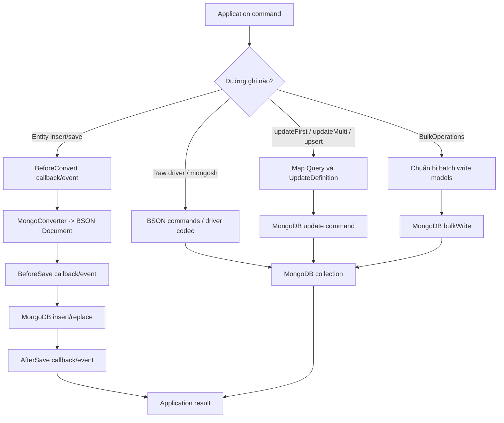
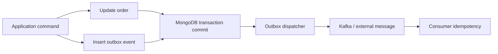

# Giới hạn callback/event với update trực tiếp, bulk hoặc driver

## 1. Tại sao có những bản ghi được cập nhật nhưng callback không chạy?

Một dịch vụ quản lý đơn hàng đăng ký `BeforeConvertCallback<OrderDocument>` để chuẩn hóa mã nghiệp vụ, `AuditingEntityCallback` để ghi `updatedAt` và listener để log save. Các bài test `repository.save(order)` đều đạt. Sau đó nhóm tối ưu luồng chuyển trạng thái:

```java
mongoTemplate.updateFirst(
    Query.query(Criteria.where("id").is(orderId)),
    new Update().set("status", "SHIPPED"),
    OrderDocument.class
);
```

MongoDB cập nhật trạng thái, nhưng logic trong `BeforeConvertCallback` không chạy như lúc `save(entity)`. Batch `bulkOps(...).updateOne(...)`, MongoDB Java driver hoặc mongosh cũng có thể sửa collection mà **không đi qua những callback của Spring Data**.

Đây là **khác biệt giữa lưu một entity qua mapping lifecycle và thực hiện lệnh cập nhật trực tiếp theo điều kiện/BSON command**, không nhất thiết là lỗi framework.

Bài thuộc chương **Vòng đời và callback** của module **SPRING_DATA_MONGODB**. Module hướng dẫn kết nối MongoDB, ánh xạ document, thao tác qua `MongoTemplate` hoặc repository, thiết kế truy vấn, aggregation, index, transaction, reactive access, kiểm thử và chẩn đoán hiệu năng dữ liệu.

Sau bài học, bạn sẽ:

1. Phân biệt **EntityCallback**, **mapping ApplicationEvent**, **Spring Data auditing** và **MongoDB database constraints**.
2. Nhận diện API nào chạy entity save callbacks và API nào **không nên dựa vào callback**.
3. Hiểu giới hạn của `updateFirst`, `updateMulti`, `upsert`, `findAndModify`, `BulkOperations`, raw driver.
4. Giải thích vì sao **mapping**, **tự tăng `@Version`** và **EntityCallback** là ba cơ chế khác nhau.
5. Bảo đảm `updatedAt`, audit metadata, validation, chuẩn hóa dữ liệu và business invariants trong bulk/direct updates.
6. Viết integration test chứng minh callback chạy hoặc bị bỏ qua trên đúng đường API.
7. Thiết kế lựa chọn giữa entity save, atomic update, bulk, migration và database constraints phù hợp workload.

> **Thông điệp cốt lõi:** Callback là một **hook trong pipeline ứng dụng**, không phải trigger MongoDB tự thực thi cho mọi write. Không dùng callback làm lớp bảo vệ duy nhất cho bất biến phải đúng với mọi client.

## 2. Bốn khái niệm hay bị đánh đồng

| Khái niệm | Chạy ở đâu? | Khi nào có tác dụng? | Không bảo đảm điều gì? |
| --- | --- | --- | --- |
| **EntityCallback** | Spring Data entity persistence pipeline | API có gọi callback lifecycle tương ứng | Không tự chạy trên mọi direct update/bulk/raw driver |
| **Mapping ApplicationEvent** | Spring `ApplicationContext` event infrastructure | Template phát event theo operation tương ứng | Có thể không đồng bộ/thứ tự nếu multicaster dùng executor async |
| **Auditing annotations** `@CreatedDate`/`@LastModifiedDate` | Spring Data auditing infrastructure | Khi auditing bật và luồng ghi dùng hook phù hợp | Không tự set timestamp cho mọi `$set` hoặc raw driver |
| **MongoDB validator/unique index** | MongoDB server | Command ghi chịu các ràng buộc tương ứng | Không thay thế mọi rule nghiệp vụ của Java |

Một `@LastModifiedDate` được cập nhật đúng khi `save(entity)` **không chứng minh** field đó đổi sau:

```javascript
db.orders.updateOne(
  { _id: "ord-101" },
  { $set: { status: "SHIPPED" } }
);
```

MongoDB không hiểu annotation Java `@LastModifiedDate`. Nếu muốn timestamp cập nhật trên **mọi direct update**, cần đưa nó vào update command hoặc có cơ chế nhất quán cấp database/quy trình vận hành.

## 3. Hai đường ghi khác nhau nhìn từ kiến trúc



Sơ đồ lược bớt chi tiết của từng API/phiên bản. Nó nhấn mạnh rằng **direct update xử lý Query và UpdateDefinition chứ không gửi toàn bộ entity qua BeforeConvert/BeforeSave**, còn bulk có quy tắc lifecycle bị giới hạn. Trước khi dựa vào hook, hãy chứng minh nó được gọi bằng test cho **đúng API và phiên bản Spring Data**.

### 3.1. Không có entity đầy đủ trong $set

```javascript
{
  filter: {
    _id: "ord-101",
    status: "READY_TO_SHIP"
  },
  update: {
    $set: {
      status: "SHIPPED"
    }
  }
}
```

Lệnh trên không cần dựng một `OrderDocument` với đầy đủ `tenantId`, `externalKey`, `createdAt`, `updatedAt` rồi save. Một callback đòi toàn bộ entity sẽ **không có đối tượng phù hợp để chạy**. Bù lại, direct update thực hiện precondition và thay đổi một document một cách nguyên tử.

## 4. Bảng hành vi theo nhóm API

Đây là bảng **kỳ vọng để thiết kế và kiểm chứng**, không phải tuyên bố mọi overload/release đều giống hệt:

| Đường thực thi | BeforeConvert/BeforeSave entity callbacks | Mapping Spring Data | Ghi chú |
| --- | --- | --- | --- |
| `MongoTemplate.insert(entity)` | **Có**, đường entity lifecycle | Có | Trường hợp chuẩn để test callback |
| `MongoTemplate.save(entity)` | **Có**, đường entity lifecycle | Có | `@Version` save có optimistic lock |
| `MongoRepository.save(entity)` | Thường theo entity save pipeline | Có | Test repository config |
| `MongoTemplate.insert(Collection, Class)` | Có lifecycle theo batch-insert API phù hợp | Có | **Khác** `BulkOperations`; test per-entity |
| `updateFirst(Query, Update, Class)` | **Không dựa vào entity save callbacks** | Có thể map query/update | `@Version` có thể tự tăng nếu không có trong Update |
| `updateMulti(...)` | **Không dựa vào entity save callbacks** | Có thể map query/update | Nhiều document, không dựng mỗi entity |
| `upsert(Query, Update, Class)` | **Không dựa vào BeforeConvert/BeforeSave của entity mới** | Có thể map query/update | Server tạo từ query/update, cần `setOnInsert` |
| `findAndModify(...)` | Không phải entity save | Có mapping update và entity trả về | Read-side callback/event trên kết quả cần test theo version |
| `BulkOperations.insert/updateOne/...` | **Lifecycle publishing bị giới hạn**, không dựa vào full callbacks | Một số mapping/initialization vẫn có thể tồn tại | Test auditing/validation |
| Raw `MongoCollection<Document>` | **Không có Spring entity callbacks/events** | Không qua `MappingMongoConverter` | Driver codec vẫn hoạt động |
| mongosh/app khác | **Không có Spring callbacks/events** | Không | Chỉ database constraints và client logic |
| Reactive entity save | Reactive callback tương ứng nếu đã đăng ký | Reactive mapping | Không tự chạy imperative callbacks |
| Reactive direct update/bulk | Không dựa vào entity save callbacks | Có thể map query/update | Phải subscribe/compose publisher |

**Hai điều không được suy ngược từ bảng:**

- `@Version` được tăng trong direct update **không có nghĩa** `BeforeSaveCallback` đã chạy.
- Kết quả `findAndModify` được convert thành Java entity **không có nghĩa** đã chạy `save(entity)`; read-side hooks và write-side hooks khác nhau.

### 4.1. Phải đối chiếu thế hệ Spring Data

Tài liệu Spring Data MongoDB 4.5 mô tả bulk operations **không phát lifecycle events**; tài liệu các dòng mới hơn mô tả **publishing bị giới hạn trong bulk**. Vì vậy quy tắc an toàn là **không phụ thuộc vào per-entity callbacks/events trong bulk**, thay vì khẳng định mọi hình thức batch/bulk của mọi release có behavior y hệt.

## 5. Domain minh họa: mỗi đơn phải có metadata và bất biến

Giả sử collection `orders` lưu:

```javascript
{
  _id: "ord-101",
  tenantId: "tenant-a",
  externalKey: "partner-101",
  status: "READY_TO_SHIP",
  statusNormalized: "READY_TO_SHIP",
  updatedAt: ISODate("2026-11-20T03:00:00Z"),
  createdAt: ISODate("2026-11-10T03:00:00Z"),
  version: NumberLong("7")
}
```

Yêu cầu:

1. `tenantId + externalKey` duy nhất theo tenant.
2. `status` thuộc tập giá trị được cho phép.
3. `statusNormalized` luôn là bản chuẩn hóa của `status` nếu hệ thống dùng field dẫn xuất này.
4. `updatedAt` phản ánh lần sửa cuối theo quy ước.
5. Hai người sửa cùng đơn không âm thầm ghi đè nhau.
6. Mọi write, kể cả batch/job/raw driver, không phá bất biến quan trọng.

Callback Java có thể hỗ trợ các quy ước này **trên những đường save thích hợp**, nhưng yêu cầu xuyên mọi client phải được bảo vệ ở tầng lệnh ghi và database theo mức thực thi phù hợp.

### 5.1. Entity có version và auditing metadata

```java
package com.example.orders.persistence;

import java.time.Instant;
import org.springframework.data.annotation.CreatedDate;
import org.springframework.data.annotation.LastModifiedDate;
import org.springframework.data.annotation.Version;
import org.springframework.data.mongodb.core.mapping.Document;
import org.springframework.data.mongodb.core.mapping.FieldType;
import org.springframework.data.mongodb.core.mapping.MongoId;

@Document("orders")
public class OrderDocument {
    @MongoId(FieldType.STRING)
    private String id;

    private String tenantId;
    private String externalKey;
    private String status;
    private String statusNormalized;

    @CreatedDate
    private Instant createdAt;

    @LastModifiedDate
    private Instant updatedAt;

    @Version
    private Long version;

    protected OrderDocument() {}

    public OrderDocument(
        String id, String tenantId,
        String externalKey, String status
    ) {
        this.id = id;
        this.tenantId = tenantId;
        this.externalKey = externalKey;
        this.status = status;
    }

    public String getId() { return id; }
    public String getTenantId() { return tenantId; }
    public String getExternalKey() { return externalKey; }
    public String getStatus() { return status; }
    public void setStatus(String status) { this.status = status; }
    public String getStatusNormalized() { return statusNormalized; }
    public void setStatusNormalized(String value) {
        this.statusNormalized = value;
    }
    public Instant getCreatedAt() { return createdAt; }
    public Instant getUpdatedAt() { return updatedAt; }
    public Long getVersion() { return version; }
}
```

Class chỉ để minh họa callbacks/auditing. Không thêm setters cho tenant ID hoặc bất biến chỉ vì mapping cần field; Spring Data có thể dùng constructor/field access tùy cấu hình. Ứng dụng thực tế nên tách domain commands và persistence model rõ ràng.

### 5.2. Unique index giữ business invariant

```javascript
db.orders.createIndex(
  { tenantId: 1, externalKey: 1 },
  {
    unique: true,
    name: "uk_orders_tenant_external"
  }
);
```

Index unique chạy ở server MongoDB, nên raw driver cũng bị kiểm tra. **Không** thay unique constraint bằng callback «kiểm tra exists rồi mới insert»: hai writer cạnh tranh có thể vượt qua phép kiểm tra.

## 6. BeforeConvertCallback: tiện cho save, không bảo vệ direct update

### 6.1. Chuẩn hóa status trước mapping

```java
package com.example.orders.persistence;

import java.util.Locale;
import org.springframework.data.mongodb.core.mapping.event.BeforeConvertCallback;
import org.springframework.stereotype.Component;

@Component
public class NormalizeOrderCallback
        implements BeforeConvertCallback<OrderDocument> {

    @Override
    public OrderDocument onBeforeConvert(
        OrderDocument order, String collection
    ) {
        String status = order.getStatus();
        if (status == null || status.isBlank()) {
            throw new IllegalArgumentException(
                "Order status is required"
            );
        }
        String normalized = status.trim()
            .toUpperCase(Locale.ROOT);
        order.setStatus(normalized);
        order.setStatusNormalized(normalized);
        return order;
    }
}
```

Khi `mongoTemplate.insert(order)` hoặc `mongoTemplate.save(order)` đi qua entity conversion pipeline và callback bean được đăng ký đúng, callback này có cơ hội chuẩn hóa entity **trước khi mapping sang BSON**.

### 6.2. Direct update không dựng entity đầy đủ

```java
mongoTemplate.updateFirst(
    Query.query(Criteria.where("id").is("ord-101")),
    new Update().set("status", "shipped"),
    OrderDocument.class
);
```

Không có cơ sở dựa vào `NormalizeOrderCallback.onBeforeConvert(...)` để chuẩn hóa lệnh trên. Nó cập nhật `status`, còn `statusNormalized` có thể giữ giá trị cũ, tạo mâu thuẫn.

### 6.3. Cách sửa ngay tại lệnh ghi

```java
String normalized = requestStatus.trim()
    .toUpperCase(Locale.ROOT);

Update update = new Update()
    .set("status", normalized)
    .set("statusNormalized", normalized)
    .currentDate("updatedAt");

mongoTemplate.updateFirst(
    Query.query(
        Criteria.where("id").is(orderId)
            .and("tenantId").is(authenticatedTenantId)
    ),
    update,
    OrderDocument.class
);
```

Các biến `requestStatus`, `orderId`, `authenticatedTenantId` đã được validate/ủy quyền. Nếu rule cho phép nhiều trạng thái, validate membership trước cập nhật. Với command có concurrency invariant, thêm expected version/status predicate.

### 6.4. Chuẩn hóa bằng pure function tái sử dụng

Thay vì để rule chỉ sống trong callback, tách một hàm:

```java
package com.example.orders.domain;

import java.util.Locale;
import java.util.Set;

public final class OrderStatuses {
    private static final Set<String> ALLOWED =
        Set.of("NEW", "PAID", "READY_TO_SHIP", "SHIPPED");

    private OrderStatuses() {}

    public static String normalizeAndValidate(String raw) {
        if (raw == null || raw.isBlank()) {
            throw new IllegalArgumentException("Missing status");
        }
        String value = raw.trim().toUpperCase(Locale.ROOT);
        if (!ALLOWED.contains(value)) {
            throw new IllegalArgumentException("Invalid status");
        }
        return value;
    }
}
```

Sau đó cả callback, service direct update và bulk preparation đều có thể gọi **một hàm domain policy chung**. Không nên đặt một logic quan trọng chỉ trong callback mà batch writer không truy cập được.

## 7. BeforeSaveCallback: BSON target và giới hạn khi ghi

`BeforeSaveCallback<OrderDocument>` nhận entity đã map và `org.bson.Document` target gần bước lưu.

```java
package com.example.orders.persistence;

import org.bson.Document;
import org.springframework.data.mongodb.core.mapping.event.BeforeSaveCallback;
import org.springframework.stereotype.Component;

@Component
public class OrderBeforeSaveCallback
        implements BeforeSaveCallback<OrderDocument> {

    @Override
    public OrderDocument onBeforeSave(
        OrderDocument order,
        Document bson,
        String collection
    ) {
        if (order.getTenantId() == null
                || order.getTenantId().isBlank()) {
            throw new IllegalStateException(
                "Cannot save without tenantId"
            );
        }
        bson.put("persistedVia", "spring-entity-save");
        return order;
    }
}
```

Khi entity save/insert chạy callback, `bson` có thể được bổ sung metadata. Đây là **dấu vết ví dụ**, không phải bằng chứng xác thực: raw driver có thể ghi `persistedVia` tùy ý.

### 7.1. Thay entity khác sửa BSON target

Ở `BeforeConvertCallback`, trả một entity mới hoặc sửa entity trước mapping phù hợp cho immutable/mutable types. Ở `BeforeSaveCallback`, BSON target đã được tạo; sửa entity mà không xử lý target có thể không tạo thay đổi như mong muốn. Chọn hook theo checkpoint và **test persisted BSON**.

### 7.2. Không xây bảo mật quanh persistedVia

Field `persistedVia` chỉ là metadata quan sát do application set. Nó không chứng minh lệnh thực sự đi từ service được ủy quyền; không dùng làm access control hoặc anti-tampering mechanism.

### 7.3. Callback có thể từ chối save, nhưng không phải server constraint

Throw exception trong callback đồng bộ có thể dừng save trước khi command gửi tới database. Với direct update/raw driver, callback đó không chạy nên không có validation này. Những invariant bắt buộc nên được bảo vệ qua application command validation **và** cơ chế server phù hợp như unique index, collection validator, quyền truy cập.

## 8. Mapping ApplicationEvent khác EntityCallback

Một listener dạng event:

```java
package com.example.orders.persistence;

import java.util.concurrent.atomic.AtomicInteger;
import org.springframework.data.mongodb.core.mapping.event.AbstractMongoEventListener;
import org.springframework.data.mongodb.core.mapping.event.BeforeSaveEvent;
import org.springframework.stereotype.Component;

@Component
public class OrderSaveEventCounter
        extends AbstractMongoEventListener<OrderDocument> {

    private final AtomicInteger seen = new AtomicInteger();

    @Override
    public void onBeforeSave(BeforeSaveEvent<OrderDocument> event) {
        seen.incrementAndGet();
    }

    public int count() {
        return seen.get();
    }
}
```

Counter chỉ để test/diagnostic, không dùng global counter làm metric phân tán.

### 8.1. Event có thể được dispatch bất đồng bộ

Mapping events dựa trên `ApplicationEventMulticaster`. Nếu `SimpleApplicationEventMulticaster` được cấu hình với `TaskExecutor` bất đồng bộ, listener có thể chạy trên thread khác, không bảo đảm đồng bộ/thứ tự so với write. Không dùng asynchronous mapping event để thực hiện validation bắt buộc trước database write.

### 8.2. EntityCallback phù hợp hơn để sửa entity

EntityCallbacks được thiết kế để hook tại các checkpoint có thứ tự rõ trong persistence chain, với biến thể synchronous/reactive. Với nhu cầu **chỉnh entity trước save**, ưu tiên `BeforeConvertCallback`/`BeforeSaveCallback` hơn event listener có thể async.

### 8.3. AfterSaveEvent không phải domain event đã phát thành công

Listener nhận `AfterSaveEvent` **không có nghĩa** Kafka/email/HTTP đã nhận sự kiện hoặc outbox đã commit. Nếu phát message trong callback, lỗi hoặc transaction rollback sau đó có thể khiến state và event lệch nhau. Đối với integration nhiều hệ, ưu tiên **transactional outbox** và dispatcher có idempotency.

## 9. Bật auditing không khiến direct update tự set timestamp

Spring Data auditing hỗ trợ các annotation như:

```java
@CreatedDate
private Instant createdAt;

@LastModifiedDate
private Instant updatedAt;
```

Khi sử dụng MongoDB imperative, bật auditing theo cấu hình tương ứng:

```java
package com.example.orders.config;

import org.springframework.context.annotation.Configuration;
import org.springframework.data.mongodb.config.EnableMongoAuditing;

@Configuration
@EnableMongoAuditing
public class MongoAuditingConfig {}
```

Khi reactive stack, dùng auditing configuration tương ứng cho reactive MongoDB theo Spring Data version. Auditing dựa trên entity callback như `AuditingEntityCallback`/`ReactiveAuditingEntityCallback` ở thời điểm trước convert, **không phải MongoDB server trigger**.

### 9.1. Một lệnh updateFirst không có updatedAt

```java
UpdateResult result = mongoTemplate.updateFirst(
    Query.query(Criteria.where("id").is("ord-101")),
    new Update().set("status", "SHIPPED"),
    OrderDocument.class
);
```

Trường `status` thay đổi; đừng kỳ vọng `@LastModifiedDate` tự được áp vào command nếu không có bước entity auditing. Với direct update, **explicitly set timestamp** bằng client timestamp hoặc server operator.

### 9.2. Cập nhật đồng thời timestamp từ server

```java
Update update = new Update()
    .set("status", "SHIPPED")
    .currentDate("updatedAt");

mongoTemplate.updateFirst(
    Query.query(Criteria.where("id").is(orderId)),
    update,
    OrderDocument.class
);
```

`currentDate("updatedAt")` dùng MongoDB `$currentDate` để server gán kiểu thời gian BSON tương ứng, tránh phụ thuộc clock ứng dụng cho field này. Nếu cần kiểm toán giờ nghiệp vụ có clock authority riêng, quyết định chính sách timestamp và kiểm thử cách chuyển sang Java `Instant`.

### 9.3. createdAt không được vô tình bị reset

Một câu lệnh direct update nên chỉ sửa các field cần thiết. Nếu dùng save/replace toàn document, phải kiểm tra `createdAt` có được giữ đúng. Nếu dùng upsert, đặt `createdAt` trong `$setOnInsert`, tránh thay đổi ngày tạo mỗi lần update.

### 9.4. Auditing không đồng nghĩa lịch sử thay đổi

`updatedAt` và `updatedBy` trong entity chỉ cho biết metadata hiện tại, không tự tạo lịch sử từng transition. Với yêu cầu audit pháp lý hoặc forensic, cân nhắc audit collection/outbox/change streams với retention, actor identity, security và idempotency thích hợp.

## 10. Validation callback không phải lớp phòng vệ duy nhất

Spring Data MongoDB có thể đăng ký `ValidatingEntityCallback` (và biến thể reactive) khi tích hợp Jakarta Bean Validation. Ví dụ:

```java
package com.example.orders.config;

import jakarta.validation.Validator;
import org.springframework.context.annotation.Bean;
import org.springframework.context.annotation.Configuration;
import org.springframework.data.mongodb.core.mapping.event.ValidatingEntityCallback;

@Configuration
public class MongoValidationConfig {
    @Bean
    ValidatingEntityCallback validatingEntityCallback(
        Validator validator
    ) {
        return new ValidatingEntityCallback(validator);
    }
}
```

Class trên giả định project đã cấu hình một bean `jakarta.validation.Validator` tương thích. Với reactive stack, chọn `ReactiveValidatingEntityCallback` theo Spring Data version. **Validation callback trên đường save không tự chạy cho một lệnh `updateMulti` hoặc raw `MongoCollection.updateMany(...)`**.

### 10.1. Khác biệt với validation của controller

`@Valid` ở HTTP controller chỉ áp cho request qua endpoint đó. Một scheduled job, listener queue, migration hoặc raw driver không nhất thiết chạy controller validation. Nên đặt những rule tái sử dụng trong application/domain service và dùng DB validation cho rule bắt buộc cấp collection.

### 10.2. Database collection validator

```javascript
// Ví dụ cấu hình cho collection test đã tồn tại.
db.runCommand({
  collMod: "orders",
  validator: {
    $jsonSchema: {
      bsonType: "object",
      required: ["tenantId", "status"],
      properties: {
        tenantId: { bsonType: "string" },
        status: {
          enum: ["NEW", "PAID", "READY_TO_SHIP", "SHIPPED"]
        }
      }
    }
  },
  validationLevel: "strict",
  validationAction: "error"
});
```

Đây là **thao tác quản trị có tác động**, chỉ chạy trong test hoặc production đã phê duyệt. JSON Schema ở MongoDB là một lớp chống dữ liệu sai với mọi driver chịu collection validator. Tùy cấu hình, có thể có quyền `bypassDocumentValidation` và policy/server version khác; không mặc định validator là bảo đảm bất khả xâm phạm khi application role được cấp quyền bypass.

### 10.3. Điều validator không dễ diễn đạt

Một schema validator có thể bắt required fields, kiểu và enum. Nhưng việc bảo đảm **statusNormalized luôn bằng uppercase(status)**, một transition phụ thuộc trạng thái cũ, hoặc invariant xuyên nhiều collection có thể cần conditional atomic update, command service, transaction/unique constraint hoặc thiết kế schema khác. Đừng coi mọi rule Java có thể chuyển nguyên xi sang JSON Schema.

## 11. updateFirst: entity callback không chạy không có nghĩa mọi mapping bị bỏ qua

### 11.1. Truy vấn và update đều có thể được map

```java
Query filter = Query.query(
    Criteria.where("id").is("ord-101")
        .and("tenantId").is("tenant-a")
        .and("status").is("READY_TO_SHIP")
);

Update update = new Update()
    .set("status", "SHIPPED")
    .currentDate("updatedAt");

UpdateResult result =
    mongoTemplate.updateFirst(filter, update, OrderDocument.class);
```

Khi gọi overload với `OrderDocument.class`, Spring Data có metadata để map Java property (như `id`) sang field BSON `_id` và chuyển các giá trị theo mapping/converters phù hợp. Điều đó **khác với việc tạo entity đầy đủ rồi gọi BeforeConvert/BeforeSave**.

### 11.2. Không dùng count như bằng chứng callback

Một `UpdateResult` có `matchedCount=1` nghĩa là command đã match document theo filter. Nó không nói hook nào đã chạy. Muốn chứng minh lifecycle behavior, hãy assert **counter callback và trạng thái BSON** sau write.

### 11.3. Field đổi mới không tự trigger @LastModifiedDate

```java
UpdateResult result = mongoTemplate.updateFirst(
    Query.query(Criteria.where("id").is("ord-101")),
    new Update().set("status", "SHIPPED"),
    OrderDocument.class
);
```

Không suy rằng `updatedAt` sẽ thay đổi nhờ auditing callback trong direct update. Nếu business policy yêu cầu:

```java
new Update()
    .set("status", "SHIPPED")
    .currentDate("updatedAt");
```

thì lệnh update phải chứa timestamp hoặc được xây qua một gateway chung bắt buộc.

### 11.4. Mapping custom converter cũng không đồng nghĩa callback

Ví dụ một `Converter<String, OrderStatus>` dùng khi đọc entity có thể ảnh hưởng conversion, nhưng `BeforeConvertCallback<OrderDocument>` vẫn là hook khác. Nếu direct update dùng literal string, đường converter có thể khác save; phải test **BSON thực** và property alias, đặc biệt với enum, UUID, money, temporal fields và custom types.

## 12. updateMulti: không có một entity callback cho từng document

### 12.1. Ví dụ đổi trạng thái hàng loạt

```java
Query filter = Query.query(
    Criteria.where("tenantId").is("tenant-a")
        .and("status").is("NEW")
);

Update update = new Update()
    .set("status", "PAID")
    .set("statusNormalized", "PAID")
    .currentDate("updatedAt");

UpdateResult result =
    mongoTemplate.updateMulti(filter, update, OrderDocument.class);
```

MongoDB có thể sửa nhiều document theo cùng định nghĩa update. Không giả định Spring Data sẽ load từng `OrderDocument`, kiểm tra mỗi `BeforeSaveCallback`, rồi save trở lại. Đây là lệnh cập nhật bulk-like ở server.

### 12.2. Vì sao đây là khác biệt quan trọng?

Giả sử `BeforeConvertCallback` có:

```java
if ("PAID".equals(order.getStatus())) {
    order.setStatusNormalized("PAID");
}
```

Nếu `updateMulti` chỉ có `.set("status", "PAID")`, metadata `statusNormalized` có thể không đổi. Với hàng nghìn documents, một lỗi bỏ quên field dẫn xuất sẽ tạo dữ liệu không đồng nhất diện rộng.

### 12.3. Ràng buộc nghiệp vụ ở command

Nếu trạng thái NEW chỉ được chuyển sang PAID khi event thanh toán đã xác nhận, filter phải ghi precondition chính xác; không thể kiểm bằng callback per entity khi nó không được gọi.

```java
Query filter = Query.query(
    Criteria.where("tenantId").is("tenant-a")
        .and("status").is("NEW")
        .and("paymentConfirmed").is(true)
);
```

Ví dụ `paymentConfirmed` thuộc domain mở rộng của collection; chỉ dùng nếu schema và quyền đã xác minh. Nếu mọi order có trạng thái khác nhau hoặc rule khác nhau, một updateMulti có thể **không phù hợp**; dùng transaction/batch nghiệp vụ với phân nhóm và kiểm tra riêng.

### 12.4. Atomicity của updateMulti

MongoDB bảo đảm nguyên tử ở **mỗi document**; một update nhiều document không mặc nhiên là một transaction nguyên tử toàn tập. Nếu command fail giữa batch, các document có thể ở trạng thái khác nhau. Khi invariant yêu cầu all-or-nothing xuyên nhiều document, cân nhắc transaction phù hợp và đo chi phí.

## 13. Upsert: nhánh insert cũng không tương đương insert(entity)

### 13.1. Cú pháp trực tiếp

```java
Query byBusinessKey = Query.query(
    Criteria.where("tenantId").is("tenant-a")
        .and("externalKey").is("partner-101")
);

Update update = new Update()
    .set("status", "READY_TO_SHIP")
    .set("statusNormalized", "READY_TO_SHIP")
    .currentDate("updatedAt")
    .setOnInsert("createdAt", Instant.now());

UpdateResult result =
    mongoTemplate.upsert(byBusinessKey, update, OrderDocument.class);
```

Nếu filter không match, MongoDB tạo document từ các equality predicates phù hợp và update operators. Đường này **không** gọi `insert(new OrderDocument(...))` qua full entity callback lifecycle. Vì vậy mọi field bắt buộc, default và derivation cần được thể hiện rõ trong query/update.

### 13.2. setOnInsert và set

| Operator | Upsert insert branch | Upsert update branch |
| --- | --- | --- |
| `$set` | Gán field | Gán field |
| `$setOnInsert` | Gán field chỉ khi tạo document mới | Không tác động |
| `$currentDate` | Gán thời gian server | Gán thời gian server |
| `$inc` | Tăng từ giá trị hiện có hoặc khởi tạo thích hợp | Tăng giá trị |

Nếu muốn `createdAt` chỉ được tạo khi insert thì `setOnInsert` phù hợp; đặt cùng path trong `$set` và `$setOnInsert` có thể gây update path conflict. Không dùng setOnInsert để cố override một path đã xuất hiện ở operator khác.

### 13.3. Unique key bảo vệ cạnh tranh

Hai request cùng upsert theo `{tenantId, externalKey}` có thể tranh tạo một document. Unique index tương ứng giúp bảo vệ invariant. Application cần xử lý duplicate key, retry có kiểm soát và idempotency; callback không giải quyết race của hai writer độc lập.

### 13.4. Phân biệt version initialization và callback

Tài liệu Spring Data mô tả khi upsert bằng mapped entity, field `@Version` chưa có trong update có thể được **khởi tạo** theo quy tắc framework. Đó là metadata-aware update logic, **không chứng minh** BeforeConvert/BeforeSave hay auditing callback đã chạy.

### 13.5. Không dùng upsert cho state transition

```java
// Không dùng upsert khi mục tiêu là "chỉ đổi trạng thái của order
// đã tồn tại và còn version đúng":
// mongoTemplate.upsert(
//     Query.query(Criteria.where("id").is(id)
//         .and("version").is(expectedVersion)),
//     update,
//     OrderDocument.class);
```

Nếu version đã thay, filter không match; upsert có thể cố insert và gặp duplicate key hoặc tạo document không mong muốn. Với state transition, dùng `updateFirst`/`findAndModify` không upsert.

## 14. findAndModify: vừa cập nhật vừa trả entity không phải save

### 14.1. Ví dụ CAS trả document mới

```java
import org.springframework.data.mongodb.core.FindAndModifyOptions;

Query filter = Query.query(
    Criteria.where("id").is(orderId)
        .and("tenantId").is(authenticatedTenantId)
        .and("status").is("READY_TO_SHIP")
        .and("version").is(expectedVersion)
);

Update update = new Update()
    .set("status", "SHIPPED")
    .set("statusNormalized", "SHIPPED")
    .currentDate("updatedAt");

OrderDocument updated = mongoTemplate.findAndModify(
    filter,
    update,
    FindAndModifyOptions.options()
        .returnNew(true)
        .upsert(false),
    OrderDocument.class
);
```

Đoạn code giả định biến đã validate và được định nghĩa trong persistence gateway có `MongoTemplate`. Khi match, MongoDB áp dụng update rồi trả document theo `returnNew(true)`; Spring Data convert BSON trả về thành `OrderDocument`.

### 14.2. Ba lớp hành vi cần tách

1. **Write** được thực thi theo Query/UpdateDefinition, **không phải** một entity save pipeline.
2. **Version** có thể được framework tự tăng nếu chưa có trong Update (theo tài liệu API), nhưng không tự thêm expected version predicate nếu caller không cung cấp.
3. **Read/convert returned entity** có thể đi qua các hook sau-load/sau-convert tùy pipeline/phiên bản. Điều này **không làm BeforeSaveCallback tự chạy**.

### 14.3. Lệnh trả null không có nghĩa callback không chạy

Nếu `findAndModify` trả null vì không match, không có entity kết quả để chạy read-side mapping. Nhưng vẫn cần xác nhận direct update operation/bson command thực sự được gửi và semantics theo overload. Không dùng callback counter làm chỉ báo duy nhất rằng một command đã thành công.

### 14.4. Mapping on read không sửa dữ liệu persisted

Một `AfterConvertCallback` có thể thay đổi Java object sau khi đọc. Nó không tự ghi thay đổi đó về MongoDB. Nếu ứng dụng thấy trường default trong returned entity do callback nhưng BSON thực không chứa field, hãy phân biệt **view trong Java** và **persisted state**.

## 15. BulkOperations: tối ưu network nhưng không cam kết lifecycle per entity

### 15.1. Ví dụ bulk update

```java
import org.springframework.data.mongodb.core.BulkOperations;
import com.mongodb.bulk.BulkWriteResult;

BulkOperations bulk = mongoTemplate.bulkOps(
    BulkOperations.BulkMode.ORDERED,
    OrderDocument.class
);

bulk.updateOne(
    Query.query(Criteria.where("id").is("ord-101")),
    new Update()
        .set("status", "SHIPPED")
        .set("statusNormalized", "SHIPPED")
        .currentDate("updatedAt")
);

bulk.updateOne(
    Query.query(Criteria.where("id").is("ord-102")),
    new Update()
        .set("status", "PAID")
        .set("statusNormalized", "PAID")
        .currentDate("updatedAt")
);

BulkWriteResult result = bulk.execute();
```

MongoDB nhận những write models được gom lại và trả kết quả bulk tương ứng. Không giả định mỗi phần tử có đủ chuỗi `BeforeConvert → BeforeSave → AfterSave` như một lời gọi `save(entity)` riêng.

### 15.2. Bulk insert không giống template.insert(collection)

```java
// Đường batch insert qua template (có entity conversion pipeline):
mongoTemplate.insert(List.of(orderA, orderB), OrderDocument.class);

// Đường BulkOperations:
mongoTemplate.bulkOps(
        BulkOperations.BulkMode.ORDERED,
        OrderDocument.class
    )
    .insert(List.of(orderA, orderB))
    .execute();
```

Hai cách có thể cùng gửi nhiều document nhưng **không có hợp đồng lifecycle tương đương**. Tài liệu các phiên bản Spring Data khác nhau mô tả bulk lifecycle events là không có hoặc bị giới hạn. Đừng đổi API chỉ vì hiệu năng mà không có test audit, validation, ID/version initialization và schema mapping.

### 15.3. Ordered và unordered

| Chế độ | Ý nghĩa thực hành | Không bảo đảm |
| --- | --- | --- |
| `BulkMode.ORDERED` | Các operations theo thứ tự, lỗi có thể dừng các bước tiếp theo | Không tự thành multi-document transaction |
| `BulkMode.UNORDERED` | Cho phép server xử lý các operations không buộc thứ tự đó | Không bảo đảm lifecycle callbacks hoặc thứ tự nghiệp vụ |

Một bulk command không tự có all-or-nothing semantics. Nếu batch cần atomicity xuyên nhiều document, cần cân nhắc transaction và giới hạn của transaction/bulk trên MongoDB version.

### 15.4. Bulk @Version không tự có optimistic locking như save

Tài liệu Spring Data cảnh báo bulk operations **không hỗ trợ các tính năng cần kết quả riêng từng operation như optimistic locking theo @Version**. Nếu cần chặn concurrent updates, mỗi bulk operation phải có **expected version trong filter** và update version đúng quy tắc; đồng thời phải có một cơ chế phân tích kết quả theo toàn batch/operation identities phù hợp. Một tổng `matchedCount` không nói chính xác record nào bị conflict nếu không có thêm thông tin.

### 15.5. Auditing trước khi enqueue

```java
String normalized = OrderStatuses.normalizeAndValidate(rawStatus);
Update update = new Update()
    .set("status", normalized)
    .set("statusNormalized", normalized)
    .currentDate("updatedAt");

bulk.updateOne(
    Query.query(
        Criteria.where("id").is(orderId)
            .and("tenantId").is(tenantId)
    ),
    update
);
```

Mỗi bulk item cần được build qua policy chung, không đợi `@LastModifiedDate` tự điền. Cần tránh truyền Update mutable đã bị sửa cho nhiều items mà dẫn đến chia sẻ state ngoài ý muốn.

## 16. Raw MongoDB driver: Spring callback không tham gia

### 16.1. MongoCollection<Document>

```java
import com.mongodb.client.MongoCollection;
import com.mongodb.client.result.UpdateResult;
import org.bson.Document;
import static com.mongodb.client.model.Filters.*;
import static com.mongodb.client.model.Updates.*;

MongoCollection<Document> orders =
    mongoTemplate.getCollection("orders");

UpdateResult result = orders.updateOne(
    and(
        eq("_id", "ord-101"),
        eq("tenantId", "tenant-a"),
        eq("status", "READY_TO_SHIP")
    ),
    combine(
        set("status", "SHIPPED"),
        set("statusNormalized", "SHIPPED"),
        currentDate("updatedAt")
    )
);
```

Dù collection handle lấy từ `MongoTemplate`, lời gọi `MongoCollection.updateOne(...)` là **driver-level**. Nó không chạy Spring Data `BeforeConvertCallback`, `BeforeSaveCallback` hay `AbstractMongoEventListener`. BSON field names phải dùng **tên vật lý**, chẳng hạn `_id`, không phải Java property `id`.

### 16.2. Driver codec vẫn tồn tại

Khi dùng raw driver, driver vẫn có `CodecRegistry` và có thể serialize các đối tượng mà codec được đăng ký. Điều đó không phải `MappingMongoConverter` của Spring Data và không tự kích hoạt Spring EntityCallback. Nếu dùng `MongoCollection<MyPojo>` với POJO codec, đó vẫn là driver codec path riêng.

### 16.3. getCollection không tự mang tenant policy

Nếu application dùng collection raw, các điều kiện tenant/authorization phải được xây chính xác. Đừng cho rằng Java entity có `tenantId` và callback sẽ tự thêm filter. API raw cần nhận tenant từ authenticated context, không từ client-supplied claim chưa xác thực.

### 16.4. Lệnh ngoài ứng dụng vẫn nhìn thấy qua change streams

MongoDB **change streams** có thể quan sát những thay đổi được ghi vào database bởi raw driver/mongosh (theo khả năng/topology/permissions), trong khi Spring Data lifecycle callback **không chạy**. Đây là hai loại cơ chế khác nhau: change streams bắt các thay đổi đã ghi ở server; entity callback chạy trong process/đường API của Spring.

## 17. Delete/remove: delete events không phải per-entity before-save callbacks

Spring Data MongoDB có các mapping events như `BeforeDeleteEvent`/`AfterDeleteEvent` trên những operation tương ứng. Chúng không tương đương `BeforeConvertCallback` của entity đã sửa.

### 17.1. remove theo Query

```java
DeleteResult deleted = mongoTemplate.remove(
    Query.query(
        Criteria.where("tenantId").is("tenant-a")
            .and("status").is("CANCELLED")
    ),
    OrderDocument.class
);
```

Lệnh này có thể xóa nhiều document mà không load từng Java entity trước. Vì vậy không nên trông chờ per-document validation/side effect giống việc lặp `findById → callback → delete`. Một `BeforeDeleteEvent` có thể cung cấp query/collection metadata, không đảm bảo có một OrderDocument đầy đủ cho mỗi document bị xóa.

### 17.2. remove(entity) khác remove(query)

Khi có `@Version`, `remove(entity)` có thể sử dụng expected version trong điều kiện xóa, còn `remove(query)` theo filter được truyền có thể bỏ version check nếu filter không chứa nó. Tài liệu Spring Data mô tả riêng phiên bản hóa khi xóa entity; cần kiểm tra API cụ thể của version dự án.

### 17.3. Quyền xóa cần kiểm ở filter

```java
Query safe = Query.query(
    Criteria.where("id").is(orderId)
        .and("tenantId").is(authenticatedTenantId)
        .and("version").is(expectedVersion)
);
```

Không dùng callback như nơi duy nhất ngăn xóa nhầm tenant. Một raw driver delete sẽ không đi qua nó. Với dữ liệu cần soft delete/retention, xây command nghiệp vụ rõ ràng hơn là gọi delete tùy ý.

### 17.4. TTL deletion không chạy Java lifecycle event

MongoDB TTL monitor có thể xóa dữ liệu hết hạn ở server. Đó không phải một lời gọi `MongoTemplate.remove(entity)` trong Spring application, nên không chạy entity callbacks/events Java tương ứng. Nếu cần nghiệp vụ trước khi xóa (ví dụ archive), không chỉ dựa vào delete callback; cần pipeline retention/archival chủ động và chính sách không mất dữ liệu.

## 18. Read-side callback không tương đương write-side callback

`AfterConvertCallback<OrderDocument>` có thể được gọi sau khi entity được đọc/map từ BSON trên những đường đọc hỗ trợ.

### 18.1. Ví dụ enrich view sau đọc

```java
package com.example.orders.persistence;

import org.bson.Document;
import org.springframework.data.mongodb.core.mapping.event.AfterConvertCallback;
import org.springframework.stereotype.Component;

@Component
public class OrderAfterConvertCallback
        implements AfterConvertCallback<OrderDocument> {

    @Override
    public OrderDocument onAfterConvert(
        OrderDocument entity,
        Document document,
        String collection
    ) {
        // Ví dụ chỉ để quan sát; không sửa thông tin persisted.
        return entity;
    }
}
```

Đây là hook phục vụ object được trả ra cho Java, **không phải MongoDB update**. Nếu callback enrich một field tạm thời, field đó không tự tồn tại trong database.

### 18.2. Direct update không chạy callback đọc nếu không đọc entity

```java
mongoTemplate.updateFirst(
    filter, new Update().set("status", "SHIPPED"),
    OrderDocument.class
);
```

Trả `UpdateResult`, không có `OrderDocument` đọc ra nên không có lý do để mong `AfterConvertCallback<OrderDocument>` được gọi.

### 18.3. findAndModify và findAndRemove là các case cần test

`findAndModify` cập nhật rồi có thể trả một entity được convert; `findAndRemove` vừa đọc vừa xóa. Read-side event/callback có thể hiện diện trong các đường này theo API/release, nhưng **không có full save callback cycle**. Khi test, tách counter:

```text
beforeConvertCount
beforeSaveCount
afterSaveCount
afterConvertCount

findAndModify:
  write-side: không kỳ vọng full entity save callbacks
  read-side: kiểm tra theo Spring Data version + options
```

### 18.4. Root entity và embedded values

Lifecycle mapping events theo tài liệu Spring Data được phát cho **root-level types**. Embedded object bên trong document không tự nhận riêng per-entity event như một root persisted entity (ngoại lệ/tình huống liên quan document references cần xem theo version). Không dùng một listener cho `OrderLine` embedded rồi cho rằng mỗi dòng items trong một order đều được event riêng.

## 19. Reactive EntityCallback: cùng ý tưởng nhưng API khác

Reactive MongoDB hỗ trợ các interface như `ReactiveBeforeConvertCallback`, `ReactiveBeforeSaveCallback`, `ReactiveAfterSaveCallback`, `ReactiveAfterConvertCallback`. Chúng phát publisher và chạy theo lifecycle reactive, không phải synchronous callbacks được tự gọi bằng adapter.

### 19.1. Ví dụ reactive before convert

```java
package com.example.orders.persistence;

import java.util.Locale;
import org.reactivestreams.Publisher;
import org.springframework.data.mongodb.core.mapping.event.ReactiveBeforeConvertCallback;
import org.springframework.stereotype.Component;
import reactor.core.publisher.Mono;

@Component
public class ReactiveOrderNormalizeCallback
        implements ReactiveBeforeConvertCallback<OrderDocument> {

    @Override
    public Publisher<OrderDocument> onBeforeConvert(
        OrderDocument order, String collection
    ) {
        return Mono.fromSupplier(() -> {
            String status = order.getStatus();
            if (status == null || status.isBlank()) {
                throw new IllegalArgumentException("Missing status");
            }
            String value = status.trim().toUpperCase(Locale.ROOT);
            order.setStatus(value);
            order.setStatusNormalized(value);
            return order;
        });
    }
}
```

Callback trả `Publisher<OrderDocument>` để Spring Data compose vào reactive save chain. Đừng gọi `subscribe()` trong callback để fire-and-forget: khi đó lỗi/cancellation và transaction context có thể bị mất.

### 19.2. Reactive save và direct update

```java
Mono<OrderDocument> saved = reactiveMongoTemplate.save(order);

Mono<UpdateResult> updated = reactiveMongoTemplate.updateFirst(
    Query.query(Criteria.where("id").is(orderId)),
    new Update().set("status", "SHIPPED"),
    OrderDocument.class
);
```

`save(order)` dùng đường reactive entity lifecycle, còn direct `updateFirst` không tự tạo OrderDocument để chạy reactive before-convert/save callbacks. **Publisher chỉ thực thi khi được subscribe**; trong WebFlux, caller/framework quản lý subscription.

### 19.3. Không trộn synchronous callback và reactive callback

Nếu cùng ứng dụng có blocking `MongoTemplate` và reactive `ReactiveMongoTemplate`:

- Synchronous template ưu tiên synchronous entity callbacks.
- Reactive template ưu tiên reactive entity callbacks.
- Đăng ký một synchronous callback **không chứng minh** reactive write chạy nó.
- Cả hai cùng ghi collection MongoDB nhưng có thể có **metadata khác** nếu policy không chia sẻ.

Nên đặt normalization/validation trong pure domain function rồi gọi lại từ hai adapters. Dùng integration tests cho cả hai đường nếu hệ thống hỗn hợp.

### 19.4. Reactive bulk

```java
Mono<BulkWriteResult> result = reactiveMongoTemplate
    .bulkOps(
        BulkOperations.BulkMode.ORDERED,
        OrderDocument.class
    )
    .updateOne(
        Query.query(Criteria.where("id").is(orderId)),
        new Update()
            .set("status", "SHIPPED")
            .currentDate("updatedAt")
    )
    .execute();
```

Đường bulk reactive cũng không thể được xem là full reactive entity save lifecycle. Test đúng Spring Data version và bảo vệ field/invariant trong command, không trông chờ callback per entity.

## 20. @Version: tự tăng phiên bản không phải optimistic locking của mọi update

Đây là một trong các hiểu nhầm nguy hiểm nhất.

### 20.1. Save với @Version

```java
OrderDocument first = mongoTemplate.findById(
    "ord-101", OrderDocument.class
);

// Giả sử first có version=7.
first.setStatus("SHIPPED");
mongoTemplate.save(first);
```

Theo cơ chế optimistic locking của Spring Data trên đường save hỗ trợ, framework thêm version hiện tại vào điều kiện ghi và cập nhật version. Nếu một writer khác đã tăng version trước, save stale có thể ném `OptimisticLockingFailureException` (cần acknowledged write).

### 20.2. updateFirst có thể tự tăng @Version

Tài liệu Spring Data MongoDB nêu rằng các mapped update operations như `updateFirst`/`updateMulti` có thể **tự tăng field @Version nếu field đó chưa nằm trong Update**.

```java
UpdateResult result = mongoTemplate.updateFirst(
    Query.query(Criteria.where("id").is("ord-101")),
    new Update().set("status", "SHIPPED"),
    OrderDocument.class
);
```

Trên phiên bản hỗ trợ, `version` có thể tăng mặc dù không có `BeforeSaveCallback` nào chạy. **Nhưng filter chỉ chứa id thì không phát hiện expected version cũ.** Tự tăng version không đồng nghĩa **version compare-and-set**.

### 20.3. CAS tường minh

```java
Query conditional = Query.query(
    Criteria.where("id").is(orderId)
        .and("tenantId").is(authenticatedTenantId)
        .and("status").is("READY_TO_SHIP")
        .and("version").is(expectedVersion)
);

Update change = new Update()
    .set("status", "SHIPPED")
    .set("statusNormalized", "SHIPPED")
    .currentDate("updatedAt");

UpdateResult result = mongoTemplate.updateFirst(
    conditional, change, OrderDocument.class
);

if (!result.wasAcknowledged()) {
    throw new IllegalStateException("No reliable write result");
}
if (result.getMatchedCount() != 1) {
    throw new IllegalStateException("Precondition not met");
}
```

Đây là CAS theo `version/status/tenant/id`. Việc auto-increment của `@Version` trong mapped update khi không cung cấp field phải được **xác minh bằng test**. Nếu muốn chủ động `.inc("version", 1)`, phải tránh cơ chế double increment bằng cách kiểm tra update definition/version behavior trong đúng release.

### 20.4. Bulk không có cùng optimistic locking contract

Bulk result thường tập hợp matched/modified counts; không mặc định biết operation nào bị stale. Nếu cần báo conflict theo từng item, có thể dùng individual commands với expectedVersion, xây kết quả per-item hoặc chia workload theo yêu cầu. Không dựa vào `@Version` annotation một mình khi `BulkOperations.updateOne` thiếu expectedVersion filter.

### 20.5. Raw driver không tự tăng @Version của Spring

```javascript
db.orders.updateOne(
  { _id: "ord-101" },
  { $set: { status: "SHIPPED" } }
);
```

MongoDB server không đọc annotation `@Version` của class Java. Lệnh này không tự tăng field version nếu update không có `$inc` hoặc tương đương. Điều này có thể **phá contract optimistic locking** của những client khác dựa vào version.

## 21. Một command gateway thống nhất thay vì sống nhờ callback

### 21.1. Bản thiết kế an toàn hơn

Thay vì:

```text
Controller -> callback mong tự chuẩn hóa
Scheduled job -> BulkOperations bỏ qua callback
Migration -> raw driver bỏ qua callback
```

hãy dùng:

```text
               Domain policy (pure functions)
                     |
      +--------------+------------------+
      |              |                  |
Entity Save      Direct Update      Bulk Writer
      |              |                  |
Mapping callback  Explicit Query/Update  Per-item policy
      +--------------+------------------+
                     |
       MongoDB unique index / validator
```

Đường ghi quan trọng cần đi qua command service/gateway có:

- Tenant-scoped authorization.
- Business precondition (status/version).
- Normalization/validation chung.
- Audit metadata/timestamp explicit.
- Idempotency key và unique index nếu cần.
- Acknowledged write/result checks.
- Telemetry không gắn với một hook có thể không chạy.

### 21.2. Một gateway mẫu

```java
package com.example.orders.persistence;

import java.util.Objects;
import com.mongodb.client.result.UpdateResult;
import org.springframework.data.mongodb.core.MongoOperations;
import org.springframework.data.mongodb.core.query.Criteria;
import org.springframework.data.mongodb.core.query.Query;
import org.springframework.data.mongodb.core.query.Update;
import org.springframework.stereotype.Component;
import com.example.orders.domain.OrderStatuses;

@Component
public class OrderTransitionGateway {
    private final MongoOperations mongo;

    public OrderTransitionGateway(MongoOperations mongo) {
        this.mongo = mongo;
    }

    public boolean transition(
        String tenantId,
        String orderId,
        long expectedVersion,
        String expectedStatus,
        String newStatus
    ) {
        Objects.requireNonNull(tenantId);
        Objects.requireNonNull(orderId);
        if (expectedVersion < 0 || tenantId.isBlank()
                || orderId.isBlank()) {
            throw new IllegalArgumentException("Invalid command");
        }
        String from = OrderStatuses.normalizeAndValidate(expectedStatus);
        String to = OrderStatuses.normalizeAndValidate(newStatus);
        // Trong production cần thêm transition rules (from -> to).

        Query filter = Query.query(
            Criteria.where("id").is(orderId)
                .and("tenantId").is(tenantId)
                .and("status").is(from)
                .and("version").is(expectedVersion)
        );
        Update update = new Update()
            .set("status", to)
            .set("statusNormalized", to)
            .currentDate("updatedAt");

        UpdateResult result = mongo.updateFirst(
            filter, update, OrderDocument.class
        );
        if (!result.wasAcknowledged()) {
            throw new IllegalStateException("Unknown result");
        }
        return result.getMatchedCount() == 1;
    }
}
```

Gateway này **không phụ thuộc vào BeforeConvert/BeforeSaveCallback để giữ status và statusNormalized nhất quán**. Nếu có nhiều writers, chúng nên dùng cùng policy library hoặc chịu database constraints. Với HTTP, tenantId phải lấy từ authentication context, không nhận mù quáng từ client.

### 21.3. Pure normalization chưa đủ transition legality

`OrderStatuses.normalizeAndValidate` chỉ kiểm tra một giá trị thuộc enum. Rule `NEW → SHIPPED` có được phép hay không là rule **transition**; cần một state machine/transition table hoặc business check riêng và phản ánh precondition trong atomic command.

### 21.4. Thay đổi API có thể tác động contract

Chuyển từ `repository.save` sang `updateFirst` mang lại hiệu quả I/O và giảm lost-update risk nếu filter đúng, nhưng làm thay đổi:

1. Callback coverage.
2. Auditing behavior.
3. Return object vs UpdateResult.
4. Version semantics.
5. Validation layer.
6. Error/exception mapping.

Vì vậy, refactor đường ghi là **thay đổi behavior**, không chỉ performance tuning.

## 22. Database constraints và command-level guards

### 22.1. Server validator bảo vệ dù không có callback

Giả sử collection có:

```javascript
db.runCommand({
  collMod: "orders",
  validator: {
    $jsonSchema: {
      bsonType: "object",
      required: ["tenantId", "status", "externalKey"],
      properties: {
        tenantId: { bsonType: "string" },
        externalKey: { bsonType: "string" },
        status: {
          enum: ["NEW", "PAID", "READY_TO_SHIP", "SHIPPED"]
        }
      }
    }
  },
  validationAction: "error"
});
```

Lệnh trên chỉ dùng sau phê duyệt trong môi trường có dữ liệu thật, vì validator có thể từ chối writes hiện đang được chấp nhận. Với dữ liệu legacy chưa đồng nhất, cần audit/backfill trước, đặt validation level/action theo rollout policy rồi đo validation errors.

### 22.2. Unique index là lớp chống race

```javascript
db.orders.createIndex(
  { tenantId: 1, externalKey: 1 },
  { unique: true, name: "uk_orders_tenant_external" }
);
```

Unique index ngăn hai writers chèn cùng cặp khóa trong phạm vi ràng buộc, kể cả raw driver. Nhưng index không xác minh nội dung status, timestamp hoặc transition order; cần các lớp khác.

### 22.3. Atomic condition thay cho check-then-save

```javascript
db.orders.updateOne(
  {
    _id: "ord-101",
    tenantId: "tenant-a",
    status: "READY_TO_SHIP",
    version: NumberLong("7")
  },
  {
    $set: {
      status: "SHIPPED",
      statusNormalized: "SHIPPED"
    },
    $currentDate: { updatedAt: true },
    $inc: { version: 1 }
  }
);
```

MongoDB kiểm precondition tại thời điểm update. Hai callers cùng expectedVersion không thể cùng áp dụng transition trên một document nếu version tăng đúng. Đây là business concurrency guarantee, **không phải một side effect của callback**.

### 22.4. Quyền riêng của jobs và migrations

Nếu một job có quyền raw write rộng, nó có thể đi vòng qua application service. Sử dụng least-privilege credentials, migration approvals, query scoping, test snapshots và auditing server-side. Cấp quyền validation bypass cho app writer đại trà làm mất một lớp bảo vệ.

## 23. Migrations và Aggregation write stages cũng đi ngoài callback

### 23.1. Mongosh script

```javascript
db.orders.updateMany(
  { status: "shipped" },
  {
    $set: {
      status: "SHIPPED",
      statusNormalized: "SHIPPED"
    },
    $currentDate: { updatedAt: true }
  }
);
```

Đoạn script này không chạy Spring Data callback vì không có Spring application trong đường lệnh. Khi migration tác động dữ liệu lớn, kiểm tra scope/tenant/backup/rollback, giới hạn batches và audit kết quả. Không xóa `createdAt` hay ghi đè `version` ngẫu nhiên.

### 23.2. Aggregation $merge / $out

Một pipeline dùng `$merge` hoặc `$out` để ghi vào collection ở server không phải `MongoTemplate.save(entity)` trên mỗi kết quả. Không kỳ vọng entity callbacks/auditing Spring Data cho từng output document.

Nếu dùng materialized view/aggregation write, định nghĩa schema target, index/validator, field timestamps và cách reconciliation rõ ràng. Trong MongoDB, các stage ghi có hạn chế về transaction/deployment cần đối chiếu theo phiên bản.

### 23.3. Import/export và ETL

Các job nhập dữ liệu từ CSV/JSON, MongoDB Database Tools hoặc ứng dụng khác có thể bỏ qua Java callbacks. Nếu dữ liệu nhập cần cùng schema, phải validate tại ETL boundary và database. Không lấy việc «đã chạy qua converter trước đây» làm tiêu chí dữ liệu đã đúng sau import.

### 23.4. Change streams quan sát nhưng không tự sửa dữ liệu

Consumer change stream có thể phát hiện write từ các client khác và ghi audit/read model sau đó. Nhưng nếu consumer trễ, ngừng hoặc replay, dữ liệu nguồn đã bị ghi rồi. Change streams không phải pre-write validation hook và không thay thế collection validator cho invariant cứng.

## 24. Auditing lịch sử và side effects: callback không phải outbox

### 24.1. Callback phù hợp cho loại việc nào?

| Việc | Callback có thể phù hợp? | Khuyến nghị |
| --- | --- | --- |
| Đặt giá trị mặc định khi save entity | Có | `BeforeConvertCallback` và test |
| Chuẩn hóa field khi save entity | Có | Tách pure function dùng lại |
| Đặt auditing timestamp khi save entity | Có | Auditing callback + test |
| In metric/log nhẹ | Có thể | Event/callback có thể được gọi nhiều, tránh side effects nặng |
| Chống tạo trùng giữa nhiều writers | **Không đủ** | Unique index |
| Ngăn update sai trạng thái | **Không đủ** | Atomic filter + version |
| Bắt mọi raw driver write | Không | DB validator/permission/change stream monitoring |
| Gửi Kafka message chắc chắn đúng một lần | Không | Outbox + idempotent consumer |
| Ghi lịch sử ngay cả khi bulk chạy | Không tự đảm bảo | Audit command/outbox/server strategy phù hợp |

### 24.2. Vì sao gửi email trong AfterSaveCallback rủi ro?

Một mapping callback chạy trong application process và không tự là một transaction bao trùm email broker. Nếu email đã gửi nhưng MongoDB transaction rollback, khách hàng có thể nhận thông báo sai. Nếu database đã commit mà callback/sending thất bại hoặc process crash, thông báo có thể mất. Bulk/raw driver còn có thể không chạy callback.

### 24.3. Transactional outbox



Đối với invariant nhiều document (order + outbox), transaction MongoDB có thể bảo đảm cùng commit/rollback nếu topology hỗ trợ. Dispatcher đọc outbox đã commit và phát sau đó; cần checkpoint, retry/idempotency và xử lý duplicate.

### 24.4. Bulk update không tự sinh event từng bản ghi

Nếu business yêu cầu một event cho từng transition, đừng chạy `updateMulti` đổi 10.000 orders rồi mong Spring `AfterSaveEvent` phát 10.000 sự kiện. Các lựa chọn gồm:

- Thực thi commands theo từng order với operation ID và outbox tương ứng.
- Tạo một job-level event và downstream xử lý lại danh sách theo ID, nếu contract cho phép.
- Dùng change streams để xây pipeline eventual có checkpoint/idempotency, với khả năng backfill và reconciliation.

Lựa chọn phải dựa trên tính toàn vẹn và chi phí nghiệp vụ; không phải chỉ dựa vào số lượng network round trips.

## 25. Thiết kế ma trận test callback coverage

Trước khi refactor `save` sang bulk, lập ma trận kỳ vọng:

| Test case | Callback BeforeConvert | BeforeSave | Field statusNormalized | Field updatedAt | Version behavior |
| --- | --- | --- | --- | --- | --- |
| `template.insert(entity)` | Có | Có | Được chuẩn hóa | Auditing khi bật | Khởi tạo |
| `template.save(entity)` | Có | Có | Được chuẩn hóa | Auditing khi bật | Optimistic lock phù hợp |
| `template.updateFirst` | Không dựa vào | Không dựa vào | Chỉ khi update đặt rõ | Chỉ khi update đặt rõ | Có thể auto increment |
| `template.updateMulti` | Không dựa vào | Không dựa vào | Chỉ khi update đặt rõ | Chỉ khi update đặt rõ | Mapping update theo version |
| `template.upsert` | Không full entity save | Không full entity save | `set` hoặc pipeline | `currentDate/setOnInsert` | Khởi tạo nếu framework xử lý |
| `template.findAndModify` | Không full entity save | Không full entity save | Update explicit | Update explicit | Có thể increment |
| `bulkOps.insert/update` | Không cam kết per-entity | Không cam kết per-entity | Tùy data/update | Tùy data/update | Không có contract optimistic save per item |
| Raw `MongoCollection` | Không | Không | Tùy BSON | Tùy BSON | Chỉ khi command ghi rõ |

**Test phải có cả positive lẫn negative assertions.** Một negative test nói «BeforeConvert không được gọi khi update» phải bảo đảm test đã thật sự thực hiện update có matchedCount=1; nếu filter không match thì counter=0 không chứng minh điều gì.

### 25.1. Kiểm chứng bằng persisted BSON

Ngoài callback counter, dùng raw driver read:

```java
Document stored = mongoTemplate
    .getCollection("orders")
    .find(eq("_id", "ord-101"))
    .first();

assertNotNull(stored);
assertEquals("SHIPPED", stored.getString("status"));
```

Khác với đọc qua `MongoTemplate.findById(OrderDocument.class)`, raw `Document` giúp tránh nhầm trường được `AfterConvertCallback` bổ sung trong Java với trường **thực sự persisted**.

### 25.2. Tính tương tác với database validation

Nếu JSON Schema validator đã được bật, một direct update không hợp lệ có thể bị server từ chối, làm negative test fail theo cách khác. Test xác nhận đường callback phải được tổ chức riêng và ghi rõ validation level; đừng tắt database validator trong production để «chứng minh callback bị bypass».

### 25.3. Test từng đường write trong dự án thật

Nếu codebase có riêng repositories, template commands, bulk loaders, migrations và reactive workers, kiểm thử từng đường tương ứng. Đặc biệt phải có test sau mỗi lần thay đổi Spring Data version hoặc chuyển MongoDB driver API.

## 26. Integration test setup với Spring Boot và MongoDB

### 26.1. Test dependencies (ví dụ dòng Spring Boot 3)

```xml
<dependencies>
  <dependency>
    <groupId>org.springframework.boot</groupId>
    <artifactId>spring-boot-starter-data-mongodb</artifactId>
  </dependency>

  <dependency>
    <groupId>org.springframework.boot</groupId>
    <artifactId>spring-boot-starter-test</artifactId>
    <scope>test</scope>
  </dependency>

  <dependency>
    <groupId>org.testcontainers</groupId>
    <artifactId>mongodb</artifactId>
    <scope>test</scope>
  </dependency>

  <dependency>
    <groupId>org.testcontainers</groupId>
    <artifactId>junit-jupiter</artifactId>
    <scope>test</scope>
  </dependency>
</dependencies>
```

Sử dụng Spring Boot BOM/parent quản lý các dependency tương thích. Với Boot 4 hoặc Testcontainers 2.x, test starters/module IDs có thể khác; điều chỉnh theo reference của phiên bản đang chạy. Không cần dùng embedded MongoDB giả lập để kiểm tra những semantics mà giả lập không hỗ trợ.

### 26.2. Testcontainers integration context

```java
package com.example.orders;

import com.example.orders.persistence.OrderDocument;
import java.util.List;
import org.junit.jupiter.api.BeforeEach;
import org.junit.jupiter.api.Test;
import org.springframework.beans.factory.annotation.Autowired;
import org.springframework.boot.test.context.SpringBootTest;
import org.springframework.data.mongodb.core.MongoOperations;
import org.springframework.test.context.DynamicPropertyRegistry;
import org.springframework.test.context.DynamicPropertySource;
import org.testcontainers.containers.MongoDBContainer;
import org.testcontainers.junit.jupiter.Container;
import org.testcontainers.junit.jupiter.Testcontainers;

@SpringBootTest
@Testcontainers
class OrderLifecycleIntegrationTest {
    @Container
    static MongoDBContainer mongo =
        new MongoDBContainer("mongo:7.0");

    @DynamicPropertySource
    static void config(DynamicPropertyRegistry registry) {
        // Spring Boot 3.x:
        registry.add(
            "spring.data.mongodb.uri",
            mongo::getReplicaSetUrl
        );
        // Spring Boot 4.x: spring.mongodb.uri
    }

    @Autowired MongoOperations template;

    @BeforeEach
    void clear() {
        template.dropCollection(OrderDocument.class);
    }

    @Test
    void insertThroughEntityPipeline() {
        // Viết các asserts như mục tiếp theo.
    }
}
```

Đây là **khung test**, cần các callback classes/config ở trên được scan và các imports liên quan. `dropCollection` chỉ dành cho **database test cô lập**, không chạy trên môi trường chia sẻ/production. Nếu test cần index/validator, tạo lại sau mỗi lần drop.

### 26.3. Không bật lifecycle listener async khi test thứ tự

Để đếm chính xác event listener calls, dùng mặc định synchronous multicaster hoặc một test config tương đương; nếu ApplicationEventMulticaster dùng executor async, assertion ngay sau save có thể chạy trước listener. Test event async nên dùng bounded await và không suy rằng thứ tự event là contract.

### 26.4. Tách kiểm thử callback với optimistic lock

Hai test riêng:

1. Callback coverage và BSON fields khi insert/save vs direct update.
2. Concurrency test của `@Version`/CAS với acknowledged writes và hai snapshots.

Không cho một test version failure trở thành bằng chứng lifecycle event không chạy: lỗi có thể làm command không đến giai đoạn after-save.

## 27. Test insert/save chạy callback; direct update không chạy

### 27.1. Counting callback riêng cho test

```java
import java.util.concurrent.atomic.AtomicInteger;
import org.springframework.data.mongodb.core.mapping.event.BeforeConvertCallback;

public final class CountingBeforeConvert
        implements BeforeConvertCallback<OrderDocument> {

    private final AtomicInteger calls = new AtomicInteger();

    @Override
    public OrderDocument onBeforeConvert(
        OrderDocument order, String collection
    ) {
        calls.incrementAndGet();
        return order;
    }

    public int count() {
        return calls.get();
    }
}
```

Đăng ký class này làm test bean trong test `ApplicationContext`; đừng chỉ tạo bằng `new CountingBeforeConvert()` mà không gắn vào Spring rồi mong MongoTemplate tự phát hiện.

### 27.2. Test Bean configuration

```java
import org.springframework.boot.test.context.TestConfiguration;
import org.springframework.context.annotation.Bean;

@TestConfiguration
class CallbackTestBeans {
    @Bean
    CountingBeforeConvert countingBeforeConvert() {
        return new CountingBeforeConvert();
    }
}
```

Trong integration test, import config này bằng `@Import(CallbackTestBeans.class)` hoặc cấu hình tương đương. Tách helper khỏi production classes.

### 27.3. Positive test: template.insert

```java
@Autowired MongoOperations template;
@Autowired CountingBeforeConvert counter;

@Test
void insertInvokesBeforeConvert() {
    int baseline = counter.count();

    OrderDocument entity = new OrderDocument(
        "test-insert-1", "tenant-a", "ext-1", "shipped"
    );
    template.insert(entity);

    assertEquals(baseline + 1, counter.count());

    Document stored = template.getCollection("orders")
        .find(eq("_id", "test-insert-1"))
        .first();
    assertNotNull(stored);
    assertEquals("SHIPPED", stored.getString("status"));
    assertEquals(
        "SHIPPED", stored.getString("statusNormalized")
    );
}
```

Test yêu cầu production `NormalizeOrderCallback` đã được Spring scan; `eq` là static import từ `com.mongodb.client.model.Filters`, `Document` từ `org.bson`, asserts JUnit 5.

### 27.4. Negative test: direct update bypasses callback

```java
@Test
void directUpdateDoesNotRunBeforeConvert() {
    template.insert(new OrderDocument(
        "test-direct-1", "tenant-a", "ext-2", "NEW"
    ));
    int baseline = counter.count();

    UpdateResult result = template.updateFirst(
        Query.query(
            Criteria.where("id").is("test-direct-1")
        ),
        new Update().set("status", "SHIPPED"),
        OrderDocument.class
    );

    assertTrue(result.wasAcknowledged());
    assertEquals(1L, result.getMatchedCount());
    assertEquals(baseline, counter.count());

    Document stored = template.getCollection("orders")
        .find(eq("_id", "test-direct-1"))
        .first();
    assertNotNull(stored);
    assertEquals("SHIPPED", stored.getString("status"));
    assertEquals(
        "NEW", stored.getString("statusNormalized")
    );
}
```

Test chứng minh direct update thay `status` nhưng **không tự đồng bộ field dẫn xuất** bằng callback. Đây là tình huống dữ liệu không nhất quán mà review phải phát hiện. Test chạy độc lập với database constraints chỉ kiểm enum status; nếu có validator kiểm equality giữa hai field, lệnh có thể bị server từ chối và test cần được điều chỉnh theo contract.

### 27.5. Test fixed direct update

```java
Update update = new Update()
    .set("status", "SHIPPED")
    .set("statusNormalized", "SHIPPED")
    .currentDate("updatedAt");

UpdateResult result = template.updateFirst(
    Query.query(Criteria.where("id").is("test-direct-1")),
    update,
    OrderDocument.class
);
```

Sau lệnh, assert persisted `statusNormalized == "SHIPPED"` và `updatedAt != null`. Không cần gọi callback để đảm bảo điều đó.

## 28. Test bulk, raw driver và @Version độc lập

### 28.1. Bulk test không nên chỉ assert counter = 0

Một test bulk tốt cần:

```java
@Test
void bulkUpdateDoesNotDependOnEntitySaveCallbacks() {
    template.insert(new OrderDocument(
        "test-bulk-1", "tenant-a", "ext-bulk-1", "NEW"
    ));
    int before = counter.count();

    BulkWriteResult written = template.bulkOps(
            BulkOperations.BulkMode.ORDERED,
            OrderDocument.class
        )
        .updateOne(
            Query.query(
                Criteria.where("id").is("test-bulk-1")
            ),
            new Update()
                .set("status", "PAID")
                .set("statusNormalized", "PAID")
                .currentDate("updatedAt")
        )
        .execute();

    assertTrue(written.getMatchedCount() >= 1L);
    assertEquals(before, counter.count());
}
```

Với Spring Data release mà test target dùng, đây là kỳ vọng cho **entity BeforeConvert** trên đường bulk update. Cần kiểm tra thêm **persisted BSON**. Đừng đồng nhất «không có BeforeConvert callback» với «bulk không làm bất kỳ metadata processing nào», vì framework có các mapping/version initialization rules khác.

### 28.2. Driver bypass test

```java
@Test
void rawDriverUpdateDoesNotInvokeSpringCallbacks() {
    template.insert(new OrderDocument(
        "test-raw-1", "tenant-a", "ext-raw-1", "NEW"
    ));
    int before = counter.count();

    UpdateResult result = template.getCollection("orders")
        .updateOne(
            eq("_id", "test-raw-1"),
            new Document(
                "$set",
                new Document("status", "PAID")
            )
        );

    assertEquals(1L, result.getMatchedCount());
    assertEquals(before, counter.count());
}
```

Driver dùng raw BSON documents và không đi qua Spring mapping callback. Nếu direct write phá một rule mà chỉ callback bảo vệ, dữ liệu sẽ sai trừ khi database validator từ chối command.

### 28.3. Version test phải đọc giá trị thực

```java
OrderDocument saved = template.insert(
    new OrderDocument(
        "test-version-1", "tenant-a", "ext-v1", "NEW"
    )
);

Long oldVersion = saved.getVersion();
assertNotNull(oldVersion);

UpdateResult result = template.updateFirst(
    Query.query(Criteria.where("id").is(saved.getId())),
    new Update().set("status", "PAID"),
    OrderDocument.class
);

assertEquals(1L, result.getMatchedCount());

OrderDocument after = template.findById(
    saved.getId(), OrderDocument.class
);
assertNotNull(after);
assertTrue(after.getVersion() > oldVersion);
```

Với Spring Data version hỗ trợ auto-increment version cho mapped direct update, kỳ vọng version tăng. **Không** vì vậy kết luận callback đã chạy. Nếu test dùng raw driver update mà không `$inc`, version thường không tự tăng theo annotation.

### 28.4. Test optimistic locking riêng

```text
T1: find order snapshot version=7
T2: find order snapshot version=7
T1: save entity → success, version=8
T2: save stale entity → OptimisticLockingFailureException

Direct update không có expectedVersion:
  có thể vẫn match và sửa status
  dù @Version tự increment theo mapping
```

Kiểm tra acknowledged write concern. Một update dùng version field trong update definition nhưng không filter expected version **không tự giải quyết lost update**.

### 28.5. Bắt lỗi mapping mới và migration

Khi nâng Spring Data version, chạy lại test cases theo bảng mục 25. So sánh persisted fields, callback counters, version behavior, error/exception type và result counts. Không đánh dấu release «không có thay đổi database» chỉ vì public API method names vẫn giống nhau.

## 29. Reactive integration tests: phải subscribe mới có write

### 29.1. Reactive callback counter

```java
import java.util.concurrent.atomic.AtomicInteger;
import org.reactivestreams.Publisher;
import org.springframework.data.mongodb.core.mapping.event.ReactiveBeforeConvertCallback;
import reactor.core.publisher.Mono;

public final class CountingReactiveBeforeConvert
        implements ReactiveBeforeConvertCallback<OrderDocument> {

    private final AtomicInteger count = new AtomicInteger();

    @Override
    public Publisher<OrderDocument> onBeforeConvert(
        OrderDocument entity, String collection
    ) {
        return Mono.fromSupplier(() -> {
            count.incrementAndGet();
            return entity;
        });
    }

    public int calls() { return count.get(); }
}
```

Đăng ký callback này thành bean test. Khi `ReactiveMongoTemplate.save(entity)` được subscribe, hook có thể được gọi ở checkpoint reactive; khi chỉ tạo publisher, test không được vội kết luận DB write đã chạy.

### 29.2. StepVerifier cho reactive save

```java
int baseline = reactiveCounter.calls();

Mono<OrderDocument> saved =
    reactiveMongoTemplate.insert(new OrderDocument(
        "test-reactive-save-1",
        "tenant-a",
        "ext-reactive-1",
        "NEW"
    ));

StepVerifier.create(saved)
    .expectNextMatches(order ->
        order.getId().equals("test-reactive-save-1")
    )
    .verifyComplete();

assertEquals(baseline + 1, reactiveCounter.calls());
```

Imports `Mono`, `StepVerifier`, JUnit assertions và test context cần được cung cấp. Lưu ý nếu có nhiều callbacks theo cùng type, thứ tự điều chỉnh bằng `@Order`/`Ordered` và test cấu hình thật.

### 29.3. Direct reactive update

```java
int beforeUpdate = reactiveCounter.calls();

Mono<UpdateResult> changed = reactiveMongoTemplate.updateFirst(
    Query.query(Criteria.where("id").is("test-reactive-save-1")),
    new Update()
        .set("status", "PAID")
        .currentDate("updatedAt"),
    OrderDocument.class
);

StepVerifier.create(changed)
    .expectNextMatches(result ->
        result.wasAcknowledged()
            && result.getMatchedCount() == 1L
    )
    .verifyComplete();

assertEquals(beforeUpdate, reactiveCounter.calls());
```

Test này chủ ý kiểm `ReactiveBeforeConvertCallback` không phải route của direct update. Đọc lại MongoDB qua raw collection hoặc repository trong một subscription mới để xác minh trạng thái thật.

### 29.4. Transaction và callbacks

Nếu `reactiveMongoTemplate.save(entity)` được thực hiện trong transaction rồi rollback, callback **có thể đã chạy** trước khi transaction abort. Vì vậy, **đếm callback != chứng minh document đã commit**. Không phát email/message với side effect không thể rollback trong `ReactiveAfterSaveCallback`; đối với event cần outbox.

### 29.5. Cancellation

Nếu reactive save publisher bị cancel trước completion, callback có thể đã chạy nhưng write/commit outcome chưa rõ trong mọi timing. Không suy luận rằng callback counter tăng đồng nghĩa persisted state thành công, hoặc counter không tăng đồng nghĩa server không nhận write. Dùng operation ID, ACK/error semantics và readback.

## 30. Các tình huống chẩn đoán điển hình

| Triệu chứng | Vì sao xảy ra? | Hướng xử lý |
| --- | --- | --- |
| `repository.save` chuẩn hóa status, `updateFirst` thì không | Direct update không đi qua full entity callback | Normalization trong command service + update explicit |
| `updatedAt` không đổi sau bulk | Auditing callback không bảo đảm cho bulk | `$currentDate` hoặc update timestamp explicit |
| `@Version` tăng nhưng callback counter đứng yên | Auto-version augmentation khác EntityCallback | Kiểm tra query/update/version theo API |
| Raw driver tạo dữ liệu không chuẩn hóa | Không qua MappingMongoConverter/callback | Schema validator + shared policy |
| `findAndModify` trả object enriched, DB không có field | Read-side callback có thể enrich Java view | Kiểm tra persisted BSON riêng |
| `BeforeSaveEvent` đến muộn | ApplicationEventMulticaster async | Đừng dùng event async cho validation |
| Listener chạy nhưng Kafka không nhận event | Lifecycle event không phải durable message bus | Transactional outbox/retry |
| `@CreatedDate` bị reset sau migration | Script tự `$set` sai | SetOnInsert/migration review/rollback |
| Ghi trùng externalKey dù callback check exists | Check-then-insert race | Compound unique index |
| Bulk result matchedCount cao nhưng vài IDs sai | Aggregate result thiếu per-item context | Operation ID và per-item reporting |
| Direct update không ném optimistic failure | Không có expectedVersion filter | CAS/acknowledged write |
| `remove(query)` xóa stale entity | Không kiểm version khi filter không chứa | Version predicate / remove(entity) nếu phù hợp |
| TTL xóa dữ liệu nhưng Java delete listener không chạy | TTL thực thi trong server | Chính sách retention/archival riêng |
| Event callback cho embedded field không chạy | Events chủ yếu cho root entity | Validate tại root/domain policy |
| Reactive save không cập nhật DB | Chưa subscribe publisher | Trả Mono/Flux cho framework, dùng StepVerifier |
| Reactive listener không chạy khi chỉ có sync callback | Hai API có callback interfaces riêng | Đăng ký reactive callback tương ứng |
| Update query mapping sai `@Field` alias | Dùng tên BSON/Java không đúng đường API | Test MappingMongoConverter/QueryMapper |
| Backfill thất bại vì MongoDB validator | Validator chặn legacy document sai | Audit & migration phases |
| AfterSave callback thực thi dù transaction rollback | Callback không phải commit notification | Outbox + post-commit workflow |
| Sau nâng cấp Spring Data số event bulk khác | Lifecycle publishing có khác biệt phiên bản | Contract tests, tránh dựa vào bulk hooks |
| `save` đè field vừa cập nhật trực tiếp | Snapshot stale/version không được kiểm | @Version/CAS và access path discipline |
| Listener log dữ liệu nhạy cảm | Event đưa toàn entity vào logs | Structured logs và redaction |

### 30.1. Quy trình kiểm tra khi thiếu callback

```text
1. Xác định API thực sự ghi MongoDB.
                    ↓
2. Đó là entity insert/save hay Query/Update/bulk/raw driver?
                    ↓
3. Callback bean có được scan, đúng generic type và đúng stack?
                    ↓
4. Event multicaster synchronous hay asynchronous?
                    ↓
5. Query thực sự matched document chưa?
                    ↓
6. Readback BSON thật và callback counters.
                    ↓
7. @Version, auditing, converter có tác dụng độc lập nào?
                    ↓
8. Xác định invariant phải được chuyển sang command/DB.
                    ↓
9. Viết regression test cho chính đường ghi mới.
```

## 31. Bài thực hành có lời giải

### Bài 1 — Vì sao callback không chuẩn hóa direct update?

**Đề bài:** `BeforeConvertCallback<OrderDocument>` đổi `status` sang uppercase. `repository.save` ghi chuẩn, nhưng `MongoTemplate.updateFirst(..., new Update().set("status","shipped"))` ghi lowercase. Lỗi ở đâu?

**Lời giải:** Direct update không dựng entity đầy đủ qua before-convert/save callbacks. Đưa normalization vào command policy chung và set field đã chuẩn hóa ngay trong `Update`, bổ sung test BSON thực.

### Bài 2 — Callback nào nhận BSON target?

**Đề bài:** Muốn thêm metadata ngay vào `org.bson.Document` trước khi entity save, chọn `BeforeConvertCallback` hay `BeforeSaveCallback`?

**Lời giải:** `BeforeSaveCallback` nhận entity, BSON target và collection; có thể sửa target. `BeforeConvertCallback` chạy sớm hơn và sửa/trả entity trước mapping. Cả hai không là server triggers cho raw driver.

### Bài 3 — MongoDB raw driver có dùng Spring callback không?

**Đề bài:** `mongoTemplate.getCollection("orders").updateOne(...)` có chạy `BeforeSaveCallback<OrderDocument>` không?

**Lời giải:** Không. Đó là raw driver call qua `MongoCollection<Document>`, dù handle lấy từ MongoTemplate. BSON field names và update operators phải đúng; ràng buộc collection unique/schema vẫn có tác dụng.

### Bài 4 — @Version tăng nhưng callback không chạy

**Đề bài:** Direct `updateFirst` tăng version từ 7 lên 8 trong khi `BeforeSaveCallback` counter không đổi. Có mâu thuẫn không?

**Lời giải:** Không. Spring Data mapped update có thể tự increment `@Version` khi field chưa được cung cấp, nhưng không đi qua entity BeforeSave pipeline. Muốn CAS còn phải thêm expectedVersion vào Query; auto-increment không tự phát hiện stale caller.

### Bài 5 — Upsert tạo document thiếu createdAt

**Đề bài:** Code dùng `upsert(Query, new Update().set("status","NEW"), OrderDocument.class)` rồi mong `@CreatedDate` tự điền nhờ callback.

**Lời giải:** Không dựa vào full entity insert lifecycle của upsert. Thêm `setOnInsert("createdAt", now)` hoặc server-time semantics theo policy và các required fields; test nhánh insert/hit. Tránh path conflict giữa `$set` và `$setOnInsert`.

### Bài 6 — Bulk và timestamp

**Đề bài:** Chuyển loop `save(entity)` sang `bulkOps.updateOne(...)`, `updatedAt` không đổi. Cách khắc phục?

**Lời giải:** Đưa `$currentDate: {updatedAt:true}` hoặc explicit timestamp vào từng update item; không trông chờ `@LastModifiedDate` callback. Đồng thời kiểm tra normalization, version, result counts, validation và rollback semantics.

### Bài 7 — findAndModify trả Java entity

**Đề bài:** `findAndModify(..., returnNew(true), OrderDocument.class)` trả entity có field do AfterConvert callback enrich. Có nghĩa BeforeSave callback chạy không?

**Lời giải:** Không. Write được thực hiện theo Query/UpdateDefinition; returned BSON được convert thành Java entity, read-side hooks có thể chạy tùy đường/version. Trạng thái Java sau read không phải bằng chứng một entity save cycle đã diễn ra.

### Bài 8 — Unique rule bảo vệ mọi client

**Đề bài:** Hai writers cùng tạo `{tenantId,externalKey}`; callback check exists trước insert. Có chắc không trùng?

**Lời giải:** Không vì race. Dùng compound unique index tại MongoDB để bảo vệ các writes, kể cả driver/mongosh. Handle duplicate-key/retry theo idempotency contract.

### Bài 9 — Direct update và optimistic lock

**Đề bài:** `updateFirst` filter chỉ theo ID, update status và framework tự tăng `@Version`. Có chống lost update?

**Lời giải:** Không. Hai writers vẫn có thể update lần lượt và được matched. Cần Query gồm expected version/status/tenant và kiểm tra acknowledged matched count; version tăng đúng chỉ là một phần của protocol.

### Bài 10 — Async mapping listener cho validation

**Đề bài:** Team dùng `AbstractMongoEventListener.onBeforeSave` để chặn thiếu tenant, rồi bật asynchronous `ApplicationEventMulticaster`. Có còn an toàn?

**Lời giải:** Không nên dựa vào event async để quyết định validity trước write; event có thể xử lý trên thread khác/thứ tự khác. Dùng synchronous EntityCallback cho save path, domain validation cho mọi application commands và MongoDB validator/permissions cho rule cấp database.

### Bài 11 — TTL xóa nhưng không có DeleteEvent

**Đề bài:** TTL monitor xóa document, listener Spring `AfterDeleteEvent` không chạy. Vì sao?

**Lời giải:** TTL là tác vụ server, không phải lời gọi MongoTemplate trong ứng dụng. Nếu yêu cầu archive/truy vết trước khi xóa, xây retention workflow, outbox/change stream monitoring hoặc các cơ chế vận hành phù hợp.

### Bài 12 — Đề xuất kiểm thử khi chuyển sang bulk

**Đề bài:** Một nhóm muốn đổi 50.000 lệnh entity save thành bulk để nhanh hơn. Hãy liệt kê test quan trọng.

**Lời giải:** Đo callback/event counters trước/sau, persisted BSON status/normalization/timestamps, expected fields/id mapping, version changes và CAS semantics, duplicate index, schema validator, ordered/unordered partial failures, error/ack handling, retry/idempotency, transaction/rollback nếu cần, performance trên dữ liệu đại diện, raw-driver compatibility và monitoring. Không đổi chỉ vì throughput mà chưa chứng minh business invariants giữ nguyên.

## 32. Checklist review trước khi thay đường ghi

| Câu hỏi | Bằng chứng / hành động |
| --- | --- |
| Đường ghi là entity save, direct update, bulk hay driver? | Trace call site thực, không đoán từ repository name |
| Có callback BeforeConvert/BeforeSave nào đang giữ business rule? | Inventory callback beans + methods |
| Có mapping ApplicationEvent async không? | Kiểm tra ApplicationEventMulticaster |
| Có synchronous và reactive persistence song song? | Kiểm tra callback variants được đăng ký |
| Entity callback có chạy cho đúng API không? | Test positive/negative với counter |
| Có đọc BSON thực sau write không? | Raw `MongoCollection<Document>` readback |
| Có trường dẫn xuất cần đồng bộ không? | `statusNormalized`, materialized fields |
| Có timestamp created/updated không? | `@CreatedDate`/`@LastModifiedDate` vs explicit command |
| Có policy timezone/clock authority không? | Server `$currentDate` hoặc application timestamp |
| Có version property không? | `@Version` behavior theo API/version |
| Có expected version trong filter không? | CAS test với hai writers |
| Có acknowledged write concern không? | `wasAcknowledged()`/driver config |
| Có unique business key không? | Database unique index |
| Có MongoDB JSON Schema validation không? | Index/validator inventory, test invalid write |
| Có migration/raw driver bypass validation Java không? | Command gateway/DB constraint tests |
| Có tenant filter từ auth context? | Cross-tenant test cho mọi write path |
| Có bulk insert/update không? | Kiểm tra event limits, ordered/unordered semantics |
| Có batch insert qua template khác bulkOps không? | Test riêng hai overload |
| Có upsert branch insert không? | `setOnInsert`/required fields/index tests |
| Có findAndModify trả entity không? | Tách read-side và write-side callback assertions |
| Có delete/TTL/change streams không? | Biết loại callback nào không liên quan |
| Có side effects ngoài database trong callback? | Ưu tiên outbox/idempotency |
| Có retry/unknown outcome không? | Operation ID/reconciliation plan |
| Có integration tests thật? | MongoDB test topology/version representative |
| Có benchmark khi chuyển sang bulk? | p95/p99 write, throughput, errors, CPU/I/O |
| Có kế hoạch rollout/rollback? | Feature flag/migration/monitoring |
| Có version Spring Data được kiểm chứng? | Dependency graph, reference docs và test |

### 32.1. Quy tắc quyết định nhanh

```text
Rule chỉ phục vụ biến đổi một entity lúc save?
  → EntityCallback, kèm test.

Rule bắt buộc cho mọi đường ghi?
  → Database validator/unique index + command policy.

Rule liên quan trạng thái cũ / đồng thời?
  → Atomic filter, @Version save hoặc CAS.

Muốn update hàng loạt nhanh?
  → Bulk/UpdateMulti với fields explicit và kiểm thử.

Muốn event chắc chắn sau commit?
  → Transactional outbox, không dựa vào AfterSaveEvent.

Có raw driver/migration/TTL?
  → Xem đây là writer riêng, không có Spring entity callbacks.
```

### 32.2. Hạn chế quyền với các đường bypass

Không cho application account thông thường quyền quản trị collection/validator/index không cần thiết. Nếu batch job được cấp quyền ghi rộng, phải có runbook và audit để phát hiện khi thay đổi schema mà không qua Java callbacks. Code review nên ghi rõ **đường ghi nào chịu trách nhiệm đặt audit fields**.

### 32.3. Khi nào chấp nhận callback-only rule?

Với một metadata thuần tiện ích, không bắt buộc xuyên clients (ví dụ field phục vụ nội bộ của một Java object khi save), callback-only có thể chấp nhận. Nhưng policy đó phải được ghi rõ: **raw driver/bulk/ETL có thể không tạo field**. Reader phải có fallback hoặc schema chấp nhận missing; không gọi một field không được đảm bảo là invariant.

## 33. Tổng kết và tài liệu đối chiếu

### 33.1. Những điểm cần nhớ

1. **Spring EntityCallback và mapping ApplicationEvent là hooks của Spring Data**, không phải database triggers. Raw driver/mongosh không chạy chúng.
2. **Insert/save entity** là những đường có đầy đủ entity conversion callbacks điển hình; **direct update, upsert và bulk không tương đương với entity save**.
3. **Batch insert qua template và BulkOperations không cùng contract lifecycle**, dù đều xử lý nhiều documents. Phải kiểm tra Spring Data version.
4. **updateFirst/updateMulti/findAndModify có thể tự xử lý `@Version` metadata khi Update không chứa field này**, nhưng không chứng minh BeforeSaveCallback chạy, cũng không tự thêm expected version predicate của caller.
5. **Auditing annotations** tiện cho entity save; với direct update/bulk phải đặt `updatedAt`/`createdAt` rõ bằng `$currentDate`/`$setOnInsert` hoặc quy tắc tương đương.
6. **Reactive callbacks tách với synchronous callbacks**. Publisher cần subscription, error/cancellation phải được giữ trong chain.
7. **Read-side AfterConvert không phải write-side BeforeSave**; dữ liệu được enrich sau đọc không tự được lưu vào MongoDB.
8. **Collection validator, unique indexes và atomic conditions** là những lớp có thể bảo vệ invariant vượt ra ngoài ứng dụng/callback.
9. **AfterSaveEvent không phải thông điệp đáng tin đã commit và giao tới hệ thống ngoài**; dùng outbox/idempotency nếu nghiệp vụ yêu cầu.
10. Khi refactor từ `save` sang `updateFirst`, `bulkOps` hoặc raw driver, phải có **regression tests cho chính callback coverage, version, audit fields, persisted BSON và error semantics**.

### 33.2. Tài liệu chính thức theo phiên bản

- Spring Data MongoDB — [Lifecycle Events và Entity Callbacks](https://docs.spring.io/spring-data/mongodb/reference/mongodb/lifecycle-events.html). Có danh sách hooks, cảnh báo về ApplicationEventMulticaster async và phân biệt synchronous/reactive.
- Spring Data MongoDB — [Saving, Updating, Removing Documents](https://docs.spring.io/spring-data/mongodb/reference/mongodb/template-crud-operations.html). Xem sections Bulk Writes, Update, Upsert, Find and Modify và Optimistic Locking.
- Spring Data MongoDB 4.5 — [CRUD operations, bulk lifecycle note](https://docs.spring.io/spring-data/mongodb/reference/4.5/mongodb/template-crud-operations.html). Dùng khi project thuộc nhánh 4.x để đối chiếu giới hạn bulk.
- Spring Data MongoDB — [Auditing](https://docs.spring.io/spring-data/mongodb/reference/mongodb/auditing.html).
- Spring Data MongoDB — [Index Creation and Management](https://docs.spring.io/spring-data/mongodb/reference/mongodb/mapping/mapping-index-management.html).
- Spring Data MongoDB — [Reactive MongoDB](https://docs.spring.io/spring-data/mongodb/reference/mongodb/reactive-mongodb.html).
- MongoDB — [Schema Validation](https://www.mongodb.com/docs/manual/core/schema-validation/).
- MongoDB — [Unique Indexes](https://www.mongodb.com/docs/manual/core/index-unique/).
- MongoDB — [Update Documents](https://www.mongodb.com/docs/manual/tutorial/update-documents/).
- MongoDB — [Change Streams](https://www.mongodb.com/docs/manual/changeStreams/).

### 33.3. Kết luận

Giới hạn callback/event không phải một lỗi lẻ tẻ, mà là hệ quả của **nhiều đường ghi có kiến trúc khác nhau**. Spring Data có các hooks hữu ích trong entity lifecycle, nhưng direct updates/bulk/raw driver không thể được thiết kế như một vòng save entity đầy đủ. Muốn hệ thống MongoDB đúng dưới tải, migration và nhiều clients, phải đặt mỗi quy tắc ở **tầng thực sự có thể thực thi cho mọi writer liên quan**, và xác minh bằng integration tests trên phiên bản/thao tác thực tế.

Bước viết tài liệu đã hoàn tất về mặt nội dung; việc rà soát và refactor chuyên môn sâu hơn theo quy trình học liệu được thực hiện ở bước QA kế tiếp, không phải là kết quả được tự giả định từ những ví dụ trong bài.


