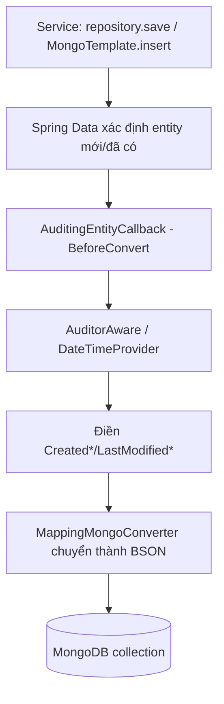

# Kích hoạt @EnableMongoAuditing

Trong một ứng dụng dùng **Spring Data MongoDB**, người phát triển thường muốn biết ai tạo một document, tạo lúc nào, ai sửa gần nhất và sửa lúc nào. Gán thủ công các trường này trong từng service dễ bị bỏ sót khi thêm đường ghi mới. Spring Data cung cấp **auditing** để điền metadata ở tầng entity mapping.

Đối với luồng **imperative**, annotation `@EnableMongoAuditing` đăng ký auditing infrastructure. Trên entity, dùng `@CreatedDate`, `@LastModifiedDate`, `@CreatedBy` và `@LastModifiedBy`. Nếu muốn ghi người thao tác, cung cấp `AuditorAware<T>` lấy identity từ ngữ cảnh bảo mật đã xác thực. Chỉ ghi ngày thì không nhất thiết phải có auditor provider.

Bài thuộc chương **Auditing** của module `SPRING_DATA_MONGODB`. Module hướng dẫn kết nối MongoDB, ánh xạ document, thao tác qua `MongoTemplate` hoặc repository, đồng thời thiết kế truy vấn, aggregation, index, transaction, reactive access, kiểm thử và chẩn đoán hiệu năng. Trọng tâm bài này là **kích hoạt auditing đúng cách**, không phải xây dựng một kho lịch sử thay đổi toàn diện.

> **Cần nhớ:** `@EnableMongoAuditing` hoạt động qua **entity callbacks** của Spring Data. Nó không tự áp dụng cho mọi câu lệnh `updateFirst`, `findAndModify`, raw driver, bulk writes hoặc script `mongosh`. Nó cũng không thay thế `@Version`, authorization, transaction hay một audit log bất biến.

## 1. Mục tiêu học tập

Sau bài này, bạn có thể:

1. Phân biệt auditing metadata với application logs, change streams và lịch sử sửa đổi.
2. Kích hoạt `@EnableMongoAuditing` trong một `@Configuration` được Spring quét.
3. Ánh xạ các trường `@CreatedDate`, `@LastModifiedDate`, `@CreatedBy` và `@LastModifiedBy`.
4. Hiểu auditing chỉ theo dõi thời gian không bắt buộc `AuditorAware`.
5. Viết `AuditorAware<String>` dựa trên Spring Security `Authentication`.
6. Cấu hình `auditorAwareRef` và `dateTimeProviderRef`.
7. Giải thích hai tùy chọn `setDates` và `modifyOnCreate` cùng giá trị mặc định.
8. Hiểu `AuditingEntityCallback` chạy trong giai đoạn `BeforeConvertCallback`.
9. Phân biệt `insert`/`save` với query update/bulk không đi qua entity auditing.
10. Xử lý actor cho authenticated request, anonymous request và background job.
11. Phân biệt imperative `@EnableMongoAuditing` với reactive `@EnableReactiveMongoAuditing`.
12. Viết integration tests cho auditing insert/save và kiểm tra metadata đọc lại từ MongoDB.
13. Thiết kế `Clock`/`DateTimeProvider` giúp test thời gian không phụ thuộc `sleep`.
14. Tránh để client chỉnh `createdBy`/`createdAt` hoặc khai báo actor giả.
15. Hiểu `@Version`, optimistic locking và transaction độc lập với audit metadata.
16. Đánh giá giới hạn lịch sử thay đổi, bảo mật và việc migrate dữ liệu cũ.

## 2. Auditing metadata là gì?

Ví dụ MongoDB document đơn hàng:

```javascript
{
  _id: "ORDER-1001",
  tenant_id: "tenant-a",
  status: "PAID",
  total_cents: NumberLong("120000"),
  createdAt: ISODate("2026-11-20T08:00:00Z"),
  createdBy: "user-17",
  lastModifiedAt: ISODate("2026-11-20T08:15:00Z"),
  lastModifiedBy: "user-28"
}
```

Bốn audit fields cho biết **trạng thái mới nhất** của metadata, nhưng không lưu toàn bộ quá trình đổi từ `DRAFT` sang `PAID` hay giá trị cũ của từng trường.

| Mục tiêu | Cơ chế | Kết quả |
| --- | --- | --- |
| Ai tạo | `@CreatedBy` + `AuditorAware` | Actor lúc tạo |
| Khi nào tạo | `@CreatedDate` | Thời điểm tạo do provider cấp |
| Ai sửa gần nhất | `@LastModifiedBy` | Actor của lần sửa cuối |
| Khi nào sửa gần nhất | `@LastModifiedDate` | Thời điểm sửa gần nhất |
| Chống ghi đè dữ liệu cũ | `@Version` / CAS | Phát hiện optimistic conflict |
| Lưu từng bản thay đổi | History/event store/outbox | Chuỗi thay đổi |
| Quan sát thay đổi server | MongoDB change streams | Dòng sự kiện tùy cấu hình |
| Giới hạn người được sửa | Authorization và tenant filters | Bảo mật truy cập |

**`createdAt` không đồng nghĩa `paidAt` hoặc thời điểm commit.** Auditing tạo giá trị phía ứng dụng trước khi document được lưu. Các mốc nghiệp vụ như thanh toán/phê duyệt nên có fields riêng với semantics rõ ràng.

## 3. Vòng đời từ repository đến callback



Spring Data MongoDB hiện đại sử dụng `AuditingEntityCallback`, một `BeforeConvertCallback` có thứ tự mặc định **100**. Nó sửa hoặc trả về entity đã bổ sung metadata **trước bước chuyển thành BSON**.

Hệ quả:

- `MongoTemplate.insert(entity)`, `MongoTemplate.save(entity)` và repository CRUD đi qua callback mapping phù hợp.
- `MongoCollection<Document>.insertOne(...)` của driver hoạt động trực tiếp trên BSON nên không biết annotations.
- `updateFirst(Query, Update, Entity.class)` và `findAndModify` là lệnh cập nhật trực tiếp, không thực hiện full auditing lifecycle giống `save(entity)`.
- `MongoTemplate.remove` hoặc repository delete không có nghĩa tạo một audit log xóa.
- Trong reactive stack có `ReactiveAuditingEntityCallback` riêng.

### 3.1. EntityCallback khác ApplicationEvent

`AbstractMongoEventListener` có thể nghe `BeforeConvertEvent` và `BeforeSaveEvent`, nhưng không nên viết event listener tự gán metadata rồi cho rằng nó giống auditing framework. Entity callbacks được Spring Data khuyến nghị để **thay đổi entity theo thứ tự có thể xác định**, kể cả với kiểu immutable.

Nếu đăng ký callback khác cũng chỉnh audit fields, phải kiểm tra thứ tự và tránh để nó ghi đè thông tin đã được auditing tạo ra.

## 4. Dependency và môi trường

Với Maven và Spring Boot imperative:

```xml
<dependency>
    <groupId>org.springframework.boot</groupId>
    <artifactId>spring-boot-starter-data-mongodb</artifactId>
</dependency>
```

Với Gradle:

```groovy
dependencies {
    implementation "org.springframework.boot:spring-boot-starter-data-mongodb"
}
```

Nếu lấy identity qua Spring Security, thêm starter bảo mật phù hợp:

```xml
<dependency>
    <groupId>org.springframework.boot</groupId>
    <artifactId>spring-boot-starter-security</artifactId>
</dependency>
```

Để Spring Boot BOM quản lý phiên bản Spring Data và MongoDB Driver. Không phối hợp tùy ý nhiều major versions. **Kết nối MongoDB thành công không tự bật auditing**: cần cấu hình và annotations; nếu có actor fields thì phải cung cấp provider.

## 5. Kích hoạt @EnableMongoAuditing đơn giản nhất

Với ứng dụng imperative **chỉ ghi timestamps**:

```java
package dev.learning.orders.config;

import org.springframework.context.annotation.Configuration;
import org.springframework.data.mongodb.config.EnableMongoAuditing;

@Configuration
@EnableMongoAuditing
public class MongoAuditingConfiguration {
}
```

Đặt configuration class trong vùng component scan hoặc import có chủ đích. Annotation thuộc:

```java
org.springframework.data.mongodb.config.EnableMongoAuditing
```

Không nhầm với `@EnableJpaAuditing` dành cho JPA, hoặc `@EnableReactiveMongoAuditing` dành cho reactive MongoDB.

### 5.1. Boot autoconfiguration và auditing không giống nhau

`@SpringBootApplication` có thể auto-configure repositories và `MongoTemplate` khi dependency đúng, nhưng không nên suy rằng nó tự kích hoạt auditing metadata. `@EnableMongoAuditing` là bước khai báo rõ.

`@EnableMongoRepositories` điều khiển repository discovery; `@EnableMongoAuditing` đăng ký auditing infrastructure. Một ứng dụng dùng `MongoTemplate` mà không có repository vẫn có thể cần auditing.

### 5.2. Chỉ ghi ngày không cần AuditorAware

Spring Data Commons ghi rõ: nếu chỉ sử dụng `@CreatedDate` và `@LastModifiedDate`, entity **không cần** một `AuditorAware`. Khi bật actor fields `@CreatedBy`/`@LastModifiedBy`, cần provider để lấy người hiện tại.

### 5.3. Tránh kích hoạt lặp

Không copy cùng lúc ba configuration classes đều có `@EnableMongoAuditing` vào một application context. Chọn **một chính sách** với đúng bean references; nhiều auditing registrars hoặc multiple contexts khiến việc chẩn đoán trở nên khó khăn.

## 6. Entity ví dụ dùng bốn annotations

```java
package dev.learning.orders.domain;

import java.time.Instant;

import org.springframework.data.annotation.CreatedBy;
import org.springframework.data.annotation.CreatedDate;
import org.springframework.data.annotation.Id;
import org.springframework.data.annotation.LastModifiedBy;
import org.springframework.data.annotation.LastModifiedDate;
import org.springframework.data.annotation.Version;
import org.springframework.data.mongodb.core.mapping.Document;
import org.springframework.data.mongodb.core.mapping.Field;

@Document("audited_orders")
public class AuditedOrder {

    @Id private String id;
    @Field("tenant_id") private String tenantId;
    private String status;
    @Field("total_cents") private long totalCents;

    @CreatedDate private Instant createdAt;
    @LastModifiedDate private Instant lastModifiedAt;
    @CreatedBy private String createdBy;
    @LastModifiedBy private String lastModifiedBy;

    @Version private Long version;

    protected AuditedOrder() {}

    public AuditedOrder(String id, String tenantId,
                        String status, long totalCents) {
        this.id = id;
        this.tenantId = tenantId;
        this.status = status;
        this.totalCents = totalCents;
    }

    public String getId() { return id; }
    public String getTenantId() { return tenantId; }
    public String getStatus() { return status; }
    public long getTotalCents() { return totalCents; }
    public Instant getCreatedAt() { return createdAt; }
    public Instant getLastModifiedAt() { return lastModifiedAt; }
    public String getCreatedBy() { return createdBy; }
    public String getLastModifiedBy() { return lastModifiedBy; }
    public Long getVersion() { return version; }

    public void setStatus(String status) { this.status = status; }
}
```

Spring Data mapping có thể làm việc với private fields qua cấu hình hỗ trợ. Không cần public setter cho audit fields trong mô hình này; caller không nên có quyền quyết định identity/timestamp.

### 6.1. Bốn audit fields khi insert và save

| Field | Insert | Save bản đã tồn tại |
| --- | --- | --- |
| `createdAt` / `@CreatedDate` | Gán thời điểm tạo | Thường giữ nguyên |
| `createdBy` / `@CreatedBy` | Gán actor hiện tại nếu có | Thường giữ nguyên |
| `lastModifiedAt` / `@LastModifiedDate` | Gán nếu `modifyOnCreate=true` | Gán thời điểm sửa |
| `lastModifiedBy` / `@LastModifiedBy` | Gán nếu `modifyOnCreate=true` | Gán actor sửa |
| `version` / `@Version` | Khởi tạo version | Kiểm tra/tăng version nếu operation hỗ trợ |

`@Version` là cơ chế **kiểm soát đồng thời khác auditing**. Nó không cần thiết để auditing hoạt động; được thêm vào ví dụ để nhắc rằng một entity có thể vừa audit vừa chống stale saves.

### 6.2. Dùng Instant và hiểu BSON Date

`Instant` là kiểu phù hợp cho timestamp tuyệt đối; MongoDB BSON Date thường lưu mili giây từ epoch. `Instant.now()` có thể chứa độ phân giải nano giây, nhưng khi đọc lại qua BSON Date một phần nhỏ hơn mili giây có thể không được bảo toàn. Test không nên assert từng nano giây nếu converter/driver đã làm tròn/cắt.

Không sử dụng `LocalDateTime` mà không làm rõ timezone. Không lưu một timestamp là string địa phương khi cần so sánh/range query/TTL một cách nhất quán.

## 7. AuditorAware<T>: lấy actor ở đâu?

`AuditorAware<T>` là SPI của Spring Data Commons:

```java
import java.util.Optional;
import org.springframework.data.domain.AuditorAware;

// Hợp đồng khái niệm:
// Optional<T> getCurrentAuditor();
```

Nếu entity khai báo `@CreatedBy String createdBy` và `@LastModifiedBy String lastModifiedBy` thì bean nên là `AuditorAware<String>`. Nếu provider trả một `User` object mà field chỉ có `String`, kiểu dữ liệu và conversion có thể không tương thích.

### 7.1. Provider cố định cho ví dụ test

```java
import org.springframework.context.annotation.Bean;
import org.springframework.context.annotation.Configuration;
import org.springframework.data.domain.AuditorAware;

@Configuration
public class TrainingActorConfiguration {

    @Bean("fixedAuditor")
    AuditorAware<String> fixedAuditor() {
        return () -> java.util.Optional.of("training-user");
    }
}
```

Cấu hình auditing tương ứng:

```java
@Configuration
@EnableMongoAuditing(auditorAwareRef = "fixedAuditor")
public class TrainingAuditingConfiguration {
}
```

**Đây là một phương án thay thế cho cấu hình mục 5**, không phải một class `@EnableMongoAuditing` thứ hai cần thêm cùng lúc. Fixed auditor phù hợp để trình diễn hoặc test; không dùng identity cố định cho mọi HTTP request production.

### 7.2. Actor là user ID, không phải dữ liệu tự khai

Một trường `createdBy` lưu user ID ổn định thường dễ truy vết hơn display name hoặc email có thể thay đổi. Không copy `createdBy` từ JSON request, không tin header `X-User-ID` tùy ý trừ khi được xác thực bởi một trusted gateway và policy rõ ràng.

## 8. Dùng Spring Security trong AuditorAware

Ứng dụng imperative Spring MVC có thể đọc `SecurityContextHolder`:

```java
package dev.learning.orders.config;

import java.util.Optional;

import org.springframework.context.annotation.Bean;
import org.springframework.context.annotation.Configuration;
import org.springframework.data.domain.AuditorAware;
import org.springframework.security.authentication.AnonymousAuthenticationToken;
import org.springframework.security.core.Authentication;
import org.springframework.security.core.context.SecurityContextHolder;

@Configuration
public class SecurityAuditorConfiguration {

    @Bean("securityAuditor")
    AuditorAware<String> securityAuditor() {
        return () -> Optional.ofNullable(
                SecurityContextHolder.getContext()
                    .getAuthentication())
            .filter(Authentication::isAuthenticated)
            .filter(a -> !(a instanceof AnonymousAuthenticationToken))
            .map(Authentication::getName);
    }
}
```

`Authentication.getName()` là một lựa chọn minh họa; production có thể cần map sang stable actor ID từ custom principal. Phải lấy actor từ **ngữ cảnh đã được xác thực**, không lấy một username do client tự cung cấp.

### 8.1. Anonymous có thể isAuthenticated=true

Một `AnonymousAuthenticationToken` do Spring Security tạo vẫn có thể được coi là authenticated theo API. Chỉ lọc `Authentication::isAuthenticated` chưa chắc loại bỏ anonymous. Ví dụ còn kiểm tra loại token; tùy cấu hình security thực tế có thể cần policy khác.

### 8.2. Không có Authentication thì sao?

`AuditorAware.getCurrentAuditor()` trả `Optional.empty()` khi không có principal hợp lệ. Lúc ấy actor fields có thể không được điền. Nếu business **bắt buộc người thực hiện**, service/controller phải xác thực/ủy quyền **trước ghi**, không kỳ vọng auditing tự từ chối mọi anonymous write.

Với background jobs, dùng **service identity** có nguồn gốc rõ ràng, không gán mặc định `"admin"` khi thiếu Authentication.

## 9. Kích hoạt bằng bean references rõ ràng

Khi có nhiều `AuditorAware` hoặc muốn dùng timestamp tùy biến, nên chọn bean cụ thể:

```java
package dev.learning.orders.config;

import org.springframework.context.annotation.Configuration;
import org.springframework.data.mongodb.config.EnableMongoAuditing;

@Configuration
@EnableMongoAuditing(
    auditorAwareRef = "securityAuditor",
    dateTimeProviderRef = "auditDateTimeProvider",
    setDates = true,
    modifyOnCreate = true
)
public class ProductionAuditingConfiguration {
}
```

Bean `securityAuditor` đến từ mục 8. Bean `auditDateTimeProvider` được định nghĩa ở mục 10. Trong một application context, **chỉ dùng một class kích hoạt auditing** theo chính sách đã chọn; `ProductionAuditingConfiguration` là phương án thay thế cho class ở mục 5 hoặc 7.

| Thuộc tính `@EnableMongoAuditing` | Kiểu | Mặc định | Tác dụng |
| --- | --- | --- | --- |
| `auditorAwareRef` | `String` | Chuỗi rỗng | Chỉ định tên bean `AuditorAware` dùng để lấy principal |
| `dateTimeProviderRef` | `String` | Chuỗi rỗng | Chỉ định tên bean `DateTimeProvider` |
| `setDates` | `boolean` | `true` | Cho phép framework tự điền thời gian |
| `modifyOnCreate` | `boolean` | `true` | Cũng đánh dấu modified metadata khi tạo entity |

Khi chỉ có **một** bean `AuditorAware` phù hợp, auditing infrastructure có thể tìm bean ấy tự động. Nhưng nếu có nhiều implementations, không dựa vào sự tình cờ của thứ tự bean: khai báo `auditorAwareRef` rõ.

### 9.1. Không dùng bean name như một giá trị actor

`auditorAwareRef = "securityAuditor"` là **tên bean Spring**, không phải giá trị lưu vào `createdBy`. Actor thực tế do `AuditorAware<String>.getCurrentAuditor()` trả ở thời điểm thao tác. Ví dụ một bean có thể trả `"user-17"` cho request A và `"user-28"` cho request B.

### 9.2. Không thay MongoClient hay transaction manager

Kích hoạt auditing **không tự thay** MongoDB URI, tên database, `MongoClientSettings`, write concern, index hay transaction boundaries. Nếu ứng dụng có nhiều Mongo templates/factories, cần kiểm chứng callback và actor provider thuộc **đúng application context** dùng để ghi entity.

## 10. Tạo DateTimeProvider và Clock

`DateTimeProvider` của Spring Data cung cấp thời điểm cho `@CreatedDate` và `@LastModifiedDate`. Khi không chỉ định, framework dùng provider hiện tại. Nếu muốn có thể kiểm thử bằng thời gian cố định, khai báo `Clock` và provider tường minh:

```java
package dev.learning.orders.config;

import java.time.Clock;
import java.time.Instant;
import java.time.temporal.ChronoUnit;
import java.time.temporal.TemporalAccessor;
import java.util.Optional;

import org.springframework.context.annotation.Bean;
import org.springframework.context.annotation.Configuration;
import org.springframework.data.auditing.DateTimeProvider;

@Configuration
public class AuditTimeConfiguration {

    @Bean
    Clock auditClock() {
        return Clock.systemUTC();
    }

    @Bean("auditDateTimeProvider")
    DateTimeProvider auditDateTimeProvider(Clock auditClock) {
        return () -> Optional.<TemporalAccessor>of(
            Instant.now(auditClock)
                .truncatedTo(ChronoUnit.MILLIS));
    }
}
```

`DateTimeProvider#getNow()` trả `Optional<TemporalAccessor>`. `Instant` triển khai `TemporalAccessor`, nên ví dụ truyền giá trị được Spring Data sử dụng để đặt field kiểu `Instant`.

### 10.1. Tại sao cắt về mili giây?

MongoDB BSON Date phổ biến lưu thời gian theo mili giây. Java `Instant` có thể chính xác hơn, nhưng phần nano giây không luôn được bảo toàn khi ghi và đọc qua BSON. `truncatedTo(MILLIS)` giúp so sánh expected timestamp trong test dễ hiểu.

Không cần cắt mili giây nếu mô hình và converter dùng precision khác có chủ đích; quan trọng là có **hợp đồng thời gian** rõ ràng cho dữ liệu lưu.

### 10.2. Test với thời gian cố định

Trong test context riêng có thể inject một `Clock.fixed(...)` để tạo kết quả xác định:

```java
Clock fixed = Clock.fixed(
    Instant.parse("2026-11-20T08:00:00Z"),
    java.time.ZoneOffset.UTC
);
```

Nếu cần chứng minh `lastModifiedAt` **thay đổi** qua hai lần save, tạo test clock có thể tiến thời gian theo từng bước. Không dùng `Thread.sleep` để chờ vượt qua độ phân giải mili giây.

### 10.3. Auditing time khác commit time

Provider được gọi ở phía application trước khi chuyển entity thành BSON. Một transaction có thể rollback sau khi callback đặt timestamp; timestamp không phải chứng cứ transaction đã commit đúng mốc đó. Nếu business cần event timestamp từ server, hãy định nghĩa riêng và xử lý các đường ghi phù hợp.

## 11. modifyOnCreate: vì sao bản ghi mới cũng có lastModified?

Mặc định `modifyOnCreate=true`, nên khi tạo entity mới, auditing có thể điền **cả created và last-modified fields**:

```text
Insert (modifyOnCreate=true)
  createdAt       = 08:00
  createdBy       = user-17
  lastModifiedAt  = 08:00
  lastModifiedBy  = user-17

Save bản đã tồn tại lúc 08:15
  createdAt       = 08:00
  createdBy       = user-17
  lastModifiedAt  = 08:15
  lastModifiedBy  = user-28
```

Đây là một policy hợp lý nếu “tạo document” cũng được xem là lần sửa đầu tiên.

Nếu muốn **last-modified fields rỗng khi insert**, chọn:

```java
@Configuration
@EnableMongoAuditing(
    auditorAwareRef = "securityAuditor",
    modifyOnCreate = false
)
public class CreatedOnlyAuditingConfiguration {
}
```

Khi đó ở entity mới, `lastModifiedAt`/`lastModifiedBy` có thể chưa được điền cho đến lần cập nhật. Cấu hình trên là **lựa chọn thay thế**, không khai báo đồng thời với `ProductionAuditingConfiguration`.

### 11.1. Đừng kiểm thử mặc định sai

Một test khẳng định `lastModifiedAt == null` sau insert sẽ không đúng khi `modifyOnCreate=true`. Ngược lại, nếu code business dùng `lastModifiedAt!=null` như dấu hiệu “đã sửa sau khi tạo”, mặc định `true` khiến suy luận đó sai. Nên so version hoặc trạng thái nghiệp vụ thay vì suy từ việc field null hay không.

## 12. setDates: bật hoặc tắt quản lý thời gian

Mặc định `setDates=true`. Nếu muốn auditing điền actor nhưng **không tự sinh timestamps**, có thể cấu hình:

```java
@EnableMongoAuditing(
    auditorAwareRef = "securityAuditor",
    setDates = false
)
```

Lúc này `createdAt` và `lastModifiedAt` không được auditing tự điền. Điều đó **không khiến MongoDB server tự sinh timestamp**. Nếu cần database-side timestamps, bạn phải cấu hình/thực hiện các thao tác tương ứng ở một con đường ghi khác.

### 12.1. Không trộn nhiều nguồn timestamp vô chủ

Một service dùng entity `save` với application-time timestamp, service khác dùng `$currentDate` với MongoDB server time. Nếu chỉ nhìn `lastModifiedAt`, hai đường ghi có thể có độ lệch clock. Hãy định nghĩa chính sách rõ ràng và giám sát clock drift.

### 12.2. setDates=false không có nghĩa tắt auditing actor

`setDates=false` chỉ điều khiển chức năng set creation/last-modification date. `@CreatedBy` và `@LastModifiedBy` vẫn có thể được điền khi có `AuditorAware` và callback chạy theo policy. Nếu muốn tắt toàn bộ auditing, đừng hiểu nhầm `setDates=false` là công tắc chung.

## 13. Insert và save bằng MongoTemplate

Giả sử cấu hình `@EnableMongoAuditing` cùng `securityAuditor` đã hoạt động và request có Authentication user-17.

```java
import org.springframework.data.mongodb.core.MongoTemplate;

AuditedOrder newOrder = new AuditedOrder(
    "ORDER-1001", "tenant-a", "DRAFT", 120_000L);

AuditedOrder inserted = mongoTemplate.insert(newOrder);

System.out.println(inserted.getCreatedBy());     // user-17
System.out.println(inserted.getLastModifiedBy()); // user-17 nếu modifyOnCreate
System.out.println(inserted.getCreatedAt());     // timestamp từ provider
```

Bản ghi sau insert có audit metadata mà service **không tự gán**. Sau này khi user-28 cập nhật:

```java
AuditedOrder existing = mongoTemplate.findById(
    "ORDER-1001", AuditedOrder.class);

if (existing == null) {
    throw new IllegalStateException("Không tìm thấy đơn hàng");
}

existing.setStatus("PAID");

AuditedOrder saved = mongoTemplate.save(existing);

System.out.println(saved.getLastModifiedBy()); // user-28
```

**Ví dụ phân tách hai request**: identity user-17/user-28 phải đến từ SecurityContext tương ứng tại lúc mỗi operation được thực thi. Nếu chạy liên tục trong cùng thread với cùng Authentication thì auditor không tự đổi sang user khác.

### 13.1. Vì sao insert khác save?

- `insert(entity)` thể hiện chủ đích **tạo mới**, lỗi nếu ID trùng.
- `save(entity)` dựa trên newness detection/mapping để insert hoặc cập nhật.
- `@Version Long version` trong ví dụ ảnh hưởng việc xác định entity mới và optimistic locking.
- Audit fields được gán theo **new/existing semantics** của Spring Data, không chỉ dựa vào việc giá trị `id` null hay không.

Một entity có ID do ứng dụng cấp sẵn nhưng version null cần được kiểm thử `insert/save` đúng hành vi trong phiên bản Spring Data đang dùng.

### 13.2. Auditing không thay đổi logic tenant

`mongoTemplate.findById(id, AuditedOrder.class)` **không tự thêm tenant filter**. Trong API đa tenant, truy vấn phải có `tenantId`/authorization predicate, tránh truy cập đơn hàng của tenant khác dù entity có auditing.

## 14. Qua repository: auditing diễn ra ở đâu?

Repository cơ bản:

```java
package dev.learning.orders.data;

import org.springframework.data.mongodb.repository.MongoRepository;

public interface AuditedOrderRepository
        extends MongoRepository<AuditedOrder, String> {
}
```

Sử dụng:

```java
AuditedOrder inserted = repository.insert(
    new AuditedOrder(
        "ORDER-1002", "tenant-a", "DRAFT", 10_000L));

AuditedOrder loaded = repository.findById(
    inserted.getId()).orElseThrow();

loaded.setStatus("CONFIRMED");

AuditedOrder updated = repository.save(loaded);
```

`insert`/`save` qua Spring Data mapping trigger callbacks tương ứng. `findById` **không** làm thay đổi `lastModifiedAt` hay `lastModifiedBy` chỉ vì document được đọc.

### 14.1. Không dùng save làm “read-only refresh”

`repository.save(entity)` là một **lệnh ghi**; auditing có thể cập nhật `lastModifiedAt` ngay cả khi các business fields không thực sự đổi. Vì vậy:

- Không gọi `save` sau một GET chỉ để “refresh”.
- Không coi mọi thay đổi audit timestamp là chứng cứ business state thay đổi.
- Phân biệt write semantics, version và modified count nếu nghiệp vụ cần biết có thay đổi thực hay không.

### 14.2. Không cho client gửi nguyên entity

Một endpoint chấp nhận toàn bộ JSON thành `AuditedOrder` rồi `save` có thể cho phép client chọn các field không nên được kiểm soát, như `tenantId` hoặc audit timestamps. Hãy dùng **request DTO** chỉ chứa các field được phép sửa, load entity có xác minh authorization, sau đó cập nhật những field nghiệp vụ cần thiết.

## 15. Query Update không giống entity save

Một ngộ nhận quan trọng:

```java
import org.springframework.data.mongodb.core.query.Criteria;
import org.springframework.data.mongodb.core.query.Query;
import org.springframework.data.mongodb.core.query.Update;

Query q = Query.query(
    Criteria.where("id").is("ORDER-1001"));

Update u = new Update()
    .set("status", "SHIPPED");

var result = mongoTemplate.updateFirst(
    q, u, AuditedOrder.class);
```

Đây là **query-based update**, không lấy một entity được audit rồi chạy `AuditingEntityCallback` theo cùng đường `save(entity)`. Vì vậy **đừng giả định `lastModifiedAt`/`lastModifiedBy` được tự động cập nhật**.

`@Version` có thể tự tăng trong các typed update operations được Spring Data hỗ trợ, nhưng **version auto-increment cũng không có nghĩa auditing callback chạy**. Đây là hai cơ chế riêng biệt.

### 15.1. Cập nhật lastModifiedAt thủ công khi cần

Nếu dự án chấp nhận thời gian database server và actor được lấy từ trusted authentication:

```java
Update change = new Update()
    .set("status", "SHIPPED")
    .set("lastModifiedBy", authorizedActorId)
    .currentDate("lastModifiedAt");

var result = mongoTemplate.updateFirst(
    Query.query(Criteria.where("id").is(orderId)
        .and("tenantId").is(authorizedTenant)),
    change,
    AuditedOrder.class);
```

`authorizedActorId` và `authorizedTenant` phải đến từ security context, không phải user-controlled string. `Update.currentDate` đặt BSON date theo server time, trong khi `DateTimeProvider` ở `save` thường đặt application time; nếu hai đường ghi cùng tồn tại phải có quy tắc đối chiếu độ lệch clock.

Nếu nghiệp vụ cần compare-and-set, thêm expected `@Version` vào Query và kiểm tra `matchedCount`. Mẫu trên chưa áp phiên bản dự kiến.

### 15.2. Không tự ghi đè created metadata

`createdAt` và `createdBy` nên thể hiện nguồn gốc ban đầu. Nếu update kiểu Query được phép thay hai trường này mà không có ràng buộc, auditing metadata có thể bị giả mạo. Hạn chế quyền ghi, xác thực actor, kiểm tra service logic và dùng nguồn audit sự kiện độc lập nếu cần tính chống sửa mạnh hơn.

## 16. Các đường ghi bypass auditing callback

| Thao tác | Auditing entity callback tự chạy? | Hành động cần thiết |
| --- | --- | --- |
| `MongoTemplate.insert(entity)` | Có trong pipeline mapping | Xác minh configuration |
| `MongoTemplate.save(entity)` | Có trong pipeline mapping | Nhớ version và newness |
| `MongoRepository.insert/save(entity)` | Có theo mapped entity path | Test integration |
| `MongoTemplate.updateFirst(Query, Update, Class)` | **Không cùng entity save callback** | Gán audit fields tường minh nếu cần |
| `MongoTemplate.updateMulti` | Không tự audit từng entity như `save` | Thiết kế update policy |
| `MongoTemplate.findAndModify` | Không tự audit như full save | Thêm audit update nếu cần |
| `BulkOperations.updateOne/updateMulti` | Không tự xử lý per-entity auditing như save | Dùng write models/metadata tường minh |
| `MongoCollection.updateOne/replaceOne` của driver | Không biết Spring annotations | Tự quản lý audit fields |
| `mongosh db.collection.updateOne` | Không có Spring context | Tự quản lý audit fields |
| MongoDB aggregation `$merge`/`$out` | Server-side pipeline | Không có Spring entity auditing |
| Repository custom query `@Update` | Không đồng nghĩa entity save | Review đường thực thi thực tế |

Nếu một collection được nhiều service và batch scripts cùng ghi, **chỉ bật @EnableMongoAuditing ở một service không đảm bảo audit fields luôn đúng**. Cần hợp đồng chung cho mọi writers.

### 16.1. Sử dụng bulk với chú ý về actor

Một batch import có thể được xử lý bằng `insertAll` trên mapped entities hoặc bulk write trực tiếp. Đây là các con đường có callback semantics khác nhau; test phải chứng minh trường nào đã được điền cho từng đường. Đừng đoán chỉ vì tên method có chữ “insert”.

### 16.2. Tại sao raw BSON không được audit?

Driver raw và MongoDB Server không hiểu Java annotation `@CreatedBy`. Không có Spring callback nào trong đường ghi raw. Nếu cần metadata ở server cho mọi language client, phải áp một chiến lược server-side hoặc audit event/log được tất cả writers tuân thủ; không trông đợi annotation Java ảnh hưởng các clients khác.

## 17. Reactive auditing là cấu hình riêng

Trong Spring Data MongoDB reactive, dùng:

```java
package dev.learning.orders.config;

import org.springframework.context.annotation.Configuration;
import org.springframework.data.mongodb.config.EnableReactiveMongoAuditing;

@Configuration
@EnableReactiveMongoAuditing(
    auditorAwareRef = "reactiveSecurityAuditor"
)
public class ReactiveAuditingConfiguration {
}
```

Provider cần là `ReactiveAuditorAware<String>`, không phải `AuditorAware<String>`:

```java
import org.springframework.context.annotation.Bean;
import org.springframework.data.domain.ReactiveAuditorAware;
import org.springframework.security.authentication.AnonymousAuthenticationToken;
import org.springframework.security.core.Authentication;
import org.springframework.security.core.context.ReactiveSecurityContextHolder;
import reactor.core.publisher.Mono;

@Bean("reactiveSecurityAuditor")
ReactiveAuditorAware<String> reactiveSecurityAuditor() {
    return () -> ReactiveSecurityContextHolder.getContext()
        .map(ctx -> ctx.getAuthentication())
        .filter(Authentication::isAuthenticated)
        .filter(a -> !(a instanceof AnonymousAuthenticationToken))
        .map(Authentication::getName);
}
```

Method `@Bean` ở đây thuộc một Spring `@Configuration` thích hợp (ví dụ đặt trong `ReactiveAuditingConfiguration`). `ReactiveSecurityContextHolder` lấy authentication từ **Reactor Context**, phù hợp WebFlux.

### 17.1. Không dùng SecurityContextHolder làm mặc định reactive

Trong WebFlux, Reactive Context có thể di chuyển giữa các threads. `SecurityContextHolder` dựa trên thread context thông thường không tự phản ánh danh tính của một reactive subscription ở mọi scheduler. Dùng `ReactiveAuditorAware` và `ReactiveSecurityContextHolder` thay vì đọc `ThreadLocal` tùy tiện.

### 17.2. Không bật hai annotations vô chủ trong cùng context

Một ứng dụng thuần imperative dùng `@EnableMongoAuditing`; một ứng dụng thuần reactive dùng `@EnableReactiveMongoAuditing`. Ứng dụng hỗn hợp có thể cần cả hai, nhưng phải kiểm soát auditing registrars/callbacks và actor providers ở từng pipeline. Đừng mặc định **một annotation** có tác dụng cho cả hai kiểu operation.

### 17.3. Reactive Publisher chỉ thực thi khi subscribe

`ReactiveMongoRepository.save(...)` trả `Mono`. Việc tạo Mono không khẳng định entity đã được audit hay ghi MongoDB. Các callback reactive được thực hiện theo lifecycle **khi Publisher được subscribe**. Gọi `subscribe()` vô chủ trong service có thể làm mất authentication/transaction context; nên trả/combine Publisher cho framework.

## 18. Embedded metadata, immutable entities và Auditable

Audit fields không bắt buộc phải ở root entity; Spring Data Commons cho phép mô hình hóa metadata trong object nhúng tùy mapping của store:

```java
import java.time.Instant;
import org.springframework.data.annotation.CreatedDate;
import org.springframework.data.annotation.LastModifiedDate;

public class AuditMetadata {
    @CreatedDate
    private Instant createdAt;

    @LastModifiedDate
    private Instant lastModifiedAt;

    public Instant getCreatedAt() { return createdAt; }
    public Instant getLastModifiedAt() { return lastModifiedAt; }
}
```

Trong entity:

```java
@Document("audited_catalog")
public class CatalogItem {
    @Id private String id;
    private String name;
    private AuditMetadata audit;
}
```

Spring Data auditing hỗ trợ metadata nhúng theo khả năng mapping; nhưng lifecycle events truyền thống chỉ được phát cho root entities, không nhất thiết cho từng object nhúng. Khi dùng immutable objects/Java records, cần kiểm tra constructor mapping, nested object creation và callback support. Nếu `audit` đang `null`, đừng đoán framework sẽ tự khởi tạo toàn bộ cây object theo mọi kiểu Java.

### 18.1. Giao diện Auditable

Spring Data Commons còn cung cấp interface `Auditable<U, ID, T>` thay vì annotations, cho phép framework truy cập setter/getter auditing metadata qua contract. Hình thức này hữu ích với base class/contract chung nhưng làm domain phụ thuộc nhiều hơn vào Spring Data. Với một entity đơn giản, annotation-based approach thường dễ hiểu.

### 18.2. Java record và wither

Immutable entity có thể hoạt động với Spring Data mapping khi constructors/withers được thiết kế phù hợp. Nhưng đừng copy ví dụ mutable class thành Java record rồi kỳ vọng callback sửa private final fields không được hỗ trợ tùy tiện. Hãy test readback trên version Spring Data cụ thể, đặc biệt với nested auditing metadata.

## 19. Kiểm thử tích hợp: auditing khi insert

Muốn chứng minh cấu hình thực sự hoạt động, phải **insert rồi đọc lại BSON qua Spring Data** trong MongoDB test database riêng. Test không nên chỉ assert một bean `AuditorAware` tồn tại.

Thêm Spring Security test dependency nếu dùng `@WithMockUser`:

```groovy
dependencies {
    testImplementation "org.springframework.boot:spring-boot-starter-test"
    testImplementation "org.springframework.security:spring-security-test"
}
```

Giả sử application test nạp đúng `ProductionAuditingConfiguration`, `SecurityAuditorConfiguration`, `AuditTimeConfiguration` ở các mục trước, cùng `AuditedOrderRepository`:

```java
package dev.learning.orders;

import static org.assertj.core.api.Assertions.assertThat;
import java.util.UUID;

import org.junit.jupiter.api.Test;
import org.springframework.beans.factory.annotation.Autowired;
import org.springframework.boot.test.context.SpringBootTest;
import org.springframework.security.test.context.support.WithMockUser;

@SpringBootTest
class MongoAuditingIntegrationTest {

    @Autowired
    AuditedOrderRepository repository;

    private AuditedOrder newOrder() {
        String key = UUID.randomUUID().toString();
        return new AuditedOrder(
            "ORDER-" + key,
            "tenant-test-" + key,
            "DRAFT",
            120_000L);
    }

    @Test
    @WithMockUser(username = "alice")
    void insertPopulatesAuditFields() {
        AuditedOrder inserted = repository.insert(newOrder());

        assertThat(inserted.getCreatedAt()).isNotNull();
        assertThat(inserted.getCreatedBy()).isEqualTo("alice");

        // Khi modifyOnCreate=true (mặc định):
        assertThat(inserted.getLastModifiedAt()).isNotNull();
        assertThat(inserted.getLastModifiedBy())
            .isEqualTo("alice");

        AuditedOrder reloaded = repository.findById(
            inserted.getId()).orElseThrow();

        assertThat(reloaded.getCreatedAt())
            .isEqualTo(inserted.getCreatedAt());
        assertThat(reloaded.getCreatedBy()).isEqualTo("alice");
    }
}
```

Các class `AuditedOrder`/`AuditedOrderRepository` cần import từ package thực trong dự án. Sử dụng ID UUID và **MongoDB test database**, không kết nối production. Test cả giá trị trả về và giá trị đọc lại để chứng minh callback không chỉ chỉnh object trong bộ nhớ.

### 19.1. Test không được xóa dữ liệu chung

Không gọi `repository.deleteAll()` hoặc `mongoTemplate.dropCollection(AuditedOrder.class)` để dọn sau test nếu collection có thể được dùng chung. Dùng database test được cách ly hoặc cleanup **chỉ IDs test tự tạo** theo chính sách fixture.

### 19.2. Vì sao không chỉ test DateTimeProvider?

Unit test provider giúp chứng minh clock đúng, nhưng không chứng minh auditing callback đã được đăng ký trong Spring context hay entity được mapping đúng BSON. Cần integration test thực.

## 20. Kiểm thử save: giữ created metadata và đổi modified actor

Cùng test class ở mục 19, bổ sung một method dùng mock authentication Alice trước khi insert, sau đó đổi sang Bob trước khi save:

```java
import java.util.List;

import org.springframework.security.authentication
    .UsernamePasswordAuthenticationToken;
import org.springframework.security.core.Authentication;
import org.springframework.security.core.authority.SimpleGrantedAuthority;
import org.springframework.security.core.context.SecurityContextHolder;

@Test
@WithMockUser(username = "alice")
void saveChangesModificationActor() {
    AuditedOrder inserted = repository.insert(newOrder());
    var initialCreatedAt = inserted.getCreatedAt();

    Authentication alice =
        SecurityContextHolder.getContext().getAuthentication();

    try {
        Authentication bob =
            new UsernamePasswordAuthenticationToken(
                "bob", "N/A",
                List.of(new SimpleGrantedAuthority("ROLE_USER")));

        SecurityContextHolder.getContext()
            .setAuthentication(bob);

        AuditedOrder current = repository.findById(
            inserted.getId()).orElseThrow();

        current.setStatus("CONFIRMED");
        repository.save(current);

    } finally {
        SecurityContextHolder.getContext()
            .setAuthentication(alice);
    }

    AuditedOrder reloaded = repository.findById(
        inserted.getId()).orElseThrow();

    assertThat(reloaded.getCreatedBy()).isEqualTo("alice");
    assertThat(reloaded.getCreatedAt())
        .isEqualTo(initialCreatedAt);

    assertThat(reloaded.getLastModifiedBy()).isEqualTo("bob");
    assertThat(reloaded.getLastModifiedAt())
        .isAfterOrEqualTo(initialCreatedAt);
}
```

Trong production, actor được truyền theo request đã được xác thực, **không tự gán SecurityContext** trong service. Ví dụ đổi context chỉ để mô phỏng hai users trong một test thread; `finally` khôi phục Authentication ban đầu.

### 20.1. Vì sao không assert lastModifiedAt phải lớn hơn?

Hai lần save có thể diễn ra trong **cùng mili giây**. BSON Date không bảo đảm chúng khác nhau. Nếu muốn test thời gian tăng chắc chắn, dùng một `DateTimeProvider` dựa trên controlled clock và tiến clock giữa các lần save.

### 20.2. Nếu save bị optimistic conflict?

Nếu entity có `@Version` và một bản đọc cũ bị từ chối bởi `OptimisticLockingFailureException`, **đừng coi audit fields trên object stale là bản ghi đã commit**. Callback có thể đã chạm object trước khi write thất bại; cần đọc lại MongoDB để biết trạng thái lưu thực.

## 21. Kiểm thử query update không tự điền lastModified

Dùng entity đã insert, chạy:

```java
Query query = Query.query(
    Criteria.where("id").is(inserted.getId()));

Update update = new Update()
    .set("status", "SHIPPED");

var result = mongoTemplate.updateFirst(
    query, update, AuditedOrder.class);
```

`inserted` và `mongoTemplate` là dữ liệu/bean trong class test có cấu hình. Query update thường không đi qua `AuditingEntityCallback` như `save(entity)`. Vì thế, test cần xác minh `lastModifiedAt` **không được tự kỳ vọng đã cập nhật**; nếu dự án yêu cầu, thêm audit fields tường minh vào `Update` và kiểm thử hành vi ấy.

### 21.1. Mẫu cập nhật tường minh

```java
Update change = new Update()
    .set("status", "SHIPPED")
    .set("lastModifiedBy", authorizedActorId)
    .currentDate("lastModifiedAt");

var outcome = mongoTemplate.updateFirst(
    Query.query(Criteria.where("id").is(orderId)
        .and("tenantId").is(authorizedTenant)),
    change, AuditedOrder.class);
```

Hai biến `authorizedActorId`/`authorizedTenant` phải đến từ principal đã xác thực. Lệnh `currentDate` dùng thời gian MongoDB Server, không phải application `Clock`, nên chính sách time source có thể khác entity save.

### 21.2. Đừng bỏ optimistic version check

Nếu thao tác cần chống stale update, thêm expected version vào query và kiểm tra `matchedCount`. Việc typed `Update` có thể tăng `@Version` là chuyện khác với việc bảo đảm auditor callback chạy hay request mang đúng version.

## 22. Kiểm thử DateTimeProvider một cách xác định

Có thể test trực tiếp provider mà không cần MongoDB:

```java
import static org.assertj.core.api.Assertions.assertThat;

import java.time.Clock;
import java.time.Instant;
import java.time.ZoneOffset;
import java.time.temporal.ChronoUnit;

import org.junit.jupiter.api.Test;

@Test
void providerUsesClock() {
    Instant fixed = Instant.parse("2026-11-20T08:00:00Z");
    Clock clock = Clock.fixed(fixed, ZoneOffset.UTC);

    var provider = new AuditTimeConfiguration()
        .auditDateTimeProvider(clock);

    assertThat(provider.getNow())
        .contains(fixed.truncatedTo(ChronoUnit.MILLIS));
}
```

Method này được đặt trong một test class có imports/JUnit context. Nếu muốn kiểm chứng mapped entity với fixed time, tạo **test application context** dùng fixed `Clock` và `dateTimeProviderRef`; không sửa runtime production clock giữa các requests.

### 22.1. Date-only auditing cũng phải có integration test

Tạo một context riêng chỉ có `@EnableMongoAuditing` và entity `@CreatedDate`/`@LastModifiedDate`. Insert một entity mới và assert dates được điền **không cần AuditorAware**. Đây là một test cấu hình thay thế, không nạp cùng lúc với nhiều `@EnableMongoAuditing` có policies mâu thuẫn.

### 22.2. Tránh test phụ thuộc thời gian thật

Không dùng `Thread.sleep` rồi assert server timestamp chính xác tới nano giây, hoặc lấy application timestamp làm timestamp commit transaction. Đọc lại BSON Date và test đúng độ phân giải được lưu.

## 23. Bảo mật audit metadata và tenant

Một HTTP request không nên được phép gửi:

```json
{
  "status": "CONFIRMED",
  "lastModifiedBy": "admin",
  "createdAt": "2020-01-01T00:00:00Z"
}
```

Nếu controller map trực tiếp toàn bộ request thành entity rồi `save`, caller có thể chèn các field không thuộc quyền chỉnh sửa. Dùng DTO chỉ chứa business fields:

```java
public record ChangeOrderStatusRequest(String status) {}
```

Service tìm document theo ID **và tenant được xác thực**, kiểm tra quyền sửa, set status rồi save. Auditing lấy actor từ `AuditorAware` ở phía server. Không tin raw header `X-User-ID` hoặc actor trong request body chưa được xác thực.

### 23.1. Auditing không thay thế authorization

Có `createdBy="alice"` không tự ngăn user khác sửa document. Authorization và tenant scoped query vẫn là bắt buộc. `@EnableMongoAuditing` cũng không chứng minh actor có quyền thực hiện thao tác; nó chỉ ghi **identity provider đã trả**.

### 23.2. Không phải kho lịch sử chống sửa

Người dùng có quyền update MongoDB hoặc script raw có thể thay `createdBy`/`lastModifiedBy` hay xóa document. Nếu cần chứng cứ kiểm toán:

- Ghi audit events append-only hoặc transactional outbox.
- Có actor, tenant, request ID, action, timestamps và event payload đã kiểm soát.
- Phân quyền lịch sử riêng khỏi CRUD dữ liệu chính.
- Thiết kế retention, backup, giám sát sửa/xóa và đối soát.
- Không dùng bốn field hiện tại để thay thế toàn bộ lịch sử.

### 23.3. Không log token hoặc dữ liệu nhạy cảm

`AuditorAware` có thể truy cập authentication principal nhưng không nên log raw JWT, session cookie, credentials hoặc toàn bộ object người dùng. Lưu actor ID ổn định và correlation ID theo policy privacy/security.

## 24. Background jobs và migration dữ liệu cũ

Một scheduled job thường không có Spring Security HTTP `Authentication`. `AuditorAware` có thể trả `Optional.empty()` làm actor fields không được điền theo mong muốn.

Các hướng xử lý:

1. Đặt **service identity** có thể truy vết cho job.
2. Có policy phân biệt interactive user và machine actor.
3. Không fallback toàn hệ thống về `admin` vô điều kiện.
4. Với batch import, chọn đường ghi và audit policy rõ ràng cho từng loại dữ liệu.

### 24.1. Legacy documents không tự được backfill

Thêm `@CreatedDate` hôm nay không khiến một triệu documents cũ tự có ngày tạo lịch sử. Những documents này có thể được đọc với `createdAt=null`.

Không chạy `repository.save` hàng loạt chỉ để “sửa thiếu audit metadata” rồi vô tình gắn ngày migration làm ngày tạo gốc. Nên backfill từ nguồn đáng tin, ghi provenance riêng hoặc đánh dấu unknown khi không xác định được thời điểm thật.

### 24.2. Index và TTL là bước khác

Nếu nghiệp vụ lọc/sort theo `lastModifiedAt`, thiết kế index dựa trên query thực, thường kèm `tenant_id`. Đừng tự động gắn TTL index lên `createdAt` của đơn hàng có nghĩa vụ lưu trữ. `@EnableMongoAuditing` **không tự tạo index** và cũng không bật schema validator.

### 24.3. Multi-service writers

Nếu chỉ service A bật auditing nhưng service B dùng raw driver để cập nhật collection, metadata có thể không nhất quán. Viết ra một **contract chung** về actor, time source và required fields cho mọi writers, kiểm thử trên đường ghi thực.

## 25. Quan sát và vận hành

Những chỉ số hoặc dấu hiệu nên theo dõi:

- Tỷ lệ documents thiếu `createdAt`/`createdBy`.
- Tỷ lệ `lastModifiedAt` null so với policy `modifyOnCreate`.
- Thiếu actor trong background jobs/anonymous requests.
- Lỗi startup vì bean `AuditorAware` hoặc `DateTimeProvider` ambiguity.
- Lỗi mapping Java `Instant`/actor type vào BSON.
- Chênh lệch clock giữa các service instances và server.
- Tỷ lệ entity saves so với raw/query/bulk writes.
- Write failures, version conflicts và transaction aborts.
- Hiệu năng query khi thêm filter/sort theo audit timestamp.

`AuditingEntityCallback` là công việc phía Spring Data. Nếu created fields rỗng, kiểm tra application context/annotation/bean registration/đường ghi trước khi tìm một MongoDB trigger không tồn tại.

## 26. Các lỗi thường gặp

| Triệu chứng | Nguyên nhân có thể | Khắc phục |
| --- | --- | --- |
| `createdAt` luôn null | `@EnableMongoAuditing` chưa được nạp | Đặt config trong component scan |
| `createdBy` null | Không có `AuditorAware` hoặc Authentication | Cấu hình provider và security |
| Không biết chọn provider nào | Nhiều `AuditorAware` beans | Dùng `auditorAwareRef` |
| Không tìm được date provider | Sai tên `dateTimeProviderRef` | Đồng bộ bean name |
| Insert có lastModified fields | `modifyOnCreate=true` mặc định | Chọn policy phù hợp |
| setDates=false làm ngày rỗng | Đã chủ động tắt dates | Bật lại hoặc có policy khác |
| Query update không đổi lastModifiedAt | Không chạy entity callback | Audit fields trong `Update` |
| Raw driver/bulk không audit | Không qua Spring mapping | Chính sách tường minh cho writers |
| Reactive repository không audit | Chỉ bật auditing imperative | `@EnableReactiveMongoAuditing` |
| Reactive actor rỗng | Dùng ThreadLocal trong WebFlux | `ReactiveAuditorAware` |
| Anonymous thành actor giả | Chỉ lọc `isAuthenticated` | Loại anonymous theo policy |
| Background job không có actor | Thiếu service principal | Identity cho workload |
| Client ghi đè createdAt | Map request vào entity toàn phần | DTO riêng, kiểm soát fields |
| Document cũ thiếu metadata | Chưa migration | Backfill có nguồn gốc |
| Timestamp không tăng giữa hai save | Cùng mili giây BSON | Fixed/mutable clock trong test |
| @Version tăng nhưng modifiedAt đứng yên | Query update không tự audit | Xử lý metadata riêng |
| Callback chạy nhưng save lỗi | Write/transaction không commit | Đọc lại DB để xác minh |
| createdBy không đủ truy vết | Chỉ có trạng thái cuối | Append-only audit events |
| Tenant khác đọc được order | ID-only query | Authorization + tenant predicate |

### 26.1. Quy trình debug

1. Đã nạp đúng configuration class chưa?
2. Entity có annotations và kiểu field hợp lệ không?
3. Đường ghi là entity `insert/save` hay raw/query update?
4. `AuditorAware` có trả identity đã xác thực?
5. Request có anonymous principal hoặc background job context không?
6. Có dùng reactive repository nhưng chỉ bật imperative auditing?
7. `setDates` và `modifyOnCreate` đang ở giá trị nào?
8. `DateTimeProvider` và timezone có phù hợp?
9. Entity được xem là mới hay đã tồn tại?
10. Có callback tùy biến nào ghi đè metadata?
11. Có đọc lại BSON sau write hay chỉ nhìn object local?
12. Writers khác có sửa field không tuân thủ policy?

## 27. Bài tập thực hành

**Bài 1.** Tạo `@Configuration @EnableMongoAuditing` và entity chỉ dùng `@CreatedDate Instant`; insert rồi kiểm tra MongoDB.

**Bài 2.** Thêm bốn auditing annotations và `AuditorAware<String>` cố định cho test. Phân biệt actor ID với bean name.

**Bài 3.** Có hai provider, chọn một bằng `auditorAwareRef`. Giải thích lỗi khi không chọn rõ.

**Bài 4.** Test riêng `modifyOnCreate=true` và `false`, so sánh lastModified fields sau insert.

**Bài 5.** Dùng `Clock.fixed` cho `DateTimeProvider` và assert timestamp tới mili giây.

**Bài 6.** `@WithMockUser("alice")` insert, đổi actor test thành Bob khi save; assert created metadata giữ nguyên.

**Bài 7.** Giải thích vì sao `AnonymousAuthenticationToken` không nên trở thành auditor của yêu cầu cần xác thực.

**Bài 8.** Dùng `updateFirst` đổi status, kiểm chứng callback không giống `save`; thêm `Update.currentDate` nếu policy yêu cầu.

**Bài 9.** Chuyển một ứng dụng MVC auditing sang reactive: thay `@EnableMongoAuditing`/`AuditorAware` bằng các thành phần reactive phù hợp.

**Bài 10.** Tại sao driver raw không nhìn thấy auditing annotations? Viết policy cho batch import.

**Bài 11.** Thiết kế migration không gắn sai ngày tạo cho documents legacy.

**Bài 12.** Kết hợp `@Version` và auditing để test stale save bị từ chối, verify document đọc lại.

**Bài 13.** Thiết kế update DTO không có createdAt/createdBy; query theo tenant từ authenticated principal.

**Bài 14.** Phân tích vì sao bốn audit fields không đủ làm lịch sử chống sửa, thiết kế audit event store.

**Bài 15.** Đánh giá clock skew, query plans và tác động index khi sort theo lastModifiedAt.

## 28. Checklist và tài liệu chính thức

- [ ] Có `@EnableMongoAuditing` trong đúng Spring context imperative.
- [ ] Không nhầm `@EnableJpaAuditing`/`@EnableReactiveMongoAuditing`.
- [ ] Gắn các annotations created/modified date/by theo yêu cầu.
- [ ] Chọn kiểu thời gian phù hợp, hiểu BSON Date mili giây và UTC.
- [ ] Cung cấp `AuditorAware<T>` khi cần actor, khớp kiểu field.
- [ ] Actor đến từ principal đã xác thực, không từ request body.
- [ ] Có policy cho anonymous/background jobs.
- [ ] Chọn bean qua `auditorAwareRef` nếu có nhiều providers.
- [ ] Chọn `dateTimeProviderRef` và clock khi cần test xác định.
- [ ] Biết `setDates=true` và `modifyOnCreate=true` là mặc định.
- [ ] Không đăng ký nhiều cấu hình auditing mâu thuẫn.
- [ ] Phân biệt mapped entity `insert/save` với raw/query/bulk.
- [ ] Có audit policy riêng cho đường ghi không qua entity callback.
- [ ] Không coi `@Version` là auditing hoặc ngược lại.
- [ ] Reactive dùng `ReactiveAuditorAware` và security Reactor Context.
- [ ] Kiểm soát DTO, tenant authorization và write permissions.
- [ ] Có migration cho legacy dữ liệu thiếu metadata.
- [ ] Không coi bốn fields là tamper-proof history.
- [ ] Integration test insert/save/readback trên MongoDB test riêng.
- [ ] Không dùng `Thread.sleep` hoặc DB production trong test.
- [ ] Có index/retention/monitoring đúng business requirement.
- [ ] `WRITTEN` chỉ là tình trạng viết tài liệu, không đồng nghĩa Content QA/publish.

### Nguồn tài liệu chính thức

1. [Spring Data MongoDB — Auditing](https://docs.spring.io/spring-data/mongodb/reference/mongodb/auditing.html): kích hoạt imperative/reactive auditing.
2. [Spring Data MongoDB — EnableMongoAuditing API](https://docs.spring.io/spring-data/mongodb/docs/current/api/org/springframework/data/mongodb/config/EnableMongoAuditing.html): `auditorAwareRef`, `dateTimeProviderRef`, `setDates` và `modifyOnCreate`.
3. [Spring Data Commons — Auditing](https://docs.spring.io/spring-data/commons/reference/auditing.html): các annotations và `AuditorAware`/`ReactiveAuditorAware`.
4. [Spring Data MongoDB — Lifecycle Events](https://docs.spring.io/spring-data/mongodb/reference/mongodb/lifecycle-events.html): callbacks ở giai đoạn trước convert.
5. [Spring Data MongoDB — AuditingEntityCallback](https://docs.spring.io/spring-data/mongodb/docs/current/api/org/springframework/data/mongodb/core/mapping/event/AuditingEntityCallback.html): callback auditing.
6. [Spring Data MongoDB — MongoTemplate CRUD](https://docs.spring.io/spring-data/mongodb/reference/mongodb/template-crud-operations.html): save, update và optimistic locking.
7. [Spring Data MongoDB — Reactive Template](https://docs.spring.io/spring-data/mongodb/reference/mongodb/template-api.html): reactive CRUD và callbacks.
8. [Spring Data MongoDB — Repositories](https://docs.spring.io/spring-data/mongodb/reference/mongodb/repositories/repositories.html): repository mapping.
9. [Spring Data Commons — AuditorAware API](https://docs.spring.io/spring-data/commons/docs/current/api/org/springframework/data/domain/AuditorAware.html): `Optional<T> getCurrentAuditor()`.
10. [Spring Data Commons — ReactiveAuditorAware API](https://docs.spring.io/spring-data/commons/docs/current/api/org/springframework/data/domain/ReactiveAuditorAware.html): reactive auditor.
11. [Spring Security — Servlet Authentication](https://docs.spring.io/spring-security/reference/servlet/authentication/architecture.html): `Authentication` và `SecurityContextHolder`.
12. [Spring Security — Reactive Authentication](https://docs.spring.io/spring-security/reference/reactive/authentication/index.html): reactive security context.
13. [MongoDB Manual — BSON Date](https://www.mongodb.com/docs/manual/reference/bson-types/#date): UTC/mili giây.
14. [MongoDB Manual — Change Streams](https://www.mongodb.com/docs/manual/changeStreams/): theo dõi thay đổi server-side.
15. [MongoDB Manual — Schema Validation](https://www.mongodb.com/docs/manual/core/schema-validation/): server validation khác auditing.
16. [Spring Data MongoDB — Index Management](https://docs.spring.io/spring-data/mongodb/reference/mongodb/mapping/mapping-index-management.html): indexes quản lý độc lập.

**Kết luận:** Kích hoạt auditing với `@EnableMongoAuditing` trong một `@Configuration` hợp lệ, đánh dấu entity bằng `@CreatedDate`, `@LastModifiedDate`, `@CreatedBy` và `@LastModifiedBy`, cung cấp `AuditorAware` khi cần actor. `auditorAwareRef`/`dateTimeProviderRef` chọn providers; `setDates` và `modifyOnCreate` xác định policy cho timestamp và ngày tạo. Auditing thực hiện tại **entity callback trước convert**, nên không tự áp cho raw driver, query updates hay bulk writes. Hãy kiểm chứng qua insert/save/readback, bảo vệ danh tính actor/tenant, giữ nguồn thời gian nhất quán, và dùng audit trail riêng nếu cần lịch sử thay đổi đầy đủ.


