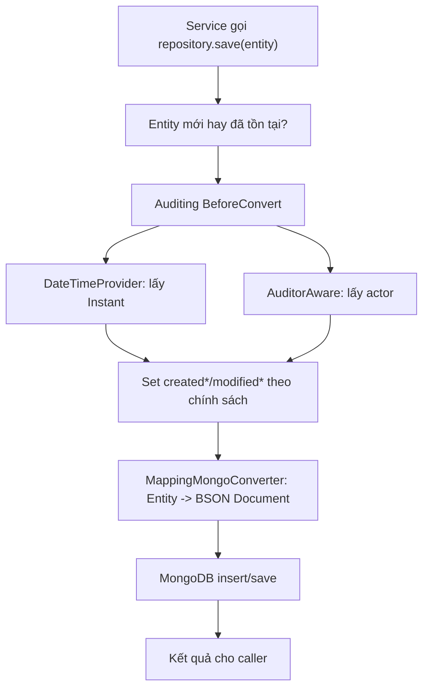
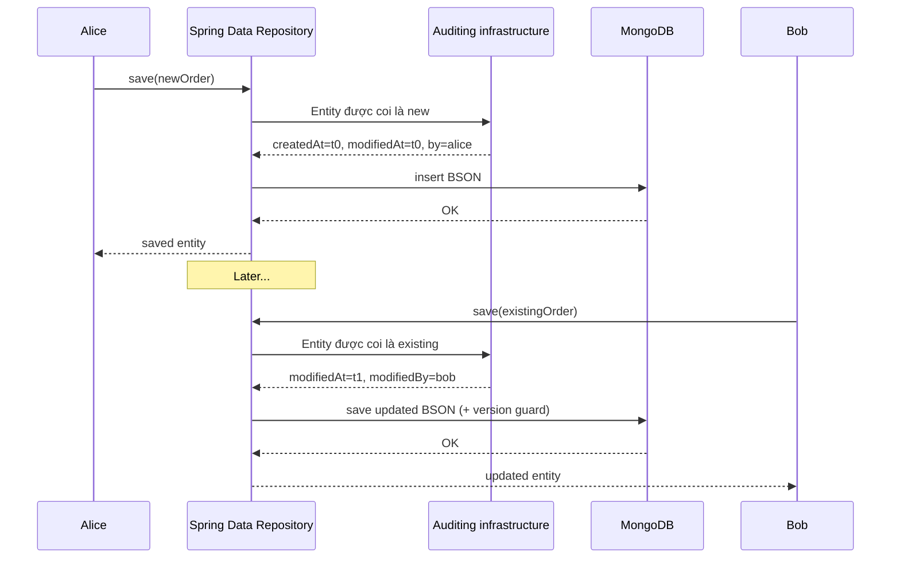

# @CreatedDate, @LastModifiedDate, @CreatedBy và @LastModifiedBy

Trong **Spring Data MongoDB**, *auditing* là cơ chế tự động điền metadata trả lời hai câu hỏi: **ai** đã tạo/sửa entity và **khi nào** việc tạo/sửa diễn ra. Thay vì mỗi service tự gán `createdAt`, `updatedAt`, `createdBy` và `updatedBy` trước khi gọi `save(...)`, ta có thể khai báo bốn annotation:

- `@CreatedDate`: thời điểm entity được tạo.
- `@LastModifiedDate`: thời điểm entity được thay đổi gần nhất qua đường persistence hỗ trợ.
- `@CreatedBy`: định danh actor đã tạo entity.
- `@LastModifiedBy`: định danh actor đã thay đổi entity gần nhất.

Điều quan trọng là auditing của Spring Data **không phải một trigger gắn trực tiếp vào MongoDB Server**. Nó hoạt động trong **đường ánh xạ/lưu entity của Spring Data**, cần được bật bằng cấu hình thích hợp, có nguồn xác định actor và thời gian, và có những giới hạn rõ ràng với partial updates, bulk operations, native driver hoặc ghi từ ứng dụng khác.

Bài thuộc chương **Auditing** của module **SPRING_DATA_MONGODB**: sử dụng Spring Data MongoDB kết nối và ánh xạ document, thao tác qua `MongoTemplate`/repository, thiết kế truy vấn, aggregation và index, transaction, reactive access, kiểm thử và chẩn đoán hiệu năng. Ở đây ta học cách cấu hình và kiểm chứng cả bốn annotation cho hệ thống có HTTP requests, background jobs và API reactive.

**Mục tiêu:** cấu hình đúng `@EnableMongoAuditing` hoặc `@EnableReactiveMongoAuditing`, triển khai `AuditorAware`/`ReactiveAuditorAware`, hiểu hành vi insert/update và giới hạn của metadata, rồi xác minh BSON thật bằng integration test.

## 1. Bốn annotation và ý nghĩa trong nghiệp vụ

| Annotation | Ý nghĩa | Kiểu Java thường dùng | Nguồn giá trị |
| --- | --- | --- | --- |
| `@CreatedDate` | Thời điểm entity được coi là **mới** và được lưu lần đầu | `Instant`, `Date`, các kiểu ngày/giờ được framework hỗ trợ | `DateTimeProvider` hoặc provider mặc định |
| `@LastModifiedDate` | Thời điểm gần nhất entity được lưu qua auditing path | `Instant` | `DateTimeProvider` |
| `@CreatedBy` | Actor tạo entity | `String`, mã user ổn định, hoặc kiểu domain phù hợp | `AuditorAware<T>` / `ReactiveAuditorAware<T>` |
| `@LastModifiedBy` | Actor sửa entity gần nhất | Cùng kiểu auditor với cấu hình | `AuditorAware<T>` / `ReactiveAuditorAware<T>` |

Ví dụ với đơn hàng:

```javascript
{
  _id: ObjectId("674000000000000000008001"),
  tenant_id: "T1",
  order_key: "ORD-2026-001",
  status: "PAID",
  created_at: ISODate("2026-11-20T02:00:00Z"),
  modified_at: ISODate("2026-11-20T02:15:00Z"),
  created_by: "user:alice",
  modified_by: "user:bob"
}
```

`created_by` và `modified_by` ở đây là **định danh ứng dụng đã xác minh**, không phải một tài khoản MongoDB database user mà driver tự cung cấp. Nếu user không đăng nhập, framework không thể tự biết ai là người thao tác, trừ khi bạn có chính sách actor cho system jobs/anonymous operations.

**Không nhầm auditing với full change history.** Bốn field cho biết **lần tạo** và **lần sửa gần nhất**, nhưng không ghi lại mọi phiên bản trước đó, ai đã sửa từng field hay giá trị trước/sau từng lần thay đổi.

## 2. Auditing diễn ra ở đâu trong lifecycle?

Spring Data MongoDB triển khai auditing qua **Entity Callback trước bước convert**, điển hình là `AuditingEntityCallback` trong đường lưu entity. Một timeline khái quát:



Trình tự chính:

1. `@EnableMongoAuditing` đăng ký auditing infrastructure.
2. Entity metadata chỉ ra những property được đánh dấu bốn annotation.
3. Framework quyết định entity **new** hay **existing**.
4. Lấy thời gian hiện tại và actor thích hợp.
5. Điền các property auditing trước khi converter ghi BSON.
6. MongoDB lưu document cùng auditing metadata trong cùng thao tác ghi entity.

Không có một lệnh mạng riêng cho từng annotation. Các field audit được đưa vào document thông thường. **Nhưng callback chạy trước ghi không chứng minh ghi đã commit**; nếu MongoDB từ chối lệnh hoặc transaction rollback, metadata có thể đã bị chỉnh trên object Java mà không có bản ghi tương ứng được commit.

## 3. Entity mẫu: OrderDocument với bốn field auditing

Ta dùng entity có khóa MongoDB `ObjectId`, mã tenant, mã đơn, trạng thái và version:

```java
import java.time.Instant;

import org.bson.types.ObjectId;
import org.springframework.data.annotation.CreatedBy;
import org.springframework.data.annotation.CreatedDate;
import org.springframework.data.annotation.Id;
import org.springframework.data.annotation.LastModifiedBy;
import org.springframework.data.annotation.LastModifiedDate;
import org.springframework.data.annotation.Version;
import org.springframework.data.mongodb.core.mapping.Document;
import org.springframework.data.mongodb.core.mapping.Field;

@Document(collection = "orders")
public class OrderDocument {

    @Id
    private ObjectId id;

    @Field("tenant_id")
    private String tenantId;

    @Field("order_key")
    private String orderKey;

    private String status;

    @Version
    private Long version;

    @CreatedDate
    @Field("created_at")
    private Instant createdAt;

    @LastModifiedDate
    @Field("modified_at")
    private Instant modifiedAt;

    @CreatedBy
    @Field("created_by")
    private String createdBy;

    @LastModifiedBy
    @Field("modified_by")
    private String modifiedBy;

    public OrderDocument() {}

    public OrderDocument(
            ObjectId id, String tenantId,
            String orderKey, String status) {
        this.id = id;
        this.tenantId = tenantId;
        this.orderKey = orderKey;
        this.status = status;
    }

    public ObjectId getId() { return id; }
    public String getTenantId() { return tenantId; }
    public String getOrderKey() { return orderKey; }
    public String getStatus() { return status; }
    public Long getVersion() { return version; }
    public Instant getCreatedAt() { return createdAt; }
    public Instant getModifiedAt() { return modifiedAt; }
    public String getCreatedBy() { return createdBy; }
    public String getModifiedBy() { return modifiedBy; }

    public void setStatus(String status) {
        this.status = status;
    }
}
```

Lưu ý:

- `@Field("created_at")` quyết định **tên BSON field**; `@CreatedDate` quyết định **cách gán metadata**. Đây là hai chức năng khác nhau.
- `Instant` thể hiện một thời điểm tuyệt đối; phù hợp hơn `LocalDateTime` khi dữ liệu đi qua nhiều múi giờ.
- `@Version Long` hỗ trợ optimistic locking và giúp phân biệt entity mới với entity đã tồn tại khi version `null`.
- Actor dùng `String`: ví dụ `"user:alice"`, `"service:payment-worker"`. Nếu dùng `@CreatedBy User` thì `AuditorAware<User>` và mapping của field phải tương thích; không tự suy rằng framework sẽ lấy principal và biến thành `User`.
- Các getter audit không có setter để giới hạn thao tác application; Spring Data vẫn có thể ghi field bằng mapping/access strategy thích hợp. Khi code dùng immutable domain, cần thiết kế constructor/withers đúng khả năng mapping của phiên bản đang dùng.

Nếu document cũ chưa có audit fields, việc thêm annotation **không tự backfill lịch sử** cho document đã nằm trong MongoDB.

## 4. Bật auditing ở đường đồng bộ

Spring Data MongoDB hỗ trợ `@EnableMongoAuditing` trên configuration class:

```java
import org.springframework.context.annotation.Configuration;
import org.springframework.data.mongodb.config.EnableMongoAuditing;

@Configuration
@EnableMongoAuditing(
    auditorAwareRef = "mongoUserAuditor",
    dateTimeProviderRef = "mongoAuditDateProvider",
    setDates = true,
    modifyOnCreate = true
)
public class MongoAuditingConfig {
}
```

Hai thuộc tính cần hiểu:

- `setDates=true`: bật điền các field `@CreatedDate`/`@LastModifiedDate`, là **mặc định**.
- `modifyOnCreate=true`: khi entity **mới** được tạo, framework cũng đánh dấu `LastModified*` theo chính sách auditing, là **mặc định**.

`auditorAwareRef` và `dateTimeProviderRef` trỏ tới **tên bean** chứ không phải class name. Các bean cụ thể được định nghĩa trong các mục tiếp theo. Trong Spring Data MongoDB, auditing có từ các phiên bản cũ (tài liệu nêu từ 1.4); nên đối chiếu API với Spring Data version đang chạy.

**Đừng mặc định Spring Boot tự bật auditing chỉ vì đã có `spring-boot-starter-data-mongodb`.** Để chắc chắn, khai báo annotation cấu hình và kiểm thử kết quả trong BSON.

## 5. AuditorAware<String>: lấy actor từ Spring Security

`@CreatedBy` và `@LastModifiedBy` cần một nguồn actor. Trên ứng dụng Spring MVC/imperative, có thể dùng `AuditorAware<String>`:

```java
import java.util.Optional;

import org.springframework.data.domain.AuditorAware;
import org.springframework.security.authentication.AnonymousAuthenticationToken;
import org.springframework.security.core.Authentication;
import org.springframework.security.core.context.SecurityContextHolder;
import org.springframework.stereotype.Component;

@Component("mongoUserAuditor")
public class SecurityMongoAuditorAware
        implements AuditorAware<String> {

    @Override
    public Optional<String> getCurrentAuditor() {

        Authentication authentication =
            SecurityContextHolder.getContext()
                .getAuthentication();

        if (authentication == null
                || !authentication.isAuthenticated()
                || authentication instanceof AnonymousAuthenticationToken) {
            return Optional.empty();
        }

        // Nên dùng ID ổn định, lấy từ principal đáng tin cậy.
        return Optional.of("user:" + authentication.getName());
    }
}
```

Spring Security chỉ là **một cách lấy nguồn actor**. Bạn có thể dùng user ID từ principal của tổ chức, service account hoặc một request context được quản lý đáng tin cậy.

Không lấy `createdBy`/`modifiedBy` trực tiếp từ body HTTP:

```json
{
  "orderKey": "ORD-2026-001",
  "status": "NEW",
  "createdBy": "admin"
}
```

Nếu client được phép tự chỉ định actor, họ có thể giả danh người khác. **Auditing field phải được suy ra từ security context hoặc một nguồn backend đã xác minh**, chứ không phải input người dùng.

### Vì sao Optional.empty() là tín hiệu hợp lệ?

Nếu không có authenticated principal, `getCurrentAuditor()` có thể trả `Optional.empty()`. Khi đó các field `@CreatedBy`/`@LastModifiedBy` **không được tự động cấp một actor tin cậy**.

Đối với nghiệp vụ buộc phải có actor, hãy thiết kế chính sách rõ: yêu cầu xác thực trước write, hoặc quy định actor system cho background worker. Không tự gán `"admin"` ở mọi anonymous request để tránh thiếu giá trị.

## 6. DateTimeProvider và Clock: kiểm soát thời gian audit

Theo mặc định, Spring Data có thể cung cấp thời gian auditing. Khi cần timestamp nhất quán qua test hoặc đồng bộ với clock policy, cung cấp `DateTimeProvider`:

```java
import java.time.Clock;
import java.time.Instant;
import java.time.temporal.TemporalAccessor;
import java.util.Optional;

import org.springframework.context.annotation.Bean;
import org.springframework.context.annotation.Configuration;
import org.springframework.data.auditing.DateTimeProvider;

@Configuration
public class MongoAuditTimeConfig {

    @Bean
    public Clock mongoAuditClock() {
        return Clock.systemUTC();
    }

    @Bean("mongoAuditDateProvider")
    public DateTimeProvider mongoAuditDateProvider(
            Clock mongoAuditClock) {
        return () -> Optional.<TemporalAccessor>of(
            Instant.now(mongoAuditClock)
        );
    }
}
```

`@EnableMongoAuditing(dateTimeProviderRef="mongoAuditDateProvider")` dùng provider này để cấp giá trị cho ngày tạo/ngày sửa.

Lợi ích:

- **Test xác định**: thay Clock bằng fake/test clock tại thời điểm mong muốn.
- **UTC**: không phụ thuộc timezone mặc định của JVM khi chọn `Instant`.
- **Một nguồn thời gian** cho created/modified audit.
- **Cấu hình rõ ràng** khi service chạy nhiều replicas.

**Lưu ý về tên bean:** ví dụ trên kết hợp với `MongoAuditingConfig` ở mục 4. Chỉ giữ một `@EnableMongoAuditing` cho mapping context cụ thể; tránh đăng ký nhiều auditing handlers cùng lúc.

## 7. Nếu chỉ cần timestamp, có bắt buộc AuditorAware không?

**Không.** Nếu entity chỉ có `@CreatedDate` và `@LastModifiedDate`, Spring Data không cần `AuditorAware` để điền hai giá trị thời gian.

Ví dụ cấu hình tối giản, **thay thế** cấu hình ở mục 4:

```java
@Configuration
@EnableMongoAuditing
class DateOnlyAuditingConfig {
}
```

Nếu sau đó entity bắt đầu dùng `@CreatedBy` và `@LastModifiedBy`, phải bổ sung nguồn actor nếu muốn các field này được điền. Đừng đăng ký đồng thời cả `DateOnlyAuditingConfig` và `MongoAuditingConfig` trong cùng application context: hai cấu hình minh họa **hai lựa chọn khác nhau**.

Ngược lại, khi chỉ cần actor mà không muốn auditing tự sinh timestamp, có thể dùng `setDates=false` ở annotation enable, nhưng phải quyết định nguồn thời gian khác và giải thích lý do thay đổi.

## 8. modifyOnCreate: dữ liệu nào có ngay sau insert?

Với `@EnableMongoAuditing(modifyOnCreate=true)` mặc định, một entity mới thường được gán:

```text
createdAt  = t0
modifiedAt = t0
createdBy  = "user:alice"
modifiedBy = "user:alice"
```

Nếu cấu hình:

```java
@Configuration
@EnableMongoAuditing(
    auditorAwareRef = "mongoUserAuditor",
    modifyOnCreate = false
)
class MongoAuditingNoModifyOnCreate {
}
```

thì auditing **không chủ động đặt last-modified metadata trong lần tạo**. Trạng thái có thể là:

```text
createdAt  = t0
modifiedAt = null  (nếu ban đầu chưa có)
createdBy  = "user:alice"
modifiedBy = null  (nếu ban đầu chưa có)
```

Tùy chọn này là **chính sách sản phẩm**:

- `modifyOnCreate=true`: “tạo mới” cũng là một hành động thay đổi, thuận tiện lọc theo modifiedAt.
- `modifyOnCreate=false`: “chưa từng sửa sau tạo” được biểu diễn bằng modifiedAt null.

**Không triển khai cả hai cấu hình cùng lúc.** Khi đã chọn, cần nhất quán cho tất cả replicas; thay đổi policy giữa deployments có thể khiến dữ liệu cũ/mới khác nhau.

## 9. Dòng thời gian của hai lần save

Giả sử repository đã được cấu hình auditing và actor ban đầu là `user:alice`.



Kỳ vọng sau hai lần lưu qua entity path:

| Field | Sau tạo (Alice) | Sau sửa (Bob) |
| --- | --- | --- |
| `createdAt` | `t0` | **Giữ `t0`** |
| `modifiedAt` | `t0` nếu modifyOnCreate=true | `t1` |
| `createdBy` | `user:alice` | **Giữ `user:alice`** |
| `modifiedBy` | `user:alice` nếu modifyOnCreate=true | `user:bob` |

Các giá trị được xác định bằng **chính sách auditing**. Nếu người gọi cố tình thay `createdAt`/`createdBy` trước khi save, annotation không tạo một cơ chế bất biến ở MongoDB: Spring Data có thể mang dữ liệu sai vào document. Không expose setters cho client và không mapping request trực tiếp thành toàn bộ entity audit.

## 10. Repository CRUD đúng cách: giữ audit fields ngoài DTO input

Repository:

```java
import org.bson.types.ObjectId;
import org.springframework.data.mongodb.repository.MongoRepository;

public interface OrderRepository
        extends MongoRepository<OrderDocument, ObjectId> {

    java.util.Optional<OrderDocument> findByIdAndTenantId(
        ObjectId id, String tenantId
    );
}
```

Service tạo đơn:

```java
import org.bson.types.ObjectId;
import org.springframework.stereotype.Service;

@Service
public class OrderService {
    private final OrderRepository repository;

    public OrderService(OrderRepository repository) {
        this.repository = repository;
    }

    public OrderDocument create(
            String authenticatedTenant, String orderKey) {

        if (orderKey == null || orderKey.isBlank()) {
            throw new IllegalArgumentException("orderKey is required");
        }

        OrderDocument newOrder = new OrderDocument(
            new ObjectId(), authenticatedTenant,
            orderKey.trim(), "NEW"
        );

        // Không truyền createdAt/createdBy từ request.
        return repository.save(newOrder);
    }

    public OrderDocument markPaid(
            ObjectId id, String authenticatedTenant) {
        OrderDocument order = repository
            .findByIdAndTenantId(id, authenticatedTenant)
            .orElseThrow(() ->
                new IllegalArgumentException("Not found")
            );

        order.setStatus("PAID");
        return repository.save(order);
    }
}
```

Ở hệ thống nhiều tenant, `authenticatedTenant` phải lấy từ authentication context backend, không từ header/JSON do client tùy ý gửi. Với `@Version`, cùng một entity bị save đồng thời có thể dẫn đến optimistic-lock failure; auditing **không thay thế** cơ chế concurrency control.

Khi dùng `MongoTemplate.insert(...)`/`save(entity)`, auditing có thể hoạt động trên entity mapping path tương tự. Nhưng phải chắc rằng bean `MongoTemplate` đang dùng hạ tầng Spring Data có auditing callback được đăng ký.

## 11. Khi nào entity được coi là "new"?

Auditing cần phân biệt `markCreated(...)` và `markModified(...)`. Spring Data thường xác định entity mới theo metadata:

- Nếu có `@Version` dạng **wrapper** như `Long`, version `null` thường biểu thị entity mới.
- Nếu không có version, `@Id` `null` thường biểu thị chưa lưu.
- Khi entity hiện thực `Persistable`, `isNew()` có thể quyết định trạng thái theo chính sách của entity.
- Những custom entity information/isNew strategies cần được kiểm thử.

Ví dụ dùng pre-assigned ID:

```java
OrderDocument order = new OrderDocument(
    new ObjectId(), "T1", "ORD-2026-002", "NEW"
);

// version ban đầu null -> newness được Spring Data nhận diện.
repository.save(order);
```

Nếu entity **không có @Version** nhưng đã gán `_id` thủ công, repository có thể coi nó là existing và đi nhánh khác; `@CreatedDate` có thể không được điền như bạn mong đợi, tùy strategy và API.

**Đừng tự fix bằng cách gán createdAt vào controller.** Cần xác định đúng entity newness và viết integration test. Với import/migration có IDs tồn tại trước, hãy làm rõ đây là **insert mới**, **upsert** hay **restore dữ liệu lịch sử** để không ghi đè audit cũ.

## 12. @Version và auditing bổ sung, không thay thế nhau

Trường `@Version` bảo vệ optimistic concurrency trên những đường save được hỗ trợ. Auditing trả lời ai/khi nào — hai vấn đề độc lập:

```text
T0: Alice đọc Order version=0, status=NEW.
T1: Bob   đọc Order version=0, status=NEW.

T2: Alice save(status=PAID) -> version=1,
    modifiedBy=alice, modifiedAt=t2.

T3: Bob save(status=CANCELLED, stale version=0)
    -> OptimisticLockingFailureException.
```

Ở T3, auditing callback có thể đã tính lại metadata trên Java object của Bob **trước khi ghi thất bại**; không có nghĩa MongoDB đã lưu modifiedBy=bob. Đọc BSON sau lỗi phải vẫn thấy metadata của lần ghi đã commit thành công.

Khi xử lý optimistic locking failure, service cần trả conflict hoặc đọc lại và áp dụng ý định trên dữ liệu mới; không retry mù cùng object stale. **Auditing không tự hợp nhất các thay đổi cạnh tranh.**

## 13. Instant, UTC và độ chính xác BSON Date

Trong Java, `Instant` có độ chính xác tới nanosecond. MongoDB **BSON Date** lưu **milli giây từ Unix epoch**.

```java
Instant created = Instant.parse(
    "2026-11-20T02:00:00.123456789Z"
);

// Sau khi round-trip qua BSON Date, precision có thể
// được chuẩn hóa về milliseconds.
Instant normalized =
    created.truncatedTo(java.time.temporal.ChronoUnit.MILLIS);
```

Những lưu ý:

- Dùng `Instant` thay cho `LocalDateTime` khi cần timestamp tuyệt đối qua các khu vực.
- Tài liệu/test nên phân biệt **giờ UTC**, cách hiển thị timezone UI và chính sách clock synchronization.
- Test có timestamp từ `Instant.now()` không nên so sánh bằng nanosecond equality sau round-trip MongoDB.
- Nhiều application replicas có clock skew; một `modifiedAt` lấy từ clock của instance A có thể sớm hơn clock instance B dù write B xảy ra sau theo thứ tự server.
- Nếu cần một thứ tự biến đổi **bất biến và tuần tự**, timestamps audit không đủ; dùng version, monotonic sequence, event log hoặc causal ordering theo nghiệp vụ.

`@CreatedDate`/**`@LastModifiedDate` không lấy “thời điểm commit” của MongoDB Server** mặc định. Chúng sử dụng `DateTimeProvider` trong application mapping lifecycle.

## 14. @CreatedBy nên chứa gì?

Có vài lựa chọn phổ biến:

| Nội dung field | Ưu điểm | Rủi ro/cân nhắc |
| --- | --- | --- |
| User ID ổn định như `user:8d3f` | Dễ đối soát, không thay khi username đổi | Cần lookup thông tin hiển thị sau |
| Username | Dễ đọc log | Có thể đổi tên, có thể lộ PII |
| Email | Dễ liên hệ | PII, thay đổi, có thể nhạy cảm |
| Full `User` entity | Truy cập thêm thông tin domain | Mapping phức tạp, dữ liệu stale, rò rỉ nested fields |
| System actor như `service:billing-worker` | Minh bạch với background job | Phải bảo đảm actor do backend xác nhận |
| `anonymous` chung | Ít công tích hợp | Không đủ audit cho nghiệp vụ yêu cầu accountability |

**Khuyến nghị:** lưu một **stable subject identifier** không nhạy cảm, gắn với principal backend đáng tin cậy; phần tên hiển thị được giải quyết ở presentation/authorization layer.

Nếu field có kiểu `String`, `AuditorAware<String>` trả về chuỗi phù hợp. Nếu field là `UserRef`, cần provider trả `UserRef` hoặc converter/mapper nhất quán. Không ép principal Java Object trực tiếp vào BSON document mà chưa thiết kế schema.

## 15. Background jobs, scheduled tasks và system actor

`SecurityContextHolder` thường được gắn với HTTP request thread. Một job chạy ở scheduler hoặc consumer có thể **không có authenticated principal**.

Ví dụ hệ thống có ba loại actor:

```text
HTTP user:
  user:alice

Kafka consumer:
  service:order-events-consumer

Scheduled reconciliation:
  service:nightly-reconcile
```

Không nên mặc định mọi job dùng `user:admin` chỉ để không có field rỗng. Có thể xây một abstraction `CurrentActorProvider` dùng:

1. Principal từ Spring Security khi là authenticated user.
2. Actor identity được worker lifecycle/backend cấp trong job context.
3. Nếu không có cả hai, fail fast ở những nghiệp vụ bắt buộc audit, hoặc ghi actor chuyên biệt `service:unknown` theo policy đã được duyệt.

**Cẩn trọng thread-local leakage:** `ThreadLocal` từ request A không được mang sang job B hoặc task async khác khi executor tái sử dụng thread. Nếu dùng context propagation, cần cơ chế chính thức và cleanup rõ ràng.

Với multi-tenant systems, auditor ID không thay thế `tenant_id`/authorization; không suy tenant từ giá trị `modifiedBy`.

## 16. Async, @Async và yêu cầu giữ principal

Một method có `@Async` có thể chạy trên thread pool khác nơi Spring Security context không tự động có mặt.

```java
@Async
public void enrichAndSaveOrder(ObjectId id) {
    // Nếu SecurityContextHolder không được propagate,
    // AuditorAware có thể trả Optional.empty().
}
```

Trong trường hợp này:

- Tránh nhận raw `Authentication` từ client.
- Dùng Spring Security context propagation/delegating executor phù hợp nếu thực sự cần user identity xuyên thread.
- Hoặc truyền **stable authenticated actor ID** dưới dạng context nghiệp vụ đã được backend xác minh, với scope rõ ràng.
- Khi code chạy ngoài HTTP request, dùng system actor đã đăng ký thay vì tin ThreadLocal rỗng.
- Kiểm thử actor identity sau khi async task hoàn tất; đừng chỉ assert entity được lưu.

**Không kết luận auditing có bug chỉ vì bốn annotation đúng nhưng `@CreatedBy` rỗng trong scheduler.** Lúc đó cần xem `AuditorAware` trả về gì ở thread thực thi save.

## 17. Reactive auditing: cấu hình không dùng ThreadLocal

Với `ReactiveMongoTemplate` hoặc `ReactiveMongoRepository`, dùng `@EnableReactiveMongoAuditing` và `ReactiveAuditorAware<T>`.

```java
import org.springframework.context.annotation.Configuration;
import org.springframework.data.mongodb.config.EnableReactiveMongoAuditing;

@Configuration
@EnableReactiveMongoAuditing(
    auditorAwareRef = "reactiveMongoUserAuditor",
    setDates = true,
    modifyOnCreate = true
)
public class ReactiveMongoAuditingConfig {
}
```

Đây là một **phương án riêng** cho reactive infrastructure. Nó không tự biến `MongoTemplate` đồng bộ thành reactive driver; nếu ứng dụng dùng cả hai đường persistence, cần cấu hình và test cả hai theo khả năng phiên bản Spring Data đang sử dụng.

Nguồn actor reactive nên dùng **Reactor Context/Spring Security reactive context**, không dựa vào `SecurityContextHolder` ThreadLocal của Servlet application.

## 18. ReactiveAuditorAware<String> với ReactiveSecurityContextHolder

```java
import org.springframework.data.domain.ReactiveAuditorAware;
import org.springframework.security.authentication.AnonymousAuthenticationToken;
import org.springframework.security.core.Authentication;
import org.springframework.security.core.context.ReactiveSecurityContextHolder;
import org.springframework.stereotype.Component;
import reactor.core.publisher.Mono;

@Component("reactiveMongoUserAuditor")
public class ReactiveSecurityMongoAuditorAware
        implements ReactiveAuditorAware<String> {

    @Override
    public Mono<String> getCurrentAuditor() {
        return ReactiveSecurityContextHolder.getContext()
            .flatMap(ctx ->
                Mono.justOrEmpty(ctx.getAuthentication())
            )
            .filter(auth ->
                auth.isAuthenticated()
                && !(auth instanceof AnonymousAuthenticationToken)
            )
            .map(auth -> "user:" + auth.getName());
    }
}
```

`Mono.empty()` biểu thị không tìm thấy authenticated auditor; nó không tự thay thế bằng `"anonymous"`. Spring Data reactive auditing có thể dùng Publisher trả về để điền audit metadata khi một entity được lưu.

**Không gọi `block()` bên trong `getCurrentAuditor()`.** Nếu block trên Netty event-loop, Reactor có thể ném lỗi blocking hoặc giảm throughput. Cũng không `subscribe()` thủ công rồi hy vọng audit field sẽ được cập nhật sau: framework cần nhận Publisher như một phần của cùng pipeline.

## 19. Reactive flow: subscribe một lần ở ranh giới WebFlux

Repository reactive:

```java
import org.bson.types.ObjectId;
import org.springframework.data.mongodb.repository.ReactiveMongoRepository;
import reactor.core.publisher.Mono;

public interface ReactiveOrderRepository
        extends ReactiveMongoRepository<OrderDocument, ObjectId> {

    Mono<OrderDocument> findByIdAndTenantId(
        ObjectId id, String tenantId
    );
}
```

Service:

```java
public Mono<OrderDocument> createReactive(
        String authorizedTenant, String orderKey) {

    return Mono.defer(() -> {
        OrderDocument order = new OrderDocument(
            new ObjectId(), authorizedTenant,
            orderKey, "NEW"
        );
        return reactiveOrderRepository.save(order);
    });
}
```

WebFlux controller phải **return Mono** để framework quản lý subscription:

```java
@PostMapping("/orders")
public Mono<OrderResponse> create(@RequestBody CreateOrderRequest body) {
    return service.createReactive(
        authenticatedTenantId(), body.orderKey()
    ).map(OrderResponse::fromEntity);
}
```

Hai class `CreateOrderRequest` và `OrderResponse` là DTO minh họa, còn `authenticatedTenantId()` phải được triển khai theo security context có thật. Nếu tenant lookup là reactive, compose `Mono` với `flatMap` thay vì đọc ThreadLocal.

**Không làm:** `reactiveRepository.save(order).subscribe(); return Mono.just(response);`. Cách đó có thể trả HTTP 200 trước khi MongoDB ghi và auditing hoàn tất, đồng thời làm mất security/transaction context.

## 20. Kiểm thử Reactor Context có auditor đúng

Trong unit test, có thể xác minh `ReactiveAuditorAware` bằng Spring Security context:

```java
import static org.assertj.core.api.Assertions.assertThat;

import java.util.List;
import org.junit.jupiter.api.Test;
import org.springframework.security.authentication.UsernamePasswordAuthenticationToken;
import org.springframework.security.core.authority.SimpleGrantedAuthority;
import org.springframework.security.core.context.ReactiveSecurityContextHolder;
import reactor.test.StepVerifier;

class ReactiveAuditorAwareTest {

    @Test
    void resolvesActorFromReactiveSecurityContext() {
        var authentication = new UsernamePasswordAuthenticationToken(
            "alice",
            "not-a-real-credential",
            List.of(new SimpleGrantedAuthority("ROLE_USER"))
        );

        var provider = new ReactiveSecurityMongoAuditorAware();

        StepVerifier.create(
            provider.getCurrentAuditor()
                .contextWrite(
                    ReactiveSecurityContextHolder
                        .withAuthentication(authentication)
                )
        )
            .assertNext(actor ->
                assertThat(actor).isEqualTo("user:alice")
            )
            .verifyComplete();
    }
}
```

Đây là **unit test cho provider**, chưa chứng minh MongoDB thực sự lưu field `created_by`. Integration test ở các mục sau cần kiểm tra entity được save qua `ReactiveMongoRepository`/`ReactiveMongoTemplate` với cùng Reactor Context.

Thử thêm một test không có authentication, kỳ vọng `Mono.empty()`; một test có anonymous token, kỳ vọng actor không phải người dùng đã xác thực.

## 21. Auditing và đường ghi không phải save entity

Các annotation không phải bộ lọc DB toàn cục. So sánh:

| Đường thao tác | Auditing auto theo entity save? | Cần chú ý |
| --- | --- | --- |
| `MongoRepository.save(entity)` | **Có**, nếu cấu hình và callback đúng | Created vs modified phụ thuộc `isNew` |
| `MongoTemplate.insert(entity)` | **Có** qua entity mapping path | Kiểm tra exception và transaction |
| `MongoTemplate.save(entity)` | **Có** | `@Version` và metadata trước convert |
| `ReactiveMongoRepository.save(entity)` | **Có** khi reactive auditing được bật | Phải subscribe đúng Reactor Context |
| `MongoTemplate.updateFirst(...)` | **Không tự điền bốn audit fields như save(entity)** | Phải thêm `modifiedAt/modifiedBy` vào update |
| `MongoTemplate.updateMulti(...)` | **Không theo entity save auditing** | Mỗi matched document có thể cần updated metadata |
| `MongoTemplate.findAndModify(...)` | **Không tự chạy save callback như entity save** | Thiết kế `Update` tường minh |
| `BulkOperations` | **Không dựa vào lifecycle callbacks của từng save** | Import/bulk cần chủ động audit policy |
| Native `MongoCollection.updateOne/replaceOne/insertOne` | **Không** đi qua Spring auditing | Raw BSON/driver không đọc annotations |
| `$merge`/`$out` trong aggregation | **Không** tự áp Spring entity auditing | Data migration/output riêng |
| Admin shell/database migration | **Không** | Ghi metadata có chủ đích khi cần |

Một `@LastModifiedDate` trên entity **không đảm bảo** mọi lệnh cập nhật document đều thay `modified_at`. Tổ chức phải kiểm kê các writers khác nhau: HTTP services, consumers, ETL, batch, native driver, external systems.

## 22. Partial update: chủ động đặt modifiedAt và modifiedBy

Nếu muốn một atomic update mà không phải đọc rồi `save` cả entity:

```java
import java.time.Clock;
import java.time.Instant;

import com.mongodb.client.result.UpdateResult;
import org.bson.types.ObjectId;
import org.springframework.data.mongodb.core.MongoOperations;
import org.springframework.data.mongodb.core.query.Criteria;
import org.springframework.data.mongodb.core.query.Query;
import org.springframework.data.mongodb.core.query.Update;

public UpdateResult markPaid(
        MongoOperations operations,
        Clock clock, ObjectId id,
        String tenantId, String trustedActorId) {

    Query filter = Query.query(
        Criteria.where("id").is(id)
            .and("tenantId").is(tenantId)
            .and("status").is("NEW")
    );

    Update update = new Update()
        .set("status", "PAID")
        .set("modifiedAt", Instant.now(clock))
        .set("modifiedBy", trustedActorId);

    return operations.updateFirst(
        filter, update, OrderDocument.class
    );
}
```

Với `OrderDocument.class`, field Java `modifiedAt`/`modifiedBy` được Spring Data map sang BSON `modified_at`/`modified_by`.

Vì `updateFirst` không đi qua AuditingEntityCallback như `save(entity)`, ba `set` trên **có chủ đích**. `matchedCount=0` có thể là không tìm thấy, tenant không khớp hoặc status đã thay; caller cần xử lý theo nghiệp vụ.

**Cảnh báo về version:** Spring Data có thể tự increment `@Version` trong một số template update APIs nếu Update chưa nêu version. Nhưng **tự tăng version không có nghĩa tự điền modifiedBy/modifiedAt**, cũng không có nghĩa đang CAS theo expected version của client. Nếu cần optimistic precondition, thêm version vào filter và tăng version đúng một lần trong cùng update.

## 23. Server time vs application time khi update

Nếu muốn dùng thời gian server cho partial update (MongoDB update operator):

```javascript
db.orders.updateOne(
  {
    _id: ObjectId("674000000000000000008001"),
    tenant_id: "T1",
    status: "NEW"
  },
  {
    $set: {
      status: "PAID",
      modified_by: "service:payment-worker"
    },
    $currentDate: {
      modified_at: true
    }
  }
);
```

`$currentDate` sử dụng thời gian từ MongoDB Server cho update. Nó khác với `@LastModifiedDate` lấy thời gian từ `DateTimeProvider` trong JVM.

Một hệ thống có cả hai đường cập nhật có thể mang timestamp từ hai nguồn khác nhau; cần xác định chính sách rõ và đồng bộ clocks. Không trộn tùy tiện giữa server time và application time rồi xem mọi `modifiedAt` là thứ tự tuần tự tuyệt đối.

Trong Java Spring Data, `new Update().currentDate("modifiedAt")` có thể sinh `$currentDate` tương ứng theo typed mapping; hãy kiểm tra API/version và BSON kết quả của phiên bản đang dùng.

## 24. Partial upsert: đừng tự nghĩ CreatedDate sẽ được điền

Một upsert qua `updateFirst(..., upsert=true)` hoặc `MongoTemplate.upsert(...)` là **update command**, không giống entity `save` có AuditingEntityCallback tự xét newness.

Ví dụ mongosh có ý định set created metadata chỉ khi insert:

```javascript
db.orders.updateOne(
  { tenant_id: "T1", order_key: "ORD-2026-003" },
  {
    $set: {
      status: "NEW",
      modified_by: "service:order-worker"
    },
    $currentDate: {
      modified_at: true
    },
    $setOnInsert: {
      tenant_id: "T1",
      order_key: "ORD-2026-003",
      created_by: "service:order-worker"
    }
  },
  { upsert: true }
);
```

Ví dụ chưa tự điền `created_at`: nếu muốn timestamp tạo **chính xác khi insert** theo cùng nguồn thời gian, cần thiết kế update/upsert pipeline hoặc dùng một timestamp từ application, `$setOnInsert`, hoặc luồng insert entity cụ thể.

`$setOnInsert` áp dụng trong nhánh insert của upsert, nhưng không tự biết actor hay logic auditing của Spring. Không đặt `created_at` trong `$set` nếu muốn tránh ghi đè thời điểm tạo ở mỗi upsert.

## 25. Tại sao không ghi audit metadata ở AfterSaveCallback?

Trong Spring Data MongoDB, `AuditingEntityCallback` chuẩn bị field trước convert để đưa vào BSON khi save.

Một callback chạy **sau save** thì quá muộn nếu mục tiêu là cập nhật DB trong chính lệnh save:

```java
// SAI nếu nghĩ modifiedAt sẽ được tự persist.
class WrongAfterSave implements
        org.springframework.data.mongodb.core.mapping.event
            .AfterSaveCallback<OrderDocument> {

    @Override
    public OrderDocument onAfterSave(
            OrderDocument entity,
            org.bson.Document document,
            String collection) {

        // Lệnh save đã xảy ra; chỉ sửa object Java.
        return entity;
    }
}
```

Nếu cần giá trị audit tùy chỉnh trên đường lưu, dùng `AuditorAware`, `DateTimeProvider` hoặc một `BeforeConvertCallback` có chính sách rõ. Không gọi lại `save(...)` trong after-save để “ghi thêm audit”: dễ tạo callback recursion, lost update hoặc side effects ngoài ý định.

Đặc biệt, `AfterSaveCallback` **không tương đương after transaction commit**. Nếu service rollback sau `save`, callback đã chạy nhưng MongoDB write trong transaction có thể không được commit.

## 26. Auditing và MongoDB transaction

Giả sử service tạo đơn rồi ghi receipt trong cùng transaction:

```java
import org.springframework.stereotype.Service;
import org.springframework.transaction.annotation.Transactional;

@Service
public class OrderTransactionService {
    private final OrderRepository orders;
    private final ReceiptRepository receipts;

    public OrderTransactionService(
            OrderRepository orders, ReceiptRepository receipts) {
        this.orders = orders;
        this.receipts = receipts;
    }

    @Transactional(transactionManager = "mongoTransactionManager")
    public OrderDocument createOrderAndReceipt(
            OrderDocument order, Receipt receipt) {

        OrderDocument saved = orders.save(order);
        receipts.save(receipt);

        return saved;
    }
}
```

`Receipt` và `ReceiptRepository` ở đây là **dependency domain minh họa** cần được định nghĩa và phải sử dụng cùng MongoDB infrastructure.

Trong transaction:

- Auditing gán fields **trước lệnh save**.
- Nếu transaction rollback, audit metadata đã nằm trong **Java object** nhưng các writes MongoDB thuộc transaction không commit.
- Khi transaction commit thành công, các field audit được lưu cùng document.
- Nếu có commit timeout/unknown commit result, `createdAt` trên object **không chứng minh** dữ liệu đã commit; cần idempotency key/receipt và reconciliation.
- Actor và timestamp không được dùng thay transaction manager hoặc write concern.

Với sync code cần `MongoTransactionManager` và MongoDB replica set/sharded cluster hỗ trợ; với reactive code cần `ReactiveMongoTransactionManager` và Reactor Context đúng.

## 27. Auditing không thay thế lịch sử thay đổi (change log)

Bốn annotation chỉ giữ **metadata hiện tại**, không phải immutable event history.

Giả sử một đơn đã trải qua:

```text
09:00 Alice tạo NEW
09:10 Bob đổi PAID
09:20 Carol đổi SHIPPED
```

Document cuối chỉ có thể hiện:

```javascript
{
  status: "SHIPPED",
  created_by: "user:alice",
  created_at: ISODate("2026-11-20T02:00:00Z"),
  modified_by: "user:carol",
  modified_at: ISODate("2026-11-20T02:20:00Z")
}
```

Thông tin “Bob đổi từ NEW sang PAID lúc 09:10” **không còn ở bốn field**.

Nếu nghiệp vụ yêu cầu lịch sử pháp lý hoặc đối soát, có thể dùng:

- Collection `order_audit_events` với immutable records mô tả actor, event, before/after hoặc diff.
- Transactional outbox ghi cùng transaction với business document.
- MongoDB Change Streams hoặc CDC pipeline, với consumer idempotency và retention phù hợp.
- Một hệ thống event sourcing khi domain thực sự cần đầy đủ events.

**Không gọi `@LastModifiedBy` là audit log đầy đủ.** Nó là **last editor metadata**. Không dùng các field này để chứng minh mọi hành động đã được ghi nhận bất biến.

## 28. Embedded AuditMetadata: nhóm bốn field trong value object

Spring Data Commons hỗ trợ auditing annotations trong một đối tượng metadata nhúng theo khả năng mapping store; với MongoDB có thể dùng value object:

```java
import java.time.Instant;
import org.springframework.data.annotation.CreatedBy;
import org.springframework.data.annotation.CreatedDate;
import org.springframework.data.annotation.LastModifiedBy;
import org.springframework.data.annotation.LastModifiedDate;

public class AuditMetadata {

    @CreatedDate
    private Instant createdAt;

    @LastModifiedDate
    private Instant modifiedAt;

    @CreatedBy
    private String createdBy;

    @LastModifiedBy
    private String modifiedBy;

    public Instant getCreatedAt() { return createdAt; }
    public Instant getModifiedAt() { return modifiedAt; }
    public String getCreatedBy() { return createdBy; }
    public String getModifiedBy() { return modifiedBy; }
}
```

Entity:

```java
@Document("orders_embedded_audit")
public class EmbeddedAuditOrder {
    @Id
    private ObjectId id;

    private String orderKey;

    private AuditMetadata audit = new AuditMetadata();

    // Constructors/getters theo mapping conventions...
}
```

Kết quả BSON có thể có dạng:

```javascript
{
  _id: ObjectId("674000000000000000008003"),
  orderKey: "ORD-2026-004",
  audit: {
    createdAt: ISODate("2026-11-20T02:00:00Z"),
    modifiedAt: ISODate("2026-11-20T02:00:00Z"),
    createdBy: "user:alice",
    modifiedBy: "user:alice"
  }
}
```

Cách này giảm lặp field trong domain model nhưng cần **verify thực tế**: constructor mapping, null audit object, property access, converter và Spring Data version có thể ảnh hưởng cách auditing đi sâu vào nested metadata.

Nếu `audit == null` ở một document cũ, phải có chiến lược khởi tạo/repair; đừng giả định auditing tự tạo mọi object trung gian.

## 29. Auditable interface so với annotations

Spring Data Commons còn hỗ trợ interface `Auditable<U, ID, T>`/`AbstractAuditable` (chi tiết generic tùy version) để domain cung cấp getters/setters cho auditing metadata.

| Kiểu khai báo | Ưu điểm | Nhược điểm |
| --- | --- | --- |
| Bốn annotations trên fields | Ít phụ thuộc vào API Spring Data trong domain behavior, linh hoạt | Phải khai báo bốn property và getters nếu cần |
| `Auditable` interface | Contract truy cập metadata nhất quán | Domain class gắn với Spring Data interface |
| Embedded `AuditMetadata` có annotations | Tái sử dụng, nhóm field rõ | Phải đảm bảo mapping/access/nested traversal |

Thông thường, **bốn annotations trực tiếp trên entity** là lựa chọn dễ học, dễ đọc và dễ kiểm thử. Khi có một thư viện domain chung hoặc nhiều entity cần thống nhất metadata, mới cân nhắc cách nhúng hoặc interface.

## 30. Multi-tenant auditing và trách nhiệm phân quyền

Hệ thống đa tenant nên lưu:

```text
tenant_id   = "T1"
created_by  = "user:alice"
modified_by = "service:order-worker"
```

Mỗi field trả lời một câu hỏi:

- `tenant_id`: document thuộc phạm vi tenant nào.
- `created_by`: actor đã tạo.
- `modified_by`: actor sửa gần nhất.

Một actor có thể thao tác nhiều tenant (admin/support), nhưng **không có nghĩa mọi truy vấn của actor tự được phép đọc tất cả tenant**. Luôn scope query bằng tenant từ authentication/authorization context:

```java
repository.findByIdAndTenantId(
    orderId, authenticatedTenantId
);
```

Đừng lấy tenant từ `createdBy` hoặc `modifiedBy`. Và không đưa token/secret/PII nhạy cảm vào audit actor ID để tránh lộ qua logs/exports.

## 31. Bảo vệ createdAt/createdBy khỏi sửa tùy ý

Những phương án thiết kế hữu ích:

1. Không cho client gửi `createdAt`/`createdBy` trong DTO input.
2. Entity không có public setters cho created fields.
3. Services chỉ thay field nghiệp vụ hoặc modified fields theo policy.
4. Migration tạo dữ liệu cũ phải có quyền riêng và log nguồn gốc.
5. DB schema validation có thể bắt buộc **kiểu** audit fields nếu phù hợp, nhưng không tự đảm bảo createdAt là bất biến qua mọi update.
6. Để bảo vệ bất biến ở mọi đường ghi, dùng một schema/versioned workflow hoặc quy tắc cập nhật có kiểm soát; MongoDB document không ngăn raw driver tự `$set` created_at nếu có quyền ghi.

**Annotation audit không phải một ràng buộc bảo mật trên server**. Bất kỳ client có quyền ghi phù hợp vẫn có thể thay field raw, trừ khi có các chính sách database/application bổ sung.

## 32. Index cho audit queries: chỉ tạo khi có workload thật

Nếu backoffice thường hỏi “các đơn của tenant T1 được sửa bởi Bob trong tuần qua”, có thể cân nhắc:

```javascript
db.orders.createIndex(
  {
    tenant_id: 1,
    modified_by: 1,
    modified_at: -1
  },
  {
    name: "ix_orders_tenant_modifier_time"
  }
);
```

Query:

```javascript
db.orders.find({
  tenant_id: "T1",
  modified_by: "user:bob",
  modified_at: { $gte: ISODate("2026-11-13T00:00:00Z") }
}).sort({ modified_at: -1 }).limit(50);
```

Không có nghĩa cứ thêm bốn annotation là phải index cả bốn fields. Index tăng chi phí write/storage; chọn theo **filter/sort/selectivity** và xác minh `explain("executionStats")`.

Thời gian audit không tự làm query có consistency mạnh hơn: `readPreference`/`readConcern`, lag trên secondary và write concern vẫn ảnh hưởng dữ liệu quan sát.

## 33. Kiểm thử đồng bộ: audit provider điều khiển được

Để test không phụ thuộc đồng hồ máy chạy CI hoặc HTTP authentication thật, tạo test config với actor/time có thể điều khiển. Ví dụ dành cho Spring Boot test trên MongoDB cô lập:

```java
import java.time.Instant;
import java.time.temporal.TemporalAccessor;
import java.util.Optional;

import org.springframework.boot.test.context.TestConfiguration;
import org.springframework.context.annotation.Bean;
import org.springframework.data.auditing.DateTimeProvider;
import org.springframework.data.domain.AuditorAware;
import org.springframework.data.mongodb.config.EnableMongoAuditing;

final class TestAuditState {
    private String actor = "user:alice";
    private Instant now = Instant.parse(
        "2026-11-20T02:00:00Z"
    );

    String actor() { return actor; }
    Instant now() { return now; }

    void setActor(String value) { actor = value; }
    void setNow(Instant value) { now = value; }
}

@TestConfiguration
@EnableMongoAuditing(
    auditorAwareRef = "testMongoAuditor",
    dateTimeProviderRef = "testMongoDateProvider",
    modifyOnCreate = true
)
public class TestAuditConfiguration {

    @Bean
    TestAuditState testAuditState() {
        return new TestAuditState();
    }

    @Bean("testMongoAuditor")
    AuditorAware<String> testMongoAuditor(TestAuditState state) {
        return () -> Optional.of(state.actor());
    }

    @Bean("testMongoDateProvider")
    DateTimeProvider testMongoDateProvider(TestAuditState state) {
        return () -> Optional.<TemporalAccessor>of(state.now());
    }
}
```

**Đây là test config thay thế production config**, không nên load đồng thời với production `@EnableMongoAuditing` hoặc production auditor provider.

Trong thực hành có thể tách `TestAuditState`, `TestAuditConfiguration` và test class thành file Java tương ứng, tùy project conventions. Không dùng shared mutable test state nếu các test song song dùng chung Spring context; có thể đặt `@DirtiesContext` hoặc cung cấp state riêng theo test fixture.

## 34. Integration test: lần insert có đủ bốn field

```java
import static org.assertj.core.api.Assertions.assertThat;

import java.time.Instant;
import org.bson.types.ObjectId;
import org.junit.jupiter.api.Test;
import org.springframework.beans.factory.annotation.Autowired;
import org.springframework.boot.test.autoconfigure.data.mongo.DataMongoTest;
import org.springframework.context.annotation.Import;

@DataMongoTest
@Import(TestAuditConfiguration.class)
class OrderAuditingIntegrationTest {

    @Autowired OrderRepository repository;
    @Autowired TestAuditState audit;

    @Test
    void firstSaveSetsCreationAndModificationMetadata() {
        ObjectId id = new ObjectId();
        Instant t0 = Instant.parse("2026-11-20T02:00:00Z");

        audit.setActor("user:alice");
        audit.setNow(t0);

        OrderDocument created = repository.save(
            new OrderDocument(
                id, "test-T1", "ORD-101", "NEW"
            )
        );

        assertThat(created.getCreatedAt()).isEqualTo(t0);
        assertThat(created.getModifiedAt()).isEqualTo(t0);
        assertThat(created.getCreatedBy())
            .isEqualTo("user:alice");
        assertThat(created.getModifiedBy())
            .isEqualTo("user:alice");

        OrderDocument loaded = repository.findById(id)
            .orElseThrow();

        assertThat(loaded.getCreatedAt()).isEqualTo(t0);
        assertThat(loaded.getModifiedAt()).isEqualTo(t0);
        assertThat(loaded.getCreatedBy())
            .isEqualTo("user:alice");
        assertThat(loaded.getModifiedBy())
            .isEqualTo("user:alice");
    }
}
```

Test dùng `@DataMongoTest` thuộc dòng Spring Boot có annotation package tương ứng và database riêng; không chạy trên production. `TestAuditConfiguration` cung cấp controlled clock/auditor, `OrderRepository` và `OrderDocument` phải nằm trong package được test scanning nhận diện.

Nếu không dùng `@Version` và gán ID thủ công, kết quả newness có thể khác; entity mẫu trong bài có `@Version Long` null trước insert. Vì thời gian thử có độ chính xác milliseconds, test tránh sai khác precision BSON Date.

## 35. Integration test: sửa bởi actor khác phải giữ created metadata

Trong cùng test context như mục trước, có thể thêm method:

```java
@Test
void secondSaveUpdatesOnlyLastModifiedMetadata() {
    ObjectId id = new ObjectId();
    Instant t0 = Instant.parse("2026-11-20T02:00:00Z");
    Instant t1 = Instant.parse("2026-11-20T02:15:00Z");

    audit.setActor("user:alice");
    audit.setNow(t0);

    OrderDocument created = repository.save(
        new OrderDocument(
            id, "test-T1", "ORD-202", "NEW"
        )
    );

    Instant originalCreatedAt = created.getCreatedAt();
    String originalCreatedBy = created.getCreatedBy();

    audit.setActor("user:bob");
    audit.setNow(t1);

    created.setStatus("PAID");
    repository.save(created);

    OrderDocument reloaded =
        repository.findById(id).orElseThrow();

    assertThat(reloaded.getCreatedAt())
        .isEqualTo(originalCreatedAt);
    assertThat(reloaded.getCreatedBy())
        .isEqualTo(originalCreatedBy);

    assertThat(reloaded.getModifiedAt()).isEqualTo(t1);
    assertThat(reloaded.getModifiedBy()).isEqualTo("user:bob");
    assertThat(reloaded.getStatus()).isEqualTo("PAID");
}
```

Đây là **method bổ sung của `OrderAuditingIntegrationTest`**, không phải Java file độc lập. Đảm bảo `audit` field và `repository` được inject như trong test trước.

Những phép assert này chứng minh **đường repository.save** cập nhật last-modified metadata. Muốn khẳng định MongoDB lưu đúng BSON names, nên đọc raw `Document`:

```java
Document bson = mongoTemplate.getCollection("orders")
    .find(new Document("_id", id)).first();

assertThat(bson).isNotNull();
assertThat(bson.getString("created_by"))
    .isEqualTo("user:alice");
assertThat(bson.getString("modified_by"))
    .isEqualTo("user:bob");
assertThat(bson.containsKey("created_at")).isTrue();
assertThat(bson.containsKey("modified_at")).isTrue();
```

Đoạn readback bổ sung cần inject `MongoTemplate mongoTemplate` và import `org.bson.Document`. Khi có fields `@Field` hoặc converters tùy chỉnh, kiểm chứng raw BSON là quan trọng hơn chỉ nhìn entity Java.

## 36. Test modifyOnCreate=false và setDates=false

Hai cấu hình này dễ bị hiểu sai nếu chỉ đọc annotation name. Nên viết **test context riêng**:

### Trường hợp modifyOnCreate=false

```java
@Configuration
@EnableMongoAuditing(
    auditorAwareRef = "testMongoAuditor",
    dateTimeProviderRef = "testMongoDateProvider",
    modifyOnCreate = false
)
class OnlyCreationOnFirstInsertConfig {}
```

Sau insert một entity mới chưa có audit metadata:

```text
createdAt != null
createdBy != null
modifiedAt == null
modifiedBy == null
```

Sau update bằng `save(entity)`, modified fields được populate.

### Trường hợp setDates=false

```java
@Configuration
@EnableMongoAuditing(
    auditorAwareRef = "testMongoAuditor",
    setDates = false
)
class ActorOnlyAuditConfig {}
```

Khi đó auditing không tự gán timestamp; actor fields vẫn có thể được gán nếu auditor provider hợp lệ.

**Mỗi cấu hình trên phải được test trong ApplicationContext riêng.** Không kết hợp ba `@EnableMongoAuditing` classes cùng một context rồi dự đoán cái nào thắng.

## 37. Integration test: updateFirst không tự đổi modified fields

Ví dụ xác minh một đường partial update:

```java
import java.time.Instant;
import com.mongodb.client.result.UpdateResult;
import org.springframework.data.mongodb.core.query.Criteria;
import org.springframework.data.mongodb.core.query.Query;
import org.springframework.data.mongodb.core.query.Update;

// Setup: repository.save() đã tạo OrderDocument vào MongoDB
// với modifiedAt=t0 và modifiedBy="user:alice".
Instant beforeModifiedAt = saved.getModifiedAt();
String beforeModifiedBy = saved.getModifiedBy();

UpdateResult changed = mongoTemplate.updateFirst(
    Query.query(Criteria.where("id").is(saved.getId())),
    new Update().set("status", "PAID"),
    OrderDocument.class
);

assertThat(changed.getMatchedCount()).isEqualTo(1L);

OrderDocument after =
    repository.findById(saved.getId()).orElseThrow();

assertThat(after.getModifiedAt())
    .isEqualTo(beforeModifiedAt);
assertThat(after.getModifiedBy())
    .isEqualTo(beforeModifiedBy);
```

**Đây là đoạn trong integration test**, cần các biến `saved`, `mongoTemplate`, `repository` và imports/fixture thực. Để rõ ràng, không đặt `modifiedAt`/`modifiedBy` vào `Update`. Sau `updateFirst`, `@Version` có thể được tự tăng theo Spring Data template update semantics; test không khẳng định version giữ nguyên.

Test này chứng minh tại sao phải thiết kế **một chính sách audit cho mọi write path**. Nếu nghiệp vụ có updateFirst, service nên thêm `set("modifiedAt",now)` và `set("modifiedBy",actor)` như mục 22, hoặc định nghĩa một shared update builder.

## 38. Test native driver: annotations không chạy ngoài Spring Data

```java
var collection = mongoTemplate.getCollection("orders");

collection.updateOne(
    new Document("_id", id),
    new Document("$set",
        new Document("status", "CANCELLED"))
);
```

Đây là MongoDB Java Sync Driver API trực tiếp; nó **không đọc** `@LastModifiedDate`/`@LastModifiedBy` trên entity. Nếu cần metadata trong native update:

```java
collection.updateOne(
    new Document("_id", id),
    new Document("$set",
        new Document("status", "CANCELLED")
            .append("modified_by", "service:migration")
            .append("modified_at", java.util.Date.from(
                Instant.parse("2026-11-20T02:30:00Z")
            ))
    )
);
```

**Không dùng ví dụ native này để bỏ qua tenant authorization trong production.** Filter thực tế nên bao gồm `tenant_id` và condition phù hợp, và mọi migration phải được phân quyền/hạn chế riêng.

## 39. Test reactive auditing với StepVerifier và MongoDB thật

Ví dụ cấu trúc test (cần application context có `ReactiveMongoAuditingConfig`, `ReactiveSecurityMongoAuditorAware` và reactive MongoDB repository):

```java
import static org.assertj.core.api.Assertions.assertThat;

import java.util.List;
import org.bson.types.ObjectId;
import org.junit.jupiter.api.Test;
import org.springframework.beans.factory.annotation.Autowired;
import org.springframework.boot.test.context.SpringBootTest;
import org.springframework.security.authentication.UsernamePasswordAuthenticationToken;
import org.springframework.security.core.authority.SimpleGrantedAuthority;
import org.springframework.security.core.context.ReactiveSecurityContextHolder;
import reactor.test.StepVerifier;

@SpringBootTest
class ReactiveOrderAuditingIntegrationTest {

    @Autowired ReactiveOrderRepository repository;

    @Test
    void createUsesAuditorFromReactorContext() {
        var authentication = new UsernamePasswordAuthenticationToken(
            "alice", "not-a-real-credential",
            List.of(new SimpleGrantedAuthority("ROLE_USER"))
        );

        OrderDocument order = new OrderDocument(
            new ObjectId(), "test-T1",
            "ORD-REACTIVE-101", "NEW"
        );

        StepVerifier.create(
            repository.save(order)
                .contextWrite(
                    ReactiveSecurityContextHolder
                        .withAuthentication(authentication)
                )
        )
            .assertNext(saved -> {
                assertThat(saved.getCreatedBy())
                    .isEqualTo("user:alice");
                assertThat(saved.getModifiedBy())
                    .isEqualTo("user:alice");
                assertThat(saved.getCreatedAt()).isNotNull();
                assertThat(saved.getModifiedAt()).isNotNull();
            })
            .verifyComplete();
    }
}
```

Điều test quan trọng:

- Không tự `subscribe()` trong service.
- Cùng subscription mang Reactor Context tới `ReactiveAuditorAware`.
- Provider chỉ trả authenticated principal.
- Repo đã dùng reactive MongoDB infrastructure, không phải sync repository bọc `Mono.just(...)`.
- MongoDB test tách biệt production, test context không đăng ký duplicate auditing configurations.

Nếu ứng dụng dùng `@Transactional` reactive, còn phải cấu hình `ReactiveMongoTransactionManager` và kiểm tra auditor context không bị mất khi method đi qua proxies/operators.

## 40. Chẩn đoán khi annotation có nhưng field rỗng

Kiểm tra theo thứ tự:

1. **Đã bật auditing?** Có `@EnableMongoAuditing` hoặc `@EnableReactiveMongoAuditing` trong context thật không?
2. **Đúng template/repository?** Spring-managed bean đang dùng có auditing callbacks không?
3. **Đúng loại đường I/O?** Sync hay reactive? Có đang gọi native driver/updateFirst/bulk thay vì entity save?
4. **Đúng entity type?** Annotation nằm trên entity được convert, không phải DTO chỉ được serialize JSON?
5. **Newness đúng?** Entity có `@Version`/`@Id` hoặc `Persistable.isNew` được nhận diện hợp lý?
6. **AuditorAware có bean?** `auditorAwareRef` khớp bean name? Có nhiều providers cùng type không?
7. **Authentication có?** HTTP context, anonymous request, scheduler, `@Async`, message consumer?
8. **Reactive Context có bị mất?** Có `subscribe()` tách rời, `block()`, hoặc sync provider trong reactive flow?
9. **DateTimeProvider trả gì?** Có trả `Optional.empty()` hay clock cố định trong environment không?
10. **setDates/modifyOnCreate?** Có ai đặt `false` không?
11. **Mapping BSON tên field?** `@Field("created_at")` hay field Java `createdAt`? Raw document cho thấy gì?
12. **Có transaction rollback?** Callback chạy nhưng data không commit?
13. **Có lỗi ghi sau auditing?** `DuplicateKeyException`/OptimisticLockingFailureException có thể xảy ra sau callback?
14. **Có job khác cập nhật đè?** Import/native writer sửa audit fields sau lần save?
15. **Dữ liệu legacy?** Document cũ chưa được backfill audit metadata?
16. **MongoDB Date precision?** Equality test nanosecond có thể sai dù timestamp đúng về milliseconds?
17. **Serialization?** API response có thể không expose audit fields dù MongoDB đã có, hoặc ngược lại.

Không “chữa” bằng cách ghi `created_by="admin"` trong mọi controller. Xác minh data flow, auditing callback registration và principal ở đúng điểm save.

## 41. Những lỗi phổ biến và hướng khắc phục

| Sai lầm | Hậu quả | Cách sửa |
| --- | --- | --- |
| Gắn annotation nhưng quên `@EnableMongoAuditing` | Field audit không được tự điền | Bật auditing và test BSON |
| Không có `AuditorAware` khi dùng `@CreatedBy` | Actor null/empty | Cấu hình provider từ auth/system context |
| Lấy actor trực tiếp từ body request | Giả danh người thực hiện | Server-side trusted principal |
| Dùng email làm ID auditor mà không có policy PII | Thông tin nhạy cảm/khó sửa | Stable subject ID |
| Gán ID trước khi save và quên newness detection | Sai nhánh created vs modified | `@Version Long` hoặc `Persistable` phù hợp |
| Tin `@LastModifiedDate` tự chạy với `updateFirst` | modifiedAt không đổi | Thêm update fields tường minh |
| Bulk/native driver bypass audit | Metadata thiếu/sai | Shared write policy/migration |
| Đặt auditing update trong AfterSaveCallback | Quá muộn cho BSON đã lưu | Audit before-convert |
| Nghĩ auditing = after transaction commit | Phát event cho transaction rollback | Outbox/after-commit mechanism |
| Dựa vào auditor ThreadLocal trong WebFlux | Mất actor, leak context | `ReactiveAuditorAware`/Reactor Context |
| Dùng `subscribe()` trong reactive service | Ghi tách rời khỏi security/transaction context | Return/compose Publisher |
| Dùng Instant nanos làm BSON equality | Test sai do BSON ms precision | Clock fixed millis/truncate |
| Xem modifiedAt là total order tuyệt đối | Clock skew giữa replicas | Version/sequence/event log |
| Không backfill legacy data | createdAt rỗng ở records cũ | Có data migration và provenance |
| Created fields được client map trực tiếp | Có thể ghi đè lịch sử | DTO allowlist/deny setters |
| Dùng 4 fields thay event history | Mất lịch sử thay đổi trung gian | Audit event collection/outbox |
| Tạo index trên mọi audit field | Tốn disk và write throughput | Query-driven indexes |
| Test chỉ Mockito provider | Không chứng minh MongoDB mapping | Integration test với real BSON |

## 42. Checklist triển khai production

- [ ] Entity đánh dấu đúng bốn fields và BSON names qua `@Field` khi cần.
- [ ] Chọn `Instant`/UTC, định nghĩa timestamp precision/clock policy.
- [ ] Đã bật `@EnableMongoAuditing` hoặc `@EnableReactiveMongoAuditing` cho đúng infrastructure.
- [ ] `AuditorAware`/`ReactiveAuditorAware` lấy stable ID từ **trusted authentication**.
- [ ] Có system actor policy cho scheduled jobs, consumers, imports.
- [ ] `auditorAwareRef` trỏ đúng bean; `dateTimeProviderRef` đúng khi custom clock.
- [ ] Đã chọn `modifyOnCreate`, `setDates` theo semantics dữ liệu.
- [ ] Test entity newness với `@Id`/`@Version`/`Persistable`.
- [ ] Không nhận created/modified metadata từ DTO input ngoài những API admin được phân quyền riêng.
- [ ] Thống kê tất cả write paths: `save`, `updateFirst`, `updateMulti`, upsert, bulk, native, aggregation writes.
- [ ] Các partial/native writes chủ động gán modified fields phù hợp.
- [ ] Không nhầm audit metadata với immutable change log; có outbox/event history nếu cần.
- [ ] Trên WebFlux, không dùng ThreadLocal hay subscribe/block thủ công để lấy auditor.
- [ ] Tích hợp với `MongoTransactionManager`/`ReactiveMongoTransactionManager` phù hợp nếu nghiệp vụ cần atomicity nhiều document.
- [ ] Test insert, update, rollback, conflict và document legacy trên MongoDB dành riêng cho test.
- [ ] Kiểm tra precision của BSON Date và clock skew nhiều instances.
- [ ] Phân quyền đọc audit fields và tuân thủ chính sách retention/PII.
- [ ] Monitoring/logging không ghi credential hoặc payload audit nhạy cảm.

## 43. Câu hỏi tự đánh giá

**1.** `@CreatedDate` lấy thời gian từ đâu?  
**Đáp án:** từ auditing `DateTimeProvider` (mặc định hoặc cấu hình), không tự động là thời điểm commit MongoDB Server.

**2.** `@CreatedBy` có tự đọc HTTP header `X-User` không?  
**Đáp án:** không. Cần `AuditorAware`/`ReactiveAuditorAware` dùng nguồn principal đáng tin cậy.

**3.** `@LastModifiedBy` có tự điền khi `MongoCollection.updateOne` native được gọi không?  
**Đáp án:** không; native driver bypass Spring auditing.

**4.** Bật auditing bằng annotation nào cho Spring Data MongoDB đồng bộ?  
**Đáp án:** `@EnableMongoAuditing`.

**5.** Reactive dùng interface auditor nào?  
**Đáp án:** `ReactiveAuditorAware<T>`.

**6.** `modifyOnCreate` mặc định là gì?  
**Đáp án:** `true`; modified metadata được điền khi tạo nếu có provider thích hợp.

**7.** `setDates=false` tác động gì?  
**Đáp án:** tắt việc tự điền created/modified date bởi auditing; actor audit có thể vẫn hoạt động.

**8.** Có `@CreatedDate` mà preassigned ID, tại sao ngày tạo có thể không được gán?  
**Đáp án:** nếu entity bị nhận diện là existing, auditing đi nhánh modified; cần kiểm tra `@Version`/`isNew` strategy.

**9.** Ghi bằng `repository.save` lỗi optimistic locking, `modifiedBy` trên Java object có chứng minh DB đã lưu không?  
**Đáp án:** không. Ghi có thể thất bại sau khi auditing callback đã sửa object in-memory.

**10.** Có nên dùng `@LastModifiedDate` để xác định thứ tự tuyệt đối mọi writes trên nhiều replicas?  
**Đáp án:** không; application clocks có thể skew. Dùng version/sequence/event log theo invariant.

**11.** Bốn annotations có ghi lại mọi lần sửa trước đó không?  
**Đáp án:** không, chỉ metadata lần tạo và lần sửa gần nhất.

**12.** Trong WebFlux, auditor nên lấy security context bằng gì?  
**Đáp án:** `ReactiveSecurityContextHolder` trong `ReactiveAuditorAware`.

**13.** Vì sao `@Transient` không được dùng để thay auditing field?  
**Đáp án:** `@Transient` loại field khỏi MongoDB mapping; audit fields muốn persist phải được mapped.

**14.** Khi muốn sửa modifiedAt trong `updateFirst`, nên làm gì?  
**Đáp án:** thêm `set("modifiedAt", ...)` hoặc `$currentDate` và actor đáng tin cậy trong cùng atomic update.

**15.** Transaction rollback có khiến audit fields trong Java object tự trở về giá trị cũ không?  
**Đáp án:** không nhất thiết. Object đã được auditing callback thay trước khi write/commit; phải đọc trạng thái DB đã commit để biết kết quả.

## 44. Bài thực hành và tài liệu chính thức

**Bài thực hành:** trên MongoDB test riêng, tạo `OrderDocument` với bốn annotation, `@Version Long` và `@Field` cho tên BSON. Bật `@EnableMongoAuditing` với `AuditorAware<String>` và `DateTimeProvider` dùng fake clock. Tạo đơn với actor Alice, xác minh created/modified fields trong entity và raw BSON; sau đó đổi actor Bob, dịch đồng hồ sang `t1`, cập nhật status qua `repository.save` và xác minh `created*` giữ nguyên, `modified*` đổi. Dùng `MongoTemplate.updateFirst` để chứng minh auditing không tự cập nhật last-modified fields, rồi bổ sung `$set`/`$currentDate`. Chạy một transaction rollback để phân biệt callback với commit. Cuối cùng bật `@EnableReactiveMongoAuditing` trên một test context riêng, dùng `ReactiveSecurityContextHolder` và `StepVerifier` để xác minh auditor actor không bị mất qua Reactor Context.

**Tài liệu tham khảo chính thức:**

- [Spring Data MongoDB — Auditing](https://docs.spring.io/spring-data/mongodb/reference/mongodb/auditing.html).
- [Spring Data Commons — Auditing](https://docs.spring.io/spring-data/mongodb/reference/data-commons/auditing.html).
- [Spring Data MongoDB — EnableMongoAuditing API](https://docs.spring.io/spring-data/mongodb/reference/api/java/org/springframework/data/mongodb/config/EnableMongoAuditing.html).
- [Spring Data MongoDB — EnableReactiveMongoAuditing API](https://docs.spring.io/spring-data/mongodb/reference/api/java/org/springframework/data/mongodb/config/EnableReactiveMongoAuditing.html).
- [Spring Data Commons — AuditorAware API](https://docs.spring.io/spring-data/commons/docs/current/api/org/springframework/data/domain/AuditorAware.html).
- [Spring Data Commons — ReactiveAuditorAware API](https://docs.spring.io/spring-data/commons/docs/current/api/org/springframework/data/domain/ReactiveAuditorAware.html).
- [Spring Data MongoDB — Lifecycle Events and Entity Callbacks](https://docs.spring.io/spring-data/mongodb/reference/mongodb/lifecycle-events.html).
- [Spring Data MongoDB — Template CRUD Operations](https://docs.spring.io/spring-data/mongodb/reference/mongodb/template-crud-operations.html).
- [Spring Data MongoDB — Sessions and Transactions](https://docs.spring.io/spring-data/mongodb/reference/mongodb/client-session-transactions.html).
- [MongoDB Manual — BSON Date](https://www.mongodb.com/docs/manual/reference/bson-types/#date).

**Kết luận:** bốn annotation `@CreatedDate`, `@LastModifiedDate`, `@CreatedBy` và `@LastModifiedBy` giúp Spring Data MongoDB điền **metadata tạo/sửa entity** khi đã bật auditing và có nguồn thời gian/actor thích hợp. `@EnableMongoAuditing` và `AuditorAware` phục vụ đường đồng bộ, còn `@EnableReactiveMongoAuditing` cùng `ReactiveAuditorAware` phục vụ đường reactive. Auditing phụ thuộc **entity newness**, clock và security context, hoạt động **trước khi lưu** trong lifecycle và **không tự áp** lên native driver, bulk, update operators hoặc aggregation writes. Vì thế auditing phải được bổ sung bởi chính sách bảo vệ fields, partial-update handling, concurrency/version, transaction, business idempotency và — nếu cần lịch sử đầy đủ — audit events/outbox. Hãy dùng integration test đọc **BSON thật** để xác nhận cả created/modified metadata, thay vì chỉ thấy annotation trên Java class.

