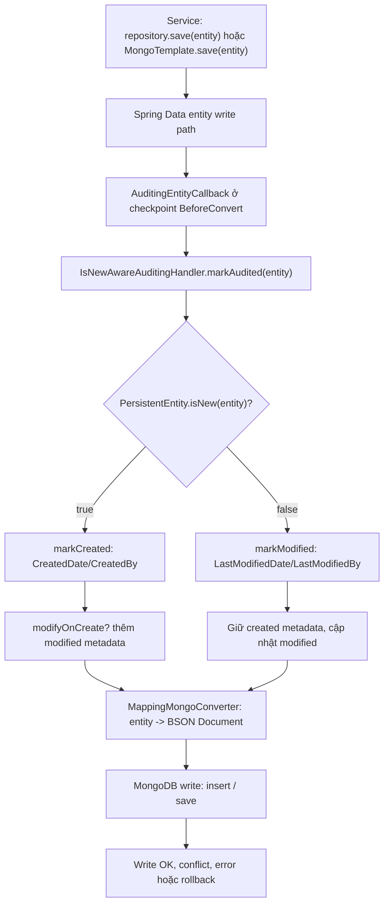
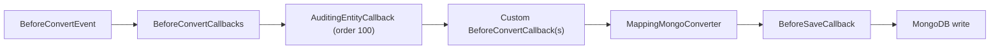

# Ảnh hưởng của phát hiện entity mới đến thông tin tạo/sửa

## 1. Vấn đề: một document “mới trong database” chưa chắc được Spring Data coi là mới

Trong Mini Commerce, chúng ta muốn ghi đúng **ai tạo, tạo lúc nào, ai sửa và sửa lúc nào** cho `Product`, `Customer` và `Order`. Spring Data MongoDB hỗ trợ tự điền những metadata này thông qua:

- `@CreatedDate` và `@CreatedBy` cho thông tin **tạo**.
- `@LastModifiedDate` và `@LastModifiedBy` cho thông tin **sửa**.
- `@EnableMongoAuditing` hoặc `@EnableReactiveMongoAuditing` để đăng ký hạ tầng.

Nhưng có một câu hỏi dễ bị bỏ qua: **làm thế nào Spring Data biết entity đang được ghi là “mới”?** Đây không chỉ là câu hỏi của `repository.save(...)`; nó còn quyết định auditing sẽ gọi nhánh **markCreated** hay **markModified**. Nếu phát hiện sai, một document vừa xuất hiện trong MongoDB có thể có `updatedAt` nhưng **không có `createdAt`**, hoặc một bản ghi đang tồn tại lại bị xử lý như mới.

Giả sử một đơn hàng sử dụng ID do payment gateway cấp trước:

```java
Order order = new Order();
order.setId("ord-external-2026-001");
order.setStatus("PLACED");
repository.save(order);
```

Nếu entity chỉ có `@Id` mà không có `@Version` hoặc `Persistable`, Spring Data thường xem `id != null` là **không mới**, dù ID này chưa có trên server. Ở đường `save` không version, MongoDB vẫn có thể **upsert** document mới; auditing lại có thể xử lý ở nhánh **modified**. Kết quả nghiệp vụ bất ngờ:

```javascript
{
  _id: "ord-external-2026-001",
  status: "PLACED",
  // createdAt có thể không được điền bởi nhánh auditing.
  updatedAt: ISODate("2026-11-20T10:00:00Z")
}
```

Lỗi không nằm ở MongoDB clock. **Auditing quyết định “created hay modified” từ state của entity trước khi ghi, không bằng một lệnh tra database xem `_id` đã tồn tại hay chưa.**

Bài thuộc chương **Auditing** của mô-đun `SPRING_DATA_MONGODB`: sử dụng Spring Data MongoDB để kết nối, ánh xạ document và thao tác qua `MongoTemplate` hoặc repository, đồng thời thực hành query, index, transaction, reactive access, kiểm thử và chẩn đoán dữ liệu.

### Mục tiêu học tập

Sau bài này, bạn có thể:

1. Mô tả chuỗi `AuditingEntityCallback → IsNewAwareAuditingHandler → PersistentEntity.isNew(...)`.
2. Phân biệt quy tắc xác định mới theo `@Id`, `@Version` và `Persistable.isNew()`.
3. Hiểu sự khác biệt đặc biệt giữa **`Long version = null`** và **`long version = 0`**.
4. Dự đoán `createdAt/createdBy/updatedAt/updatedBy` trên insert, save, replace và save entity có ID gán trước.
5. Giải thích cấu hình `modifyOnCreate=true/false` và `setDates=true/false`.
6. Tổ chức `AuditorAware`, `DateTimeProvider` đúng nguồn identity/clock.
7. Tránh việc DTO thiếu field hoặc update trực tiếp làm mất/không cập nhật audit metadata.
8. Dùng `Persistable` khi business ID gán trước; đồng bộ trạng thái mới/sau load mà không làm lộ flag vào BSON.
9. Viết integration test đọc raw BSON cho các tình huống mới/cũ, versioned/unversioned, auditing imperative và reactive.
10. Biết các giới hạn của auditing trước transactions, retry, raw driver, bulk và truy vết lịch sử.

**Điều kiện:** Java 17+, Spring Boot có `spring-boot-starter-data-mongodb`, MongoDB test riêng, hiểu `@Document`, `@Id`, `MongoRepository`, `MongoTemplate`, `@Version`. Phần reactive cần starter reactive và Reactor.

## 2. Luồng auditing trước khi BSON Document được tạo

Trong đường ghi **entity qua Spring Data mapping**:



Các thành phần liên quan:

| Thành phần | Vai trò |
| --- | --- |
| `@EnableMongoAuditing` | Đăng ký cơ chế auditing imperative |
| `AuditingEntityCallback` | Callback `BeforeConvertCallback<Object>` cho entity sắp được ghi |
| `IsNewAwareAuditingHandler` | Phân nhánh `markCreated`/`markModified` theo `PersistentEntity.isNew(entity)` |
| `PersistentEntity.isNew(entity)` | Trả boolean dựa trên chiến lược phát hiện state (`@Version`, `@Id`, `Persistable`) |
| `AuditorAware<T>` | Cho biết actor hiện tại để điền `@CreatedBy`/`@LastModifiedBy` |
| `DateTimeProvider` | Cho biết thời điểm Java dùng cho `@CreatedDate`/`@LastModifiedDate` |
| `MappingMongoConverter` | Ánh xạ entity đã được auditing thành BSON field |

**Điểm mấu chốt:** kiểm tra mới/cũ được thực hiện **trong JVM từ metadata và giá trị của entity**, không có `findById` mặc định trước mỗi lần audit. Việc MongoDB thực sự insert hay replace xảy ra **sau đó**, nên hai khái niệm có thể lệch nhau.

### 2.1. Newness và tồn tại trên database là hai trục khác nhau

| Spring Data `isNew` | Document `_id` đã tồn tại? | Điều auditing có thể làm | Rủi ro |
| --- | --- | --- | --- |
| `true` | Chưa | Đánh dấu created; có thể thêm modified trên create | Bình thường nếu insert thành công |
| `false` | Có | Đánh dấu modified, giữ created metadata | Bình thường khi sửa |
| `false` | **Chưa** | Đánh dấu modified dù write có thể insert mới | Thiếu `createdAt/createdBy` |
| `true` | **Có** | Đánh dấu created, nhưng insert có thể bị duplicate key hoặc save/version logic từ chối | Không thể tự coi created là đã commit |

Không có cơ chế auditing thông thường nào tự động biến bảng này thành kiểm tra tồn tại tuyệt đối giữa hai luồng cạnh tranh. Unique index, optimistic locking, transaction và business operation ID xử lý các bài toán khác nhau.

### 2.2. “Đã chạy auditing” không đồng nghĩa “đã commit”

Auditing chạy trước chuyển đổi BSON. Sau đó write có thể bị từ chối vì duplicate key, optimistic-lock conflict, schema validation, network failure hoặc transaction rollback. Callback **có thể chạy nhiều lần** nếu toàn command được retry.

Không phát email, gọi thanh toán hoặc ghi audit event ngoài MongoDB ngay trong auditing callback. Nếu cần log lịch sử bền vững, dùng **outbox/append-only event log** được điều phối trong transaction.

## 3. Quy tắc phát hiện entity mới: thứ tự ưu tiên

Spring Data Commons mô tả các chiến lược phát hiện state:

1. **`Persistable`**: nếu domain entity implement `Persistable<ID>`, Spring Data ủy quyền quyết định cho `isNew()`.
2. **`@Version`**: nếu entity có version property, `null` (boxed) hoặc `0` (primitive) được coi là mới; giá trị khác thì không mới.
3. **`@Id`**: nếu không có version, ID bằng `null` (hoặc `0` ở primitive ID) thì mới; ID khác null thì không mới.

Đó là quy tắc của **entity-state detection**, không phải một lệnh đọc MongoDB. Khi có custom strategy hoặc entity metadata đặc biệt, kiểm tra theo Spring Data version của ứng dụng.

### 3.1. Không có @Version: xét @Id

```java
@Document("customers")
class CustomerWithoutVersion {
    @Id String id;
    @CreatedDate Instant createdAt;
    @LastModifiedDate Instant updatedAt;
}
```

| ID | isNew theo mặc định | Nhánh auditing |
| --- | --- | --- |
| `null` | `true` | Created |
| `"cus-001"` | `false` | Modified |
| `""` (chuỗi rỗng) | `false` theo quy tắc null | Modified; ID rỗng còn có thể không hợp lệ theo policy |

Nếu MongoDB sinh ID và bạn để `id=null` tới khi insert, đường đầu tiên thường được xem là mới. Nhưng một business ID do client đặt sẵn khiến entity **không mới** theo quy tắc ID-only.

### 3.2. Có @Version Long: xét null trước

```java
@Version
private Long version;
```

| Version boxed | ID | isNew | Giải thích |
| --- | --- | --- | --- |
| `null` | `null` | `true` | Chưa có version |
| `null` | `"order-assigned"` | `true` | **ID gán trước vẫn được coi là mới** |
| `0L` | `"order-assigned"` | `false` | Boxed **zero khác null** |
| `1L` | `null` | `false` theo version | Metadata version chi phối; dữ liệu không nhất quán cần xử lý |

**Bẫy nổi bật:** với `Long`, tự khởi tạo `version = 0L` trong constructor/DTO có thể biến entity mới thành **“đã tồn tại”** trước khi ghi. Trên insert entity mới, Spring Data MongoDB thường khởi tạo boxed numeric version ở `0`; sau lần insert thành công, giá trị `0` lại chính là dấu hiệu **existing entity** ở lần save tiếp theo.

### 3.3. Có @Version long primitive: xét số 0

```java
@Version
private long version;
```

| Version primitive | isNew | Nhánh |
| ---: | --- | --- |
| `0L` | `true` | Created |
| `1L` | `false` | Modified |
| `2L` | `false` | Modified |

Primitive `long` không thể null, vì vậy Spring Data dùng `0` làm sentinel “mới”. Spring Data MongoDB có thể khởi tạo **primitive numeric version ở 1** trên insert. Nếu đưa entity `long version=0` được đọc từ legacy DB vào `save`, nó có thể vẫn bị phân loại **new**: cần migration và test thay vì giả định mọi `0` là existing.

### 3.4. Bảng đối chiếu tổng hợp

| Entity | Giá trị | Nhận định `isNew` |
| --- | --- | --- |
| Chỉ `@Id String id` | `id=null` | Mới |
| Chỉ `@Id String id` | `id="manual-001"` | Không mới |
| `@Id` + `@Version Long version` | `id="manual-001", version=null` | Mới |
| `@Id` + `@Version Long version` | `id="manual-001", version=0L` | Không mới |
| `@Id` + `@Version long version` | `id="manual-001", version=0L` | Mới |
| `@Id` + `@Version long version` | `id="manual-001", version=1L` | Không mới |
| Implement `Persistable<ID>` | `isNew()=true` | Mới, bất kể ID đã gán trước |
| Implement `Persistable<ID>` | `isNew()=false` | Không mới, theo explicit strategy |

**Không suy đoán từ việc gọi `save()` hay `insert()` để định nghĩa nhánh auditing.** Hãy xét entity state **tại checkpoint auditing**.

## 4. Cấu hình auditing chuẩn cho MongoDB

### 4.1. Bật auditing imperative

```java
package com.example.minicommerce.config;

import org.springframework.context.annotation.Configuration;
import org.springframework.data.mongodb.config.EnableMongoAuditing;

@Configuration
@EnableMongoAuditing(
    auditorAwareRef = "currentActorProvider",
    modifyOnCreate = true,
    setDates = true
)
public class MongoAuditingConfig {
}
```

`modifyOnCreate=true` và `setDates=true` là **mặc định** trong các phiên bản Spring Data MongoDB hiện hành, nhưng bài khai báo tường minh để thấy tác động. Nếu chỉ lưu `@CreatedDate` và `@LastModifiedDate`, ứng dụng **không bắt buộc** có `AuditorAware`.

### 4.2. AuditorAware trong ứng dụng imperative

```java
package com.example.minicommerce.config;

import java.util.Optional;

import org.springframework.context.annotation.Bean;
import org.springframework.context.annotation.Configuration;
import org.springframework.data.domain.AuditorAware;
import org.springframework.security.core.Authentication;
import org.springframework.security.core.context.SecurityContextHolder;

@Configuration
public class AuditorConfig {

    @Bean("currentActorProvider")
    AuditorAware<String> currentActorProvider() {
        return () -> {
            Authentication auth = SecurityContextHolder
                .getContext()
                .getAuthentication();

            if (auth == null || !auth.isAuthenticated() ||
                    "anonymousUser".equals(auth.getPrincipal())) {
                return Optional.of("system");
            }
            return Optional.of(auth.getName());
        };
    }
}
```

Ví dụ dùng Spring Security imperative; ứng dụng phải có dependency/config tương ứng. `"system"` chỉ thích hợp khi policy đã định nghĩa rõ actor cho scheduled/import jobs. **Không cho phép HTTP user tự gửi actor/tenant rồi tin trực tiếp**. Với các operation không có principal, có thể trả `Optional.empty()` theo contract và quyết định rõ liệu audit actor được phép rỗng hay không.

### 4.3. @CreatedBy và @LastModifiedBy

```java
@CreatedBy
private String createdBy;

@LastModifiedBy
private String lastModifiedBy;
```

Các fields trên là **đoạn khai báo bên trong entity**, cần import:

```java
import org.springframework.data.annotation.CreatedBy;
import org.springframework.data.annotation.LastModifiedBy;
```

Type của property (ví dụ `String`) phải tương thích type trả từ `AuditorAware<String>`. Nếu dùng domain `UserId` object, provider cũng phải trả đúng kiểu/map được; không tự ép một object không chuyển đổi được thành BSON string.

## 5. Mô hình Order cho bài thực hành

### 5.1. Entity có @Version Long boxed

```java
package com.example.minicommerce.domain;

import java.time.Instant;
import org.springframework.data.annotation.Id;
import org.springframework.data.annotation.Version;
import org.springframework.data.annotation.CreatedDate;
import org.springframework.data.annotation.CreatedBy;
import org.springframework.data.annotation.LastModifiedDate;
import org.springframework.data.annotation.LastModifiedBy;
import org.springframework.data.mongodb.core.mapping.Document;
import org.springframework.data.mongodb.core.mapping.Field;

@Document(collection = "orders")
public class Order {

    @Id
    private String id;

    @Field("tenant_id")
    private String tenantId;

    private String customerId;
    private String status;

    @Version
    private Long version; // Cố ý để null khi entity chưa ghi.

    @CreatedDate
    private Instant createdAt;

    @LastModifiedDate
    private Instant updatedAt;

    @CreatedBy
    private String createdBy;

    @LastModifiedBy
    private String lastModifiedBy;

    public Order() {}

    public Order(String id, String tenantId,
                 String customerId, String status) {
        this.id = id;
        this.tenantId = tenantId;
        this.customerId = customerId;
        this.status = status;
        // Không tự điền version=0L trong constructor.
    }

    public String getId() { return id; }
    public String getTenantId() { return tenantId; }
    public String getCustomerId() { return customerId; }
    public String getStatus() { return status; }
    public Long getVersion() { return version; }
    public Instant getCreatedAt() { return createdAt; }
    public Instant getUpdatedAt() { return updatedAt; }
    public String getCreatedBy() { return createdBy; }
    public String getLastModifiedBy() { return lastModifiedBy; }

    public void setId(String id) { this.id = id; }
    public void setTenantId(String tenantId) {
        this.tenantId = tenantId;
    }
    public void setCustomerId(String customerId) {
        this.customerId = customerId;
    }
    public void setStatus(String status) { this.status = status; }
    public void setVersion(Long version) {
        this.version = version;
    }
    public void setCreatedAt(Instant createdAt) {
        this.createdAt = createdAt;
    }
    public void setUpdatedAt(Instant updatedAt) {
        this.updatedAt = updatedAt;
    }
    public void setCreatedBy(String createdBy) {
        this.createdBy = createdBy;
    }
    public void setLastModifiedBy(String actor) {
        this.lastModifiedBy = actor;
    }
}
```

**Không** gọi `new Order(...).setVersion(0L)` cho entity mới. Khi `@Version Long` null, dù `id` do gateway cấp trước, Spring Data xem entity là **new**, auditing chọn created và repository dùng new-entity path. Sau insert thành công, `version` thường được khởi tạo ở `0`, và lần save tiếp theo được xem là existing.

### 5.2. BSON field và metadata

```javascript
{
  _id: "ord-2026-001",
  tenant_id: "shop-a",
  customerId: "cus-001",
  status: "PLACED",
  version: NumberLong(0),
  createdAt: ISODate("2026-11-20T10:00:00Z"),
  updatedAt: ISODate("2026-11-20T10:00:00Z"),
  createdBy: "operator-a",
  lastModifiedBy: "operator-a"
}
```

Đây là **mẫu BSON minh họa khi `modifyOnCreate=true` và có auditor**; timestamp/actor cụ thể lấy từ provider tại runtime. `@Field("tenant_id")` ánh xạ property `tenantId` sang BSON key `tenant_id`. Nếu đổi sang `modifyOnCreate=false`, fields `updatedAt/lastModifiedBy` có thể chưa được điền lúc tạo.

### 5.3. Repository của Order

```java
package com.example.minicommerce.repository;

import org.springframework.data.mongodb.repository.MongoRepository;
import com.example.minicommerce.domain.Order;

public interface OrderRepository
        extends MongoRepository<Order, String> {
}
```

Từ bây giờ, phần lớn ví dụ sử dụng `OrderRepository` và `MongoTemplate` với entity này. Chúng được Spring Boot tạo/inject từ **cùng MongoDB configuration**.

## 6. Hai lần save: created rồi modified

### 6.1. Lần đầu: version null

```java
Order order = new Order(
    "ord-2026-001", "shop-a", "cus-001", "PLACED");

// order.getVersion() == null
Order first = repository.save(order);
```

Trước ghi: `isNew=true` do boxed `@Version` null. `AuditingEntityCallback` gọi **markCreated**. Nếu `modifyOnCreate=true`, cả nhóm created và modified được điền ở lần tạo.

Khi save thành công, server lưu Order mới, `@Version Long` thường bắt đầu ở 0. Các fields `createdAt`/`createdBy` đánh dấu thời điểm/actor **chuẩn bị ghi**, không phải thời điểm transaction commit chính xác.

### 6.2. Lần hai: version đã có

```java
Order loaded = repository.findById("ord-2026-001")
    .orElseThrow();

loaded.setStatus("PAID");
Order second = repository.save(loaded);
```

Với version boxed đã có (ví dụ 0), `isNew=false`. Auditing gọi **markModified**:

- `createdAt` và `createdBy` được giữ từ entity đã load.
- `updatedAt` và `lastModifiedBy` nhận thời điểm/actor mới khi provider có dữ liệu.
- `@Version` tham gia optimistic locking; version có thể tăng 0 → 1.

Nếu code **không load** mà tự tạo object mới với cùng `_id` và version null, nó lại được xem là **new**. Khi `repository.save` cố insert, document có cùng ID đã tồn tại sẽ có thể gây duplicate key. Đây là lỗi vận dụng entity state, không phải lý do tự đặt version ngẫu nhiên.

### 6.3. Timeline

```text
T0  new Order(id="ord-2026-001", version=null)
    isNew=true
    CreatedDate=T0; CreatedBy=operator-a
    LastModifiedDate=T0; LastModifiedBy=operator-a (mặc định)
    INSERT -> version=0

T1  load Order(id=..., version=0)
    change status PLACED -> PAID
    isNew=false
    createdAt/createdBy được giữ nguyên
    updatedAt=T1; lastModifiedBy=operator-b
    SAVE with expected version 0 -> version=1
```

Không khẳng định `T1>T0` luôn nhận được hai BSON Date khác nhau nếu các thao tác diễn ra rất nhanh hoặc clock có cùng độ phân giải; kiểm thử nên ưu tiên **không mất created metadata**, version đúng và modified metadata có mặt thay vì dựa vào `Thread.sleep`.

## 7. Trường hợp sai phổ biến: ID gán trước nhưng không có @Version

Nhiều hệ thống thanh toán phát sinh Order ID hoặc mã giao dịch trước khi lưu MongoDB. Nếu entity chỉ có `@Id`, `isNew` dựa vào giá trị ID:

```java
package com.example.minicommerce.domain;

import java.time.Instant;
import org.springframework.data.annotation.Id;
import org.springframework.data.annotation.CreatedDate;
import org.springframework.data.annotation.LastModifiedDate;
import org.springframework.data.mongodb.core.mapping.Document;

@Document("legacy_orders")
public class LegacyOrder {

    @Id
    private String id;

    private String status;

    @CreatedDate
    private Instant createdAt;

    @LastModifiedDate
    private Instant updatedAt;

    public LegacyOrder() {}
    public LegacyOrder(String id, String status) {
        this.id = id;
        this.status = status;
    }

    public String getId() { return id; }
    public String getStatus() { return status; }
    public Instant getCreatedAt() { return createdAt; }
    public Instant getUpdatedAt() { return updatedAt; }
    public void setStatus(String value) { status = value; }
}
```

Giả sử chạy trên `legacy_orders` chưa có ID này:

```java
LegacyOrder incoming = new LegacyOrder(
    "external-order-001", "PLACED");

LegacyOrder written = mongoTemplate.save(incoming);
```

Vì `id != null` và không có `@Version` hay `Persistable`, entity được xem là **not new**. Auditing đặt modified metadata. Tuy nhiên, `MongoTemplate.save` (không version) có thể thực hiện **replacement với upsert** nếu chưa có `_id`, khiến document vừa được tạo mà `createdAt` bị bỏ trống.

| Sự kiện | Newness nhận định | Việc có thể xảy ra |
| --- | --- | --- |
| Tạo object có ID gán trước | `false` | Auditing chọn modified |
| Server chưa có ID | Chưa được auditing tra cứu | Save có thể upsert một document mới |
| Lưu thành công | Nhánh auditing đã chọn trước đó | `updatedAt` có nhưng `createdAt` không được khởi tạo |

**Không sửa bằng cách bắt auditing luôn gọi markCreated.** Vì khi sửa document thực sự đã tồn tại, created metadata cần giữ nguyên.

### 7.1. Ba cách giải quyết đúng hơn

1. **Thêm `@Version Long`, để null trên entity mới** rồi dùng repository save/insert theo đúng protocol optimistic locking.
2. **Implement `Persistable<String>`** và duy trì cờ `isNew()` một cách chính xác, đặc biệt với ID được tạo trước.
3. **Phân biệt rõ API create/update**: tạo qua một đường insert được kiểm soát và khởi tạo audit metadata ở service; update dùng direct CAS và cập nhật modified metadata có chủ đích.

Không kết luận một `@Id` có sẵn nghĩa là server chắc chắn có document tương ứng. Ngược lại, cũng không dùng existence query tách rời rồi insert làm cơ chế chống race: hai writer có thể cùng thấy “chưa có”. Unique index trên `_id` vẫn cần.

## 8. Long version, long version và những lỗi khởi tạo state

### 8.1. Boxed Long có hai trạng thái khác nhau

```java
@Version
private Long version; // Mặc định null: new.
```

**Đúng cho entity mới:**

```java
Order first = new Order(
    "ord-automatic-001", "shop-a", "cus-001", "PLACED");

assert first.getVersion() == null;
repository.save(first);
```

**Sai tiềm ẩn:**

```java
Order wrong = new Order(
    "ord-automatic-002", "shop-a", "cus-001", "PLACED");
wrong.setVersion(0L); // Boxed zero bị coi là EXISTING.
repository.save(wrong);
```

Entity thứ hai có `isNew=false` ở auditing và routing repository; nếu database chưa có document với expected version 0, đường versioned write có thể gây optimistic-lock failure thay vì tạo mới. **Không dùng `version=0L` làm default cho DTO create** chỉ vì MongoDB thường lưu boxed version đầu tiên bằng 0.

### 8.2. Primitive version có sentinel = 0

```java
@Document("primitive_orders")
public class PrimitiveVersionOrder {

    @Id
    private String id;

    @Version
    private long version;

    @CreatedDate
    private Instant createdAt;

    @LastModifiedDate
    private Instant updatedAt;

    public PrimitiveVersionOrder() {}
    public PrimitiveVersionOrder(String id) { this.id = id; }

    public String getId() { return id; }
    public long getVersion() { return version; }
    public Instant getCreatedAt() { return createdAt; }
    public Instant getUpdatedAt() { return updatedAt; }
}
```

Đây là entity riêng trong file `PrimitiveVersionOrder.java`, với imports `Id`, `Version`, `CreatedDate`, `LastModifiedDate`, `Document` và `Instant`.

Khi object mới được tạo, primitive `long version` mặc định là 0 và `isNew=true`. MongoDB/Spring Data có thể khởi tạo primitive version ở **1** sau insert (trong khi boxed `Long` thường bắt đầu ở 0). Do đó:

```text
Long version=null -> NEW
    insert -> Long version=0 -> EXISTING

long version=0 -> NEW
    insert -> long version=1 -> EXISTING
```

Hãy xem chính xác contract của Spring Data MongoDB version bạn sử dụng và kiểm tra raw BSON trong integration test. **Không trộn legacy documents có version 0/1 sai chuẩn** rồi suy luận từ giá trị số là đủ để cứu auditing.

### 8.3. Tránh sao chép version từ client create DTO

Đầu vào không nên cho client quyết định version:

```java
public record CreateOrderRequest(
    String customerId,
    String status
) {}
```

Service tạo entity mới có version null (boxed) hoặc 0 (primitive), không map field `version` tùy ý từ HTTP body. Version của lệnh update phải lấy từ **entity đang tồn tại/ETag hoặc expected version** và kiểm tra tại write.

### 8.4. Mismatch metadata và document thực

| Trường hợp | Rủi ro |
| --- | --- |
| Boxed `@Version Long=0L` trước insert | Auditing coi existing, repository có thể đi update path |
| Primitive `@Version long=0L` trên entity legacy đã tồn tại | Auditing coi new, save có thể thử insert và fail |
| Entity từ projection không có `version` | Có thể bị coi new dù ID đã tồn tại |
| Raw driver cập nhật mà không bump version | Stale entity khó phát hiện, auditing có thể dựa vào state cũ |
| Client tự đưa `createdAt` mới trong update DTO | Ghi đè mốc tạo nếu save replacement |

**Bài học:** xác định entity mới không phải một thủ tục tùy tiện đặt null/zero cho thuận tiện. Nó liên quan trực tiếp tới routing insert/update, optimistic locking và auditing.

## 9. Khi cần gán ID trước: Persistable.isNew()

`Persistable<ID>` cho phép entity chủ động công bố trạng thái mới/cũ:

```java
import org.springframework.data.domain.Persistable;
```

Đây là giải pháp hữu ích khi:

- ID được sinh bởi service/UUID/ULID hoặc hệ thống ngoài **trước khi insert**.
- Không muốn dùng `@Version` cho một loại document append-only.
- Có chiến lược rõ ràng để đổi cờ new → existing **sau khi lưu hoặc tải từ MongoDB**.

### 9.1. Ví dụ OrderNote với ID tự gán

```java
package com.example.minicommerce.domain;

import java.time.Instant;

import org.springframework.data.annotation.Id;
import org.springframework.data.annotation.CreatedDate;
import org.springframework.data.annotation.LastModifiedDate;
import org.springframework.data.annotation.Transient;
import org.springframework.data.domain.Persistable;
import org.springframework.data.mongodb.core.mapping.Document;

@Document("order_notes")
public class OrderNote implements Persistable<String> {

    @Id
    private String id;

    private String message;

    @CreatedDate
    private Instant createdAt;

    @LastModifiedDate
    private Instant updatedAt;

    @Transient
    private boolean newEntity = true;

    public OrderNote() {}

    public OrderNote(String id, String message) {
        this.id = id;
        this.message = message;
    }

    @Override
    public String getId() { return id; }

    @Override
    public boolean isNew() { return newEntity; }

    public void markNotNew() { newEntity = false; }

    public String getMessage() { return message; }
    public void setMessage(String value) { message = value; }
    public Instant getCreatedAt() { return createdAt; }
    public Instant getUpdatedAt() { return updatedAt; }
}
```

Ở ví dụ này, `@Transient` đảm bảo cờ `newEntity` **không được lưu vào BSON**. Nó chỉ là thông tin lifecycle của instance Java. Khi các entity sử dụng property access, cần bảo đảm `isNew()` không bị hiểu như một persistent property; dùng `@Transient` phù hợp access strategy và kiểm tra BSON.

### 9.2. Đánh dấu không mới khi đã load và đã save

Nếu tạo `OrderNote("note-001", "...")`, `isNew=true` ngay cả khi `id!=null`. Nhưng sau khi load từ MongoDB, class sẽ được dựng với `newEntity=true` mặc định; **nếu không đổi lại cờ**, lần save kế tiếp có thể thử insert một document đã tồn tại.

Một cách xử lý explicit:

```java
package com.example.minicommerce.callback;

import org.bson.Document;
import org.springframework.data.mongodb.core.mapping.event.AfterConvertCallback;
import org.springframework.data.mongodb.core.mapping.event.AfterSaveCallback;
import org.springframework.stereotype.Component;

import com.example.minicommerce.domain.OrderNote;

@Component
public class OrderNoteStateCallbacks
        implements AfterConvertCallback<OrderNote>,
                   AfterSaveCallback<OrderNote> {

    @Override
    public OrderNote onAfterConvert(
            OrderNote entity,
            Document document,
            String collection) {
        entity.markNotNew();
        return entity;
    }

    @Override
    public OrderNote onAfterSave(
            OrderNote entity,
            Document document,
            String collection) {
        entity.markNotNew();
        return entity;
    }
}
```

Nhờ `AfterConvertCallback`, instance được load từ DB là `isNew=false`. Nhờ `AfterSaveCallback`, instance sau khi write thành công được đánh dấu existing. Hai callback này **không thay thế** error handling/unknown outcome: nếu insert ném exception trước after-save, cờ có thể vẫn true; nếu response thất lạc, caller không được suy chắc transaction chưa commit.

### 9.3. Persistable thay đổi cả routing lẫn auditing

| Trạng thái instance | `id` | `isNew()` | Auditing | Repository save path |
| --- | --- | --- | --- | --- |
| Vừa tạo `OrderNote` | `"note-001"` | `true` | Created | Thường insert |
| Sau save thành công | `"note-001"` | `false` | Modified ở lần tiếp | Existing save |
| Load từ MongoDB | `"note-001"` | `false` nhờ callback | Modified ở lần tiếp | Existing save |
| Instance khác giữ cờ true cho ID đã tồn tại | `"note-001"` | `true` | Created sai | Có thể duplicate key |

**Không** dùng `Persistable.isNew()` để né unique index, và không viết `isNew() { return true; }` vĩnh viễn. Việc override này ảnh hưởng tới quyết định insert/update và auditing của nhiều đường repository.

### 9.4. Chọn Persistable hay @Version?

- Với aggregate có cập nhật concurrent như `Product` hoặc `Order`, `@Version Long` thường vừa cung cấp newness theo null vừa hỗ trợ optimistic locking.
- Với một document append-only có ID gán trước, `Persistable` có thể diễn tả trực tiếp newness mà không cần version field.
- Với một workflow phức tạp phải duy trì lifecycle flag trên immutable entity, thiết kế các factory/with-methods nhất quán; đôi khi tạo entity mới với `@Version Long null` đơn giản hơn.

Không thêm `Persistable` chỉ để “sửa một test createdAt” nếu dự án đã có `@Version`/mapping và nguyên nhân thực là DTO dựng sai state.

## 10. modifyOnCreate: tạo mới có được tính là đã sửa?

`@EnableMongoAuditing` có thuộc tính:

```java
@EnableMongoAuditing(modifyOnCreate = true)
```

**Mặc định `true`:** khi entity mới được audit, cả thông tin tạo và sửa có thể được đánh dấu. Do đó lần đầu insert có thể có:

```text
createdAt      = 2026-11-20T10:00:00Z
updatedAt      = 2026-11-20T10:00:00Z
createdBy      = operator-a
lastModifiedBy = operator-a
```

**Khi `false`:** lần tạo chỉ cần created metadata; modified metadata có thể để null/chưa có:

```java
@Configuration
@EnableMongoAuditing(
    auditorAwareRef = "currentActorProvider",
    modifyOnCreate = false
)
public class CreateOnlyAuditConfig {
}
```

`CreateOnlyAuditConfig` là **phương án thay thế `MongoAuditingConfig` phần 4**, không kích hoạt cả hai cùng lúc. Khi save entity existing, auditing đi theo nhánh modified nên `updatedAt`/`lastModifiedBy` được điền ở lần sửa.

### 10.1. Ma trận created/modified

| `isNew` | `modifyOnCreate` | Created metadata | Modified metadata |
| --- | --- | --- | --- |
| `true` | `true` (mặc định) | Điền | Điền trên create |
| `true` | `false` | Điền | Không tự điền trên create |
| `false` | Bất kỳ | **Giữ** từ entity hiện có | Điền/cập nhật |

Điều kiện: auditing đã được bật, entity có annotations phù hợp, `DateTimeProvider`/`AuditorAware` cung cấp giá trị và không có callback khác ghi đè. “Giữ created metadata” có nghĩa **không tự cập nhật** nó trong nhánh modified; nếu entity đưa vào đã bị mất `createdAt` thì auditing không tự khôi phục từ DB.

### 10.2. Kỳ vọng API phải rõ ràng

Nếu frontend yêu cầu `updatedAt` luôn non-null cho mọi Order, giữ `modifyOnCreate=true` có thể phù hợp. Nếu semantics nghiệp vụ là “updatedAt chỉ có sau lần sửa đầu tiên”, chọn `false` và cho phép null trong DTO/BSON schema.

Không định nghĩa MongoDB JSON Schema bắt buộc `updatedAt` trên create rồi lại bật `modifyOnCreate=false` mà không có cơ chế khác điền field, vì insert có thể bị validation từ chối.

## 11. setDates và DateTimeProvider

### 11.1. setDates=true/false

```java
@EnableMongoAuditing(setDates = true)
```

`setDates=true` là mặc định: auditing tự gán Java timestamp từ `DateTimeProvider`. Với:

```java
@EnableMongoAuditing(setDates = false)
```

auditing **không tự điền ngày giờ**, nhưng điều đó không nhất thiết tắt cơ chế actor auditing. Chỉ chọn `setDates=false` nếu bạn có một nguồn thời gian có hợp đồng rõ ràng (ví dụ ứng dụng điền từ service, hoặc server-side timestamp ở đường update khác).

### 11.2. Clock có thể được inject để test

```java
package com.example.minicommerce.config;

import java.time.Clock;
import java.time.Instant;
import java.time.temporal.TemporalAccessor;
import java.util.Optional;

import org.springframework.context.annotation.Bean;
import org.springframework.context.annotation.Configuration;
import org.springframework.data.auditing.DateTimeProvider;

@Configuration
public class AuditClockConfig {

    @Bean
    Clock auditClock() {
        return Clock.systemUTC();
    }

    @Bean("auditDateTimeProvider")
    DateTimeProvider auditDateTimeProvider(
            Clock auditClock) {
        return () -> Optional.<TemporalAccessor>of(
            Instant.now(auditClock));
    }
}
```

Chọn provider ở annotation:

```java
@EnableMongoAuditing(
    dateTimeProviderRef = "auditDateTimeProvider",
    auditorAwareRef = "currentActorProvider"
)
```

Đoạn annotation trên là **cách điều chỉnh cấu hình hiện có**, không tự tạo thêm một class `@EnableMongoAuditing` thứ hai. Test có thể inject một `Clock.fixed(...)` hoặc một `Clock` có thể điều chỉnh có kiểm soát để so sánh thời gian tạo/sửa mà không dùng `Thread.sleep`.

### 11.3. Timestamp auditing khác commit time

Auditing lấy thời gian khi callback xử lý entity. Trong một transaction dài:

```text
10:00:00.001  BeforeConvert auditing -> createdAt
10:00:00.010  MongoDB insert trong transaction
10:00:02.000  MongoDB commit transaction
```

`createdAt` là thời gian Spring chuẩn bị entity để ghi, không phải timestamp MongoDB xác nhận commit. Khi cần **thời gian pháp lý/giao dịch chính thức**, phải xác lập nguồn timestamp và protocol rõ ràng; không giả định auditing timestamp chứng minh commit.

### 11.4. Thời gian UTC và định dạng dữ liệu

`Instant` biểu diễn thời điểm tuyệt đối; MongoDB lưu kiểu BSON Date theo epoch milliseconds. Hiển thị giờ Việt Nam là **trách nhiệm presentation layer**. Không dùng `LocalDateTime.now()` không timezone rồi hiểu BSON Date như giờ địa phương khi API chạy trên nhiều region.

## 12. Actor auditing: CreatedBy và LastModifiedBy cũng chịu ảnh hưởng isNew

Cùng một `AuditorAware<String>`, thời điểm và identity hiện tại có thể được dùng khác nhau tùy `isNew`:

```text
isNew=true, modifyOnCreate=true:
    createdBy      = currentActor
    lastModifiedBy = currentActor

isNew=true, modifyOnCreate=false:
    createdBy      = currentActor
    lastModifiedBy = null (nếu trước đó chưa có)

isNew=false:
    createdBy      = giữ nguyên từ entity
    lastModifiedBy = currentActor
```

Đây là hành vi cho entity có cả hai annotations và actor provider trả actor. Nếu `AuditorAware` trả `Optional.empty()` hoặc có custom callbacks, cần kiểm tra output tương ứng.

### 12.1. Actor phải đến từ nguồn tin cậy

```java
@CreatedBy
private String createdBy;

@LastModifiedBy
private String lastModifiedBy;
```

Không cho client đặt hai field trên qua create/update DTO. Nếu request gắn:

```json
{
  "createdBy": "admin",
  "lastModifiedBy": "admin",
  "status": "PAID"
}
```

service nên **bỏ qua** hai trường actor từ body và lấy actor từ SecurityContext/service principal. `AuditorAware` được Spring Data gọi ở callback; security authorization vẫn phải được kiểm tra tại service/query filter theo tenant/Customer.

### 12.2. Async và scheduled jobs

Imperative `SecurityContextHolder` mặc định là thread-local. Một scheduled job hay worker chuyển thread có thể không có request security context. Đừng dùng actor của request trước đó bị rò qua shared mutable state.

Đối với import/scheduler, dùng service identity có chính sách rõ ràng như `"catalog-importer"` hoặc `"order-reconciler"`. Đó là danh tính kỹ thuật, không phải mạo danh một người dùng.

### 12.3. Auditing không thay được event log

`lastModifiedBy="operator-b"` nói ai được ghi là người sửa **gần nhất**; nó không cho biết lần nào, field gì, giá trị cũ và có bao nhiêu bước trung gian. Nếu cần lịch sử thay đổi trạng thái Order, giữ `order_events`/append-only audit hoặc outbox theo transaction boundary.

## 13. Sự khác nhau giữa repository.save, MongoTemplate.save và insert

Auditing phân loại entity new/existing **trước BSON write**; routing thực tế của API ghi còn tùy operation.

### 13.1. Repository.save

```java
Order newOrder = new Order(
    "ord-assigned-001", "shop-a", "cus-001", "PLACED");

Order saved = repository.save(newOrder);
```

Repository `save` sử dụng Spring Data entity information để quyết định insert hay save dựa trên newness. Với `Order.version=null`, nó đi theo **new entity path**, auditing đánh dấu created và insert. Với `version!=null`, nó đi theo existing path; MongoDB version-aware save sẽ kiểm tra version theo optimistic locking.

### 13.2. MongoTemplate.insert

```java
Order inserted = mongoTemplate.insert(new Order(
    "ord-insert-001", "shop-a", "cus-001", "PLACED"));
```

`insert` thể hiện ý định **tạo mới và từ chối trùng `_id`**, nhưng auditing vẫn dựa vào `isNew` của entity tại callback. Đừng tạo instance với `version=0L` rồi nghĩ việc gọi `insert` sẽ bắt auditing **chắc chắn** đi nhánh created.

### 13.3. MongoTemplate.save

```java
Order saved = mongoTemplate.save(order);
```

`save` có thể insert/replace tùy metadata, version và trạng thái ở server. Nếu không có `@Version`, save theo ID có thể thay thế hoặc upsert một document. Vì auditing không tra database, entity có assigned ID và no-version có thể bị **markModified trước khi upsert tạo document mới**.

Không coi “server đã insert” và “`isNew=true` trong callback” là cùng một assertion.

### 13.4. Upsert bằng Update không đi qua entity auditing

```java
Query filter = Query.query(
    Criteria.where("id").is(orderId)
        .and("tenantId").is(tenantId));

Update change = new Update()
    .set("status", "PLACED")
    .setOnInsert("createdAt", Instant.now(clock))
    .setOnInsert("createdBy", verifiedActor)
    .currentDate("updatedAt")
    .set("lastModifiedBy", verifiedActor);

var result = mongoTemplate.upsert(
    filter, change, Order.class);
```

Đây là một **đoạn thân service** với `clock` và `verifiedActor` được xác định từ nguồn tin cậy; không phải ví dụ đầy đủ của upsert idempotent. Direct `upsert` gửi query/update tới MongoDB và **không tạo một Order entity để gọi `AuditingEntityCallback`**. Nếu cần metadata:

- `$setOnInsert` cho `createdAt/createdBy`, chỉ khi server thực sự insert.
- `$set`/`$currentDate` cho `updatedAt/lastModifiedBy` theo contract.
- Unique index để bảo vệ business key; đánh giá race và version.

**Cẩn thận:** `$setOnInsert` và `$currentDate` trên các field khác nhau, như snippet, là hợp lệ; không đặt đồng thời hai operator lên **cùng field** (có thể gây conflicting update paths). Nếu muốn modified metadata trên create **đúng cùng mốc** với created metadata, nên dùng một timestamp được tính trước cho cả hai field hoặc xây một update pipeline theo chính sách.

### 13.5. Thay thế không cẩn thận có thể xóa createdAt

Khi save một entity chỉ có một số field từ DTO:

```java
Order patch = new Order(
    "ord-existing-001", "shop-a", "cus-001", "PAID");

// Với không-version entity khác hoặc code thay thế thô,
// patch này có thể làm mất createdAt của document hiện có.
mongoTemplate.save(patch);
```

Với entity `Order` versioned ở phần 5, `version=null` có thể khiến lệnh thử insert và báo duplicate-key, **không bảo đảm dẫn tới replacement**. Đây là lời cảnh báo chung cho các đường save/replace không version hoặc dùng raw document: **nhánh modified không tự tải createdAt từ database**. Muốn patch trường nhỏ, dùng `Query/Update` với CAS và metadata sửa phù hợp, hoặc load entity đầy đủ/kiểm tra version rồi save.

## 14. DTO, mapping và trạng thái mới bị thay đổi ngoài ý muốn

### 14.1. Không cho create DTO chứa version

```java
package com.example.minicommerce.api;

public record CreateOrderRequest(
    String customerId,
    String status
) {}
```

Trong service:

```java
Order order = new Order(
    generatedOrderId,
    verifiedTenantId,
    request.customerId(),
    "PLACED");

return orderRepository.save(order);
```

`generatedOrderId` là ID ổn định theo use case, `verifiedTenantId` đến từ security context. `request.status()` bị bỏ qua vì server phải kiểm soát state transition; code snippet chỉ cho thấy entity mới **không nhận phiên bản hoặc audit metadata từ client**.

### 14.2. Update DTO chỉ chứa field được sửa

```java
package com.example.minicommerce.api;

public record UpdateOrderRequest(
    String desiredStatus,
    long expectedVersion
) {}
```

Đừng map `UpdateOrderRequest` thành `new Order(id, ..., status)` rồi save một object thiếu `createdAt`. Hướng an toàn:

- Load entity đầy đủ, kiểm tra tenant và version rồi `save`.
- Hoặc dùng atomic `updateFirst` với `_id + tenantId + expectedVersion`, set `status` và modified metadata trực tiếp.

### 14.3. Object mapping có thể làm entity “mới lại”

Với immutable DTO mapper:

```java
Order copy = new Order(
    old.getId(),
    old.getTenantId(),
    old.getCustomerId(),
    "PAID");

// Không sao chép version, createdAt, createdBy:
// copy.version == null -> isNew == true.
```

Khi gọi `repository.save(copy)`, copy có thể đi **new branch** dù nó đại diện cho một Order đã tồn tại. Với immutable entity, dùng constructor/copy method đủ metadata hoặc thiết kế update operation không phải replacement; không thay thế một aggregate bằng DTO mới thiếu state.

## 15. Immutable entities và auditing

Auditing infrastructure có thể xử lý immutable/constructor-bound entities tùy metadata/mapping hỗ trợ. Nhưng **nếu entity immutable được tái tạo**, phải giữ:

- `id` và version/expected version.
- `createdAt` và `createdBy` từ document đã lưu.
- Domain fields không bị patch.
- Identity/tenant bất biến.

### 15.1. Record chỉ để mô tả vấn đề

```java
@Document("order_receipts")
public record OrderReceipt(
    @Id String id,
    @Version Long version,
    @CreatedDate Instant createdAt,
    @LastModifiedDate Instant updatedAt,
    String orderId,
    String status
) {}
```

Đoạn code là **một record** với imports `Id`, `Version`, `CreatedDate`, `LastModifiedDate`, `Document` và `Instant`.

Nếu tạo receipt mới:

```java
OrderReceipt fresh = new OrderReceipt(
    "receipt-001", null, null, null,
    "order-001", "ISSUED");
```

`version=null` là dấu hiệu new cho auditing. Nếu clone để update:

```java
OrderReceipt changed = new OrderReceipt(
    stored.id(),
    stored.version(),
    stored.createdAt(),
    stored.updatedAt(),
    stored.orderId(),
    "SENT");
```

Clone giữ **version và created metadata**. Tuy nhiên, không giả định mọi record/constructor trong mọi phiên bản Spring Data sẽ được auditing sửa đúng giống mutable POJO; cần integration test tạo rồi cập nhật, đối chiếu object trả về và raw BSON.

### 15.2. Vì sao không dùng entity mới làm “patch”?

`new OrderReceipt(id, null, null, null, ..., "SENT")` không phải là thay đổi của receipt cũ theo đúng semantics; `version=null` đánh dấu một **entity mới**. Với một aggregate có lifecycle, hãy coi ID/version/audit metadata là thành phần của state, không phải chi tiết “có cũng được”.

## 16. Auditing và entity callbacks khác nhau thế nào?

Spring Data MongoDB hỗ trợ nhiều callbacks/event checkpoints:



Sơ đồ trên là **minh họa thứ tự theo các callback trong ví dụ**: một custom callback có order 50 sẽ chạy **trước** auditing order 100, order 200 chạy sau. Không suy rằng tất cả custom callbacks luôn đứng sau auditing.

### 16.1. AuditingEntityCallback

Theo Spring Data MongoDB, `AuditingEntityCallback` triển khai `BeforeConvertCallback<Object>`, có **order mặc định 100**. Khi sắp lưu entity, nó dùng `IsNewAwareAuditingHandler` quyết định new/modified.

```java
@Component
@Order(200)
public class ProductNormalization
        implements BeforeConvertCallback<Product> {

    @Override
    public Product onBeforeConvert(
            Product entity, String collection) {
        // Chuẩn hóa Product trước mapping thành BSON.
        return entity;
    }
}
```

Đoạn class minh họa cần imports `Component`, `Order`, `BeforeConvertCallback` và `Product`. Với order 200, auditing order 100 chạy trước (khi cả hai cùng được áp dụng).

### 16.2. Không đổi version/ID ở callback một cách tùy tiện

Nếu callback custom order 50 thay đổi `id` hoặc `version` trước auditing, `isNew` có thể đổi. Ví dụ:

```text
BeforeConvertCallback(order 50):
    version=null -> version=0
AuditingEntityCallback(order 100):
    nhìn version=0 (boxed) -> isNew=false
```

Như vậy callback custom có thể khiến auditing **nhầm creation thành modification**. Đừng dùng BeforeConvert để tự khởi tạo version boxed = 0; để Spring Data quản lý version đúng protocol. Nếu ứng dụng có callback cấp ID, phải kiểm tra thứ tự đối với entity chỉ dùng `@Id` làm newness.

### 16.3. BeforeConvertEvent khác EntityCallback

`AbstractMongoEventListener` dựa vào `ApplicationEventMulticaster`; nếu multicaster async, code mutate state trong event listener có thể race với conversion. `EntityCallback` được Spring Data khuyến nghị cho việc thay đổi entity tại checkpoint có thứ tự xác định. **Không dựa vào BeforeConvertEvent để “chữa” `isNew` thiếu nhất quán**.

### 16.4. BeforeSave đã quá muộn để quyết định nhánh auditing

`BeforeSaveCallback` chạy khi BSON `Document` đã được mapped. Auditing `markCreated/markModified` đã được thực thi ở checkpoint BeforeConvert, nên một thay đổi trong `BeforeSaveCallback` không tự yêu cầu Spring Data audit lại.

Khi cần force metadata theo domain exception (ví dụ backfill `createdAt`), hãy viết một migration/service update explicit có kiểm thử, không âm thầm đổi `createdAt` trong BeforeSave rồi kỳ vọng mọi entity/object được đồng bộ.

## 17. Direct updates không chạy entity auditing

Những đường ghi sau **không tự gọi `AuditingEntityCallback` của một entity được update**:

| Đường ghi | Vì sao không được tự audit? |
| --- | --- |
| `MongoTemplate.updateFirst(Query, Update, Order.class)` | Update modifiers, không có entity instance được convert |
| `MongoTemplate.findAndModify(...)` | Query + Update; không phải `save(entity)` |
| Repository `@Update` | Direct update method |
| `BulkOperations` | Không mặc định có đầy đủ lifecycle callbacks |
| Raw `MongoCollection<Document>` | Bỏ qua Spring Data mapping callbacks |
| MongoDB aggregation `$merge`/`$out` | Server-side write pipeline |
| Migration chạy bằng `mongosh` | Không có Spring application context |

### 17.1. Cập nhật status đúng version và modified metadata

```java
public boolean markPaid(
        String tenantId, String orderId,
        long expectedVersion, String verifiedActor) {

    Query filter = Query.query(
        Criteria.where("id").is(orderId)
            .and("tenantId").is(tenantId)
            .and("version").is(expectedVersion)
            .and("status").is("PLACED"));

    Update update = new Update()
        .set("status", "PAID")
        .set("lastModifiedBy", verifiedActor)
        .inc("version", 1L)
        .currentDate("updatedAt");

    var result = mongoTemplate.updateFirst(
        filter, update, Order.class);

    if (!result.wasAcknowledged()) {
        throw new IllegalStateException(
            "Acknowledged write required");
    }
    return result.getMatchedCount() == 1;
}
```

Đây là **method trong service** đã inject `MongoTemplate` và import `Query`, `Criteria`, `Update`, `Order`. `verifiedActor` lấy từ security context. Query bảo vệ tenant, expected version và trạng thái Order hiện hành; `$inc version`/`$set lastModifiedBy`/`$currentDate updatedAt` chạy **cùng atomic update** trên một document.

### 17.2. Direct update không nên sửa created metadata

Đối với thao tác sửa:

```java
Update update = new Update()
    .set("status", "SHIPPED")
    .set("lastModifiedBy", actor)
    .currentDate("updatedAt");
```

**Không** thêm `.set("createdAt", Instant.now())` hay `.set("createdBy", actor)`. Trong normal update, thông tin tạo phải bất biến. Nếu thực sự sửa created metadata do migration, đó là nghiệp vụ đặc biệt có audit/migration log riêng.

### 17.3. Repository @Update

```java
@Query("""
    { '_id': ?0, 'tenant_id': ?1, 'version': ?2,
      'status': 'PLACED' }
    """)
@Update("""
    {
      '$set': {
        'status': 'PAID',
        'lastModifiedBy': ?3
      },
      '$inc': { 'version': 1 },
      '$currentDate': { 'updatedAt': true }
    }
    """)
long markPaid(String orderId, String tenantId,
              long expectedVersion, String actor);
```

Method minh họa nằm trong một interface `MongoRepository<Order, String>` và import `org.springframework.data.mongodb.repository.Query`, `org.springframework.data.mongodb.repository.Update`. Không giả định `@LastModifiedDate` được tự áp vào repository `@Update`: metadata được nêu tường minh trong BSON update.

### 17.4. findAndModify trả document nhưng không phát audit callback

```java
Order after = mongoTemplate.findAndModify(
    filter,
    new Update()
        .set("status", "PAID")
        .inc("version", 1L)
        .set("lastModifiedBy", verifiedActor)
        .currentDate("updatedAt"),
    FindAndModifyOptions.options().returnNew(true),
    Order.class);
```

Đây là đoạn service đã định nghĩa `filter` và `verifiedActor`, import `FindAndModifyOptions`. `returnNew(true)` trả entity sau update (hoặc null nếu không match), **không có nghĩa** entity được chạy lại qua `AuditingEntityCallback`.

## 18. Bulk, raw driver và import dữ liệu lịch sử

Một batch import Mini Commerce có thể ghi hàng nghìn Product/Order bằng `BulkOperations` hoặc Java driver. Những đường đó **không được giả định phát đủ entity lifecycle callbacks**, kể cả khi model Java có `@CreatedDate` và `@LastModifiedDate`.

### 18.1. Bulk import không tự suy người tạo

```java
var operations = mongoTemplate.bulkOps(
    BulkOperations.BulkMode.ORDERED,
    Order.class);

operations.insert(ordersToImport);
operations.execute();
```

Đây là đoạn service với `ordersToImport` đã được chuẩn bị/validate và import `BulkOperations`. Khi dùng bulk, hãy **chuẩn bị audit metadata** theo chính sách import:

- `createdAt` nếu có nguồn dữ liệu cũ đáng tin cậy phải giữ đúng mốc cũ.
- `createdBy` có thể là actor lịch sử (nếu được chứng thực) hoặc `migration-service`, không tự bịa người tạo.
- `updatedAt` phản ánh lần sửa gần nhất theo dữ liệu nguồn hoặc thời điểm import **theo định nghĩa rõ ràng**.
- `version` được khởi tạo/phục hồi phù hợp nếu entity về sau sẽ lưu qua `@Version` optimistic locking.
- Bulk validation/index conflicts được log và đối soát theo từng ID.

**Không lấy thời gian chạy migration hôm nay gán thành “thời điểm Order được tạo”** nếu business cần lịch sử chính xác từ năm trước.

### 18.2. Raw BSON không biết @CreatedDate

```javascript
db.orders.updateOne(
  { _id: "ord-manual-001" },
  {
    $setOnInsert: {
      createdAt: ISODate("2026-11-20T10:00:00Z"),
      createdBy: "migration-service"
    },
    $set: {
      status: "PLACED",
      lastModifiedBy: "migration-service"
    },
    $currentDate: { updatedAt: true }
  },
  { upsert: true }
);
```

MongoDB không đọc Java annotations. `$setOnInsert` có nghĩa **chỉ khi upsert thực sự tạo document**, trong khi `$currentDate` áp dụng tại write. Chọn actor, timestamp và business key đúng thực tế; thao tác MongoDB này không bảo đảm idempotency theo toàn luồng Order nếu request ID thay đổi mỗi lần chạy.

### 18.3. AuditMetadata nested field

Spring Data Commons hỗ trợ metadata auditing trong embedded value object tùy mapping của store. Ví dụ domain có:

```java
public class AuditMetadata {
    @CreatedDate
    private Instant createdAt;
    @LastModifiedDate
    private Instant updatedAt;
}
```

Đây là type minh họa với imports `Instant`, `CreatedDate`, `LastModifiedDate`. Nếu đặt `AuditMetadata` là property của root `Order`, auditing vẫn dùng **newness của root entity đang được persist**, không tự tạo lifecycle create/update độc lập cho mỗi phần tử embedded document.

## 19. Migration: thêm auditing và @Version vào database cũ

Giả sử `orders` đã chạy nhiều năm với document:

```javascript
{
  _id: "ord-legacy-001",
  tenant_id: "shop-a",
  customerId: "cus-001",
  status: "DELIVERED"
  // Chưa có version, createdAt, updatedAt.
}
```

Nếu hôm nay triển khai entity `Order` có `@Version Long`, khi đọc một document thiếu version, Java `version=null`; theo newness rule, nó có thể được coi **new** dù `_id` đã tồn tại. Lần `repository.save(...)` có thể thử insert, gây duplicate key thay vì cập nhật document. Auditing cũng có thể đi nhánh created khi sửa một Order cũ.

### 19.1. Kế hoạch migration an toàn

1. **Khảo sát dữ liệu**: bao nhiêu Order thiếu `version`, `createdAt`, `createdBy`; xác định BSON type hiện tại.
2. **Chọn mốc migration**: có nên dừng các writers cũ hoặc dùng rollout version-aware theo giai đoạn?
3. **Lập nguồn thời gian lịch sử**: Order có `placedAt`/payment timestamp đáng tin cậy không? Có thể chấp nhận đánh dấu unknown thay vì bịa `createdAt` không?
4. **Backfill version** nhất quán với entity `Long` và optimistic locking. Thường chuẩn hóa missing thành BSON Int64 `0` cho các document existing, sau khi chắc chắn các writers đồng thuận.
5. **Backfill created metadata** từ nguồn xác thực hoặc đánh dấu migration approximation riêng; không giả làm người dùng ban đầu.
6. **Test save existing** sau migration để xác minh version CAS và nhánh `markModified`.
7. **Roll out** hạ tầng auditing/constraint, theo dõi duplicate key và optimistic locking conflicts.
8. **Đối soát** raw BSON, báo cáo số document chưa migrate; rollback plan phải được xây dựng trước.

### 19.2. Ví dụ backfill version với phạm vi được phê duyệt

Chạy trên database test trước:

```javascript
db.orders.updateMany(
  {
    version: { $exists: false }
  },
  {
    $set: { version: NumberLong(0) }
  }
);
```

Lệnh này không qua auditing callback và không đổi `createdAt`. Không chạy trên production khi còn nhiều writer có protocol version khác nhau nếu chưa có kế hoạch migration: giá trị version mới phải phản ánh đúng tất cả đường ghi.

### 19.3. Backfill createdAt cần nguồn

Một số tình huống:

| Dữ liệu lịch sử | Hành động |
| --- | --- |
| Có `placedAt` gắn đúng nghĩa thời gian tạo Order | Có thể dùng làm nguồn `createdAt` nếu domain chấp nhận |
| Có audit/event log gốc | Dùng mốc và actor trong log đã xác minh |
| Chỉ có `updatedAt` gần nhất | Không suy ra createdAt chính xác |
| Không có thời gian nào | Giữ unknown hoặc ghi `createdAtSource="legacy_unknown"` theo schema |

Không để việc bật auditing tự “lấp dữ liệu lịch sử”: callback chỉ chạy khi entity đi qua một đường ghi cụ thể, và nhánh markCreated/markModified vẫn phụ thuộc isNew tại thời điểm đó.

### 19.4. Tránh gọi save cho từng legacy entity để backfill

Nếu tải một triệu Order thiếu version rồi gọi `repository.save` từng bản chỉ để thêm `createdAt`, mỗi entity có thể bị phân loại new sai và phát sinh duplicate key. Một migration raw BSON/`updateMulti` có filter rõ, thận trọng với version, thường dễ kiểm soát hơn việc lợi dụng lifecycle callback để backfill.

## 20. Transaction, retry và ranh giới của audit metadata

### 20.1. Auditing chạy trước commit

Trong giao dịch MongoDB:

```java
@Transactional(transactionManager = "mongoTransactionManager")
public void placeOrder(Order order) {
    orderRepository.save(order);
    outboxRepository.save(
        new OrderCreatedEvent(order.getId()));
}
```

Đây là **khung minh họa**, cần định nghĩa `outboxRepository` và `OrderCreatedEvent` riêng. Nếu transaction rollback, Order và outbox write tham gia cùng session không được commit; nhưng auditing đã chạy **trong JVM** và có thể đã mutate instance Java. Vì vậy instance sau exception không phải bằng chứng DB đã lưu.

### 20.2. Retry có thể thay đổi timestamp

```text
Attempt 1: markCreated(createdAt=T0)
           write conflict -> rollback

Attempt 2: markCreated(createdAt=T1)
           commit thành công
```

Nếu retry toàn transaction, callback có thể chạy lại. Mốc tạo cuối cùng được lưu có thể là T1, không nhất thiết T0. Với `Persistable` mutable, cần bảo đảm cờ `isNew` và ID/version được đặt lại/đối soát hợp lý sau failed attempt, không reuse entity với trạng thái nội bộ bị mutate rồi suy nó chắc chắn đã commit.

### 20.3. Unknown commit result

Nếu client mất response sau commit, không được kết luận transaction rollback rồi tạo một Order **với ID mới**. Idempotency key/unique Order ID, ledger và readback theo tenant là cơ chế giải quyết outcome chưa rõ.

Auditing `createdAt` hoặc `lastModifiedBy` một mình **không chứng minh** chính request này đã commit; hai request khác nhau có thể dùng cùng actor, và timestamp có thể trùng ở độ phân giải milliseconds.

### 20.4. Optimistic locking và audit data

Với `@Version`, một lệnh save stale có thể ném `OptimisticLockingFailureException`. Auditing callback có thể đã điền `updatedAt` vào instance stale trước khi MongoDB xác nhận conflict; **không coi instance đó là bản lưu thành công**.

Trong Mini Commerce, dùng acknowledged write concern cho optimistic locking. Với direct CAS, đưa expected version vào filter và update timestamp/actor **trong cùng lệnh**, tránh “set audit trước rồi update nghiệp vụ sau” thành hai write riêng.

## 21. Reactive auditing cũng cần phát hiện entity mới

Reactive Spring Data MongoDB dùng:

- `@EnableReactiveMongoAuditing`.
- `ReactiveAuditingEntityCallback`.
- `ReactiveIsNewAwareAuditingHandler` để phân loại created/modified theo metadata.
- `ReactiveAuditorAware<T>` để phát actor qua reactive publisher.

Logic `@Id`/`@Version`/`Persistable` vẫn quan trọng; khác biệt chính là **context và cách thực thi bất đồng bộ**.

### 21.1. Bật reactive auditing

```java
package com.example.minicommerce.config;

import org.springframework.context.annotation.Bean;
import org.springframework.context.annotation.Configuration;
import org.springframework.data.domain.ReactiveAuditorAware;
import org.springframework.data.mongodb.config.EnableReactiveMongoAuditing;
import reactor.core.publisher.Mono;

@Configuration
@EnableReactiveMongoAuditing(
    auditorAwareRef = "reactiveActorProvider",
    modifyOnCreate = true
)
public class ReactiveMongoAuditingConfig {

    @Bean("reactiveActorProvider")
    ReactiveAuditorAware<String> reactiveActorProvider() {
        // Ví dụ cho worker/importer nội bộ.
        // Với HTTP identity cần Reactor security context.
        return () -> Mono.just("mini-commerce-worker");
    }
}
```

Đây là một **cấu hình cho reactive stack**, không bổ sung vào ứng dụng imperative trừ khi thật sự có cả hai. Ví dụ actor cố định chỉ phù hợp với service account được xác thực. WebFlux dùng user identity nên cung cấp `ReactiveAuditorAware` từ Reactor/Spring Security context, không đọc servlet `SecurityContextHolder` thread-local rồi block.

### 21.2. Reactive repository

```java
package com.example.minicommerce.repository;

import org.springframework.data.mongodb.repository.ReactiveMongoRepository;
import com.example.minicommerce.domain.Order;

public interface ReactiveOrderRepository
        extends ReactiveMongoRepository<Order, String> {
}
```

```java
Mono<Order> created = reactiveOrderRepository.save(
    new Order("ord-reactive-001",
              "shop-a", "cus-001", "PLACED"));
```

Khi publisher được subscribe, Spring Data thực thi save và reactive auditing; nếu `Order.version=null`, nhánh created được chọn. Nếu subscribe lại một publisher chứa **cùng entity instance** đã mutate sau save, trạng thái có thể đã chuyển thành existing và lệnh thứ hai có thể là update hoặc lỗi. Reactive publisher **không đảm bảo exactly-once** xuyên nhiều subscriptions.

### 21.3. Không dùng TransactionTemplate để bao publisher

`TransactionalOperator`/`ReactiveMongoTransactionManager` cần dùng khi muốn một reactive transaction. `TransactionTemplate` imperative gắn thread-bound session; không bảo đảm một `Mono` được subscribe sau callback sẽ nằm trong cùng transaction.

Nếu cần atomically tạo Order và Outbox:

```java
Mono<Void> work = reactiveOrderRepository.save(order)
    .flatMap(saved ->
        reactiveOutboxRepository.save(
            new OrderCreatedEvent(saved.getId())))
    .then();

return transactionalOperator.transactional(work);
```

Đoạn này là **khung ý tưởng**; cần định nghĩa entity/outbox repository theo ứng dụng và đảm bảo transaction manager/reactive factory cùng session. Không coi `createdAt` trên Order là thời điểm commit chính xác hay sự kiện đã được publish ra broker.

### 21.4. ReactiveAuditorAware từ context

Ví dụ trong ứng dụng có Spring Security reactive:

```java
@Bean("reactiveActorProvider")
ReactiveAuditorAware<String> reactiveActorProvider() {
    return () -> ReactiveSecurityContextHolder.getContext()
        .map(SecurityContext::getAuthentication)
        .filter(auth -> auth != null && auth.isAuthenticated())
        .map(Authentication::getName);
}
```

Đây là **phương án thay thế bean actor cố định** ở phần 21.1, không đăng ký cả hai bean cùng tên. Cần import `ReactiveSecurityContextHolder`, `SecurityContext`, `Authentication` và `ReactiveAuditorAware`. Khi security context không có actor, publisher hoàn thành rỗng; quyết định rõ policy cho scheduled tasks thay vì mặc định mạo danh.

## 22. Unit test: chứng minh isNew dựa trên metadata chứ không dựa trên database

Không cần MongoDB server để kiểm tra quy tắc phân loại entity từ mapping metadata. Khi `MongoMappingContext` đã được tạo trong Spring context, có thể kiểm tra `PersistentEntity.isNew(...)`:

```java
package com.example.minicommerce;

import static org.junit.jupiter.api.Assertions.*;

import org.junit.jupiter.api.Test;
import org.springframework.beans.factory.annotation.Autowired;
import org.springframework.boot.test.context.SpringBootTest;
import org.springframework.data.mongodb.core.mapping.MongoMappingContext;
import org.springframework.data.mongodb.core.mapping.MongoPersistentEntity;

import com.example.minicommerce.domain.Order;
import com.example.minicommerce.domain.LegacyOrder;
import com.example.minicommerce.domain.PrimitiveVersionOrder;

@SpringBootTest
class EntityNewnessMetadataTest {

    @Autowired
    MongoMappingContext mappingContext;

    @Test
    void assignedIdAndNullBoxedVersionIsNew() {
        Order candidate = new Order(
            "order-manual-001", "shop-a",
            "cus-001", "PLACED");

        MongoPersistentEntity<?> metadata =
            mappingContext.getRequiredPersistentEntity(
                Order.class);

        assertTrue(metadata.isNew(candidate));

        candidate.setVersion(0L);
        assertFalse(metadata.isNew(candidate));
    }

    @Test
    void noVersionFallsBackToIdInspection() {
        LegacyOrder candidate = new LegacyOrder(
            "legacy-manual-001", "PLACED");

        var metadata = mappingContext
            .getRequiredPersistentEntity(LegacyOrder.class);

        assertFalse(metadata.isNew(candidate));
    }

    @Test
    void primitiveZeroVersionMeansNew() {
        PrimitiveVersionOrder candidate =
            new PrimitiveVersionOrder("primitive-manual-001");

        var metadata = mappingContext
            .getRequiredPersistentEntity(
                PrimitiveVersionOrder.class);

        assertTrue(metadata.isNew(candidate));
    }
}
```

Các test đọc `MongoMappingContext` đã được Spring Boot tạo, không gọi repository hay database write. Đây là **kiểm tra điều kiện đầu vào của auditing**, không chứng minh document được insert/updated hoặc metadata audit đã thực sự persist. Cần test với MongoDB server.

### 22.1. Test Persistable

```java
OrderNote fresh = new OrderNote(
    "note-assigned-001", "Lần đầu");

assertTrue(fresh.isNew());
fresh.markNotNew();
assertFalse(fresh.isNew());
```

Đây là đoạn **thân test** trong class có import `OrderNote` và JUnit. Khi `OrderNote` implement `Persistable`, callback audit/repository có thể dựa trên `isNew()` này. Test metadata nên kết hợp:

```java
var meta = mappingContext
    .getRequiredPersistentEntity(OrderNote.class);

assertFalse(meta.isNew(fresh));
```

Để kiểm tra `isNew()=true`, tạo một instance `OrderNote` mới khác với ID chưa tồn tại. Không dùng lại instance đã `markNotNew()` rồi mong new strategy quay lại.

## 23. Integration test imperative: created/modified và raw BSON

Unit test không thể chứng minh Spring thực sự đăng ký `AuditingEntityCallback` hoặc MongoDB lưu fields đúng. Integration test cần:

1. Chạy trên **MongoDB thật hoặc Testcontainers**.
2. Có `@EnableMongoAuditing`, actor/time provider đã được cấu hình.
3. Đọc raw `Document` sau mỗi write.
4. Không đưa test vào một transaction bao phủ rồi đọc trước commit và tuyên bố persistence thành công.
5. Dùng ID riêng, cleanup đúng ID, **không drop collection production**.

### 23.1. Trường hợp version boxed null → 0 → 1

```java
package com.example.minicommerce;

import static org.junit.jupiter.api.Assertions.*;

import java.util.Date;
import java.util.UUID;

import org.bson.Document;
import org.junit.jupiter.api.Test;
import org.springframework.beans.factory.annotation.Autowired;
import org.springframework.boot.test.context.SpringBootTest;
import org.springframework.data.mongodb.core.MongoTemplate;

import com.example.minicommerce.domain.Order;
import com.example.minicommerce.repository.OrderRepository;

@SpringBootTest
class AuditingNewnessIntegrationTest {

    @Autowired
    OrderRepository repository;

    @Autowired
    MongoTemplate template;

    @Test
    void assignedIdWithNullBoxedVersionHasCreationMetadata() {
        String id = "audit-it-" + UUID.randomUUID();
        var collection = template.getCollection("orders");

        try {
            Order order = new Order(
                id, "test-audit-tenant",
                "cus-test-001", "PLACED");

            assertNull(order.getVersion());

            Order first = repository.save(order);
            assertNotNull(first.getCreatedAt());
            assertNotNull(first.getUpdatedAt());
            assertNotNull(first.getCreatedBy());
            assertNotNull(first.getLastModifiedBy());

            Document created = collection
                .find(new Document("_id", id)).first();
            assertNotNull(created);
            assertEquals(0L,
                ((Number) created.get("version"))
                    .longValue());

            Date originalCreatedAt =
                created.getDate("createdAt");
            String originalCreator =
                created.getString("createdBy");

            assertNotNull(originalCreatedAt);
            assertNotNull(originalCreator);
            assertNotNull(created.getDate("updatedAt"));
            assertNotNull(created.getString("lastModifiedBy"));
            assertEquals(
                "test-audit-tenant",
                created.getString("tenant_id"));

            Order loaded = repository.findById(id)
                .orElseThrow();
            assertEquals(0L, loaded.getVersion());

            loaded.setStatus("PAID");
            repository.save(loaded);

            Document modified = collection
                .find(new Document("_id", id)).first();
            assertNotNull(modified);

            // Created metadata giữ nguyên.
            assertEquals(originalCreatedAt,
                modified.getDate("createdAt"));
            assertEquals(originalCreator,
                modified.getString("createdBy"));

            // Modified metadata được điền.
            assertNotNull(modified.getDate("updatedAt"));
            assertNotNull(
                modified.getString("lastModifiedBy"));
            assertEquals("PAID",
                modified.getString("status"));
            assertEquals(1L,
                ((Number) modified.get("version"))
                    .longValue());

        } finally {
            collection.deleteOne(new Document("_id", id));
        }
    }
}
```

**Điều kiện của test:**

- Config phần 4 (`modifyOnCreate=true`) đang được bật trong test context.
- Bean `currentActorProvider` trả actor, ví dụ `"system"` khi test không có user identity.
- Schema collection `orders` cho phép/đòi các fields đúng như entity; nếu validator có những field khác, bổ sung fixture.
- Write concern phải acknowledged để optimistic locking có ý nghĩa.
- Tránh assertion `updatedAt > createdAt` cứng vì độ phân giải clock.
- Test dùng ID bắt đầu bằng `audit-it-` để String `@Id` không bị Spring tự hiểu là 24-char ObjectId.
- Nếu có một production callback khác sửa created metadata, test cần phát hiện và báo lỗi policy thay vì sửa test để bỏ qua.

### 23.2. Trường hợp ID gán trước, không có @Version

Thêm test trong class trên:

```java
@Test
void assignedIdWithoutVersionCanSkipCreatedAuditBranch() {
    String id = "audit-legacy-" + UUID.randomUUID();
    var collection = template.getCollection("legacy_orders");

    try {
        LegacyOrder legacy = new LegacyOrder(
            id, "PLACED");

        template.save(legacy);

        Document raw = collection
            .find(new Document("_id", id)).first();

        assertNotNull(raw);
        assertEquals("PLACED",
            raw.getString("status"));

        // Entity đã có ID -> isNew=false trong auditing.
        // MongoTemplate.save (không version) vẫn có thể
        // upsert một document mới.
        assertNull(raw.getDate("createdAt"));
        assertNotNull(raw.getDate("updatedAt"));

    } finally {
        collection.deleteOne(new Document("_id", id));
    }
}
```

Snippet cần import `LegacyOrder`. **Đây là bài test biểu diễn một cấu hình lỗi thiết kế có chủ đích**, không phải policy nên áp dụng. Kết quả cần được xác minh với Spring Data MongoDB version đang chạy; nếu version/contract của dự án thay đổi, đọc raw BSON và điều tra, không “đảm bảo” auditing sẽ tự tạo created date khi metadata không mới.

### 23.3. Primitive version từ 0 sang 1

```java
@Test
void primitiveZeroVersionIsNewThenInitialized() {
    String id = "audit-primitive-" + UUID.randomUUID();
    var collection = template
        .getCollection("primitive_orders");

    try {
        PrimitiveVersionOrder order =
            new PrimitiveVersionOrder(id);

        assertEquals(0L, order.getVersion());
        template.insert(order);

        Document raw = collection
            .find(new Document("_id", id)).first();

        assertNotNull(raw);
        assertNotNull(raw.getDate("createdAt"));
        assertEquals(1L,
            ((Number) raw.get("version")).longValue());

    } finally {
        collection.deleteOne(new Document("_id", id));
    }
}
```

Snippet cần import `PrimitiveVersionOrder`. Test này giúp phát hiện lỗi khi một code path copy primitive version 0 từ document legacy rồi coi nó là existing. Với MongoDB/Spring Data versions khác, hãy đối chiếu contract khởi tạo `@Version` trong documentation hiện hành.

### 23.4. Khi boxed version 0L nhưng ID chưa tồn tại

```java
@Test
void boxedZeroDoesNotMeanNew() {
    String id = "audit-wrong-version-" + UUID.randomUUID();
    Order candidate = new Order(
        id, "test-audit-tenant", "cus-1", "PLACED");
    candidate.setVersion(0L);

    try {
        assertThrows(
            org.springframework.dao.OptimisticLockingFailureException.class,
            () -> repository.save(candidate));

        assertNull(template.getCollection("orders")
            .find(new Document("_id", id)).first());
    } finally {
        template.getCollection("orders")
            .deleteOne(new Document("_id", id));
    }
}
```

Đây là test cho path version-aware với acknowledged write; nó minh họa boxed `0L` có ý nghĩa **existing** và không thể dùng tùy tiện như default của request create.

### 23.5. Created metadata từ entity thiếu fields

Một test bổ sung nên:

1. Seed `Order` hợp lệ có `createdAt/createdBy/version`.
2. Tạo một object replacement chỉ giữ ID/status nhưng **giữ version** để đi existing path.
3. Chạy save trên database test.
4. Đọc BSON, xác minh created metadata **không tự được phục hồi** nếu object đưa vào thiếu fields.

Đây là **negative test** nhằm chứng minh nguy cơ save thiếu dữ liệu, không phải hành vi nên lặp trong production. Sau test phải cleanup fixture. Đường sửa an toàn là load entity đầy đủ hoặc dùng `updateFirst` với expected version.

## 24. Integration test cho Persistable và reactive auditing

### 24.1. Persistable ID gán trước

Với `OrderNote` ở phần 9, khai báo repository:

```java
package com.example.minicommerce.repository;

import org.springframework.data.mongodb.repository.MongoRepository;
import com.example.minicommerce.domain.OrderNote;

public interface OrderNoteRepository
        extends MongoRepository<OrderNote, String> {
}
```

Test:

```java
String id = "note-it-" + UUID.randomUUID();
try {
    OrderNote fresh = new OrderNote(
        id, "Ghi chú lần đầu");

    assertTrue(fresh.isNew());
    OrderNote saved = orderNoteRepository.save(fresh);

    assertFalse(saved.isNew());
    assertNotNull(saved.getCreatedAt());

    OrderNote loaded = orderNoteRepository.findById(id)
        .orElseThrow();
    assertFalse(loaded.isNew());
    assertNotNull(loaded.getCreatedAt());

    loaded.setMessage("Ghi chú cập nhật");
    orderNoteRepository.save(loaded);

    Document raw = mongoTemplate
        .getCollection("order_notes")
        .find(new Document("_id", id))
        .first();

    assertNotNull(raw);
    assertNotNull(raw.getDate("createdAt"));
    assertNotNull(raw.getDate("updatedAt"));
    assertFalse(raw.containsKey("newEntity"));

} finally {
    mongoTemplate.getCollection("order_notes")
        .deleteOne(new Document("_id", id));
}
```

Đây là **thân test** trong class đã inject `OrderNoteRepository` và `MongoTemplate`, với imports `OrderNote`, `Document`, `UUID` và JUnit. Test yêu cầu `OrderNoteStateCallbacks` ở phần 9 đã được đăng ký. Nó chứng minh cờ runtime new/not-new **không persist** vào BSON.

### 24.2. Reactive auditing test với StepVerifier

Trong ứng dụng test đã bật `ReactiveMongoAuditingConfig`:

```java
package com.example.minicommerce;

import static org.junit.jupiter.api.Assertions.*;

import java.util.UUID;

import org.junit.jupiter.api.Test;
import org.springframework.beans.factory.annotation.Autowired;
import org.springframework.boot.test.context.SpringBootTest;
import org.springframework.data.mongodb.core.ReactiveMongoTemplate;
import org.springframework.data.mongodb.core.query.Criteria;
import org.springframework.data.mongodb.core.query.Query;

import reactor.core.publisher.Mono;
import reactor.test.StepVerifier;

import com.example.minicommerce.domain.Order;
import com.example.minicommerce.repository.ReactiveOrderRepository;

@SpringBootTest
class ReactiveAuditingNewnessTest {

    @Autowired ReactiveOrderRepository repository;
    @Autowired ReactiveMongoTemplate template;

    @Test
    void createsThenModifiesWithReactiveAuditing() {
        String id = "reactive-audit-" + UUID.randomUUID();

        Order candidate = new Order(
            id, "reactive-test-tenant",
            "cus-test", "PLACED");

        Mono<Order> sequence = repository.save(candidate)
            .flatMap(created -> {
                assertNotNull(created.getCreatedAt());
                assertNotNull(created.getUpdatedAt());
                assertNotNull(created.getCreatedBy());
                assertNotNull(created.getVersion());
                created.setStatus("PAID");
                return repository.save(created);
            })
            .flatMap(saved -> repository.findById(id));

        try {
            StepVerifier.create(sequence)
                .assertNext(loaded -> {
                    assertEquals("PAID",
                        loaded.getStatus());
                    assertNotNull(loaded.getCreatedAt());
                    assertNotNull(loaded.getUpdatedAt());
                    assertNotNull(loaded.getLastModifiedBy());
                    assertEquals(1L,
                        loaded.getVersion().longValue());
                })
                .verifyComplete();

        } finally {
            StepVerifier.create(
                    template.remove(
                        Query.query(
                            Criteria.where("id").is(id)),
                        Order.class).then())
                .verifyComplete();
        }
    }
}
```

**Điều kiện:** reactive starter, reactor-test, entity mapping, actor provider phản ứng, MongoDB test riêng và auditing reactive đã được cấu hình. Test `StepVerifier` chạy **một subscription** cho chuỗi create/update; nếu bạn subscribe lặp lại một publisher ghi dữ liệu, nó có thể chạy lại thao tác và thay đổi newness/version của instance.

### 24.3. Test modifyOnCreate=false ở context khác

Đây là **test case riêng** phải chạy với application context chỉ bật:

```java
@EnableMongoAuditing(
    modifyOnCreate = false,
    auditorAwareRef = "currentActorProvider"
)
```

Kỳ vọng ngay sau lần insert của entity new:

```java
assertNotNull(created.getCreatedAt());
assertNotNull(created.getCreatedBy());

// Khi các field này không được gán trước:
assertNull(created.getUpdatedAt());
assertNull(created.getLastModifiedBy());
```

Sau khi load entity đó và save update:

```java
assertNotNull(modified.getUpdatedAt());
assertNotNull(modified.getLastModifiedBy());
assertEquals(originalCreatedAt,
    modified.getCreatedAt());
```

Những assertion này là **đoạn thân test**, cần biến `created`, `modified` và `originalCreatedAt` từ fixture. Không kích hoạt cả `@EnableMongoAuditing(modifyOnCreate=true)` và `false` trên cùng context rồi mong cấu hình nào đó tự thắng.

## 25. Ma trận kiểm thử ngăn regression về thông tin tạo/sửa

| Kịch bản | `isNew` kỳ vọng | `createdAt` | `updatedAt` | Kiểm tra bổ sung |
| --- | --- | --- | --- | --- |
| ID null, không version | `true` | Được điền | Được điền nếu `modifyOnCreate=true` | ID do driver/mapper tạo |
| ID gán trước, không version | `false` | Có thể không được điền | Được điền | Thực tế server có thể upsert document mới |
| ID gán trước, `Long version=null` | `true` | Được điền | Theo modifyOnCreate | Version BSON thường bắt đầu 0 |
| ID gán trước, `Long version=0L` | `false` | Không tự điền mới | Được điền nếu write path đi được | Có thể optimistic-lock fail khi DB chưa có |
| `long version=0L` | `true` | Được điền | Theo modifyOnCreate | Primitive version thường khởi tạo 1 |
| `long version=1L` | `false` | Giữ từ input | Được cập nhật | Existing state |
| `Persistable.isNew()=true` | `true` | Được điền | Theo modifyOnCreate | Chỉ insert nếu business ID không trùng |
| `Persistable.isNew()=false` | `false` | Giữ từ input | Được cập nhật | Cờ runtime không persist |
| Save loaded versioned Order | `false` | Giữ nguyên | Được cập nhật | Version increment và CAS |
| Save patch DTO thiếu createdAt | Tùy version/ID | Có thể mất | Được cập nhật | Không coi auditing là merge dữ liệu |
| `updateFirst`/`@Update` | Không đi entity auditing | Không đổi trừ khi update tự set | Không đổi trừ khi update tự set | Đặt modified fields trong update |
| Upsert `$setOnInsert` | Không đi entity auditing | Theo operator | Theo operator | Không dùng nhầm `$set` lên createdAt |
| Transaction rollback sau auditing | Callback đã chạy | **Không commit** | **Không commit** | Không coi object Java là DB state |
| Retry với cùng business ID | Có thể đi lại nhánh theo instance | Chỉ đúng nếu protocol state ổn | Theo lần ghi thực tế | Idempotency/readback |
| Reactive save entity version=null | `true` | Được điền tại subscription | Theo modifyOnCreate | `StepVerifier` một subscription |

Đây là **ma trận kỳ vọng của policy trình bày trong bài**, không thay thế phép kiểm tra trên Spring Data/MongoDB version thực tế. Nếu integration test khác với mô hình, phải đọc raw BSON, inspect bean configuration và dữ liệu đầu vào trước khi kết luận framework sai.

## 26. Chẩn đoán lỗi thường gặp

| Triệu chứng | Nguyên nhân thường gặp | Hướng xử lý |
| --- | --- | --- |
| Document mới có `updatedAt` nhưng không có `createdAt` | Assigned ID + no version khiến `isNew=false` | Thêm `@Version Long null`/`Persistable` hoặc create path explicit |
| `@CreatedBy` thiếu dù createdAt có | Không có `AuditorAware` hoặc provider rỗng | Đăng ký đúng bean, chọn actor policy |
| `createdAt` thay đổi khi sửa | DTO replacement mang createdAt mới/custom callback ghi đè | Load entity đầy đủ, giữ created metadata bất biến |
| `updatedAt` không đổi khi updateFirst | Direct update bỏ qua auditing callback | `$currentDate`/`$set` explicit |
| `createdAt` null sau save versioned | Entity bị phân loại existing hoặc callback không được bật | Kiểm tra boxed version, auditing config và raw BSON |
| Mới tạo nhưng repository báo OptimisticLockingFailureException | `@Version Long` bị đặt `0L` trước insert | Để boxed version null khi create |
| `Long version=0L` bị cho là new trong code tự viết | Nhầm boxed zero với primitive zero | Theo quy tắc typed version |
| Legacy Order có `version=null` dù ID tồn tại | Dữ liệu cũ chưa backfill version | Migration trước khi bật save version-aware |
| Primitive long version 0 trên legacy entity | Sentinel `0` bị coi new | Chuẩn hóa version và test lifecycle |
| `Persistable.isNew()` luôn true | Flag không chuyển sau load/save | `AfterConvertCallback` và `AfterSaveCallback` |
| Lưu lại Persistable loaded bị duplicate-key | Entity load vẫn có cờ new | Mark not-new sau load |
| `newEntity` xuất hiện trong BSON | Không đánh dấu transient đúng access mode | `@Transient` và kiểm tra raw document |
| `modifyOnCreate=false` mà updatedAt null | Đây là chính sách đã chọn | Chấp nhận null hoặc bật true theo contract |
| UI sai vì datetime cùng ngày | So sánh timezone/local time | Lưu `Instant` UTC, hiển thị theo locale |
| Test flaky khi assert updatedAt > createdAt | Clock trùng milliseconds | Không phụ thuộc thời gian ngủ, dùng Clock cố định/kiểm tra metadata |
| Auditing callback chạy nhưng không có document | Write fail hoặc transaction rollback | Kiểm tra write result/transaction commit |
| Audit fields thay đổi sau failed save | Entity Java bị callback mutate trước lỗi | Reload/readback, không reuse mù |
| Callback custom order thấp đổi version | Auditing thấy isNew khác dự kiến | Không tự set @Version, kiểm soát callback order |
| Two auditing configs cùng được load | Registrar/beans có thể trùng/xung đột | Một cấu hình rõ theo stack |
| Reactive modifiedBy rỗng | Lấy SecurityContextHolder thay Reactor context | Dùng ReactiveAuditorAware |
| Raw MongoDB driver bỏ qua @CreatedDate | Không có Spring mapping lifecycle | Set audit fields trong driver/update protocol |
| Bulk import thiếu metadata | Bulk không bảo đảm lifecycle callbacks | Preprocess audit/clock/actor source trước bulk |
| Audit không phân biệt hai request retry | Metadata không phải idempotency key | Operation ID, ledger/outbox |
| CreatedBy = actor bên ngoài tenant | Authorization chưa xác minh | Security/service xác thực tenant và actor |
| Lỗi version conflict bị nuốt | Write concern unacknowledged | Yêu cầu acknowledged writes |

### 26.1. Checklist khi điều tra một createdAt bị thiếu

1. Xác định **đường ghi**: repository save/insert, template, bulk hay raw driver?
2. Xem bean `@EnableMongoAuditing` có thực sự được load không?
3. Xem entity có `@CreatedDate` và constructor/getter/setter/mapping đúng không?
4. Tại **trước callback**, ID, boxed/primitive version và `Persistable.isNew()` là gì?
5. Kiểm tra custom `BeforeConvertCallback` có đổi ID/version trước auditing không.
6. Xác nhận `DateTimeProvider` và `setDates`.
7. Đọc raw BSON để biết field **thật** đang thiếu hay chỉ DTO/Jackson không hiển thị.
8. Xác nhận operation thực sự commit, không chỉ có object Java đã mutate.
9. Nếu document là legacy, kiểm tra version migration và dữ liệu lịch sử.
10. Tạo regression test cho đúng nhánh gây lỗi.

## 27. Bài tập thực hành

**Bài 1 — Phân loại state.** Lập bảng `isNew` cho 8 tổ hợp ID/version/Persistable khác nhau. So sánh với `MongoMappingContext.getRequiredPersistentEntity(...).isNew(...)`.

**Bài 2 — Assigned ID không version.** Viết entity `LegacyOrder` có ID từ gateway nhưng không `@Version`. Gọi `MongoTemplate.save` trên collection chưa có ID. Đọc raw BSON, giải thích vì sao created date có thể thiếu.

**Bài 3 — Sửa bằng boxed @Version.** Thêm `@Version Long` và giữ null khi create. Chứng minh auditing đi nhánh created dù ID có sẵn trước insert.

**Bài 4 — Boxed zero.** Cố ý truyền `version=0L` vào entity mới. Dự đoán `isNew`, đường save và exception với acknowledged write; sửa create DTO không chứa version.

**Bài 5 — Primitive long.** Chạy insert `@Version long=0`, đối chiếu BSON version ban đầu với boxed `Long`. Thử mô phỏng legacy entity có primitive version 0.

**Bài 6 — modifyOnCreate.** Dùng hai application context riêng: `true` và `false`. Kiểm tra created/modified date và actor sau lần insert, rồi sau lần sửa.

**Bài 7 — DateTimeProvider.** Inject `Clock.fixed(...)` để test thời gian tạo. Chuyển sang clock khác trước update rồi kiểm tra createdAt giữ nguyên còn updatedAt theo clock mới.

**Bài 8 — AuditorAware.** Cho import worker và API user sử dụng actor đúng nguồn. Kiểm tra createdBy/lastModifiedBy và từ chối actor tùy ý từ HTTP body.

**Bài 9 — Persistable.** Tạo OrderNote với ID gán trước, cờ `newEntity=true` transient, đánh dấu false sau save/load. Test một lần insert, một lần update không duplicate key.

**Bài 10 — Immutable record.** Tạo immutable OrderReceipt có `@Version Long`; update bằng copy giữ đầy đủ version/created metadata. So sánh với copy thiếu version và giải thích failure.

**Bài 11 — Direct CAS.** Chuyển Order `PLACED → PAID` bằng `updateFirst` theo expected version, cập nhật `$currentDate updatedAt` và `$set lastModifiedBy`. Đảm bảo created metadata bất biến.

**Bài 12 — Upsert.** Dùng `$setOnInsert` để gán created metadata khi server thực sự tạo mới; dùng `$currentDate` cho updatedAt. Thử lại cùng key và xác minh createdAt không bị thay.

**Bài 13 — Migration.** Seed Order legacy không có version/createdAt. Viết kế hoạch backfill không làm mất lịch sử, dùng raw driver/update nhiều document test và kiểm tra save sau migration.

**Bài 14 — Callback order.** Viết custom `BeforeConvertCallback` order 50 và 200. Kiểm tra tác động khi một callback thay đổi version trước `AuditingEntityCallback` order 100; sửa để không tự set version.

**Bài 15 — Reactive.** Bật `@EnableReactiveMongoAuditing`, dùng `ReactiveAuditorAware`, chạy create rồi update với `ReactiveMongoRepository` và `StepVerifier`; không gọi `block()` trên WebFlux event loop.

**Bài 16 — Transaction rollback.** Ghi Order trong MongoDB transaction, cố tình rollback. Chứng minh entity Java có thể đã có createdAt dù database không có Order. Thiết kế outbox nếu cần audit event bền vững.

**Bài 17 — Idempotency.** Với checkout bị mất commit response, dùng stable Order ID/operation ID và readback để tránh tạo Order mới và audit sai. Giải thích vì sao so sánh timestamp không đủ.

**Bài 18 — Performance.** Đo độ trễ `save`, `updateFirst`, callback auditing và unique index trên test database. Không suy rằng cập nhật trường audit tự thay đổi query planner; đo cả update path và index cost.

### Câu hỏi tự kiểm tra

1. `isNew` của Spring Data được xác định bằng tồn tại trên DB hay metadata entity?
2. `IsNewAwareAuditingHandler.markAudited(...)` chọn hai nhánh nào?
3. Không có `@Version`, một String ID gán trước được coi mới không?
4. `@Version Long version=null` và `version=0L` khác nhau thế nào?
5. `@Version long version=0L` có giống boxed `Long version=0L` không?
6. Vì sao một Order vừa được upsert lại có thể thiếu `createdAt`?
7. Khi nào `Persistable.isNew()` nên được dùng?
8. Cờ newness trong `Persistable` vì sao nên có `@Transient`?
9. Tại sao cần cập nhật cờ sau load và sau save?
10. `modifyOnCreate` mặc định là gì, tác động lên những field nào?
11. `setDates=false` có đồng nghĩa ngắt toàn bộ actor auditing không?
12. `DateTimeProvider` cho timestamp ở thời điểm nào?
13. `createdAt` có chính xác bằng commit timestamp không?
14. Vì sao save từ partial DTO có thể làm mất created metadata?
15. Auditing có tự chạy với `MongoTemplate.updateFirst` không?
16. Upsert `$setOnInsert` khác nhánh markCreated của auditing ra sao?
17. Custom `BeforeConvertCallback` thay version có thể làm thay đổi isNew như thế nào?
18. `AuditingEntityCallback` thường có order bao nhiêu?
19. Vì sao audit data trên entity sau rollback không có nghĩa dữ liệu đã commit?
20. Spring Security imperative và reactive auditor lấy principal từ hai context khác nhau ra sao?
21. Nếu thêm `@Version Long` cho dữ liệu legacy thiếu version, nguy cơ gì xuất hiện?
22. Vì sao `lastModifiedBy` không thay được lịch sử thay đổi bất biến?
23. Test nào chứng minh actor/date đã được lưu đúng BSON, thay vì chỉ object Java?
24. Thế nào là nguồn dữ liệu đáng tin cậy để backfill createdAt lịch sử?

**Kết quả mong đợi:** người học giải thích và kiểm soát được **mối liên hệ giữa xác định entity mới với metadata tạo/sửa** trong Spring Data MongoDB; chọn đúng `@Id`, `@Version` và `Persistable`; cấu hình `modifyOnCreate`, actor và clock; tránh sai lệch khi dùng DTO, direct update, bulk hoặc migration; xác minh bằng unit/integration test imperative và reactive; đồng thời phân biệt auditing field với transaction commit, idempotency và lịch sử sự kiện.

## Tài liệu tham khảo

- [Spring Data MongoDB — Auditing](https://docs.spring.io/spring-data/mongodb/reference/mongodb/auditing.html): cấu hình `@EnableMongoAuditing` và `@EnableReactiveMongoAuditing`.
- [Spring Data MongoDB — EnableMongoAuditing API](https://docs.spring.io/spring-data/mongodb/docs/current/api/org/springframework/data/mongodb/config/EnableMongoAuditing.html): `modifyOnCreate`, `setDates`, `auditorAwareRef` và `dateTimeProviderRef`.
- [Spring Data MongoDB — EnableReactiveMongoAuditing API](https://docs.spring.io/spring-data/mongodb/docs/current/api/org/springframework/data/mongodb/config/EnableReactiveMongoAuditing.html): các tùy chọn tương đương cho reactive.
- [Spring Data Commons — Core Concepts, Entity State Detection Strategies](https://docs.spring.io/spring-data/mongodb/reference/repositories/core-concepts.html): quy tắc `@Id`, `@Version` và `Persistable.isNew()`.
- [Spring Data Commons — Auditing](https://docs.spring.io/spring-data/mongodb/reference/data-commons/auditing.html): metadata `CreatedDate`/`LastModifiedDate` và `CreatedBy`/`LastModifiedBy`.
- [Spring Data Commons — IsNewAwareAuditingHandler API](https://docs.spring.io/spring-data/commons/docs/current/api/org/springframework/data/auditing/IsNewAwareAuditingHandler.html): phân nhánh `markCreated`/`markModified` theo `PersistentEntity.isNew`.
- [Spring Data Commons — AuditingHandlerSupport API](https://docs.spring.io/spring-data/commons/docs/current/api/org/springframework/data/auditing/AuditingHandlerSupport.html): `setModifyOnCreation` và `DateTimeProvider`.
- [Spring Data MongoDB — Lifecycle Events](https://docs.spring.io/spring-data/mongodb/reference/mongodb/lifecycle-events.html): auditing callback order 100 và checkpoint BeforeConvert.
- [Spring Data MongoDB — Saving, Updating, and Removing Documents](https://docs.spring.io/spring-data/mongodb/reference/mongodb/template-crud-operations.html): `save`/`insert`, version initialization và optimistic locking.
- [Spring Data MongoDB — Repository Query and Update Methods](https://docs.spring.io/spring-data/mongodb/reference/mongodb/repositories/modifying-methods.html): repository `@Update` không đi entity save lifecycle.
- [Spring Data MongoDB — Sessions and Transactions](https://docs.spring.io/spring-data/mongodb/reference/mongodb/client-session-transactions.html): commit/rollback và reactive transaction boundaries.
- [MongoDB Manual — $setOnInsert](https://www.mongodb.com/docs/manual/reference/operator/update/setOnInsert/): metadata chỉ khi upsert thực sự insert.
- [MongoDB Manual — BSON Types](https://www.mongodb.com/docs/manual/reference/bson-types/): BSON Date, numeric version và kiểu ID.
- [MongoDB Manual — Write Operations Atomicity](https://www.mongodb.com/docs/manual/core/write-operations-atomicity/): update một document và điều kiện cạnh tranh.
